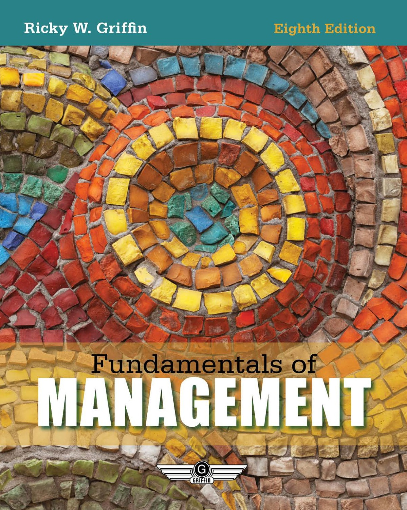

# Fundamentals of Management: Front Matter

<!-- Page 1 -->

<!-- Page 2 -->

> 1

> 2

> 3

> 4

> 5

> *availability varies

> Engaged with you.www.cengage.com

5  REASONSto buy your textbooks and course materials at

SAVINGS: Prices up to 75% off, daily coupons, and free shipping on orders over $25

CHOICE: Multiple format options including textbook, eBook and eChapter rentals

CONVENIENCE: Anytime, anywhere access of eBooks or eChapters via mobile devices

SERVICE: Free eBook access while your text ships, and instant access to online homework products

STUDY TOOLS: Study tools* for your text, plus writing, research, career and job search resources

Find your course materials and start saving at:

www.cengagebrain.com

Source Code: 14M-AA0107

<!-- Page 3 -->

Fundamentals ofMANAGEMENT

Eighth Edition

Ricky W. Griffin

Australia • Brazil • Japan • Korea • Mexico • Singapore • Spain • United Kingdom • United States

<!-- Page 4 -->

Important Notice: Media content referenced within the product description or the product text may not be available in the eBook version.

<!-- Page 5 -->

© 2016, 2011 Cengage Learning

Fundamentals of Management,Eighth EditionRicky W. Griffin

WCN: 02-200-203

ALL RIGHTS RESERVED. No part of this work covered by the copyrightherein may be reproduced, transmitted, stored, or used in any form or byany means graphic, electronic, or mechanical, including but not limitedto photocopying, recording, scanning, digitizing, taping, web distribution,information networks, or information storage and retrieval systems,except as permitted under Section 107 or 108 of the 1976 United StatesCopyright Act, without the prior written permission of the publisher.

Vice President, General Manager, SocialScience & Qualitative Business: ErinJoyner

Product Director: Michael Schenk

Senior Product Manager: Scott Person

Senior Content Developer: Julia Chase

For product information and technology assistance, contact us atCengage Learning Customer & Sales Support, 1-800-354-9706

Senior Product Assistant: Brian Pierce

Brand Manager: Robin LeFevre

For permission to use material from this text or product,submit all requests online at www.cengage.com/permissionsFurther permissions questions can be emailed topermissionrequest@cengage.com

Marketing Manager: Emily Horowitz

Marketing Director: Kristen Hurd

Marketing Coordinator: Christopher Walz

Media Developer: Sally Neiman

Library of Congress Control Number: 2014937601

Manufacturing Planner: Ron Montgomery

ISBN: 978-1-285-84904-1

Art and Cover Direction, ProductionManagement, and Composition:Integra Software Services Pvt. Ltd.

Cengage Learning20 Channel Center StreetBoston, MA 02210USA

Design elements: © iStockphoto.com/BrianAJackson; © iStockphoto.com/bo1982; © iStockphoto.com/adventtrand © iStockphoto.com/trullyinspired

Cengage Learning is a leading provider of customized learningsolutions with office locations around the globe, including Singapore,the United Kingdom, Australia, Mexico, Brazil, and Japan. Locate yourlocal office at: www.cengage.com/global

Intellectual PropertyAnalyst: Diane GarrityProject Manager: Sarah Shainwald

Cengage Learning products are represented in Canada byNelson Education, Ltd.

To learn more about Cengage Learning Solutions, visitwww.cengage.com.

Purchase any of our products at your local college store or at ourpreferred online store www.cengagebrain.com

Printed in CanadaPrint Number: 01Print Year: 2015

<!-- Page 6 -->

For Matt and Lura—Thank you for what you add to our family.

<!-- Page 7 -->

<!-- Page 8 -->

> v

## Brief Contents

PrefacexxiAcknowledgmentsxxv

### PART 1An Introduction to Management

CHAPTER1Understanding the Manager’s Job1

CHAPTER2The Environments of Organizations and Managers34

### PART 2Planning

CHAPTER3Planning and Strategic Management65

CHAPTER4Managing Decision Making98

CHAPTER5Entrepreneurship and New Venture Management127

### PART 3Organizing

CHAPTER6Organization Structure and Design159

CHAPTER7Organization Change and Innovation191

CHAPTER8Managing Human Resources in Organizations223

### PART 4Leading

CHAPTER9Basic Elements of Individual Behavior in Organizations260

CHAPTER 10Managing Employee Motivation and Performance292

CHAPTER 11Leadership and Influence Processes326

CHAPTER 12Communication in Organizations361

CHAPTER 13Managing Work Groups and Teams391

### PART 5Controlling

CHAPTER 14Basic Elements of Control424

CHAPTER 15Managing Operations, Quality, and Productivity456

Appendix: Interpretations of Skills Self-Assessment Instruments490Name Index502

Organization and Product Index505Subject Index510

<!-- Page 9 -->

> vi

## Contents

Preface . . . . . . . . . . . . . . . . . . . . . . . . . . . . . . . . . . . . . . . . . . . . . . . . . . . . . . . . . . . . . . . . . xxiAcknowledgments . . . . . . . . . . . . . . . . . . . . . . . . . . . . . . . . . . . . . . . . . . . . . . . . . . . . . . . .xxv

### PART 1An Introduction to Management

C H A P T E R 1Understanding the Manager’s Job . . . . . . . . . . . . . . . . . . . . . . . . . . . . . . . . . . . . . . . . . . . . . . 1

An Introduction to Management3Kinds of Managers4Levels of Management,4 • Managing in Different Areas of the Organization,5Basic Management Functions6Planning and Decision Making,6 • Organizing,6 • Leading,7 • Controlling,7Fundamental Management Skills7

Toward Zero Waste8

Technical Skills,8 • Interpersonal Skills,8 • Conceptual Skills,8 • DiagnosticSkills,9 • Communication Skills,9 • Decision-Making Skills,9 • Time ManagementSkills,9The Science and the Art of Management9The Science of Management,9 • The Art of Management,10

The Evolution of Management10The Importance of Theory and History11Why Theory?,11 • Why History?,11The Historical Context of Management11The Classical Management Perspective12Scientific Management,12 • Administrative Management,13 • The ClassicalManagement Perspective Today,14The Behavioral Management Perspective14The Hawthorne Studies,15 • The Human Relations Movement,16 • ContemporaryBehavioral Science in Management,17 • The Behavioral Management PerspectiveToday,17The Quantitative Management Perspective17Management Science,17 • Operations Management,18 • The Quantitative ManagementPerspective Today,19

Contemporary Management Perspectives19The Systems Perspective19The Contingency Perspective20Contemporary Management Issues and Challenges21Contemporary Applied Perspectives,21 • Contemporary Management Challenges,21

The Rise of the Service Sector23

Summary of Learning Outcomes and Key Points 24Discussion Questions 25Building Effective Time Management Skills 26Building Effective Decision-Making Skills 26

<!-- Page 10 -->

Contentsvii

Skills Self-Assessment Instrument 27Experiential Exercise 28Management at Work29You Make the Call: Reed Hastings Doesn’t Like Standing Still 31Endnotes 31

C H A P T E R 2The Environments of Organizations and Managers . . . . . . . . . . . . . . . . . . . . . . . . . . . . . 34

The Organization’s Environments37The General Environment37The Economic Dimension,37 • The Technological Dimension,37

What Goes Around …38The Political–Legal Dimension,38The Task Environment39Competitors,39 • Customers,39 • Supplier,39 • Regulators,40 • StrategicPartners,40The Internal Environment41Owners,41 • Board of Directors,42 • Employees,42 • Physical WorkEnvironment,42

The Ethical and Social Environment of Management43Individual Ethics in Organizations43Managerial Ethics,43 • Managing Ethical Behavior,44Emerging Ethical Issues45Ethical Leadership,45 • Corporate Governance,46 • Ethics and InformationTechnology,46Social Responsibility in Organizations47Arguments for Social Responsibility,47 • Arguments Against Social Responsibility,47Managing Social Responsibility48Formal Organizational Dimensions,48

Greening the Business Environment: HP Keeps Itself in the Recycling Loop49Informal Organizational Dimensions,50

The International Environment of Management51Trends in International Business51Levels of International Business Activity51Exporting and Importing,52 • Licensing,52 • Strategic Alliances,53 • DirectInvestment,53The Context of International Business53The Cultural Environment,53 • Controls on International Trade,54 • EconomicCommunities,55 • The Role of the GATT and WTO,56

The Organization’s Culture56The Importance of Organizational Culture56Determinants of Organizational Culture57Managing Organizational Culture57

Summary of Learning Outcomes and Key Points 58Discussion Questions 58Building Effective Interpersonal Skills 59Building Effective Communication Skills 60Skills Self-Assessment Instrument 60Experiential Exercise 61Management at Work61You Make the Call: Social Entrepreneurship at Its Finest 63Endnotes 63

<!-- Page 11 -->

> viiiContents

### PART 2Planning

C H A P T E R 3Planning and Strategic Management . . . . . . . . . . . . . . . . . . . . . . . . . . . . . . . . . . . . . . . . . . 65

Planning and Organizational Goals67Organizational Goals68Purposes of Goals,68 • Kinds of Goals,69Kinds of Organizational Plans69Strategic Plans,69 • Tactical Plans,69

Setting a New Direction for General Motors70Operational Plans,70

The Nature of Strategic Management71The Components of Strategy71Types of Strategic Alternatives72

Using SWOT Analysis to Formulate Strategy72Evaluating an Organization’s Strengths72Evaluating an Organization’s Weaknesses74Evaluating an Organization’s Opportunities and Threats74

Formulating Business-Level Strategies74Porter’s Generic Strategies74Strategies Based on the Product Life Cycle75

Formulating Corporate-Level Strategies77Single-Product Strategy77Related Diversification77Unrelated Diversification78Managing Diversification,79 • BCG Matrix,79

The Little-White-Lie Strategy80

GE Business Screen82

Tactical Planning83Developing Tactical Plans83Executing Tactical Plans84

Operational Planning84Single-Use Plans85Programs,85 • Projects,85Standing Plans85Policies,86 • Standard Operating Procedures,86 • Rules and Regulations,86Contingency Planning and Crisis Management86

Summary of Learning Outcomes and Key Points 89Discussion Questions 90Building Effective Decision-Making Skills 91Building Effective Communication and Interpersonal Skills 91Skills Self-Assessment Instrument 92Experiential Exercise 93Management at Work94You Make the Call: Google’s Strategy for Dominance 96Endnotes 96

C H A P T E R 4Managing Decision Making . . . . . . . . . . . . . . . . . . . . . . . . . . . . . . . . . . . . . . . . . . . . . . . . . . . 98

The Nature of Decision Making100

<!-- Page 12 -->

Contentsix

Decision Making Defined100Types of Decisions101Decision-Making Conditions102Decision Making Under Certainty,102 • Decision Making Under Risk,102 • DecisionMaking Under Uncertainty,103

The Wide World of Risk104

Rational Perspectives on Decision Making104The Classical Model of Decision Making104Steps in Rational Decision Making105Recognizing and Defining the Decision Situation,105 • IdentifyingAlternatives,105 • Evaluating Alternatives,107 • Selecting the BestAlternative,108 • Implementing the Chosen Alternative,108 • Following Up andEvaluating the Results,109Evidence-Based Management110

Behavioral Aspects of Decision Making111The Administrative Model111Political Forces in Decision Making112Intuition and Escalation of Commitment113Intuition,113 • Escalation of Commitment,113

A Bad Decision at Wesabe114

Risk Propensity and Decision Making115Ethics and Decision Making115

Group and Team Decision Making in Organizations116Forms of Group and Team Decision Making116Interacting Groups or Teams,116 • Delphi Groups,116 • Nominal Groups,117Advantages of Group and Team Decision Making117Disadvantages of Group and Team Decision Making118Managing Group and Team Decision-Making Processes118

Summary of Learning Outcomes and Key Points 119Discussion Questions 119Building Effective Conceptual Skills 120Building Effective Technical Skills 120Skills Self-Assessment 121Experiential Exercise 121Management at Work122You Make the Call: The Embargo Grinds On 124Endnotes 124

C H A P T E R 5Entrepreneurship and New Venture Management . . . . . . . . . . . . . . . . . . . . . . . . . . . . . 127

The Nature of Entrepreneurship129

The Role of Entrepreneurship in Society129Job Creation131Innovation132Importance to Big Business133

Strategy for Entrepreneurial Organizations133Choosing an Industry133Services,133 • Retailing,134

<!-- Page 13 -->

> xContents

A New Model for Going Green135

Construction,136 • Finance and Insurance,136 • Wholesaling,137• Transportation,137 • Manufacturing,137Emphasizing Distinctive Competencies139Identifying Niches in Established Markets,139 • Identifying New Markets,139

Samuel Adams Makes Headway140

First-Mover Advantages,141Writing a Business Plan141Entrepreneurship and International Management141

Structure of Entrepreneurial Organizations142Starting the New Business142Buying an Existing Business,142 • Starting from Scratch,143Financing the New Business143Personal Resources,143 • Strategic Alliances,144 • Lenders,144 • Venture CapitalCompanies,144 • Small-Business Investment Companies,144 • SBA FinancialPrograms,145Sources of Management Advice145Advisory Boards,145 • Management Consultants,145 • The Small BusinessAdministration,146 • Networking,147Franchising147

The Performance of Entrepreneurial Organizations148Trends in Small-Business Start-Ups149Emergence of E-Commerce,149 • Crossovers from Big Business,150 • Opportunities forMinorities and Women,150 • Better Survival Rates,151Reasons for Failure151Reasons for Success151

Summary of Learning Outcomes and Key Points 152Discussion Questions 153Building Effective Diagnostic Skills 153Building Effective Conceptual Skills 154Skills Self-Assessment Instrument 154Experiential Exercise 155Management at Work155You Make the Call: Putting the Greek into Yogurt 157Endnotes 157

### PART 3Organizing

C H A P T E R 6Organization Structure and Design. . . . . . . . . . . . . . . . . . . . . . . . . . . . . . . . . . . . . . . . . . . 159

The Basic Elements Of Organizing162Job Specialization162Benefits and Limitations of Specialization,162 • Alternatives to Specialization,162Grouping Jobs: Departmentalization164Functional Departmentalization,165 • Product Departmentalization,166 • CustomerDepartmentalization,166 • Location Departmentalization,166Establishing Reporting Relationships166Chain of Command,166 • Span of Management,167 • Tall Versus FlatOrganizations,167

<!-- Page 14 -->

Contentsxi

Distributing Authority167The Delegation Process,167

Delayering as a Defense Mechanism168

Decentralization and Centralization,169

A Panel of Your Peers170

Coordinating Activities170The Need for Coordination,171 • Structural Coordination Techniques,171 • ElectronicCoordination,172

The Bureaucratic Model of Organization Design172

Situational Influences on Organization Design173Core Technology174Environment175Organizational Size and Life Cycle176

Basic Forms of Organization Design177Functional (U-Form) Design177Conglomerate (H-Form) Design178Divisional (M-Form) Design179Matrix Design179Hybrid Designs181

Emerging Issues in Organization Design182The Team Organization182The Virtual Organization182The Learning Organization182

Summary of Learning Outcomes and Key Points 183Discussion Questions 184Building Effective Conceptual Skills 184Building Effective Diagnostic Skills 185Skills Self-Assessment Instrument 185Experiential Exercise 186Management at Work187You Make the Call: Authority & Function at A&F189Endnotes 189

C H A P T E R 7Organization Change and Innovation . . . . . . . . . . . . . . . . . . . . . . . . . . . . . . . . . . . . . . . . 191

The Nature of Organization Change194Forces for Change194External Forces,194 • Internal Forces,195Planned Versus Reactive Change195

Managing Change in Organizations195Steps in the Change Process196The Lewin Model,196 • A Comprehensive Approach to Change,196Understanding Resistance to Change197Uncertainty,197 • Threatened Self-Interests,198 • Different Perceptions,198 • Feelingsof Loss,198Overcoming Resistance to Change198Participation,198

Charting a “New” Old Course199

Education and Communication,200 • Facilitation,200 • Force-Field Analysis,201

<!-- Page 15 -->

> xiiContents

Areas of Organization Change201Changing Organization Structure and Design201Changing Technology and Operations202Changing People, Attitudes, and Behaviors203Changing Business Processes204The Need for Business Process Change,204

To Offshore or Not to Offshore205

Approaches to Business Process Change,206Organization Development207OD Assumptions,207 • OD Techniques,207 • The Effectiveness of OD,208

Organizational Innovation209The Innovation Process209Innovation Development,209 • Innovation Application,210 • ApplicationLaunch,210 • Application Growth,210 • Innovation Maturity,210 • InnovationDecline,210Forms of Innovation210Radical Versus Incremental Innovations,211 • Technical Versus ManagerialInnovations,211 • Product Versus Process Innovations,211The Failure to Innovate212Lack of Resources,212 • Failure to Recognize Opportunities,212 • Resistance toChange,212 • Promoting Innovation in Organizations,213 • The RewardSystem,213 • Organization Culture,213 • Intrapreneurship in LargerOrganizations,213

Summary of Learning Outcomes and Key Points 215Discussion Questions 215Building Effective Decision-Making Skills 216Building Effective Diagnostic Skills 216Skills Self-Assessment Instrument 217Experiential Exercise 218Management at Work219You Make the Call: Cultivating Innovation at IKEA 221Endnotes 221

C H A P T E R 8Managing Human Resources in Organizations . . . . . . . . . . . . . . . . . . . . . . . . . . . . . . . . 223

The Environmental Context of HRM226The Strategic Importance of HRM226The Legal Environment of HRM227Equal Employment Opportunity Title VII of the Civil Rights Act of1964,228 • Compensation and Benefits,228Labor Relations229Health and Safety,230 • Emerging Legal Issues,230

Attracting Human Resources230Human Resource Planning230Job Analysis,230 • Forecasting Human Resource Demand and Supply,231 • MatchingHuman Resource Supply and Demand,232Recruiting Human Resources232Selecting Human Resources233Application Blanks,233 • Tests,234 • Interviews,234 • AssessmentCenters,234 • Other Techniques,234

<!-- Page 16 -->

Contentsxiii

Developing Human Resources234Training and Development235Assessing Training Needs,235 • Common Training Methods,235 • Evaluation ofTraining,235

Darden Invests in Employee Development236

Performance Appraisal237Common Appraisal Methods,237 • Errors in Performance Appraisal,238Performance Feedback239

Maintaining Human Resources240Determining Compensation240

Holding True at Nucor Steel241

Wage-Level Decision,242 • Wage Structure Decision,242 • Individual WageDecisions,243Determining Benefits243

Managing Workforce Diversity244The Meaning of Diversity244The Impact of Diversity244Diversity as a Competitive Advantage,244 • Diversity as a Source of Conflict,244Managing Diversity in Organizations245Individual Strategies,245 • Organizational Approaches,245

Managing Labor Relations246How Employees Form Unions246Collective Bargaining248

New Challenges in the Changing Workplace249Managing Knowledge Workers249The Nature of Knowledge Work,249 • Knowledge Worker Management and LaborMarkets,249Contingent and Temporary Workers250Trends in Contingent and Temporary Employment,250 • Managing Contingent andTemporary Workers,250

Summary of Learning Outcomes and Key Points 251Discussion Questions 252Building Effective Decision-Making Skills 252Building Effective Technical Skills 253Skills Self-Assessment Instrument 254Experiential Exercise 255Management at Work255You Make the Call: No Company for Old-Fashioned Management 257Endnotes 257

### PART 4Leading

C H A P T E R 9Basic Elements of Individual Behavior in Organizations . . . . . . . . . . . . . . . . . . . . . . . 260

Understanding Individuals in Organizations262The Psychological Contract262The Person–Job Fit263The Nature of Individual Differences264

Personality and Individual Behavior264

<!-- Page 17 -->

> xivContents

The “Big Five” Personality Traits264The Myers–Briggs Framework266Other Personality Traits at Work267Emotional Intelligence268

Attitudes and Individual Behavior269Work-Related Attitudes269Job Satisfaction or Dissatisfaction,269

Toss It, or Recycle It?270

Organizational Commitment,271Affect and Mood in Organizations271

Perception and Individual Behavior272Basic Perceptual Processes272Selective Perception,272 • Stereotyping,272Perception and Attribution273

Stress and Individual Behavior273Causes and Consequences of Stress275Causes of Stress,275 • Consequences of Stress,276Managing Stress276

When Stress Becomes Too Tough to Handle277

Creativity in Organizations279The Creative Individual279Background Experiences and Creativity,279 • Personal Traits andCreativity,280 • Cognitive Abilities and Creativity,280The Creative Process280Preparation,280 • Incubation,280 • Insight,281 • Verification,281Enhancing Creativity in Organizations281

Types of Workplace Behavior282Performance Behaviors282Withdrawal Behaviors282Organizational Citizenship283Dysfunctional Behaviors283

Summary of Learning Outcomes and Key Points 284Discussion Questions 285Building Effective Interpersonal Skills 285Building Effective Time Management Skills 286Skills Self-Assessment Instrument 286Experiential Exercise 287Management at Work287You Make the Call: Putting In the Hours 289Endnotes 289

C H A P T E R 1 0Managing Employee Motivation and Performance . . . . . . . . . . . . . . . . . . . . . . . . . . . . . 292

The Nature of Motivation294

Content Perspectives on Motivation295The Needs Hierarchy Approach296The Two-Factor Theory297Individual Human Needs298

Process Perspectives on Motivation299

<!-- Page 18 -->

Contentsxv

Expectancy Theory299Effort-to-Performance Expectancy,300 • Performance-to-Outcome Expectancy,300• Outcomes and Valences,300 • The Porter–Lawler Extension,301Equity Theory302Goal-Setting Theory302Goal Difficulty,303 • Goal Specificity,303

Reinforcement Perspectives on Motivation304Kinds of Reinforcement in Organizations304

To Reward or To Punish? … That Is the Question305

Providing Reinforcement in Organizations306

Popular Motivational Strategies307Empowerment and Participation307Alternative Forms of Work Arrangements307

Service with a Smile308

Variable Work Schedules,309 • Flexible Work Schedules,309 • JobSharing,309 • Telecommuting,310

Using Reward Systems to Motivate Performance310Merit Reward Systems311Incentive Reward Systems311Incentive Pay Plans,311 • Other Forms of Incentive,312Team and Group Incentive Reward Systems312Common Team and Group Reward Systems313Other Types of Team and Group Rewards,313Executive Compensation314Standard Forms of Executive Compensation,314 • Special Forms of ExecutiveCompensation,314 • Criticisms of Executive Compensation,315New Approaches to Performance-Based Rewards316

Summary of Learning Outcomes and Key Points 316Discussion Questions 317Building Effective Interpersonal and Communication Skills 318Building Effective Decision-Making Skills 318Skills Self-Assessment Instrument 319Experiential Exercise 319Management at Work321You Make the Call: Motivating the Whole Person 323Endnotes 323

C H A P T E R 1 1Leadership and Influence Processes. . . . . . . . . . . . . . . . . . . . . . . . . . . . . . . . . . . . . . . . . . . 326

The Nature of Leadership328The Meaning of Leadership329Leadership and Management329Leadership and Power329Legitimate Power,329 • Reward Power,330 • Coercive Power,331 • ReferentPower,331 • Expert Power,331

Generic Approaches to Leadership331Leadership Traits331Leadership Behaviors332Michigan Studies,332 • Ohio State Studies,332 • Managerial Grid,333

Situational Approaches to Leadership334

<!-- Page 19 -->

> xviContents

Leadership Tips for Tough Times335

LPC Theory336Favorableness of the Situation,337 • Favorableness and Leader Style,337 • Flexibility ofLeader Style,338Path-Goal Theory338Leader Behavior,339 • Situational Factors,339Vroom’s Decision Tree Approach340Basic Premises,340 • Decision-Making Styles,342 • Evaluation and Implications,343The LMX Approach343

Related Approaches to Leadership344Substitutes for Leadership344Charismatic Leadership344Transformational Leadership345

Emerging Approaches to Leadership346Strategic Leadership346Cross-Cultural Leadership346

Diversity Still Lagging in the Boardroom347

Ethical Leadership348

Political Behavior in Organizations348Common Political Behaviors349Impression Management349Managing Political Behavior350

Summary of Learning Outcomes and Key Points 351Discussion Questions 352Building Effective Diagnostic Skills 352Building Effective Interpersonal Skills 353Skills Self-Assessment Instrument 354Experiential Exercise 355Management at Work356You Make the Call: When to Stand on Your Head and Other Tips from the Top 357Endnotes 358

C H A P T E R 1 2Communication in Organizations . . . . . . . . . . . . . . . . . . . . . . . . . . . . . . . . . . . . . . . . . . . . 361

Communication and the Manager’s Job364A Definition of Communication364Characteristics of Useful Information365Accurate,365 • Timely,365 • Complete,365 • Relevant,366The Communication Process366

Forms of Communication in Organizations367Interpersonal Communication367Oral Communication,367 • Written Communication,367 • Choosing the RightForm,368Communication in Networks and Work Teams368Organizational Communication369Vertical Communication,369 • Horizontal Communication,370Digital Communication371Information Systems,371

The Brutally-Honest-Opinion Business372

Personal Digital Technology,374

<!-- Page 20 -->

Contentsxvii

Informal Communication in Organizations375The Grapevine375Management by Wandering Around377Nonverbal Communication377

Say It with a Smile378

Managing Organizational Communication379Barriers to Communication379Individual Barriers,379 • Organizational Barriers,380Improving Communication Effectiveness381Individual Skills,382 • Organizational Skills,383

Summary of Learning Outcomes and Key Points 383Discussion Questions 384Building Effective Technical Skills 385Building Effective Interpersonal Skills 385Skills Self-Assessment Instrument 386Experiential Exercise 387Management at Work387You Make the Call: “Que Pasa in the Ad Agency?” 389Endnotes 389

C H A P T E R 1 3Managing Work Groups and Teams . . . . . . . . . . . . . . . . . . . . . . . . . . . . . . . . . . . . . . . . . . 391

Groups and Teams in Organizations394Types of Groups and Teams394Functional Groups,394 • Informal or Interest Groups,394 • Task Groups,395

Using Customer-Created Groups for Competitive Advantage396

Why People Join Groups and Teams398Interpersonal Attraction,399 • Group Activities,399 • Group Goals,399 • NeedSatisfaction,399 • Instrumental Benefits,400Stages of Group and Team Development400

Characteristics of Groups and Teams402Role Structures402Role Ambiguity,402 • Role Conflict,403 • Role Overload,403

Measuring Carbon Footprints404

Behavioral Norms405Norm Generalization,406 • Norm Variation,406 • Norm Conformity,406Cohesiveness407Factors That Increase Cohesiveness,407 • Factors That ReduceCohesiveness,408 • Consequences of Cohesiveness,408Formal and Informal Leadership409

Interpersonal and Intergroup Conflict409The Nature of Conflict409Causes of Conflict410Interpersonal Conflict,410 • Intergroup Conflict,411 • Conflict Between Organizationand Environment,412

Managing Conflict in Organizations412Stimulating Conflict413Controlling Conflict413Resolving and Eliminating Conflict414Negotiation414

<!-- Page 21 -->

> xviiiContents

Summary of Learning Outcomes and Key Points 416Discussion Questions 417Building Effective Conceptual Skills 417Building Effective Communication Skills 418Skills Self-Assessment Instrument 418Experiential Exercise 419Management at Work419You Make the Call: Managing by Clowning Around 421Endnotes 421

### PART 5Controlling

C H A P T E R 1 4Basic Elements of Control . . . . . . . . . . . . . . . . . . . . . . . . . . . . . . . . . . . . . . . . . . . . . . . . . . . 424

The Nature of Control426The Purpose of Control427Adapting to Environmental Change,427 • Limiting the Accumulation ofError,427 • Coping with Organizational Complexity,428 • Minimizing Costs,428Types of Control428

Engineering Time429

Areas of Control,430 • Levels of Control,430 • Responsibilities for Control,431Steps in the Control Process432Establishing Standards,432 • Measuring Performance,433 • Comparing PerformanceAgainst Standards,433 • Considering Corrective Action,434

Operations Control434Preliminary Control434Screening Control435Postaction Control436

Financial Control436Budgetary Control436Types of Budgets,437 • Developing Budgets,438 • Strengths and Weaknesses ofBudgeting,439Other Tools for Financial Control440Financial Statements,440 • Ratio Analysis,440 • Financial Audits,440

Structural Control441Bureaucratic Control442Decentralized Control443

Strategic Control443

Managing Control in Organizations444Characteristics of Effective Control444Integration with Planning,444 • Flexibility,444

Balancing Control with Fun445

Accuracy,445 • Timeliness,446 • Objectivity,446Resistance to Control446Overcontrol,446 • Inappropriate Focus,447 • Rewards for Inefficiency,447 • Too MuchAccountability,447Overcoming Resistance to Control447Encourage Employee Participation,447 • Develop Verification Procedures,448

<!-- Page 22 -->

Contentsxix

Summary of Learning Outcomes and Key Points 448Discussion Questions 449Building Effective Time Management Skills 449Building Effective Technical Skills 450Skills Self-Assessment Instrument 451Experiential Exercise 451Management at Work453You Make the Call: Shifting Gears in the Auto Industry 454Endnotes 455

C H A P T E R 1 5Managing Operations, Quality, and Productivity . . . . . . . . . . . . . . . . . . . . . . . . . . . . . . 456

The Nature of Operations Management459The Importance of Operations459Manufacturing and Production Operations460Service Operations460The Role of Operations in Organizational Strategy461

Designing Operations Systems461Determining the Product–Service Mix462Capacity Decisions462Facilities Decisions462Location,462 • Layout,463

How to Get2 a Human464

Organizational Technologies465Manufacturing Technology466Automation,466 • Computer-Assisted Manufacturing,467 • Robotics,468Service Technology468

Implementing Operations Systems Through Supply Chain Management469Operations Management as Control469

Combining Technology and Artistry470Purchasing Management471Inventory Management472

Managing Total Quality473The Meaning of Quality473The Importance of Quality474Competition,474 • Productivity,474 • Costs,475Total Quality Management475Strategic Commitment,475 • Employee Involvement,476Technology,476 • Materials,476 • Methods,476TQM Tools and Techniques476Value-Added Analysis,476 • Benchmarking,476 • Outsourcing,477 • Reducing CycleTime,477 • ISO 9000:2000 and ISO 14000,478 • Statistical QualityControl,478 • Six Sigma,478

Managing Productivity478The Meaning of Productivity479Levels of Productivity,479 • Forms of Productivity,479The Importance of Productivity479Productivity Trends480Improving Productivity481Improving Operations,481 • Increasing Employee Involvement,482

<!-- Page 23 -->

> xxContents

Summary of Learning Outcomes and Key Points 482Discussion Questions 483Building Effective Communication Skills 484Building Effective Diagnostic Skills 484Skills Self-Assessment Instrument 485Experiential Exercise 485Management at Work486You Make the Call: Orchestrating Outcomes 488Endnotes 488Appendix: Interpretations of Skills Self-Assessment Instruments. . . . . . . . . . . . . . . . . . 490Name Index. . . . . . . . . . . . . . . . . . . . . . . . . . . . . . . . . . . . . . . . . . . . . . . . . . . . . . . . . . . . . . . . . 502Organization and Product Index . . . . . . . . . . . . . . . . . . . . . . . . . . . . . . . . . . . . . . . . . . . . . . 505Subject Index. . . . . . . . . . . . . . . . . . . . . . . . . . . . . . . . . . . . . . . . . . . . . . . . . . . . . . . . . . . . . . . . 510

<!-- Page 24 -->

> xxi

## Preface

Literally hundreds of books have been written for introductory management courses. Asthe body of material comprising the theory, research, and practice of management hasgrown and expanded, textbook authors have continued to mirror this expansion of mate-rial in their books. Writers have understood the importance of adding new materialabout traditional topics, such as planning and organizing, while simultaneously addingcoverage of emerging newer topics, such as sustainability, ethics, and social media. As aby-product of this trend, our general survey textbooks have grown longer and longer,making it increasingly difficult to cover all the material in one course.Another trend in management education is a focus on teaching in a broader context—that is, introductory management courses are increasingly being taught with lessemphasis on theory alone and more emphasis on application of concepts. Teachingstudents how to apply management concepts successfully often involves focusingmore on skills development and the human side of the organization. This trendrequires that textbooks cover theoretical concepts within a flexible framework thatenables instructors to make use of interactive tools such as case studies, exercises, andprojects. It also dictates that a text be as relevant to students as possible. Hence, whilethis book draws examples and cases from older large firms like Ford, IBM, and Nissan,it also makes extensive use of newer firms such as Google, Netflix, Facebook, Star-bucks, Urban Outfitters, and others.This textbook represents a synthesis of these trends toward a more manageable andpractical approach. By combining concise text discussion, standard pedagogical tools,lively and current content, an emphasis on organizational behavior, and exciting skillsdevelopment material, Fundamentals of Management answers the need for a newapproach to management education. This book provides almost limitless flexibility, asolid foundation of knowledge-based material, and an action-oriented learning dimen-sion unique in the field. Indeed, over half a million students were introduced to thefield of management using the first seven editions of this book. This eighth edition buildssolidly on the successes of the earlier editions.

## ORGANIZATION OF THE BOOK

Most management instructors today organize their course around the traditional man-agement functions of planning, organizing, leading, and controlling. Fundamentals ofManagement uses these functions as its organizing framework. The book consists offive parts, with fifteen chapters.Part One introduces management through two chapters. Chapter 1 provides a basicoverview of the management process in organizations, and Chapter 2 introduces studentsto the environment of management. Part Two covers the first basic management func-tion, planning. Chapter 3 introduces the fundamental concepts of planning and discussesstrategic management. Managerial decision making is the topic of Chapter 4. Finally,Chapter 5 covers entrepreneurship and the management of new ventures.The second basic management function, organizing, is the subject of Part Three. InChapter 6, the fundamental concepts of organization structure and design are introduced

<!-- Page 25 -->

> xxiiPreface

and discussed. Chapter 7 explores organization change and organizational innovation.Chapter 8 is devoted to the management of human resources.Many instructors and managers believe that the third basic management function,leading, is especially important in contemporary organizations. Thus, Part Four consistsof five chapters devoted to this management function. Basic concepts and processes asso-ciated with individual behavior are introduced and discussed in Chapter 9. Employeemotivation is the subject of Chapter 10. Chapter 11 examines leadership and influenceprocesses in organizations. Communication in organizations is the topic of Chapter 12.The management of groups and teams is covered in Chapter 13.The fourth management function, controlling, is the subject of Part Five. Chapter 14introduces the fundamental concepts and issues associated with management of the con-trol process. A special area of control today, managing for total quality, is discussed inChapter 15.

## SKILLS-FOCUSED PEDAGOGICAL FEATURES

Both the overarching framework and streamlined topical coverage make it possible toaddress new dimensions of management education without creating a book so long thatit is unwieldy. Specifically, each chapter is followed by an exciting set of skills-basedexercises and related activities. These resources have been created to bring an activeand a behavioral orientation to management education by requiring students to solveproblems, make decisions, respond to situations, and work in groups. In short, thesematerials simulate many of the day-to-day challenges and opportunities that real man-agers face.Among these skills-based exercises are two different Building Effective Skills featuresorganized around the set of basic management skills introduced in Chapter 1. The SkillsSelf-Assessment Instrument exercise helps readers learn something about their ownapproach to management. Feedback for the Self-Assessment Instruments can be foundin the Appendix. Finally, an Experiential Exercise provides additional action-orientedlearning opportunities, usually in a group setting.New to the eighth edition, each chapter also contains interesting boxed features, two perchapter, centered around sustainability, leadership, the service sector, and managingduring tough times. These features depart briefly from the flow of the chapter to highlightor extend especially interesting or emerging points and issues related to boxed feature titles.In addition to the end-of-chapter exercises, every chapter includes important standardpedagogy: learning objectives, a chapter outline, an opening incident, key terms, a sum-mary of key points, questions for review, questions for analysis, and an end-of-chaptercase with questions.

## CHANGES TO THE EIGHTH EDITION

The eighth edition of Fundamentals of Management retains the same basic structure andformat as the previous edition. However, within that framework the content of the bookhas been thoroughly revised and updated. The following changes are illustrative of thenew material:

(1)New topical coverage related to both domestic and global economic conditions isincluded. The book also places greater emphasis on the services sector of the econ-omy. Coverage of the economic impact of unrest in the Middle East and HurricaneSandy has also been added. Moreover, all data regarding international business

<!-- Page 26 -->

Prefacexxiii

activity, entrepreneurship and small businesses, and workforce diversity have beenupdated to the most current figures available.(2)Several new management techniques are also included in this edition. Examplesinclude the tiered workforce and evidence-based management. These and othernew techniques are discussed in several places in the book.(3)The latest research findings regarding globalization, strategic management,organizing, motivation, leadership, and control have been incorporated intothe text and referenced at the end of the book. Over 150 new articles andbooks are cited.(4)Virtually all of the cases and boxed inserts are new to this edition of Fundamentalsof Management, while the few retained from earlier editions have been updated asneeded. They reflect a wide variety of organizations and illustrate both successfuland less successful practices and decisions.(5)As noted earlier, this book features a rich and diverse array of end-of-chaptermaterials to facilitate both learning and skill development. For this edition, a sub-stantial portion of this material has been replaced or substantially revised.

## SUPPLEMENTS

### Instructor Supplements

Instructor’s Resource Companion Website. Find all of the helpful, time-saving teachingresources you need to create a dynamic, interactive management course. The Instructor’sWebsite includes the Instructor’s Manual (IM) files, Testing files, PowerPoint slides, anda DVD Guide to help you most effectively use this edition’s accompanying video cases.Updated content throughout the IM and PowerPoint slides reflects the latest edition ofthe text. Almost one-third of the Test Bank questions are new. New to this edition, weare now providing our Test Bank in Cognero. Cengage Learning Testing Powered byCognero is a flexible, online system that allows you to:

•author, edit, and manage test bank content•create multiple test versions in an instant•deliver tests from your LMS, your classroom, or wherever you want

Cengage Learning Testing Powered by Cognero works on any operating system orbrowser.

•No special installs or downloads are needed.•Create tests from school, home, the coffee shop—anywhere with Internet access.

What will you find?

•Simplicity at every step. A desktop-inspired interface features drop-down menus andfamiliar, intuitive tools that take you through content creation and managementwith ease.•Full-featured test generator. Create ideal assessments with your choice of questiontypes. Searchable metadata helps ensure your tests are complete and compliant.•Cross-compatible capability. Import and export content into other systems.

Video Case DVD. Put management in action with this edition’s new video package.All new “On the Job” videos illustrate management concepts at work within familiarcompanies, large and small, giving students an insider’s perspective.

<!-- Page 27 -->

> xxivPreface

### Student SupplementsMindTap™

Students who purchase the MindTap product will enjoy a number of innovative featuresdesigned to enhance their learning experience. The e-book has been enriched with inter-active figures and animated videos that increase comprehension of the most challengingtopics, and the insightful video cases are embedded directly into the end-of-chaptermaterials. At the beginning of each chapter, students will be asked to take a self-assessmentquestionnaire that introduces an important topic and shows how it relates to students’current experience. Students will also have ready access to the assignments chosen by theinstructor, which may include test-prep quizzes, homework questions, Write Experienceessay-writing practice, and experiential exercises (role-play activities and group projectactivities).New to this edition, the role-play activities give students opportunities to practicetheir managerial and communication skills in an online, real-time environment, whilethe group project activities encourage them to take a modern approach to applying keyconcepts using a digital collaborative workspace. By giving them opportunities to collab-orate online, apply course concepts, and create solutions to realistic managementproblems, all of these learning activities are designed to enable students to Engage,Connect, Perform, and Lead—in short, to learn to “Think and Act Like Managers,” withdemonstrable skills in critical thinking, analysis, and much more.Augmenting the entire MindTap experience, robust diagnostic tools powered byKnewton provide students with feedback and personalized study plans based on actualassigned coursework rather than a separate set of quizzes. Using recommendationsprovided by Knewton, students can focus their efforts on the most important conceptsthey need to learn at that moment in time, as well as more effectively prepare forexams. Furthermore, Knewton gives instructors the ability to focus class time on themost relevant material and effectively assist struggling students. Using the MindTapProgress App, instructors can track student proficiency, which will allow them to quicklyreact to where students are in their learning and make the best use of class time. Thiscreates even more opportunities to train students to “Think and Act Like Managers.

<!-- Page 28 -->

> xxv

## Acknowledgments

I would like to acknowledge the many contributions that others have made to this book.My faculty colleagues at Texas A&M University have contributed enormously both tothis book and to my thinking about management education. The fine team of profes-sionals at Cengage Learning has also been instrumental in the success of this book. ErinJoyner, Mike Schenk, Scott Person, Julia Chase, Jennifer Ziegler, Sarah Shainwald, andthe team at Integra Software Services were instrumental in the creation of this edition.Many reviewers have played a critical role in the continuous evolution and improvementof this project. They examined my work in detail and with a critical eye. I would like to tipmy hat to the following reviewers, whose imprint can be found throughout this text:

Joseph Adamo (Cazenovia College), Sally Alkazin (Linfield College), Robert Ash(Santiago Canyon College), Sherryl Berg-Ridenour (DeVry College–Pomona), AlainBroder (Touro College), Murray Brunton (Central Ohio Tech), Sam Chapman (DiabloValley College), Elizabeth Anne Christo-Baker (Terra Community College), Gary Corona(Florida State College–Jacksonville), Dr. Anne Cowden (California State University),Suzanne Crampton (Grand Valley State University), Thomas DeLaughter (University ofFlorida), Anita Dickson (Northampton Community College), Joe Dobson (WesternIllinois University), Michael Dutch (University of Houston), Dale Eesley (University ofNebraska–Omaha), Norb Elbert (Eastern Kentucky University), Teri Elkins (Universityof Houston), Jan Feldbauer (Schoolcraft College), Tamela D. Ferguson (University ofLouisiana at Lafayette), Anne Fiedler (Barry University), Eugene Garaventa (College ofStaten Island), Phillip Gonsher (Johnson Community College), Patricia Green (NassauCommunity College), John Guess (Delgado Community College), Joseph S. Hooker, Jr.(North Greenville College), David Hudson (Spalding University), George W. Jacobs(Middle Tennessee State University), Tim McCabe (Tompkins Cortland CommunityCollege), Garry McDaniel (Franklin University), Lauryn Migenes (University of CentralFlorida), Christopher Neck (Arizona State University), Judy Nixon (University ofTennessee–Chattanooga), Ranjna Patel (Bethune-Cookman College), Lisa Reed (Universityof Portland), Virginia Rich (Caldwell College), Dr. Joan Rivera (Angelo State University),Roberta B. Slater (Pennsylvania College of Technology), Bob Smoot (Hazard CommunityCollege), Howard Stanger (Canisius College), Sheryl A. Stanley (Newman University), RoyStrickland (Ozarks Technical Community College), Mike L. Stutzman (Mt. Mercy Collegeand Kirkwood College), Abe Tawil (Baruch University), Lynn Turner (California PolytechUniversity–Pomona), Barry Van Hook (Arizona State University), Ruth Weatherly(Simpson College), and Mary Williams (Community College of Nevada).

My wife, Glenda, and our children, Dustin, Ashley, Matt, and Lura, are of course duethe greatest thanks. Their love, care, interest, and enthusiasm help sustain me in all that Ido. And my granddaughter, Griffin, brings joy to my life and a smile to my face everytime I think about her.I enthusiastically invite your feedback on this book. If you have any questions, sugges-tions, or issues to discuss, please feel free to contact me. The most efficient way to reachme is through e-mail. My address is rgriffin@tamu.edu.

R.W.G.

<!-- Page 29 -->
