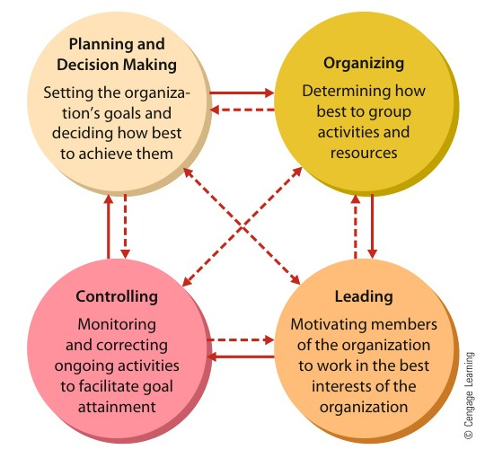
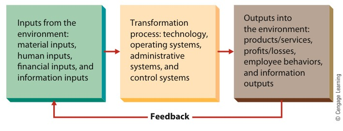

# CHAPTER 1: Understanding the Manager’s Job

<!-- Page 30 -->

CHAPTER 1Understanding theManager’s Job

Learning Outcomes

After studying this chapter, you should be able to:

1Define management, describe the kinds of managers found in organizations, identify and explain thefour basic management functions, describe the fundamental management skills, and comment onmanagement as a science and art.

2Justify the importance of history and theory to managers, and explain the evolution of managementthought through the classical, behavioral, and quantitative perspectives.

3Identify and discuss key contemporary management perspectives represented by the systems andcontingency perspectives, and identify the major challenges and opportunities faced by managerstoday.

Management in Action

Reed Hastings Doesn’t Like Standing Still

#### “Don’t be afraid to change the model.”

—Netflix CEO Reed Hastings

Several years ago, Reed Hastings, a California entrepreneur between start-upventures, incurred a $40 late fee at Blockbuster. “It was six weeks late,” headmits. “I had misplaced the cassette [and] I didn’t want to tell my wife. . .. I wasembarrassed about it.” The next day he dropped off the VHS cassette and paidthe late fee on his way to the gym. As it turns out, his itinerary for the day wasquite opportune: In the middle of his workout, he recalls, “I realized [the gym]had a much better business model. You could pay $30 or $40 a month and workout as little or as much as you wanted.”Thus was born the idea for Netflix. But Hastings knew he needed to startslowly. So, when Netflix was launched in 1997, its only innovations involved theconvenience of ordering movies over the Internet and receiving and returningthem by mail; Netflix merely rented movies for $4 apiece plus $2 for postage(and, yes, it charged late fees). Basically, the customer base consisted of peoplewho wanted to watch movies without having to leave the house. But Hastingsand co-founder Marc Randolph then quickly decided to test a subscription-basedmodel, unlimited rentals by mail for a flat fee and, perhaps most important, nodue dates (and thus no late fees). Current customers were first offered theopportunity to shift from their pay-per-rental plans to subscription plans on afree, trial basis and then given the chance to renew the subscription plan on apaid basis. “We knew it wouldn’t be terrible,” says Hastings, “but we didn’t

<!-- Page 31 -->

Reed Hastings has used a variety of management techniques to build Netflix into an entertainmentpowerhouse.

know if it would be great.” In the first month, however, 80 percent of Netflix userswho’d tried the no-cost subscription plan had renewed on a paid basis.“Having unlimited due dates and no late fees,” said Hastings back in 2003,“has worked in a powerful way and now seems obvious, but at that time, wehad no idea if customers would even build and use an online queue.” The“queue,” as any Netflix user will tell you, is the list of movies that the customerwants to watch. Netflix maintains your queue, follows your online directions inkeeping it up to date, and automatically sends you the next movie you wanteach time you send one back.The essence of queuing—and of the Netflix business model—is clearlyconvenience. Although the ability to enhance customer convenience, even whencombined with cost savings, often gives a company a competitive advantage inits industry, it doesn’t always have the industry-wide effect that it’s had in thecase of Netflix. Not only did the Netflix subscriber model improve the serviceprovided by the industry in an unexpected way, but ultimately it also weakenedthe competitive positions of companies already doing business in the industry—notably,Blockbuster.Inlate2012,theonetimeindustryleader’smarketcapitalization, which had peaked at $5 billion in 2002, was languishing at$35 million. At the same time, Netflix’s market cap stood at nearly $10 billionand would top $15 billion by 2013.How had Hastings’s upstart company managed to put itself in such an enviableposition? For one thing, it got off to a fast start. In 1997, when DVDs were justbeing test-marketed in the United States, Hastings and Randolph gambled thatthe new medium would eventually overtake videocassettes as the format ofchoice for both the home-movie industry and the home-movie renter. They were

<!-- Page 32 -->

> **organization**: A group of people working together in a structured and coordinated fashion to achieve a set of goals

right, of course—by 2002, one in four U.S. households owned a DVD player, butthe number today is close to nine in ten. (In any case, it would have cost about $4to mail a videocassette both ways, compared to the $0 78 that it costs to ship aDVD back and forth.)More important, as the first company to rent movies by mail, Netflix was thefirst to establish a rental-by-mail customer base. At first, says Hastings, “peoplethought the idea was crazy. But it was precisely because it was a contrarian ideathat [it] enabled us to get ahead of our competitors.” As Netflix has continued toexpand and nurture its subscriber base, it’s also generated both brand recognitionand brand loyalty. “Netflix has customer loyalty. It’s a passion brand,” explainsHastings, who hastens to add that keeping customers happy is crucial “becausethe more someone uses Netflix, the more likely they are to stay with us.”Netflix also puts a premium on hiring the very best people. Hastings hires brightpeople, pays them above-market wages, and provides innovative and interestingbenefits. For instance, Netflix employees can take as much vacation time as theywant so long as they perform their jobs at a high level. But at the same time, thefirm has very high performance standards and employees sometimes complainabout too much pressure. As Hastings says, “We treat our top performers verywell. We provide average employees with reasonable severance package[s].”Today Netflix continues to be at the forefront of innovation and has establisheda strong position in the emerging video-on-demand market. In 2013, the companyobtained exclusive rights to distribute the original series The House of Cards,HemlockGrove,OrangeIstheNewBlack,andtherevivalofArrestedDevelopment. And each proved to be a big smash. All told, Netflix’s 36 millionsubscribers watch about 4 billion hours of programs every quarter on more than1,000 different devices—indeed, on a normal evening Netflix accounts for over athird of all Internet usage in North America!Never one to stand still, Reed Hastings continues to look for the “next bigthing.” Unlike most traditional managers, Hastings doesn’t have an office. Hesimply wanders around headquarters, talking to people about their work andtheir ideas, and occasionally grabbing an empty chair or desk to check hise-mail. When he needs solitude to think and ponder major decisions, he retreatsto a rooftop “cube” with four glass walls overlooking the Santa Cruz mountains.And from that cube Hastings will continue to make the right moves.1

This book is about managers like Reed Hastings and the work they do. In thischapter, we examine the general nature of management, its dimensions, and itschallenges. We explain the basic concepts of management and managers,discuss the management process, and summarize the origins of contemporarymanagementthought.Weconcludethischapterbyintroducingcriticalchallenges and issues that managers are facing now and will continue toencounter in the future.

## AN INTRODUCTION TO MANAGEMENT

An organization is a group of people working together in a structured and coordinatedfashion to achieve a set of goals, which may include profit (Netflix or Starbucks), the discov-ery of knowledge (the University of Nebraska or the National Science Foundation), national

<!-- Page 33 -->

> **management**: A set of activities (including planning and decision making, organizing, leading, and controlling) directed at an organization’s resources (human, financial, physical, and information), with the aim of achieving organizational goals in an efficient and effective manner

> **manager**: Someone whose primary responsibility is to carry out the management process

> **efficient**: Using resources wisely and in a cost-effective way

> **effective**: Making the right decisions and successfully implementing them

defense (the U.S. Navy or Marines), the coordination of various local charities (the UnitedWay of America), or social satisfaction (a fraternity or sorority).Managers are responsible for using the organization’s resources to help achieve itsgoals. More precisely, management can be defined as a set of activities (including plan-ning and decision making, organizing, leading, and controlling) directed at an organiza-tion’s resources (human, financial, physical, and information), with the aim of achievingorganizational goals in an efficient and effective manner. A manager, then, is someonewhose primary responsibility is to carry out the management process. By efficient, wemean using resources wisely, in a cost-effective way. By effective, we mean making theright decisions and successfully implementing them. In general, successful organizationsare both efficient and effective.2

Today’s managers face various interesting and challenging situations. The averageexecutive works 60 hours a week; has enormous demands placed on his or her time;and faces increased complexities posed by globalization, domestic competition, govern-ment regulation, shareholder pressure, emerging technologies, the rise of social media,and other Internet-related uncertainties. Their job is complicated even more by rapidchanges, unexpected disruptions, and both minor and major crises. The manager’s jobis unpredictable and fraught with challenges, but it is also filled with opportunitiesto make a difference. Good managers can propel an organization into unprecedentedrealms of success, whereas poor managers can devastate even the strongest oforganizations.3

### Kinds of Managers

Many different kinds of managers work in organizations today. Figure 1.1 shows howvarious kinds of managers within an organization can be differentiated by level and byarea.

#### Levels of Management

One way to classify managers is in terms of their level in theorganization. Top managers make up the relatively small group of executives who man-age the overall organization. Titles found in this group include president, vice president,and chief executive officer (CEO). Top managers create the organization’s goals, overallstrategy, and operating policies. They also officially represent the organization to theexternal environment by meeting with government officials, executives of other organiza-tions, and so forth.Howard Schultz, CEO of Starbucks, is a top manager, as are Paula Boggs and PeterGibbons, two of the firm’s executive vice presidents. Likewise, Reed Hastings, SergeyBrin and Larry Page (Google’s founders and top executives), Marissa Mayer (CEO ofYahoo!), Richard Hayne (CEO of Urban Outfitters), and Mary Barra (CEO of GeneralMotors) are also top managers. The job of a top manager is likely to be complex andvaried. Top managers make decisions about activities such as acquiring other companies,investing in research and development (R&D), entering or abandoning various markets,and building new plants and office facilities. They often work long hours and spendmuch of their time in meetings or on the telephone. In most cases, top managers arealso very well paid. In fact, the elite top managers of very large firms sometimes makeseveral million dollars a year in salary, bonuses, and stock.4 In 2012, Ford paid AlanMulally $1,400,000 in salary for his work as CEO. He was also awarded a bonus of$9,450,000 and around $15,000,000 in stock and option awards.5

Middle management is probably the largest group of managers in most organizations.Common middle-management titles include plant manager, operations manager, anddivision head. Middle managers are primarily responsible for implementing the policiesand plans developed by top managers and for supervising and coordinating the activities

<!-- Page 34 -->

*Figure 1.1 — Kinds of Managers by Level and Area (Source: Page 34)*

Organizations generally have three levels of management, represented by topmanagers, middle managers, and first-line managers. Regardless of level, managersare also usually associated with a specific area within the organization, such asmarketing, finance, operations, human resources, administration, or some other area.

of lower-level managers.6 Jason Hernandez, a regional manager at Starbucks responsiblefor the firm’s operations in three eastern states, is a middle manager.First-line managers supervise and coordinate the activities of operating employees.Common titles for first-line managers are supervisor, coordinator, and office manager.Positions like these are often the first held by employees who enter management fromthe ranks of operating personnel. Wayne Maxwell and Jenny Wagner, managers of Star-bucks coffee shops in Texas, are first-line managers. They oversee the day-to-day opera-tions of their respective stores, hire operating employees to staff them, and handle otherroutine administrative duties required of them by the parent corporation. In contrast totop and middle managers, first-line managers typically spend a large proportion of theirtime supervising the work of their subordinates.

#### Managing in Different Areas of the Organization

Regardless of their level, man-agers may work in various areas within an organization. In any given firm, for example,these areas may include marketing, financial, operations, human resources, administra-tive, and others.

<!-- Page 35 -->

> **planning**: Setting an organization’s goals and deciding how best to achieve them

> **decision making**: Part of the planning process that involves selecting a course of action from a set of alternatives

> **organizing**: Determining how activities and resources are to be grouped

Marketing managers work in areas related to the marketing function—getting consu-mers and clients to buy the organization’s products or services (be they Samsung smart-phones, Toyota automobiles, Vogue magazines, Associated Press news reports, streamingvideo rentals from Netflix, or lattes at Starbucks). These areas include new productdevelopment, promotion, and distribution. Given the importance of marketing for virtu-ally all organizations, developing good managers in this area is critical.Financial managers deal primarily with an organization’s financial resources. They areresponsible for activities such as accounting, cash management, and investments. Insome businesses, especially banking and insurance, financial managers are found in largenumbers.Operations managers are concerned with creating and managing the systems that cre-ate an organization’s products and services. Typical responsibilities of operations man-agers include production control, inventory control, quality control, plant layout, and siteselection.Human resources managers are responsible for hiring and developing employees. Theyare typically involved in human resource planning, recruiting and selecting employees,training and development, designing compensation and benefit systems, formulating per-formance appraisal systems, and discharging low-performing and problem employees.Administrative, or general, managers are not associated with any particular manage-ment specialty. Probably the best example of an administrative management position isthat of a hospital or clinic administrator. Administrative managers tend to be generalists;they have some basic familiarity with all functional areas of management rather thanspecialized training in any one area.7

Many organizations have specialized management positions in addition to those alreadydescribed. Public relations managers, for example, deal with the public and media for firmssuch as Facebook and the Dow Chemical Company to protect and enhance the image oftheir organizations. R&D managers coordinate the activities of scientists and engineersworking on scientific projects in organizations such as Google, Shell Oil, and NASA. Internalconsultants are used in organizations such as Prudential Insurance to provide specializedexpert advice to operating managers. International operations are often coordinated by spe-cialized managers in organizations like Walmart and Halliburton. The number, nature, andimportance of these specialized managers vary tremendously from one organization toanother. As contemporary organizations continue to grow in complexity and size, the num-ber and importance of such managers are also likely to increase.

### Basic Management Functions

Regardless of level or area, management involves the four basic functions of planningand decision making, organizing, leading, and controlling. This book is organized aroundthese basic functions, as shown in Figure 1.2.

#### Planning and Decision Making

In its simplest form, planning means setting anorganization’s goals and deciding how best to achieve them. Decision making, a part ofthe planning process, involves selecting a course of action from a set of alternatives.Planning and decision making help managers maintain their effectiveness by serving asguides for their future activities. In other words, the organization’s goals and plansclearly help managers know how to allocate their time and resources. Part 1 of thisbook is devoted to planning and decision-making activities and concepts.

#### Organizing

Once a manager has set goals and developed a workable plan, his or hernext management function is to organize people and the other resources necessary tocarry out the plan. Specifically, organizing involves determining how activities and

<!-- Page 36 -->

> **leading**: The set of processes used to get members of the organization to work together to further the interests of the organization

> **controlling**: Monitoring organizational progress toward goal attainment

*Figure 1.2 — The Management Process (Source: Page 36)*

Management involves four basic activities—planning and decision making,organizing, leading, and controlling. Although there is a basic logic for describingthese activities in this sequence (as indicated by the solid arrows), most managersengage in more than one activity at a time and often move back and forth betweenthe activities in unpredictable ways (as shown by the dotted arrows).

resources are to be grouped. Although some people equate this function with the crea-tion of an organization chart, we will see in Part 3 that it is actually much more.

#### Leading

The third basic managerial function is leading. Some people consider leadingto be both the most important and the most challenging of all managerial activities.Leading is the set of processes used to get members of the organization to work togetherto further the interests of the organization. We cover the leading function in detail inPart 4.

#### Controlling

The final phase of the management process is controlling, or monitoringthe organization’s progress toward its goals. As the organization moves toward its goals,managers must monitor progress to ensure that it is performing in such a way as toarrive at its “destination” at the appointed time. Part 5 explores the control function.The “Sustainability Matters” feature also illustrates how control can be applied to wastemanagement.

### Fundamental Management Skills

To carry out these management functions most effectively, managers rely on a numberof different fundamental management skills, of which the most important are technical,interpersonal, conceptual, diagnostic, communication, decision-making, and time man-agement skills.8

<!-- Page 37 -->

> **technical skills**: The skills necessary to accomplish or understand the specific kind of work being done in an organization.

> **interpersonal skills**: The ability to communicate with, understand, and motivate both individuals and groups.

> **conceptual skills**: The manager’s ability to think in the abstract.

> ### SUSTAINABILITY MATTERS: Toward Zero Waste
> 
> DuPont was once a major generator of trash, routinely dumping thousands of tons of waste into public landfills every year. Today, 100 percent of the waste generated in DuPont’s headquarters and 15 of its largest manufacturing facilities is recycled or converted to energy. DuPont’s goal is zero waste across all its global operations by 2020.
> 
> How does a huge firm achieve this? DuPont began by evaluating every waste stream. Then it implemented changes throughout the organization, such as:
> • Composting cafeteria waste and using it in landscaping
> • Repairing shipping pallets for reuse instead of discarding them
> • Burning nonrecyclable waste to generate electricity
> • Selling scrap Tyvek (a building material) to plastic recyclers
> 
> A new term has even been coined to reflect this accomplishment: zero-landfill status. And DuPont isn’t alone. GM recently reported that 81 of its North American manufacturing plants have achieved zero-landfill status. Moreover, GM makes about $1 billion a year by reusing and recycling materials. Other companies leading the way include Procter & Gamble, Honda, Kraft Foods, Subaru, and Disney.
> 
> Achieving zero waste requires strong managerial commitment across all levels and areas of the organization. As one executive noted, “Zero landfill is not just an environmental program. It drives operational efficiency and cost savings.”
> 
> *References: “Companies Aim for Zero Success in Waste Recycling,” USA Today, January 3, 2013, pp. 1B, 2B; and DuPont Company website, www.dupont.com.*

### Technical Skills

Technical skills are necessary to accomplish or understand the specific kind of work being done in an organization. Technical skills are especially important for first-line managers. These managers spend much of their time training subordinates and answering questions about work-related problems. They must know how to perform the tasks assigned to those they supervise if they are to be effective managers.

### Interpersonal Skills

Managers spend considerable time interacting with people both inside and outside the organization. For obvious reasons, then, they also need interpersonal skills—the ability to communicate with, understand, and motivate both individuals and groups. As a manager climbs the organizational ladder, interpersonal skills become even more important. A manager who does not have good interpersonal skills is likely to face difficult challenges.

### Conceptual Skills

Conceptual skills depend on the manager’s ability to think in the abstract. Managers need the mental capacity to understand the overall workings of the organization and its environment, to grasp how all the parts of the organization fit together, and to view the organization in a holistic manner.

<!-- Page 38 -->

> **diagnostic skills**: The manager’s ability to visualize the most appropriate response to a situation

> communicationskillsThe manager’sabilities both toeffectively conveyideas andinformation to othersand to effectivelyreceive ideas andinformation fromothers

> decision-makingskillsThe manager’sability to correctlyrecognize and defineproblems andopportunities and tothen select anappropriate courseof action to solveproblems andcapitalize onopportunities

> time managementskillsThe manager’sability to prioritizework, to workefficiently, and todelegateappropriately

together, and to view the organization in a holistic manner. This ability allows them tothink strategically, to see the “big picture,” and to make broad-based decisions that servethe overall organization. Reed Hastings’s idea to extend the payment model used byhealth clubs to the video rental market came from his strong conceptual skills.

#### Diagnostic Skills

Successful managers also possess diagnostic skills—skills thatenable them to visualize the most appropriate response to a situation. A physician diag-noses a patient’s illness by analyzing symptoms and determining their probable cause.Similarly, a manager can diagnose and analyze a problem in the organization by studyingits symptoms and then developing a solution.9

#### Communication Skills

Communication skills refer to the manager’s abilities toboth effectively convey ideas and information to others and effectively receive ideas andinformation from others. These skills enable a manager to transmit ideas to subordinatesso that they know what is expected, to coordinate work with peers and colleagues so thatthey work well together, and to keep higher-level managers informed about what is goingon. In addition, communication skills help the manager listen to what others say andunderstand the real meaning behind e-mails, letters, reports, and other writtencommunication.

#### Decision-Making Skills

Effective managers also have good decision-making skills.Decision-making skills refer to the manager’s ability to correctly recognize and defineproblems and opportunities and to then select an appropriate course of action to solveproblems and capitalize on opportunities. No manager makes the right decision all thetime. However, effective managers make good decisions most of the time. And, whenthey do make a bad decision, they usually recognize their mistake quickly and thenmake good decisions to recover with as little cost or damage to their organization as pos-sible. Managers at Netflix made a poor decision when they decided to split their servicesinto two businesses, but they quickly reversed themselves before things got too bad.

#### Time Management Skills

Finally, effective managers usually have good time man-agement skills. Time management skills refer to the manager’s ability to prioritizework, to work efficiently, and to delegate work appropriately. As already noted, managersface many different pressures and challenges. It is too easy for a manager to get boggeddown doing work that can easily be postponed or delegated to others.10 When this hap-pens, unfortunately, more pressing and higher-priority work may get neglected.11

### The Science and the Art of Management

Given the complexity inherent in the manager’s job, a reasonable question relates towhether management is a science or an art. In fact, effective management is a blend ofboth science and art. Successful executives recognize the importance of combining boththe science and art of management as they practice their craft.12

#### The Science of Management

Many management problems and issues can beapproached in ways that are rational, logical, objective, and systematic. Managers cangather data, facts, and objective information. They can use quantitative models anddecision-making techniques to arrive at “correct” decisions. And they need to take such ascientific approach to solving problems whenever possible, especially when they are dealingwith relatively routine and straightforward issues. When Starbucks considers entering anew market, its managers look closely at a wide variety of objective details as they formu-late their plans. Technical, diagnostic, and decision-making skills are especially importantwhen approaching a management task or problem from a scientific perspective.

<!-- Page 39 -->

> © Elena Kharichkina/Shutterstock.com

Most successful managers have strong time management skills. This allows them to stay on topof their work, meet deadlines, achieve their goals, and avoid unnecessary stress. Poor timemanagement skills, however, often lead to falling behind on work, not meeting goals, being late onprojects, and excessive stress.

#### The Art of Management

Even though managers may try to be scientific as often aspossible, they must frequently make decisions and solve problems on the basis of intui-tion, experience, instinct, and personal insights. Relying heavily on conceptual, commu-nication, interpersonal, and time management skills, for example, a manager may have todecide among multiple courses of action that look equally attractive. And even “objectivefacts” may prove to be wrong. When Starbucks was planning its first store in New YorkCity, market research clearly showed that New Yorkers preferred drip coffee to moreexotic espresso-style coffees. After first installing more drip coffee makers and fewerespresso makers than in their other stores, managers had to backtrack when New Yor-kers lined up clamoring for espresso. Starbucks now introduces a standard menu andlayout in all its stores, regardless of presumed market differences, and then makes neces-sary adjustments later.13 Thus, managers must blend an element of intuition and per-sonal insight with hard data and objective facts.14

## THE EVOLUTION OF MANAGEMENT

Most managers today recognize the importance of history and theory in their work. Forinstance, knowing the origins of their organization and the kinds of practices that haveled to success—or failure—can be an indispensable tool in managing the contemporaryorganization. Thus, in our next section, we briefly trace the history of managementthought. Then we move forward to the present day by introducing contemporary man-agement issues and challenges.

<!-- Page 40 -->

> **theory**: A conceptual framework for organizing knowledge and providing a blueprint for action

### The Importance of Theory and History

Some people question the value of history and theory. Their arguments are usually basedon the assumptions that history is not relevant to contemporary society and that theoryis abstract and of no practical use. In reality, however, both theory and history areimportant to all managers today.

#### Why Theory?

A theory is simply a conceptual framework for organizing knowledge andproviding a blueprint for action.15 Although some theories seem abstract and irrelevant,others appear very simple and practical. Management theories, which are used to build orga-nizations and guide them toward their goals, are grounded in reality.16 Practically any orga-nization that uses assembly lines (such as Nissan and Samsung) is drawing on what wedescribe later in this chapter as scientific management. Many organizations, includingNucor Steel and Google, use the behavioral perspective (also introduced later in this chapter)to improve employee satisfaction and motivation. And naming a large company that doesnot use one or more techniques from the quantitative management perspective would bedifficult. For example, retailers such as Best Buy and Target routinely use operations man-agement to determine how many checkout lines they need to have open at any given time.In addition, most managers develop and refine their own theories of how they should runtheir organizations and manage the behavior of their employees. James Sinegal, founder andCEO of Costco Wholesale, believes that paying his employees well while keeping prices aslow as possible are the key ingredients in success for his business. This belief is based essen-tially on his personal theory of competition in the warehouse retailing industry.

#### Why History?

Awareness and understanding of important historical developmentsare also important to contemporary managers.17 Understanding the historical context ofmanagement provides a sense of heritage and can help managers avoid the mistakes ofothers. Most courses in U.S. history devote time to business and economic developmentsin this country, including the Industrial Revolution, the early labor movement, and theGreat Depression, and to captains of U.S. industry such as Cornelius Vanderbilt (rail-roads), John D. Rockefeller (oil), and Andrew Carnegie (steel). The contributions ofthose and other industrialists left a profound imprint on contemporary culture.18

Many managers are also realizing that they can benefit from a greater understandingof history in general. For example, Ian M. Ross of AT&T’s Bell Laboratories cites TheSecond World War by Winston Churchill as a major influence on his approach to lead-ership. Other books often mentioned by managers for their relevance to today’s businessproblems include such classics as Plato’s Republic, Homer’s Iliad, Sun Tzu’s The Art ofWar, and Machiavelli’s The Prince.19 And new business history books have also beendirected at women managers and the lessons they can learn from the past.20

Managers at Wells Fargo clearly recognize the value of history. For example, the com-pany maintains an extensive archival library of its old banking documents and records,and even employs a full-time corporate historian. As part of their orientation and train-ing, new managers at Wells Fargo take courses to become acquainted with the bank’shistory.21 Similarly, Shell Oil, Levi Strauss, Walmart, Lloyd’s of London, Disney, Honda,and Unilever all maintain significant archives about their pasts and frequently evokeimages from those pasts in their orientation and training programs, advertising cam-paigns, and other public relations activities.

### The Historical Context of Management

The practice of management can be traced back thousands of years. The Egyptians usedthe management functions of planning, organizing, and controlling when they con-structed the pyramids. Alexander the Great employed a staff organization to coordinate

<!-- Page 41 -->

> classicalmanagementperspectiveConsists of twodistinct branches—scientificmanagement andadministrativemanagement

> scientificmanagementConcerned withimproving theperformance ofindividual workers

> **soldiering**: Employees deliberately working at a slow pace

> Bettmann/CORBIS

activities during his military campaigns. The Roman Empire developed a well-definedorganizational structure that greatly facilitated communication and control. Socrates dis-cussed management practices and concepts in 400 BC, Plato described job specializationin 350 BC, and the Persian scientist and philosopher al-Farabi listed several leadershiptraits in AD 900.22

In spite of this history, the serious study of management did not begin until the nine-teenth century. Two of its pioneers were Robert Owen and Charles Babbage. Owen(1771–1858), a British industrialist and reformer, was one of the first managers to recog-nize the importance of an organization’s human resources and to express concern for thepersonal welfare of his workers. Babbage (1792–1871), an English mathematician,focused his attention on efficiencies of production. He placed great faith in the divisionof labor and advocated the application of mathematics to such problems as the efficientuse of facilities and materials.

### The Classical Management Perspective

Early in the twentieth century, the preliminary ideas and writings of these and othermanagers and theorists converged with the emergence and evolution of large-scale busi-nesses and management practices. This created interest and focused attention on howbusinesses should be operated. The first important ideas to emerge are now called theclassical management perspective, which actually includes two different viewpoints: sci-entific management and administrative management.

#### Scientific Management

Productivity emerged as a serious busi-ness problem during the early years of the twentieth century. Businesswas expanding and capital was readily available, but labor was in shortsupply. Hence, managers began to search for ways to use existinglabor more efficiently. In response to this need, experts began tofocus on ways to improve the performance of individual workers.Their work led to the development of scientific management. Someof the earliest advocates of scientific management included FrederickW. Taylor (1856–1915), Frank Gilbreth (1868–1924), and LillianGilbreth (1878–1972).23 Taylor played the dominant role.One of Taylor’s first jobs was as a foreman at the MidvaleSteel Company in Philadelphia. There he observed what he calledsoldiering—employees deliberately working at a pace slower thantheir capabilities. Taylor studied and timed each element of the steel-workers’ jobs. He determined what each worker should be produc-ing, and then he designed the most efficient way of doing each partof the overall task. Next, he implemented a piecework pay system.Rather than paying all employees the same wage, he began increasingthe pay of each worker who met and exceeded the target level ofoutput set for his or her job.After Taylor left Midvale, he worked as a consultant for severalcompanies, including Simonds Rolling Machine Company andBethlehem Steel. At Simonds he studied and redesigned jobs, intro-duced rest periods to reduce fatigue, and implemented a pieceworkpay system. The results were higher quality and quantity of output,and improved morale. At Bethlehem Steel, Taylor studied efficientways of loading and unloading railcars and applied his conclusionswith equally impressive results. During these experiences, heformulated the basic ideas that he called scientific management.

Frederick W. Taylor was one of the firstmanagement consultants and helped createscientific management. Time-and-motionstudies and performance-based paysystems were among the innovations Taylorand his associates introduced. Mass-production assembly line technologies alsobenefited from Taylor’s ideas and insights.

<!-- Page 42 -->

> **administrative management**: Focuses on managing the total organization.

Frederick Taylor developed this system of scientific management, which he believed would lead to a more efficient and productive workforce. Bethlehem Steel was among the first organizations to profit from scientific management and still practices some parts of it today.

Figure 1.3 illustrates the basic steps Taylor suggested. He believed that managers who followed his guidelines would improve the efficiency of their workers.24

*Figure 1.3 — Steps in Scientific Management (Source: Page 42)*

Taylor’s work had a major impact on U.S. industry. By applying his principles, many organizations achieved major gains in efficiency. Taylor was not without his detractors, however. Labor argued that scientific management was just a device to get more work from each employee and to reduce the total number of workers needed by a firm. There was a congressional investigation into Taylor’s ideas, and evidence suggests that he falsified some of his findings.25 Nevertheless, Taylor’s work left a lasting imprint on business.26

<!-- Page 43 -->

> behavioralmanagementperspectiveEmphasizesindividual attitudesand behaviors andgroup processes

other administrative management theorists. He also advanced modern thinking aboutthe functions of planning, organizing, and controlling. Like Fayol, he developed a list ofguidelines for improving managerial effectiveness. Urwick is noted not so much for hisown contributions as for his synthesis and integration of the work of others.Although Max Weber lived and worked at the same time as Fayol and Taylor, hiscontributions were not recognized until some years had passed. Weber was a Germansociologist, and his most important work was not translated into English until 1947.28

Weber’s work on bureaucracy laid the foundation for contemporary organization theory,which is discussed in detail in Chapter 6. The concept of bureaucracy, as we discuss laterin this book, is based on a rational set of guidelines for structuring organizations in themost efficient manner.

#### The Classical Management Perspective Today

The classical management per-spective provides many management techniques and approaches that are still relevanttoday. For example, many of the job specialization techniques and scientific methodsespoused by Taylor and his contemporaries are still reflected in how several industrialjobs are designed today.29 Moreover, many contemporary organizations still use someof the bureaucratic procedures suggested by Weber. Also, these early theorists were thefirst to focus attention on management as a meaningful field of study. Several aspects ofthe classical perspective are also relevant to our later discussions of planning, organizing,and controlling. And recent advances in areas such as business-to-business (B2B) digitalcommerce and supply chain management also have efficiency as their primary goal. Onthe other hand, the classical perspective focused on stable, simple organizations; manyorganizations today, in contrast, are changing and complex. They also proposed univer-sal guidelines that we now recognize do not fit every organization. A third limitation ofthe classical management perspective is that it slighted the role of the individual in orga-nizations. This role was much more fully developed by advocates of the behavioral man-agement perspective.

### The Behavioral Management Perspective

Early advocates of the classical management perspective viewed organizations and jobsfrom an essentially mechanistic point of view; that is, they sought to conceptualize orga-nizations as machines and workers as cogs within those machines. Even though manyearly writers recognized the role of individuals, their focus tended to be on how man-agers could control and standardize the behavior of their employees. In contrast, thebehavioral management perspective placed much more emphasis on individual atti-tudes, behaviors, and group processes and recognized the importance of behavioral pro-cesses in the workplace.The behavioral management perspective was stimulated by many writers and theoreticalmovements. One of those movements was industrial psychology, the practice of applyingpsychological concepts to industrial settings. Hugo Munsterberg (1863–1916), a notedGerman psychologist, is recognized as the father of industrial psychology. He establisheda psychological laboratory at Harvard University in 1892, and his pioneering book,Psychology and Industrial Efficiency, was translated into English in 1913.30 Munsterbergsuggested that psychologists could make valuable contributions to managers in the areasof employee selection and motivation. Industrial psychology is still a major course ofstudy at many colleges and universities. Another early advocate of the behavioral approachto management was Mary Parker Follett (1868–1933).31 Follett worked during the scien-tific management era but quickly came to recognize the human element in the workplace.Indeed, her work clearly anticipated the behavioral management perspective, and sheappreciated the need to understand the role of human behavior in organizations.

<!-- Page 44 -->

> Courtesy of AT&T Archives and History Center

#### The Hawthorne Studies

Although Munsterberg and Follett made major contribu-tions to the development of the behavioral approach to management, its primary catalystwas a series of studies conducted near Chicago at Western Electric’s Hawthorne plantbetween 1927 and 1932. The research, originally sponsored by General Electric, was con-ducted by Elton Mayo and his associates.32 Mayo was a faculty member and consultantat Harvard. The first study involved manipulating illumination for one group of workersand comparing their subsequent productivity with the productivity of another groupwhose illumination was not changed. Surprisingly, when illumination was increased forthe experimental group, productivity went up in both groups. Productivity continued toincrease in both groups, even when the lighting for the experimental group wasdecreased. Not until the lighting was reduced to the level of moonlight did productivitybegin to decline (and General Electric withdrew its sponsorship).Another experiment established a piecework incentive pay plan for a group of ninemen assembling terminal banks for telephone exchanges. Scientific management wouldhave predicted that each man would try to maximize his pay by producing as manyunits as possible. Mayo and his associates, however, found that the group itself infor-mally established an acceptable level of output for its members. Workers who overpro-duced were branded rate busters, and underproducers were labeled chiselers. To beaccepted by the group, workers produced at the accepted level. As they approached thisacceptable level of output, workers slacked off to avoid overproducing.Other studies, including an interview program involving several thousand workers, ledMayo and his associates to conclude that human behavior was much more important in

The Hawthorne studies were a series of early experiments that focused on behavior in theworkplace. In one experiment involving this group of workers, for example, researchers monitoredhow productivity changed as a result of changes in working conditions. The Hawthorne studiesand subsequent experiments led scientists to the conclusion that the human element is veryimportant in the workplace.

<!-- Page 45 -->

> **human relations movement**: Argued that workers respond primarily to the social context of the workplace.

> **Theory X**: A pessimistic and negative view of workers consistent with the views of scientific management.

> **Theory Y**: A positive view of workers; it represents the assumptions that human relations advocates make.

the workplace than had been previously believed. In the lighting experiment, for example, the results were attributed to the fact that both groups received special attention and sympathetic supervision for perhaps the first time. The incentive pay plans did not work because wage incentives were less important to the individual workers than was social acceptance in determining output. In short, individual and social processes played major roles in shaping worker attitudes and behavior.

#### The Human Relations Movement

The human relations movement, which grew from the Hawthorne studies and was a popular approach to management for many years, proposed that workers respond primarily to the social context of the workplace, including social conditioning, group norms, and interpersonal dynamics. A basic assumption of the human relations movement was that the manager’s concern for workers would lead to increased satisfaction, which would in turn result in improved performance. Two writers who helped advance the human relations movement were Abraham Maslow (1908–1970) and Douglas McGregor (1906–1964). In 1943, Maslow advanced a theory suggesting that people are motivated by a hierarchy of needs, including monetary incentives and social acceptance.33 Maslow’s hierarchy, perhaps the best-known human relations theory, is described in detail in Chapter 10.

Meanwhile, Douglas McGregor’s Theory X and Theory Y model best represents the essence of the human relations movement (see Table 1.1).34 According to McGregor, Theory X and Theory Y reflect two extreme belief sets that different managers have about their workers. Theory X is a relatively pessimistic and negative view of workers and is consistent with the views of scientific management. Theory Y is more positive and represents the assumptions made by human relations advocates. In McGregor’s view, Theory Y was a more effective philosophy for managers to adopt.

### Table 1.1: Theory X and Theory Y

| Theory X Assumptions | Theory Y Assumptions |
| :--- | :--- |
| 1. People do not like work and try to avoid it. | 1. People do not naturally dislike work; work is a natural part of their lives. |
| 2. People do not like work, so managers have to control, direct, coerce, and threaten employees to get them to work toward organizational goals. | 2. People are internally motivated to reach objectives to which they are committed. |
| 3. People prefer to be directed, to avoid responsibility, and to want security; they have little ambition. | 3. People are committed to goals to the degree that they receive personal rewards when they reach their objectives. |
| | 4. People will both seek and accept responsibility under favorable conditions. |
| | 5. People have the capacity to be innovative in solving organizational problems. |
| | 6. People are bright, but under most organizational conditions their potential is underutilized. |

*Source: Douglas McGregor, The Human Side of Enterprise. Copyright © 1960 by The McGraw-Hill Companies, Inc. Reprinted by permission of The McGraw-Hill Companies, Inc.*

<!-- Page 46 -->

> organizationalbehaviorContemporary fieldfocusing onbehavioralperspectives onmanagement

> quantitativemanagementperspectiveApplies quantitativetechniques tomanagement

> managementscienceFocuses specificallyon the developmentof mathematicalmodels

view, Theory Y was a more appropriate philosophy for managers to adhere to. BothMaslow and McGregor notably influenced the thinking of many practicing managers.

#### Contemporary Behavioral Science in Management

Munsterberg, Mayo, Maslow,McGregor, and others have made valuable contributions to management. Contemporarytheorists, however, have noted that many of the human relationists’ assertions were sim-plistic and provided inadequate descriptions of work behavior. Current behavioral per-spectives on management, known as organizational behavior, acknowledge that humanbehavior in organizations is much more complex than the human relationists realized.The field of organizational behavior draws from a broad, interdisciplinary base of psy-chology, sociology, anthropology, economics, and medicine. Organizational behaviortakes a holistic view of behavior and addresses individual, group, and organization pro-cesses. These processes are major elements in contemporary management theory.35

Important topics in this field include job satisfaction, stress, motivation, leadership,group dynamics, organizational politics, interpersonal conflict, and the structure anddesign of organizations.36 A contingency orientation also characterizes the field (dis-cussed more fully later in this chapter). Our discussions of organizing (Chapters 6–8)and leading (Chapters 9–13) are heavily influenced by organizational behavior. And,finally, managers need a solid understanding of human behavior as they addressdiversity-related issues such as ethnicity and religion in the workplace. Indeed, all thesetopics are useful to help managers better deal with the consequences of layoffs and jobcuts and to motivate today’s workers.

#### The Behavioral Management Perspective Today

The primary contributions ofthis approach relate to how it has changed managerial thinking. Managers are nowmore likely to recognize the importance of behavioral processes and to view employeesas valuable resources instead of mere tools. However, organizational behavior is still rel-atively imprecise in its ability to predict behavior, especially the behavior of a specificindividual. It is not always accepted or understood by practicing managers. Hence thecontributions of the behavioral school are just beginning to be fully realized.

### The Quantitative Management Perspective

The third major school of management thought began to emerge during World War II.During the war, government officials and scientists in England and the United Statesworked to help the military deploy its resources more efficiently and effectively. Thesegroups took some of the mathematical approaches to management developed decadesearlier by Taylor and Gantt and applied these approaches to logistical problems duringthe war.37 They learned that problems regarding troop, equipment, and submarinedeployment, for example, could all be solved through mathematical analysis. After thewar, companies such as DuPont and General Electric began to use the same techniquesfor deploying employees, choosing plant locations, and planning warehouses. Basically,then, this perspective is concerned with applying quantitative techniques to management.More specifically, the quantitative management perspective focuses on decision making,cost-effectiveness, mathematical models, and the use of computers. The two branches ofthe quantitative approach are management science and operations management.

#### Management Science

Unfortunately, the term management science appears to berelated to scientific management, the approach developed by Taylor and others early inthe twentieth century. But the two have little in common and should not be confused.Management science focuses specifically on the development of mathematical models.A mathematical model is a simplified representation of a system, process, or relationship.

<!-- Page 47 -->

> operationsmanagementConcerned withhelping theorganization moreefficiently produceits products orservices

> © tmcphotos/Shutterstock.com

At its most basic level, management science focuses on models, equations, and similarrepresentations of reality. For example, managers at Detroit Edison use mathematicalmodels to determine how best to route repair crews during blackouts. Citizens Bank ofNew England uses models to figure out how many tellers need to be on duty at eachlocation at various times throughout the day. In recent years, paralleling the advent ofthe personal computer, management science techniques have become increasinglysophisticated. For example, automobile manufacturers Daimler AG and General Motorsuse realistic computer simulations to study collision damage to cars. These simulationshelp them lower costs by crashing actual test cars only after multiple simulations.

#### Operations Management

Operations management is somewhat less mathematicaland statistically sophisticated than management science, and it can be applied moredirectly to managerial situations. Indeed, we can think of operations management as aform of applied management science. Operations management techniques are generallyconcerned with helping the organization produce its products or services more efficientlyand can be applied to a wide range of problems.For example, Unilever and Home Depot each use operations management techniquesto manage their inventories. (Inventory management is concerned with specific inven-tory problems, such as balancing carrying costs and ordering costs, and determiningthe optimal order quantity.) Linear programming (which involves computing simulta-neous solutions to a set of linear equations) helps United Airlines plan its flight sche-dules, Consolidated Freightways develop its shipping routes, and General InstrumentCorporation plan what instruments to produce at various times. Other operations man-agement techniques include queuing theory, break-even analysis, and simulation. Allthese techniques and procedures apply directly to operations, but they are also helpfulin areas such as finance, marketing, and human resource management.38

The quantitative management perspective is important to a variety of management situationstoday. Computer simulations, mathematical modeling, and statistical analyses are all commonlyused in many different organizations.

<!-- Page 48 -->

> **system**: An interrelated set of elements functioning as a whole.

#### The Quantitative Management Perspective Today

Like the other management perspectives, the quantitative management perspective has made important contributions and has certain limitations. It has provided managers with an abundance of decision-making tools and techniques and has greatly increased our understanding of overall organizational processes. It has been particularly useful in the areas of planning and controlling.

On the other hand, mathematical models cannot fully account for individual human behavior and interpersonal relationships. Because of this, the quantitative management perspective cannot completely explain or predict employee actions. Many of the models require a variety of unrealistic assumptions, and the sophisticated math involved may intimidate some managers.

## CONTEMPORARY MANAGEMENT PERSPECTIVES

### The Systems Perspective

The systems perspective is one of two contemporary management perspectives that keep us from becoming overly specialized. The systems perspective provides a holistic view of the management process.

*Figure 1.4 — The Systems Perspective of Organizations (Source: Page 48)*

As Figure 1.4 illustrates, a system is an interrelated set of elements functioning as a whole. An organization as a system is composed of four basic elements: inputs, transformation processes, outputs, and feedback.

<!-- Page 49 -->

> open systemsA system thatinteracts with itsenvironment

> closed systemsA system that doesnot interact with itsenvironment

> subsystemsA system withinanother system

> **synergy**: Two or more subsystems working together to produce more than the total of what they might produce working alone

> **entropy**: A normal process leading to system decline

> universalperspectivesAn attempt toidentify the one bestway to do something

> contingencyperspectiveSuggests thatappropriatemanagerial behaviorin a given situationdepends on, or iscontingent on,unique elements in agiven situation

not-for-profit organizations must operate within their budgets); employee behaviors; andinformation. Finally, the environment reacts to these outputs and provides feedback to thesystem.Thinking of organizations as systems provides us with a variety of important view-points on organizations, such as the concepts of open systems, subsystems, synergy,and entropy. Open systems are systems that interact with their environment, whereasclosed systems do not interact with their environment. Although organizations areopen systems, some make the mistake of ignoring their environment and behaving asthough it is not important.The systems perspective also stresses the importance of subsystems—systems within abroader system. For example, the marketing, production, and finance functions withinMattel are systems in their own right but are also subsystems within the overall organiza-tion. Because they are interdependent, a change in one subsystem can affect other subsys-tems as well. If the production department at Mattel lowers the quality of the toys beingmade (by buying lower-quality materials, for example), the effects are felt in finance(improved cash flow in the short run owing to lower costs) and marketing (decreasedsales in the long run because of customer dissatisfaction). Managers must thereforeremember that although organizational subsystems can be managed with some degree ofautonomy, their interdependence should not be overlooked. For instance, recent researchhas underscored the interdependence of strategy and operations in businesses.41

Synergy suggests that organizational units (or subsystems) may often be more suc-cessful working together than working alone. The Walt Disney Company, for example,benefits greatly from synergy. The company’s movies, theme parks, television programs,and merchandise-licensing programs all benefit one another. Children who enjoy Disneymovies such as Monsters University and Frozen want to go to Disney World to see theattractions and shows based on the movies and their favorite characters; and when theyshop at Target, they see and want to buy stuffed toys and action figures of the samecharacters. Music from the films generates additional revenues for the firm, as do com-puter games and other licensing arrangements for lunchboxes, clothing, and so forth.Synergy was also the major objective of Procter & Gamble’s acquisition of Gillette; thefirm decided it could use its own retailing presence and international distribution net-works to substantially increase Gillette’s sales. And Gillette’s products are natural com-plements to P&G’s existing line of grooming products.42 Synergy is an important conceptfor managers because it emphasizes the importance of working together in a cooperativeand coordinated fashion.43

Finally, entropy is a normal process that leads to system decline. When an organiza-tion does not monitor feedback from its environment and make appropriate adjust-ments, it may fail. For example, witness the problems and eventual demise ofStudebaker (an automobile manufacturer) and Circuit City (a major retailer). Each ofthese organizations went bankrupt because it failed to revitalize itself and keep pacewith changes in its environment. A primary objective of management, from a systemsperspective, is to continually reenergize the organization to avoid entropy.

### The Contingency Perspective

Another noteworthy recent addition to management thinking is the contingency per-spective. The classical, behavioral, and quantitative approaches are considered universalperspectives because they try to identify the “one best way” to manage organizations.The contingency perspective, in contrast, suggests that universal theories cannot beapplied to organizations because each organization is unique. Instead, the contingencyperspective suggests that appropriate managerial behavior in a given situation dependson, or is contingent on, unique elements in that situation.44

<!-- Page 50 -->

Stated differently, effective managerial behavior in one situation cannot always begeneralized to other situations. Recall, for example, that Frederick Taylor assumed thatall workers would generate the highest possible level of output to maximize their ownpersonal economic gain. We can imagine some people being motivated primarily bymoney—but we can just as easily imagine other people being motivated by the desirefor leisure time, status, social acceptance, or any combination of these (as Mayo foundat the Hawthorne plant). In 2000, Cisco Systems had the largest market cap in theworld and was growing at a rate of 50 percent per year. A recession and the terroristattacks in September 2001, however, caused the technology sector to crash, and Cisco’sstock dropped in value by 86 percent. Cisco’s CEO, John Chambers, had to downsize thecompany through layoffs and divestitures and transform it into a smaller company. Ashe went through this process, he also changed his management style. He had previouslybeen an autocratic manager and led Cisco using a command-and-control hierarchy. As aresult of the transformation at Cisco, however, Chambers decided he needed to changehis own management style as well. So, he began to adopt a much more democraticapproach and run Cisco using a more democratic organizational structure.45

### Contemporary Management Issues and Challenges

Interest in management theory and practice has heightened in recent years as new issuesand challenges have emerged. No new paradigm has been formulated that replaces thetraditional views, but managers continue to strive toward a better understanding of howthey can better compete and lead their organizations toward improved effectiveness.

#### Contemporary Applied Perspectives

Several applied authors have significant influ-ence on modern management theory and practice. Among the most popular applied authorstoday are Peter Senge, Stephen Covey, Tom Peters, Jim Collins, Michael Porter, John Kotter,and Gary Hamel.46 Their books highlight the management practices of successful firms suchas Shell Oil, Ford, and IBM, or they outline conceptual or theoretical models or frameworksto guide managers as they formulate strategies or motivate their employees. MalcolmGladwell’s books The Tipping Point, Blink, and Outliers have all caught the attention ofmany contemporary managers. Scott Adams, creator of the popular comic strip Dilbert,also remains popular today. Adams is a former communications industry worker who devel-oped his strip to illustrate some of the absurdities that occasionally afflict contemporaryorganizational life. The daily strip is routinely e-mailed and posted outside office doors,above copy machines, and beside water coolers in hundreds of offices.

#### Contemporary Management Challenges

Managers today also face an imposingset of challenges as they guide and direct the fortunes of their companies. Coverage ofeach of these challenges is thoroughly integrated throughout this book. In addition,many of them are highlighted or given focused coverage in one or more special ways.One significant challenge (and opportunity) is globalization. Managing in a globaleconomy poses many different challenges and opportunities. For example, at a macrolevel, property ownership arrangements vary widely. So does the availability of naturalresources and infrastructure components, as well as government’s role in business. More-over, behavioral processes vary widely across cultural and national boundaries. Forexample, values, symbols, and beliefs differ sharply among cultures. Different worknorms and the role that work plays in a person’s life, for example, influence patterns ofboth work-related behavior and attitudes toward work. They also affect the nature ofsupervisory relationships, decision-making styles and processes, and organizational con-figurations. Group and intergroup processes, responses to stress, and the nature of polit-ical behaviors also differ from culture to culture.

<!-- Page 51 -->

Another management challenge that has taken on renewed importance is ethics andsocial responsibility and their relationship to corporate governance. Unfortunately, busi-ness scandals involving unethical conduct have become almost commonplace today. Forexample, the effects of Allen Stanford’s alleged $7 billion Ponzi scheme ruined the finan-cial futures of thousands of people. From a social responsibility perspective, increasingattention has been focused on pollution and business’s obligation to help clean up ourenvironment, business contributions to social causes, and so forth. The proper frame-work for corporate governance is often at the center of these debates and discussions.47

Quality also continues to pose an important management challenge today. Quality isan important issue for several reasons. First, more and more organizations are usingquality as a basis for competition. Lexus, for example, stresses its high rankings in theJ. D. Power survey of customer satisfaction in its print advertising. Second, improvingquality tends to increase productivity because making higher-quality products generallyresults in less waste and rework. Third, enhancing quality lowers costs. Managers atWhistler Corporation once realized that the firm was using 100 of its 250 employees torepair defective radar detectors that had been built incorrectly in the first place.The shift toward a service economy also continues to be important. Traditionally, mostU.S. businesses were manufacturers—using tangible resources like raw materials andmachinery to create tangible products like automobiles and steel. And manufacturing isindeed still important in the U.S. economy. In the last few decades, however, the service sec-tor of the economy has become much more important. This is documented more fully in the“At Your Service” feature. Although there are obviously many similarities between managingin a manufacturing and a service organization, there are also many fundamental differences.The economic recession of 2008–2010 and slow recovery in 2011–2014 have also cre-ated myriad challenges, as well as some opportunities, for managers. Most businessesstruggled, and some failed to survive. But some managers also used this period as aframework for reducing their costs, streamlining their operating systems and procedures,and fine-tuning their business strategies. As the economy slowly began to rebound in2013, firms like Ford, Target, and Delia seemed to be well positioned for new growthand cautiously began hiring new employees.A related challenge for managers is the rapidly changing workplace.48 Indeed, thisnew workplace is accompanied by both dramatic challenges and amazing opportunities.Among other things, workplace changes relate in part to both workforce reductions andexpansion. For example, many firms hired large numbers of new workers during the eco-nomic expansion that was taking place between 2002 and early 2008. But as the recessionof 2008–2010 took hold, many of those same firms had to reduce their workforces, whileothers cut hours and pay and suspended all hiring until conditions showed signs ofimprovement. But even more central to the idea of workplace change are developmentssuch as workforce diversity and the characteristics of new workers themselves.The management of diversity continues to be an important organizational opportunity—and challenge—today. The term diversity refers to differences among people. Diversitymay be reflected along numerous dimensions, but most managers tend to focus on age,gender, ethnicity, and physical abilities and disabilities.49 For example, the average age ofworkers in the United States is gradually increasing. An increasing number of women havealso entered the U.S. workforce. Fifty years ago, only about one-third of U.S. womenworked outside their homes; today, 60 percent of women aged 16 and older are in theworkforce. The ethnic composition of the workplace is also changing.Aside from its demographic composition, the workforce today is changing in otherways. During the 1980s, many people entering the workforce came to be called yuppies,slang for young urban professionals. These individuals were highly motivated by careerprospects, sought employment with big corporations, and often were willing to make

<!-- Page 52 -->

work their highest priority. Thus, they put in long hours and could be expected to stay with the company for a long time. Younger workers today, however, tend to emphasize balance in their lives. They want rewarding work, but they also value family time, personal development, and leisure. Organizations that fail to appreciate this shift will find it difficult to attract and retain talented people.

> ### AT YOUR SERVICE: The Rise of the Service Sector
> 
> Manufacturing is a form of business that combines and transforms resources into tangible products that are sold to others. Historically, manufacturing drove economic growth in the United States and other developed nations. In recent decades, however, manufacturing has steadily declined as a percentage of economic output and employment.
> 
> What has taken its place? The service sector. A service organization transforms resources into intangible output and creates time or place utility for its customers. Today, services account for more than 75 percent of the U.S. gross domestic product (GDP) and nearly 80 percent of all jobs.
> 
> Service organizations range from financial services (such as Bank of America and JPMorgan Chase) and healthcare (such as Mayo Clinic) to entertainment (such as Disney and Netflix), software, education, and retail. Many traditional manufacturers have also expanded their service operations to create new revenue streams. For instance, IBM sold its personal computer business to Lenovo to concentrate on software and technology consulting services.
> 
> Managing a service firm presents distinct challenges. Because services are intangible and consumed at the point of delivery, quality control must occur in real time during interactions between employees and customers.

<!-- Page 53 -->

Thus, managers are increasingly faced with the challenge of, first, creating an environment that will be attractive to today’s worker; and, second, addressing the challenge of providing new and different incentives to keep people motivated and interested in their work. They must build enough flexibility into the organization to accommodate an ever-changing set of lifestyles and preferences. And, of course, as these generations eventually move into top spots of major corporations, there may even be entirely new paradigms for managing that cannot be foreseen today.50

Managers must also be prepared to address organization change.51 This has always been a concern, but the rapid, constant environmental change faced by businesses today has made change management even more critical. Simply put, an organization that fails to monitor its environment and to change to keep pace with that environment is doomed to failure. But more and more managers are seeing change as an opportunity, not a cause for alarm. Indeed, some managers think that if things get too calm in an organization and people start to become complacent, they should shake things up to get everyone energized.

New technology, especially as it relates to information, also poses an increasingly important challenge for managers. Communications advances such as smartphones and other wireless communication networks have made it easier than ever for managers to communicate with one another. Social media has also quickly established itself as a major force in all walks of contemporary life. At the same time, these innovations have increased the work pace for managers, cut into their time for thoughtful contemplation of decisions, and increased the amount of information they must process. Issues associated with employee privacy have also emerged. For instance, controversies have arisen when businesses take action against people for things they do in their personal lives—posting negative comments about their employer on Facebook, for example.

## SUMMARY OF LEARNING OUTCOMES AND KEY POINTS

### 1. Define management, describe the kinds of managers found in organizations, identify and explain the four basic management functions, describe the fundamental management skills, and comment on management as a science and art.
• Management is a set of activities (planning and decision making, organizing, leading, and controlling) directed at using an organization’s resources (human, financial, physical, and information) to achieve organizational goals in an efficient and effective manner.
• A manager is someone whose primary responsibility is to carry out the management process within an organization.
• Managers can be classified by level: top managers, middle managers, and first-line managers.
• Managers can also be classified by area: marketing, finances, operations, human resources, administration, and specialized.
• The basic activities of the management process include planning and decision making (determining courses of action), organizing (coordinating activities and resources), leading (motivating and managing people), and controlling (monitoring and evaluating activities).
• Effective managers also tend to have the following skills: technical, interpersonal, conceptual, diagnostic, communication, decision making, and time management.
• The effective practice of management requires a synthesis of science and art: a blend of rational objectivity and intuitive insight.

### 2. Justify the importance of history and theory to managers, and explain the evolution of management thought through the classical, behavioral, and quantitative perspectives.
• Understanding the historical context and precursors of management and organizations provides a sense of heritage and can also help managers avoid repeating the mistakes of others.
• The classical management perspective, which paid little attention to the role of workers, had two major branches: scientific management (concerned with improving efficiency and work methods for individual workers) and administrative management (concerned with how organizations themselves should be structured and arranged for efficient operations).

<!-- Page 54 -->

• The behavioral management perspective, characterized by a concern for individual and group behavior, emerged primarily as a result of the Hawthorne studies. The human relations movement recognized the importance and potential of behavioral processes in organizations but made many overly simplistic assumptions about those processes. Organizational behavior, a more realistic outgrowth of the behavioral perspective, is of interest to many contemporary managers.
• The quantitative management perspective, which attempts to apply quantitative techniques to decision making and problem solving, has two components: management science and operations management. These areas are also of considerable importance to contemporary managers. Their contributions have been facilitated by the tremendous increase in the use of personal computers and integrated information networks.

### 3. Identify and discuss key contemporary management perspectives represented by the systems and contingency perspectives, and identify the major challenges and opportunities faced by managers today.
• Two relatively recent additions to management theory that can serve as frameworks for integrating the other perspectives are the systems perspective and the contingency perspective.
• The important issues and challenges that contemporary managers face include globalization, ethics and social responsibility, product and service quality, the service economy, the economic recession of 2008–2010, the new workplace, workforce diversity, organization change, and technology.

## DISCUSSION QUESTIONS

### Questions for Review
1. What three basic levels of management can be identified in most organizations? How precise are the lines differentiating these levels? In which of the basic areas do managers work?
2. What four basic functions make up the management process? How are they related to one another?
3. Identify several of the important skills that help managers succeed. Give an example of each. How might the importance of different skills vary by level and area within an organization?
4. Briefly describe the principles of scientific management and administrative management. What assumptions do these perspectives make about workers? To what extent are these assumptions still valid today?
5. Describe the systems perspective. Why is a business organization considered an open system?

### Questions for Analysis
1. Recall a recent group project or task in which you have participated. Explain how members of the group displayed each of the managerial skills.
2. The text notes that management is both a science and an art. Recall an interaction you have had with someone at a higher level in an organization (manager, teacher, group leader, or the like). In that interaction, how did the individual use science? If he or she did not use science, what could have been done to use science? In that interaction, how did the individual use art? If she or he did not use art, what could have been done to use art?
3. Watch a movie that involves an organization of some type. Harry Potter, Avatar, The Avengers, Flight, and Up in the Air would all be good choices. Identify as many management activities and skills as you can.
4. Young, innovative, or high-tech firms often adopt the strategy of ignoring history or attempting to do something radically new. In what ways might this strategy help them? In what ways might this strategy hinder their efforts?
5. Can a manager use tools and techniques from several different perspectives at the same time? For example, can a manager use both classical and behavioral perspectives? Give an example of a time when a manager did this, and explain how it enabled him or her to be effective.

<!-- Page 55 -->

## BUILDING EFFECTIVE TIME MANAGEMENT SKILLS

### Exercise Overview
Time management skills refer to the ability to prioritize tasks, to work efficiently, and to delegate appropriately. Effective time management helps managers accomplish their goals while minimizing stress.

### Exercise Background
As we saw in this chapter, effective managers must be prepared to switch back and forth among various activities throughout the day. Some managers focus on day-to-day crises and urgent requests, which ensures that urgent tasks meet their deadlines but tend to neglect critical areas such as long-term planning. (Unfortunately, the same people are also prone to neglect critical areas of their personal lives.) In short, effective time management requires maintaining a balance between the urgent and the important.

### Exercise Task
1. Visit one of the websites of Franklin Covey (the firm cofounded by Stephen Covey, author of *The 7 Habits of Highly Effective People*) or another time-management resource online.
2. Explore the tools and tips offered for prioritizing daily tasks. Identify three specific practices that you can incorporate into your daily routine as a student or employee.
3. Keep a log of your daily activities for the next two days, recording the time spent on each activity. Categorize each activity as (a) urgent and important, (b) not urgent but important, (c) urgent but not important, or (d) neither urgent nor important. Reflect on whether your time allocation aligns with your top personal and professional priorities.

## BUILDING EFFECTIVE DECISION-MAKING SKILLS

### Exercise Overview
Decision-making skills include the ability to recognize and define problems or opportunities and then select an appropriate course of action.

### Exercise Background
You’re the vice president of a large company that makes outdoor furniture for decks and patios. Your sales have grown substantially in recent years. Unfortunately, your success has attracted the attention of competitors, who are offering similar furniture at lower prices. You need to decide how to respond. You have identified three potential options:
• Begin buying slightly lower-grade materials, including hardwood, aluminum, vinyl, and fabrics, in order to lower your manufacturing costs and sell at lower prices.

<!-- Page 56 -->

• Lay off a portion of your workforce and then try to motivate everyone who’s left to work harder and faster to maintain current production levels.
• Maintain your current premium quality standards and prices, but increase your advertising budget to emphasize your brand’s superior craftsmanship and durability.

### Exercise Task
With this background in mind, respond to the following questions:
1. Carefully examine each of your three options. In what ways might each option affect other parts of the organization?
2. Which is the most costly option in terms of impact on other parts of the organization, not in terms of absolute dollars? Which is the least costly?
3. What are the primary trade-offs involved in each option?
4. Which option would you recommend, and why?

## SKILLS SELF-ASSESSMENT INSTRUMENT

### Assessing Your Managerial Potential
**Instructions:** For each of the following statements, indicate the extent to which you agree or disagree, using this scale:
- 1 = Strongly disagree
- 2 = Disagree
- 3 = Neither agree nor disagree
- 4 = Agree
- 5 = Strongly agree

#### Section I. Planning
1. I enjoy thinking about the future and anticipating problems before they arise.
2. I regularly set specific, measurable goals for myself.
3. When facing a complex project, I break it down into manageable sequential steps.
4. I prefer having a clear roadmap before starting any major assignment.
5. I regularly review my progress toward long-term goals and make adjustments when needed.
6. I enjoy developing contingency plans in case things go wrong.
7. I consider multiple alternatives before committing to a course of action.
8. I am comfortable making decisions even when information is incomplete.

<!-- Page 57 -->

#### Section II. Organizing
1. I keep my workspace and personal belongings well organized.
2. When working on a team project, I naturally clarify who should do what.
3. I evaluate different ways of working on the task before deciding on the best assignment of responsibilities.
4. I believe clear roles and responsibilities are essential for team success.
5. I find it easy to coordinate the efforts of diverse individuals toward a common goal.
6. I readily delegate tasks to others when working on group projects.
7. I establish checkpoints to monitor progress on delegated assignments.
8. I am adaptable when organizational priorities change.

#### Section III. Leading
1. People often look to me for direction when working in groups.
2. I feel comfortable motivating and inspiring others to achieve high performance.
3. I actively listen to others’ opinions and concerns before sharing my own.
4. I give sincere praise and recognition when others do good work.
5. I am able to resolve conflicts constructively when disagreements arise.
6. I adjust my leadership style depending on the situation and person involved.
7. I lead by example and hold myself to high ethical standards.
8. I encourage others to express novel or unconventional ideas.
9. I am considerate when providing constructive suggestions to others.
10. I understand the needs of others and encourage their initiative in meeting those needs.

#### Section IV. Controlling
1. I regularly track my expenses and manage my budget carefully.
2. I compare my actual performance against established standards.
3. When outcomes fall short of expectations, I seek to understand the root cause.
4. I establish performance standards and milestones for my projects.
5. I welcome feedback and use it to improve my future performance.
6. I take prompt corrective action when tasks get off schedule.
7. I ensure that rules and procedures are followed consistently.
8. I monitor quality standards in my work and the work of others.
9. I keep careful records of key information and performance data.
10. I hold myself and others accountable for agreed-upon results.

*(See Appendix for scoring and interpretation of your responses.)*

<!-- Page 58 -->

## BUILDING EFFECTIVE INTERPERSONAL SKILLS

### The Johari Window

This skill builder focuses on the human resources model and will help you develop your mentor role. One of the skills of a mentor is self-awareness.

**Introduction:** Each individual has four sets of personality characteristics. One set, which includes such characteristics as working hard, is well known to the individual and to others. A second set is unknown to the individual but obvious to others. For example, in a working situation, a peer group might observe that your jumping in to move the group off dead center is appropriate. At other times, you jump in when the group is not really finished, and you seem to interrupt. A third set of personality characteristics is known to the individual but not to others. These are situations that you have elected not to share, perhaps because of a lack of trust. Finally, there is a fourth set, which is not known to the individual or to others, such as why you are uncomfortable at office parties.

*Figure: Johari Window — Interpersonal Perception Matrix (Source: Page 58)*

**Instructions:** Look at the Johari Window. In quadrant 1, list three things that you know about yourself and that you think others know. List three things in quadrant 3 that others do not know about you. Finally, in quadrant 2, list three things that you did not know about yourself last semester that you learned from others.

*Source: Adapted from Joseph Luft, Group Processes: An Introduction to Group Dynamics (Palo Alto, CA: Mayfield, 1970), pp. 10–11; and William C. Morris and Marshall Sashkin, Organizational Behavior in Action (St. Paul, MN: West, 1976), p. 56.*

## MANAGEMENT AT WORK

### Some Keys to Making a Steinway

Everybody knows what a grand piano looks like, although it’s hard to describe its contour as anything other than “piano shaped.” From a bird’s-eye view, you might recognize something like a great big holster. The case—the curved lateral surface that runs around the whole instrument—appears to be a single continuous piece of wood, but it isn’t really. If you look carefully

<!-- Page 59 -->

at the case of a piano built by Steinway & Sons, you’ll see that you’re actually looking at as many as 22 layers of wood. They’re laminated together, bent into the proper shape, and held in place by giant clamps until the glue sets.

Why does Steinway use 22 layers of wood instead of a single solid piece? Because a bent laminate is both stronger and more resilient than solid wood. It can withstand the enormous tension exerted by more than 200 piano strings (up to 40,000 pounds of pressure) while vibrating to create the rich, complex tone for which Steinway pianos are world renowned. More than 98 percent of concert pianists prefer the sound of a Steinway, and the company’s attention to manufacturing detail reflects the fact that when a piano is being played, the entire instrument vibrates—and thus affects its sound. In other words—and not surprisingly—the better the raw materials, design, and construction, the better the sound.

That’s one of the reasons Steinway craftsmen put so much care into the construction of the piano’s case: It’s a major factor in the way the body of the instrument resonates. The maple wood for the case, for example, arrives at the factory with water content of 80 percent. It’s then dried, both in the open air and in kilns, until the water content is reduced to about 10 percent—suitable for both strength and pliability. To ensure that strength and pliability remain stable, the slats must rest in conditioning rooms for months.

Making a Steinway is an extraordinary blend of science, craftsmanship, and art. It takes nearly a year and about 300 craftspeople to build a single grand piano. Each employee takes tremendous pride in their work. As one artisan explained: “The payback is not in [the factory]. The payback is outside, when you get the celebrity treatment for

<!-- Page 60 -->

building a Steinway, when you meet somebody for the first time and they ooh and ahh: ‘You build Steinways? Wow.’ You’re automatically put on a higher level, and you go, ‘I didn’t realize I was that notable.’”

### Case Questions
1. Explain the process by which a Steinway grand piano is constructed as a subsystem of a larger system. From what the text tells you, give some examples of how the production subsystem is affected by the management, financial, and marketing subsystems.
2. Discuss the Steinway process in terms of the systems perspective of organizations summarized in Figure 1.4. Explain the role of each of the three elements highlighted by the figure—inputs from the environment, the transformation process, and outputs into the environment.
3. Discuss some of the ways the principles of behavioral management and operations management can throw light on the Steinway process. How about the contingency perspective? In what ways does the Steinway process reflect a universal perspective, and in what ways does it reflect a contingency perspective?

### Case References
Steinway & Sons, “The Steinway Restoration Center,” www.steinway.com, accessed on July 27, 2013; Steinway & Sons, “Online Factory Tour,” http://www.steinway.com, accessed on July 27, 2013; WGBH (Boston), “Note by Note: The Making of Steinway L1037,” www.wgbh.org, accessed on July 27, 2013; Maya Roney, “Steinway: Worth Much More Than a Song,” BusinessWeek, www.businessweek.com, accessed on July 27, 2013; James Barron, “88 Keys, Many Languages, One Proud Name,” New York Times, www.nytimes.com, accessed on July 27, 2013; Michael Lenehen, “K 2571: The Making of a Steinway Grand,” Atlantic Monthly, August 1982, www.sherwinbeach.com, accessed on July 27, 2013; and Rick Rogers, “Steinway Builds a Legacy with Distinctive Pianos,” Daily Oklahoman (Oklahoma City), www.richardhuggins.com, accessed on July 27, 2013.

### You Make the Call: Reed Hastings Doesn’t Like Standing Still
1. You’re a Netflix employee, and Reed Hastings has just stopped by your desk. “I’d like to know,” he says, “what you like most and least about working here.” How do you think you might respond?
2. You’re a major Netflix stockholder attending the firm’s annual board meeting. When you bump into Reed Hastings at a reception, he asks you, “How do you think we’re doing with this company?” How would you respond?
3. You’re the founder and owner of a small media company, and Netflix has indicated an interest in buying your business. In addition to price, what other factors (if any) are important to you?
4. You’ve been contacted by a marketing research company doing work for Netflix. The researcher asks if you use Netflix and, if not, why? If you do use Netflix, the researcher asks what you like and dislike most about it. What would you say?

## ENDNOTES

1. “How Netflix Got Started,” CNNMoney.com, January 28, 2009, http://money.cnn.com on July 25, 2013; Reed Hastings, “How I Did It: Reed Hastings, Netflix,” Inc.com, December 1, 2005, www.inc.com on July 25, 2013; Sally Aaron, “Netflix Script Spells Disruption,” Harvard Business School Working Knowledge, March 22, 2004, http://hbswk.hbs.edu on July 25, 2013; John M. Caddell, “Frontiers of Innovation—Netflix Demolishes Its Own Business Model,” PennLive.com, February 11, 2009, http://blog.pennlive.com on July 25, 2013; “Netflix Subscriber Loss Triggers Panic Selling,” CBSNews.com, October 24, 2011, www.cbsnews.com on July 25, 2013; Andrew Goldman, “Reed Hastings Knows He Messed Up,” New York Times, October 20, 2011, www.nytimes.com on July 25, 2013; “The Man Who Ate the Internet,” Bloomberg BusinessWeek, May 13, 2013–May 19, 2013, pp. 56–62.
2. Fred Luthans, “Successful vs. Effective Real Managers,” Academy of Management Executive, May 1988, Vol. 2, No. 2, pp. 127–132. See also “The Best Performers,” BusinessWeek, Special Issue, Spring 2012, pp. 38–49.
3. See “The Best (& Worst) Managers of the Year,” Bloomberg Businessweek, January 10, 2013, pp. 68–74; see also “Two Days

<!-- Page 61 -->

With a Tech Titan on a Mission,” USA Today, January 10, 2013, pp. 1B, 2B.
4. See “Apple Names Arthur Levinson Board Chairman, Adds Disney Chief Robert Iger,” Los Angeles Times, November 15, 2011, http://latimesblogs.latimes.com on July 25, 2013; and Yukari Iwatani Kane, “Levinson to Take the Gavel at Apple,” Wall Street Journal, November 16, 2011, pp. B1, B2.
5. Gary Hamel, “First, Let’s Fire All the Managers,” Harvard Business Review, December 2011, pp. 48–60.
6. Hamel, “First, Let’s Fire All the Managers.”
7. See Carol Hymowitz, “CEOs Pay Down Debt, Hoard Cash While Pondering Weak Recovery,” Bloomberg.com, August 10, 2011, www.bloomberg.com on July 25, 2013.
8. See “The 2012 Global 2000,” Forbes, April 18, 2012, www.forbes.com on July 25, 2013; and Stephanie N. Mehta, “The Secrets of Succession,” Fortune, May 21, 2012, pp. 106–112.
9. See “Best-Performing CEOs in the World,” Harvard Business Review, January–February 2013, pp. 81–89.
10. “How to Make a Megamerger Work,” BusinessWeek, August 6, 2007, pp. 58–60.
11. See “Texas Instruments Names Templeton CEO,” Electronic News, June 2004, p. 8; and Texas Instruments Annual Report 2012.
12. See “Target’s New Boss Outlines His Goals,” Wall Street Journal, August 14, 2014, pp. B1, B4.
13. See “A New Recipe at McDonald’s,” Wall Street Journal, March 3, 2015, pp. B1, B2.
14. “Managing through Tough Times,” BusinessWeek, Special Report, October 20, 2008, pp. 38–46; and “Management by the Numbers,” Wall Street Journal, September 24, 2012, p. R4.
15. See “The Science of Smarter Management,” BusinessWeek, September 21, 2009, pp. 46–49.
16. See “The World’s 50 Most Innovative Companies,” Fast Company, March 2013, pp. 79–144.
17. For a recent overview of art versus science in management, see Joseph L. Badaracco, Jr., Defining Moments: When Managers Must Choose between Right and Right (Boston: Harvard Business School Press, 1997).
18. Daniel Wren, The Evolution of Management Thought, 5th ed. (New York: Wiley, 2005); and Page Smith, The Rise of Industrial America (New York: McGraw-Hill, 1984).
19. Martha I. Finney, “Books That Changed Careers,” HR Magazine, June 1997, pp. 141–145. See also “Leadership in Literature,” Harvard Business Review, March 2006, pp. 47–55.
20. Claude S. George, Jr., The History of Management Thought, 2nd ed. (Englewood Cliffs, NJ: Prentice-Hall, 1972).
21. Wren, The Evolution of Management Thought.
22. Charles D. Wrege and Amedeo G. Perroni, “Taylor’s Pig-Tale: A Historical Analysis of Frederick W. Taylor’s Pig-Iron Experiments,” Academy of Management Journal, March 1974, pp. 6–27; and Charles D. Wrege and Richard M. Stotka, “Cookbook Solutions to Complex Problems: A History of the Technical Principles of Scientific Management,” Academy of Management Proceedings, 1978, pp. 128–133.
23. Frederick W. Taylor, Principles of Scientific Management (New York: Harper and Row, 1911), p. 21.
24. Taylor, Principles of Scientific Management, p. 44.
25. Charles D. Wrege and Ann Marie Stotka, “An Historical Investigation of Scientific Management: The Taylor-White High-Speed Steel Experiments,” Academy of Management Proceedings, 1980, pp. 118–123.
26. “The Real Frederick Taylor,” Inc., August 1997, p. 76.
27. Frank B. Gilbreth, Primer of Scientific Management (New York: Van Nostrand, 1912).
28. Lillian M. Gilbreth, The Psychology of Management (New York: Sturgis and Walton, 1914).
29. Wren, The Evolution of Management Thought, pp. 144–147.
30. Henri Fayol, General and Industrial Management, trans. J. A. Coubrough (Geneva: International Management Institute, 1930).
31. Max Weber, The Theory of Social and Economic Organizations, trans. A. M. Henderson and Talcott Parsons (New York: Free Press, 1947).
32. Chester I. Barnard, The Functions of the Executive (Cambridge, MA: Harvard University Press, 1938).
33. Abraham H. Maslow, “A Theory of Human Motivation,” Psychological Review, July 1943, pp. 370–396.
34. Douglas McGregor, The Human Side of Enterprise (New York: McGraw-Hill, 1960).
35. Jeffrey Pfeffer, The Human Equation (Boston: Harvard Business School Press, 1998).
36. See John R. Schermerhorn, Jr., James G. Hunt, and Richard N. Osborn, Organizational Behavior, 12th ed. (New York: Wiley, 2011).

<!-- Page 62 -->

37. Daniel Wren, The Evolution of Management Thought, pp. 255–264.
38. “Math Will Rock Your World,” BusinessWeek, January 23, 2006, pp. 54–61.
39. “Quantitative Analysis Offers Tools to Predict Likely Terrorist Moves,” Wall Street Journal, February 17, 2006, p. B1.
40. For more information on systems theory, see Ludwig von Bertalanffy, General Systems Theory: Foundations, Development, Applications (New York: Braziller, 1968).
41. For a classic analysis, see Fremont E. Kast and James E. Rosenzweig, Contingency Views of Organization and Management (Chicago: Science Research Associates, 1973).
42. “GE’s Culture Club,” Wall Street Journal, April 20, 2012, pp. B1, B2.
43. See “The World’s Biggest Public Companies,” Forbes, May 2014, www.forbes.com on July 25, 2014.
44. Fremont E. Kast and James E. Rosenzweig, Contingency Views of Organization and Management (Chicago: Science Research Associates, 1973).
45. “BP’s Next Big Test: Winning Trust,” Wall Street Journal, March 5, 2013, p. B1.
46. “The Customer Is Always Right,” Forbes, September 24, 2012, pp. 110–116.
47. “How the Service Economy Took Over the World,” Fortune, April 9, 2012, pp. 48–54.
48. “Recession Takes Toll on Global Economy,” Wall Street Journal, July 12, 2012, p. A1.
49. See “The Future of Work,” BusinessWeek, Special Issue, August 20, 2012.
50. “Millennials Bring New Values to Workplace,” USA Today, April 29, 2013, p. 3B.
51. See John P. Kotter, Leading Change, 2nd ed. (Boston: Harvard Business Review Press, 2012).
