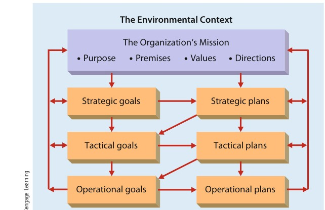
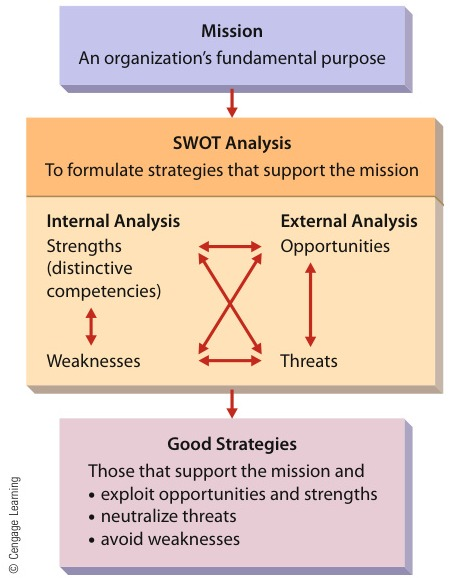
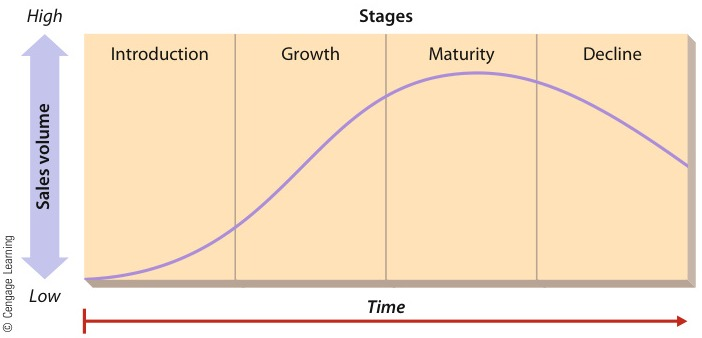
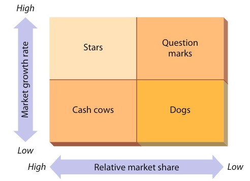
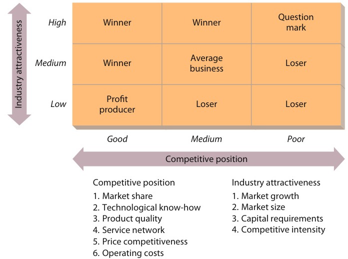

# CHAPTER 3: Planning and Strategic Management

<!-- Page 94 -->

CHAPTER 3Planning and StrategicManagement

Learning Outcomes

After studying this chapter, you should be able to:

1Summarize the planning process and describe organizational goals.

2Discuss the components of strategy and the types of strategic alternatives.

3Describe how to use SWOT analysis in formulating strategy.

4Identify and describe various alternative approaches to business-level strategy formulation.

5Identify and describe various alternative approaches to corporate-level strategy formulation.

6Discuss how tactical plans are developed and implemented.

7Describe the basic types of operational plans used by organizations.

Management in Action

Google’s Strategy for Dominance

#### “We don’t talk about our strategy … because it’s strategic. I would ratherhave people think we’re confused than let our competitors know what we’regoing to do.”

—Larry Page, Google Co-founder

Sergey Brin and Larry Page met at Stanford University in 1995 when bothwere graduate students in computer science. At the time, Page was workingon a software-development project designed to create an index of websitesby scouring sites for key words and other linkages. Brin joined him on theproject, and when they were satisfied that they’d developed something withcommercial value, they tried to license the technology to other searchcompanies. As luck would have it, they couldn’t find a buyer and settledinstead for procuring enough investment capital to keep refining and testingtheir product.In 2000, Brin and Page ran across a discussion of a business model basedon the concept of selling advertising in the form of sponsored links andsearch-specific ads. They adapted it to their own concept and went intobusiness for themselves. They named their new venture Google and, as youprobably know, it has grown to become the world’s largest search engine.Google generally processes more than 11,300 million searches a month by auser base of 380 million people in 181 different countries and using 146

<!-- Page 95 -->

> Rob Kim/Landov

Sergey Brin and Larry Page, founders of Google, spend much of their time planning anddeveloping new strategies. When they bought YouTube, they made the announcement in aYouTube video.

languages. Following an IPO in 2004, the company’s market capitalization rosesteadily; it stood at more than $243 65 billion by 2012, when Google controlled66.7 percent of the U.S. search market (compared to Yahoo!’s 12.1 percent andMicrosoft’s 16.3 percent).Google, however, is much more than a mere search engine. Services includesearches for news, shopping, local businesses, interactive maps, and discussiongroups, as well as blogs, web-based e-mail and voice mail, and a digital photo-management system. You can access the results of any Google search from theGoogle website, from your own user’s toolbar, from your Windows taskbar, andfrom wireless devices such as smartphones and tablets. Amazingly, Googleestimates that 15 percent of searches conducted each day are new—neverhaving been searched before.How did two young computer scientists build this astoundingly successfulcompany, and where will they take it in the future? Brin and Page remain inthe forefront of Google’s search for technological innovations. They believe inthe power of mathematics and have developed unique algorithms for justabout every form of activity in the firm. One of the most successful is analgorithm for auctioning advertising placements that ensures the highestpossible prices. Brin and Page have also been remarkably successful inattracting talented and creative employees and providing them with a workenvironment and culture that foster the kind of productivity and innovation forwhich they were hired.Finally,althoughthefoundersavoidformalstrategicplanning,they’vemanagedtodiversifyextensivelythroughacquisitionsandkeyalliances.Typically, Google absorbs an acquired firm and then improves on its technology,

<!-- Page 96 -->

thereby adding variety to its own online offerings. Recent acquisitions includeYouTube, a leader in online video sharing, Postini, a leader in communications-security products, and Double Click, a leader in online advertising services.Strategic alliances include those with foreign online service providers that offerGoogle searches on their sites.For the immediate future, at least, Google plans on following its basic provenrecipe for success, competing head to head with financial-service providers forstock information and with iTunes for music and videos. Also committed to thein-house development of new features and services, Google spent $2 8 billion onR&D in 2012 (up from $1 2 billion in 2006) and another $1 billion to acquire new ITassets. Innovations in the works include an automated universal languagetranslator for translating documents in any language into any other languageand personalized home pages that will allow users to design automatic searchesand display the results in personal “newspapers.”Nobody knows for sure what else is on the drawing board. In fact, outsiders—notably potential investors—often criticize Google for being a “black box” whenthey want a few more details on Google’s long-range strategy. “We don’t talkabout our strategy,” explains Page, “… because it’s strategic. I would ratherhave people think we’re confused than let our competitors know what we’regoing to do.”1

Strategic thinking is at the heart of effective management in any business, including old-line industrial giants like Ford and General Electric to newer web-based businesses suchas Google and Yahoo!. This chapter discusses how organizations manage strategy andhow managers engage in strategic planning. As we note in Chapter 1, planning and deci-sion making comprise the first managerial functions that organizations must address.This chapter is the first of three that explore planning and decision making.

## PLANNING AND ORGANIZATIONAL GOALS

The planning process itself can best be thought of as a generic activity. All organizationsengage in planning activities, but no two organizations plan in exactly the same fashion.Figure 3.1 is a general representation of the planning process that many organizationsattempt to follow. But although most firms follow this general framework, each also hasits own nuances and variations.2

As Figure 3.1 shows, all planning occurs within an environmental context. Ifmanagers do not understand this context, they are unable to develop effective plans.Thus, understanding the environment is essentially the first step in planning. Chapter 2covered many of the basic environmental issues that affect organizations and how theyplan. With this understanding as a foundation, managers must then establish the organi-zation’s mission. The mission outlines the organization’s purpose, premises, values, anddirections. Flowing from the mission are parallel streams of goals and plans. Directlyfollowing the mission are strategic goals. These goals and the mission help determinestrategic plans. Strategic goals and plans are primary inputs for developing tacticalgoals. Tactical goals and the original strategic plans help shape tactical plans. Tacticalplans, in turn, combine with the tactical goals to shape operational goals. These goalsand the appropriate tactical plans determine operational plans. Finally, goals and plansat each level can also be used as inputs for future activities at all levels.

<!-- Page 97 -->

*Figure 3.1 — The Planning Process (Source: Page 97)*

The planning process takes place within an environmental context. Managers mustdevelop a complete and thorough understanding of this context to determine theorganization’s mission and to develop its strategic, tactical, and operational goalsand plans.

### Organizational Goals

Goals are critical to organizational effectiveness, and they serve a number of purposes. Orga-nizations can also have several different kinds of goals, all of which must be appropriatelymanaged. And a number of different kinds of managers must be involved in setting goals.

#### Purposes of Goals

Goals serve four important purposes.3 First, they provide guid-ance and a unified direction for people in the organization. Goals can help everyoneunderstand where the organization is going and why getting there is important.4 MarkPincus, founder and CEO of the social-gaming company Zynga, recently noted that“it’s important to know what your goal is, because if you don’t know what your goal is,you will … never achieve it.”5 IBM announced a goal to achieve earnings per share of$20 (up from $11 52 in 2010) by 2015. The company also plans to reach $100 billionin cash flow and return 70 percent to shareholders by that same year.6 Top managersat General Electric (GE) have a long-standing goal that every business owned by thefirm will be either number one or number two in its industry. This goal helps set thetone for decisions made by GE managers as it competes with other firms such asWhirlpool and Electrolux.7

Second, goal-setting practices strongly affect other aspects of planning. Effective goalsetting promotes good planning, and good planning facilitates future goal setting. Forexample, IBM’s financial goals demonstrate how setting goals and developing plans toreach them should be seen as complementary activities. Specifically, the firm will needto work aggressively to boost both profits and cash flow to meet its goals.Third, goals can serve as a source of motivation for an organization’s employees.Goals that are specific and moderately difficult can motivate people to work harder,

<!-- Page 98 -->

> missionA statement of anorganization’sfundamentalpurpose

> strategic goalA goal set by and foran organization’s topmanagement

> tactical goalA goal set by and foran organization’smiddle managers

> operational goalA goal set by and foran organization’slower-levelmanagers

> strategic planA general planoutlining decisionsabout the resourceallocation, priorities,and action stepsnecessary to reachstrategic goals

especially if attaining the goal is likely to result in rewards.8 The Italian furniture manu-facturer Industrie Natuzzi SpA uses goals to motivate its workers. Each craftsperson hasa goal for how long it should take to perform his or her job, such as sewing leathersheets together to make a sofa cushion or building wooden frames for chair arms. Atthe completion of assigned tasks, workers enter their ID numbers and job numbers intothe firm’s computer system. If they get a job done faster than their goal, a bonus is auto-matically added to their paycheck.9

Finally, goals provide an effective mechanism for evaluation and control. This meansthat performance can be assessed in the future in terms of how successfully today’s goalsare accomplished. For example, suppose that officials of the United Way of America seta goal of collecting $250,000 from a particular small community. If, midway through thecampaign, they have raised only $50,000, they know that they need to change or inten-sify their efforts. If they raise only $100,000 by the end of their drive, they will carefullystudy why they did not reach their goal and what they need to do differently next year.On the other hand, if they succeed in raising $250,000 or more, evaluations of theirefforts will take on an entirely different character.

#### Kinds of Goals

Goals are set for and by different levels within an organization. Anorganization’s mission is a statement of its “fundamental, unique purpose that sets a busi-ness apart from other firms of its type and identifies the scope of the business’s operationsin product and market terms.”10 For instance, Starbucks’ mission statement is to be “thepremier purveyor of the finest coffee in the world while maintaining our uncompromisingprinciples while we grow.” The principles to which the mission refers help managers atStarbucks make decisions and direct resources in clear and specific ways.

Strategic goals are set by and for an organization’s top management. They focus onbroad, general issues. For example, Starbucks has a strategic goal of increasing the prof-itability of each of its coffee stores by 25 percent over the next five years. Tactical goalsare set by and for middle managers. Their focus is on how to operationalize actions nec-essary to achieve the strategic goals. To achieve Starbucks’ goal of increasing its per-storeprofitability, managers are working on tactical goals related to company-owned versuslicensed stores and the global distribution of stores in different countries. Operationalgoals are set by and for lower-level managers. Their concern is with shorter-term issuesassociated with the tactical goals. An operational goal for Starbucks might be to boost theprofitability of a certain number of stores in each of the next five years. (Some managersuse the words objective and goal interchangeably. When they are differentiated, however,the term objective is usually used instead of operational goal.)

### Kinds of Organizational Plans

Organizations establish many different kinds of plans. At a general level, these includestrategic, tactical, and operational plans.

#### Strategic Plans

Strategic plans are developed to achieve strategic goals. More pre-cisely, a strategic plan is a general plan outlining decisions about resource allocation,priorities, and action steps necessary to reach strategic goals. These plans are set by theboard of directors and top management, generally have an extended time horizon, andaddress questions of scope, resource deployment, competitive advantage, and synergy.We discuss strategic planning further in the next major section of this chapter.

#### Tactical Plans

A tactical plan, aimed at achieving tactical goals, is developed toimplement specific parts of a strategic plan. Tactical plans typically involve upper andmiddle management and, compared with strategic plans, have a somewhat shorter timehorizon and a more specific and concrete focus. Thus, tactical plans are concerned more

<!-- Page 99 -->

> operational planA plan that focuseson carrying outtactical plans toachieve operationalgoals

LEADING THE WAY

## Setting a New Direction for General Motors

Chapter 11 in 2010, the firm has been on a consis-tent upward trajectory, regaining lost market share,launching successful new products, and postingrecord profits—$25 billion in 2012. His supportersattributed his success to a consistent message ofproduct quality, innovation, and openness to change(traits apparently not found at GM for a long time).Akerson also spent a lot of time out in GM factoriestalking to the people who build the cars and in GMdealerships talking to the people who buy cars.What happened next was even more amazing. Inlate 2013, Akerson was just starting to think abouthis replacement when his wife was diagnosed withcancer and he decided to step down sooner thananticipated. Akerson informed the board that hethought the best candidate to replace him wasMary Barra, the firm’s executive vice president ofglobal product development, purchasing, and supplychain. The board quickly decided that Akerson wasright and appointed Barra to the position of CEO inJanuary 2014. This marked the first time a womanhas ever led a major U.S. auto company. So, whatdoes the future hold for Barra and GM? On the onehand, she will likely have to deal with sexism fromsome quarters and still faces stiff competition fromboth domestic and foreign rivals. A major productrecall and allegations about a cover-up of defectsleading to that recall will also pose challenges. Butothers believe that GM has been successfully trans-formed from a staid, old car company into an innova-tiveandflexiblecompanythatwillremaincompetitive for a long time.

General Motors is over a hundred years old, and formuch of that time was the world’s dominant automo-bile manufacturer. But rising employee health carecosts, an onslaught of new foreign competitors,and high wage contracts with its major unionsseverely weakened GM in the early years of thetwenty-first century, Perhaps it is no surprise, then,that GM was knocked to the mat when the globaleconomy plunged into recession a few years ago.The auto giant lost $38 billion in 2007, another$32 billion in 2008, and was forced to declare Chapter11 bankruptcy. Using Chapter 11 protection, GMcancelled several joint ventures, renegotiated some ofits labor contracts, shed brands like Pontiac and Saturn,lowered its operating costs, and reduced its debt. Andwhen it emerged from bankruptcy in 2010, the firm wasready to compete in new and different ways.Tothesurpriseofmanyobservers,DanielAkerson was appointed CEO of the new GM andcharged with leading the company back to profitabil-ity. His appointment was unexpected because hehad no automobile industry experience—he is anelectrical engineer by training, spent several yearsas a Naval officer, and had worked in the telecommu-nications, technology, and private investments indus-tries. To the naysayers, he “wasn’t a car guy.” And tosome, that doomed him to failure.One thing he did have, though, was a long history ofeffective leadership. Akerson had been successful atevery stop along the way, and was consistently hailedas both a strong leader and an astute manager. In hiswords, a CEO’s role is “to articulate [the] vision, and astrategy, what you want to accomplish.” And virtuallyeveryone who ever worked for Akerson agreed that heplayed that role with integrity and effectiveness.While his detractors expected him to fail, thosewho knew him expected just the opposite. Andas things developed, they were right. FollowingAkerson’s appointment and GM’s emergence from

References: “GM CEO: ‘Good Enough’ Isn’t,” USA Today,August 5, 2013, p. 1B; Hoover’s Handbook of American Busi-ness 2013 (Austin: Mergent, 2013), pp. 381–383; “Mary BarraNamed GM CEO, Automaker’s First Female Chief,” Forbes,December 10, 2013, pp. 23–24; “GM CEO Mary BarraAdmired by Fellow Auto Executives, Competitors,” http://www.mlive.com/auto/, accessed on February 16, 2014.

with actually getting things done than with deciding what to do. Tactical planning iscovered in detail later in this chapter.

#### Operational Plans

An operational plan focuses on carrying out tactical plans toachieve operational goals. Developed by middle- and lower-level managers, operationalplans have a short-term focus and are relatively narrow in scope. Each one deals with a fairlysmall set of activities. We also cover operational planning in more detail later in this chapter.

<!-- Page 100 -->

> strategyA comprehensive planfor accomplishingan organization’sgoals

> strategicmanagementA comprehensiveand ongoingmanagementprocess aimed atformulating andimplementingeffective strategies; away of approachingbusinessopportunities andchallenges

> effective strategyA strategy thatpromotes a superioralignment betweenthe organization andits environment andthe achievement ofstrategic goals

> distinctivecompetenceAn organizationalstrength possessedby only a smallnumber ofcompeting firms

> scopeWhen applied tostrategy, it specifiesthe range of marketsin which anorganization willcompete

## THE NATURE OF STRATEGIC MANAGEMENT

A strategy is a comprehensive plan for accomplishing an organization’s goals. Strategicmanagement, in turn, is a way of approaching business opportunities and challenges—itis a comprehensive and ongoing management process aimed at formulating and imple-menting effective strategies. Finally, effective strategies are those that promote a superioralignment between the organization and its environment and the achievement of strate-gic goals.11

### The Components of Strategy

In general, a well-conceived strategy addresses three areas: distinctive competence,scope, and resource deployment. A distinctive competence is something the organiza-tion does exceptionally well. A distinctive competence of Abercrombie & Fitch is itsspeed in moving inventory. It tracks consumer preferences daily with point-of-salecomputers, electronically transmits orders to suppliers in Hong Kong, charters 747cargo planes to fly new products to the United States, and has those products in stores48 hours later. Because other retailers take weeks or sometimes months to accomplishthe same things, Abercrombie & Fitch uses this distinctive competence to remaincompetitive.12

The scope of a strategy specifies the range of markets in which an organization willcompete. Hershey Foods has essentially restricted its scope to the confectionery business,

dpa picture alliance/Alamy

Resource deployment is an important part of strategic management. General Electric, for example,has often used profits from its U.S. operations to invest in new business opportunities abroad. In2013, for example, the firm broke ground on a new energy business in Berlin. Much of the start-upcosts for the new business were funded from other GE operations.

<!-- Page 101 -->

> resourcedeploymentHow an organizationdistributes itsresources across theareas in which itcompetes

> business-levelstrategyThe set of strategicalternatives fromwhich anorganization choosesas it conductsbusiness in aparticular industry ormarket

> corporate-levelstrategyThe set of strategicalternatives fromwhich anorganization choosesas it manages itsoperationssimultaneouslyacross severalindustries andseveral markets

> strategyformulationThe set of processesinvolved in creatingor determining anorganization’sstrategies; it focuseson the content ofstrategies

> strategyimplementationThe methods bywhich strategies areoperationalized orexecuted within theorganization; itfocuses on theprocesses throughwhich strategies areachieved

with a few related activities in other food-processing areas. In contrast, its biggest com-petitor, Mars, has adopted a broader scope by competing in the pet food business andthe electronics industry, among others. Some organizations, called conglomerates, com-pete in dozens or even hundreds of markets.A strategy should also include an outline of the organization’s projected resourcedeployment—how it will distribute its resources across the areas in which it competes.General Electric, for example, has been using profits from its highly successful U.S.operations to invest heavily in new businesses in Europe and Asia. Alternatively, thefirm might have chosen to invest in different industries in its domestic market or toinvest more heavily in Latin America. The choices it makes as to where and how muchto invest reflect issues of resource deployment.

### Types of Strategic Alternatives

Most businesses today develop strategies at two distinct levels: the business level and cor-porate level. These levels provide a rich combination of strategic alternatives for organi-zations. Business-level strategy is the set of strategic alternatives from which anorganization chooses as it conducts business in a particular industry or market. Suchalternatives help the organization focus its competitive efforts for each industry or mar-ket in a targeted and focused manner.

Corporate-level strategy is the set of strategic alternatives from which an organiza-tion chooses as it manages its operations simultaneously across several industries andseveral markets. As we discuss later in this chapter, most large companies today competein various industries and markets. Thus, although they develop business-level strategiesfor each industry or market, they also develop an overall strategy that helps define themix of industries and markets that are of interest to the firm.Drawing a distinction between strategy formulation and strategy implementation isalso instructive. Strategy formulation is the set of processes involved in creating ordetermining the organization’s strategies, whereas strategy implementation is themethods by which those strategies are operationalized or executed. The primary dis-tinction is along the lines of content versus process: The formulation stage determineswhat the strategy is, and the implementation stage focuses on how the strategy isachieved.

## USING SWOT ANALYSIS TOFORMULATE STRATEGY

The starting point in formulating strategy is usually SWOT (strengths, weaknesses,opportunities, and threats) analysis. As shown in Figure 3.2, SWOT analysis is acareful evaluation of an organization’s internal strengths and weaknesses as well asits environmental opportunities and threats. In SWOT analysis, the best strategiesaccomplish an organization’s mission by (1) exploiting an organization’s opportu-nities and strengths while (2) neutralizing its threats and (3) avoiding (or correcting)its weaknesses.

### Evaluating an Organization’s Strengths

Organizational strengths are skills and capabilities that enable an organization to createand implement its strategies. Strengths may include things like a deep pool of managerialtalent, surplus capital, a unique reputation and/or brand name, and well-established

<!-- Page 102 -->

> SWOTAn acronym thatstands for strengths,weaknesses,opportunities, andthreats

> organizationalstrengthA skill or capabilitythat enables anorganization tocreate andimplement itsstrategies

*Figure 3.2 — SWOT Analysis (Source: Page 102)*

SWOT analysis is one of the most important steps in formulating strategy. Using theorganization’s mission as a context, managers assess internal strengths (distinctivecompetencies) and weaknesses as well as external opportunities and threats. Thegoal is then to develop good strategies that exploit opportunities and strengths,neutralize threats, and avoid weaknesses.

distribution channels.13 Sears, for example, has a nationwide network of trained serviceemployees who repair its appliances. Jane Thompson, a Sears executive, created a plan toconsolidate repair and home improvement services nationwide under the well-knownSears brand name and to promote them as a general repair operation for all appliances,not just those purchased from Sears. Thus, the firm capitalized on existing capabilitiesand the strength of its name to launch a new operation.A distinctive competence, introduced earlier in this chapter, is a strength possessed byonly a small number of competing firms. Distinctive competencies are rare among a setof competitors. When George Lucas founded Industrial Light & Magic (ILM), for exam-ple, the new venture brought the cinematic art of special effects to new heights. Some ofILM’s special effects can be produced by no other organization; these rare special effectsare thus ILM’s distinctive competencies. Indeed, ILM (now owned by Disney) had noreal competitor until Peter Jackson formed Weta Digital Effects to help bring The Lordof the Rings to the screen. But even so, although ILM and Weta have some of the samecompetences, each also has proprietary technology that gives it certain unique advan-tages. Organizations that exploit their distinctive competencies often obtain a competi-tive advantage and attain above-normal economic performance.14 Indeed, a main

<!-- Page 103 -->

> organizationalweaknessA skill or capabilitythat does not enablean organization tochoose andimplement strategiesthat support itsmission

> organizationalopportunityAn area in theenvironment that, ifexploited, maygenerate higherperformance

> organizationalthreatAn area thatincreases thedifficulty of anorganizationperforming at ahigh level

> differentiationstrategyA strategy in whichan organizationseeks to distinguishitself fromcompetitors throughthe quality of itsproducts or services

purpose of SWOT analysis is to discover an organization’s distinctive competencies sothat the organization can choose and implement strategies that exploit its unique organi-zational strengths.

### Evaluating an Organization’s Weaknesses

Organizational weaknesses are skills and capabilities that do not enable an organizationto choose and implement strategies that support its mission. An organization has essen-tially two ways of addressing weaknesses. First, it may need to make investments toobtain the strengths required to implement strategies that support its mission. Second,it may need to modify its mission so that it can be accomplished with the skills andcapabilities that the organization already possesses.In practice, organizations have a difficult time focusing on weaknesses, in part becauseorganization members are often reluctant to admit that they do not possess all the skillsand capabilities needed. Evaluating weaknesses also calls into question the judgment ofmanagers who chose the organization’s mission in the first place and who failed to investin the skills and capabilities needed to accomplish it.American Airlines sought bankruptcy protection in 2012–13 in order to restructureitself. Poor labor relations, a reputation for indifferent customer service, insufficientcash reserves, and an aging jet fleet were all organizational weaknesses that led to thefirm’s problems.

### Evaluating an Organization’s Opportunities and Threats

Whereas evaluating strengths and weaknesses focuses attention on the internal workingsof an organization, evaluating opportunities and threats requires analyzing an organiza-tion’s environment. Organizational opportunities are areas that may generate higherperformance. Organizational threats are areas that increase the difficulty of an organi-zation performing at a high level.

## FORMULATING BUSINESS-LEVEL STRATEGIES

A number of frameworks have been developed for identifying the major strategic alter-natives that organizations should consider when choosing their business-level strategies.Two of the most important ones are Porter’s generic strategies and strategies based onthe product life cycle.

### Porter’s Generic Strategies

According to Michael Porter, organizations may pursue a differentiation, overallcost leadership, or focus strategy at the business level.15 An organization that pursues adifferentiation strategy seeks to distinguish itself from competitors through the quality(broadly defined) of its products or services. Firms that successfully implement a differ-entiation strategy are able to charge more than competitors because customers are will-ing to pay more to obtain the extra value they perceive.16 Rolex pursues a differentiationstrategy. Rolex watches are handmade of stainless steel and precious metals such as goldor platinum, and they are subjected to strenuous tests of quality and reliability. Thefirm’s reputation enables it to charge thousands of dollars for its watches. Coca-Colaand Pepsi compete in the market for bottled water on the basis of differentiation. Coketouts its Dasani brand on the basis of its fresh taste, whereas Pepsi promotes its Aquafinabrand on the basis of its purity.17 Other firms that use differentiation strategies areLexus, Godiva, Nikon, Mont Blanc, Apple, and Ralph Lauren. During the recent

<!-- Page 104 -->

> overall costleadership strategyA strategy in whichan organizationattempts to gain acompetitiveadvantage byreducing its costsbelow the costs ofcompeting firms

> focus strategyA strategy in whichan organizationconcentrates on aspecific regionalmarket, product line,or group of buyers

> product life cycleA model thatportrays how salesvolume for productschanges over the lifeof products

> ©iStockphoto.com/evemilla

economic recession, most youth-oriented retailers such as American Eagle Outfitters,Quiksilver, and Aéropostale slashed prices to generate sales. But Abercrombie & Fitchdecided to hold firm to standard pricing in an attempt to maintain a differentiatedimage for its products.18 Similarly, other firms tried to provide strong differentiation onthe basis of outstanding customer service.19

An organization implementing an overall cost leadership strategy attempts to gain acompetitive advantage by reducing its costs below the costs of competing firms. Bykeeping costs low, the organization is able to sell its products at low prices and stillmake a profit. Timex uses an overall cost leadership strategy. For decades, this firmhas specialized in manufacturing relatively simple, low-cost watches for the mass mar-ket. The price of Timex watches, starting around $39 95, is low because of the com-pany’s efficient high-volume manufacturing capacity. Poland Springs and CrystalGeyser bottled waters are promoted on the basis of their low cost. Other firms thatimplement overall cost leadership strategies are Hyundai, BIC, Old Navy, and Hershey.When the 2008 economic recession hit, Hershey actually experienced a jump in sales—during hard times, consumers started cutting back on high-end chocolate productsfrom Godiva but weren’t willing to forgo chocolate altogether.20 Likewise, other low-costproducersalsobenefitedasconsumersavoidedhigher-pricedbrand-nameproducts (i.e., those with a differentiation strategy) in favor of lower-priced goods.For instance, both P&G and Colgate saw sales of products such as Tide, Pampers,and Colgate toothpaste decline, whereas sales of lower-priced private-label productsjumped.21

A firm pursuing a focus strategy concentrates on a specific regional market, prod-uct line, or group of buyers. This strategy may have either a differentiation focus,whereby the firm differentiates its products in the focus market, or an overall costleadership focus, whereby the firm manufactures and sells its products at low costin the focus market. In the watch industry, Tag Heuer follows a focus differentiationstrategy by selling only rugged waterproof watches to active consumers. Tata Motorsfollows a focus cost leadership strategy by selling its inexpensive automobiles only inIndia. Alfa Romeo uses focus differentiation to sell its high-performance cars only inmarkets where customers can pay over a hundred thousand dollars for a car. Fisher-Price uses focus differentiation to sell electronic calculators with large, brightlycolored buttons to the parents of preschoolers; stockbroker Edward Jones focuses onsmall-town settings. General Mills focuses one part of its new-product developmentonconsumerswhoeatmealswhiledriving—itswatchword is “Can we make it ‘one-handed’?” sothat drivers can safely eat or drink it. Two investorsrealized that most Las Vegas casinos were targetingeither high-end big spenders or the young hip mar-ket. So, they bought the venerable old Tropicanacasino, renovated it, and began marketing it to so-called Middle America—middle-aged or older gam-blers who aren’t into big dollar wagering. Their occu-pancy rates have soared, as have their profits.22

Hershey uses an overall cost leadership strategy to promoteits candy bars. By keeping its costs as low as possible, thefirm can provide good-quality snacks at competitive prices.This strategy benefited the firm during the recent recessionas customers cut back on higher-priced candy, allowingHershey to gain new market share.

### Strategies Based on the Product Life Cycle

The product life cycle is a model that shows how salesvolume changes over the life of products. Understand-ing the four stages in the product life cycle helpsmanagers recognize that strategies need to evolve

<!-- Page 105 -->

*Figure 3.3 — The Product Life Cycle (Source: Page 105)*

Managers can use the framework of the product life cycle—introduction, growth, maturity,and decline—to plot strategy. For example, management may decide on a differentiationstrategy for a product in the introduction stage and a prospector approach for a product inthe growth stage. By understanding this cycle and where a particular product falls withinit, managers can develop more effective strategies for extending product life.

over time. As Figure 3.3 shows, the cycle begins when a new product or technology isfirst introduced. In this introduction stage, demand may be very high and sometimesoutpaces the firm’s ability to supply the product. At this stage, managers need tofocus their efforts on “getting product out the door” without sacrificing quality. Man-aging growth by hiring new employees and managing inventories and cash flow arealso concerns during this stage.During the growth stage, more firms begin producing the product, and sales continueto grow. Important management issues include ensuring quality and delivery and begin-ning to differentiate an organization’s product from competitors’ products. Entry intothe industry during the growth stage may threaten an organization’s competitive advan-tage; thus, strategies to slow the entry of competitors are important.After a period of growth, products enter a third phase. During this maturity stage,overall demand growth for a product begins to slow down, and the number of newfirms producing the product begins to decline. The number of established firmsproducing the product may also begin to decline. This period of maturity is essentialif an organization is going to survive in the long run. Product differentiation concernsare still important during this stage, but keeping costs low and beginning the search fornew products or services are also important strategic considerations.In the decline stage, demand for the product or technology decreases, the number oforganizations producing the product drops, and total sales drop. Demand oftendeclines because all those who were interested in purchasing a particular producthave already done so. Organizations that fail to anticipate the decline stage in earlierstages of the life cycle may go out of business. Those that differentiate their product,keep their costs low, or develop new products or services may do well during thisstage.

<!-- Page 106 -->

> diversificationThe number ofdifferent businessesthat an organizationis engaged in and theextent to which thesebusinesses arerelated to oneanother

> single-productstrategyA strategy in whichan organizationmanufactures justone product orservice and sells it ina single geographicmarket

> relateddiversificationA strategy in whichan organizationoperates in severalbusinesses that aresomehow linked withone another

## FORMULATING CORPORATE-LEVEL STRATEGIES

Most large organizations are engaged in several businesses, industries, and markets.Each business or set of businesses within such an organization is frequently referredto as a strategic business unit (SBU). An organization such as GE operates hundredsof different businesses, making and selling products as diverse as jet engines, nuclearpower plants, and lightbulbs. GE organizes these businesses into approximately20 SBUs. Even organizations that sell only one product may operate in several distinctmarkets.Decisions about which businesses, industries, and markets an organization willenter, and how to manage these different businesses, are based on an organization’scorporate strategy. The most important strategic issue at the corporate level concernsthe extent and nature of organizational diversification. Diversification describes thenumber of different businesses that an organization is engaged in and the extent towhich these businesses are related to one another. There are three types of diversifi-cationstrategies:single-productstrategy,relateddiversification,andunrelateddiversification.23

### Single-Product Strategy

An organization that pursues a single-product strategy manufactures just one product orservice and sells it in a single geographic market. The WD-40 Company, for example, basi-cally manufactures one product, WD-40 spray lubricant, and for years sold it just in NorthAmerica. WD-40 has started selling its lubricant in Europe and Asia, but it continues tocenter all manufacturing, sales, and marketing efforts on one product. Similarly, Michelinhas remained faithful to the cause of strictly manufacturing quality tires.The single-product strategy has one major strength and one major weakness. By con-centrating its efforts so completely on one product and market, a firm is likely to be verysuccessful in manufacturing and marketing the product. Because it has staked its survivalon a single product, the organization works very hard to make sure that the product is asuccess. Of course, if the product is not accepted by the market or is replaced by a newone, the firm will suffer. This happened to slide-rule manufacturers when electroniccalculators became widely available and to companies that manufactured only black-and-white televisions when low-priced color televisions were first mass-marketed.Similarly, Wrigley long practiced what amounted to a single-product strategy with itsline of chewing gums. But, because younger consumers are buying less gum than earliergenerations, Wrigley experienced declining revenues and lower profits. As a result, theWrigley family eventually sold their business to Mars.24

### Related Diversification

Given the disadvantage of the single-product strategy, most large businesses today oper-ate in several different businesses, industries, or markets.25 If the businesses are somehowlinked, that organization is implementing a strategy of related diversification. Virtuallyall larger businesses in the United States use related diversification.Pursuing a strategy of related diversification has three primary advantages. First, itreduces an organization’s dependence on any one of its business activities and thusreduces economic risk. Even if one or two of a firm’s businesses lose money, the organi-zation as a whole may still survive because the healthy businesses will generate enoughcash to support the others.26 At Disney, a decline in theme park attendance may beoffset by an increase in box office and DVD sales of Disney movies and vice versa.When the firm lost millions on the poorly conceived movies John Carter in 2012 and

<!-- Page 107 -->

> AP Images/Disney-Pixar

> unrelateddiversificationA strategy in whichan organizationoperates multiplebusinesses that arenot logicallyassociated with oneanother

Disney has successfully used related diversification strategies for years. For instance, an annualslate of both animated and live-action movies complements its attractions at theme parks and retailoutlets and then feeds directly into DVD and streaming video operations. Recent smash hitsMonsters University (shown here), Frozen, and Iron Man 3, for instance, will help fuel Disney profitsfor years.

The Lone Ranger in 2013, Disney was still profitable due to strong theme park revenuesand other hit movies like The Avengers in 2012 and Iron Man 3, Monsters University,and Frozen in 2013.Second, by managing several businesses at the same time, an organization can reducethe overhead costs associated with managing any one business. In other words, if thenormal administrative costs required to operate any business, such as legal services andaccounting, can be spread over a large number of businesses, then the overhead costs perbusiness will be lower than they would be if each business had to absorb all costs itself.Thus the overhead costs of businesses in a firm that pursues related diversification areusually lower than those of similar businesses that are not part of a larger corporation.27

Third, related diversification allows an organization to exploit its strengths and capa-bilities in more than one business. When organizations do this successfully, they capital-ize on synergies, which are complementary effects that exist among their businesses.Synergy exists among a set of businesses when the businesses’ economic value togetheris greater than their economic value separately. McDonald’s is using synergy as it diver-sifies into other restaurant and food businesses. For example, both its McCafe premiumcoffee stands in some McDonald’s restaurants and its investments in Pret A Manger, aEuropean chain of sandwich shops, allow the firm to create new revenue opportunitieswhile using the firm’s existing strengths in food-product purchasing and distribution.“Tough Times, Tough Choices” discusses how diversification can also occasionally createethical challenges.

### Unrelated Diversification

Firms that implement a strategy of unrelated diversification operate multiple businessesthat are not logically associated with one another. At one time, for example, Quaker Oatsownedclothingchains,toycompanies,andarestaurantbusiness.Unrelated

<!-- Page 108 -->

> portfoliomanagementtechniquesMethods thatdiversifiedorganizations use todetermine in whichbusinesses toengage and how tomanage thesebusinesses tomaximize corporateperformance

> BCG (BostonConsulting Group)matrixA framework forevaluatingbusinesses relativeto the growth rate oftheir market and theorganization’s shareof the market

diversification was a very popular strategy several years ago. During that time, severalconglomerates such as ITT and Transamerica grew by acquiring literally hundreds ofother organizations and then running these numerous businesses as independent entities.Even if there are important potential synergies among their different businesses, organi-zations implementing a strategy of unrelated diversification do not attempt to exploitthem.In theory, unrelated diversification has two advantages. First, a business that uses thisstrategy should be able to achieve stable performance over time. During any givenperiod, some businesses owned by the organization are in a cycle of decline, whereasothers may be in a cycle of growth. Second, unrelated diversification is also thought tohave resource allocation advantages. Every year, when a corporation allocates capital,people, and other resources among its various businesses, it must evaluate informationabout the future of those businesses so that it can place its resources where they havethe highest potential for return. Given that it owns the businesses in question and thushas full access to information about the future of those businesses, a firm implementingunrelated diversification should be able to allocate capital to maximize corporateperformance.Despite these presumed advantages, research suggests that unrelated diversificationusually does not lead to high performance. First, corporate-level managers in such acompany usually do not know enough about the unrelated businesses to provide helpfulstrategic guidance or to allocate capital appropriately. To make strategic decisions, man-agers must have complete and subtle understanding of a business and its environment.Because corporate managers often have difficulty fully evaluating the economic impor-tance of investments for all the businesses under their wing, they tend to concentrateonly on a business’s current performance. This narrow attention at the expense ofbroader planning eventually hobbles the entire organization.Second, because organizations that implement unrelated diversification fail to exploitimportant synergies, they are at a competitive disadvantage compared to organizationsthat use related diversification. Universal Studios has been at a competitive disadvantagerelative to Disney because its theme parks, movie studios, and licensing divisions are lessintegrated and therefore achieve less synergy.For these reasons, almost all organizations have abandoned unrelated diversificationas a corporate-level strategy. Transamerica, for instance, sold off numerous unrelatedbusinesses and now concentrates on a core set of related businesses and markets.Large corporations that have not concentrated on a core set of businesses have eventu-ally been acquired by other companies and then broken up. Research suggests thatthese organizations are actually worth more when broken up into smaller pieces thanwhen joined.28

#### Managing Diversification

However an organization implements diversification—whether through internal development, vertical integration, or mergers and acquisitions—it must monitor and manage its strategy. Portfolio management techniques are methodsthat diversified organizations use to determine in which businesses to engage and how tomanage these businesses to maximize corporate performance. Two important portfoliomanagement techniques are the BCG matrix and the GE Business Screen.

#### BCG Matrix

The BCG (Boston Consulting Group) matrix provides a framework forevaluating the relative performance of businesses in which a diversified organization oper-ates. It also prescribes the preferred distribution of cash and other resources among thesebusinesses.29 The BCG matrix uses two factors to evaluate an organization’s set of busi-nesses: the growth rate of a particular market and the organization’s share of that market.

<!-- Page 109 -->

TOUGH TIMES, TOUGH CHOICES

## The Little-White-Lie Strategy

to take over its largest franchise. Legally speaking,executivescannotdenyoutrightthatthey’reengaged in negotiations, but they’re also barredfrom mentioning negotiations in public: Such state-ments would amount to leaking inside informationand might affect stock prices—in which case, inves-tors who lost money when the market reacted to anexecutive’s statement could sue the company.“Part of this is the artful use of words,” suggestsPaul Lapides, director of the Corporate GovernanceCenter at Kennesaw State University, who does notfeel that Coke CEO Kent was misleading his inves-tors. “Shareholders would really like to know every-thing that management is thinking about,” saysLapides, “but that’s just bad business.” In thiscase, for example, hints of an imminent deal couldhave driven up the price that Coke ultimately paidfor CCE. According to John Sicher, a former corpo-rate lawyer who’s now editor of Beverage Digest,Kent had skillfully walked a thin legal and ethicalline. “He couldn’t say too little or too much. His‘committed to the franchise system’ message wasaccurate and an appropriate communication.”On the point that Kent saved money for Cokeinvestors, even Gorham tends to agree: “If itinvolves telling a little white lie for a few monthswhile negotiations are going on,” he admits, “that’sprobably the best way to go about it.”

It may surprise you to learn that The Coca-ColaCompany does not make Coca-Cola. Coke and theother beverage brands owned by The Coca-Cola Com-pany are actually manufactured by what the companycalls bottling partners—more than 300 franchisesworldwide that both make and distribute final Cokeproducts to grocery stores, restaurants, and otherplaces where consumers can purchase them. Upuntil 2010, the largest of these franchises had beenCoca-Cola Enterprises (CCE), which held the franchisefor most of North America and much of Europe.According to Coke CEO Muhtar Kent, “the fran-chise model is the best way to win in the market-place,” and in November 2009, he extolled theCoke franchise system for fostering a “magnificentfusion of scalable, global brands.” Three monthslater, however, Coke announced plans to purchaseCCE’s North American operations in a “substantiallycashless” deal that would make CCE a European-oriented bottler and give Coke 90 percent control ofits own bottling operations in North America. Thedeal was finalized in February 2010.Coke admitted that negotiations with CCE hadbeen in the works for about 18 months and that aconfidentiality agreement between the two firmshad been in effect since November 2008, longbefore Kent and other Coke executives had goneon record to support the company’s franchise-bottling system. Had they been saying one thing inpublic while doing another behind boardroom doors?“There’s no question,” says Wall Street analyst PhilGorham, that the CCE deal “flies in the face of whatthey’ve done in the past. This acquisition is abso-lutely an about-face.” Does Gorham believe thatKent and other Coke leaders damaged the com-pany’s credibility? “I think so,” he says. “I thinkinvestors will think twice from now on when they’retold something from Coke.”Many corporate governance experts, however,observe that Kent was not legally obligated to explainthefinedistinctionbetweenhissimultaneoussupport of Coke’s franchise system and his intention

References: Michael J. de la Merced, “Coke ConfirmsPurchase of a Bottling Unit,” New York Times, February 26,2010, www.nytimes.com, accessed on September 1, 2013;Jeremiah McWilliams, “Coca-Cola’s Mixed Message DrawsCritics,” Atlanta Journal-Constitution, March 13, 2010, www.ajc.com, accessed on September 1, 2013; The Coca-ColaCo., “The Coca-Cola Company and Coca-Cola EnterprisesStrategically Advance and Strengthen Their Partnership,”press release, February 25, 2010, www.coca-colacompany.com, accessed on September 1, 2013; and “Coca-ColaAcquires CCE North America Business, Closes Sale of Nor-way and Swedish Bottling Operations to CCE,” DBR, Octo-ber 2, 2010, http://soft drinks.drinks-business-review.com,accessed on September 1, 2013.

The matrix suggests that fast-growing markets in which an organization has the highestmarket share are more attractive business opportunities than slow-growing markets inwhich an organization has small market share. Dividing market growth and market shareinto two categories (low and high) creates the simple matrix shown in Figure 3.4.

<!-- Page 110 -->

*Figure 3.4 — The BCG Matrix (Source: Page 110)*

The BCG matrix helps managers develop a better understanding of how differentstrategic business units contribute to the overall organization. By assessing eachSBU on the basis of its market growth rate and relative market share, managerscan make decisions about whether to commit further financial resources to theSBU or to sell or liquidate it.

Source: Perspectives, No. 66, “The Product Portfolio.” Adapted by permission from The BostonConsulting Group, Inc., 1970.

The matrix classifies the types of businesses in which a diversified organization canengage as dogs, cash cows, question marks, and stars. Dogs are businesses that havea very small share of a market that is not expected to grow. Because these businessesdo not hold much economic promise, the BCG matrix suggests that organizationseither should not invest in them or should consider selling them as soon as possible.Cash cows are businesses that have a large share of a market that is not expected togrow substantially. These businesses characteristically generate high profits that theorganization should use to support question marks and stars. (Cash cows are “milked”for cash to support businesses in markets that have greater growth potential.) Questionmarks are businesses that have only a small share of a quickly growing market. Thefuture performance of these businesses is uncertain. A question mark that is able tocapture increasing amounts of this growing market may be very profitable. On theother hand, a question mark unable to keep up with market growth is likely to havelow profits. The BCG matrix suggests that organizations should invest carefully inquestion marks. If their performance does not live up to expectations, question marksshould be reclassified as dogs and divested. Stars are businesses that have the largestshare of a rapidly growing market. Cash generated by cash cows should be investedin stars to ensure their preeminent position. For example, BMW bought Rover a fewyears ago, thinking that its products would help the German automaker reach newconsumers. But the company was not able to capitalize on this opportunity, so itended up selling Rover’s car business to a British firm and Land Rover to Ford. Fordcouldn’t get leverage out of Rover either and ended up selling it (along with Jaguar) toIndia’s Tata Motors.

<!-- Page 111 -->

> GE Business ScreenA method ofevaluatingbusinesses alongtwo dimensions:(1) industryattractiveness and(2) competitiveposition; in general,the more attractivethe industry and themore competitive theposition, the more anorganization shouldinvest in a business

### GE Business Screen

Because the BCG matrix is relatively narrow and overly simplistic, GE developed theGE Business Screen, a more sophisticated approach to managing diversified businessunits. The GE Business Screen is a portfolio management technique that can also berepresented in the form of a matrix. Rather than focusing solely on market growth andmarket share, however, the GE Business Screen considers industry attractiveness andcompetitive position. These two factors are divided into three categories to make thenine-cell matrix shown in Figure 3.5.30 These cells, in turn, classify business units as win-ners, losers, question marks, average businesses, or profit producers.As Figure 3.5 shows, both market growth and market share appear in a broad list offactors that determine the overall attractiveness of an industry and the overall qualityof a firm’s competitive position. Other determinants of an industry’s attractiveness(in addition to market growth) include market size, capital requirements, and compet-itive intensity. In general, the greater the market growth, the larger the market, the

*Figure 3.5 — The GE Business Screen (Source: Page 111)*

The GE Business Screen is a more sophisticated approach to portfolio managementthan the BCG matrix. As shown here, several factors combine to determine abusiness’s competitive position and the attractiveness of its industry. These twodimensions, in turn, can be used to classify businesses as winners, question marks,average businesses, losers, or profit producers. Such a classification enablesmanagers to allocate the organization’s resources more effectively across variousbusiness opportunities.

Source: From Strategy Formulation: Analytical Concepts, 1st edition, by Charles W. Hofer andDan Schendel. Copyright © 1978. Reprinted with permission of South-Western, a division ofThomson Learning: www.cengagelearning.com.

<!-- Page 112 -->

> tactical plansA plan aimed atachieving tacticalgoals and developedto implement parts ofa strategic plan; anorganized sequenceof steps designed toexecute strategicplans

smaller the capital requirements, and the less the competitive intensity, the moreattractive an industry will be. Other determinants of an organization’s competitiveposition in an industry (besides market share) include technological know-how, prod-uct quality, service network, price competitiveness, and operating costs. In general,businesses with large market share, technological know-how, high product quality, aquality service network, competitive prices, and low operating costs are in a favorablecompetitive position.Think of the GE Business Screen as a way of applying SWOT analysis to the imple-mentation and management of a diversification strategy. The determinants of industryattractiveness are similar to the environmental opportunities and threats in SWOT anal-ysis, and the determinants of competitive position are similar to organizational strengthsand weaknesses. By conducting this type of SWOT analysis across several businesses, adiversified organization can decide how to invest its resources to maximize corporateperformance. In general, organizations should invest in winners and question marks(where industry attractiveness and competitive position are both favorable), shouldmaintain the market position of average businesses and profit producers (where industryattractiveness and competitive position are average), and should sell losers. For example,Unilever recently assessed its business portfolio using a similar framework and, as aresult, decided to sell off several specialty chemical units that were not contributing tothe firm’s profitability as much as other businesses. The firm then used the revenuesfrom these divestitures and bought more related businesses such as Ben & Jerry’s Home-made and Slim-Fast.31 During the recent economic recession, many diversified busi-nesses took an especially aggressive approach to selling or closing underperformingbusinesses. For instance, Japan’s Pioneer electronics business sold its television business,Home Depot shut down its Expo home-design stores, and Textron closed a business unitthat financed real estate deals.32

## TACTICAL PLANNING

As we noted earlier, tactical plans are developed to implement specific parts of a strategicplan. You have probably heard the saying about winning the battle but losing the war.Tactical plans are to battles what strategy is to a war: an organized sequence of stepsdesigned to execute strategic plans. Strategy focuses on resources, environment, and mis-sion, whereas tactics focus primarily on people and action.33

### Developing Tactical Plans

Although effective tactical planning depends on many factors, which vary from one situa-tion to another, we can identify some basic guidelines. First, the manager needs to recog-nize that tactical planning must address a number of tactical goals derived from a broaderstrategic goal.34 An occasional situation may call for a stand-alone tactical plan, but mostof the time tactical plans flow from and must be consistent with a strategic plan.For example, top managers at Coca-Cola developed a strategic plan for cementing thefirm’s dominance of the soft-drink industry. As part of developing the plan, they identi-fied a critical environmental threat—considerable unrest and uncertainty among theindependent bottlers that packaged and distributed Coca-Cola’s products. To simulta-neously counter this threat and strengthen the company’s position, Coca-Cola boughtseveral large independent bottlers and combined them into one new organization calledCoca-Cola Enterprises. Selling half of the new company’s stock reaped millions in profitswhile effectively keeping control of the enterprise in Coca-Cola’s hands. Thus, the

<!-- Page 113 -->

creation of the new business was a tactical plan developed to contribute to the achievementof an overarching strategic goal.35 More recently, as discussed earlier in this chapter in“Tough Times, Tough Choices,” the firm eventually reacquired its largest franchised bottlingoperation.Second, although strategies are often stated in general terms, tactics must specifyresources and time frames. A strategy can call for being number one in a particular mar-ket or industry, but a tactical plan must specify precisely what activities will be under-taken to achieve that goal. Consider the Coca-Cola example again. Another element ofits strategic plan involves increased worldwide market share. To facilitate additionalsales in Europe, managers developed tactical plans for building a new plant in thesouth of France to make soft-drink concentrate and for building another canning plantin Dunkirk. The firm has also invested heavily in India.36 Building these plants repre-sents a concrete action involving measurable resources (funds to build the plants) and aclear time horizon (a target date for completion).Finally, tactical planning requires the use of human resources. Managers involvedin tactical planning spend a great deal of time working with other people. They mustbe in a position to receive information from others within and outside the organiza-tion, process that information most effectively, and then pass it on to others whomight use it. Coca-Cola executives have been intensively involved in planning thenew plants, setting up the new bottling venture noted earlier in this chapter, andexploring ajointventure withCadburySchweppesin the United Kingdom.Each activity has required considerable time and effort from dozens of managers.One manager, for example, crossed the Atlantic 12 times while negotiating theCadbury deal.

### Executing Tactical Plans

Regardless of how well a tactical plan is formulated, its ultimate success depends on theway it is carried out. Successful implementation, in turn, depends on the astute use ofresources, effective decision making, and insightful steps to ensure that the right thingsare done at the right times and in the right ways. A manager can see an absolutely bril-liant idea fail because of improper execution.Proper execution depends on a number of important factors. First, the manager needsto evaluate every possible course of action in light of the goal it is intended to reach.Next, he or she needs to make sure that each decision maker has the information andresources necessary to get the job done. Vertical and horizontal communication andintegration of activities must be present to minimize conflict and inconsistent activities.And, finally, the manager must monitor ongoing activities derived from the plan to makesure they are achieving the desired results. This monitoring typically takes place withinthe context of the organization’s ongoing control systems.

## OPERATIONAL PLANNING

Another critical element in effective organizational planning is the development andimplementation of operational plans. Operational plans are derived from tactical plansand are aimed at achieving operational goals. Thus, operational plans tend to be nar-rowly focused, have relatively short time horizons, and involve lower-level managers.The two most basic forms of operational plans and specific types of each are summarizedin Table 3.1.

<!-- Page 114 -->

> single-use planDeveloped to carryout a course of actionthat is not likely to berepeated in the future

> programA single-use plan fora large set ofactivities

> projectA single-use plan ofless scope andcomplexity than aprogram

> standing planDeveloped foractivities that recurregularly over aperiod of time

### Table 3.1: Types of Operational Plans

| Plan | Description |
| :--- | :--- |
| **Single-use plan** | Developed to carry out a course of action not likely to be repeated in the future |
| **Program** | Single-use plan for a large set of activities |
| **Project** | Single-use plan of less scope and complexity than a program |
| **Standing plan** | Developed for activities that recur regularly over a period of time |
| **Policy** | Standing plan specifying the organization’s general response to a designated problem or situation |
| **Standard operating procedure** | Standing plan outlining steps to be followed in particular circumstances |
| **Rules and regulations** | Standing plans describing exactly how specific activities are to be carried out |

Organizations develop various operational plans to help achieve operational goals. Ingeneral, there are two types of single-use plans and three types of standing plans.

### Single-Use Plans

A single-use plan is developed to carry out a course of action that is not likely to berepeated in the future. As Disney planned its newest theme park in Hong Kong, it devel-oped numerous single-use plans for individual rides, attractions, and hotels. The twomost common forms of single-use plans are programs and projects.

#### Programs

A program is a single-use plan for a large set of activities. It might consistof identifying procedures for introducing a new product line, opening a new facility, orchanging the organization’s mission. When United and Continental Airlines merged, aprogram was needed to integrate every facet of the two firms’ operations. The overallprogram required the integration of 1,400 technology systems (600 at Continental and800 at United) and took three years to complete.37

#### Projects

A project is similar to a program but is generally of less scope and complexity.A project may be a part of a broader program, or it may be a self-contained single-use plan.During the United–Continental merger, one project that was handled by the beverage com-mittee involved deciding what coffee to use on the new airline. What might seem like a simpledecision required thousands of taste tests and changes in both coffee suppliers and coffee-making equipment, and took over a year. Projects are also used to introduce a new productwithin an existing product line or to add a new benefit option to an existing salary package.

### Standing Plans

Whereas single-use plans are developed for nonrecurring situations, a standing plan is usedfor activities that recur regularly over a period of time. Standing plans can greatly enhanceefficiency by making decision making routine. Policies, standard operating procedures(SOPs), and rules and regulations are three kinds of standing plans.

<!-- Page 115 -->

> policyA standing plan thatspecifies theorganization’sgeneral response toa designatedproblem or situation

> SOPA standard plan thatoutlines the steps tobe followed inparticularcircumstances

> rules andregulationsDescribe exactly howspecific activities areto be carried out

> contingencyplanningThe determination ofalternative coursesof action to be takenif an intended plan isunexpectedlydisrupted orrenderedinappropriate

> crisis managementThe set ofprocedures theorganization uses inthe event of adisaster or otherunexpected calamity

#### Policies

As a general guide for action, a policy is the most general form of standingplan that specifies the organization’s general response to a designated problem or situa-tion. For example, McDonald’s has a policy that it will not grant a franchise to an indi-vidual who already owns another fast-food restaurant. Similarly, Starbucks has a policythat it will not franchise to individuals at all, instead retaining ownership of all Starbuckscoffee shops. Likewise, a university admissions office might establish a policy that admis-sion will be granted only to applicants with a minimum SAT score of 1,200 and a rank-ing in the top quarter of their high school class. Admissions officers may routinely denyadmission to applicants who fail to reach these minimums. A policy is also likely todescribe how exceptions are to be handled. The university’s policy statement, for exam-ple, might create an admissions appeals committee to evaluate applicants who do notmeet minimum requirements but may warrant special consideration.

#### Standard Operating Procedures

Another type of standing plan is the SOP. An SOPis more specific than a policy, in that it outlines the steps to be followed in particular cir-cumstances. The admissions clerk at the university, for example, might be told that, whenan application is received, he or she should (1) set up an electronic file for the applicant;(2) merge test score records, transcripts, and letters of reference to the electronic file asthey are received; and (3) forward the electronic file to the appropriate admissions directorwhen it is complete. Gallo Vineyards in California has a 300-page manual of SOPs. Thisplanning manual is credited with making Gallo one of the most efficient wine-makingoperations in the United States. McDonald’s has SOPs explaining exactly how Big Macsare to be cooked, how long they can stay in the warming rack, and so forth.

#### Rules and Regulations

The narrowest of the standing plans, rules and regulationsdescribe exactly how specific activities are to be carried out. Rather than guiding decisionmaking, rules and regulations actually take the place of decision making in various situa-tions. Each McDonald’s restaurant has a rule prohibiting customers from using its tele-phones, for example. The university admissions office might have a rule stipulating thatif an applicant’s file is not complete two months before the beginning of a semester, thestudent cannot be admitted until the next semester. Of course, in most organizations amanager at a higher level can suspend or bend the rules. If the high school transcript ofthe child of a prominent university alumnus and donor arrives a few days late, the direc-tor of admissions might waive the two-month rule. Indeed, rules and regulations canbecome problematic if they are excessive or enforced too rigidly.Rules and regulations and SOPs are similar in many ways. They are both relativelynarrow in scope, and each can serve as a substitute for decision making. An SOP typi-cally describes a sequence of activities, whereas rules and regulations focus on one activ-ity. Recall our examples: The admissions SOP consisted of three activities, whereas thetwo-month rule related to only one activity. In an industrial setting, the SOP for orient-ing a new employee could involve enrolling the person in various benefit options, intro-ducing him or her to coworkers and supervisors, and providing a tour of the facilities. Apertinent rule for the new employee might involve when to come to work each day.

### Contingency Planning and Crisis Management

Another important type of planning is contingency planning, or the determination of alter-native courses of action to be taken if an intended plan of action is unexpectedly disrupted orrendered inappropriate.38 Crisis management, a related concept, is the set of procedures theorganization uses in the event of a disaster or other unexpected calamity. Some elements ofcrisis management may be orderly and systematic, whereas others may be more ad hoc anddevelop as events unfold.

<!-- Page 116 -->

Dana White/PhotoEdit

Rules and regulations are standing plans describing how activities are to be carried out. Thisworkplace, for example, has posted a set of safety rules to be followed by all employees near thetime clock where they register their hours of work.

A classic example of widespread contingency planning occurred during the late 1990sin anticipation of what was popularly known as the Y2K bug. Concerns about the impactof technical glitches in computers stemming from their internal clocks’ changing from1999 to 2000 resulted in contingency planning for most organizations. Many banks andhospitals, for example, had extra staff available; some organizations created backupcomputer systems; and some even stockpiled inventory in case they could not purchasenew products or materials.39

The devastating hurricanes—Katrina and Rita—that hit the Gulf Coast in 2005dramatically underscored the importance of effective crisis management. For example,inadequate and ineffective responses by the Federal Emergency Management Agency(FEMA) illustrated to many people that organization’s weaknesses in coping with crisissituations. On the other hand, some organizations responded much more effectively.Walmart began ramping up its emergency preparedness on the same day Katrina wasupgraded from a tropical depression to a tropical storm. In the days before the stormstruck, Walmart stores in the region were supplied with powerful generators and largesupplies of dry ice so they could reopen as quickly as possible after the storm had passed.In neighboring states, the firm also had scores of trucks standing by crammed with bothemergency-related inventory for its stores and emergency supplies it was prepared todonate—bottled water, medical supplies, and so forth. And Walmart often beat FEMAby several days in getting those supplies delivered.40

Seeing the consequences of poor crisis management after the terrorist attacks ofSeptember 11, 2001, and the 2005 hurricanes, many firms today are actively working tocreate new and better crisis management plans and procedures. For example, both

<!-- Page 117 -->

*Figure 3.6 — Contingency Planning (Source: Page 117)*

Reliant Energy and Duke Energy rely on computer trading centers where trading man-agers actively buy and sell energy-related commodities. If a terrorist attack or a naturaldisaster such as a hurricane were to strike their trading centers, they would essentially beout of business. Prior to September 11, each firm had relatively vague and superficial cri-sis plans. But now they and most other companies have much more detailed and com-prehensive plans in the event of another crisis. Both Reliant and Duke, for example, havecreated secondary trading centers at other locations. In the event of a shutdown at theirmain trading centers, these firms can quickly transfer virtually all their core tradingactivities to their secondary centers within 30 minutes or less.41 More recently, manybusinesses have developed contingency plans for dealing with a potential pandemicsuch as the H1N1 virus.Unfortunately, however, because it is impossible to forecast the future precisely, noorganization can ever be perfectly prepared for all crises. For example, due to 2011’sdisastrous earthquake and tsunami in Japan, many U.S. companies faced shortages ofgoods and materials imported from that country. General Motors was the first auto-maker forced to temporarily shut down one of its truck plants because it could not getenough Japanese-made parts. Two months after the disaster, Toyota’s facilities in theUnited States were operating at less than 30 percent of capacity and did not return tofull production until several months later.42

The mechanics of contingency planning are shown in Figure 3.6. In relation to anorganization’s other plans, contingency planning comes into play at four action points.At action point 1, management develops the organization’s basic plans. These mayinclude strategic, tactical, and operational plans. As part of this development process,managers usually consider various contingency events. Some management groups evenassign someone the role of devil’s advocate, who asks, “But what if … ?” about eachcourse of action. A variety of contingencies is usually considered.At action point 2, the plan that management chooses is put into effect. The mostimportant contingency events are also defined. Only the events that are likely to occurand whose effects will have a substantial impact on the organization are used in thecontingency-planning process. Next, at action point 3, the company specifies certain

Most organizations develop contingency plans. These plans specify alternative courses of action to be takenif an intended plan is unexpectedly disrupted or rendered inappropriate.

<!-- Page 118 -->

indicators or signs that suggest a contingency event is about to take place. A bank mightdecide that a 2 percent drop in interest rates should be considered a contingency event.An indicator might be two consecutive months with a drop of 0.5 percent in eachmonth. As indicators of contingency events are being defined, the contingency plansthemselves should also be developed. Examples of contingency plans for various situa-tions are delaying plant construction, developing a new manufacturing process, and cut-ting prices.After this stage, the organization’s managers monitor the indicators identified ataction point 3. If the situation dictates, a contingency plan is implemented. Otherwise,the primary plan of action continues in force. Finally, action point 4 marks the successfulcompletion of either the original or a contingency plan.Contingency planning is becoming increasingly important for most organizations,especially for those operating in particularly complex or dynamic environments. Fewmanagers have such an accurate view of the future that they can anticipate and planfor everything. Contingency planning is a useful technique for helping managers copewith uncertainty and change. However, crisis management, by its very nature, is moredifficult to anticipate. But organizations that have a strong culture, strong leadership,and a capacity to deal with the unexpected stand a better chance of successfully weather-ing a crisis than other organizations.43

## SUMMARY OF LEARNING OUTCOMES AND KEY POINTS

1. Summarize the planning process, and describeorganizational goals.

• Using SWOT analysis, an organization choosesstrategies that support its mission, exploit itsopportunities and strengths, neutralize itsthreats, and avoid its weaknesses.

• The planning process includes understandingthe environment, formulating a mission, andcreating goals and plans.• Goals serve four basic purposes: They provideguidance and direction, facilitate planning, inspiremotivation and commitment, and promote eval-uation and control.• With an understanding of the environmentalcontext, managers develop a number of differ-ent types of goals and plans, including strategic,tactical, and operational plans.

4. Identify and describe various alternativeapproaches to business-level strategy formulation.

• A business-level strategy is the plan an organi-zation uses to conduct business in a particularindustry or market.• Porter suggests that businesses may formulate adifferentiation strategy, an overall cost leader-ship strategy, or a focus strategy.• Business-level strategies may also take intoaccount the stages in its products’ life cycles.

2. Discuss the components of strategy and types ofstrategic alternatives.

5. Identify and describe various alternativeapproaches to corporate-level strategyformulation.

• A strategy is a comprehensive plan for accom-plishing the organization’s goals.• Effective strategies address three organizationalissues: distinctive competence, scope, andresource deployment.

• A corporate-level strategy is the plan an orga-nization uses to manage its operations acrossseveral businesses.• A firm that does not diversify is implementinga single-product strategy.• An organization pursues a strategy of relateddiversification when it operates a set of busi-nesses that are somehow linked.

3. Describe how to use SWOT analysis in formulat-ing strategy.

• SWOT analysis considers an organization’sstrengths, weaknesses, opportunities, andthreats.

<!-- Page 119 -->

•Tactical plans must flow from strategy, specifyresource and time issues, and commit humanresources.

• An organization pursues a strategy of unrelateddiversification when it operates a set of busi-nesses that are not logically associated with oneanother.• Organizations manage diversification throughthe organization structure that they adopt andthrough portfolio management techniques. TheBCG matrix classifies an organization’s diver-sified businesses as dogs, cash cows, questionmarks, or stars according to market share andmarket growth rate. The GE Business Screenclassifies businesses as winners, losers, questionmarks, average businesses, or profit producersaccording to industry attractiveness and com-petitive position.

7. Describe the basic types of operational plans usedby organizations.

•Operational plans are at the lower level of theorganization, have a shorter time horizon, andare narrower in scope. They are derived from atactical plan and are aimed at achieving one ormore operational goals.•Two major types of operational plans aresingle-use and standing plans. Single-use plansare designed to carry out a course of action thatis not likely to be repeated in the future. Pro-grams and projects are examples of single-useplans. Standing plans are designed to carry outa course of action that is likely to be repeatedseveral times. Policies, SOPs, and rules andregulations are all standing plans.•Contingency planning and crisis managementare also emerging as very important forms ofoperational planning.

6. Discuss how tactical plans are developed andexecuted.

• Tactical plans are at the middle of the organi-zation, have an intermediate time horizon, andare moderate in scope.• Tactical plans are developed to implementspecific parts of a strategic plan.

## DISCUSSION QUESTIONS

### Questions for Review

2.Which strategy—business or corporate level—should a firm develop first? Describe the relation-ship between a firm’s business- and corporate-levelstrategies.3.Volkswagen sold its original Beetle automobile inthe United States until the 1970s. The originalBeetle was made of inexpensive materials, wasbuilt using an efficient mass-production technol-ogy, and offered few options. Then, in the 1990s,Volkswagen introduced its new Beetle, which has adistinctive style, provides more optional features,and is priced for upscale buyers. What was Volks-wagen’s strategy with the original Beetle—productdifferentiation, low cost, or focus? Which strategydid Volkswagen implement with its new Beetle?Explain your answers.4.What kind of plan—tactical or operational—should be developed first? Why? Does the orderreally matter? Why or why not?5.Cite examples of operational plans that you use orencounter (now or in the past) at work, at school,or in your personal life.

1.Describe the nature of organizational goals. Be cer-tain to include both the purposes and the kinds ofgoals.2.Identify and describe Porter’s generic strategies.3.What are the basic differences among a single-product strategy, a strategy based on related diversi-fication, and one based on unrelated diversification?4.What is tactical planning? What is operationalplanning? What are the similarities and differencesbetween them?5.What is contingency planning? How is it similar toand different from crisis management?

### Questions for Analysis

1.Managers are sometimes criticized for focusing toomuch attention on the achievement of short-termgoals. In your opinion, how much attention shouldbe given to long-term versus short-term goals? In theevent of a conflict, which should be given priority?Explain your answers.

<!-- Page 120 -->

## BUILDING EFFECTIVE DECISION-MAKING SKILLS

### Exercise Overview

products. In recent years, however, management hastried cutting costs as a means of bringing prices inline with those of new competitors in the market.Unfortunately, the strategy hasn’t worked very well,with the effect of cost cutting being primarily a fall-off in product quality. Convinced that a new strategyis called for, you’ve decided to begin with a SWOTanalysis.

Decision-making skills refer to the ability to recognizeand define problems and opportunities correctly andthen to select an appropriate course of action for solv-ing problems or capitalizing on opportunities. As wenoted in this chapter, many organizations use SWOTanalysis as part of the strategy formulation process.This exercise will help you better understand bothhow managers obtain the information they need to per-form such an analysis and how they use it as a frame-work for making decisions.

### Exercise Task

Reviewing the situation, you take the following steps:

1.List the sources that you’ll use to gather informa-tion about the firm’s strengths, weaknesses, oppor-tunities, and threats.2.Then ask yourself: For what types of informationare data readily available on the Internet? Whatcategories of data are difficult or impossible tofind on the Internet? (Note: When using the Inter-net, be sure to provide specific websites or URLs.)3.Next, rate each source that you consult in terms ofprobable reliability.4.Finally, ask yourself how confident you would bein basing decisions on the information that you’veobtained.

### Exercise Background

The idea behind SWOT is that a good strategy exploits anorganization’s opportunities and strengths while neutral-izing threats and avoiding or correcting weaknesses.You’ve just been hired to run a medium-sized com-pany that manufactures electric motors, circuit break-ers, and similar electronic components for industrialuse. In recent years, the firm’s financial performancehas gradually eroded, and your job is to turn thingsaround.At one time, the firm was successful in part becauseit was able to charge premium prices for top-quality

## BUILDING EFFECTIVE COMMUNICATIONAND INTERPERSONAL SKILLS

### Exercise Overview

In April 1970, NASA launched the Apollo 13manned space mission, which was charged with explo-ration of the lunar surface. On its way to the moon, theship developed a malfunction that could have resultedin the death of all the crew members. The crew mem-bers worked with scientists in Houston to develop asolution to the problem. The capsule was successfulin returning to Earth, and no lives were lost.

Interpersonal skills refer to the manager’s ability tocommunicate with, understand, and motivate indivi-duals and groups. Communication skills are usedboth to convey information to others effectively andto receive ideas and information effectively fromothers. Communicating and interacting effectivelywith many different types of individuals are essentialplanning skills. This exercise allows you to thinkthrough communication and interaction issues as theyrelate to an actual planning situation.

### Exercise Task

1.Watch and listen to the short clip from Apollo 13.(This movie was made by Universal Studios in1995 and was directed by Ron Howard. The scriptwas based on a memoir by astronaut and Apollo13 Mission Captain Jim Lovell.) Describe the vari-ous types of planning and decision-making activi-ties taking place at NASA during the unfolding ofthe disaster.

### Exercise Background

Larger and more complex organizations require greaterplanning complexity to achieve their goals. NASA isresponsible for the very complex task of managingU.S. space exploration and therefore has very complexplanning needs.

<!-- Page 121 -->

2.The biggest obstacles to effective planning in thefirst few minutes of this crisis were the rapid andunexpected changes occurring in a dynamic andcomplexenvironment.Listelementsofthesituation that contributed to dynamism (elementsthat were rapidly changing). List elements thatcontributed to complexity. What kinds of actionsdid NASA’s planning staff take to overcome theobstacles presented by the dynamic and complex

environment? Suggest any other useful actions thestaff could have taken.

3.NASA managers and astronauts did not use a formalplanning process in their approach to this situation.Why not? Is there any part of the formal planningprocess that could have been helpful? What does thisexample suggest to you about the advantages andlimitations of the formal planning process?

## SKILLS SELF-ASSESSMENT INSTRUMENT

### Goal-Setting Questionnaire

Instructions:Indicate your concepts of your goal-setting behaviors and feelings by circling the appropri-ate number on the scale for each statement.

This exercise will help you understand how to conceptual-ize the elements of goal setting and your own goal-settingtendencies.

StatementsStronglyAgreeSlightlyAgreeNotSureSlightlyDisagreeStronglyDisagree

1. Rewards should be allocated based on goalachievement.54321

2. I set goals for all key results areas.543213. Goals should have clear deadlines.543214. I work hard to give others feedback on howthey’re doing.54321

5. I tend to set goals that I can’t quite achieveto force me to try harder.12345

12345

6. Sometimes when I think maybe I’m notdoing so well, I don’t want feedback fromothers.

7. My goals are always clearly stated.123458. My goals are stated in quantifiable terms.543219. Achieving goals is the way to promotionand success.54321

10. My boss (parent, etc.) will not get on mycase if I don’t achieve my goals.12345

11. My boss (parent, etc.) usually sets mygoals.12345

12. I don’t always know what the key resultareas are.12345

13. I work better without specific deadlines.1234514. Others allow me to take part in setting mygoals.54321

15. The more challenging my goals, the better Iwork.54321

16. If I’m not on target to achieve my goals,my boss (parent, etc.) should get on mycase.

54321

(continued)

<!-- Page 122 -->

StatementsStronglyAgreeSlightlyAgreeNotSureSlightlyDisagreeStronglyDisagree

17. When I’m working on my goals, my boss(parent, etc.) doesn’t always give me thesupport I need.

12345

18. Specific goals make me nervous, so I prefergeneral goals.12345

19. My goals state exactly what results I planto achieve.54321

20. I challenge myself by setting goals that arejust out of my reach.12345

Scoring:Sum all of your responses on the question-naire and place your total score here:

Source: From Burton, Exercises in Management, 3E. © 1990 CengageLearning.

Scores can range from 20 to 100. The higher yourscore, the closer you are to effective goal-settingbehaviors.

## EXPERIENTIAL EXERCISE

### The SWOT Analysis

Purpose:The SWOT analysis provides the managerwith a cognitive model of the organization and its envi-ronmental forces. By developing the ability to conductsuch an analysis, the manager builds both processknowledge and a conceptual skill. This skill builderfocuses on the administrative management model. Itwill help you develop the coordinator role of theadministrative management model. One of the skillsof the coordinator is the ability to plan.

Second, divide into small groups and conduct aSWOT analysis for Trek based on the short narrative.You may also use your general knowledge and anyinformation you have about Trek or the bicycle-manufacturingindustry.Thenprepareagroupresponse to the discussion questions.Third, as a class, discuss both the SWOT analysisand the groups’ responses to the discussion questions.

## Discussion Questions

1. What was the most difficult part of the SWOTanalysis?2. Why do most firms not develop major strategiesfor matches between threats and strengths?3. Under what conditions might a firm develop a majorstrategy around a match between an opportunity anda weakness?

Introduction:This exercise helps you understand thecomplexinterrelationshipsbetweenenvironmentalopportunities and threats and organizational strengthsand weaknesses. Strategy formulation is facilitated by aSWOT analysis. First, the organization should study itsinternal operations to identify its strengths and weak-nesses. Next, the organization should scan the environ-ment to identify existing and future opportunities andthreats. Then, the organization should identify the rela-tionships that exist among these strengths, weaknesses,opportunities, and threats. Finally, major business strate-gies usually result from matching an organization’sstrengths with appropriate opportunities or from match-ing the threats it faces with weaknesses that have beenidentified.

### Trek’s External and InternalEnvironments

Today in the United States, inflation, cost of materials,and unemployment are all relatively stable. Emergingeconomies are growing more rapidly than the U.S.economy in general. Foreign trade is relatively open,so manufacturers face intense international and localcompetition, with pressure to keep prices low andopportunities to utilize low-cost labor and raw materi-als from around the world. New manufacturing

Instructions:First, read the short narrative of theTrek Bicycle Corporation’s external and internal envir-onments, found next in this chapter.

<!-- Page 123 -->

technologies, futuristic materials, and e-commerce arebecoming more prevalent and affordable. The political–legal climate is favorable to business in the UnitedStates and most developing nations, whereas regulationis higher in the European Union. The standard of livingis stable, the population is aging, and ethnic diversity isincreasing.Today in the bicycle-manufacturing industry, manu-facturers must invest very heavily in research and devel-opment (R&D) to compete effectively on a global scale.Domestically, the bicycle-manufacturing industry isfragmented, with the largest firm, Trek, controlling just24 percent of sales. The industry’s customers are primar-ily local, independent bike retailers, a very fragmentedgroup. The Internet, and eBay in particular, providesalternate channels for new and used bike sales. Bikeriders, the ultimate purchasers, are interested in style,comfort, and high-tech features, as well as environmen-tal and health issues. Suppliers of many bike compo-nentsaresmall,localmanufacturerslocatedin

developing countries. However, a few suppliers aremore powerful, such as Shimano, an internationallyknown maker of bicycle components and cycling gear.Regulators are not a significant force for bicycle manu-facturers, but Trek and others have numerous joint ven-tures. In one example, Trek teamed with AMD, Nike,and other companies to produce the high-performancecycle used by Lance Armstrong and other leadingcyclists in the Tour de France and other races.Trek has excellent R&D capability and effectivelyutilizes low-cost manufacturers in producing the moreaffordable products in its broad line of bikes. However,its Wisconsin factory produces its high-end lines andcan customize a bike to a customer’s exact specifica-tions. Trek is beginning to push to improve the cus-tomer bike-buying experience. The company will limitthe number of retailers it uses and require retailers tostock a higher percentage of Trek products. In return, itwill provide training and funds to improve in-storemarketing and increase customer loyalty.

## MANAGEMENT AT WORK

### Acting on a Strategic Vision

Established as Amazin’ Software in 1982 by an ex-Applemarketing executive named Trip Hawkins, ElectronicArts (EA) was a pioneer in the home computer gameindustry. From the outset, EA published games cre-ated by outside developers—a strategy that offeredhigher profit margins and forced the new companyto stay in close contact with its market. By 1984,having built the largest sales force in the industry,EA had generated revenue of $18 million. Creditingits developers as “software artists,” EA regularly gavegame creators photo credits on packaging and adver-tising spreads and, what’s more important, developeda generous profit-sharing policy that helped it toattract some of the industry’s best developmenttalent.By 1986, the company had become the country’slargest supplier of entertainment software. It wentpublic in 1989, and net revenue took off in the early1990s, climbing from $113 million in 1991 to $298million in 1993. In the next 13 years, the companycontinued to grow by developing two key strategies:

Activision’s path to success in the industry wasn’tquite as smooth as EA’s. Activision was founded in1979 as a haven for game developers unhappy withprevailing industry policy. At the time, systems provi-ders like Atari hired developers to create games onlyfor their own systems; in-house developers were paidstraight salaries and denied credit for individual con-tributions, and there was no channel at all for would-beindependents. Positioning itself as the industry’s firstthird-party developer, Activision began promotingcreators as well as games. The company went publicin 1983 and successfully rode the crest of a boomingmarket until the mid-1980s. Between 1986 and 1990,however, Activision’s growth strategies—acquisitionsand commitment to a broader product line—fizzled,and it had become, as Forbes magazine put it, “a com-pany with a sorry balance sheet but a storied history.”Enter Robert Kotick, a serial entrepreneur with noparticular passion for video games, who bought one-fourth of the firm in December 1990 and becameCEO two months later. Kotick looked immediately toElectronic Arts for a survey of best practices in theindustry. What he discovered was a company whoseculture was disrupted by internal conflict—namely,between managers motivated by productivity and profitand developers driven by independence and imagina-tion. It seems that EA’s strategy for acquiring and

• Acquiring independent game makers (at the rate of1.2 studios per year between 1995 and 2006)• Rolling out products in series, such as John MaddenFootball, Harry Potter, and Need for Speed

<!-- Page 124 -->

managing a burgeoning portfolio of studios had slippedinto a counterproductive pattern: Identify an extremelypopular game, buy the developer, delegate the originalcreative team to churn out sequels until either the teamburned out or the franchise fizzled, and then closedown or absorb what was left.On the other hand, EA still sold a lot of videogames, and to Kotick, the basic tension in EA culturewasn’t entirely surprising: Clearly the business of mak-ing and marketing video games succeeded when thecreative side of the enterprise was supported by financ-ing and distribution muscle, but it was equally true thata steady stream of successful games came from thecompany’s creative people. The key to getting Activi-sion back in the game, Kotick decided, was managingthis complex of essential resources better than his com-petition did.So the next year Kotick moved the company to LosAngeles and began to recruit the people who could fur-nish the resources that he needed most—creativeexpertise and a connection with the passion that itscustomers brought to the video-game industry. Activi-sion, he promised prospective developers, would notmanage its human resources the way that EA did:EA, he argued, “has commoditized development. Wewon’t absorb you into a big Death Star culture.”Between 1997 and 2003, Kotick proceeded to buy nofewer than nine studios, but his concept of a video-game studio system was quite different from that ofEA, which was determined to make production moreefficient by centralizing groups of designers and pro-grammers into regional offices. Kotick allows his stu-dios to keep their own names, often lets them staywhere they are, and further encourages autonomy byproviding seed money for Activision alumni who wantto launch out on their own. Each studio draws up itsown financial statements and draws on its own bonuspool, and the paychecks of studio heads reflect compa-nywide profits and losses.The strategy paid off big time. For calendar year2007, the company, now known as Activision Blizzard,estimated compiled revenues of $3 8 billion—justenough to squeeze past EA’s $3 7 billion and sneakinto the top spot as the bestselling video game pub-lisher in the world not affiliated with a maker ofgame consoles (such as Nintendo and Microsoft).

Revenues for calendar year 2012 were $4 6 billion, upmore than 22 percent over 2009, making ActivisionBlizzard the number one video game publisher inNorth America and Europe. Today, its market capitali-zation of $14 5 billion is twice that of EA.Kotick attributes the firm’s success to a “focus ona select number of proven franchises and genreswhere we have proven development expertise….We look for ways to broaden the footprints of ourfranchises, and where appropriate, we develop inno-vative business models like subscription-based onlinegaming.”

### Case Questions

1.How might a SWOT analysis have helped Elec-tronic Arts assess its slippage in the video gamemarket?2.How might Porter’s generic strategies theory helpto explain why Electronic Arts lost its leadership inthe video game market to Activision Blizzard?3.Is the concept of product life cycle relevant to thevideo game market? Why or why not?4.If you ran a small video game start-up, what wouldbe your strategy for competing with EA and Acti-vision Blizzard?5.If you’re a video game player, what aspects ofActivision’s strategy have led to your playing more(or fewer) of its games? If you’re not a video gameplayer, what aspects of Activision Blizzard’s strategymight induce you to try a few of its games?

### Case References

Eric-Jon Rossel Waugh, “A Short History of ElectronicArts,” BusinessWeek, www.businessweek.com, onSeptember 1, 2013; Peter C. Beller, “Activision’sUnlikely Hero,” Forbes, www.forbes.com, accessed onSeptember 1, 2013; “Activision Beats EA as Top ThirdParty Publisher in U.S.,” Gamasutra, www.gamasu tra.com, accessed on September 1, 2013; “Activision Posts92% Revenue Increase in Record Year,” Gamasutra,www.gamasutra.com, accessed on September 1, 2013;and “Activision Blizzard Reports December Quarterand Calendar Year 2011 Financial Results,” PRNews-wire, http://investor.activision.com, accessed onSeptember 1, 2013.

<!-- Page 125 -->

> You Make the Call

> ENDNOTES

Google’s Strategy for Dominance

1.Explain how each of its strategic components—distinctive competence, scope, and resource deploy-ment—plays a role in Google’s success.2.In what ways is Google prepared to respond toboth organizational opportunities and organiza-tional threats in the U.S. market?

3.How can Porter’s generic strategies approach helpto explain Google’s U.S. strategy?4.Identify situations in which Google might use tac-tical, operational, and contingency planning.

1 Google, “Corporate Information,” April 11, 2013, at http://www.google.com, accessed on September 1, 2013; “The Secret toGoogle’s Success,” BusinessWeek, March 6, 2008, http://www.businessweek.com, accessed on September 1, 2013; “In Search ofthe Real Google,” Time, February 20, 2007, http://time.com/,accessed on September 1, 2013; www.google.com, accessed onSeptember 1, 2013.2 See Peter J. Brews and Michelle R. Hunt, “Learning to Plan andPlanning to Learn: Resolving the Planning School/LearningSchool Debate,” Strategic Management Journal, 1999, Vol. 20,pp. 889–913.3 Max D. Richards, Setting Strategic Goals and Objectives, 2nd ed.(St. Paul, MN: West, 1986).4 Jim Collins, “Turning Goals into Results: The Power of CatalyticMechanisms,” Harvard Business Review, July–August 1999,pp. 71–81.5 “Set a Goal First, Says CEO of Zynga,” USA Today, April 23,2012, pp. 1B, 2B.6 “IBM Execs Tout Success of Roadmap, Reiterate 2015 Targets,”Wall Street Journal, March 8, 2011.7 Hoover’s Handbook of American Business 2013 (Austin, TX:Mergent, 2013), pp. 232–233; and “GE, No. 2 in Appliances, IsAgitating to Grab Share from Whirlpool,” Wall Street Journal,July 2, 1997, pp. A1, A6. See also “A Talk with Jeff Immelt,”BusinessWeek, January 28, 2002, pp. 102–104.8 Kenneth R. Thompson, Wayne A. Hochwarter, and Nicholas J.Mathys, “Stretch Targets: What Makes Them Effective?”Academy of Management Executive, August 1997, pp. 48–58.9 “A Methodical Man,” Forbes, August 11, 1997, pp. 70–72.10 John A. Pearce II and Fred David, “Corporate MissionStatements: The Bottom Line,” Academy of ManagementExecutive, May 1987, p. 109.11 For early discussions of strategic management, see KennethAndrews, The Concept of Corporate Strategy, rev. ed. (Home-wood, IL: Dow Jones–Irwin, 1980); and Igor Ansoff, CorporateStrategy (New York: McGraw-Hill, 1965). For more recentperspectives, see Michael E. Porter, “What Is Strategy?” HarvardBusiness Review, November–December 1996, pp. 61–78;Kathleen M. Eisenhardt, “Strategy as Strategic Decision Making,”Sloan Management Review, Spring 1999, pp. 65–74; and SarahKaplan and Eric Beinhocker, “The Real Value of StrategicPlanning,” Sloan Management Review, Winter 2003, pp. 71–80.

12 Hoover’s Handbook of American Business 2013, pp. 28–29.13 T. R. Holcomb, R. M. Holmes Jr., and B. L. Connelly, “Makingthe Most of What You Have: Managerial Ability as a Source ofResource Value Creation,” Strategic Management Journal, 2009,Vol. 30, No. 5, pp. 457–486.14 Jay Barney, “Firm Resources and Sustained CompetitiveAdvantage,” Journal of Management, June 1991, pp. 99–120.See also T. Russell Crook, David J. Ketchen Jr., James G. Combs,and Samuel Y. Todd, “Strategic Resources and Performance: AMeta-Analysis,” Strategic Management Journal, 2008, Vol. 29,pp. 1141–1154.15 Michael Porter, Competitive Strategy (New York: Free Press,1980). See also Colin Campbell-Hunt, “What Have We Learnedabout Generic Competitive Strategy? A Meta-Analysis,” StrategicManagement Journal, 2000, Vol. 21, pp. 127–154. See alsoMichael E. Porter, “The Five Competitive Forces That ShapeStrategy,” Harvard Business Review, January 2008, pp. 79–90, fora recent update.16 Ian C. MacMillan and Rita Gunther McGrath, “Discovering NewPoints of Differentiation,” Harvard Business Review, July–August1997, pp. 133–136.17 “In a Water Fight, Coke and Pepsi Try Opposite Tacks,” WallStreet Journal, April 18, 2002, pp. A1, A8.18 “Abercrombie Fights Discount Tide,” Wall Street Journal,December 8, 2008, p. B1.19 “When Service Means Survival,” BusinessWeek, March 2, 2009,pp. 26–40.20 “Recession Puts Hershey in Sweet Spot,” Wall Street Journal,January 28, 2009, p. B1.21 “P&G, Colgate Hit by Consumer Thrift,” Wall Street Journal,May 1, 2009, pp. B1, B8.22 “It Ain’t the Bellagio …” BusinessWeek, June 20–26, 2011,pp. 84–85.23 Alfred Chandler, Strategy and Structure: Chapters in the History of theAmerican Industrial Enterprise (Cambridge, MA: MIT Press, 1962);Richard Rumelt, Strategy, Structure, and Economic Performance(Cambridge, MA: Division of Research, Graduate School of BusinessAdministration, Harvard University, 1974); and Oliver Williamson,Markets and Hierarchies (New York: Free Press, 1975).24 “Mars’s Takeover of Wrigley Creates a Global Powerhouse,” WallStreet Journal, April 29, 2009, p. 1A.

<!-- Page 126 -->

25 K. L. Stimpert and Irene M. Duhaime, “Seeing the Big Picture:The Influence of Industry, Diversification, and Business Strategyon Performance,” Academy of Management Journal, 1997,Vol. 40, No. 3, pp. 560–583.26 See Chandler, Strategy and Structure; and Yakov Amihud and BaruchLev, “Risk Reduction as a Managerial Motive for ConglomerateMergers,” Bell Journal of Economics, 1981, pp. 605–617.27 Chandler, Strategy and Structure; and Williamson, Markets andHierarchies.28 For a discussion of the limitations of unrelated diversification,see Jay Barney and William G. Ouchi, Organizational Economics(San Francisco: Jossey-Bass, 1986).29 See Barry Hedley, “A Fundamental Approach to Strategy Develop-ment,” Long Range Planning, December 1976, pp. 2–11; and BruceHenderson, “The Experience Curve-Reviewed: IV. The Growth ShareMatrix of theProduct Portfolio,” Perspectives, 1973,No. 135, pp. 1–18.30 Michael G. Allen, “Diagramming G.E.’s Planning for What’sWATT,” in Robert J. Allio and Malcolm W. Pennington (eds.),Corporate Planning: Techniques and Applications (New York:AMACOM, 1979). Limits of this approach are discussed in R. A.Bettis and W. K. Hall, “The Business Portfolio Approach: WhereIt Falls Down in Practice,” Long Range Planning, March 1983,pp. 95–105.31 “Unilever to Sell Specialty-Chemical Unit to ICI of the U.K. forAbout $8 Billion,” Wall Street Journal, May 7, 1997, pp. A3, A12;and “For Unilever, It’s Sweetness and Light,” Wall Street Journal,April 13, 2000, pp. B1, B4.32 “Unprofitable Businesses Getting Axed More Often,” Wall StreetJournal, February 17, 2009, pp. B1, B2.

33 James Brian Quinn, Henry Mintzberg, and Robert M. James, TheStrategy Process (Englewood Cliffs, NJ: Prentice Hall, 1988).34 Vasudevan Ramanujam and N. Venkatraman, “Planning SystemCharacteristics and Planning Effectiveness,” Strategic Manage-ment Journal, 1987, Vol. 8, No. 2, pp. 453–468.35 “Coca-Cola May Need to Slash Its Growth Targets,” Wall StreetJournal, January 28, 2000, p. B2. See also “Pepsi and Coke RollOut Flavors to Boost Sales,” Wall Street Journal, May 7, 2002,pp. B1, B4.36 “Finally, Coke Gets It Right,” BusinessWeek, February 10, 2003, p. 47.37 “Marriage at 30,000 Feet,” Bloomberg BusinessWeek, February6–12, 2012, pp. 58–64.38 K. A. Froot, D. S. Scharfstein, and J. C. Stein, “A Framework forRisk Management,” Harvard Business Review, November–December 1994, pp. 91–102.39 “How the Fixers Fended Off Big Disasters,” Wall Street Journal,December 23, 1999, pp. B1, B4.40 “At Wal-Mart, Emergence Plan Has Big Payoff,” Wall StreetJournal, September 12, 2005, pp. B1, B3.41 “Next Time,” USA Today, October 4, 2005, pp. 1B, 2B. See alsoJudith A. Clair and Ronald L. Dufresne, “How Companies CanExperience Positive Transformation from a Crisis,” Organiza-tional Dynamics, 2007, Vol. 36, No. 1, pp. 63–77.42 “Lacking Parts, G. M. Will Close Plant,” New York Times, March17, 2011.43 Michael Watkins and Max Bazerman, “Predictable Surprises: TheDisasters You Should Have Seen Coming,” Harvard BusinessReview, March 2003, pp. 72–81.
