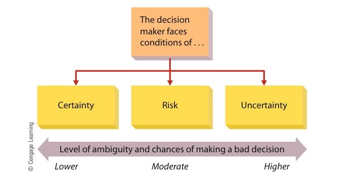

# CHAPTER 4: Managing Decision Making

<!-- Page 127 -->

CHAPTER 4Managing DecisionMaking

Learning Outcomes

After studying this chapter, you should be able to:

1Define decision making and discuss types of decisions and decision-making conditions.

2Discuss rational perspectives on decision making, including the steps involved.

3Describe the behavioral aspects of decision making.

4Discuss group and team decision making, including its advantages and disadvantages and how it canbe more effectively managed.

Management in Action

The Embargo Grinds On

#### “I’m not going to risk everything I’ve worked for [for]over 30 years by violating U.S. law.”

—Paul Katzeff, founder of Thanksgiving Coffee Co.

Because they love certain types of coffee, some Americancoffee enthusiasts only buy coffee that’s labeled “Cuban.”As it turns out, though, such brands as Nescafé Café conLeche and Pilon Café Cubano aren’t actually made fromCuban coffee beans: Because of a U.S. embargo againstCuban products, the so-called “Cuban coffee” available inthis country comes from beans grown in such countries asNicaragua, Mexico, or Guatemala, basically anywhere butCuba. Indeed, Americans cannot legally buy any productsfrom Cuba—coffee, cigars, alcohol, or anything else. Socoffee distributors in the United States are limited in theproducts they can offer and must be careful in how theypromote those coffees they do sell. In short, they facerisk and uncertainty in every decision they make.Consider the Canadian firm Merchants of Green Coffee.Its mission “is to deliver the best-tasting coffee experienceto discerning consumers through a supply chain withintegrity and a unique commitment to quality.” Thecompany buys only the finest beans from small growersin Africa, Latin America, and Cuba and stocks premium

Paul Katzeff is the founder of Thanksgiving CoffeeCo. Katzeff would like to see the U.S. governmentdrop its decades-long embargo on Cuban coffee,arguing that it has not been effective and that it hurtsthe Cuban people more than the Cubangovernment.

<!-- Page 128 -->

products like Cuba Turquino. This premium coffee is made from beans grownunder shade-tree canopies at elevations above 3,000 feet. As the name indicates,Cuba Turquino is made from Cuban coffee beans, and for that reason, again,American coffee connoisseurs can’t buy it.Now, coffee beans from other Latin American nations are also of high quality,and they’re often certified organic. They’re just not Cuban coffee beans, and tosome people in the coffee business, it’s the principle that matters. Paul Katzeff,founder of Thanksgiving Coffee Co., a California producer of specialty coffees,regards the U.S. embargo as impractical (on the grounds that it hasn’t achievedits goals) and immoral (on the grounds that it punishes the Cuban people ratherthan their government). These two reasons are why his company has beenmarketing a line of beans called “End the Embargo Coffee” for over a decade. Thecoffee actually comes from Nicaragua, but the packaging, emblazoned with theimage of Cuban revolutionary Che Guevara, gets the point across. Katzeff hastensto point out that he’s not going “to risk everything I’ve worked for [for] over 30years” by violating U.S. law, but in addition to selling distinctive, high-qualitycoffee, he’s determined “to bring awareness to U.S. consumers on Cuba issues.”Explains Johanna Schulz, director of Thanksgiving’s social and environmentalpolicy: “Since we can’t import Cuban coffee directly, we’re using [End theEmbargo] as an awareness tool to educate customers about the embargo onCuba.” For the past eight years, Thanksgiving has also donated 15 cents fromevery package sold to the U.S.-Cuba Sister Cities Association, a nonprofit thatworks to establish relationships between similar-sized cities in the two countries.The U.S. embargo, which was first imposed in 1962 in response to therevolutionary communist government’s appropriation of American land holdingsin the country, prevents “U.S. persons” and entities “owned or controlled” by“U.S. persons” from engaging in any transactions in which Cuba has an“interest of any nature whatsoever, direct or indirect.” Cuba, therefore, has noaccess to the American market, does without U.S. imports, and amassessubstantial debts to other trading partners. But, says a Canadian businessmanwith investments in Cuba, “anyone who thinks there will be a ‘for sale’ sign [put]up by a bankrupt Cuban government is wrong.” Why? Basically because theembargo doesn’t really have much effect on Cuba or its people.Cubans now buy ice cream and soft drinks from Swiss-based Nestlé, soap andshampoo from Anglo-Dutch Unilever, and cigarettes from Brazil’s Souza Cruz. Thefact that the United States is the world’s largest market for rum did not deterFrench-owned Pernod-Ricard from building a new distillery in Cuba, and Britain’sImperial Tobacco expects to double sales when Americans can once againpurchase premium hand-rolled Cuban cigars. Most of the directors of Canada’sSherritt International are barred from the United States by provisions of theembargo, but they apparently regard the ban as a small price to pay for futurereturns on a $1 5 billion investment in Cuba’s nickel and oil and gas industries.Cuba has also lifted restrictions on many products once unavailable to Cubanconsumers, such as computers, DVDs, and smartphones, and sales of all theseproducts will be a boon to Telecom Italia, which holds a 27 percent stake in thecountry’s state-owned telecom operations.Katzeff is thinking the same thing that a lot of American businesspeople areundoubtedly thinking: “When the embargo is over,” he says, “I want to bethere.” As he sees it, Cuban coffee has a promising post-embargo future: Itspotential, he points out, “is phenomenal. The climate hasn’t changed. The soilhasn’t changed.” And while Katzeff’s geopolitics may rankle some people, his

<!-- Page 129 -->

> **decision making**: The act of choosing one alternative from among a set of alternatives

> decision-makingprocessRecognizing anddefining the nature ofa decision situation,identifyingalternatives,choosing the bestalternative, andputting it intopractice

business sense seems sound. At present, of course, he can’t actually do businesswith Cuban coffee growers, but he has figured out a way to lay the groundwork.He has already established working relationships with coffee cooperatives, groupsof individual growers who pool their crops to enter the export market and securehigher prices, in Latin America and Africa. “Right now,” he says, “my objective isto show those cooperatives that I’m willing to risk something on their behalf,” buta longer-term goal is to invest the same capital and acquired know-how inrelationships with Cuban growers.The director of Thanksgiving’s Cuba project, Nick Hoskins, has alreadydeveloped contacts in Cuba’s coffee-growing regions, and Katzeff hopes toestablish a twinning agreement, an exchange of people-to-people programs, withcooperatives in the coffee-growing province of Santiago de Cuba. “We’re tryingto create models that other companies can use and benefit from,” explainsKatzeff, who is meanwhile willing to settle for a public relations program oftransactions—monetary and otherwise—with American coffee drinkers.1

Managers make decisions every day. Some have immediate consequences. Others, likethose made in the context of the Cuban embargo, are much more long-term in nature.Making effective decisions, as well as recognizing when a bad decision has been madeand quickly responding to it, is a key ingredient in organizational effectiveness. Indeed,some experts believe that decision making is the most basic and fundamental of all man-agerial activities.2 Thus, we discuss it here, in the context of the first management func-tion, planning. Keep in mind, however, that although decision making is perhaps mostclosely linked to the planning function, it is also part of organizing, leading, andcontrolling.We begin our discussion by exploring the nature of decision making. We thendescribe rational perspectives on decision making. Behavioral aspects of decision makingare then introduced and described. We conclude with a discussion of group and teamdecision making.

## THE NATURE OF DECISION MAKING

Managers at Disney recently made the decision to buy all of George Lucas’s properties,including the characters and stories in the Star Wars mythology. At about the same time,the general manager of the Ford dealership in Bryan, Texas, made a decision to sponsora local youth soccer team for $200. Each of these examples reflects a decision, but thedecisions differ in many ways. Thus, as a starting point in understanding decision mak-ing, we must first explore the meaning of decision making as well as types of decisionsand the conditions under which decisions are made.3

### Decision Making Defined

Decision making can refer to either a specific act or a general process. Decision makingis the act of choosing one alternative from among a set of alternatives. The decision-making process, however, is much more than this. One step of the process, for example,is that the person making the decision must both recognize that a decision is necessaryand identify the set of feasible alternatives before selecting one. Hence, the decision-making process includes recognizing and defining the nature of a decision situation,identifying alternatives, choosing the “best” alternative, and putting it into practice.4

<!-- Page 130 -->

> Jim West/Alamy

> programmeddecisionA decision that isrelatively structuredor recurs with somefrequency (or both)

> nonprogrammeddecisionA decision that isrelativelyunstructured andoccurs much lessoften than aprogrammeddecision

The word best, of course, implies effectiveness. Effec-tive decision making requires that the decision makerunderstands the situation driving the decision. Mostpeople would consider an effective decision to be onethat optimizes some set of factors, such as profits, sales,employee welfare, and market share. In some situations,though, an effective decision may be one that minimizesloss, expense, or employee turnover. It may even meanselecting the best method for going out of business, lay-ing off employees, or terminating a strategic alliance.We should also note that managers make decisionsabout both problems and opportunities. For example,making decisions about how to cut costs by 10 percentreflectsaproblem—anundesirablesituationthatrequires a solution. But decisions are also necessary insituations of opportunity. Learning that the firm isearning higher-than-projected profits, for example,requires a subsequent decision. Should the extra fundsbe used to increase shareholder dividends, reinvest incurrent operations, or expand into new markets?5

Of course, it may take a long time before a manager canknow if the right decision was made. For example, in late2008 and early 2009, government leaders made the deci-sion to invest billions of dollars in failing financial institu-tions and other businesses. It will be years—or perhapsdecades—before economists and other experts will knowif those were sound decisions or if the United States wouldhave been better off by allowing those businesses to fail.

Decision making plays a major role in all organizations,both public and private. For example, poor decisionmaking at major financial institutions led to the financialcrisis that swept the United States in 2008 and 2009. Andthen the U.S. government made several controversialdecisions to help pull the economy out of recession.These protesters were among the critics who thoughtdecisions to support the bailouts were inappropriate.

### Types of Decisions

Managers must make many different types of decisions.In general, however, most decisions fall into one of twocategories: programmed and nonprogrammed.6

Programmed decisions are relatively structured orrecur with some frequency (or both). Starbucks uses pro-grammed decisions to purchase new supplies of coffeebeans, cups, and napkins, and its employees are trained in exact procedures for brewingcoffee. Likewise, the Bryan Ford dealer made a decision that he will sponsor a youth soccerteam each year. Thus, when the soccer club president calls, the dealer already knows whathe will do. Many decisions regarding basic operating systems and procedures and standardorganizational transactions are of this variety and can therefore be programmed.7

Nonprogrammed decisions, on the other hand, are relatively unstructured and occurmuch less often than programmed decisions. Disney’s decision to buy George Lucas’sassets was a nonprogrammed decision. Managers faced with such decisions must treateach one as unique, investing enormous amounts of time, energy, and resources intoexploring the situation from all perspectives. Intuition and experience are major factorsin nonprogrammed decisions. Most of the decisions made by top managers involvingstrategy (including mergers, acquisitions, and takeovers) and organization design arenonprogrammed. So are decisions about new facilities, new products, labor contracts,and legal issues.

<!-- Page 131 -->
> **state of risk**: A condition in which the availability of each alternative and its potential payoffs and costs are all associated with probability estimates.

> **state of certainty**: A condition in which the decision maker knows with reasonable certainty what the alternatives are and what conditions are associated with each alternative

### Decision-Making Conditions

Just as there are different kinds of decisions, there are also different conditions underwhich decisions are made. Managers sometimes have an almost perfect understandingof the conditions surrounding a decision, but at other times they have few clues aboutthose conditions. In general, as shown in Figure 4.1, the circumstances that exist for thedecision maker are conditions of certainty, risk, or uncertainty.8

#### Decision Making Under Certainty

When the decision maker knows with reason-able certainty what the alternatives are and what conditions are associated with eachalternative, a state of certainty exists. Suppose, for example, that managers at SingaporeAirlines make a decision to buy five new jumbo jets. Their next decision would be fromwhom to buy them. Because only two companies in the world make jumbo jets, Boeingand Airbus, Singapore Airlines knows its options exactly. Each has proven products andwill guarantee prices and delivery dates. The airline thus knows the alternative condi-tions associated with each. There is little ambiguity and relatively little chance of makinga bad decision.Few organizational decisions, however, are made under conditions of true certainty.The complexity and turbulence of the contemporary business world make such situationsrare. Even the airplane purchase decision we just considered has less certainty than itappears. The aircraft companies may not be able to really guarantee delivery dates, sothey may write cost increase or inflation clauses into contracts. Thus, the airline maybe only partially certain of the conditions surrounding each alternative.

#### Decision Making Under Risk

A more common decision-making condition is astate of risk. Under a state of risk, the availability of each alternative and its potentialpayoffs and costs are all associated with probability estimates.9 Suppose, for example,that a labor contract negotiator for a company receives a “final” offer from the unionright before a strike deadline. The negotiator will have two alternatives: to accept or toreject the offer. The risk centers on whether the union representatives are bluffing. If the

The decisionmaker facesconditions of . . .

*Figure 4.1 — Decision-Making Conditions (Source: Page 131)*

Most major organizational decisions today are made under a state of uncertainty.Managers making decisions in these circumstances must be sure to learn as muchas possible about the situation and approach the decision from a logical and rationalperspective.

<!-- Page 132 -->

> **state of uncertainty**: A condition in which the decision maker does not know all the alternatives, the risks associated with each, or the likely consequences of each alternative

company negotiator accepts the offer, she avoids a strike but commits to a relativelycostly labor contract. If she rejects the contract, she may get a more favorable contractif the union is bluffing, but she may provoke a strike if it is not.On the basis of past experiences, relevant information, the advice of others, and herown judgment, she may conclude that there is about a 75 percent chance that unionrepresentatives are bluffing and about a 25 percent chance that they will back up theirthreats. Thus, she can base a calculated decision on the two alternatives (accept or rejectthe contract demands) and the probable consequences of each. When making decisionsunder a state of risk, managers must reasonably estimate the probabilities associated witheach alternative. For example, if the union negotiators are committed to a strike if theirdemands are not met, and the company negotiator rejects their demands because sheguesses they will not strike, her miscalculation will prove costly.As indicated in Figure 4.1, decision making under conditions of risk is accompaniedby moderate ambiguity and the chances of a bad decision. Managers at Ford MotorCompany often face risky decisions. For instance, like many other automobile compa-nies, Ford laid off thousands of workers during 2008. But shortly thereafter, Ford execu-tives noted that as fuel prices were dropping, demand for its new F-150 pickup wasincreasing in spite of the recession. So, the firm rehired 1,000 of its former workers tohelp build more pickups. The risk was that if gas prices had surged unexpectedly and/or demand for the F-150 had cooled, Ford would have been in the embarrassing positionof recalling workers and then once again terminating them. But the upside was thatFord’s assessment that it would generate new revenues and more profits was correct.10

More recently, Ford launched the newest version of the F-150 in early 2014. The risk?Truck makers have historically used steel for most of their product’s exterior sheet metal,but the new F-150 uses aluminum. Aluminum construction reduces the weight of thetrucks by several hundred pounds, promising much better fuel economy. If pickupbuyers accept aluminum construction and embrace better fuel economy, Ford will havegained a competitive advantage. But if buyers resist the idea of aluminum, then the F-150may see a drop in market share. The “Tough Times, Tough Choices” box explores riskmanagers face due to increased globalization.

#### Decision Making Under Uncertainty

Most of the major decision making in con-temporary organizations is done under a state of uncertainty, where the decision makerdoes not know all the alternatives, the risks associated with each, or the likely conse-quences of each alternative. This uncertainty stems from the complexity and dynamismof contemporary organizations and their environments. For example, airlines continuallyface uncertainty stemming from fluctuations in fuel costs. In large part to reduce thisuncertainty, Delta Air Lines recently took the unusual step of buying its own oil refin-ery.11 The emergence of new technology and social media as significant forces in today’scompetitive environment has served to increase both revenue potential and uncertaintyfor most managers.To make effective decisions in these circumstances, managers must acquire asmuch relevant information as possible and approach the situation from a logicaland rational perspective. Intuition, judgment, and experience always play majorroles in the decision-making process under conditions of uncertainty. Even so, uncer-tainty is the most ambiguous condition for managers and the one in which they aremost prone to error.12 Indeed, many of the problems associated with the downfall ofArthur Andersen resulted from the firm’s apparent difficulties in responding toambiguous and uncertain decision parameters regarding the firm’s moral, ethical,and legal responsibilities.13

<!-- Page 133 -->

> classical decisionmodelA prescriptiveapproach to decisionmaking that tellsmanagers how theyshould makedecisions; it assumesthat managers arelogical and rationaland that theirdecisions will be inthe organization’sbest interests

TOUGH TIMES, TOUGH CHOICES

## The Wide World of Risk

Aldi itself is a German firm. One thing’s for sure, ifyou’re going to be dealing with a company overseas,you’d better have a good idea of where and howdecisions are made, and who has the real power tomake them.Remember, too, that different cultures have dif-ferent attitudes when it comes to risk, especially asit relates to entrepreneurship. In some countries andcultures, like that of the United States, there’s a livelyentrepreneurial spirit. Businesspeople are open totaking risks, and if they fail, they tend to pick them-selves up and move on to something else. In someAsian countries, though, the entrepreneurial spirit isoften tempered by the need for consensus and get-ting everyone on board. This approach requires a lotof patience and the ability to compromise. Knowingthe economic cultural forces that shape both a busi-ness organization and people’s attitudes toward risk,success, and failure is an increasingly important com-ponent of the manager’s job today.

Decision making under a condition of risk is becom-ing an increasingly common challenge for all man-agers today. One reason for the increased risk isthe fact that globalization has become such a factorin everyday business life. The general impact of theglobal economy and the expanded reach and powerof multinational companies are the basic causes ofincreased risk stemming from globalization. Manylarge corporations have actually become engines forinnovation as well as growth, adapting to new mar-kets and new economic circumstances. In a highlyinterconnected world, however, it’s often hard to fig-ure out the complex ownership and organizationalstructures of many global corporations. Sometimes,for example, their branding strategies and manage-ment structures lead people to think that they’relocal companies when, in fact, the real source of cor-porate power may lie thousands of miles away onanother continent. For example, there are severalhundred Aldi supermarkets in the United States, but

## RATIONAL PERSPECTIVES ON DECISION MAKING

Most managers like to think of themselves as rational decision makers. And, indeed,many experts argue that managers should try to be as rational as possible in makingdecisions.14 This section highlights the fundamental and rational perspectives on decisionmaking.

### The Classical Model of Decision Making

The classical decision model is a prescriptive approach that tells managers howthey should make decisions. It rests on the assumptions that managers are logicaland rational and that they make decisions that are in the organization’s bestinterests. Figure 4.2 shows how the classical model views the decision-makingprocess:

1. Decision makers have complete information about the decision situation and possi-ble alternatives.2. They can effectively eliminate uncertainty to achieve a decision condition ofcertainty.3. They evaluate all aspects of the decision situation logically and rationally.

As we see later, these conditions rarely, if ever, actually exist.

<!-- Page 134 -->

> **steps in rational decision making**: Recognize and define the decision situation; identify appropriate alternatives; evaluate each alternative in terms of its feasibility, satisfactoriness, and consequences; select the best alternative; implement the chosen alternative; and follow up and evaluate the results of the chosen alternative.

*Figure 4.2 — The Classical Model of Decision Making (Source: Page 134)*

### Steps in Rational Decision Making

A manager who really wants to approach a decision rationally and logically should try to follow the steps in rational decision making, which are listed in Table 4.1.

#### Recognizing and Defining the Decision Situation
The first step in rational decision making is recognizing that a decision is necessary—that is, there is some stimulus for a decision. In business, such stimuli are usually either problems or opportunities. For example, a problem might be declining sales or increasing customer complaints. An opportunity might be the availability of a new technology or an underserved market niche. To define the situation accurately, the manager must understand the problem itself rather than merely its symptoms.

#### Identifying Alternatives
Once the decision situation has been recognized and defined, the second step is to identify alternative courses of effective action. Both obvious and creative alternatives are desired. In general, the more important the decision, the more attention is directed to developing alternatives. Managers must also recognize that their alternatives are constrained by factors such as legal restrictions, moral and ethical norms, available resources, and company policies.

<!-- Page 135 -->

### Table 4.1: Steps in the Rational Decision-Making Process

| Step | Detail | Example |
| :--- | :--- | :--- |
| **1. Recognizing and defining the decision situation** | Some stimulus indicates that a decision must be made. The stimulus may be positive or negative. | A plant manager sees that employee turnover has increased by 5 percent. |
| **2. Identifying alternatives** | Both obvious and creative alternatives are desired. In general, the more important the decision, the more alternatives should be generated. | The plant manager can increase wages, increase benefits, or change hiring standards. |
| **3. Evaluating alternatives** | Each alternative is evaluated to determine its feasibility, its satisfactoriness, and its consequences. | Increasing benefits may not be feasible. Increasing wages and changing hiring standards may satisfy the goal. |
| **4. Selecting the best alternative** | Consider all situational factors, and choose the alternative that best fits the situation. | Changing hiring standards will take an extended period of time to cut turnover, so increase wages. |
| **5. Implementing the chosen alternative** | The chosen alternative is implemented into the organizational system. | The plant manager may need permission from corporate headquarters. The HR department must establish a new wage structure. |
| **6. Following up and evaluating the results** | At some time in the future, the manager should ascertain the extent to which the alternative chosen in step 4 and implemented in step 5 has worked. | The plant manager notes that, six months later, turnover dropped to its previous level. |

locations. AT&T spent over a year searching before selecting Denver for a major regional operations center. Similarly, Boeing and Airbus spent years evaluating customer requirements, technical configurations, and production feasibility before launching the 787 Dreamliner and A350, respectively.

<!-- Page 136 -->

> Eliminate fromconsideration.

*Figure 4.3 — Evaluating Alternatives in the Decision-Making Process (Source: Page 136)*

a joint venture to create a single new large plane, or they could modify their largest exist-ing planes to increase their capacity.

#### Evaluating Alternatives

The third step in the decision-making process is evaluat-ing each of the alternatives. Figure 4.3 presents a decision tree that can be used tojudge different alternatives. The figure suggests that each alternative be evaluated interms of its feasibility, satisfactoriness, and consequences. The first question to ask iswhether an alternative is feasible. Is it within the realm of probability and practicality?For a small, struggling firm, an alternative requiring a huge financial outlay is probablyout of the question. Other alternatives may not be feasible because of legal barriers.And limited human, material, and information resources may make other alternativesimpractical.When an alternative has passed the test of feasibility, it must next be examined tosee how well it satisfies the conditions of the decision situation. For example, amanager searching for ways to double production capacity might initially consider pur-chasing an existing plant from another company. If more detailed analysis reveals thatthe new plant would increase production capacity by only 35 percent, this alternativemay not be satisfactory. Finally, when an alternative has proven both feasible and sat-isfactory, its probable consequences must still be assessed. To what extent will a partic-ular alternative influence other parts of the organization? What financial andnonfinancial costs will be associated with such influences? For example, a plan toboost sales by cutting prices may disrupt cash flows, require a new advertising pro-gram, and alter the behavior of sales representatives because it requires a differentcommission structure. The manager, then, must put “price tags” on the consequencesof each alternative. Even an alternative that is both feasible and satisfactory must beeliminated if its consequences are too expensive for the total system. Airbus felt itwould be at a disadvantage if it tried to simply enlarge its existing planes because theBoeing 747 was already the largest aircraft being made and could readily be expandedto remain the largest. Boeing, meanwhile, was seriously concerned about the risk inher-ent in building a new and even larger plane, even if it shared the risk with Airbus as ajoint venture.

Eliminate fromconsideration.

Eliminate fromconsideration.

Evaluating Alternatives in the Decision-Making Process

Managers must thoroughly evaluate all the alternatives; this increases the chances that the alternative that isfinally chosen will be successful. Failure to evaluate an alternative’s feasibility, satisfactoriness, andconsequences can lead to a wrong decision.

<!-- Page 137 -->

#### Selecting the Best Alternative

Even though many alternatives fail to pass the tripletests of feasibility, satisfactoriness, and affordable consequences, two or more alternativesmay remain. Choosing the best of these is the real crux of decision making. Oneapproach is to choose the alternative with the optimal combination of feasibility, satisfac-toriness, and affordable consequences. Even though most situations do not lend them-selves to objective, mathematical analysis, the manager can often develop subjectiveestimates and weights for choosing an alternative.Optimization is also a frequent goal. Because a decision is likely to affect severalindividuals or units, any feasible alternative will probably not maximize all of therelevant goals. Suppose that the manager of the Kansas City Royals needs to select anew outfielder for the upcoming baseball season. Bill hits .350 but sometimes hasdifficulty catching fly balls, Joe hits only .225 but is outstanding in the field, and Sam hits.290 and is a solid but not outstanding fielder. The manager would probably select Sambecause of the optimal balance of hitting and fielding. Decision makers should alsoremember that finding multiple acceptable alternatives may be possible; selecting justone alternative and rejecting all the others might not be necessary. For example, theRoyals’ manager might decide that Sam will start each game, Bill will be retained as apinch hitter, and Joe will be retained as a defensive substitute. In many hiring decisions,the candidates remaining after evaluation are ranked. If the top candidate rejects theoffer, it may be automatically extended to the number-two candidate and, if necessary,to the remaining candidates in order. For the reasons noted earlier, Airbus proposed ajoint venture with Boeing. Boeing, meanwhile, decided that its best course of action wasto modify its existing 747 to increase its capacity. As a result, Airbus then decided toproceed on its own to develop and manufacture a new jumbo jet. Boeing, however, alsodecided that in addition to modifying its 747, it would develop a new plane to offer as analternative, albeit one not as large as the 747 or the proposed Airbus plane.

#### Implementing the Chosen Alternative

After an alternative has been selected, themanager must put it into effect. In some decision situations, implementation is fairlyeasy; in others, it is more difficult. In the case of an acquisition, for example, man-agers must decide how to integrate all of the new business’s activities, including pur-chasing, human resource practices, and distribution, into an ongoing organizationalframework. For example, when Hewlett-Packard made the decision to buy CompaqComputer, managers estimated that it would take at least a year to integrate thetwo firms into a single one. Similarly, the decision made by executives at AmericanAirlines and US Airways to merge into a single airline will take two or three years toimplement. Operational plans, which we discussed in Chapter 3, are useful in imple-menting alternatives.Managers must also consider people’s resistance to change when implementing deci-sions. The reasons for such resistance include insecurity, inconvenience, and fear of theunknown. Managers should anticipate potential resistance at various stages of the imple-mentation process. (Resistance to change is covered in Chapter 7.) Managers should alsorecognize that even when all alternatives have been evaluated as precisely as possible andthe consequences of each alternative weighed, unanticipated consequences are still likely.Any number of factors—such as unexpected cost increases, a less-than-perfect fit withexisting organizational subsystems, or unpredicted effects on cash flow or operatingexpenses—could develop after implementation has begun. Boeing set its engineers towork expanding the capacity of its 747 from 416 passengers to as many as 520 passengersby adding 30 feet to the plane’s body. The company has also been developing its new planeintended for international travel, the Boeing 787 Dreamliner. Airbus engineers, meanwhile,spent years developing and constructing its new jumbo jet, the A380; it is equipped with

<!-- Page 138 -->

Boeing and Airbus used rational perspectives to arrive at different decisions about majorinvestments in developing new airplanes. Airbus decided to build the A380, the world’s largestpassenger plane. Boeing, meanwhile, chose to develop a smaller but much more fuel efficientplane named the 787 Dreamliner.

escalators and elevators, and capable of carrying 655 passengers. Airbus’s developmentcosts alone are estimated to be more than $12 billion.

#### Following Up and Evaluating the Results

The final step in the decision-makingprocess requires that managers evaluate the effectiveness of their decision—that is, theyshould make sure that the chosen alternative has served its original purpose. If an imple-mented alternative appears not to be working, the manager can respond in several ways.Another previously identified alternative (the original second or third choice, forinstance) could be adopted. Or the manager might recognize that the situation was notcorrectly defined to begin with and start the process all over again. Finally, the managermight decide that the original alternative is in fact appropriate but has not yet had timeto work or should be implemented in a different way.18

<!-- Page 139 -->

Failure to evaluate decision effectiveness may have serious consequences. The Penta-gon once spent $1 8 billion and eight years developing the Sergeant York antiaircraftgun. From the beginning, tests revealed major problems with the weapon system, butnot until it was in its final stages, when it was demonstrated to be completely ineffective,was the project scrapped.At this point, both Boeing and Airbus are still learning about the consequences oftheir decisions. Airbus’s A380 has been placed in commercial service. However, theplane has suffered numerous mechanical problems. Moreover, because the weakenedeconomy has dealt a blow to large international airlines, some of them—such as QantasAirways and Emirates Airlines—deferred or cancelled orders for the plane. Airbus esti-mated that it needs to sell 420 A380s before it starts making a profit. Current projectionssuggest that sales of the plane may not hit that target until at least 2020.19 Meanwhile, itappeared for a while that Boeing’s commitment to the new 787 might prove to be thebest decision of all. A key element of the new plane is that it is much more fuel efficientthan other international airplanes. Given the dramatic surge in fuel costs in recent years,a fuel-efficient option like the 787 is likely to be an enormous success. However, the 787has suffered from numerous manufacturing problems and was not available for passen-ger service until 2012 (over 3 years late). The plane also experienced problems in 2013and was grounded for several weeks. New problems surfaced in early 2014 as well. So, itsreal impact will not be known for a few more years.20

### Evidence-Based Management

Rational perspectives on decision making have recently been reformulated under the con-cept of evidence-based management. Stanford University professors Jeffrey Pfeffer and BobSutton, authors of Hard Facts, Dangerous Half-Truths, and Total Nonsense, have put out acall for a renewed reliance on rationality in managerial decision making—an approach thatthey call evidence-based management (EBM). “Management decisions,” they argue,“[should] be based on the best evidence, managers [should] systematically learn from expe-rience, and organizational practices [should] reflect sound principles of thought andanalysis.” They define evidence-based management as “a commitment to finding andusing the best theory and data available at the time to make decisions,” but their “FivePrinciples of Evidence-Based Management” make it clear that EBM means more thanjust sifting through data and crunching numbers. Here’s what they recommend:

1. Face the hard facts and build a culture in which people are encouraged to tell thetruth, even if it’s unpleasant.2. Be committed to “fact-based” decision making—which means being committed togetting the best evidence and using it to guide actions.3. Treat your organization as an unfinished prototype—encourage experimentation andlearning by doing.4. Look for the risks and drawbacks in what people recommend (even the best medi-cine has side effects).5. Avoid basing decisions on untested but strongly held beliefs, what you have done inthe past, or uncritical “benchmarking” of what winners do.

Pfeffer and Sutton are particularly persuasive when they use EBM to question theoutcomes of decisions based on “untested but strongly held beliefs” or on “uncritical‘benchmarking.” Take, for instance, the popular policy of paying high performerssignificantly more than low performers. Pfeffer and Sutton’s research shows thatpay-for-performance policies get good results when employees work solo orindependently. But it’s another matter altogether when it comes to collaborative

<!-- Page 140 -->

> administrativemodelA decision-makingmodel that arguesthat decision makers(1) use incompleteand imperfectinformation, (2) areconstrained bybounded rationality,and (3) tend to“satisfice” whenmaking decisions

> **bounded rationality**: A concept suggesting that decision makers are limited by their values and unconscious reflexes, skills, and habits

teams—the kind of teams that make so many organizational decisions today. Underthese circumstances, the greater the gap between highest- and lowest-paid executives,the weaker the firm’s financial performance. Why? According to Pfeffer and Sutton,wide disparities in pay often weaken both trust among team members and the socialconnectivity that contributes to strong team-based decision making.Or consider another increasingly prevalent policy for evaluating and rewarding talent.Pioneered at General Electric by the legendary Jack Welch, the practice of “forced ranking”divides employees into three groups based on performance—the top 20 percent, middle70 percent, and bottom 10 percent—and terminates those at the bottom. Pfeffer and Suttonfound that, according to many HR managers, forced ranking impaired morale and collabo-ration and ultimately reduced productivity. They also concluded that automatically firingthe bottom 10 percent resulted too often in the unnecessary disruption of otherwise effectiveteamwork. That’s how they found out that 73 percent of the errors committed by commer-cial airline pilots occur on the first day that reconfigured crews work together.21

## BEHAVIORAL ASPECTS OF DECISION MAKING

If all decision situations were approached as logically as described in the previous section,more decisions might prove to be successful. Yet decisions are often made with little con-sideration for logic and rationality. Some experts have estimated that U.S. companies userational decision-making techniques less than 20 percent of the time.22 And, even whenorganizations try to be logical, they sometimes fail. For example, when Starbucks openedits first coffee shop in New York, it relied on scientific marketing research, taste tests, andrational deliberation in making a decision to emphasize drip over espresso coffee. How-ever, that decision still proved wrong, as New Yorkers strongly preferred the sameespresso-style coffees that were Starbucks mainstays in the West. Hence, the firm had tohastily reconfigure its stores to better meet customer preferences.On the other hand, sometimes when a decision is made with little regard for logic, itcan still turn out to be correct.23 An important ingredient in how these forces work is thebehavioral aspect of decision making. The administrative model better reflects these sub-jective considerations. Other behavioral aspects include political forces, intuition andescalation of commitment, risk propensity, and ethics.

### The Administrative Model

Herbert A. Simon was one of the first experts to recognize that decisions are not alwaysmade with rationality and logic.24 Simon was subsequently awarded the Nobel Prize inEconomics. Rather than prescribing how decisions should be made, his view of decisionmaking, now called the administrative model, describes how decisions often actually aremade. As illustrated in Figure 4.4, the model holds that decision makers (1) use incom-plete and imperfect information, (2) are constrained by bounded rationality, and (3) tendto “satisfice” when making decisions.

Bounded rationality suggests that decision makers are limited by their values andunconscious reflexes, skills, and habits. They are also limited by less-than-completeinformation and knowledge. Bounded rationality partially explains how U.S. auto execu-tives allowed Japanese automakers to get such a strong foothold in the U.S. domesticmarket. For years, executives at GM, Ford, and Chrysler compared their companies’ per-formance only to one another’s and essentially ignored foreign imports. The foreign“threat” was not acknowledged until the domestic auto market had been changed for-ever. If managers had gathered—and acknowledged—complete information from thebeginning, they might have been better able to thwart foreign competitors. Essentially,

<!-- Page 141 -->

*Figure 4.4 — The Administrative Model of Decision Making (Source: Page 141)*

> **satisficing**: The tendency to search for alternatives only until one is found that meets some minimum standard of sufficiency

> **coalition**: An informal alliance of individuals or groups formed to achieve a common goal

. . . and end up with adecision that may or maynot serve the interestsof the organization.

When faced with adecision situationmanagers actually . . .

The Administrative Model of Decision Making

The administrative model is based on behavioral processes that affect how managers make decisions.Rather than prescribing how decisions should be made, it focuses more on describing how they are made.

then, the concept of bounded rationality suggests that although people try to be rationaldecision makers, their rationality has limits.Another important part of the administrative model is satisficing, which suggests thatrather than conducting an exhaustive search for the best possible alternative, decisionmakers tend to search only until they identify an alternative that meets some minimumstandard of sufficiency. A manager looking for a new plant site, for example, may selectthe first site she finds that meets basic requirements for transportation, utilities, andprice, even though further searching might yield a better location. People satisfice for avariety of reasons. Managers may simply be unwilling to ignore their own motives (suchas reluctance to spend time making a decision) and therefore not be able to continuesearching after a minimally acceptable alternative is identified. The decision maker maybe unable to weigh and evaluate large numbers of alternatives and criteria. Also, subjec-tive and personal considerations often intervene in decision situations.Because of the inherent imperfection of information, bounded rationality, and satisfi-cing, a manager’s decisions may or may not actually be in the organization’s best inter-ests. A manager may choose a particular location for a new plant because it offers thelowest price and best availability of utilities and transportation. Or she may choose thelocation because it is located in a community where she wants to live.In summary, then, the classical and administrative models paint quite different pic-tures of decision making. Which is more correct? Actually, each can be used to betterunderstand how managers make decisions. The classical model is prescriptive: It explainshow managers can at least attempt to be more rational and logical in their approaches todecisions. The administrative model can be used by managers to develop a better under-standing of their inherent biases and limitations.25 In the following sections, we describemore fully other behavioral forces that can influence decisions.

### Political Forces in Decision Making

Political forces are another major element that contributes to the behavioral nature ofdecision making. Organizational politics is covered in Chapter 11, but one major elementof politics, coalitions, is especially relevant to decision making. A coalition is an informalalliance of individuals or groups formed to achieve a common goal. This common goal isoften a preferred decision alternative. For example, coalitions of stockholders frequentlyband together to force a board of directors to make a certain decision.When General Motors (GM) decided to launch Saturn as a new automobile companyseveral years ago, the idea had the full backing and support of its CEO, Roger Smith.Saturn was to have its own factories, design teams, and dealer networks and was to com-pete directly with high-quality foreign imports such as Toyota and Honda. Just as the

<!-- Page 142 -->

> **intuition**: An innate belief about something, without conscious consideration

> escalation ofcommitmentWhen a decisionmaker stays with adecision even whenit appears to bewrong

first Saturn cars were being introduced, however, Smith retired. As it turned out, a coali-tion of senior GM executives had opposed the Saturn concept but had been unable to doanything about it because Smith was such a powerful product champion. When Smithleft GM, though, the coalition managed to divert resources intended for Saturn to otherGM brands. As a result, new Saturn products were delayed, the brand received weakmarketing support, and it never lived up to expectations.26

The impact of coalitions can be either positive or negative. They can help astute man-agers get their organization on a path toward effectiveness and profitability, or they canstrangle well-conceived strategies and decisions. Managers must recognize when to usecoalitions, how to assess whether coalitions are acting in the organization’s best interests,and how to constrain their dysfunctional effects.27

### Intuition and Escalation of Commitment

Two other important decision processes that go beyond logic and rationality are intui-tion and escalation of commitment to a chosen course of action.

#### Intuition

Intuition is an innate belief about something without conscious consider-ation. Managers sometimes decide to do something because it “feels right” or they have a“hunch.” This feeling usually is not arbitrary, however. Rather, it is based on years ofexperience and practice in making decisions in similar situations.28 An inner sense mayhelp managers make an occasional decision without going through a full-blown rationalsequence of steps. For example, Kip Tindell, CEO of The Container Store, emphasizesthe use of intuition throughout his company and urges employees to believe that it iscritical in the workplace. He is quoted as saying, “Intuition is only the sum total ofyour life experiences. So why would you want to leave it at home when you come towork in the morning?”29 Of course, all managers, but especially the inexperienced ones,should be careful not to rely too heavily on intuition. If rationality and logic are contin-ually flouted for “what feels right,” the odds are that disaster will strike one day. Thissituation is illustrated in the “At Your Service” feature.

#### Escalation of Commitment

Another important behavioral process that influencesdecision making is escalation of commitment to a chosen course of action. In particular,decision makers sometimes make decisions and then become so committed to thecourses of action suggested by those decisions that they stay with them, even when thedecisions appear to have been wrong.30 For example, when people buy stock in a com-pany, they sometimes refuse to sell it even after repeated drops in price. They choose acourse of action—buying the stock in anticipation of making a profit—and then staywith it even in the face of increasing losses. Moreover, after the value drops, they ratio-nalize that they can’t sell now because they will lose money.For years, Pan American World Airways ruled the skies and used its profits to diver-sify into real estate and other businesses. But, with the advent of deregulation, Pan Ambegan to struggle and lose market share to other carriers. When Pan Am managersfinally realized how ineffective their airline operations had become, experts today pointout that the “rational” decision would have been to sell off the remaining airline opera-tions and concentrate on the firm’s more profitable businesses. But because they still sawthe company as being first and foremost an airline, they instead began to slowly sell offthe firm’s profitable holdings to keep the airline flying. Eventually, the company was leftwith nothing but an ineffective and inefficient airline, and then it had to sell off its moreprofitable routes before being taken over by Delta. Had Pan Am managers made themore rational decision years earlier, chances are the firm could still be a profitable enter-prise today, albeit one with no involvement in the airline industry.31

<!-- Page 143 -->

AT YOUR SERVICE

## A Bad Decision at Wesabe

the startup process, Hedlund and Knight rejected apartnership with a firm called Yodlee, which hadalready developed a system for accessing transac-tion data from banks. But because the Yodlee pro-cessworkedwithusers’passwords,Wesabeconsidered it too great a security risk and proceededto work on its own process, which, though moresecure, was also more cumbersome.“Everyone—I mean 90-percent-plus of every-body,” says Hedlund, “told me that they wouldnever in a million years use a startup website thatasked them for their bank passwords.” When Mintcame online in 2007, it was using Yodlee technology,password-access included, and Hedlund acknowl-edges that he’d made a poor decision by relying onhis own informal market research: “We should haveknown,” he admits, “that somebody would go withYodlee, and we should have aimed at [Yodlee] aswhat we needed to achieve.” By 2008, Wesabe,too, was accepting users’ passwords in order to sim-plify the process of pulling bank data into its system.“We just didn’t build it nearly fast enough,” saysHedlund of Wesabe’s own data-access system.“That one mistake—not using or replacing Yodleebefore Mint had a chance to launch on Yodlee—was probably enough to kill Wesabe alone.”

As far as U.S. small business was concerned, thefirst quarter of 2010 could have been worse: Therewas a net loss of only 96,000 companies with fewerthan 100 employees. As a matter of fact, the firstquarter of 2009 was worse—a lot worse: By theend of the quarter, there were 400,000 fewer smallbusinesses than there had been at the beginning.And service businesses were especially hard hit.One of the companies that shut down in 2010 wasWesabe, which had launched in 2006 as an online ser-vice provider to help people manage their money andmake better financial decisions. It was one of the firstcompanies to enter the financial sector of what’s oftenreferred to as Web 2.0—the world of web applicationsthat allow users to interact and collaborate on contentthat they create themselves. The idea was to let cus-tomers access data from several financial institutionsand then compare their own money managementpractices to those of online peers.Wesabe actually got off to a reasonably goodstart. Within the first year, founders Marc Hedlundand Jason Knight secured venture capital totaling$4 7 million and attracted 150,000 members. Thefirst signs of trouble appeared in the second year,just after a competitor called Mint.com came online.Nine months after its launch, Mint.com boasted$17 million in venture capital and 300,000 users. In2009, Intuit, a creator of financial and tax-preparationsoftware,purchasedMint.comfor$170million.Wesabe held on until mid-2010, when Hedlund andKnight announced that the company could no longerhandle users’ highly sensitive data “with shoestringoperations and security staff.”So what went wrong? Naturally, there’s no singlereason for Wesabe’s failure, but both Hedlund, whoblogged a postmortem shortly after the shutdown,and independent observers point to one crucial busi-ness decision as a key factor. In the early stages of

References: Eilene Zimmerman, “How Six CompaniesFailed to Survive 2010,” New York Times, January 5,2011,www.nytimes.com,accessedonSeptember5,2013; Anthony Ha, “Personal Finance Startup Wesabe toShut Down,” VentureBeat, June 30, 2010, http://venturebeat.com, accessed on September 5, 2013; Marc Hedlund,“Why Wesabe Lost to Mint,” Marc Hedlund’s Blog,October 1, 2010, http://blog.precipice.org, accessed onSeptember 5, 2013; “Some Lessons Learned from theRise and Fall of Wesabe,” Credit Union Journal, December16, 2010, www.cunatechnologycouncil.org, accessed onSeptember 5, 2013.

In contrast, a group of investors licensed the use of Hard Rock logos and trademarksfor a large theme park—Hard Rock Park—to be built in South Carolina. After six yearsof planning and construction and an investment of over $400 million, the park in MyrtleBeach opened to dismal reviews and poor attendance. Rather than increasing theirinvestment and trying to increase attendance, owners decided after only nine months toshut down the park and sell off its assets.32

Thus, decision makers must walk a fine line. On the one hand, they must guard againststicking too long with an incorrect decision. To do so can bring about financial decline. On

<!-- Page 144 -->

> **risk propensity**: The extent to which a decision maker is willing to gamble when making a decision

the other hand, they should not bail out of a seemingly incorrect decision too soon, asAdidas once did. Adidas had dominated the market for professional athletic shoes. It subse-quently entered the market for amateur sports shoes and did well there also. But managersinterpreted a sales slowdown as a sign that the boom in athletic shoes was over. Theythought that they had made the wrong decision and ordered drastic cutbacks. The markettook off again with Nike at the head of the pack, and Adidas never recovered. Fortunately, anew management team has changed the way Adidas makes decisions, and the firm is againon its way to becoming a force in the athletic shoe and apparel markets.

### Risk Propensity and Decision Making

The behavioral element of risk propensity is the extent to which a decision maker is will-ing to gamble when making a decision. Some managers are cautious about every decisionthey make. They try to adhere to the rational model and are extremely conservative inwhat they do. Such managers are more likely to avoid mistakes, and they infrequentlymake decisions that lead to big losses. Other managers are extremely aggressive in makingdecisions and are willing to take risks.33 They rely heavily on intuition, reach decisionsquickly, and often risk big investments on their decisions. As in gambling, these managersare more likely than their conservative counterparts to achieve big successes with theirdecisions; they are also more likely to incur greater losses.34 The organization’s culture isa prime ingredient in fostering different levels of risk propensity.

### Ethics and Decision Making

As we introduced in Chapter 2, individual ethics are personal beliefs about right andwrong behavior. Ethics are clearly related to decision making in a number of ways. Forexample, suppose that, after careful analysis, a manager realizes that his company couldsave money by closing his department and subcontracting with a supplier for the sameservices. But to recommend this course of action would result in the loss of several jobs,

De Meester Johan/Arterra Picture Library/Alamy

It is both unethical and illegal to make a decision to improperly dump trash and hazardous waste.Nevertheless, some people make this decision in order to save time and money. Of course, othersincur additional costs in cleaning up dumping sites such as this one.

<!-- Page 145 -->

> interacting groupor teamA decision-makinggroup or team inwhich membersopenly discuss,argue about, andagree on the bestalternative

> **Delphi group**: A form of group decision making in which a group is used to achieve a consensus of expert opinion

including his own. His own ethical standards will clearly shape how he proceeds.35

Indeed, each component of managerial ethics (relationships of the firm to its employees,of employees to the firm, and of the firm to other economic agents) involves a wide vari-ety of decisions, all of which are likely to have an ethical component. Thus, a managermust remember that, just as behavioral processes such as politics and risk propensityaffect the decisions he makes, so, too, do his ethical beliefs.36

## GROUP AND TEAM DECISION MAKING IN ORGANIZATIONS

In more and more organizations today, important decisions are made by groupsand teams rather than by individuals. Examples include the executive committee ofAbercrombie & Fitch, product design teams at Texas Instruments, and marketing plan-ning groups at Red Lobster. Managers can typically choose whether to have individualsor groups and teams make a particular decision. Thus, knowing about forms of groupand team decision making and their advantages and disadvantages is important.37

### Forms of Group and Team Decision Making

The most common methods of group and team decision making are interacting groups,Delphi groups, and nominal groups. Increasingly, these methods of group decision mak-ing are being conducted online.38

#### Interacting Groups or Teams

Interacting groups or teams are the most commondecision-making group. The format is simple—either an existing or a newly designated groupor team is asked to make a decision. Existing groups or teams might be functional departments,regular work teams, or standing committees. Newly designated groups or teams can be ad hoccommittees, task forces, or newly constituted work teams. The group or team members talkamong themselves, argue, agree, form internal coalitions, and so forth. Finally, after someperiod of deliberation, the group or team makes its decision. An advantage of this method isthat the interaction among people often sparks new ideas and promotes understanding. Amajor disadvantage, though, is that political processes can play too big a role.

#### Delphi Groups

A Delphi group is sometimes used to arrive at a consensus of expertopinion. Developed by the Rand Corporation, the Delphi procedure solicits input from apanel of experts who contribute individually. Their opinions are combined and, in effect,averaged. Assume, for example, that the problem is to establish an expected date for amajor technological breakthrough in converting coal into usable energy. The first stepin using the Delphi procedure is to obtain the cooperation of a panel of experts. Forthis situation, experts might include various research scientists, university researchers,and executives in a relevant energy industry. At first, the experts are asked to anony-mously predict a time frame for the expected breakthrough. The persons coordinatingthe Delphi group collect the responses, average them, and ask the experts for anotherprediction. In this round, the experts who provided unusual or extreme predictionsmay be asked to justify them. These explanations may then be relayed to the otherexperts. When the predictions stabilize, the average prediction is taken to represent thedecision of the group of experts. The time, expense, and logistics of the Delphi techniquerule out its use for routine, everyday decisions, but it has been successfully used for fore-casting technological breakthroughs at Boeing, market potential for new products atGM, research and development patterns at Eli Lilly, and future economic conditions bythe U.S. government.39 Moreover, although the Delphi method originally relied on

<!-- Page 146 -->

> **nominal group**: A structured technique used to generate creative and innovative alternatives or ideas.

paper-and-pencil responses obtained and shared through the mail, modern Delphi groups typically communicate using electronic networks, web-based surveys, and collaborative platforms.

#### Nominal Groups
Another useful group and team decision-making technique is the nominal group. Unlike the Delphi method, in which group members do not see one another, nominal group members are brought together in a face-to-face setting. The members represent a group in name only, however; they do not talk freely with one another as members of interacting groups do.

#### Advantages and Disadvantages of Group and Team Decision Making
To increase the chances that a group or team decision will be successful, managers must learn how to manage the process of group and team decision making. Federal Express and IBM are increasingly using groups and teams for decision making. Managers must understand both the advantages and disadvantages of group decision making, as summarized in Table 4.2.

### Table 4.2: Advantages and Disadvantages of Group and Team Decision Making

| Advantages | Disadvantages |
| :--- | :--- |
| • More information and knowledge are available. | • The process takes longer than individual decision making, so it is costlier. |
| • More alternatives are likely to be generated. | • Compromise decisions resulting from indecisiveness may occur. |
| • More acceptance of the final decision is likely. | • One person may dominate the group. |
| • Enhanced communication of the decision may result. | • Groupthink may occur. |
| • Better decisions generally emerge. | |

<!-- Page 147 -->

> **groupthink**: A situation that occurs when a group or team’s desire for consensus and cohesiveness overwhelms its desire to reach the best possible decision

### Disadvantages of Group and Team Decision Making

Perhaps the biggest drawback of group and team decision making is the additionaltime and hence the greater expense entailed. The increased time stems from interactionand discussion among group or team members. If a given manager’s time is worth$50 an hour, and if the manager spends two hours making a decision, the decision“costs” the organization $100. For the same decision, a group of five managers mightrequire three hours of time. At the same $50-an-hour rate, the decision “costs” theorganization $750. Assuming the group or team decision is better, the additionalexpense may be justified, but the fact remains that group and team decision makingis more costly.Group or team decisions may also represent undesirable compromises.44 For example,hiring a compromise top manager may be a bad decision in the long run because he orshe may not be able to respond adequately to various subunits in the organization andnot have everyone’s complete support. Sometimes one individual dominates the groupprocess to the point where others cannot make a full contribution. This dominancemay stem from a desire for power or from a naturally dominant personality. The prob-lem is that what appears to emerge as a group decision may actually be the decision ofone person.Finally, a group or team may succumb to a phenomenon known as groupthink, whichoccurs when the desire for consensus and cohesiveness overwhelms the goal of reachingthe best possible decision.45 Under the influence of groupthink, the group may arrive atdecisions that are made not in the best interests of either the group or the organization,but rather to avoid conflict among group members. One of the most clearly documentedexamples of groupthink involved the space shuttle Challenger disaster. As NASA was pre-paring to launch the shuttle, numerous problems and questions arose. At each step of theway, however, decision makers argued that there was no reason to delay and that every-thing would be fine. Shortly after its launch, the shuttle exploded, killing all seven crewmembers.

### Managing Group and Team Decision-Making Processes

Managers can do several things to help promote the effectiveness of group and teamdecision making. One is simply being aware of the pros and cons of having a groupor team make a decision to start with. Time and cost can be managed by setting adeadline by which the decision must be made final. Dominance can be at leastpartially avoided if a special group is formed just to make the decision. An astutemanager, for example, should know who in the organization may try to dominateand can either avoid putting that person in the group or put several strong-willedpeople together.To avoid groupthink, each member of the group or team should critically evaluate allalternatives. So that members present divergent viewpoints, the leader should not makehis or her position known too early. At least one member of the group or team might beassigned the role of devil’s advocate. And, after reaching a preliminary decision, thegroup or team should hold a follow-up meeting wherein divergent viewpoints can beraised again if any group members wish to do so.46 Gould Paper Corporation usedthese methods by assigning managers to two different teams. The teams then spent anentire day in a structured debate presenting the pros and cons of each side of an issueto ensure the best possible decision.

<!-- Page 148 -->

## SUMMARY OF LEARNING OUTCOMES AND KEY POINTS

### 1. Define decision making, and discuss types of decisions and decision-making conditions.
• Decision making is the act of choosing one alternative from among a set of alternatives.
• The decision-making process includes recognizing and defining the decision situation, identifying alternatives, choosing the “best” alternative, and putting it into practice.
• Programmed decisions are relatively structured or recur with some frequency (or both).
• Nonprogrammed decisions are relatively unstructured and occur much less often.
• Decision making occurs under conditions of certainty (the decision maker knows with reasonable certainty what the alternatives are and what conditions are associated with each alternative), risk (the availability of each alternative and its potential payoffs and costs are all associated with probability estimates), or uncertainty (the decision maker does not know all the alternatives, the risks associated with each, or the likely consequences of each alternative).

### 2. Discuss rational perspectives on decision making, including the steps in rational decision making.
• The classical model of decision making is a prescriptive approach that tells managers how they should make decisions. It rests on the assumptions that managers are logical and rational and that they have complete information.
• Rational decision making proceeds through six sequential steps: (1) recognizing and defining the decision situation, (2) identifying alternatives, (3) evaluating alternatives, (4) selecting the best alternative, (5) implementing the chosen alternative, and (6) following up and evaluating the results.

### 3. Describe the behavioral aspects of decision making.
• Behavioral aspects of decision making rely on the administrative model.
• This model recognizes that managers use incomplete and imperfect information, are constrained by bounded rationality, and tend to satisfice when making decisions.
• Political forces, intuition, escalation of commitment, and risk propensity also affect decision making.
• Ethics also plays a major role in managerial decisions.

### 4. Discuss group and team decision making, including advantages, disadvantages, and techniques.
• Group and team decision making is becoming increasingly common in organizations.
• Common forms of group decision making include interacting groups, Delphi groups, and nominal groups.
• Group and team decision making offers advantages such as more information and knowledge, more alternatives generated, greater acceptance of decisions, enhanced communication, and better decisions.
• Disadvantages include longer time required, compromise decisions, potential domination by one individual, and groupthink.
• Managers can enhance group effectiveness by carefully selecting group members and properly managing the process.

## DISCUSSION QUESTIONS

### Questions for Review
1. What are the differences between programmed and nonprogrammed decisions? Give an example of each.
2. What are the three primary conditions under which decisions are made? How do these conditions differ from one another?
3. What are the six steps in rational decision making? Briefly explain each step.
4. What is the administrative model of decision making? What are bounded rationality and satisficing?
5. What are the advantages and disadvantages of group and team decision making?

<!-- Page 149 -->

### Questions for Analysis
1. Think of a major personal decision you have made recently (such as choosing a college, buying a car, or selecting a major). How closely did your decision process match the steps in rational decision making?
2. Recall a decision you made that resulted in an unexpected or undesirable outcome. Which of the conditions of decision making (certainty, risk, or uncertainty) was present? Did behavioral factors such as intuition or escalation of commitment play a role?
3. Why do managers often satisfice rather than seek the optimal decision? Under what circumstances might satisficing be a sensible strategy?
4. In what ways are escalation of commitment and decision making under conditions of risk related to one another?
5. Consider the following list of business decisions. Which decisions would be handled most effectively by group or team decision making? Which would be handled most effectively by individual decision making? Explain your answers:
   • A decision to change the color of the company logo.
   • A decision to close an unprofitable regional manufacturing facility.
   • A decision to choose between two qualified applicants for a secretarial position.
   • A decision to introduce a major new product line into an international market.

## BUILDING EFFECTIVE CONCEPTUAL SKILLS

### Exercise Overview
Conceptual skills refer to the ability to think in the abstract, understand the big picture, and recognize how various parts of an organization fit together.

### Exercise Background
Managers frequently face decisions where the way information is framed significantly impacts their choices. Behavioral economists have demonstrated that people respond differently when a decision is framed in terms of potential gains versus potential losses. This is called framing.

### Exercise Task
1. Consider the following scenario: A firm faces an outbreak of a workplace safety issue that could affect 600 employees. Two alternative response programs have been proposed:
   • Program A: Exactly 200 employees will be saved.
   • Program B: There is a one-third probability that 600 employees will be saved and a two-thirds probability that no employees will be saved.
   Which program would you choose?
2. Now consider the same situation framed differently:
   • Program C: Exactly 400 employees will die.
   • Program D: There is a one-third probability that nobody will die and a two-thirds probability that 600 employees will die.
   Which program would you choose?
3. Compare your choices. Notice that Program A and Program C are mathematically identical, as are Program B and Program D. Did framing influence your decision? Discuss how managers can guard against framing effects in decision making.

<!-- Page 150 -->

### Exercise Task

You are seeking a place that has a stable and well-educated workforce, as well as ample affordable housing,access to quality health care, and a good educationalsystem. You have narrowed your choice to the followingtowns:

With this background information as context, do thefollowing:

1.Use the Internet to research each of these cities.2.Rank-order the cities on the basis of the criterianoted.3.Select the best city for your new factory.

1. Santa Cruz, California2. Madison, Wisconsin3. Manhattan, Kansas4. College Station, Texas5. Amherst, Massachusetts6. Athens, Georgia

## SKILLS SELF-ASSESSMENT

### Decision-Making Styles

Introduction:Decision making is clearly important.However, individuals differ in their decision-makingstyle, or the way they approach decisions. The follow-ing assessment is designed to help you understand yourdecision-making style.

5. When making decisions, Icheck mywork more than once.1. rarely2. occasionally3. usually6. When making decisions, I gather

information.1. little2. some3. lots of7. When making decisions, I consider

Instructions:Respond to the following statementsby indicating the extent to which they describe you.Circle the response that best represents your self-evaluation.

alternatives.1. few2. some3. lots of8. I usually make decisionsbefore thedeadline.1. way2. somewhat3. just9. After making a decision, Ilook for otheralternatives, wishing I had waited.1. rarely2. occasionally3. usually10. Iregret having made a decision.1. rarely2. occasionally3. often

1. Overall, I’mto act.1. quick2. moderately fast3. slow2. I spendamount of time making importantdecisions as/than I do making less important ones.1. about the same2. a greater3. a much greater3. When making decisions, Igo with myfirst thought.1. usually2. occasionally3. rarely4. When making decisions, I’mconcernedabout making errors.1. rarely2. occasionally3. often

Source: Adapted from Robert N. Lussier, Supervision: A Skill-Building Approach, 2nd ed., 1994, pp. 122–123, © 1994 by RichardD. Irwin, Inc. Reproduced with permission of The McGraw-HillCompanies.

## EXPERIENTIAL EXERCISE

### Decision Making with Journaling and Affinity Diagrams

best way to have a good idea is to have a lot of ideas.”Journaling is one technique to increase the quantity ofideas generated in response to a decision situation.Affinity diagrams can be used alone or in conjunctionwith journaling or other idea-generating techniques.Affinity diagrams help you to interpret and organizea quantity of diverse ideas. The diagrams are particu-larly useful in decision situations that involve lots ofideas, where the ideas are very different from eachother and the relationships between the ideas are not

Purpose:This exercise gives you practice in using bothjournaling and affinity diagrams, both of which are toolsfor effective decision making. These techniques can beused to help expand and improve your decision makingin many areas of your life, both personal and professional.

Introduction:The chemist Linus Pauling, winner ofNobel Prizes in both Chemistry and Peace, said, “The

<!-- Page 151 -->

> Instructions:

3. Lay out the slips of paper so you can see all ofthem, and then read them. Begin to move theslips of paper into groups of ideas that are similarto each other. Gradually, as you rearrange theslips, patterns of ideas will emerge. Again, don’ttry to be critical or rational at this point; simplyconsider the relationships among the ideas. Keepmoving the slips into different combinations untilyou find a set of groups that “feels right.”Then assign each of these groups a themethat identifies the common element. For exam-ple, you might group the ideas green housing,good public transportation, and vegetarian res-taurants into a theme called environmentallyconscious. Or you might group good publictransportation, short commute towork, andwalk to restaurants and stores into a themecalledconvenience.Thefinishedproject,agrouping of a diverse set of ideas into relatedthemes, is called an affinity diagram.

well understood, and where the underlying questionsseemoverwhelmingortoocomplextoanalyzerationally.

1. Have on hand a number of index cards or stickynotes, at least 50. Or use several sheets of paper cutinto at least 50 smaller slips. Set aside 30 minutes orso of quiet time. Assume that graduation day isapproaching and you are faced with the decisionabout where to live. Assume that your options arebroad and that the decision will be for at least fiveyears but would not necessarily commit you for therest of your life. You could choose to live in anurban, suburban, or rural community. You couldchoose a large or small community, various regionsof the country or world, and many different types ofsocial and economic settings.2. Think about the qualities you desire for your futurehometown. Briefly jot down qualities that youdesire, putting one quality on each piece of paper.Relax and visualize your ideal community, andthen commit the ideas to paper. For example, yourideas might include “ethnic diversity” or “upscalesuburb.” Or something quite different might beimportant to you. Allow the answers to just “cometo” you. Don’t try to force your thinking along anyone path, and don’t edit yourself or criticize yourthoughts at this point in the process. It’s okay tohave some ideas that don’t seem rational, that areduplicates, or even that seem meaningless.If you can, work quickly and without interrup-tion. Try to generate at least 25 ideas. If that numbercomes easily to you, generate some more. Stop whenyou feel that you’ve exhausted your supply of ideas.This process is one way to use the technique knownas journaling.

### Follow-Up Questions

1. Did the techniques of journaling and affinitydiagramming help you generate more ideas andbetter see the connections between ideas? If so,explain how. If not, what technique(s) would haveworked better?2. Note that both techniques explicitly encouragethe behavioral aspects of decision making,especially intuition. Do you think this is appro-priate when making this type of decision? Orwould a more rational approach be moreeffective?3. How might a manager use these techniques atwork? What situations would not be appropriatefor the use of these techniques?

## MANAGEMENT AT WORK

### The Verdict on Groupthink

case until, by movie’s end, he has steered the group to amore cogently considered decision. “My favorite part of atrial,” reports one Texas attorney, “is when the judge …tellsthejurorsthatdeliberationsshouldinvolvediscussions, the questioning of their beliefs, and a willing-ness to change their minds. I really want jurors to dothat,” he says, but “I don’t think they do.” Like manylawyers, he doubts very seriously if the kind of delibera-tive decision making extolled in Twelve Angry Men goeson in many real jury rooms.

In the 1957 movie Twelve Angry Men, Henry Fondaplays a mild-mannered architect who’s been selectedto serve on a jury with 11 other white, middle-class,middle-aged men. Within the confines of the claustro-phobic jury room, attitudes and preconceptions gradu-ally begin to harden and the group’s decision seemsincreasingly like a foregone conclusion—guilty in acase of capital murder. Fonda, however, has his doubtsand starts to suggest alternative interpretations of the

<!-- Page 152 -->

David A. Mitchell and Daniel Eckstein, authors of “Jury Dynamics and Decision-Making: A Prescription for Groupthink,” aren’t so sure either. They characterize a jury as “a unique variety of an autonomous work group … one in which group members are chosen, essentially at random, to perform a function of great importance for which they generally have no direct training.” It’s a prescription, they argue, for groupthink: a situation in which the group’s desire for consensus overrides realistic appraisal of alternatives.

In juries, groupthink often manifests as pressure on dissenting jurors to conform to the majority verdict. Highly confident or articulate jurors can dominate discussions, leading other jurors to abandon their genuine convictions to avoid conflict or bring deliberation to a swift conclusion.

### Case Questions
1. In what ways does a jury deliberation resemble a business task force or decision-making team? In what ways is it different?
2. How do the symptoms of groupthink described by Janis appear in the jury deliberations in *Twelve Angry Men*?
3. If you were the foreperson of a jury, what specific steps would you take to minimize groupthink and ensure that all perspectives are thoroughly evaluated?

<!-- Page 153 -->

### Case References
*Twelve Angry Men* (United Artists, 1957); David A. Mitchell and Daniel Eckstein, “Jury Dynamics and Decision-Making: A Prescription for Groupthink,” *International Journal of Academic Research*, Vol. 1 (September 2009), www.ijar.lit.az, accessed on May 1, 2012; Irving L. Janis, *Groupthink*, 2nd ed. (Boston: Houghton Mifflin, 1972); Michael P. Meyer, “The Psychology of Juries,” *Law and Human Behavior*, Vol. 33 (2009), pp. 112–128.

### You Make the Call: The Verdict on Group Decision Making
1. You’ve been assigned to lead a cross-functional team charged with choosing a new software vendor for your company. Based on the insights from this case, how will you organize team discussions to prevent premature consensus?
2. How might the Delphi technique or nominal group technique be applied to improve decision quality in high-stakes committee decisions?

## ENDNOTES

1. James G. March and Herbert A. Simon, *Organizations* (New York: Wiley, 1958).
2. For an overview, see Daniel Kahneman, *Thinking, Fast and Slow* (New York: Farrar, Straus and Giroux, 2011).
3. Herbert A. Simon, *Administrative Behavior*, 4th ed. (New York: Free Press, 1997).
4. Daniel Kahneman and Amos Tversky, “Prospect Theory: An Analysis of Decision under Risk,” *Econometrica*, March 1979, pp. 263–291.
5. Irving L. Janis, *Victims of Groupthink* (Boston: Houghton Mifflin, 1972).

<!-- Page 154 -->

8 George P. Huber, Managerial Decision Making (Glenview, IL:Scott, Foresman, 1980). See also David W. Miller and Martin K.Starr, The Structure of Human Decisions (Englewood Cliffs, NJ:Prentice Hall, 1976); and Alvar Elbing, Behavioral Decisions inOrganizations, 2nd ed. (Glenview, IL: Scott, Foresman, 1978).9 Rene M. Stulz, “Six Ways Companies Mismanage Risk,” HarvardBusiness Review, March 2009, pp. 86–94; See also Robert Merton,“Innovation Risk: Make Smarter Decisions,” Harvard BusinessReview, April 2013, pp. 48–56.10 “Ford Lays Bet on New Truck by Rehiring 1,000 Workers,” WallStreet Journal, October 31, 2008, pp. B1, B2.11 “Delta Air Lines to Buy Oil Refinery,” USA Today, May 1, 2012,p. 1B.12 Gerard P. Hodgkinson, Nicola J. Bown, A. John Maule, Keith W.Glaister, and Alan D. Pearman, “Breaking the Frame: AnAnalysis of Strategic Cognition and Decision Making UnderUncertainty,” Strategic Management Journal, 1999, Vol. 20,No. 10, pp. 977–985.13 “Andersen’s Fall from Grace Is a Tale of Greed and Miscues,”Wall Street Journal, June 7, 2002, pp. A1, A6.14 Glen Whyte, “Decision Failures: Why They Occur and How toPrevent Them,” Academy of Management Executive, August1991, pp. 23–31. See also Jerry Useem, “Decisions, Decisions,”Fortune, June 27, 2005, pp. 55–154.15 Jerry Useem, “Boeing vs. Boeing,” Fortune, October 2, 2000,pp. 148–160; and “Airbus Prepares to ‘Bet the Company’ as ItBuilds a Huge New Jet,” Wall Street Journal, November 3, 1999,pp. A1, A10.16 Robert C. Litchfield, “Brainstorming Reconsidered: A Goal-BasedView,” Academy of Management Review, 2008, Vol. 33, No. 3,pp. 649–668.17 Paul Nutt, “Expanding the Search for Alternatives DuringStrategic Decision-Making,” Academy of Management Executive,2004, Vol. 18, No. 4, pp. 13–22.18 See Paul J. H. Schoemaker and Robert E. Gunther, “The Wisdomof Deliberate Mistakes,” Harvard Business Review, June 2006,pp. 108–115.19 “Airbus Clips Superjumbo Production,” Wall Street Journal, May7, 2009, p. B1.20 “Accommodating the A380,” Wall Street Journal, November 29,2005, p. B1; “Boeing Roars Ahead,” BusinessWeek, November 7,2005, pp. 44–45; and “Boeing’s New Tailwind,” Newsweek,December 5, 2005, p. 45; “Flyers Losing Faith in Dreamliner,”USA Today, January 17, 2013, pp. 1B, 2B; “DreamlinerReliability in Doubt After Failures,” USA Today, January 9,2013, pp. 1A, 5A.21 Jeffrey Pfeffer and Robert I. Sutton, Hard Facts, Dangerous Half-Truths, and Total Nonsense: Profiting from Evidence-BasedManagement (Cambridge, MA: Harvard Business School Press,2006); Pfeffer and Sutton, “Evidence-Based Management,” 2010,www.evidence-basedmanagement.com, accessed on September 4,2013; Donald W. McCormick, “Ethics and the 15 MinuteEvidence-Based Manager,” Organization Management Journal,Vol. 7 (2010), www.palgrave-journals.com, accessed onSeptember 4, 2013.22 “The Wisdom of Solomon,” Newsweek, August 17, 1987,pp. 62–63.

23 “Making Decisions in Real Time,” Fortune, June 26, 2000,pp. 332–334. See also Eugene Sadler-Smith and Erella Shefy,“The Intuitive Executive: Understanding and Applying ‘Gut Feel’in Decision-Making,” Academy of Management Executive, 2004,Vol. 18, No. 4, pp. 76–91; and Don A. Moore and Francis J.Flynn, “The Case of Behavioral Decision Research in Organiza-tional Behavior,” in James P. Walsh and Arthur P. Brief (eds.),The Academy of Management Annals, Vol. 2 (London: Routledge,2008), pp. 399–432.24 Herbert A. Simon, Administrative Behavior (New York: FreePress, 1945). Simon’s ideas have been refined and updated inHerbert A. Simon, Administrative Behavior, 3rd ed. (New York:Free Press, 1976); and Herbert A. Simon, “Making ManagementDecisions: The Role of Intuition and Emotion,” Academy ofManagement Executive, February 1987, pp. 57–63.25 Patricia Corner, Angelo Kinicki, and Barbara Keats, “IntegratingOrganizational and Individual Information Processing Perspec-tives on Choice,” Organization Science, August 1994,pp. 294–302.26 “Lessons from Saturn’s Fall,” BusinessWeek, March 2, 2009, p. 25.27 Kimberly D. Elsbach and Greg Elofson, “How the Packaging ofDecision Explanations Affects Perceptions of Trustworthiness,”Academy of Management Journal, 2000, Vol. 43, No. 1,pp. 80–89.28 Kenneth Brousseau, Michael Driver, Gary Hourihan, and RikardLarsson, “The Seasoned Executive’s Decision-Making Style,”Harvard Business Review, February 2006, pp. 111–112. See alsoErik Dane and Michael G. Pratt, “Exploring Intuition and ItsRole in Managerial Decision Making,” Academy of ManagementReview, 2007, Vol. 32, No. 1, pp. 33–54.29 “Three Good Hires? He’ll Pay More for One Who’s Great,” NewYork Times, March 13, 2010.30 Barry M. Staw and Jerry Ross, “Good Money after Bad,”Psychology Today, February 1988, pp. 30–33; and D. RamonaBobocel and John Meyer, “Escalating Commitment to a FailingCourse of Action: Separating the Roles of Choice and Justifica-tion,” Journal of Applied Psychology, 1994, Vol. 79, No. 3,pp. 360–363.31 Mark Keil and Ramiro Montealegre, “Cutting Your Losses:Extricating Your Organization When a Big Project Goes Awry,”Sloan Management Review, Spring 2000, pp. 55–64.32 “Closing Time for a Rock Theme Park,” Wall Street Journal,January 7, 2009, p. B1.33 Gerry McNamara and Philip Bromiley, “Risk and Return inOrganizational Decision Making,” Academy of ManagementJournal, 1999, Vol. 42, No. 3, pp. 330–339.34 For an example, see Brian O’Reilly, “What It Takes to Start aStartup,” Fortune, June 7, 1999, pp. 135–140.35 Martha I. Finney, “The Catbert Dilemma—the Human Side ofTough Decisions,” HRMagazine, February 1997, pp. 70–78.36 See Ann E. Tenbrunsel and Kristen Smith-Crowe, “EthicalDecision Making: Where We’ve Been and Where We’re Going,”in J. Walsh and A. P. Brief (eds.), The Academy of ManagementAnnals, Taylor and Francis, Philadelphia Pennsylvania, 2010,pp. 545–607.37 Edwin A. Locke, David M. Schweiger, and Gary P. Latham,“Participation in Decision Making: When Should It Be Used?”

<!-- Page 155 -->

Perspectives on Business in Organizations, 2nd ed. (New York:McGraw-Hill, 1983), pp. 385–392.42 Anthony L. Iaquinto and James W. Fredrickson, “TopManagement Team Agreement about the Strategic DecisionProcess: A Test of Some of Its Determinants and Conse-quences,” Strategic Management Journal, 1997, Vol. 18, No. 1,pp. 63–75.43 Tony Simons, Lisa Hope Pelled, and Ken A. Smith, “Making Useof Difference: Diversity, Debate, and Decision Comprehensive-ness in Top Management Teams,” Academy of ManagementJournal, 1999, Vol. 42, No. 6, pp. 662–673.44 Richard A. Cosier and Charles R. Schwenk, “Agreement andThinking Alike: Ingredients for Poor Decisions,” Academy ofManagement Executive, February 1990, pp. 69–78.45 Janis, Groupthink.46 Janis, Groupthink.

Organizational Dynamics, Winter 1986, pp. 65–79; and NicholasBaloff and Elizabeth M. Doherty, “Potential Pitfalls in EmployeeParticipation,” Organizational Dynamics, Winter 1989, pp. 51–62.38 “The Art of Brainstorming,” BusinessWeek, August 26, 2002,pp. 168–169.39 Andre L. Delbecq, Andrew H. Van de Ven, and David H.Gustafson, Group Techniques for Program Planning (Glenview,IL: Scott, Foresman, 1975); and Michael J. Prietula and HerbertA. Simon, “The Experts in Your Midst,” Harvard BusinessReview, January–February 1989, pp. 120–124.40 For an extension of the nominal group method, see Kevin P.Coyne, Patricia Gorman Clifford, and Renee Dye, “BreakthroughThinking from Inside the Box,” Harvard Business Review,December 2007, pp. 71–80.41 Norman P. R. Maier, “Assets and Liabilities in Group ProblemSolving: The Need for an Integrative Function,” in J. RichardHackman, Edward E. Lawler III, and Lyman W. Porter (eds.),
