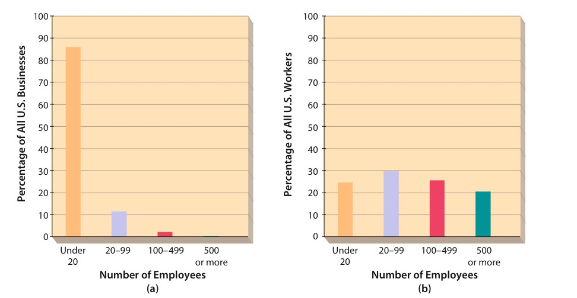
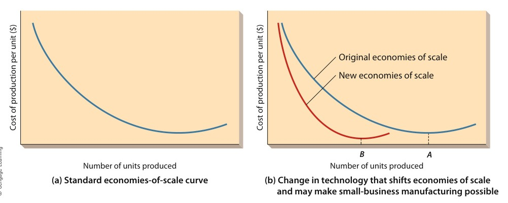
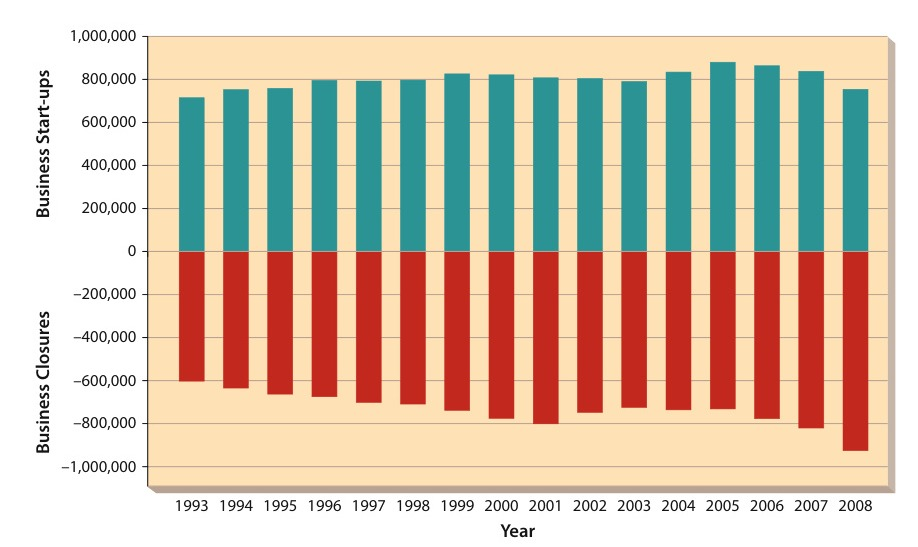

# CHAPTER 5: Entrepreneurship and New Venture Management

<!-- Page 156 -->

> Michael Okoniewski/Newscom

CHAPTER 5Entrepreneurship andNew Venture Management

Learning Outcomes

After studying this chapter, you should be able to:

1Discuss the nature of entrepreneurship.

2Describe the role of entrepreneurship in society.

3Understand the major issues involved in choosing strategies for small firms and the role of internationalmanagement in entrepreneurship.

4Discuss the structural challenges unique to entrepreneurial firms.

5Understand the determinants of the performance of small firms.

Management in Action

Putting the Greek into Yogurt

#### “We had the right product. And we had it in the right place. And I think weused the right approach, which was making a delicious, nutritious, natural,and accessible product.”

—Hamdi Ulukaya, founder of Chobani yogurt

Hamdi Ulukaya was born and raised in Turkey. He helped workin the family dairy, and loved eating the thick, tangy yogurt thathis mother prepared from an old family recipe. As he traveledthrough Europe as a young man, he found similar kinds ofyogurt all along the way and became a real aficionado. He laterlearned that European yogurt has almost always been madeusing the so-called Greek process that removes the whey fromthe final product (water left after the milk has been cultured)resulting in a thick, creamy yogurt.Ulukaya moved to the United States in 1994 to studyEnglish. While he loved his new country, he quickly grew todetest the yogurt varieties marketed in this country byDannon, Yoplait, and other companies. These manufacturersproduced yogurt using a different process that left thewhey in the yogurt—harmless, but resulting in a thinner, lesscreamy product. He thought its taste was poor in comparisonto the yogurt he grew up with. Meanwhile, Ulukaya startedasmallbusinesscalledEuphratesthatproducedfeta

Hamdi Ulukaya is the founder and CEO of Chobaniyogurt. His entrepreneurial vision has transformedChobani into a multibillion-dollar corporation.

<!-- Page 157 -->

cheese for restaurants. He built it into a successful operation and accumulatedsome savings.One day in 2004, Ulukaya read an article about an old yogurt plant that KraftFoods was closing. As he thought about the old yogurt factory being shutteredand his own disdain for local yogurt products, an idea began to take shape. Thenext day, he drove to upstate New York, inspected the plant, and quickly decidedto buy it. He used a combination of personal savings and a loan from the U.S.Small Business Association to buy the plant at a bargain price (he declined todisclose the amount). He also hired four of the former Kraft employees who hadworked at the plant plus a skilled yogurt maker he knew by reputation fromTurkey.Next, he needed to set up equipment and develop a production system. Theold Kraft plant had all of the basic yogurt-making equipment he needed.However, because he wanted to extract the whey, he also needed someadditional machinery. After a brief search he found a used machine called aseparator in Wisconsin and bought it for $50,000. In addition, he bought a fewother pieces of specialized equipment—mostly used—and was ready to starttesting recipes and production processes.He also wanted to create some unique packaging for his new line of yogurt.Ulukaya didn’t feel that he could afford traditional advertising for his start-upoperation but concluded that he could attract consumer attention. He created amodel of his yogurt containers that was squatter and fatter than what othermanufacturers were using. This would both attract attention and make thecontainers look a bit larger. In addition, he decided that he wanted the labels to beshrunken-on plastic sleeves instead of being printed directly on the yogurtcontainers—this would result in sharper and brighter colors, attracting furtherattention.But these decisions resulted in some temporary roadblocks for Ulukaya. Thefirst step in making the yogurt containers would be to create a mold. The lowestbid he could get from a U.S. supplier for this job was $250,000—half of hisworking capital. Eventually, though, he found a company in Colombia that woulddo the job for half that amount. So, now he had a plant, equipment, workers, andpacking. But he still needed a product.Finally, after a couple of years of trying and testing recipes and getting hisbusiness plan finalized, Ulukaya launched his new yogurt in 2007. He named itChobani—Turkish for shepherd. To keep control over the product, as well as itspricingandplacement,Ulukayaandhisfirstmarketingrepresentativeapproachedretailersdirectlyratherthangoingthroughdistributors.Itwas important to Ulukaya, for example, that his yogurt be sold with all of theother yogurts rather than in the organic section. Their first order was for 300cases for a grocer on Long Island. A week later, the grocer called Ulukaya, toldhim the product was flying off the shelf, and ordered another 300 cases.To say Chobani has been successful would be an understatement. Forexample, Ulukaya’s business plan called for achieving a sell rate of 20,000cases of Chobani a week within 36 months. If the new start-up could notreach that level, Ulukaya knew he would need to close the operation. As itturned out, his target was way too low—by a year and a zero. By mid-2009,200,000 cases a week were going out the door. Now Ulukaya is a billionaire.Chobani has become a market leader and is also being made and sold inEurope and Australia.

<!-- Page 158 -->

> **entrepreneurship**: The process of planning, organizing, operating, and assuming the risk of a business venture

> **entrepreneur**: Someone who engages in entrepreneurship

> **small business**: A business that is privately owned by one individual or a small group of individuals; it has sales and assets that are not large enough to influence its environment

It is no surprise, of course, that his bigger competitors have taken note ofUlukaya’s success and attempted to thwart his efforts. Both Dannon and Yoplaithave aggressively introduced their own versions of Greek yogurt and are gainingmarket share. But for the time being, at least, Chobani still hasn’t found its ceiling.Indeed, the firm is now shipping 1.2 million cases a week, and sales are stillgrowing. Not bad for a Turkish immigrant just looking to learn a foreignlanguage!1

Just like Hamdi Ulukaya, thousands of people all over the world start new businesses eachyear. Some of them succeed and many, unfortunately, fail. Some of the people who fail in anew business try again, and sometimes it takes two or more failures before a successfulbusiness gets under way. Henry Ford, for example, went bankrupt twice before succeedingwith Ford Motor Company. On the other hand, of course, there are the Hamdi Ulukayaswho succeed once (with Euphrates, in his case), try again, and succeed a second time.This process of starting a new business or business venture, sometimes failing andsometimes succeeding, is part of what is called entrepreneurship, the subject of this chapter.We begin by exploring the nature of entrepreneurship. We then examine the role of entre-preneurship in the business world and discuss strategies for entrepreneurial organizations.We then describe the structure and performance of entrepreneurial organizations.

## THE NATURE OF ENTREPRENEURSHIP

Entrepreneurship is the process of planning, organizing, operating, and assuming therisks of a business venture. An entrepreneur, in turn, is someone who engages in entre-preneurship. Hamdi Ulukaya, who’s featured in our opening story, fits this description.He put his own resources on the line and took a personal stake in the success or failureof Chobani.2 Business owners who hire professional managers to run their businessesand then turn their attention to other interests are not true entrepreneurs. Althoughthey are assuming the risk of the venture, they are not actively involved in organizingor operating it. Likewise, professional managers whose job is running someone else’sbusiness are not entrepreneurs, for they assume less-than-total personal risk for the suc-cess or failure of the business.Entrepreneurs start new businesses. We define a small business as one that is pri-vately owned by one individual or a small group of individuals and has sales and assetsthat are not large enough to meaningfully influence its environment. A two-person soft-ware development company with annual sales of $100,000 would clearly be a small busi-ness, whereas Microsoft Corporation is just as clearly a large business. But the boundariesare not always this clear-cut. For example, a regional retail chain with 20 stores and annualrevenues of $30 million may sound large but is really very small when compared to giantssuch as Walmart and Macy’s.

## THE ROLE OF ENTREPRENEURSHIP IN SOCIETY

The history of entrepreneurship and of the development of new businesses is in manyways the history of great wealth and of great failure. Some entrepreneurs have beenvery successful and have accumulated vast fortunes from their entrepreneurial efforts.

<!-- Page 159 -->

*Figure 5.1 — The Importance of Small Business in the United States (Source: Page 159)*

For example, when Microsoft Corporation first sold its stock to the public in 1986,Bill Gates, then just 30 years old, received $350 million for his share of Microsoft.3

Today his holdings—valued at over $53 billion—make him the richest person inthe United States and one of the richest in the world.4 Many more entrepreneurs,however, have lost a great deal of money. Research suggests that the majorityof new businesses fail within the first few years of founding.5 Many that last longerdo so only because the entrepreneurs themselves work long hours for very littleincome.As Figure 5.1 shows, most U.S. businesses employ fewer than 100 people, andmost U.S. workers are employed by small firms. For example, Figure 5.1(a) showsthat approximately 86 percent of all U.S. businesses employ fewer than 20 people; another11.7 percent employ between 20 and 99 people. In contrast, only about 2.1 percent employbetween 100 and 499 workers, and another 0.2 percent employ 500 or more. Figure 5.1(b)shows that 24.5 percent of all U.S. workers are employed by firms with fewer than 20people; another 29.6 percent work in firms that employ between 20 and 99 people. Thevast majority of these companies are owner-operated.6 Figure 5.1(b) also shows that

The Importance of Small Business in the United States

(a) Approximately 86 percent of all U.S. businesses employ fewer than 20 people; another 11.7 percentemploy between 20 and 99 people. In contrast, only about 2.1 percent employ between 100 and 499workers, and another 0.2 percent employ 500 or more.(b) 24.5 percent of all U.S. workers are employed by firms with fewer than 20 people; another 29.6 percentwork in firms that employ between 20 and 99 people. 25.5 percent of U.S. workers are employed by firmswith 100–499 employees, and another 20.3 percent work for businesses that employ 500 or more totalemployees.

Source: U.S. Census Bureau, Statistical Abstract of the United States, 2010 (Washington, DC: GovernmentPrinting Office, 2011).

<!-- Page 160 -->

25.5 percent of U.S. workers are employed by firms with 100 to 499 employees, and another20.3 percent work for businesses that employ 500 or more total employees.On the basis of numbers alone, then, small business is a strong presence in the econ-omy, which is also true in virtually all of the world’s mature economies. In Germany, forexample, companies with fewer than 500 employees produce two-thirds of the nation’sgross national product, train nine of ten apprentices, and employ four of every fiveworkers. Small businesses also play major roles in the economies of Italy, France, andBrazil. In addition, experts agree that small businesses will be quite important in theemerging economies of countries such as Russia and Vietnam. The contribution ofsmall business can be measured in terms of its effects on key aspects of an economicsystem. In the United States, these aspects include job creation, innovation, and importanceto big business.

### Job Creation

In the early 1980s, a widely cited study suggested that small businesses are responsiblefor creating eight of every ten new jobs in the United States. This contention touchedoff considerable interest in the fostering of small business as a matter of public policy.As we will see, though, relative job growth among businesses of different sizes is noteasy to determine. But it is clear that small business—especially in certain industries—isan important source of new (and often well-paid) jobs in the United States. According tothe Small Business Administration (SBA), for example, seven of the ten industries thatadded the most new jobs in 2007 were in sectors dominated by small businesses. More-over, small businesses currently account for over one-third of all jobs in high-technologysectors of the economy.7

Note that new jobs are also being created by small firms specializing in internationalbusiness. For example, Bob Knosp operates a small business in Bellevue, Washington,that makes computerized sign-making systems. Knosp gets over half his sales fromabroad and has dedicated almost 75 percent of his workforce to handling internationalsales. Indeed, according to the SBA, small businesses account for 33.5 percent of all U.S.exporters.8

It is important to note, though, that tracking job gains and losses is very complicatedand somewhat imprecise. For instance, suppose a business eliminates one full-time jobbut later replaces it with two part-time jobs. Some statistics would count this as a lossof one job followed by a gain of two jobs. Similarly, the jobs within a company canfluctuate when it acquires or sells a business unit. For instance, a few years ago statisticsshowed that Halliburton had cut 53,000 jobs. But in reality, these “losses” actually camewhen the firm sold its largest subsidiary, KBR. Only a handful of jobs were actuallyeliminated; instead, over 50,000 jobs were simply moved to a new firm.At least one message is clear: Entrepreneurial business success, more than businesssize, accounts for most new job creation. Whereas successful retailers such as Walmartand Starbucks have been growing and adding thousands of new jobs, struggling chainssuch as Kmart have been eliminating thousands. Hence, most firms, especially those incomplex and dynamic environments, go through periods of growth when they add newjobs but also have periods when they cut jobs.The reality, then, is that jobs are created by entrepreneurial companies of all sizes, allof which hire workers and all of which lay them off. Although small firms often hire at afaster rate than large ones, they are likely to eliminate jobs at a far higher rate. Smallfirms are also usually the first to hire in times of economic recovery, whereas largefirms are generally the last. Conversely, however, big companies are also the last to layoff workers during economic downswings.

<!-- Page 161 -->

Merck & Co.

*Figure 5.2 — Representative Jobs Created and Lost in 2013 (Source: Page 161)*

All businesses create and eliminate jobs. Because of their size, the magnitude of jobcreation and elimination is especially pronounced in bigger businesses. This figureprovides several representative examples of job creation and elimination at severalbig U.S. businesses during 2013. For example, while Barclay’s cut 12,000 jobs andMerck cut 8,500 jobs, Kroger added 7,000 jobs and Toys R Us added 6,750 jobs duringthis same period.

### Innovation

History has shown that major innovations are as likely to come from small businesses(or individuals) as from big businesses. For example, small firms and individualsinvented the personal computer, the stainless-steel razor blade, the transistor radio, thephotocopying machine, the jet engine, and the self-developing photograph. They also gaveus the helicopter and power steering, automatic transmissions and air conditioning, cello-phane, and the disposable ballpoint pen. Today, says the SBA, small businesses consistentlysupply over half of all “innovations” introduced into the U.S. marketplace each year.9

It is no surprise that history is repeating itself with increasing rapidity in the age of compu-ters and high-tech communication. For example, much of today’s most innovative software isbeing written at relatively new start-up companies. Yahoo! and Netscape brought the Internetinto the average U.S. living room, and online companies such as Amazon.com, eBay, andGoogle are using it to redefine our shopping habits. Facebook and Twitter have changed howwe interact with one another.10 Each of these firms started out as a small business.Of course, not all successful new start-ups are leading-edge dot-com enterprises. TakeSacha White, for example. He moved to Oregon a few years ago and got a job as a bicycle

<!-- Page 162 -->

messenger. He began to tinker with his bike and eventually built himself a customone from scratch. Other riders took note and wanted him to build bikes for themas well. White eventually started his own business called Vanilla Bicycles. He hand-crafts each one and has a waiting list of four years. All told, he makes between40 and 50 bikes per year; about 40 percent of these bikes are sold domestically, therest to international customers. The average price of each of his custom bikes isaround $7,000.11 Entrepreneurs have also achieved success in diverse fields such asspecialized dog training, handcrafted musical instruments, and delicate fly-fishingreels. And the popular television program Duck Dynasty features a family’s successfulbusiness making duck calls.

### Importance to Big Business

Most of the products made by big manufacturers are sold to consumers by smallbusinesses. For example, the majority of dealerships selling Fords, Chevrolets, Toyotas,and Kias are independently owned and operated. Moreover, small businesses providebig businesses with many of the services, supplies, and raw materials they need. Likewise,Microsoft relies heavily on small businesses in the course of its routine business opera-tions. For example, the software giant outsources much of its routine code-writingfunctions to hundreds of sole proprietorships and other small firms. It also outsourcesmuch of its packaging, delivery, and distribution to smaller companies. Dell Computeruses this same strategy, buying most of the parts and components used in its computersfrom small suppliers around the world.

## STRATEGY FOR ENTREPRENEURIAL ORGANIZATIONS

One of the most basic challenges facing an entrepreneurial organization is choosing astrategy. The three strategic challenges facing small firms, in turn, are choosing anindustry in which to compete, emphasizing distinctive competencies, and writing a busi-ness plan.12

### Choosing an Industry

It also is no surprise that small businesses are more common in some industries than inothers. The major industry groups that include successful new ventures and small busi-nesses are services, retailing, construction, financial and insurance, wholesaling, transpor-tation, and manufacturing. Obviously, each group differs in its requirements foremployees, money, materials, and machines. In general, the more resources an industryrequires, the harder it is to start a business and the less likely it is that the industry isdominated by small firms. Remember, too, that small is a relative term: The criteria(number of employees and total annual sales) differ from industry to industry and areoften meaningful only when compared with businesses that are truly large. Figure 5.3shows the distribution of all U.S. businesses employing fewer than 20 people acrossindustry groups.

#### Services

Primarily because they require few resources, service businesses are thefastest-growing segment of small-business enterprise. In addition, no other industrygroup offers a higher return on time invested. Finally, services appeal to the talent forinnovation typified by many small enterprises. As Figure 5.3 shows, 40.53 percent of allU.S. businesses with fewer than 20 employees are services.

<!-- Page 163 -->

*Figure 5.3 — Small Businesses (Businesses with Fewer than 20 Employees) by Industry (Source: Page 163)*

Small businesses are especially strong in certain industries, such as retailing andservices. On the other hand, there are relatively fewer small businesses in industriessuch as transportation and manufacturing. The differences are primarily a result offactors such as the investment costs necessary to enter markets in these industries.For example, starting a new airline would require the purchase of large passengeraircraft and airport gates, and hiring an expensive set of employees.

Source: U.S. Census Bureau, www.census.gov/econ/susb/, accessed on March 2014.

Small-business services range from shoeshine parlors to car rental agencies, frommarriage counseling to computer software, from accounting and management consultingto professional dog walking. In Dallas, for example, Jani-King has prospered by sellingcommercial cleaning services to local companies. In Virginia Beach, Virginia, JacksonHewitt Tax Services has found a profitable niche in providing computerized tax preparationand electronic tax-filing services. Great Clips, Inc., is a fast-growing family-run chain of hairsalons headquartered in Minneapolis.

#### Retailing

A retail business sells directly to consumers products manufactured by otherfirms. There are hundreds of different kinds of retailers, ranging from wig shops andfrozen yogurt stands to automobile dealerships and department stores. Usually, however,people who start small businesses favor specialty shops—for example, big-men’s clothingor gourmet coffees—which let them focus limited resources on narrow market segments.Retailing accounts for 11.71 percent of all U.S. businesses with fewer than 20 employees.John Mackey, for example, launched Whole Foods out of his own frustration at beingunable to find a full range of natural foods at other stores. He soon found, however, thathe had tapped a lucrative market and started an ambitious expansion program. Today,with 310 outlets in North America and the United Kingdom, Whole Foods is the largestnatural-foods retailer in the United States—three times larger than its biggest competi-tor.13 Likewise, when Olga Tereshko found it difficult to locate just the right clothdiapers and breast-feeding supplies for her newborn son, she decided to start sellingthem herself. Instead of taking the conventional retailing route, however, Tereshko setup shop on the Internet. Her business, called Little Koala, has established a customerbase of over 10,000 loyal customers. The “Sustainability Matters” feature highlightsanother successful business that has combined retailing and services.

<!-- Page 164 -->

> © Elena Elisseeva/Shutterstock.com

SUSTAINABILITY MATTERS

## A New Model for Going Green

$1,000 down and agree to lease a SolarCity systemfor 15 years. At a cost of $73 a month, Budwig figuredto save about $95 a month and recoup his $1,000 inless than a year. Too good to be true? “We hear that alot,” says Rive. “But we do save you money, and itdoesn’t cost you a cent to go solar.” With leasing, headds, “we can essentially make it so that everybodycan now afford clean power.”At the same time, however, Rive understandsthat price isn’t the only consideration for potentialcustomers like Darin Budwig. “Widespread adop-tion,” he admits, “will come if you can take awaythe complexity and hassle of installing solar.”SolarCity thus made things easier for Budwig byliningupbuildingpermits,financing,andtaxbreaks. The company also streamlined costs byusing innovative computer automation to custom-design Budwig’s installation, which was based onsatellite images of his rooftop. SolarCity even com-piled utility-rate data to estimate Budwig’s returnon his solar investment.

Darin Budwig, a registered nurse in Glendale, Cali-fornia, wanted to do the green thing by going solar.Price, however, was a problem: “I wanted to dothe right thing for the environment,” says Budwig,“but I really had to ask whether it was worth tak-ing on $30,000 in debt.” According to Lyndon Rive,CEOofSolarCity,aproviderofsolar-energysystems located in Foster City, California, theaverage cost is actually closer to $20,000, but heunderstands Budwig’s reservations. “Even thosewho really want to make an environmental change,”admits Rive, “can’t part with $20,000…. The solutionis just too costly for them.”That’s why Rive revamped his business model inorder to make solar panels affordable for a muchbroader range of environmentally conscious consu-mers. He realized that he could put solar panels onpeople’s roofs in much the same way that automakersput more expensive vehicles in their garages: by leas-ing them rather than selling them outright. So insteadof borrowing $20,000, Darin Budwig only had to put

Surging energy prices, increased consumer awareness, and the availability ofnew technologies have combined to lead many people to explore alternativeenergy sources, including solar power. Unfortunately, many of these individualsare often discouraged when they learn how much solar power equipment actuallycosts. SolarCity, though, has built a lucrative business by leasing solar panels tohomeowners. This installer, for example, is putting leased solar panels on the roofof a home in California.

(continued)

<!-- Page 165 -->

SUSTAINABILITY MATTERS (Continued)

Menlo Park, California. He saves $100 a month onhis energy bill and expects to save more than$16,000 over the 15 years of his lease. Hisemployers at Google, a longtime supporter ofclean-energyinnovations, wereimpressed andrecently announced a $280 million fund to helpSolarCity finance solar installations across thecountry.

The company recently added another automatedservice to its innovative product line. With theacquisition of Building Solutions, a firm specializing insoftware-controlled home energy audits, SolarCityentered the market for home-efficiency upgrades.Company auditors now come into a house armedwith duct blowers, infrared cameras, and combustionanalyzers to check for leaks and test heaters. Thedata are then analyzed to determine what can bedone at what cost and to calculate the homeowner’sbest return on his or her upgrade investment. COOPeter Rive (Lyndon’s older brother) is especiallyoptimistic about the company’s ability to combinepanel-installation services with such services asenergy audits and building-envelope sealing (sealingleaks in walls, doors, and windows). “As of rightnow,” he points out, “there aren’t residential energy-efficiency providers with any serious scale. We’regoing to be able to bring serious economies ofscale” to bear on the costs to both the provider andthe customer.Like Darin Budwig, Google engineer MichaelFlaster leased a SolarCity system for his home in

References: Pete Engardio and Adam Aston, “The NextEnergy Innovators,” BusinessWeek, July 16, 2009, www.businessweek.com, accessed on September 11, 2013;Julie Schmidt, “SolarCity Aims to Make Solar PowerMore Affordable,” USA Today, November 10, 2009,www.usatoday.com, accessed on September 11, 2013;Eric Wesoff, “SolarCity Adds Energy Efficiency to SolarFinance, Design, and Monitoring,” Greentech Media,October 14, 2010, www.greentechmedia.com, accessedon September 11, 2013; David A. Hill, “Solar City TakesAim at Home Energy Audit Market,” Colorado EnergyNews, May 14, 2010, http://coloradoenergynews.com,accessed on September 11, 2013; Rick Needham, “Help-ing Homeowners Harness the Sun,” The Official GoogleBlog,June14,2011,http://googleblog.blogspot.in/,accessed on September 11, 2013.

#### Construction

About 11.73 percent of businesses with fewer than 20 employees areinvolved in construction. Because many construction jobs are relatively small, localprojects, local construction firms are often ideally suited as contractors. Many suchfirms are begun by skilled craftspeople who start out working for someone else andsubsequently decide to work for themselves. Common examples of small constructionfirms include home builders, wood finishers, roofers, painters, and plumbing, electrical,and roofing contractors.For example, Marek Brothers Construction in College Station, Texas, was startedby two brothers, Pat and Joe Marek. They originally worked for other contractorsbut started their own partnership in 1980. Their only employee is a receptionist.Theymanagevariousconstructionprojects,includingnew-homeconstructionand remodeling, subcontracting out the actual work to other businesses or toindividual craftspeople. Marek Brothers has an annual gross income of about $5million.

#### Finance and Insurance

Finance and insurance businesses comprise about 4.2 percentof all firms with fewer than 20 employees. In most cases, these businesses either are affili-ates of or sell products provided by larger national firms. Although the deregulation of thebanking industry has reduced the number of small local banks, other businesses in thissector are still doing quite well.Typically, for example, local State Farm Mutual offices are small businesses. State Farmitself is a major insurance company, but its local offices are run by 16,500 independent

<!-- Page 166 -->

agents. In turn, agents hire their own staff, run their own offices as independentbusinesses, and so forth. They sell various State Farm insurance products and earn com-missions from the premiums paid by their clients. Some local savings-and-loan-operations,mortgage companies, and pawnshops also fall into this category.

#### Wholesaling

Small-business owners often also do very well in wholesaling; about5.2 percent of businesses with fewer than 20 employees are wholesalers. A wholesalebusiness buys products from manufacturers or other producers and then sells them toretailers. Wholesalers usually buy goods in bulk and store them in quantity at locationsthat are convenient for retailers. For a given volume of business, therefore, they needfewer employees than manufacturers, retailers, or service providers.They also serve fewer customers than other providers—usually those who repeatedlyorder large volumes of goods. Wholesalers in the grocery industry, for instance, buypackaged food in bulk from companies such as Del Monte and Campbell’s and thensell it to both large grocery chains and smaller independent grocers. Luis Espinoza hasfound a promising niche for Inca Quality Foods, a Midwestern wholesaler that importsand distributes Latino foods for consumers from Mexico, the Caribbean, and CentralAmerica. Partnered with the large grocery store chain Kroger, Espinoza’s firm continuesto grow steadily.14

#### Transportation

Some small firms—about 2.8 percent of all U.S. companies withfewer than 20 employees—do well in transportation and transportation-related busi-nesses. Such firms include local taxi and limousine companies, charter airplaneservices, and tour operators. In addition, in many smaller markets, bus companiesand regional airlines subcontract local equipment maintenance to small businesses.Consider, for example, some of the transportation-related small businesses at a skiresort like Steamboat Springs, Colorado. Most visitors fly to the town of Hayden, about15 miles from Steamboat Springs. Although some visitors rent vehicles, many others usethe services of Alpine Taxi, a small local operation, to transport them to their destina-tions in Steamboat Springs. While on vacation, they also rely on the local bus service,which is subcontracted by the town to another small business, to get to and from theski slopes each day. Other small businesses offer van tours of the region, hot-air balloonrides, and helicopter lifts to remote areas for extreme skiers. Still others provide mainte-nance support at Hayden for United and American aircraft that serve the area during skiseason.

#### Manufacturing

More than any other industry, manufacturing lends itself to bigbusiness—and for good reason. Because of the investment normally required in equip-ment, energy, and raw materials, a good deal of money is usually needed to start amanufacturing business. Automobile manufacturing, for example, calls for billions ofdollars of investment and thousands of workers before the first automobile rolls off theassembly line. Obviously, such requirements shut out most individuals. Although HenryFord began with $28,000, it has been a long time since anyone started a new U.S. carcompany from scratch.Research has shown that manufacturing costs often fall as the number of unitsproduced by an organization increases. This relationship between cost and productionis called an economy of scale.15 Small organizations usually cannot compete effectivelyon the basis of economies of scale. As depicted in Figure 5.4(a), organizations withhigher levels of production have a major cost advantage over those with lower levels ofproduction. Given the cost positions of small and large firms when there are strongeconomies of scale in manufacturing, it is not surprising that small manufacturingorganizations generally do not do as well as large ones.

<!-- Page 167 -->

*Figure 5.4 — Economies of Scale in Small-Business Organizations (Source: Page 167)*

Economies of Scale in Small-Business Organizations

Small businesses sometimes find it difficult to compete in manufacturing-related industries because of theeconomies of scale associated with plants, equipment, and technology. As shown in (a), firms that producea large number of units (that is, larger businesses) can do so at a lower per-unit cost. At the same time,however, new forms of technology occasionally cause the economies-of-scale curve to shift, as illustrated in (b).In this case, smaller firms may be able to compete more effectively with larger ones because of the drop inper-unit manufacturing cost.

It is interesting that when technology in an industry changes, it often shifts theeconomies-of-scale curve, thereby creating opportunities for smaller organizations. Forexample, steel manufacturing was historically dominated by a few large companies,which owned several huge facilities. With the development of mini-mill technology,however, extracting economies of scale at a much smaller level of production becamepossible. This type of shift is depicted in Figure 5.4(b). Point A in this panel is the low-cost point with the original economies of scale. Point B is the low-cost point with theeconomies of scale brought on by the new technology. Notice that the number of unitsneeded for low costs is considerably lower for the new technology. This has allowed theentry of numerous smaller firms into the steel industry. Such entry would not have beenpossible with the older technology.This is not to say that no small-business owners do well in manufacturing—about3.78 percent of businesses with fewer than 20 employees are involved in some aspect ofmanufacturing. Indeed, it is not uncommon for small manufacturers to outperform bigbusiness in innovation-driven industries such as chemistry, electronics, toys, and com-puter software. Some small manufacturers prosper by locating profitable niches. Forexample, brothers Dave and Dan Hanlon and Dave’s wife Jennie started a newmotorcycle-manufacturing business called Excelsior-Henderson. (Excelsior and Hender-son are actually names of classic motorcycles from the early years of the twentiethcentury; the Hanlons acquired the rights to these brand names because of the imagesthey evoke among motorcycle enthusiasts.) The Hanlons started by building 4,000 bikesin 1999 and soon had annual production of 20,000 per year. Excelsior-Hendersonmotorcycles have been well received (the top-end Excelsior-Henderson Super X sells forabout $18,000), and some Harley-Davidson dealers have started to sell them as a meansof diversifying their product line.16

<!-- Page 168 -->

> **established market**: A market in which several large firms compete according to relatively well-defined criteria

> **niche**: A segment of a market that is not currently being exploited

### Emphasizing Distinctive Competencies

As we defined in Chapter 3, an organization’s distinctive competencies are the aspects ofbusiness that the firm performs better than its competitors. The distinctive competenciesof small business usually fall into three areas: the ability to identify new niches in estab-lished markets, the ability to identify new markets, and the ability to move quickly totake advantage of new opportunities.

#### Identifying Niches in Established Markets

An established market is one inwhich several large firms compete according to relatively well-defined criteria. For exam-ple, throughout the 1970s, several well-known computer-manufacturing companies,including IBM, Digital Equipment, and Hewlett-Packard, competed according to threeproduct criteria: computing power, service, and price. Over the years, the computingpower and quality of service delivered by these firms continued to improve, while prices(especially relative to computing power) continued to drop.Enter Apple Computer and the personal computer. For Apple, user-friendliness, notcomputing power, service, or price, was to be the basis of competition. Apple targetedevery manager, every student, and every home as the owner of a personal computer.Apple’s major entrepreneurial act was not to invent a new technology (indeed, the firstApple computers used all standard parts taken from other computers), but to recognize anew kind of computer and a new way to compete in the computer industry.Apple’s approach to competition was to identify a new niche in an established market.A niche is simply a segment of a market that is not currently being exploited. In general,small entrepreneurial businesses are better at discovering these niches than are largerorganizations. For example, David Tran launched a new hot sauce product, SrirachaHot Chili Sauce, because he thought existing products were a bit too mild. From a mod-est beginning about 10 years ago, Tran now sells over 20 million bottles of Sriracha ayear.17 Another example is described in the “Leading the Way” feature. Large organiza-tions usually have so many resources committed to older, established business practicesthat they may be unaware of new opportunities. Entrepreneurs can see these opportu-nities and move quickly to take advantage of them.Dave Gilboa and Neil Blumenthal recently founded Warby Parker, a business thatsells prescription eyewear through the mail. The entrepreneurs realized that most consu-mers disliked the experience of going to an optical shop to try on glasses and then wereirritated at the price of those glasses. So, Warby Parker offers lower-priced glasses withhip designs and a money-back guarantee. Astute marketing then allowed them to get aquick start with their niche business, selling over 50,000 pairs of glasses and generatingprofits after only a single year of operation.18

#### Identifying New Markets

Successful entrepreneurs also excel at discovering wholenew markets. Discovery can happen in at least two ways. First, an entrepreneur cantransfer a product or service that is well established in one geographic market to asecond market. This is what Marcel Bich did with ballpoint pens, which occupied awell-established market in Europe before Bich introduced them to the United States.Bich’s company, Société Bic, eventually came to dominate the U.S. market.Second, entrepreneurs can sometimes create entire industries. Entrepreneurial inven-tions of the dry paper-copying process and the semiconductor have created vast newindustries. Not only have the first companies into these markets been very successful(Xerox and Texas Instruments, respectively), but their entrepreneurial activity also hasspawned the development of hundreds of other companies and hundreds of thousandsof jobs. Again, because entrepreneurs are not encumbered with a history of doing busi-ness in a particular way, they are usually better at discovering new markets than arelarger, more mature organizations.

<!-- Page 169 -->

LEADING THE WAY

## Samuel Adams Makes Headway

to his business acumen and part to his leadershipcapabilities.Koch’s company is Boston Beer, and its flagshipproduct is a premium beer called Samuel Adams.James set up shop in an old warehouse in Boston,bought some surplus equipment from a large brew-ery, and started operations. Because he used onlythe highest-quality ingredients, Koch had to pricehis product at about $1 more per case than such pre-mium imports as Heineken. Most distributors, doubt-ing consumers would pay $6 per six-pack for anAmerican beer, refused to carry it. So Koch beganselling directly to retailers and bars.His big break came when Samuel Adams Lagerwon the consumer preference poll at the GreatAmerican Beer Festival. Koch quickly turned thisvictoryintoanadvertisingmantra,proclaimingSamuel Adams “The Best Beer in America.” Assales took off, national distributors came calling;to meet surging demand, Koch contracted partsof his brewing operations to facilities in Pittsburghand Cincinnati.Annual sales of Samuel Adams products began toskyrocket andin2012exceeded$628 million.Demand grew to the point the point that Kochdecided to purchase a large brewery outside Phila-delphia. This increased the firm’s brewing capacityby over 1.6 million barrels per year. Boston Beereven exports Samuel Adams to Germany, where it’sbecome popular among finicky beer drinkers. Koch,who retains controlling interest in the business, stilloversees day-to-day brewing operations. Indeed, heclaims to have sampled at least one of the firm’sproducts every day. In his words, “To best lead a busi-ness you have to lead on every front, and this includessampling the merchandise!”

James Koch used his own personal savings to launchBoston Beer, makers of Samuel Adams and other premiumbeers. Koch’s success with Boston Beer has come in partfrom his business acumen and in part from his strongleadership skills.

References: “Sam Adams Beer to Expand CincinnatiBrewery,” USA Today, www.usa.com, accessed on Septem-ber 11, 2013; Christopher Edmunds, “Bottom of the Bar-rel:BostonBeer’sWinningFormula,”realmoney.thestreet.com, accessed on September 11, 2013; “BostonBeer Company—Company Profile, Information, BusinessDescription, History, Background Information on BostonBeerCompany,”athttp://www.referenceforbusiness.com/history2/74/Boston-Beer-Company.html, accessed onSeptember 11, 2013.

In 1984, James Koch was a high-flying managementconsultant earning over $250,000 a year. To thesurprise of his family and friends, however, he quitthis job and invested his life’s savings to start abusiness from scratch and go head-to-head withinternational competitors in a market that had nothad a truly successful specialty product in decades.To everyone’s even greater surprise, he succeeded.Part of his success as an entrepreneur is attributable

<!-- Page 170 -->

> first-moveradvantageAny advantage thatcomes to a firmbecause it exploitsan opportunitybefore any other firm

> **business plan**: A document that summarizes the business strategy and structure

#### First-Mover Advantages

A first-mover advantage is any advantage that comes to afirm because it exploits an opportunity before any other firm does. Sometimes largefirms discover niches within existing markets or new markets at just about the sametime as small entrepreneurial firms but are not able to move as quickly as small compa-nies to take advantage of these opportunities.This difference occurs for numerous reasons. For example, many large organizationsmake decisions slowly because each of their many layers of hierarchy must approve anaction before it can be implemented. Also, large organizations may sometimes put agreat deal of their assets at risk when they take advantage of new opportunities. Everytime Boeing decides to build a new model of a commercial jet, it is making a decisionthat could literally bankrupt the company if it does not turn out well. The size of therisk may make large organizations cautious. The dollar value of the assets at risk in asmall organization, in contrast, is quite small. Managers may be willing to “bet the com-pany” when the value of the company is only $100,000. They might be unwilling to “betthe company” when the value of the company is $1 billion.

### Writing a Business Plan

Once an entrepreneur has chosen an industry in which to compete and has determinedwhich distinctive competencies to emphasize, these choices are usually included in adocument called a business plan. In a business plan, the entrepreneur summarizes thebusiness strategy and how that strategy is to be implemented. The very act of preparinga business plan forces prospective entrepreneurs to crystallize their thinking about whatthey must do to launch their business successfully and obliges them to develop theirbusiness on paper before investing time and money in it. The idea of a business plan isnot new. What is new is the growing use of specialized business plans by entrepreneurs,mostly because creditors and investors demand them for use in deciding whether to helpfinance a small business.19

The plan should describe the match between the entrepreneur’s abilities and therequirements for producing and marketing a particular product or service. It shoulddefine strategies for production and marketing, legal aspects and organization, andaccounting and finance. In particular, it should answer three questions: (1) What arethe entrepreneur’s goals and objectives? (2) What strategies will the entrepreneur use toobtain these goals and objectives? (3) How will the entrepreneur implement thesestrategies?Business plans should also account for the sequential nature of much strategicdecision making in small businesses. For example, entrepreneurs cannot forecast salesrevenues without first researching markets. The sales forecast itself is one of the mostimportant elements in the business plan. Without such forecasts, it is all but impossibleto estimate intelligently the size of a plant, store, or office, or to determine how muchinventory to carry or how many employees to hire.Another important component of the overall business plan is financial planning,which translates all other activities into dollars. Generally, the financial plan is made upof a cash budget, an income statement, balance sheets, and a breakeven chart. The mostimportant of these statements is the cash budget because it tells entrepreneurs how muchmoney they need before they open for business and how much money they need to keepthe business operating.

### Entrepreneurship and International Management

Although many people associate international management with big business, manysmaller companies are finding expansion and growth opportunities in foreign countries.

<!-- Page 171 -->

For example, Fuci Metals, a small but growing enterprise, buys metal from remote loca-tions in areas such as Siberia and Africa and then sells it to big automakers such as Fordand Toyota. Similarly, California-based Gold’s Gym is expanding into foreign countriesand has been especially successful in Russia. And Markel Corporation, a smallPhiladelphia-based firm that manufactures tubing and insulated wiring, derives 40 per-cent of its annual revenues (currently around $32 million) from international sales.Although such ventures are accompanied by considerable risks, they give entrepreneursnew opportunities and can be a real catalyst for success.

## STRUCTURE OF ENTREPRENEURIAL ORGANIZATIONS

With a strategy in place and a business plan in hand, the entrepreneur can then proceedto devise a structure that turns the vision of the business plan into a reality. Many of thesame concerns in structuring any business, which are described in the next five chaptersof this book, are also relevant to small businesses. For example, entrepreneurs need toconsider organization design and develop job descriptions, organization charts, and man-agement control systems.The Internet, of course, has virtually rewritten all the rules for starting and operatinga small business. Getting into business is easier and faster than ever before, thereare many more potential opportunities than at any other time in history, and theability to gather and assimilate information is at an all-time high. And social mediaintroduces new companies to larger potential markets than ever before.20 For example,HardToFindPartySupplies.com has been successful marketing discontinued or hard-to-find supplies like Power Ranger paper plates, Lone Ranger napkins, and Snow Whitedrinking cups. The firm relies solely on social media and its website.21

Even so, would-be entrepreneurs must still make the right decisions when they start.They must decide, for example, precisely how to get into business. Should they buy anexisting business or build from the ground up? In addition, would-be entrepreneurs mustfind appropriate sources of financing and decide when and how to seek the advice ofexperts.

### Starting the New Business

The first step in starting a new business is the individual’s commitment to becominga business owner. Next comes choosing the goods or services to be offered—a pro-cess that means investigating one’s chosen industry and market. Making this choicealso requires would-be entrepreneurs to assess not only industry trends but also theirown skills. Like the managers of existing businesses, new business owners must alsobe sure that they understand the true nature of the enterprise in which they areengaged.

#### Buying an Existing Business

After choosing a product and making sure that thechoice fits their own skills and interests, entrepreneurs must decide whether to buy anexisting business or to start from scratch. Consultants often recommend the first approach.Quite simply, the odds are better: If successful, an existing business has already proved itsability to draw customers at a profit. It has also established working relationships with len-ders, suppliers, and the community. Moreover, the track record of an existing businessgives potential buyers a much clearer picture of what to expect than any estimate of anew business’s prospects. Around 30 percent of the new businesses started in the past

<!-- Page 172 -->

decade were bought from someone else. As another example, the McDonald’s empire wasstarted when Ray Kroc bought an existing hamburger business and then turned it into aglobal phenomenon. Likewise, Starbucks was a struggling mail-order business whenHoward Schultz bought it and turned his attention to retail expansion.

#### Starting from Scratch

Some people, however, prefer the satisfaction that comesfrom planting an idea, nurturing it, and making it grow into a strong and sturdy busi-ness. There are also practical reasons to start a business from scratch. A new businessdoes not suffer the ill effects of a prior owner’s errors. The start-up owner is also freeto choose lenders, equipment, inventories, locations, suppliers, and workers, unboundby a predecessor’s commitments and policies. Of the new businesses begun in the pastdecade, 64 percent were started from scratch.It is no surprise, though, that the risks of starting a business from scratch are greaterthan those of buying an existing firm. Founders of new businesses can make only predic-tions and projections about their prospects. Success or failure thus depends heavily onidentifying a genuine business opportunity—a product for which many customers willpay well but which is currently unavailable to them. To find openings, entrepreneursmust study markets and answer the following questions: (1) Who are my customers?(2) Where are they? (3) At what price will they buy my product? (4) In what quantitieswill they buy? (5) Who are my competitors? (6) How will my product differ from thoseof my competitors?Finding answers to these questions is a difficult task, even for large, well-establishedfirms. Where can the new business owner get the necessary information? Other sourcesof assistance are discussed later in this chapter, but we briefly describe three of the mostaccessible here. First, the best way to gain knowledge about a market is to work in itbefore going into business in it. For example, if you once worked in a bookstore andnow plan to open one of your own, you probably already have some idea about thekinds of books people request and buy. Second, a quick scan of the local Yellow Pagesor an Internet search will reveal many potential competitors, as will advertisements intrade journals. Personal visits to these establishments and websites can give you insightsinto their strengths and weaknesses. And, third, studying magazines, books, and websitesaimed specifically at small businesses can be of help, as can hiring professionals to surveythe market for you.

### Financing the New Business

Although the choice of how to start is obviously important, it is meaningless unless anew business owner can obtain the money to set up shop. Among the more commonsources for funding are family and friends, personal savings, banks and similar lendinginstitutions, investors, and government agencies. Lending institutions are more likely tohelp finance the purchase of an existing business than a new business because the risksare better understood. Individuals starting up new businesses, on the other hand, aremore likely to have to rely on their personal resources.

#### Personal Resources

According to a study by the National Federation of IndependentBusiness (NFIB), an owner’s personal resources, not loans, are the most important sourceof money. Including money borrowed from friends and relatives, personal resourcesaccount for over two-thirds of all money invested in new small businesses and one-halfof that invested in the purchase of existing businesses. John Mackey started Whole Foodswith a $10,000 loan from his father. Fred Smith used $4 million he had inherited from hisfather to launch FedEx. And Rebecca Boenigk started Neutral Posture, an ergonomic chaircompany, with personal savings and loans from several family members.

<!-- Page 173 -->

> AP Images/Paul Zoeller

> venture capitalcompaniesA group of smallinvestors seeking tomake profits oncompanies withrapid growthpotential

#### Strategic Alliances

Strategic alliances arealso becoming a popular method for financingbusiness growth. When Steven and AndrewGrundy decided to launch an Internet CD-exchange business called Spun.com, they hadvery little capital and thus made extensive useof alliances with other firms. They partnered,for example, with wholesaler Alliance Enter-tainment Corporation as a CD supplier. Ordersto Spun.com actually go to Alliance, whichships products to customers and bills Spun.comdirectly. This setup has allowed Spun.com to pro-mote a vast inventory of labels without actuallyhaving to buy inventory. All told, the firm createdan alliance network that has provided the equiv-alent of $40 million in capital.22

Rebecca Boenigk is the founder and CEO of Neutral Posture.Neutral Posture makes a variety of ergonomic seating products.Beonigk’s father, Dr. Jerome Congleton, developed the technologybut did not have the expertise to commercialize it. Ms. Boenigk usedpersonal savings and family loans to found what is now aninternational business.

#### Lenders

Althoughbanks,independentinvestors, and government loans all providemuch smaller portions of start-up funds thanthe personal resources of owners, they areimportant in many cases. Getting money fromthese sources, however, requires some extraeffort. Banks and private investors usuallywant to see formal business plans—detailed outlines of proposed businesses and markets,owners’ backgrounds, and other sources of funding. Government loans have strict eligibilityguidelines.

#### Venture Capital Companies

Venture capital companies are groups of small inves-tors seeking to make profits on companies with rapid growth potential. Most of thesefirms do not lend money: They invest it, supplying capital in return for stock. Theventure capital company may also demand a representative on the board of directors.In some cases, managers may even need approval from the venture capital companybefore making major decisions. Of all venture capital currently committed in the UnitedStates, around 25 percent comes from true venture capital firms.23 In 2010, venturecapital firms invested about $18 billion in new start-ups in the United States. SoftBankCapital is a venture capital firm that has provided funds to over 300 web companies,including Yahoo! and E*Trade.As noted earlier, Fred Smith used his inheritance to launch FedEx. Once he got hisbusiness plan developed and started service, though, he needed an infusion of substantialadditional capital. All told, he raised about $80 million in venture capital to buy his firstsmall fleet of planes. Venture capital was also important in the launch of both Facebookand Twitter.

#### Small-Business Investment Companies

Taking a more balanced approach in theirchoices than venture capital companies, small-business investment companies (SBICs)seek profits by investing in companies with potential for rapid growth. Created by theSmall Business Investment Act of 1958, SBICs are federally licensed to borrow moneyfrom the SBA and to invest it in or lend it to small businesses. They are themselvesinvestments for their shareholders. Past beneficiaries of SBIC capital include Apple Com-puter, Intel, and Federal Express (now FedEx). In addition, the government has recently

<!-- Page 174 -->

begun to sponsor minority enterprise small-business investment companies (MESBICs).As the name suggests, MESBICs specialize in financing businesses that are owned andoperated by minorities.

#### SBA Financial Programs

Since its founding in 1953, the SBA has offered more than20 financing programs to small businesses that meet standards of size and independence.Eligible firms must also be unable to get private financing at reasonable terms. Becauseof these and other restrictions, SBA loans have never been a major source of small-business financing. In addition, budget cutbacks at the SBA have reduced the numberof firms benefiting from loans. Nevertheless, several SBA programs currently offerfunds to qualified applicants.For example, under the SBA’s guaranteed loans program, small businesses can borrowfrom commercial lenders. The SBA guarantees to repay 75 to 85 percent of the loanamount, not to exceed $750,000. Under a related program, companies engaged in inter-national trade can borrow up to $1 50 million. Such loans may be made for as long as15 years. Most SBA lending activity flows through this program.Sometimes, however, both desired bank and SBA-guaranteed loans are unavailable(perhaps because the business cannot meet stringent requirements). In such cases, theSBA may help finance the entrepreneur through its immediate participation loanprogram. Under this arrangement, the SBA and the bank each put up a share of themoney, with the SBA’s share not to exceed $150,000. Under the local developmentcompanies (LDCs) program, the SBA works with a corporation (either for-profit ornonprofit) founded by local citizens who want to boost the local economy. The SBAcan lend up to $500,000 for each small business to be helped by an LDC.Spurred in large part by the boom in Internet businesses, both venture capital and loansare in general becoming easier to get. Most small businesses, for example, report that itbecame increasingly easier to obtain loans between 1995 and 2005. And firms such as Face-book and Twitter are being offered so much venture capital that they are turning down partof it to keep from unnecessarily diluting their ownership. Unfortunately, the credit crunchthat began in 2008 has made it harder for most entrepreneurs to obtain funds, but expertsbelieve this is only a short-term problem.24 But in response, some entrepreneurs have turnedto other sources of funding such as microloans and cash-flow lenders.25

### Sources of Management Advice

Financing is not the only area in which small businesses need help. Until World War II, forexample, the business world involved few regulations, few taxes, few records, few big compe-titors, and no computers. Since then, simplicity has given way to complexity. Today, fewentrepreneurs are equipped with all the business skills they need to survive. Small-businessowners can no longer be their own troubleshooters, lawyers, bookkeepers, financiers, and taxexperts. For these jobs, they rely on professional help. To survive and grow, however, smallbusinesses also need advice regarding management. This advice is usually available fromfour sources: advisory boards, management consultants, the SBA, and networking.

#### Advisory Boards

All companies, even those that do not legally need boards of direc-tors, can benefit from the problem-solving abilities of advisory boards. Thus, some smallbusinesses create boards to provide advice and assistance. For example, an advisoryboard might help an entrepreneur determine the best way to finance a plant expansionor to start exporting products to foreign markets.

#### Management Consultants

Opinions vary widely about the value of managementconsultants—experts who charge fees to help managers solve problems. They often

<!-- Page 175 -->

> Todd Bannor/Alamy

specialize in one area, such as international business, small business, or manufacturing.Thus, they can bring an objective and trained outlook to problems and provide logicalrecommendations. They can be quite expensive, however, as some consultants charge$1,000 or more for a day of assistance.Like other professionals, management consultants should be chosen with care. Theycan be found through major corporations that have used their services and that canprovide references and reports on their work. Not surprisingly, they are most effectivewhen the client helps (for instance, by providing schedules and written proposals forthe work to be done).

#### The Small Business Administration

Even more important than its financing roleis the SBA’s role in helping small-business owners improve their management skills. It iseasy for entrepreneurs to spend money; SBA programs are designed to show them howto spend it wisely. The SBA offers small businesses four major management-counselingprograms at virtually no cost.A small-business owner who needs help in starting a new business can get it freethrough the Service Corps of Retired Executives (SCORE). All SCORE members areretired executives, and all are volunteers. Under this program, the SBA tries to matchthe expert to the need. For example, if a small-business owner needs help puttingtogether a marketing plan, the SBA will send a SCORE counselor with marketingexpertise.Like SCORE, the Active Corps of Executives (ACE) program is designed to help smallbusinesses that cannot afford consultants. The SBA recruits ACE volunteers from virtu-ally every industry. All ACE volunteers are currently involved in successful activities,

The U.S. Small Business Administration (SBA) was created in 1953 as a resource to helpwould-be business owners learn more about starting and managing a business, avenues forsecuring financing for new ventures, and techniques for effective management. Today theSBA uses a national network of headquarters offices, regional offices, district offices, anddisaster officers to provide assistance to both potential and current small business owners.

<!-- Page 176 -->

> franchisingagreementsA contract betweenan entrepreneur (thefranchisee) and aparent company(the franchiser); theentrepreneur paysthe parent companyfor the use of itstrademarks, products,formulas, andbusiness plans

mostly as small-business owners themselves. Together, SCORE and ACE have more than12,000 counselors working out of 350 chapters throughout the United States. They pro-vide assistance to some 140,000 small businesses each year.The talents and skills of students and instructors at colleges and universities arefundamental to the Small Business Institute (SBI). Under the guidance of seasonedprofessors of business administration, students seeking advanced degrees work closelywith small-business owners to help solve specific problems, such as sagging sales orrising costs. Students earn credit toward their degree, with their grades depending onhow well they handle a client’s problems. Several hundred colleges and universitiescounsel thousands of small-business owners through this program every year.Finally, the newest of the SBA’s management counseling projects is its Small BusinessDevelopment Center (SBDC) program. Begun in 1976, SBDCs are designed to consoli-date information from various disciplines and institutions, including technical andprofessional schools. Then they make this knowledge available to new and existingsmall businesses. In 1995, universities in 45 states took part in the program.

#### Networking

More and more, small-business owners are discovering the value ofnetworking—meeting regularly with one another to discuss common problems andopportunities and, perhaps most important, to pool resources. Businesspeople have longjoined organizations such as the local chamber of commerce and the NFIBs to makesuch contacts.Today, organizations are springing up all over the United States to facilitate small-business networking. One such organization, the Council of Smaller Enterprises ofCleveland, boasts a total membership of more than 10,000 small-business owners,the largest number in the country. This organization offers its members not onlynetworking possibilities but also educational programs and services tailored to theirneeds. In a typical year, its 85 educational programs draw more than 8,500 small-business owners.In particular, women and minorities have found networking to be an effectiveproblem-solvingtool.TheNationalAssociationofWomenBusinessOwners(NAWBO), for example, provides a variety of networking forums. The NAWBOalso has chapters in most major cities, where its members can meet regularly.Increasingly, women are relying more on other women to help locate venture capital,establish relationships with customers, and provide essential services such as account-ing and legal advice. According to Patty Abramson of the Women’s Growth CapitalFund, all these tasks have traditionally been harder for women because, until now,they have never had friends in the right places. “I wouldn’t say this is about discrim-ination,” adds Abramson. “It’s about not having the relationships, and business isabout relationships.”

### Franchising

The next time you drive or walk around town, be on the alert for a McDonald’s, Taco Bell,Subway, Denny’s, or KFC restaurant; a 7-Eleven or Circle K convenience store; a RE/MAXor Coldwell Banker real estate office; a Super 8 or Ramada Inn motel; a Merry Maidscleaning service; a Sylvan Learning educational center; an Express Oil Change or PrecisionAuto Wash service center; or a Supercuts hair salon. What do these businesses have incommon? In most cases, they are franchised operations, operating under licenses issuedby parent companies to local entrepreneurs who own and manage them.As many would-be businesspeople have discovered, franchising agreements are anaccessible doorway to entrepreneurship. A franchise is an arrangement that permits thefranchisee (buyer) to sell the product of the franchiser (seller, or parent company).

<!-- Page 177 -->

Franchisees can thus benefit from the selling corporation’s experience and expertise.They can also consult the franchiser for managerial and financial help.For example, the franchiser may supply financing. It may pick the store location,negotiate the lease, design the store, and purchase necessary equipment. It may trainthe first set of employees and managers and provide standardized policies and proce-dures. Once the business is open, the franchiser may offer franchisees savings by allow-ing them to purchase from a central location. Marketing strategy (especially advertising)may also be handled by the franchiser. Finally, franchisees may benefit from continuedmanagement counseling. In short, franchisees receive—that is, invest in—not only theirown ready-made business but also expert help in running it.Franchises offer many advantages to both sellers and buyers. For example, franchisersbenefit from the ability to grow rapidly by using the investment money provided byfranchisees. This strategy has enabled giant franchisers such as McDonald’s and Subwayto mushroom into billion-dollar concerns in a brief time.For the franchisee, the arrangement combines the incentive of owning a business withthe advantage of access to big-business management skills. Unlike the person who startsfrom scratch, the franchisee does not have to build a business step by step. Instead, thebusiness is established virtually overnight. Moreover, because each franchise outlet isprobably a carbon copy of every other outlet, the chances of failure are reduced.McDonald’s, for example, is a model of consistency—Big Macs taste the same everywhere.Of course, owning a franchise also involves certain disadvantages. Perhaps the mostsignificant is the start-up cost. Franchise prices vary widely. Fantastic Sams hair salonfranchise fees are $25,000 to $30,000. Extremely profitable or hard-to-get franchises aremuch more expensive, though. A McDonald’s franchise costs a minimum of $500,000plus the cost of building and outfitting a new restaurant (estimated to be between$1 million and $1 8 million), and a professional sports team can cost several hundredmillion dollars. Franchisees may also have continued obligations to contribute percen-tages of sales to the parent corporation.Buying a franchise also entails less tangible costs. For one thing, the small-businessowner sacrifices some independence. A McDonald’s franchisee cannot change the wayits hamburgers or milkshakes are made. Nor can franchisees create an individual identityin their community; for all practical purposes, the McDonald’s owner is anonymous. Inaddition, many franchise agreements are difficult to terminate.Finally, although franchises minimize risks, they do not guarantee success. Many franchi-sees have seen their investments—and their dreams—disappear because of poor location, ris-ing costs, or lack of continued franchiser commitment. Moreover, figures on failure rates areartificially low because they do not include failing franchisees bought out by their franchisingparent companies. An additional risk is that the chain itself could collapse. In any given year,dozens—sometimes hundreds—of franchisers close shop or stop selling franchises.

## THE PERFORMANCE OF ENTREPRENEURIAL ORGANIZATIONS

The formulation and implementation of an effective strategy play major roles in deter-mining the overall performance of an entrepreneurial organization. This section exam-ines how entrepreneurial firms evolve over time and the attributes of these firms thatenhance their chances of success. For every Henry Ford, Walt Disney, Mary Kay Ash,or Bill Gates—people who transformed small businesses into major corporations—thereare many small-business owners and entrepreneurs who fail.

<!-- Page 178 -->

*Figure 5.5 — Business Start-Ups and Failures (Source: Page 178)*

Exact numbers of start-ups and failures are surprisingly difficult to determine, how-ever. For instance, a business may shut down because it is out of money (a failure) orsimply because the owner decides to do something else; or the business may be sold toanother business and cease to exist as an independent entity. Likewise, an ongoing soleproprietorship that becomes a partnership or corporation is not really a new business butmay be counted as such in some statistics; similarly, a large corporation might launch anew enterprise as a new wholly owned but separately incorporated enterprise.In general, though, experts believe that new business start-ups generally run betweenaround 700,000 and 900,000 per year and that business failures generally run between600,000 and 950,000 per year. Figure 5.5 illustrates trends in new business start-upsand failures through 2008 (the most current data available).

### Trends in Small-Business Start-Ups

Thousands of new businesses are started in the United States every year. Several factorsaccount for this trend, and in this section we focus on four of them.

#### Emergence of E-Commerce

Clearly, one of the most significant recent trends insmall-business start-ups is the rapid emergence of electronic commerce. Because theInternet has provided fundamentally new ways of doing business, savvy entrepreneurshave been able to create and expand new businesses faster and more easily than everbefore. Leading-edge firms such as Facebook, Google, and eBay, for example, owe their

Business Start-Up Successes and Failures

Over the most recent ten-year period for which data are available, new business start-ups numberedbetween 700,000 and 900,000 per year. Business failures during this same period, meanwhile, ranged fromabout 600,000 to 950,000 per year.

Source: http://www.bls.gov/bdm/entrepreneurship/bdm_chart5.htm, accessed on March 2014.

<!-- Page 179 -->

very existence to the Internet. At the same time, however, many would-be Internet entre-preneurs have gone under in the last few years, as the so-called dot-com boom quicklyfaded. In 2010, online retail sales exceeded $142 billion, an increase of 3 percent from theprevious year.Indeed, it seems as if new ideas emerge virtually every day. Andrew Beebe, forexample, is scoring big with Bigstep, a web business that essentially creates, hosts, andmaintains websites for other small businesses. So far, Bigstep has signed up 75,000small-business clients. Beebe actually provides his basic services for free but earnsmoney by charging for the so-called premium services such as customer billing. KarlJacob’s Keen.com is a web business that matches people looking for advice with expertswho have the answers. Keen got the idea when he and his father were struggling to fix aboat motor and did not know where to turn for help. Keen.com attracted 100,000subscribers in just three months.26

#### Crossovers from Big Business

It is interesting to note that increasingly more busi-nesses are being started by people who have opted to leave big corporations and puttheir experience and know-how to work for themselves. In some cases, these individualssee great new ideas they want to develop. Often, they get burned out working for a bigcorporation. Sometimes they have lost their jobs, only to discover that working for them-selves was a better idea anyway.Cisco Systems CEO John Chambers is acknowledged as one of the best entrepreneursaround. But he spent several years working first at IBM and then at Wang Laboratoriesbefore he set out on his own. Under his leadership, Cisco has become one of the mostimportant technology companies in the world. In a more unusual case, Gilman Louierecently left an executive position at Hasbro toy company’s online group to head up aCentral Intelligence Agency (CIA)–backed venture capital firm called In-Q-It. Thefirm’s mission is to help nurture high-tech companies making products of interest tothe nation’s intelligence community.27

#### Opportunities for Minorities and Women

In addition to big-business expatriates,minorities and women are starting more small businesses. For example, the number ofAfrican-American–owned businesses totals about 1.9 million, an increase of 60.5 percentsince 2002. These businesses account for around 7.1 percent of all U.S. businesses,generate $137 5 billion in revenue, and employ 921,032 people. African-Americanpurchasing power is expected to hit $1 2 trillion by 2013, an increase of 35 percentsince 2008.28

Latino-owned businesses have grown at a rate of 43.6 percent and now number about2.3 million. Other ethnic groups are also making their presence felt among U.S. businessowners. Business ownership among Asians and Pacific Islanders has increased 34.3 percent,to over 1.6 million. Although the number of businesses owned by Native American Indiansand Alaska Natives is still somewhat small, at slightly over 235,000, the total neverthelessrepresents a five-year increase of 17.9 percent.The number of women entrepreneurs is also growing rapidly. Women now own7.8 million businesses—about 28.7 percent of all businesses in the United States and anincrease of 20.1 percent since 2002. Combined, they generate nearly $1 2 trillion inrevenue a year and employ 7.6 million people. Celeste Johnson, for example, left amanagement position at Pitney Bowes to launch Obex, Inc., which makes gardeningand landscaping products from mixed recycled plastics. Katrina Garnett gave up a lucra-tive job at Oracle to start her own software company, Crossworlds Software. LailaRubenstein closed her management-consulting practice to create Greeting Cards.com,Inc., an Internet-based business selling customizable electronic greetings.

<!-- Page 180 -->

#### Better Survival Rates

Finally, more people are encouraged to test their skills as entre-preneurs because the failure rate among small businesses has been declining in recentyears. As of 2008, seven out of ten new businesses survived at least two years, whereasabout 49 percent survived five years; 34 percent of businesses survived at least ten years,and 26 percent lasted 15 years or longer. For reasons discussed in the next section, smallbusinesses suffer a higher mortality rate than larger concerns. Among those that manage tostay in business for six to ten years, however, the survival rate levels off.

### Reasons for Failure

Why do some succeed and others fail? Although no set pattern has been established, fourgeneral factors contribute to new business failure. One factor is managerial incompetenceor inexperience. Some would-be entrepreneurs assume that they can succeed throughcommon sense, overestimate their own managerial acumen, or think that hard workalone will lead to success. But if managers do not know how to make basic business deci-sions or understand the basic concepts and principles of management, they are unlikelyto be successful in the long run.Second, neglect can also contribute to failure. Some entrepreneurs try either to launchtheir ventures in their spare time or to devote only a limited amount of time to a newbusiness. But starting a new business requires an overwhelming time commitment.Entrepreneurs who are not willing to put in the time and effort that a business requiresare unlikely to survive.Third, weak control systems can lead to serious problems. Effective control systemsare needed to keep a business on track and to help alert entrepreneurs to potential trou-ble. If control systems do not signal impending problems, managers may be in serioustrouble before more visible difficulties alert them.Finally, insufficient capital can contribute to new business failure. Some entrepreneursare overly optimistic about how soon they will start earning profits. In most cases, how-ever, it takes months or years before a business is likely to start turning a profit.Amazon.com, for example, has still not earned a profit. Most experts say that a newbusiness should have enough capital to operate for at least six months without earninga profit; some recommend enough to last a year.29

### Reasons for Success

Similarly, four basic factors are typically cited to explain new business success. Onefactor is the combination of hard work, drive, and dedication. New business ownersmust be committed to succeeding and be willing to put in the time and effort tomake it happen. Having positive feelings and a good outlook on life may also play animportant role.30 Gladys Edmunds, a single teenaged mother in Pittsburgh, washedlaundry, made chicken dinners to sell to cab drivers, and sold fire extinguishers andBibles door to door to earn money to launch her own business. Today, EdmundsTravel Consultants employs eight people and earns about $6 million in annualrevenues.31

Second, careful analysis of market conditions can help new business owners assess theprobable reception of their products in the marketplace. This will provide insights aboutmarket demand for proposed products and services. Whereas attempts to expand localrestaurants specializing in baked potatoes, muffins, and gelato have been largely unsuc-cessful, hamburger and pizza chains continue to have an easier time expanding into newmarkets.Third, managerial competence also contributes to success. Successful new businessowners may acquire competence through training or experience or by using the expertise

<!-- Page 181 -->

of others. Few successful entrepreneurs succeed alone or straight out of college.Most spend time working in successful companies or partner with others to bring moreexpertise to a new business.Finally, luck also plays a role in the success of some firms. For example, after AlanMcKim started Clean Harbors, an environmental cleanup firm based in New England,he struggled to keep his business afloat. Then the U.S. government committed$1 6 billion to toxic waste cleanup—McKim’s specialty. He was able to get severallarge government contracts and put his business on solid financial footing. Had thegovernment fund not been created at just the right time, McKim may well havefailed. Similarly, when retailers like Circuit City and Linens and Things close theirdoors, others firms that specialize in liquidating inventories of bankrupt companiesstep in.32 Similarly, in the wake of such recent disasters—both natural and industrial—as Hurricane Sandy, the Japanese tsunami and nuclear plant disaster, and the BP Deep-water oil spill, new businesses have sprung up to help cope with the aftermath, includingrelocating people, waste clean-up, and so forth.33

## SUMMARY OF LEARNING OUTCOMES AND KEY POINTS

1. Discuss the nature of entrepreneurship.

•Once an entrepreneur has chosen a strategy, thestrategy is normally written down in a businessplan. Writing a business plan forces an entre-preneur to plan thoroughly and to anticipateproblems that might occur.

• Entrepreneurship is the process of planning,organizing, operating, and assuming the riskof a business venture.• An entrepreneur is someone who engages inentrepreneurship. In general, entrepreneursstart small businesses.

4. Discuss the structural challenges unique toentrepreneurial firms.

2. Describe the role of entrepreneurship insociety.

•With a strategy and business plan in place,entrepreneurs must choose a structure toimplement them. All of the structural issuessummarized in the next five chapters of thisbook are relevant to the entrepreneur.•In addition, the entrepreneur has some uniquestructural choices to make. For example, theentrepreneur can buy an existing business orstart a new one.•In determining financial structure, an entre-preneur has to decide how much personalcapital to invest in an organization, how muchbank and government support to obtain, andwhether to encourage venture capital firms toinvest.•Entrepreneurs can also rely on various sourcesof advice.

• Small businesses are an important source ofinnovation.• Small businesses create numerous jobs.• Small businesses contribute to the success oflarge businesses.

3. Understand the major issues involved in choos-ing strategies for small firms and the role ofinternational management in entrepreneurship.

• In choosing strategies, entrepreneurs haveto consider the characteristics of theindustry in which they are going toconduct business.• Small businesses generally have severaldistinctive competencies that they shouldexploit in choosing their strategy. They areusually skilled at identifying niches in estab-lished markets, identifying new markets, andacting quickly to obtain first-moveradvantages.• Small businesses are usually not skilled atexploiting economies of scale.

5. Understand the determinants of the performanceof small firms.

•Several interesting trends characterize newbusiness start-ups today.•There are several reasons some new businessesfail and others succeed.

<!-- Page 182 -->

## DISCUSSION QUESTIONS

### Questions for Review
1. What is an entrepreneur? What is entrepreneurship? How does a small business differ from an entrepreneurial venture?
2. What major roles do small businesses play in the U.S. economy?
3. Briefly describe the major industry sectors in which small businesses are concentrated. Why are small businesses especially prevalent in services and retailing?
4. What is a business plan? What three fundamental questions should a business plan answer?
5. What are the primary financing options available to entrepreneurs starting a new venture?

### Questions for Analysis
1. Some economists argue that government should do more to encourage the development of small business. Others argue that government intervention distorts market competition. What is your position? Explain your reasoning.
2. Consider the four major reasons for new business failure. What specific proactive steps can entrepreneurs take to minimize or avoid each cause of failure?
3. The U.S. automotive industry is well established, with several large and many small competitors. Describe an unexploited niche that might offer entrepreneurial opportunity in or around this industry today.
4. If you were contemplating starting your own business, would you prefer to start from scratch, buy an existing business, or purchase a franchise? What are the key advantages and disadvantages of your choice?
5. How has the Internet changed the playing field for small businesses competing against large corporations? Give two concrete examples.

## BUILDING EFFECTIVE DIAGNOSTIC SKILLS

### Exercise Overview
Diagnostic skills allow managers to visualize the most appropriate response to a situation by analyzing symptoms, identifying root problems, and formulating solutions.

### Exercise Background
Entrepreneurial success often depends on personal attributes and psychological characteristics. Research indicates that successful entrepreneurs share common traits, including a high need for achievement, an internal locus of control, tolerance for ambiguity, and willingness to take calculated risks.

<!-- Page 183 -->

### Exercise Task: Are You an Entrepreneur?
Rate yourself on each of the following statements using a scale from 1 (Strongly disagree) to 5 (Strongly agree):
1. I am a self-starter and prefer setting my own direction rather than having tasks assigned to me.
2. I am comfortable making decisions in ambiguous situations where outcome information is incomplete.
3. When I experience a setback or failure, I view it as a learning opportunity rather than a reason to give up.
4. I am willing to invest significant personal time and money into a venture in which I strongly believe.
5. I enjoy solving challenging, unstructured problems without relying on established routines.

## BUILDING EFFECTIVE CONCEPTUAL SKILLS

### Exercise Overview
Conceptual skills involve thinking in the abstract, recognizing market opportunities, and synthesizing disparate information into a coherent business concept.

### Exercise Background
Identifying an unexploited market niche requires careful analysis of community demographics, local economic trends, consumer habits, and existing competitive offerings.

### Exercise Task
1. Brainstorm ten businesses that do not currently exist in your local college campus or community but for which you believe there is unmet demand.
2. Use the Internet and local resources to gather information on factors such as population size, demographic composition, local economic conditions, and existing competitors.
3. Select the three most promising business concepts from your list. Write a brief executive summary for each, explaining its distinctive value proposition, target customer segment, and competitive advantage.
<!-- Page 184 -->

5. How good an organizer are you?

8. Can people trust what you say?

I like to have a plan before I start. I’m usuallythe one to get things lined up when the groupwants to do something.I do all right unless things get too confused.Then I quit.You get all set and then something comesalong and presents too many problems. So Ijust take things as they come.6. How good a worker are you?

You bet they can. I don’t say things I don’t mean.I try to be on the level most of the time, butsometimes I just say what’s easiest.Why bother if the other person doesn’t knowthe difference?9. Can you stick with it?

If I make up my mind to do something, I don’tlet anything stop me.I usually finish what I start—if it goes well.If it doesn’t go well right away, I quit. Whybeat your brains out?10. How good is your health?

I can keep going as long as I need to. I don’tmind working hard for something I want.I’ll work hard for a while, but when I’ve hadenough, that’s it.I can’t see that hard work gets you anywhere.7. Can you make decisions?

I never run down!I have enough energy for most things I want todo.I run out of energy sooner than most of myfriends.Total the checks or Xs in each column here.

I can make up my mind in a hurry if I have to.It usually turns out OK, too.I can if I have plenty of time. If I have to makeup my mind fast, I think later I should havedecided the other way.I don’t like to be the one who has to decidethings.

Source: Dible, Donald, Business Startup Basics, 1st Ed., © 1978,pp. 9–10. Reprinted by permission of Pearson Education, Inc.,Upper Saddle River, NJ.

## EXPERIENTIAL EXERCISE

### Negotiating a Franchise Agreement

Step 1: Assume that you are the owner of a rapidly grow-ing restaurant chain. To continue your current level ofgrowth,youare consideringtheoption of sellingfranchisesfor new restaurants. Working alone, outline the majorpoints of most concern to you that you would want tohave in a franchising agreement. Also note the character-istics you would look for in potential franchisees.

Step 3: Now form small groups of four. Randomlyselect one member of the group to play the role ofthe franchiser; the other three members will play theroles of potential franchisees. Role-play a negotiationmeeting. The franchiser should stick as closely aspossible to the major points developed in Step 1.Similarly, the potential franchisees should try toadhere to the points they developed in Step 2.

### Follow-Up Questions

Step 2: Assume that you are an individual investor look-ing to buy a franchise in a rapidly growing restaurantchain. Again working alone, outline the major factorsthat might determine which franchise you elect to buy.Also note the characteristics you would look for in apotential franchiser.

1. Did doing both Step 1 and Step 2 in advance helpor hinder your negotiations?2. Can a franchising agreement be so one-sided asto damage the interests of both parties? How so?

## MANAGEMENT AT WORK

### The Creative Imprint of Bigfoot

Feature Film at the 10th Annual Chicago Horror FilmFestival. It also found an audience outside the UnitedStates, with producer Bigfoot selling distribution rightsin such countries as Germany, Greece, Thailand, andJapan. How about 3 Needles, a Canadian-made movie

Have you seen Midnight Movie? You wouldn’t havecaught it in a theater because it went straight to DVD,but that doesn’t prevent hardcore horror-film fans fromtracking it down—after all, it was selected as the Best

<!-- Page 185 -->

about the worldwide AIDS crisis? It was no blockbuster,but it was endorsed by the United Nations and did wellenough at international film festivals to find distributorsin such countries as Australia, New Zealand, and Brazil.Bigfoot CEO Kacy Andrews was pleased with the film’sreception: “The positive response from critics and audi-ences,” she said, “… once again affirms our conviction topromote independent filmmakers.”Bigfoot Entertainment is responsible for a host ofindependently produced films, many of which followsimilar distribution paths to venues and audiencesaround the world. The company, says Andrews, “isdedicated to the community of filmmakers who possessthe vision and passion to create critically acclaimedindependent films.” It was founded in 2004 by a Ger-man serial entrepreneur named Michael Gleissner, whois in some ways a model for the sort of creative peoplethat Bigfoot likes to back. He was certainly the modelfor the hero of Hui Lu, a 2007 Bigfoot film that Gleiss-ner wrote and directed about a highly successful youngentrepreneur who sells his company but finds himselfpushed to the edge despite his millions. “What was Igoing to do,” Gleissner replied when asked about hisunusual career move, “buy more boats, buy morehouses? I discovered there’s a creative side in me.”Gleissner was an e-commerce pioneer in Germany,where he founded Telebook, Germany’s number-oneonline bookstore, and WWW-Service GmbH, thecountry’s first, and one of its most successful, web-hosting companies. In 1998, he sold Telebook toAmazon.com, where he served two years as a vicepresident before cashing in and, in 2001, moving toAsia to make it a base for a new round of entrepreneur-ial activities. When he bought Bigfoot, it was an e-mailmanagement firm, but Gleissner quickly re-created it asan international entertainment company whose mainbusiness, according to its mission statement, is produc-ing and financing “innovative entertainment content,including independent feature films, television series,and reality shows.” As head of Bigfoot, Gleissner servedas executive producer on Midnight Movie and 3 Nee-dles, as well as on Irreversi, his second effort at writingand directing, and on Shanghai Kiss, in which he alsotried his hand at acting.Bigfoot maintains offices in Los Angeles and a smallproduction facility in Venice, California, but the cen-terpiece of its operations is Bigfoot Studios, whichopened in 2004 on the island of Mactan, in Cebu,home to the second-largest city in the Philippines. Thestate-of-the-art facility features six large soundstages,fully equipped editing suites and sound-mixing studios,

and the latest in high-tech cameras and other equip-ment. In 2007, under the auspices of Bigfoot Properties,Gleissner expanded Bigfoot Studios as the first phase ofBigfoot Center, a complex that will eventually housenot only film and TV production facilities but also Big-foot Executive Hotel, an array of restaurants, boutiques,and sidewalk shops, and an 11-story office building(home to Bigfoot Outsourcing, which specializes inbusiness-process services). The Bigfoot Center in thePhilippines, by the way, should not be confused withthe 26-story Bigfoot Centre in Hong Kong, where Big-foot Properties is headquartered.Gleissner’s goal is to turn Cebu into a destination ofchoice for filmmakers who want to cut costs by shoot-ing and finishing movies outside the United States, andwhen Bigfoot Entertainment finds a film suitable forfinancing and development, the deal usually requiresthe director to do some production work at the Cebufacility. By the time the studio opened in 2004, thePhilippines were already an attractive location foranimators looking for inexpensive post-production help,but the pool of talent available for work on live-actionfilms was quite limited. Gleissner’s solution? He foundedthe International Academy of Film and Television(IAFT), not only to staff Bigfoot Studios but also to trainwhat executive director Keith Sensing calls “the nextgeneration of global filmmakers.” IAFT, says Sensing,looks for creative people who “have a desire for adventure”and “an education that will set them apart from peoplewho have a strictly Hollywood background.”IAFT enrollment is currently 60 percent internationaland 40 percent Filipino, but “all of our students,” saysSensing, “have the opportunity to participate in real pro-jects going on at Bigfoot Studios … . Many IAFT gradu-ates,” he adds, “have gone on to write, produce, and directtheir own films” and often follow in Bigfoot’s steps byfinding distribution for their independent features onthe international festival circuit. Three recent graduateslanded jobs on Gleissner’s most recent project, aPhilippines-set thriller revolving around a female diver.Gleissner not only cowrote and directed Deep Gold butalso drew on his experience as an underwater photogra-pher to shoot key scenes in Bigfoot’s specially designed170,000-gallon Underwater Studio.In 2010, Bigfoot moved to expand into the areas ofacquisition, distribution, and foreign sales with the pur-chase of Ascendant Pictures. Much like Bigfoot itself,Ascendant carved out its niche in the industry by inte-grating the budgeting sensibility of “indie” producerswith the marketing skills of larger studios. “Our schoolsare profitable,” explains Andrews, “but overall we’re

<!-- Page 186 -->

not profitable yet. We’re hoping the distribution side will get us there in one or two years.”

The new unit, called Bigfoot Ventures, focuses on acquiring rights to promising indie and international games and distributing them across multiple digital platforms. By leveraging its established relationships and localization expertise, Bigfoot helps smaller development studios reach global audiences while expanding its own recurring revenue base.

### Case Questions
1. In what ways is Bigfoot an entrepreneurial venture? In what ways does it operate like an established corporate firm?
2. Which growth strategy—developing proprietary mobile titles or publishing and distributing third-party titles—offers Bigfoot greater long-term competitive advantage? Why?
3. How can Bigfoot’s management maintain an entrepreneurial culture of creativity and agility as the firm continues to grow larger?
4. In what ways does Bigfoot rely on distinctive competencies? In what ways is experience in international management among these competencies? How do you expect this competency to become even more important in the future?

### Case References
“Bigfoot Games Expanding into Publishing,” *TechinAsia*, March 14, 2013; Bigfoot Entertainment Corporate Profile, www.bigfoot.com; “Mobile Gaming Explodes in Southeast Asia,” *VentureBeat*, November 20, 2012; “Indie Game Studios Seek Global Distribution Partners,” *Game Developer Magazine*, August 2013.

### You Make the Call: Scaling the Venture
1. If you were advising the founder of Bigfoot, what criteria would you suggest for evaluating whether to acquire an indie studio or simply sign a publishing partnership?
2. How should the firm balance investments between established markets (North America, Europe) and high-growth emerging markets?

## ENDNOTES

1. U.S. Small Business Administration, *The Small Business Economy: A Report to the President* (Washington, DC: Government Printing Office, 2012).
2. David L. Birch, *Job Creation in America: How Our Smallest Companies Put the Most People to Work* (New York: Free Press, 1987).
3. Paul Allen, *Idea Man: A Memoir by the Cofounder of Microsoft* (New York: Portfolio/Penguin, 2011).
4. “The Forbes 400: The Richest People in America,” *Forbes*, October 2013.
5. Amar Bhide, *The Origin and Evolution of New Businesses* (New York: Oxford University Press, 2000).
<!-- Page 187 -->

5 Murray B. Low and Ian MacMillan, “Entrepreneurship: PastResearch and Future Challenges,” Journal of Management, June1988, pp. 139–159.6 U.S. Bureau of the Census, Statistical Abstract of the UnitedStates, 2009 (Washington, DC: Government Printing Office,2009).7 “Small Business ‘Vital Statistics,’” http://www.sba.gov/category/navigation-structure/about-sba, accessed on July 17, 2012.8 “Small Business ‘Vital Statistics,’” http://www.sba.gov/category/navigation-structure/about-sba, accessed on July 17, 2012.9 “Small Business ‘Vital Statistics,’” http://www.sba.gov/category/navigation-structure/about-sba, accessed on July 17, 2012.10 “A World That’s a-Twitter,” USA Today, May 26, 2009, pp. 1B, 2B.11 “Heaven on Wheels,” Forbes, April 13, 2009, pp. 74–75.12 Amar Bhide, “How Entrepreneurs Craft Strategies That Work,”Harvard Business Review, March–April 1994, pp. 150–163.13 Hoover’s Handbook of American Business 2013 (Austin, TX:Hoover’s Business Press, 2013), pp. 888–889; and “Peace, Love,and the Bottom Line,” BusinessWeek, December 7, 1998,pp. 79–82.14 Nancy J. Lyons, “Moonlight over Indiana,” Inc., January 2000,pp. 71–74.15 F. M. Scherer, Industrial Market Structure and EconomicPerformance, 2nd ed. (Boston: Houghton Mifflin, 1980).16 “Three Biker-Entrepreneurs Take on Mighty Harley,” New YorkTimes, August 20, 1999, p. F1.17 “Burning Sensation,” Bloomberg Businessweek, May 10, 2013, pp.66–69.18 “A Startup’s New Prescription for Eyewear,” Business Week, July4–10, 2011, pp. 49–51.19 D. Kirsch, B. Goldfarb, and A. Gera, “Form or Substance: TheRole of Business Plans in Venture Capital Decision Making,”Strategic Management Journal, Vol. 30, No. 5, 2009, pp. 487–516.

20 “Online Rep Crucial for Small Companies,” USA Today, October 30,2012, p. 5B.21 “Doing Their Part for Your Perfect Party,” USA Today, February 26,2013, p. 4B.22 “Cheap Tricks,” Forbes, February 21, 2000, p. 116.23 U.S. Bureau of the Census, Statistical Abstract of the UnitedStates, May 24, 2009 (Washington, DC: Government PrintingOffice, 2009). See also “Too Much Ventured, Nothing Gained,”Fortune, November 25, 2002, pp. 135–144.24 “This Recession Isn’t Being Kind to Entrepreneurs,” USA Today,June 8, 2009, p. 1B.25 “Small Businesses Go Alternative for Loans,” USA Today,November 14, 2012, p. 1B.26 “Up-and-Comers,” BusinessWeek, May 15, 2000, pp. EB70–EB72.27 “High-Tech Advances Push CIA into New Company,” New YorkTimes, September 29, 1999, p. A14.28 “BET: African-Americans Grow in Numbers, Buying Power,”Multichannel News, January 26, 2010.29 Norman M. Scarborough and Thomas W. Zimmerer, Effective SmallBusiness Management: An Entrepreneurial Approach, 6th ed. (UpperSaddle River, N.J.: Prentice Hall, 2000), pp. 412–413.30 See Robert A. Baron, “The Role of Affect in the EntrepreneurialProcess,” Academy of Management Review, 2008, Vol. 33, No. 2,pp. 328–340. See also Keith M. Hmieleski and Robert A. Baron,“Entrepreneurs’ Optimism and New Venture Performance: ASocial Cognition Perspective,” Academy of Management Journal,2009, Vol. 52, No. 3, pp. 540–572.31 “Expert Entrepreneur Got Her Show on the Road at an EarlyAge,” USA Today, May 24, 2000, p. 5B.32 “Flush Times for Liquidators,” Wall Street Journal, January 20,2009, p. B1.33 “Apocalypse 24/7,” Bloomberg Businessweek, June 15, 2013, pp.60–65.
