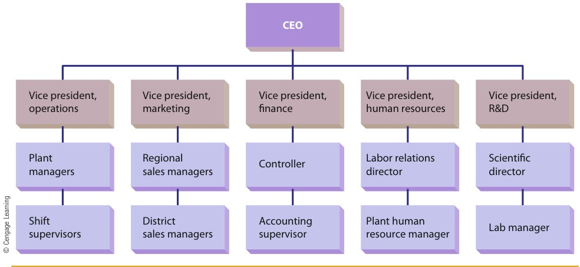
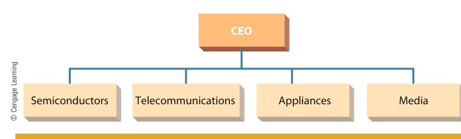
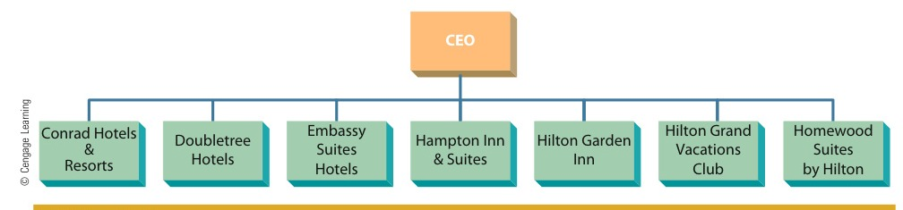
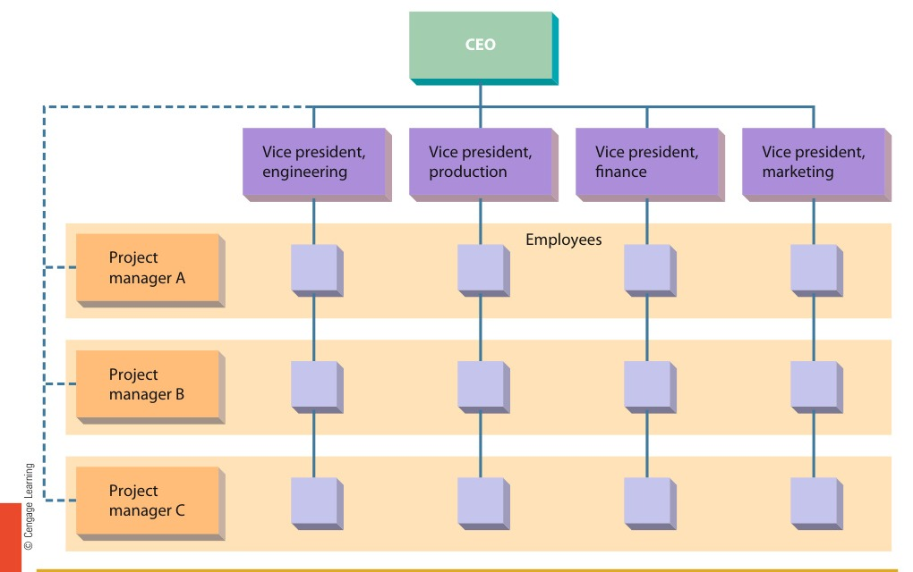

# CHAPTER 6: Organization Structure and Design

<!-- Page 188 -->

CHAPTER 6Organization Structureand Design

Learning Outcomes

After studying this chapter, you should be able to:

1Identify the basic elements of organizations.

2Describe the bureaucratic perspective on organization design.

3Identify and explain key situational influences on organization design.

4Describe the basic forms of organization design that characterize many organizations.

5Identify and describe emerging issues in organization design.

Management in Action

Authority & Function at A&F

#### “Paying $90 for torn jeans isn’t that cool anymore.”

—Analyst on declining sales at Abercrombie & Fitch

Along with American Eagle and Aéropostale, Abercrombie & Fitch (A&F) is one ofthe “Three A’s” of retailing for younger consumers, the three largest specialtyretailers catering to young adults ages 18 to 22 (and up). Look around yourcollege classroom and you’ll probably spy at least one A&F item—a cap, a shirt,a pair of jeans. Abercrombie & Fitch, a line of “casual luxury” apparel and otherproducts, is actually one of five brands owned by Ohio-based A&F Corporation.The company’s other brands include abercrombie (“classic cool” for preteens),Hollister (“SoCal” for teenagers), RUEHL 925 (a higher-priced brand for post-collegiates that recently closed), and Gilly Hicks (Australian-themed lounge andunderwear for women).Obviously, A&F’s businesses are related, and its overall corporate strategyis best characterized as one of related diversification. Based on this strategy,one would assume that A&F’s organizational design reflects a divisionalstructure,aformfavoredbycompaniesthatoperatemultiplerelatedbusinesses. It is interesting, however, that A&F relies instead on a functionaldesign based on functional departments (groups responsible for specificcompany functions).In general, some form of divisional structure is preferred by most firms thatpursue strategies of related diversification. Limited Brands, for example, a closecompetitor (and one-time parent) of A&F, uses a divisional structure to coordinate

<!-- Page 189 -->

Abercrombie & Fitch has been a fashion mainstay for younger consumers for years. Although thefirm has grown to be a huge retailer, it still uses a form of organization design more commonlyfound in much smaller businesses.

brands such as Victoria’s Secret, Bath & Body Works, Pink, and the White BarnCandle Company. Each unit is empowered to make autonomous decisions butcan also access companywide staff support in areas such as logistics,information technology, real estate, and store design. At A&F, on the other hand,every employee is assigned to one of eight basic business functions, such asplanning, purchasing, distribution, or stores, each of which is headed by apresident. Why this design? Basically, A&F wants every employee to develophighly specialized skills within a functional area. This design is also moreeffective in coordinating activities within a function.The company’s history also accounts in part for its choice of a functionalstructure. From its founding in 1892 until a bankruptcy in 1977, Abercrombie &Fitch was a high-end sporting-goods retailer. In 1978, Oshman’s, a Houston-basedsporting-goods chain, purchased the company brand and trademark and, for11 years, operated a combination retail chain and catalog company, sellingan eclectic line of products ranging from tweed jackets to exercise machines.Limited Brands purchased the brand in 1988, putting it on preppy, upscaleclothing for young adults. Nine years later, Limited sold 16 percent of thecompany through a public stock sale, and when the remaining shares were soldto the public in 1998, A&F became an independent company. In its currentincarnation, then, A&F started out as a division of a larger firm, so it makes sensethat its structure would be much like that of one division in a multidivisionalcorporation.It’s also interesting to note that, even before the spinoff from Limited, A&F hadbegun to establish its own culture and its own pattern of growth. Michael Jeffries,

<!-- Page 190 -->

aretail-industryveteran,becamepresidentin1992andundertooktotransform the company into the retailer of choice for younger consumers.Jeffriesquicklymanagedtoattach thebrandtoanidealizedlifestyle,emphasizing apparel that complemented youth, good looks, and good times.The transformation turned out to be highly profitable, with sales increasingfrom $85 million in 1992 to $165 million in just two years. During the sameperiod, the number of stores in the chain grew from 36 to 67, and in 1999,with 212 stores nationwide, A&F topped $1 billion in sales. In the same year,A&F started its abercrombie division for children and preteens, and a yearlater, it launched Hollister, the first of its “lifestyle” chains. By the end of2002, the multidivision company was running 485 A&F stores, 144 abercrombieshops, and 32 Hollister outlets. Sales for the year were just under $1 4 billion.RUEHL opened in 2004 and Gilly Hicks in 2008. Today, A&F Corporationoperates around 1,100 stores.And yet A&F is still organized as if it were one big company with one bigbrand and a single division. The main advantage of this choice can beexplained as a desire to exercise top-down control over each brand byseparating and controlling all the functions on which every brand—that is,everystoretype—depends.RegardlessofhowA&Fisorganizedandotherwise managed, one thing is clear: It’s the way it is because that’s theway CEO Jeffries wants it. Jeffries took over a firm that was losing $25 milliona year, declared that survival depended on becoming a “young, hip, spiritedcompany,” and engineered a reversal of fortunes by turning it into somethingcompletely new, a retailer that celebrates what one observer calls “the vain,highly constructed male.” (A&F has had much less influence on women’sfashion.)Like many other retailers, A&F struggled during 2009 and 2010. The firm hadalways refused to discount, so some customers began to look elsewhere. Tohelp combat the downturn, A&F closed RUEHL and started offering some limiteddiscounting. These measures, along with the rebounding economy, helped A&Fstart to turn things around recently. In 2013, the firm reported sales of $3 5billion and a modest profit. Jeffries is under contract through 2014 but will likelyretire when the contract expires.1

All managers need the assistance of others to succeed and so must trust the membersof their team to do their jobs and carry out their responsibilities. And the teammembers themselves need the support of their boss and a clear understanding oftheir role in the organization. Indeed, the working relationship between managersand their subordinates is one of the most critical elements comprising an organiza-tion. As you will see in this chapter, managing the basic frameworks that organiza-tions use to get their work done—structure and design—is a fundamental part of themanagement process.This chapter, the first of three devoted to organizing, discusses many of the criticalelements of organization structure and design that managers can control. We first iden-tify and describe the various elements of organizing. Next, we explore how thoseelements can be combined to create an overall design for the organization. Next, weintroduce situational factors and how they impact organization design. We conclude bypresenting emerging issues in organization design.

<!-- Page 191 -->

> **job specialization**: The degree to which the overall task of the organization is broken down and divided into smaller component parts

> **job rotation**: An alternative to job specialization that involves systematically moving employees from one job to another

## THE BASIC ELEMENTS OF ORGANIZING

The term organization structure and design refers to the overall set of elements that can beused to configure an organization. This section introduces and describes these elements:job specialization, departmentalization, reporting relationships, distribution of authority,and coordination.

### Job Specialization

The first building block of organization structure is job specialization. Job specializationis the degree to which the overall task of the organization is broken down and dividedinto smaller component parts. For example, when Walt Disney started his company, hedid everything himself—wrote cartoons, drew them, added character voices, and thenmarketed them to theaters. As the business grew, though, he eventually hired others toperform many of these same functions. As growth continued, so, too, did specialization.For example, as animation artists work on Disney movies today, they may specialize ingenerating computer images of a single character or doing only background scenery.Others provide voices, and marketing specialists develop promotional campaigns.Today, the Walt Disney Company has literally thousands of different specialized jobs.Clearly, no one person could perform them all.

#### Benefits and Limitations of Specialization

Job specialization provides four bene-fits to organizations.2 First, workers performing small, simple tasks will become very pro-ficient at each task. Second, transfer time between tasks decreases. If employees performseveral different tasks, some time is lost as they stop doing the first task and start doingthe next. Third, the more narrowly defined a job is, the easier it is to develop specializedequipment to assist with that job. Fourth, when an employee who performs a highlyspecialized job is absent or resigns, the manager is able to train someone new atrelatively low cost. Although specialization is generally thought of in terms of operatingjobs, many organizations have extended the basic elements of specialization to managerialand professional levels.3

On the other hand, job specialization can have negative consequences. The foremostcriticism is that workers who perform highly specialized jobs may become bored anddissatisfied. The job may be so specialized that it offers no challenge or stimulation.Boredom and monotony set in, absenteeism rises, and the quality of the work may suffer.Furthermore, the anticipated benefits of specialization do not always occur. For example,a classic study conducted at Maytag found that the time spent moving work in processfrom one worker to another was greater than the time needed for the same individual tochange from job to job.4 Thus, although some degree of specialization is necessary, itshould not be carried to extremes because of the possible negative consequences. Man-agers must be sensitive to situations in which extreme specialization should be avoided.And indeed, several alternative approaches to designing jobs have been developed inrecent years.

#### Alternatives to Specialization

To counter the problems associated with specializa-tion, managers have sought other approaches to job design that achieve a better balancebetween organizational demands for efficiency and productivity and individual needs forcreativity and autonomy. Five alternative approaches are job rotation, job enlargement,job enrichment, job characteristics approach, and work teams.5

Job rotation involves systematically moving employees from one job to another. Aworker in a warehouse might unload trucks on Monday, carry incoming inventory to

<!-- Page 192 -->

> **job enlargement**: An alternative to job specialization that involves giving the employee more tasks to perform

storage on Tuesday, verify invoices on Wednesday, pull outgoing inventory from storageon Thursday, and load trucks on Friday. Thus, the jobs do not change, but instead work-ers move from job to job. Unfortunately, for this very reason, job rotation has not beenvery successful in enhancing employee motivation or satisfaction. Jobs that are amenableto rotation tend to be relatively standard and routine. Workers who are rotated to a“new” job may be more satisfied at first, but satisfaction soon wanes. Although manycompanies (among them Raytheon, Ford, and Prudential Insurance) have tried job rota-tion, it is most often used today as a training device to improve worker skills and flexi-bility. Similarly, the TSA rotates security screeners at airports several times a day tooffset problems of boredom that might set in if the same task were being performed allthe time. The Walt Disney World resort swimming pool lifeguards rotate stations everyhalf hour to help them maintain focus on their task.

Job enlargement was developed to increase the total number of tasks workers per-form. As a result, all workers perform a wide variety of tasks, which presumably reducesthe level of job dissatisfaction. Many organizations have used job enlargement, includingIBM, Detroit Edison, AT&T, the U.S. Civil Service, and Maytag. At Maytag, for example,the assembly line for producing washing-machine water pumps was systematically chan-ged so that work that had originally been performed by six workers, who passed thework sequentially from one person to another, was performed by four workers, each ofwhom assembled a complete pump.6 Unfortunately, although job enlargement does havesome positive consequences, those are often offset by some disadvantages: (1) trainingcosts usually increase, (2) unions have argued that pay should increase because theworker is doing more tasks, and (3) in many cases the work remains boring and routineeven after job enlargement.

Many products like Maytag washers and dryers are manufactured using job specialization andassembly line technology. While this approach promotes efficiency, it can also lead to monotonyand worker boredom. To help counter these negative effects, Maytag has experimented with jobenlargement and other alternatives to job specialization.

<!-- Page 193 -->

> **job enrichment**: An alternative to job specialization that involves increasing both the number of tasks the worker does and the control the worker has over the job

> job characteristicsapproachAn alternative to jobspecialization thatsuggests that jobsshould be diagnosedand improved alongfive core dimensions,taking into accountboth the worksystem andemployeepreferences

> **work teams**: An alternative to job specialization that allows an entire group to design the work system it will use to perform an interrelated set of tasks

> **departmentalization**: The process of grouping jobs according to some logical arrangement

A more comprehensive approach, job enrichment, assumes that increasing the rangeand variety of tasks is not sufficient by itself to improve employee motivation.7 Thus, jobenrichment attempts to increase both the number of tasks a worker does and the controlthe worker has over the job. To implement job enrichment, managers remove somecontrols from the job, delegate more authority to employees, and structure the work incomplete, natural units. These changes increase subordinates’ sense of responsibility.Another part of job enrichment is to continually assign new and challenging tasks,thereby increasing employees’ opportunity for growth and advancement. AT&T, TexasInstruments, IBM, and General Foods are among the firms that have used job enrich-ment. This approach, however, also has disadvantages. For example, work systems needto be analyzed before enrichment, but this seldom happens, and managers rarely ask foremployee preferences when enriching jobs.The job characteristics approach is an alternative to job specialization that does takeinto account the work system and employee preferences.8 As illustrated in Figure 6.1, thejob characteristics approach suggests that jobs should be diagnosed and improved alongfive core dimensions:

1. Skill variety, the number of things a person does in a job2. Task identity, the extent to which the worker does a complete or identifiable portionof the total job3. Task significance, the perceived importance of the task4. Autonomy, the degree of control the worker has over how the work is performed5. Feedback, the extent to which the worker knows how well the job is being performed

Increasing the presence of these dimensions in a job presumably leads to highermotivation, higher-quality performance, higher satisfaction, and lower absenteeism andturnover. A large number of studies have been conducted to test the usefulness of thejob characteristics approach. The Southwestern Division of Prudential Insurance, forexample, used this approach in its claims division. Results included moderate declinesin turnover and a small but measurable improvement in work quality. Other researchfindings have not supported this approach as strongly. Thus, although the job character-istics approach is one of the most promising alternatives to job specialization, it is prob-ably not the final answer.Another alternative to job specialization is work teams. Under this arrangement, agroup is given responsibility for designing the work system to be used in performing aninterrelated set of tasks. In the typical assembly-line system, the work flows from oneworker to the next, and each worker has a specified job to perform. In a work team,however, the group itself decides how jobs will be allocated. For example, the workteam assigns specific tasks to members, monitors and controls its own performance,and has autonomy over work scheduling.9

### Grouping Jobs: Departmentalization

The second element of organization structure is the grouping of jobs according to somelogical arrangement. The process of grouping jobs is called departmentalization. Whenorganizations are small, the owner-manager can personally oversee everyone who works there.As an organization grows, however, personally supervising all the employees becomes more andmore difficult for the owner-manager. Consequently, new managerial positions are created tosupervise the work of others. Employees are not assigned to particular managers randomly.Rather, jobs are grouped according to some plan. The logic embodied in such a plan is the basisfor all departmentalization.10

<!-- Page 194 -->

> functionaldepartmentalizationGrouping jobsinvolving the sameor similar activities

© Academic Press, Inc. Reprinted by permission of Academic Press and the authors.

*Figure 6.1 — The Job Characteristics Approach (Source: Page 194)*

The job characteristics approach to job design provides a viable alternative to jobspecialization. Five core job dimensions may lead to critical psychological states that,in turn, may enhance motivation, performance, and satisfaction while also reducingabsenteeism and turnover.

Source: J. R. Hackman and G. R. Oldham, “Motivation through the Design of Work:Test of a Theory,” Organizational Behavior and Human Performance, 1976, Vol. 16,pp. 250–279.

#### Functional Departmentalization

The most common base for departmentalization,especially among smaller organizations, is by function. Functional departmentalizationgroups together those jobs involving the same or similar activities. (The word function isused here to mean organizational functions such as finance and production, rather thanthe basic managerial functions, such as planning or controlling.) This approach, which ismost common in smaller organizations, has three primary advantages. First, each depart-ment can be staffed by experts in that functional area. Marketing experts can be hired torun the marketing function, for example. Second, supervision is facilitated because an indi-vidual manager needs to be familiar with only a relatively narrow set of skills. And, third,coordinating activities inside each department is easier.On the other hand, as an organization begins to grow in size, several disadvantages ofthis approach may emerge. For one, decision making tends to become slower and more

<!-- Page 195 -->

> productdepartmentalizationGrouping activitiesaround products orproduct groups

> customerdepartmentalizationGrouping activitiesto respond to andinteract with specificcustomers orcustomer groups

> locationdepartmentalizationGrouping jobs on thebasis of definedgeographic sites orareas

> **chain of command**: A clear and distinct line of authority among the positions in an organization

bureaucratic. Employees may also begin to concentrate too narrowly on their own unitand lose sight of the total organizational system. Finally, accountability and performancebecome increasingly difficult to monitor. For example, determining whether a new productfails because of production deficiencies or a poor marketing campaign may not be possible.

#### Product Departmentalization

Product departmentalization, a second commonapproach, involves grouping and arranging activities around products or product groups.Most larger businesses adopt this form of departmentalization for grouping activities at thebusiness or corporate level. Product departmentalization has three major advantages. First,all activities associated with one product or product group can be easily integrated and coor-dinated. Second, the speed and effectiveness of decision making are enhanced. Third, theperformance of individual products or product groups can be assessed more easily andobjectively, thereby improving the accountability of departments for the results of theiractivities.Product departmentalization also has two major disadvantages. For one, managers ineach department may focus on their own product or product group to the exclusion ofthe rest of the organization. For example, a marketing manager may see his or herprimary duty as helping the group rather than helping the overall organization. Foranother, administrative costs rise because each department must have its own functionalspecialists for areas such as market research and financial analysis.

#### Customer Departmentalization

Under customer departmentalization, the organi-zation structures its activities to respond to and interact with specific customers or cus-tomer groups. The lending activities in most banks, for example, are usually tailored tomeet the needs of different kinds of customers (business, consumer, mortgage, and agricul-tural loans). The basic advantage of this approach is that the organization is able to useskilled specialists to deal with unique customers or customer groups. It takes one set ofskills to evaluate a balance sheet and lend $5,000,000 for operating capital and a differentset of skills to evaluate an individual’s creditworthiness and lend $40,000 for a new car.However, a fairly large administrative staff is required to integrate the activities of thevarious departments. In banks, for example, coordination is necessary to make sure thatthe organization does not overcommit itself in any one area and to handle collections ondelinquent accounts from a diverse set of customers.

#### Location Departmentalization

Location departmentalization groups jobs on thebasis of defined geographic sites or areas. The defined sites or areas may range in sizefrom a hemisphere to only a few blocks of a large city. Transportation companies,police departments (precincts represent geographic areas of a city), and the FederalReserve Bank all use location departmentalization. The primary advantage of locationdepartmentalization is that it enables the organization to respond easily to uniquecustomer and environmental characteristics in the various regions. On the negativeside, a larger administrative staff may be required if the organization must keep trackof units in scattered locations.

### Establishing Reporting Relationships

The third basic element of organizing is the establishment of reporting relationshipsamong positions. The purpose of this activity is to clarify the chain of command andthe span of management.

#### Chain of Command

Chain of command is an old concept, first popularized in theearly years of the twentieth century. For example, early writers about the chain of command

argued that clear and distinct lines of authority need to be established among all positions in

<!-- Page 196 -->

> span ofmanagementThe number ofpeople who report toa particular manager

> authorityPower that has beenlegitimized by theorganization

> **delegation**: The establishment of a pattern of authority between a superior and one or more subordinates

an organization. The chain of command actually has two components. The first, called unityof command, suggests that each person within an organization must have a clear reportingrelationship to one and only one boss (as we see later, newer models of organization designroutinely—and successfully—violate this premise). The second, called the scalar principle,suggests that there must be a clear and unbroken line of authority that extends from thelowest to the highest position in the organization. The popular saying “The buck stopshere” is derived from this idea—someone in the organization must ultimately be responsiblefor every decision.

#### Span of Management

Another part of establishing reporting relationships is determin-ing how many people will report to each manager. This defines the span of management(sometimes called the span of control). For years, managers and researchers sought todetermine the optimal span of management. Today, we recognize that the span of man-agement is a crucial factor in structuring organizations but that there are no universal,cut-and-dried prescriptions for an ideal or optimal span.11

#### Tall Versus Flat Organizations

In recent years, managers have begun to focusattention on the optimal number of layers in their organizational hierarchy. Havingmore layers results in a taller organization, whereas having fewer layers results in a flatterorganization. What difference does it make whether the organization is tall or flat? Oneearly study at Sears found that a flat structure led to higher levels of employee moraleand productivity.12 Researchers have also argued that a tall structure is more expensive(because of the larger number of managers involved) and that it fosters more communi-cation problems (because of the increased number of people through whom informationmust pass). On the other hand, a wide span of management in a flat organization mayresult in a manager having more administrative responsibility (because there are fewermanagers) and more supervisory responsibility (because there are more subordinatesreporting to each manager). If these additional responsibilities become excessive, theflat organization may suffer.13

Many experts agree that businesses can function effectively with fewer layers of orga-nization than they currently have. The Franklin Mint, for example, reduced its numberof management layers from 6 to 4. At the same time, the CEO increased his span ofmanagement from 6 to 12. The British firm Cadbury PLC, maker of Cadbury Dairy cho-colates, Trident gum, and other confectionary products, recently eliminated a layer ofmanagement separating the CEO and the firm’s operating units. The specific reasonsfor the change were to improve communication between the CEO and the operatingunit heads and to speed up decision making.14 The “Leading the Way” feature providesanother recent example of a CEO leading a firm toward a flatter organization. One addi-tional reason for this trend is that improved communication technologies such as e-mailand text messaging allow managers to stay in touch with a larger number of subordinatesthan was possible even just a few years ago.15

### Distributing Authority

Another important building block in structuring organizations is the determination ofhow authority is to be distributed among positions. Authority is power that has beenlegitimized by the organization.16 Two specific issues that managers must address whendistributing authority are delegation and decentralization.17

#### The Delegation Process

Delegation is the establishment of a pattern of authoritybetween a superior and one or more subordinates. Specifically, delegation is the processby which managers assign a portion of their total workload to others.18 In theory, thedelegation process involves three steps. First, the manager assigns responsibility or gives

<!-- Page 197 -->

> AP Images/Dan Joling

> ### LEADING THE WAY: Delayering as a Defense Mechanism
> 
> Anglo American PLC, one of the world’s largest diversified mining companies, operates across Africa, Europe, South and North America, and Australia. Times have been hectic for Anglo. In February 2009, CEO Cynthia Carroll admitted that the organization, like many companies, was starting to feel the impact of the global recession. Her whirlwind campaign to cut costs focused on delayering—reducing the number of management levels to create a flatter, more responsive organization.
> 
> Carroll eliminated redundant management layers between the executive committee and frontline mine operators. By expanding the span of management and delegating operational authority downward, Anglo accelerated decision-making speed and cut annual overhead by hundreds of millions of dollars. As Carroll observed, eliminating intermediate bureaucratic layers forces managers to trust their teams and empowers frontline supervisors to make timely operational calls.

### Flat Versus Tall Organizations

A flat organization has a wide span of management and fewer hierarchical levels, whereas a tall organization has a narrow span of management and many levels. Flat structures tend to foster higher morale and employee productivity because decentralized decision making puts managers closer to everyday operations. However, managers in flat organizations may face excessive supervisory workloads.

<!-- Page 198 -->

> **decentralization**: The process of systematically delegating power and authority throughout an organization to middle- and lower-level managers

> **centralization**: The process of systematically retaining power and authority in the hands of higher-level managers

the subordinate a job to do. The assignment of responsibility might range from telling asubordinate to prepare a report to placing the person in charge of a task force. Alongwith the assignment, the individual is also given the authority to do the job. The man-ager may give the subordinate the power to requisition needed information from confi-dential files or to direct a group of other workers. Finally, the manager establishes thesubordinate’s accountability—that is, the subordinate accepts an obligation to carry outthe task assigned by the manager. For instance, the CEO of AutoZone will sign off forthe company on financial performance only when the individual manager responsible foreach unit has certified his or her own results as being accurate. The firm believes thatthis high level of accountability will help it avoid the kind of accounting scandal thathas hit many businesses in recent times.19

#### Decentralization and Centralization

Just as authority can be delegated from oneindividual to another, organizations also develop patterns of authority across a widevariety of positions and departments. Decentralization is the process of systematicallydelegating power and authority throughout the organization to middle- and lower-levelmanagers. It is important to remember that decentralization is actually one end of acontinuum anchored at the other end by centralization, the process of systematicallyretaining power and authority in the hands of higher-level managers. Hence, a decen-tralized organization is one in which decision-making power and authority are dele-gated as far down the chain of command as possible. Conversely, in a centralizedorganization, decision-making power and authority are retained at higher levels in theorganization.What factors determine an organization’s position on the decentralization–central-ization continuum? One common determinant is the organization’s external environ-ment. Usually, the greater the complexity and uncertainty of the environment, thegreater is the tendency to decentralize. Another crucial factor is the history of theorganization. Firms have a tendency to do what they have done in the past, so thereis likely to be some relationship between what an organization did in its early historyand what it chooses to do today in terms of centralization or decentralization.The nature of the decisions being made is also considered. The costlier and riskierthe decisions, the more pressure there is to centralize. In short, managers have noclear-cut guidelines for determining whether to centralize or decentralize. Manysuccessful organizations, such as General Electric and Johnson & Johnson, are quitedecentralized. Equally successful firms, such as McDonald’s and Walmart, have remainedcentralized.IBM has recently undergone a transformation from using a highly centralizedapproach to a much more decentralized approach to managing its operations. A greatdeal of decision-making authority was passed from the hands of a select group of topexecutives down to six product and marketing groups. The reason for the move was tospeed up the company’s ability to make decisions, introduce new products, and respondto customers. Similarly, Toyota recently announced its intent to provide more autonomyto country managers, especially those in the United States. This move came in partbecause of poor and slow decision making during a recent quality crisis involving Toyotaproducts.20

In contrast, Royal Dutch Shell, long operated in a highly decentralized manner, hasrecently gone through several major changes all intended to make the firm more central-ized. New CEO Peter Voser went so far as to note that “fewer people will make strategicdecisions.”21 Yahoo! Inc. has also initiated a change to become more centralized.22 The“At Your Service” feature provides an interesting example of how Best Buy createdauthority for its chief ethics officer.

<!-- Page 199 -->

> ### AT YOUR SERVICE: A Panel of Your Peers
> 
> Kathleen Edmond is chief ethics officer at Best Buy, the world’s largest consumer-electronics retailer. To help people better understand the role of ethics in a service environment, she established peer review panels for employee grievances.
> 
> When an employee faces termination or severe disciplinary action, he or she can request a hearing before a peer review panel consisting of three hourly associates and two managers randomly selected from other store locations. The panel reviews the case, hears testimony, and votes by secret ballot. The panel’s decision is binding on the company.
> 
> This innovative delegation of authority builds extraordinary trust and organizational commitment. Employees know that management decisions must be transparent, fair, and justifiable to a jury of their peers.
> 
> • Are there procedures in place that could prevent this from happening at your store?
> • How does peer review support Best Buy’s customer-service culture?

<!-- Page 200 -->

> **coordination**: The process of linking the activities of the various departments of the organization

> pooledinterdependenceWhen units operatewith little interaction;their output is pooledat the organizationallevel

> sequentialinterdependenceWhen the output ofone unit becomesthe input for anotherin a sequentialfashion

> reciprocalinterdependenceWhen activities flowboth ways betweenunits

accomplished by coordination—the process of linking the activities of the variousdepartments of the organization.23

#### The Need for Coordination

The primary reason for coordination is that depart-ments and work groups are interdependent—they depend on one another for informa-tion and resources to perform their respective activities. The greater the interdependencebetween departments, the more coordination the organization requires if departmentsare to be able to perform effectively. The three major forms of interdependence arepooled, sequential, and reciprocal.24

Pooled interdependence represents the lowest level of interdependence. Units withpooled interdependence operate with little interaction—the output of the units is pooledat the organizational level. Old Navy clothing stores operate with pooled interdepen-dence. Each store is considered a “department” by the parent corporation. Each has itsown operating budget, staff, and so forth. The profits or losses from each store are“added together” at the organizational level. The stores are interdependent to the extentthat the final success or failure of one store affects the others, but they do not generallyinteract on a day-to-day basis.In sequential interdependence, the output of one unit becomes the input for anotherin a sequential fashion. This creates a moderate level of interdependence. At Nissan, forexample, one plant assembles engines and then ships them to a final assembly site atanother plant, where the cars are completed. The plants are interdependent in that thefinal assembly plant must have the engines from engine assembly before it can performits primary function of producing finished automobiles. But the level of interdependenceis generally one way—the engine plant is not necessarily dependent on the final assemblyplant.

Reciprocal interdependence exists when activities flow both ways between units.This form is clearly the most complex. Within a Marriott hotel, for example, thereservations department, front-desk check-in, and housekeeping are all reciprocallyinterdependent. Reservations has to provide front-desk employees with informationabout how many guests to expect each day, and housekeeping needs to know whichrooms require priority cleaning. If any of the three units does not do its job properly, allthe others will be affected.

#### Structural Coordination Techniques

Because of the obvious coordination require-ments that characterize most organizations, many techniques for achieving coordinationhave been developed. Some of the most useful devices for maintaining coordinationamong interdependent units are the managerial hierarchy, rules and procedures, liaisonroles, task forces, and integrating departments.25

Organizations that use the hierarchy to achieve coordination place one manager incharge of interdependent departments or units. In Walmart distribution centers, majoractivities include receiving and unloading bulk shipments from railroad cars and loadingother shipments onto trucks for distribution to retail outlets. The two groups (receivingand shipping) are interdependent in that they share the loading docks and some equip-ment. To ensure coordination and minimize conflict, one manager is in charge of thewhole operation.Routine coordination activities can be handled through rules and standard proce-dures. In the Walmart distribution center, an outgoing truck shipment has priorityover an incoming rail shipment. Thus, when trucks are to be loaded, the shippingunit is given access to all of the center’s auxiliary forklifts. This priority is specificallystated in a rule. But, as useful as rules and procedures often are in routine situations,they are not particularly effective when coordination problems are complex orunusual.

<!-- Page 201 -->

> **bureaucracy**: A model of organization design based on a legitimate and formal system of authority

As a device for coordination, a manager in a liaison role coordinates interdependentunits by acting as a common point of contact. This individual may not have any formalauthority over the groups but instead simply facilitates the flow of information betweenunits. Two engineering groups working on component systems for a large project mightinteract through a liaison. The liaison maintains familiarity with each group as well aswith the overall project. She can answer questions and otherwise serve to integrate theactivities of all the groups.A task force may be created when the need for coordination is acute. When interde-pendence is complex and several units are involved, a single liaison person may not besufficient. Instead, a task force might be assembled by drawing one representative fromeach group. The coordination function is thus spread across several individuals, each ofwhom has special information about one of the groups involved. When the project iscompleted, task force members return to their original positions. For example, a collegeoverhauling its degree requirements might establish a task force made up of representa-tives from each department affected by the change. Each person not only retains his orher regular departmental affiliation and duties but also serves on the special task force.After the new requirements are agreed on, the task force is dissolved.Integrating departments are occasionally used for coordination. These are somewhatsimilar to task forces but are more permanent. An integrating department generally hassome permanent members as well as members who are assigned temporarily from unitsthat are particularly in need of coordination. One study found that successful firms inthe plastics industry, which is characterized by complex and dynamic environments,used integrating departments to maintain internal integration and coordination.26 Anintegrating department usually has more authority than a task force and may even begiven some budgetary control by the organization.

#### Electronic Coordination

Advances in information technology are also providinguseful mechanisms for coordination. E-mail, for example, makes it easier for people tocommunicate with one another. This communication, in turn, enhances coordination.Similarly, many people in organizations today use electronic scheduling, at least someof which is accessible to others. Hence, if someone needs to set up a meeting with twocolleagues, he or she can often check their electronic schedules to determine their avail-ability, making it easier to coordinate their activities.Local networks, increasingly managed by handheld electronic devices, are also makingit easier to coordinate activities. Bechtel, for example, now requires its contractors, sub-contractors, and suppliers to use a common web-based communication system toimprove coordination among their myriad activities. The firm estimates that thisimproved coordination technology routinely saves it thousands of dollars on every bigconstruction project it undertakes.

## THE BUREAUCRATIC MODEL OF ORGANIZATION DESIGN

Max Weber, an influential German sociologist, was a pioneer of classical organizationtheory. At the core of Weber’s writings was the bureaucratic model of organizations.27 TheWeberian perspective suggests that a bureaucracy is a model of organization design basedon a legitimate and formal system of authority. Many people associate bureaucracy with “redtape,” rigidity, and passing the buck. For example, how many times have you heard peoplerefer disparagingly to “the federal bureaucracy”? Many U.S. managers believe that

<!-- Page 202 -->

> situational view oforganization designBased on theassumption that theoptimal design forany givenorganizationdepends on a set ofrelevant situationalfactors

bureaucracy in the Chinese government is a major impediment to U.S. firms’ ability to dobusiness there.Weber viewed the bureaucratic form of organization as logical, rational, and efficient.He offered the model as a framework to which all organizations should aspire—the “onebest way” of doing things. According to Weber, the ideal bureaucracy exhibits five basiccharacteristics:

1. The organization should adopt a distinct division of labor, and each position shouldbe filled by an expert.2. The organization should develop a consistent set of rules to ensure that task perfor-mance is uniform.3. The organization should establish a hierarchy of positions or offices that createsa chain of command from the top of the organization to the bottom.4. Managers should conduct business in an impersonal way and maintain an appropriatesocial distance between themselves and their subordinates.5. Employment and advancement in the organization should be based on technicalexpertise, and employees should be protected from arbitrary dismissal.

Perhaps the best examples of bureaucracies today are government agencies anduniversities. Consider, for example, the steps you must go through and the formsyou must fill out to apply for admission to college, request housing, register eachsemester, change majors, submit a degree plan, substitute a course, and file for grad-uation. Even when paper is replaced with electronic media, the steps are often thesame. The reason these procedures are necessary is that universities deal with largenumbers of people who must be treated equally and fairly. Hence, rules, regulations, andstandard operating procedures are needed. Large labor unions are also usually organized asbureaucracies.28

Some bureaucracies, such as the U.S. Postal Service, have been trying to portraythemselves as less mechanistic and impersonal. The strategy of the Postal Service is tobecome more service oriented as a way to fight back against competitors such as FedExand UPS.A primary strength of the bureaucratic model is that several of its elements (such asreliance on rules and employment based on expertise) do, in fact, often improveefficiency. Bureaucracies also help prevent favoritism (because everyone must followthe rules) and make procedures and practices very clear to everyone. Unfortunately,however, this approach also has several disadvantages. One major disadvantage is thatthe bureaucratic model results in inflexibility and rigidity. Once rules are created andput in place, making exceptions or changing them is often difficult. In addition, thebureaucracy often results in the neglect of human and social processes within theorganization.

## SITUATIONAL INFLUENCES ON ORGANIZATION DESIGN

The situational view of organization design is based on the assumption that theoptimal design for any given organization depends on a set of relevant situational factors.In other words, situational factors play a role in determining the best organization designfor any particular circumstance.29 Four basic situational factors—technology, environment,size, and organizational life cycle—are discussed here.

<!-- Page 203 -->

> NetPhotos/Alamy

> **technology**: Conversion processes used to transform inputs into outputs

Fidelity Investments uses technology to transform investment dollars into growth and income forinvestors. This technology, in turn, plays a significant role in the kind of organization design thatbest serves Fidelity. Other firms that use different technologies, meanwhile, will likely use differentforms of organization design.

### Core Technology

Technology consists of the conversion processes used to transform inputs (such as mate-rials or information) into outputs (such as products or services). Most organizations usemultiple technologies, but an organization’s most important one is called its core technology.Although most people visualize assembly lines and machinery when they think of tech-nology, the term can also be applied to service organizations. For example, an invest-ment firm like Fidelity uses technology to transform investment dollars into income inmuch the same way that Union Carbide uses natural resources to manufacture chemicalproducts.The link between technology and organization design was first recognized byJoanWoodward.30Woodwardstudied100manufacturingfirmsinsouthernEngland. She collected information about aspects such as the history of each organi-zation, its manufacturing processes, its forms and procedures, and its financial per-formance. Woodward expected to find a relationship between the size of anorganization and its design, but no such relationship emerged. As a result, shebegan to seek other explanations for differences. Close scrutiny of the firms in hersample led her to recognize a potential relationship between technology and organi-zation design. This follow-up analysis led Woodward to first classify the organiza-tions according to their technology. Three basic forms of technology were identified byWoodward:

1. Unit or small-batch technology. The product is custom-made to customer specifica-tions or produced in small quantities. Organizations using this form of technologyinclude a tailor shop specializing in custom suits, a printing shop that producesbusiness cards and company stationery, and a photography studio.

<!-- Page 204 -->

> mechanisticorganizationSimilar to thebureaucratic model,most frequentlyfound in stableenvironments

> organicorganizationVery flexible andinformal model oforganization design,most often found inunstable andunpredictableenvironments

2. Large-batch or mass-production technology. The product is manufactured in assembly-line fashion by combining component parts into another part or finished product.Examples include automobile manufacturers like Subaru, appliance makers likeWhirlpool Corporation, and electronics firms like Philips.3. Continuous-process technology. Raw materials are transformed to a finished productby a series of machine or process transformations. The composition of the materialsthemselves is changed. Examples include petroleum refineries like ExxonMobil andShell, and chemical refineries like Dow Chemical and Hoechst AG.

These forms of technology are listed in order of their assumed levels of complexity. Inother words, unit or small-batch technology is presumed to be the least complex andcontinuous-process technology the most complex. Woodward found that differentconfigurations of organization design were associated with each technology.Specifically, Woodward found that the two extremes (unit or small-batch andcontinuous-process) tended to have very little bureaucracy, whereas the middle-rangeorganizations (large-batch or mass-production) were much more bureaucratic. Thelarge-batch and mass-production organizations also had a higher level of specialization.31

Finally, she found that organizational success was related to the extent to whichorganizations followed the typical pattern. For example, successful continuous-process organizations tended to have less bureaucracy, whereas less successful firmswith the same technology tended to be more bureaucratic.

### Environment

Environmental elements and organization design are specifically linked in a number ofways.32 The first widely recognized analysis of environment–organization design linkageswas provided by Tom Burns and G. M. Stalker.33 Like Woodward, Burns and Stalkerworked in England. Their first step was identifying two extreme forms of organizationalenvironment: stable (one that remains relatively constant over time) and unstable (sub-ject to uncertainty and rapid change). Next, they studied the designs of organizations ineach type of environment. It was no surprise that they found that organizations in stableenvironments tended to have a different kind of design than organizations in unstableenvironments. The two kinds of design that emerged were called mechanistic andorganic organization.A mechanistic organization, quite similar to the bureaucratic model, was most fre-quently found in stable environments. Free from uncertainty, organizations structuredtheir activities in rather predictable ways by means of rules, specialized jobs, and central-ized authority. Mechanistic organizations are also quite similar to bureaucracies.Although no environment is completely stable, Abercrombie & Fitch and Wendy’suse mechanistic designs. Each A&F store, for example, has prescribed methods for storedesign and merchandise-ordering processes. Little or no deviation is allowed fromthese methods. An organic organization, on the other hand, was most often found inunstable and unpredictable environments, in which constant change and uncertaintyusually dictate a much higher level of fluidity and flexibility. Motorola (facing rapidtechnological change) and Apple (facing both technological change and constant changein consumer tastes) both use organic designs. A manager at Motorola, for example, hasconsiderable discretion over how work is performed and how problems can be solved.These ideas were extended in the United States by Paul R. Lawrence and JayW. Lorsch.34 They agreed that environmental factors influence organization design butbelieved that this influence varies between different units of the same organization. Infact, they predicted that each organizational unit has a unique environment andresponds by developing unique attributes. Lawrence and Lorsch suggested that organiza-tions could be characterized along two primary dimensions.

<!-- Page 205 -->

> differentiationExtent to which theorganization isbroken down intosubunits

> integrationDegree to which thevarious subunitsmust work togetherin a coordinatedfashion

> organizational sizeTotal number of full-time or full-time–equivalentemployees

> organizational lifecycleProgression throughwhich organizationsevolve as they growand mature

One of these dimensions, differentiation, is the extent to which the organization isbroken down into subunits. A firm with many subunits is highly differentiated; onewith few subunits has a low level of differentiation. The second dimension, integration,is the degree to which the various subunits must work together in a coordinated fashion.For example, if each unit competes in a different market and has its own productionfacilities, they may need little integration. Lawrence and Lorsch reasoned that the degreeof differentiation and integration needed by an organization depends on the stability ofthe environments that its subunits face.

### Organizational Size and Life Cycle

The size and life cycle of an organization may also affect its design.35 Although severaldefinitions of size exist, we define organizational size as the total number of full-time orfull-time–equivalent employees. A team of researchers at the University of Aston inBirmingham, England, believed that Woodward had failed to find a size–structurerelationship (which was her original expectation) because almost all the organizationsshe studied were relatively small (three-fourths had fewer than 500 employees).36 Thus,they decided to undertake a study of a wider array of organizations to determine howsize and technology both individually and jointly affect an organization’s design.Their primary finding was that technology did in fact influence structural variables insmall firms, probably because all their activities tend to be centered on their core tech-nologies. In large firms, however, the strong technology–design link broke down, mostlikely because technology is not as central to ongoing activities in large organizations.The Aston studies yielded a number of basic generalizations: When compared to smallorganizations, large organizations tend to be characterized by higher levels of job special-ization, more standard operating procedures, more rules, more regulations, and a greaterdegree of decentralization. Walmart is a good case in point. The firm expects to continueits dramatic growth for the foreseeable future, adding several thousand new jobs in thenext few years. But, as it grows, the firm acknowledges that it will have to become moredecentralized for its first-line managers to stay in tune with their customers.37 Of course,size is not constant. As we noted in Chapter 5, for example, some small businesses areformed but soon disappear. Others remain as small, independently operated enterprisesas long as their owner-manager lives. A few, such as Dell Computer, JetBlue, andStarbucks, skyrocket to become organizational giants. And occasionally, large organiza-tions reduce their size through layoffs or divestitures. Marathon Oil, for instance,recently announced that it would be spinning off its downstream business, creating twoindependent businesses and significantly reducing the size of its business.38 Consequently,Marathon is becoming a much smaller organization.Although no clear pattern explains changes in size, many organizations progressthrough a four-stage organizational life cycle.39 The first stage is the birth of theorganization. The second stage, youth, is characterized by growth and the expansion oforganizational resources. Midlife is a period of gradual growth evolving eventually intostability. Finally, maturity is a period of stability, perhaps eventually evolving intodecline. Firms like Netflix and Starbucks, for instance, are still in their youth stage;Halliburton and Chevron are in midlife; and Ford and Boeing are in maturity. (A keychallenge for managers, of course, is to avoid allowing a mature organization to beginto decline. Hence, they must be alert for opportunities to reenergize the organizationwith new products and new markets.)Managers must confront a number of organization design issues as the organizationprogresses through these stages. In general, as an organization passes from one stage tothe next, it becomes bigger, more mechanistic, and more decentralized. It also becomes

<!-- Page 206 -->

> **functional design**: Based on the functional approach to departmentalization (also called the U-form approach)

*Figure 6.2 — Functional (U-Form) Design for Organization Structure (Source: Page 206)*

more specialized, devotes more attention to planning, and takes on an increasingly largestaff component. Finally, coordination demands increase, formalization increases, organi-zational units become geographically more dispersed, and control systems become moreextensive. Thus, an organization’s size and design are clearly linked, and this link isdynamic because of the organizational life cycle.40

## BASIC FORMS OF ORGANIZATION DESIGN

Because technology, environment, size, and life cycle can all influence organizationdesign, it should come as no surprise that organizations adopt many different kinds ofdesigns. Most designs, however, fall into one of four basic categories. Others are hybridsbased on two or more of the basic forms.

### Functional (U-Form) Design

The functional design is an arrangement based on the functional approach to depart-mentalization. This design has been termed the U-form (for unitary) approach.41 Underthe U-form arrangement, the members and units in the organization are grouped intofunctional departments such as marketing and production.For the organization to operate efficiently in this design, there must be considerablecoordination across departments. This integration and coordination are most commonlythe responsibility of the CEO and members of senior management. Figure 6.2 shows theU-form design applied to the corporate level of a small manufacturing company. In aU-form organization, none of the functional areas can survive without the others.Marketing, for example, needs products from operations to sell and funds from finance

Functional (U-Form) Design for a Small Manufacturing Company

The U-form design is based on functional departmentalization. This small manufacturing firm usesmanagers at the vice presidential level to coordinate activities within each functional area of theorganization. Note that each functional area is dependent on the others.

<!-- Page 207 -->

> conglomeratedesignUsed by anorganization madeup of a set ofunrelated businesses

to pay for advertising. The WD-40 Company, which makes a popular lubricating oil, andthe McIlhenny Company, which makes tabasco sauce, are both examples of firms thatuse the U-form design.In general, this approach shares the basic advantages and disadvantages of functionaldepartmentalization. Thus, it allows the organization to staff all important positions withfunctional experts, and it facilitates coordination and integration. On the other hand, it alsopromotes a functional, rather than an organizational, focus and tends to promote centraliza-tion. Functionally based designs are most commonly used in small organizations because anindividual CEO can easily oversee and coordinate the entire organization. As an organizationgrows, the CEO finds staying on top of all functional areas increasingly difficult.

### Conglomerate (H-Form) Design

Another common form of organization design is the conglomerate, or H-form (for hold-ing, as in holding company), approach.42 The conglomerate design is used by an orga-nization made up of a set of unrelated businesses. Thus, the H-form design is essentiallya holding company that results from unrelated diversification.This approach is based loosely on the product form of departmentalization. Eachbusiness or set of businesses is operated by a general manager who is responsible for itsprofits or losses, and each general manager functions independently of the others.Samsung Electronics Company, a South Korean firm, uses the H-form design. As illus-trated in Figure 6.3, Samsung consists of four basic business groups. Other firms thatuse the H-form design include General Electric (aircraft engines, appliances, medicalequipment, financial services, lighting products, plastics, and other unrelated businesses)and Tenneco (pipelines, auto parts, financial services, and other unrelated businesses).Honeywell has also recently adopted the H-form design.43

In an H-form organization, a corporate staff usually evaluates the performance ofeach business, allocates corporate resources across companies, and shapes decisionsabout buying and selling businesses. The basic shortcoming of the H-form design is thecomplexity associated with holding diverse and unrelated businesses. Managers usuallyfind it difficult to compare and integrate activities across a large number of diverseoperations. Research suggests that many organizations following this approach achieveonly average-to-weak financial performance.44 Thus, although some U.S. firms are stillusing the H-form design, many have abandoned it for other approaches.

*Figure 6.3 — Conglomerate (H-Form) Design at Samsung (Source: Page 207)*

Samsung Electronics Company, a South Korean firm, uses the conglomerate form oforganization design. This design, which results from a strategy of unrelateddiversification, is a complex one to manage. Managers find that comparing andintegrating activities among the dissimilar operations are difficult. Companies mayabandon this design for another approach, such as the M-form design.

<!-- Page 208 -->

*Figure 6.4 — Multidivisional (M-Form) Design at Hilton Hotels (Source: Page 208)*

> **divisional design**: Based on multiple businesses in related areas operating within a larger organizational framework (also called the M-form approach)

> **matrix design**: Based on two overlapping bases of departmentalization

Multidivisional (M-Form) Design at Hilton Hotels

Hilton Hotels uses the multidivisional approach to organization design. Although each unit operates withrelative autonomy, all units function in the same general market. This design resulted from a strategy ofrelated diversification. Other firms that use M-form designs include PepsiCo and the Walt Disney Company.

### Divisional (M-Form) Design

In the divisional design, which is becoming increasingly popular, a product form oforganization is also used; in contrast to the H-form approach, however, the divisionsare related. Thus the divisional design, or M-form (for multidivisional) approach, isbased on multiple businesses in related areas operating within a larger organizationalframework. This design results from a strategy of related diversification.Some activities are extremely decentralized down to the divisional level; others arecentralized at the corporate level.45 For example, as shown in Figure 6.4, Hilton Hotelsuses this approach. Each of its divisions is headed by a president or executive vice presi-dent and operates with reasonable autonomy, but the divisions also coordinate theiractivities as is appropriate. Other firms that use this approach are the Walt DisneyCompany (theme parks, movies, and merchandising units, all interrelated) and Hewlett-Packard (computers, printers, scanners, electronic medical equipment, and otherelectronic instrumentation).The opportunities for coordination and shared resources represent one of the biggestadvantages of the M-form design. Hilton’s market research and purchasing departmentsare centralized. Thus, a site selector can visit a city and look for possible locations fordifferent Hilton brands, and a buyer can purchase bed linens for multiple Hilton brandsfrom the same supplier. The M-form design’s basic objective is to optimize internal com-petition and cooperation. Healthy competition for resources among divisions canenhance effectiveness, but cooperation should also be promoted. Research suggests thatthe M-form organization that can achieve and maintain this balance will outperformlarge U-form and all H-form organizations.46

### Matrix Design

The matrix design, another common approach to organization design, is based on twooverlapping bases of departmentalization.47 The foundation of a matrix is a set of func-tional departments. A set of product groups, or temporary departments, is then super-imposed across the functional departments. Employees in a matrix are simultaneouslymembers of a functional department (such as engineering) and of a project team.Figure 6.5 shows a basic matrix design. At the top of the organization are functionalunits headed by vice presidents of engineering, production, finance, and marketing. Eachof these managers has several subordinates. Along the side of the organization are anumber of positions called project manager. Each project manager heads a project

<!-- Page 209 -->

*Figure 6.5 — A Matrix Organization Design (Source: Page 209)*

> A Matrix Organization

A matrix organization design is created by superimposing a product form of departmentalization on anexisting functional organization. Project managers coordinate teams of employees drawn from differentfunctional departments. Thus, a matrix relies on a multiple-command structure.

group composed of representatives or workers from the functional departments.Note from the figure that a matrix reflects a multiple-command structure—any givenindividual reports to both a functional superior and one or more project managers.The project groups, or teams, are assigned to designated projects or programs. Forexample, the company might be developing a new product. Representatives are chosenfrom each functional area to work as a team on the new product. They also retainmembership in the original functional group. At any given time, a person may be amember of several teams as well as a member of a functional group. Ford used thisapproach in creating its popular Focus automobile. It formed a group called TeamFocus made up of designers, engineers, production specialists, marketing specialists, andother experts from different areas of the company. This group facilitated getting a verysuccessful product to the market at least a year earlier than would have been possibleusing Ford’s previous approaches.Martha Stewart also uses a matrix organization for her lifestyle business. The com-pany was first organized broadly into media and merchandising groups, each of whichhas specific products and product groups. Layered on top of this structure are teams oflifestyle experts organized into groups such as cooking, crafts, and weddings. Each ofthese groups is targeted toward specific customer needs, but they work as necessary

<!-- Page 210 -->

across all of the product groups. For example, a wedding expert might contribute to anarticle on wedding planning for a Martha Stewart Living magazine, contribute a storyidea for a cable TV program, and supply content for a Martha Stewart website. Thissame individual might also help select fabrics suitable for wedding gowns forretailing.48

The matrix form of organization design is most often used in one of three situa-tions.49 First, a matrix may work when there is strong pressure from the environment.For example, intense external competition may dictate the sort of strong marketingthrust that is best spearheaded by a functional department, but the diversity of acompany’s products may argue for product departments. Second, a matrix may beappropriate when large amounts of information need to be processed. For example,creating lateral relationships by means of a matrix is one effective way to increase theorganization’s capacity for processing information. Third, the matrix design may workwhen there is pressure for shared resources. For example, a company with ten productdepartments may have resources for only three marketing specialists. A matrix designwould allow all the departments to share the company’s scarce marketing resources.Both advantages and disadvantages are associated with the matrix design. Researchershave observed six primary advantages of matrix designs. First, they enhance flexibilitybecause teams can be created, redefined, and dissolved as needed. Second, because theyassume a major role in decision making, team members are likely to be highly motivatedand committed to the organization. Third, employees in a matrix organization have con-siderable opportunity to learn new skills. Fourth, the matrix design provides an efficientway for the organization to take full advantage of its human resources. Fifth, teammembers retain membership in their functional unit so that they can serve as a bridgebetween the functional unit and the team, enhancing cooperation. Sixth, the matrixdesign gives top management a useful vehicle for decentralization. Once the day-to-dayoperations have been delegated, top management can devote more attention to areassuch as long-range planning.On the other hand, the matrix design also has some major disadvantages. Employeesmay be uncertain about reporting relationships, especially if they are simultaneouslyassigned to a functional manager and to several project managers. To complicate mat-ters, some managers see the matrix as a form of anarchy in which they have unlimitedfreedom. Another set of problems is associated with the dynamics of group behavior.Groups take longer than individuals to make decisions, may be dominated by one indi-vidual, and may compromise too much. They may also get bogged down in discussionand not focus on their primary objectives. Finally, in a matrix, more time may also berequired for coordinating task-related activities.50

### Hybrid Designs

Some organizations use a design that represents a hybrid of two or more of thecommon forms of organization design.51 For example, an organization may havefive related divisions and one unrelated division, making its design a cross betweenan M form and an H form. Indeed, few companies use a design in its pure form;most firms have one basic organization design as a foundation for managing thebusiness but maintain sufficient flexibility so that temporary or permanent modifica-tions can be made for strategic purposes. Ford, for example, used the matrixapproach to design the Focus and the newest Mustang, but the company is basicallya U-form organization showing signs of moving to an M-form design. As we notedearlier, any combination of factors may dictate the appropriate form of design for anyparticular company.

<!-- Page 211 -->

> **team organization**: An approach to organization design that relies almost entirely on project-type teams, with little or no underlying hierarchy

> **virtual organization**: One that has little or no formal structure

> learningorganizationOne that works tofacilitate the lifelonglearning andpersonaldevelopment of all itsemployees whilecontinuallytransforming itself torespond to changingdemands and needs

## EMERGING ISSUES IN ORGANIZATION DESIGN

In today’s complex and ever-changing environment, it should come as no surprise thatmanagers continue to explore and experiment with new forms of organization design.Many organizations are creating designs for themselves that maximize their ability toadapt to changing circumstances and to a changing environment. They try to accomplishthis by not becoming too compartmentalized or too rigid. As we noted earlier, bureau-cratic organizations are hard to change, slow, and inflexible. To avoid these problems,then, organizations can try to be as different from bureaucracies as possible—relativelyfew rules, general job descriptions, and so forth. This final section highlights some ofthe most important emerging issues.52

### The Team Organization

Some organizations today are using the team organization, an approach to organizationdesign that relies almost exclusively on project-type teams, with little or no underlyingfunctional hierarchy. Within such an organization, people float from project to projectas necessitated by their skills and the demands of those projects. At Cypress Semicon-ductor, T. J. Rodgers refuses to allow the organization to grow so large that it cannotfunction this way. Whenever a unit or group starts getting too large, he simply splits itinto smaller units. Consequently, all units within the organization are small. This allowsthem to change direction, explore new ideas, and try new methods without dealing witha rigid bureaucratic organizational context. Although few organizations have actuallyreached this level of adaptability, Apple Computer and Xerox are among those movingtoward it.53

### The Virtual Organization

Closely related to the team organization is the virtual organization that has little or noformal structure. Such an organization typically has only a handful of permanentemployees and a very small staff and administrative headquarters facility. As the needsof the organization change, its managers bring in temporary workers, lease facilities, andoutsource basic support services to meet the demands of each unique situation. As thesituation changes, the temporary workforce changes in parallel, with some people leavingthe organization and others entering. Facilities and the services subcontracted to otherschange as well. Thus, the organization exists only in response to its needs. And, increas-ingly, virtual organizations are conducting most—if not all—of their businesses online.54

For example, TLG Research Inc. was founded as a virtual organization focused onmarketing research for automotive, aviation, marine, and industrial markets for originalequipment and replacement parts. Currently, the company consists of an in-house proj-ect management staff of ten people and a virtual network of industry professionals. Italso has a global business and research sources in Europe, Latin America, and Asia–Pacific to which it refers for consulting and research services as needed.

### The Learning Organization

Another recent approach to organization design is the so-called learning organization.Organizations that adopt this approach work to integrate continuous improvement withcontinuous employee learning and development. Specifically, a learning organization isone that works to facilitate the lifelong learning and personal development of all itsemployees while continually transforming itself to respond to changing demands andneeds.55

<!-- Page 212 -->

Although managers might approach the concept of a learning organization from a variety of perspectives, improved quality, continuous improvement, and performance measurement are frequent goals. The idea is that the most consistent and logical strategy for achieving continuous improvement is by constantly improving employee skills and organizational systems.

## SUMMARY OF LEARNING OUTCOMES AND KEY POINTS

### 1. Identify the basic elements of organization structure.
• The basic elements of organization structure are designing jobs (job specialization, job rotation, job enlargement, job enrichment, and the job characteristics approach), grouping jobs (functional, product, customer, and location departmentalization), establishing reporting relationships (chain of command and span of management), distributing authority (delegation, decentralization, and centralization), coordinating activities (pooled, sequential, and reciprocal interdependence), and differentiating between positions (line versus staff positions and administrative intensity).

### 2. Recognize the basic forms of organization design.
• The bureaucratic model of organization design was formulated by Max Weber. It emphasizes division of labor, a consistent rules structure, hierarchy, impersonality, and technical competence.
• System 1 organizations are bureaucratic; System 4 organizations are flexible and organic.

### 3. Discuss the situational influences on organization design.
• Situational factors influencing design include the organization’s environment (stable versus dynamic), size, technology (unit/small batch, large batch/mass production, continuous process), and organizational life cycle (birth, youth, midlife, and maturity).

### 4. Describe the basic forms of organization design.
• Basic forms of organization design include functional (U-form) design, conglomerate (H-form) design, divisional (M-form) design, and matrix design.
• Emerging designs include team-based organizations, virtual organizations, and learning organizations.

<!-- Page 213 -->

## DISCUSSION QUESTIONS

### Questions for Review
1. What is job specialization? What are the primary advantages and disadvantages of job specialization?
2. What are the common bases for departmentalization? Under what conditions is each base most appropriate?
3. What is the difference between a flat organization and a tall organization? How does span of management affect organizational height?
4. What is delegation? What three steps are involved in the delegation process?
5. Contrast the bureaucratic (System 1) and organic (System 4) approaches to organization design.

### Questions for Analysis
1. Select a familiar company and identify its primary form of departmentalization. Comment on how well or how poorly other forms of organization might work for that business.
2. Recall a situation in which a manager delegated a task to you or someone you know. Was the delegation process handled effectively? Why or why not?
3. Identify five ways in which electronic coordination mechanisms (such as enterprise software, video conferencing, and shared documents) affect your daily life and work.
4. Each of the situational factors—technology, environment, size, and life cycle—influences organization design. Which factor do you believe is most powerful for a high-tech start-up? For a major automaker? Explain your reasoning.
5. Why are matrix organizations notoriously difficult to manage? Under what competitive circumstances is a matrix design worth the complexity?

## BUILDING EFFECTIVE CONCEPTUAL SKILLS

### Exercise Overview
Conceptual skills involve understanding how an organization's structural components interact to achieve strategic goals.

### Exercise Background
Different organizational designs reflect trade-offs between specialization, coordination, control, and agility. When an organization shifts from a centralized functional design to a decentralized product structure, every reporting relationship is transformed.

### Exercise Task
1. Imagine that you are the CEO of a mid-sized consumer goods manufacturer that currently uses a strict functional design (manufacturing, sales, finance, R&D). As the firm adds new product lines, coordination breakdowns have proliferated.
2. Draft a proposal outlining the structural transition to a divisional (M-form) design or a matrix design. Compare the pros and cons of both options for your executive team.

<!-- Page 214 -->

## BUILDING EFFECTIVE DIAGNOSTIC SKILLS

### Exercise Overview
Diagnostic skills enable a manager to visualize the most appropriate response to a situation. In this exercise, you analyze delegation and decentralization dilemmas.

### Exercise Background
Scenario A: You are the founder of a successful specialty bakery that has grown from one shop to six locations. You still personally approve every ingredient order, employee schedule, and marketing flyer. Store managers feel micromanaged and turnover is rising.
Scenario B: You have just been brought in as regional director for a nationwide retail firm, but this time you’re going to centralize operations in an organization that’s always been decentralized.

### Exercise Task
1. Diagnose the root structural problem in Scenario A. What specific authority should you delegate immediately, and what controls should you maintain?
2. In Scenario B, what resistance should you anticipate when shifting authority back to headquarters, and how will you manage that change?

## SKILLS SELF-ASSESSMENT INSTRUMENT

### Delegation Aptitude Survey
**Instructions:** For each statement, circle the number that best reflects your attitude or behavior when working with others:
- 5 = Strongly Agree
- 4 = Slightly Agree
- 3 = Not Sure
- 2 = Slightly Disagree
- 1 = Strongly Disagree

<!-- Page 215 -->

| # | Statement | SA | A | NS | D | SD |
| :--- | :--- | :---: | :---: | :---: | :---: | :---: |
| 1. | I can do most tasks faster and better myself than if I explain them to someone else. | 5 | 4 | 3 | 2 | 1 |
| 2. | When I delegate a task, I worry that it will not be completed to my standards. | 5 | 4 | 3 | 2 | 1 |
| 3. | Subordinates lack the experience needed to make sound decisions on their own. | 5 | 4 | 3 | 2 | 1 |
| 4. | Delegation allows me to focus on higher-level strategic planning. | 5 | 4 | 3 | 2 | 1 |
| 5. | Employees with more responsibility tend to have more commitment to group goals. | 5 | 4 | 3 | 2 | 1 |
| 6. | When I delegate, I always explain precisely how the task is to be done. | 1 | 2 | 3 | 4 | 5 |
| 7. | I always seem to have too much to do and too little time to do it. | 5 | 4 | 3 | 2 | 1 |
| 8. | I enjoy developing subordinates by assigning them challenging new tasks. | 5 | 4 | 3 | 2 | 1 |
| 9. | If a delegated task is mishandled, I usually take it back rather than coach the person. | 5 | 4 | 3 | 2 | 1 |
| 10. | True delegation requires giving up authority along with responsibility. | 5 | 4 | 3 | 2 | 1 |

*(See Appendix for scoring and interpretation of your responses.)*

<!-- Page 216 -->

will be grouped back together into logical departments,and how authority and responsibility will be allocatedacross positions.

• Scenario 1. You will design and sell the productsyourself, as well as oversee production. You willstart with a workforce of five people.• Scenario 2. You intend to devote all of your time tosales to increase revenues, leaving all other functionsto others. You will start with a workforce of ninepeople.• Scenario 3. You do not intend to handle any onefunction yourself but will instead oversee the entireoperation and will start with a workforce of 15people.

Instructions: Assume that you have decided to open ahandmade chocolate business in your local community.Your products will be traditional bars and novelty-shapedchocolates, truffles, other chocolate products such as icecream, and gift baskets and boxes featuring chocolates.You have hired a talented chef and believe that her exper-tise, coupled with your unique designs and high-qualityingredients, will make your products very popular. Youhave also inherited enough money to get your businessup and running and to cover about one year of livingexpenses (in other words, you do not need to pay yourselfa salary).You intend to buy food items, including chocolate,cocoa, white chocolate, nuts, and fruit, from supplierswho deliver to your area. Your chef will then turn thoseingredients into luscious products that will then beattractively packaged. Local grocery store owners andrestaurant chefs have seen samples of your productsand indicated a keen interest in selling them. Youknow, however, that you will still need to serviceaccounts and keep your customers happy. At the pres-ent time, you are trying to determine how many peopleyou need to get your business going and how to groupthem most effectively into an organization. You realizethat you can start out quite small and then expand assales warrant. However, you also worry that if you arecontinuallyaddingpeopleandrearrangingyourorganization, confusion and inefficiency may result.Under each of the following scenarios, decide howbest to design your organization. Sketch a basic organi-zation chart to show your thoughts.

1. After you have created your organization chart,form small groups of four to five people each.Compare your various organization charts, focus-ing on similarities and differences.2. Working in the same group, assume that five yearshave passed and that your business has been abig success. You have a large factory for makingyour chocolates and are shipping them to 15states. You employ almost 500 people. Create anorganization design that you think fits this organi-zation best.

## Discussion Questions

1. How clear (or how ambiguous) were the decisionsabout organization design?2. What are your thoughts about starting out too largeto maintain stability, as opposed to starting small andthen growing?3. What basic factors did you consider in choosing adesign?

## MANAGEMENT AT WORK

### The Alliance Maze

Let’s say you’re a businessperson in New York whoneeds to fly to Hong Kong. Logging on to Orbitz, youfind that American Airlines (AMR) offers a nonstopround-trip flight for $2,692. Because Orbitz recom-mends that you “Act Fast! Only 1 ticket left at thisprice!” you buy your ticket online. On your departuredate, you arrive at the American Airlines ticket desk,only to be referred to the Cathay Pacific Airwayscounter. Your flight, the ticket agent informs you, isactually operated by Cathay, and she points tothe four-digit “codeshare number” on your ticket.

Bewildered but hoping that you’re still booked on aflight to Hong Kong, you hustle to the Cathay counter,where your ticket is in fact processed. Settled into yourseat a few hours later, you decide to get on your laptopto see if you can figure out why you are and aren’t onthe flight that you booked. Going back to Orbitz, youfind that, like American, Cathay does indeed offer anonstop round-trip flight to and from its home cityof Hong Kong—for $1,738. It dawns on you that ifyou’d bought your ticket directly from Cathay, you’dbe sitting in the same seat on the same airplane foralmost $1,000 less.

<!-- Page 217 -->

If this scenario sounds confusing, that’s because it is,even to veteran flyers. What’s confusing about it is thepractice of code sharing, which works like this: You buya ticket from Airline A for a flight operated by AirlineB on a route that Airline A doesn’t otherwise serve.This practice is possible if both airlines, like AMRand Cathay, belong to the same airline alliance (inthis case, Oneworld).On the surface, the advantages to the airlines mayseem mostly a matter of perception: An airline seems tobe serving certain markets that it doesn’t actually serveand flying certain routes more frequently than it actuallydoes. The networks formed by codesharing agreements,however, are real, and the breadth of an airline’s networkis a real factor in attracting high-margin corporatetravelers. In fact, the spread of codesharing has leddirectly to the formation of much larger “alliances” ofcarriers who cooperate on a substantial level, includingcodesharing and shared frequent-flyer programs. Thethree largest airline alliances are the Star Alliance, whichincludes United Airlines, Lufthansa, Air Canada, AirChina, and Scandinavian Airlines; SkyTeam, whichincludes Delta, Air France, Alitalia, and Dutch-basedKLM; and Oneworld, which includes AMR, Cathay,Qantas, British Airways, and Japan’s JAL.An airline alliance is one form of a virtual organiza-tion—in this case, a temporary alliance formed by twoor more organizations to pursue a specific venture or toexploit a specific opportunity. Although each memberremains an independently owned and managed organi-zation, alliance members can save money by sharingsales, maintenance, and operational facilities and staff(such as check-in, boarding, and other on-the-groundpersonnel), and they can also cut costs on purchasesand investments by negotiating volume discounts.The chief advantages, however, are breadth of serviceand geographical reach—in short, size (both perceivedand real). Star Alliance, for example, operates over21,000 daily flights to 1,200 airports in 181 countries.According to the most recent data, its members carried665.4 million passengers for a total of nearly 1 trillionrevenue passenger kilometers (1 rpk means that 1 pay-ing passenger was flown 1 kilometer). Based on rpk(which is really a measure of sales volume), Star com-mands 29.8 percent of global market share in the air-line industry—greater than the combined market shareof all airlines that don’t belong to any of the threemajor alliances.Note that our definition of a virtual organizationindicates a “temporary alliance,” and shifts by membersof airline alliances are not unheard of. In January 2009,

for example, a few months after merger talks had bro-ken down with United Airlines, Continental Airlines, amember of SkyTeam since 2004, announced that it wasjoining United in the Star Alliance. According to oneanalyst, the move, which took effect in October 2009,“was obviously a precursor to a full-blown merger,”and, sure enough, Continental and United merged inMay 2010 under a parent company called United Con-tinental Holdings. The new airline, retaining theUnited Airlines name, remains a member of the StarAlliance.The Continental–United merger was particularlybad news for both AMR, a member of Oneworld andthe country’s largest stand-alone airline, and USAirways Group, a member of the Star Alliance and thefifth-largest U.S. carrier. With the merger of Continen-tal and United, says Vaughn Cordle, chief analyst atAirline Forecasts, a specialist in industry investmentresearch, “the odds of … bankruptcy for US Airwaysand American increase because it will be too difficult,if not impossible, for them to remain viable as stand-alone businesses … . [W]ithout a new strategic directionand significant changes in the industry’s structure,”Cordle predicts, AMR and US Airways “will continueon the slow… path to failure.”And as predicted, American soon declared bank-ruptcy. Several months later, US Airways proposeda merger. And after a protracted legal battle, theU.S. Department of Justice approved the merger plansin late 2013. The new airline will retain the AmericanAirlines name but be run by top executives formerly atUS Airways. When the merger is finalized, the newairline will be the largest in the world.

### Case Questions

1.Take a situational view of organization design:What roles have technology and environmentplayed in the development of alliances and virtualorganizations in the airline industry? In what waysdoes the corporate-level strategy of joining an alli-ance affect an airline’s organizational functions?2.In what ways might the divisional (M-form)designs of most airlines lend themselves to therequirements of alliance membership? In whatways might they be compatible with the organiza-tional needs of the alliances themselves?3.According to one industry analyst, “in a scale busi-ness … size does matter.” What does he mean by“a scale business”? Why is the airline industry “ascale business”? Once you’ve thought about these

<!-- Page 218 -->

> ENDNOTES

two questions, how would you describe the “spe-cific opportunity” which, as virtual organizations,airline alliances are designed to exploit?4.Have you ever been on a flight that involved acodesharing arrangement? Did you notice then—or do you realize now—that there were advantagesto the practice of codesharing? Based on what youknow about airline travel, list a few of the possibleadvantages of codesharing for passengers.

“The Anomalies of Code Share,” USA Today, June 23,2006, www.usatoday.com, accessed on November 13,2013; Star Alliance, “Star Alliance Statistics,” July 2013,www.staralliance.com, accessed on November 13, 2013;AndrewClark,“UnitedandContinentalMergetoCreateWorld’s Biggest Airline,” The Guardian, September 17,2010, www.guardian.co.uk, accessed on November 13,2013; Susanna Ray, “AMR May Seek Alliances as Mer-gers Erase Lead in Size,” Bloomberg Businessweek, May3, 2010, www.businessweek.com, accessed on Novem-ber 13, 2013; and “The Winners and Losers of the USAirways, American Merger,” forbes.com, accessed onNovember 13, 2013.

### Case References

“Orbitz: Flightstit,” Orbitz.com, May 3, 2010, www.orbitz.com, accessed on November 13, 2013; David Grossman,

You Make the Call

Authority & Function at A&F

1.If you were hired to advise Michael Jeffries onA&F’s current organizational design, what weak-nesses and potential threats would you identify?What strengths and opportunities?2.What kind of organizational design do you thinkwould be best suited to Jeffries’s managerial style?

3.What differences might you expect to see betweenthe organizational designs of such traditional retai-lers as A&F and American Eagle and those atonline retailers such as Amazon.com and eBay?4.Assuming that you wanted a career in retailing, wouldyou want to work for A&F? Why or why not?

1 Robert Berner, “Flip-Flops, Torn Jeans—And Control,”BusinessWeek, May 30, 2005, www.businessweek.com, accessed onNovember 13, 2013; Jess Cartner-Morley, “History of Abercrombie& Fitch: Tracing a Line from JFK’s Blazer,” The Guardian, June 24,2009, https://www.guardian.com, accessed on November 13, 2013;Benoit Denizet-Lewis, “The Man Behind Abercrombie & Fitch,”Salon.com, January 24, 2006, www.salon.com, accessed on Novem-ber 13, 2013; Andria Cheng, “Abercrombe & Fitch Clothed inGreen,” MarketWatch, February 13, 2009, www.marketwatch.com,accessed on November 13, 2013.2 Ricky W. Griffin, Task Design (Glenview, Ill.: Scott, Foresman, 1982).3 Anne S. Miner, “Idiosyncratic Jobs in Formal Organizations,”Administrative Science Quarterly, September 1987, pp. 327–351.4 Maurice D. Kilbridge, “Reduced Costs through Job Enlargement:A Case,” Journal of Business, 1960, Vol. 33, No. 4, pp. 357–362.5 Ricky W. Griffin and Gary C. McMahan, “Motivation throughJob Enrichment,” in Jerald Greenberg (ed.), OrganizationalBehavior: State of the Science (New York: Lawrence Erlbaumand Associates, 1994), pp. 23–44.6 Maurice D. Kilbridge, “Reduced Costs through Job Enlargement:A Case,” Journal of Business, 1960, Vol. 33, No. 4, pp. 357–362.7 Frederick Herzberg, Work and the Nature of Man (Cleveland,Ohio: World Press, 1966).8 J. Richard Hackman and Greg R. Oldham, Work Redesign(Reading, Mass.: Addison-Wesley, 1980).

9 Jerry Useem, “What’s That Spell? Teamwork!” Fortune, June 12,2006, pp. 64–66.10 Richard L. Daft, Organization Theory and Design, 11th ed.(Cincinnati, Ohio: South-Western, 2013).11 David D. Van Fleet and Arthur G. Bedeian, “A History of theSpan of Management,” Academy of Management Review, 1977,pp. 356–372.12 James C. Worthy, “Factors Influencing Employee Morale,”Harvard Business Review, January 1950, pp. 61–73.13 Dan R. Dalton, William D. Todor, Michael J. Spendolini, GordonJ. Fielding, and Lyman W. Porter, “Organization Structure andPerformance: A Critical Review,” Academy of ManagementReview, January 1980, pp. 49–64.14 “Cadbury Gives Its CEO More Control,” Wall Street Journal,October 15, 2008, p. B2.15 See Jerry Useem, “Welcome to the New Company Town,”Fortune, January 10, 2000, pp. 62–70, for a related discussion. Seealso “Wherever You Go, You’re on the Job,” Business Week, June 20,2005, pp. 87–90.16 See Daft, Organization Theory and Design.17 William Kahn and Kathy Kram, “Authority at Work: InternalModels and Their Organizational Consequences,” Academy ofManagement Review, 1994, Vol. 19, No. 1, pp. 17–50.18 Carrie R. Leana, “Predictors and Consequences of Delegation,”Academy of Management Journal, December 1986, pp. 754–774.

<!-- Page 219 -->

19 Jerry Useem, “In Corporate America It’s Cleanup Time,”Fortune, September 16, 2002, pp. 62–70.20 “Toyota Overhauls Management, Gives More Autonomy toNorth America,” LA Times, March 7, 2013, p. 3B; “Toyota Shake-Up to Speed Decisions,” USA Today, March 7, 2013, p. 1B.21 “New Shell CEO Begins Shake-Up,” Wall Street Journal, May 28,2009, p. B4.22 “Yahoo CEO to Install Top-Down Management,” Wall StreetJournal, February 23, 2009, p. B1.23 Kevin Crowston, “A Coordination Theory Approach to Organi-zational Process Design,” Organization Science, March–April1997, pp. 157–166.24 James Thompson, Organizations in Action (New York: McGraw-Hill, 1967). For a recent discussion, see Bart Victor and RichardS. Blackburn, “Interdependence: An Alternative Conceptualiza-tion,” Academy of Management Review, July 1987, pp. 486–498.25 Jay R. Galbraith, Designing Complex Organizations (Reading,Mass.: Addison-Wesley, 1973) and Organizational Design (Read-ing, Mass.: Addison-Wesley, 1977).26 Paul R. Lawrence and Jay W. Lorsch, “Differentiation andIntegration in Complex Organizations,” Administrative ScienceQuarterly, March 1967, pp. 1–47.27 Max Weber, Theory of Social and Economic Organizations, trans.T. Parsons (New York: Free Press, 1947).28 Paul Jarley, Jack Fiorito, and John Thomas Delany, “A StructuralContingency Approach to Bureaucracy and Democracy in U.S.National Unions,” Academy of Management Journal, 1997, Vol. 40,No. 4, pp. 831–861.29 See N. Anand and Richard L. Daft, “What Is the RightOrganization Design?” Organizational Dynamics, 2007, Vol. 36,No 4, pp. 329–344, for a recent review.30 Joan Woodward, Industrial Organization: Theory and Practice(London: Oxford University Press, 1965).31 Joan Woodward, Management and Technology, Problems ofProgress Industry, Series no. 3 (London: Her Majesty’s StationeryOffice, 1958).32 For example, see Michael Russo and Niran Harrison, “Organiza-tional Design and Environmental Performance: Clues from theElectronics Industry,” Academy of Management Journal, 2005,Vol. 48, No. 4, pp. 582–593. See also Sebastian Raisch and JulianBirkinshaw, “Organizational Ambidexterity: Antecedents, Out-comes, and Moderators,” Journal of Management, 2008, Vol. 34,No.3, pp. 375–409.33 Tom Burns and G. M. Stalker, The Management of Innovation(London: Tavistock, 1961).34 Paul R. Lawrence and Jay W. Lorsch, Organization andEnvironment (Homewood, Ill.: Irwin, 1967).35 Edward E. Lawler III, “Rethinking Organization Size,” Organiza-tional Dynamics, Autumn 1997, pp. 24–33. See also Henrich R.Greve, “A Behavioral Theory of Firm Growth: SequentialAttention to Size and Performance Goals,” Academy of Manage-ment Journal, 2008, Vol. 51, No. 3, pp. 476–494.36 Derek S. Pugh and David J. Hickson, Organization Structure in ItsContext: The Aston Program I (Lexington, Mass.: D. C. Heath, 1976).37 Can Wal-Mart Get Any Bigger?” Time, January 13, 2003, pp. 38–43.

38 “Marathon Oil to Split in Two,” New York Times, January 13,2011.39 Robert H. Miles and Associates, The Organizational Life Cycle(San Francisco: Jossey-Bass, 1980). See also “Is Your CompanyToo Big?” BusinessWeek, March 27, 1989, pp. 84–94.40 Douglas Baker and John Cullen, “Administrative Reorganizationand Configurational Context: The Contingent Effects of Age,Size, and Change in Size,” Academy of Management Journal,1993, Vol. 36, No. 6, pp. 1251–1277. See also Kevin Crowston, “ACoordination Theory Approach to Organizational ProcessDesign,” Organization Science, March–April 1997, pp. 157–168.41 Oliver E. Williamson, Markets and Hierarchies (New York: FreePress, 1975).42 Williamson, Markets and Hierarchies.43 “The Real Winner of GE’s CEO Bake-Off,” Bloomberg Busi-nessweek, May 6–May 12, 2013, pp. 19–20.44 Michael E. Porter, “From Competitive Advantage to CorporateStrategy,” Harvard Business Review, May–June 1987, pp. 43–59.45 Williamson, Markets and Hierarchies.46 Jay B. Barney and William G. Ouchi (eds.), OrganizationalEconomics (San Francisco: Jossey-Bass, 1986); and Robert E.Hoskisson, “Multidivisional Structure and Performance: TheContingency of Diversification Strategy,” Academy of Manage-ment Journal, December 1987, pp. 625–644. See also BruceLamont, Robert Williams, and James Hoffman, “Performanceduring ‘M-Form’ Reorganization and Recovery Time: The Effectsof Prior Strategy and Implementation Speed,” Academy ofManagement Journal, 1994, Vol. 37, No. 1, pp. 153–166.47 Stanley M. Davis and Paul R. Lawrence, Matrix (Reading, Mass.:Addison-Wesley, 1977).48 “Martha, Inc.,” BusinessWeek, January 17, 2000, pp. 63–72.49 Davis and Lawrence, Matrix.50 See Lawton Burns and Douglas Wholey, “Adoption and Abandon-ment of Matrix Management Programs: Effects of OrganizationalCharacteristics and Interorganizational Networks,” Academy ofManagement Journal, 1993, Vol. 36, No. 1, pp. 106–138.51 See Michael Hammer and Steven Stanton, “How ProcessEnterprises Really Work,” Harvard Business Review, November–December 1999, pp. 108–118.52 Raymond E. Miles, Charles C. Snow, John A. Mathews, GrantMiles, and Henry J. Coleman, Jr., “Organizing in the KnowledgeAge: Anticipating the Cellular Form,” Academy of ManagementExecutive, November 1997, pp. 7–24.53 John Mathieu, Travis M. Maynard, Tammy Rapp, and LucyGibson, “Team Effectiveness 1997–2007: A Review of RecentAdvancements and a Glimpse into the Future,” Journal ofManagement, 2008, Vol. 34, No. 3, p. 410–476.54 “Management by Web,” BusinessWeek, August 28, 2000, pp. 84–96.55 Peter Senge, The Fifth Discipline (New York: Free Press, 1993).See also David Lei, John W. Slocum, and Robert A. Pitts,“Designing Organizations for Competitive Advantage: ThePower of Unlearning and Learning,” Organizational Dynamics,Winter 1999, pp. 24–35.56 Amy C. Edmondson, “The Competitive Imperative of Learning,”Harvard Business Review, July–August 2008, pp. 60–70.
