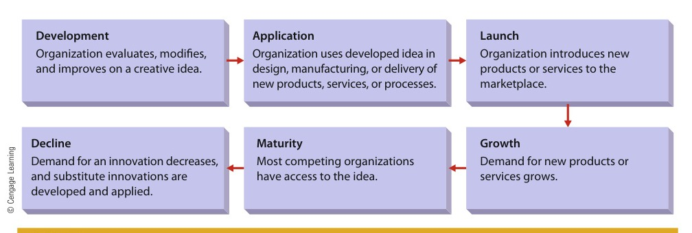

# CHAPTER 7: Organization Change and Innovation

<!-- Page 220 -->

CHAPTER 7Organization Changeand Innovation

Learning Outcomes

After studying this chapter, you should be able to:

1Describe the nature of organization change, including forces for change and plannedversus reactive change.

2Discuss the steps in organization change and how to manage resistance to change.

3Identify and describe major areas of organization change and discuss the assumptions, techniques,and effectiveness of organization development (OD).

4Describe the innovation process, forms of innovation, the failure to innovate, and how organizationscan promote innovation.

Management in Action

Cultivating Innovation at IKEA

#### “Designing beautiful-but-expensive products is easy. Designing beautifulproducts that are inexpensive and functional is a huge challenge.”

—IKEA Executive

According to Businessweek magazine, IKEA “is the quintessential cult brand,”and its customers belong to “a like-minded cost/design/environmentally sensitiveglobal tribe.” The founder of this global “cult” is a Swedish entrepreneur namedIngvar Kamprad. Kamprad has always referred to his targeted customers as “themany,” and his plan has been to bring affordable, well-designed furniture to thistarget market. “The many,” then, is hardly a “mass” market: In reality, it’s aprofitable niche consisting primarily of consumers who want stylish furniture ata low cost. Its goal, says the company, is to offer “affordable solutions for betterliving,” with “better living” referring to a range of well-designed furniture andfurnishings and “affordable” referring to the price range of consumers who arestarting up their own homes and/or expanding their families.IKEA’s marketing strategy depends on constant innovation, and the company’sability to innovate successfully depends in part on an organizational structure thatencourages creativity and communication. In order to understand how it’s alldesigned to work, however, we first need to break down the elements of “theIKEA way”—the factors which, taken in combination, have made the IKEAapproach so successful. The target market that we’ve just described is the first of

<!-- Page 221 -->

> Ron Buskirk/Alamy

IKEA is known for its innovative approach to retailing and its ability to implement change efficientlyand effectively.

these factors, and we can identify four others in terms that any marketer wouldrecognize:

•Product. With over 12,000 items, the IKEA product line is quite large, andbecause smaller products complement larger products, customers can exper-iment with ensembles that satisfy their own needs and tastes while calculat-ing total costs as they proceed through the store or catalog. The companydidn’t pay much attention to product design at first, but today, admits oneexpert, “you will always find some pieces which are good designs and veryreasonable in pricing.” IKEA also wants consumers—especially Americans—to stop thinking of furniture as durable goods. Older Americans, says onecompany marketing manager, “keep a sofa longer than a car” because theybelieve that it’s going to be the long-term “icon of the living room.” IKEAwants to appeal to the willingness of younger consumers to experiment withchanges, and its price structure makes it possible for them to do it.•Price. “Designing beautiful-but-expensive products is easy,” says one IKEA exec-utive. “Designing beautiful products that are inexpensive and functional is a hugechallenge.” Nevertheless, IKEA prices are typically from 20 percent to 50 percentbelow those of stores selling fully assembled furniture. “When we decide about aproduct, we always start with the price,” reports one product developer, and afterstarting with an original competitive price, IKEA then proceeds to drive it evenlower. The company maintains price leadership not only by purchasing in largequantities but also by constantly looking for cheaper suppliers; nearly 50 percentof IKEA’s outsourcing partners are located in developing economies.•Distribution. In addition to a global network of thousands of manufacturers andnearly 1,400 suppliers in 54 countries, IKEA maintains a system of 27 distributioncenters (which ship products to stores) and 11 customer-distribution centers

<!-- Page 222 -->

(which ship goods to consumers) in 16 countries. Its stores, too, are an impor-tant facet of IKEA’s distribution strategy. A key innovation is the way they’re laidout. Unlike the traditional furniture outlet, which directs customers to separatesections to view multiple versions of one product (e.g., beds) or one room (e.g.,bedrooms), IKEA stores are laid out around a wide one-way path—the “naturalpath,” according to the company—that carries customers directly from one sec-tion to the next. The “natural path” not only exposes them to the whole rangeof IKEA offerings but also encourages them to extend their in-store visits.•Promotion. Promotion at IKEA revolves around the near-legendary annualcatalog, a 300-page compendium of color photos and blurbs for about 12,000products. Boasting a circulation of 175 million copies worldwide, the catalogcovers the whole range of the company’s new products, focuses on ideas forinnovations in the customer’s home, and relies on word-of-mouth publicityamong the faithful. It is no surprise that IKEA stores are arranged toaccomplish essentially the same goals. Like the IKEA catalog, for example,they’re designed to encourage repeat visits by showcasing the company’sregular turnover in new products (about one-third per year).

The IKEA store is also the company’s most obvious and most importantprocess innovation. Averaging around 300,000 square feet, most box-like blue-and-yellow stores feature both the series of showrooms arranged along the“natural path” and an in-store self-serve warehouse. After choosing items fromthe Showroom, customers collect trolleys for transporting their purchases andpass into the Market Hall, where they can pick up smaller items, such as linen,lighting, glassware, and rugs. Next along the path is the Self-Serve Warehouse,where they collect their furniture purchases in flat-pack form and then proceed tothe rows of cashier’s stations to pay for everything. Once they’ve paid for theirpurchases, customers can arrange for delivery or roll them to the loading dock,pack them in or on their vehicles, and take them home.As important as process innovation has been to the company’s success, the IKEAengine is powered by the introduction of new products and a constant stream ofproduct innovations. Finding new products from outside sources, however, isn’tthe same thing as innovating within the company. At IKEA, innovation from withinsignals the company’s commitment not only to respond to changes in the needs ofcustomers all around the world but also to maintain a global brand identity andconvey an ongoing sense of excitement among the brand-loyal faithful.About 50 designers at the company’s Swedish workshop are always busycreating new products, but designers aren’t the only people in the organizationwho are responsible for innovative ideas. “[E]veryone contributes,” says BillAgee, head of marketing at IKEA United States. “Whoever you are within theIKEA organization, you’re expected to contribute your ideas—your new ideas,your old ideas, or whatever it may be—and every idea is welcome.” The conceptworks, explains Agee, because “we’re a very process-oriented company.… [W]ehave three basic processes: creating, communicating, and selling the home-furnishings offer. Each of these processes,” he adds, “has a matrix structure”:Working as members of what amounts to a companywide team, designersdesign products, marketers like Agee communicate the product message, and“coworkers” in the company’s warehouses and stores deliver the product to thecustomer. “Our independence,” Agee thinks, “has a lot to do with ourinnovation because we don’t know any better.… We feel that we are, to a certainextent, operating outside of standard operating procedures.”1

<!-- Page 223 -->

> organizationchangeAny substantivemodification to somepart of theorganization

Managers at IKEA are fueling growth and profitability through the astute managementof innovation. In particular, the company relies on the development and marketing ofinnovative products to grow and prosper. At a broader level, IKEA also relies heavilyon change. As we will see, understanding when and how to implement change is a vitalpart of management. This chapter describes how organizations manage change. We firstexamine the nature of organization change and identify the basic issues of managingchange. We then identify and describe major areas of change, including business processchange, a major type of change undertaken by many firms recently. We then examineorganization development and conclude by discussing organizational innovation as avital form of change.

## THE NATURE OF ORGANIZATION CHANGE

Organization change is any substantive modification to some part of the organization.2

Thus, change can involve virtually any aspect of an organization: work schedules, basesfor departmentalization, span of management, machinery, organization design, peoplethemselves, and so on. It is important to keep in mind that any change in an organiza-tion may have effects extending beyond the actual area where the change is implemen-ted. For example, when General Motors recently installed a new automated productionsystem at one of its plants, employees were trained to operate new equipment, thecompensation system was adjusted to reflect new skill levels, the span of managementfor supervisors was altered, and several related jobs were redesigned. Selection criteriafor new employees were also changed, and a new quality control system was installed.In addition, it is quite common for multiple organization change activities to be going onsimultaneously.

### Forces for Change

Why do organizations find change necessary? The basic reason is that something rele-vant to the organization either has changed or is likely to change in the foreseeablefuture. The organization therefore may have little choice but to change as well. Indeed,a primary reason for the problems that organizations often face is failure to anticipate orrespond properly to changing circumstances. The forces that compel change may beexternal or internal to the organization.3

#### External Forces

External forces for change come from the organization’s general andtask environments. For example, two energy crises, an aggressive Japanese automobile indus-try, floating currency exchange rates, and floating international interest rates—all manifesta-tions of the international dimension of the general environment—profoundly influenced U.S.automobile companies. New rules of production and competition forced them to dramati-cally alter the way they do business. In the political area, new laws, court decisions, and reg-ulations affect organizations. The technological dimension may yield new productiontechniques that the organization needs to explore. The economic dimension is affected byinflation, the cost of living, and money supplies. The sociocultural dimension, reflecting soci-etal values, determines what kinds of products or services will be accepted in the market.Because of its proximity to the organization, the task environment is an even morepowerful force for change. Competitors influence an organization through their pricestructures and product lines. When Dell lowers the prices it charges for computers,Hewlett-Packard may have little choice but to follow suit. Because customers determinewhat products can be sold at what prices, organizations must be concerned with con-sumer tastes and preferences. Suppliers affect organizations by raising or lowering prices

<!-- Page 224 -->

> **planned change**: Change that is designed and implemented in an orderly and timely fashion in anticipation of future events

> **reactive change**: A piecemeal response to circumstances as they develop

or changing product lines. Regulators can have dramatic effects on an organization. Forexample, if OSHA rules that a particular production process is dangerous to workers, itcan force a firm to close a plant until it meets higher safety standards. Unions can forcechange when they have the clout to negotiate for higher wages or if they go on strike.

#### Internal Forces

A variety of forces inside the organization may cause change. If topmanagement revises the organization’s strategy, organization change is likely to result.A decision by an electronics company to enter the home computer market or a decisionto increase a ten-year product sales goal by 3 percent would occasion many organizationchanges. Other internal forces for change may be reflections of external forces. As socio-cultural values shift, for example, workers’ attitudes toward their job may also shift—andworkers may demand a change in working hours or working conditions. In such a case,even though the force is rooted in the external environment, the organization mustrespond directly to the internal pressure it generates.4

### Planned Versus Reactive Change

Some change is planned well in advance; other change comes about as a reaction tounexpected events. Planned change is designed and implemented in an orderly andtimely fashion in anticipation of future events. Reactive change is a piecemeal response tocircumstances as they develop. Because reactive change may be hurried, the potential forpoorly conceived and executed change is increased. Planned change is almost always prefer-able to reactive change.5

Georgia-Pacific, a large forest products business, is an excellent example of a firm thatwent through a planned and well-managed change process. When A. D. Correll becameCEO, he quickly became alarmed at the firm’s high accident rate—9 serious injuries per100 employees each year, and 26 deaths during the most recent 5-year period. Althoughthe forest products business is inherently dangerous, Correll believed that the accident ratewas far too high and set out on a major change effort to improve things. He and other topmanagers developed a multistage change program intended to educate workers about safety,improve safety equipment in the plant, and eliminate a long-standing part of the firm’sculture that made injuries almost a badge of courage. As a result, Georgia-Pacific achievedthe best safety record in the industry, with relatively few injuries.On the other hand, Caterpillar was caught flat-footed by a worldwide recession in theconstruction industry, suffered enormous losses, and took several years to recover. Hadmanagers at Caterpillar anticipated the need for change earlier, they might have beenable to respond more quickly. The importance of approaching change from a plannedperspective is reinforced by the frequency of organization change. Most companies ordivisions of large companies implement some form of moderate change at least everyyear and one or more major changes every four to five years. Managers who sitback and respond only when they have to are likely to spend a lot of time hastily chang-ing and rechanging things. A more effective approach is to anticipate forces urgingchange and plan ahead to deal with them.6

## MANAGING CHANGE IN ORGANIZATIONS

Organization change is a complex phenomenon. A manager cannot simply wave a wandand implement a planned change like magic. Instead, any change must be systematic andlogical to have a realistic opportunity to succeed.7 To carry this off, the manager needs tounderstand the steps of effective change and how to counter employee resistance tochange.8

<!-- Page 225 -->

### Steps in the Change Process

Researchers have over the years developed a number of models or frameworks outliningsteps for change. The Lewin model was one of the first, although a more comprehensiveapproach is usually more useful in today’s complex business environment.

#### The Lewin Model

Kurt Lewin, a noted organizational theorist, suggested that everychange requires three steps.9 The first step is unfreezing—individuals who will beaffected by the impending change must be led to recognize why the change is neces-sary. The second step is the implementation of the change itself. The third step isrefreezing, which involves reinforcing and supporting the change so that it becomes apart of the system.10 For example, one of the changes that Caterpillar faced in responseto the recession noted earlier involved a massive workforce reduction. The first step(unfreezing) was convincing the United Auto Workers (UAW) to support the reduc-tion because of its importance to long-term effectiveness. After this unfreezing wasaccomplished, 30,000 jobs were eliminated (implementation). Then it worked toimprove its damaged relationship with its workers (refreezing) by guaranteeing futurepay hikes and promising no more cutbacks. As interesting as the Lewin model is, itunfortunately lacks operational specificity. Thus, a more comprehensive perspective isoften needed.

#### A Comprehensive Approach to Change

The comprehensive approach to changetakes a systems view and delineates a series of specific steps that often leads to successfulchange. This expanded model is illustrated in Figure 7.1. The first step is recognizing theneed for change. Reactive change might be triggered by employee complaints, declines inproductivity or turnover, court injunctions, sales slumps, or labor strikes. Recognitionmay simply be managers’ awareness that change in a certain area is inevitable. For exam-ple, managers may be aware of the general frequency of organizational change under-taken by most organizations and recognize that their organization should probablyfollow the same pattern. The immediate stimulus might be the result of a forecast indi-cating new market potential, the accumulation of a cash surplus for possible investment,or an opportunity to achieve and capitalize on a major technological breakthrough. Man-agers might also initiate change today because indicators suggest that it will be necessaryin the near future.11

Second, managers must set goals for the change: to increase market share, to enternew markets, to restore employee morale, to settle a strike, and to identify investmentopportunities—all might be goals for change. Third, managers must diagnose whatbrought on the need for change. Turnover, for example, might be caused by low pay,poor working conditions, poor supervisors, or employee dissatisfaction. Thus, althoughturnover may be the immediate stimulus for change, managers must understand itscauses to make the right changes.The next step is to select a change technique that will accomplish the intendedgoals. If turnover is caused by low pay, a new reward system may be needed. If thecause is poor supervision, interpersonal skills training may be called for. (Variouschange techniques are summarized later in this chapter.) After the appropriate tech-nique has been chosen, its implementation must be planned. Issues to considerinclude the costs of the change, its effects on other areas of the organization, andthe degree of employee participation appropriate for the situation. If the change isimplemented as planned, the results should then be evaluated. If the change wasintended to reduce turnover, managers must check turnover after the change hasbeen in effect for a while. If turnover is still too high, other changes may benecessary.12

<!-- Page 226 -->

*Figure 7.1 — Steps in the Change Process (Source: Page 226)*

Managers must understand how and why to implement change. A manager who,when implementing change, follows a logical and orderly sequence like the oneshown here is more likely to succeed than a manager whose change process ishaphazard and poorly conceived.

### Understanding Resistance to Change

Another element in the effective management of change is understanding the resistancethat often accompanies change.13 Managers need to know why people resist change andwhat can be done about their resistance. When Schlumberger first provided all its man-agers with smartphones, most people responded favorably. One manager, however,resisted the change to the point where he maintained two telephone numbers, one onhis new smartphone (which he left with his assistant) and his old standard cell phonethat he continued to use. Such resistance is common for a variety of reasons.14 The “Leadingthe Way” feature illustrates resistance to change.

#### Uncertainty

Perhaps the biggest cause of employee resistance to change is uncer-tainty. In the face of impending change, employees may become anxious and nervous.They may worry about their ability to meet new job demands, they may think thattheir job security is threatened, or they may simply dislike ambiguity. Nabisco was oncethe target of an extended and confusing takeover battle, and during the entire time,employees were nervous about the impending change. The Wall Street Journal describedthem this way: “Many are angry at their leaders and fearful for their jobs. They are swap-ping rumors and spinning scenarios for the ultimate outcome of the battle for the

<!-- Page 227 -->

tobacco and food giant. Headquarters staffers in Atlanta know so little about what’s hap-pening in New York that some call their office ‘the mushroom complex,’ where they arekept in the dark.”15 More recently, 13,500 British Airways cabin crew members votedto participate in a strike over a heavily traveled holiday season. The action against theairlines was spurred by high levels of uncertainty as British Airways planned to mergewith another airline and proposed cutting 1,700 jobs and freezing employee wages inthe process.16

#### Threatened Self-Interests

Many impending changes threaten the self-interests ofsome managers within the organization. A change might diminish their power or influencewithin the company, so they fight it. Managers at Sears once developed a plan calling for anew type of store. The new stores would be somewhat smaller than a typical Searsstore and would not be located in large shopping malls. Instead, they would be located insmaller strip centers. They would carry clothes and other “soft goods,” but not hardware,appliances, furniture, or automotive products. When executives in charge of the excludedproduct lines heard about the plan, they raised such strong objections that the plan wascancelled.

#### Different Perceptions

A third reason that people resist change is due to differentperceptions. A manager may make a decision and recommend a plan for change onthe basis of her own assessment of a situation. Others in the organization may resistthe change because they do not agree with the manager’s assessment or perceive thesituation differently.17 Executives at 7-Eleven battled this problem as they attemptedto enact a major organizational change. The corporation wanted to take its conve-nience stores a bit “upscale” and begin selling fancy fresh foods to go, the newest hard-cover novels, some gourmet products, and higher-quality coffee. But many franchiseesbalked because they saw this move as taking the firm away from its core blue-collarcustomers.

#### Feelings of Loss

Many changes involve altering work arrangements in ways that dis-rupt existing social networks. Because social relationships are important, most peopleresist any change that might adversely affect those relationships. Other intangiblesthreatened by change include power, status, security, familiarity with existing procedures,and self-confidence.

### Overcoming Resistance to Change

Of course, a manager should not give up in the face of resistance to change. Althoughthere are no surefire cures, there are several techniques that at least have the potentialto overcome resistance.18

#### Participation

Participation is often the most effective technique for overcomingresistance to change. Employees who participate in planning and implementing achange are better able to understand the reasons for the change. Uncertainty isreduced, and self-interests and social relationships are less threatened. Having had anopportunity to express their ideas and assume the perspectives of others, employees aremore likely to accept the change gracefully. A classic study of participation monitoredthe introduction of a change in production methods among four groups in a Virginiapajama factory.19 The two groups that were allowed to fully participate in planning andimplementing the change improved significantly in their productivity and satisfaction,relative to the two groups that did not participate. 3M Company recently attributedseveral million dollars in cost savings to employee participation in several organizationchange activities.

<!-- Page 228 -->

LEADING THE WAY

## Charting a “New” Old Course

SeniorIBMexecutiveswerequicklyintegratedthroughout the top management structure, and oneof them, Stephen Ward, was appointed chief execu-tive officer (CEO) of Lenovo. Liu Chuanzhi, mean-while, moved into the background but remained adirector—he felt that Lenovo’s best opportunity forthe firm to gain international market share would beunder the leadership of a seasoned global managerlike Ward.But almost from the start, problems began to sur-face. Ward was extremely autocratic and believedthat Lenovo should function in a highly centralized,command-and-controlfashion. This alienatedhisnew Chinese colleagues who assumed that theirroles were being diminished because they spentless time with the CEO. Chuanzhi, for instance, hadrelied on a senior leadership team that workedtogether to make decisions, whereas Ward made

Lenovo was started in Beijing by Liu Chuanzhi in1984. Initially, Lenovo made computers for othercompanies. In 1990, the firm launched its ownbrand of PC and by 1997 Lenovo was the top-selling PC in its home country. Unfortunately, how-ever, the company was not successful in gainingmarket share outside China. One reason for thiswas the lack of brand recognition. Another was thatLenovo simply did not have many top managers withglobal experience. But that changed in 2005. WhenIBM decided to sell its PC operation that year,Lenovo was quick to jump on the opportunity andbought IBM’s entire PC business for $1.75 billion.Lenovo was allowed to continue using the IBMname through 2007 but then started to brand all ofits PCs with the Lenovo name. Along with the PCbusiness itself, Lenovo also got a team of skilledtop managers well-versed in global PC markets.

Lenovo is a leading Chinese technology products company best known for theline of ThinkPad personal computers it purchased from IBM. For years, thecompany has struggled with balancing traditional Chinese approaches tomanagement with contemporary management practices more widely practiced inglobal businesses. Lenovo’s founder, Liu Chuanzhi, recently took back control ofthe firm in an effort to improve its competitiveness.

(continued)

<!-- Page 229 -->

LEADING THE WAY (Continued)

eight top managers at Lenovo into a close-knit teamand then brought them together regularly to makedecisions and formulate plans. After decisions andplans were made by consensus, the team continuedto work together to ensure that they were implemen-ted effectively and with buy-in from others through-out the organization. Today Lenovo is headquarteredin Hong Kong but has major operations in Beijing,Singapore,andMorrisville,NorthCarolina.Thefirm’s products include PCs, workstations, servers,storage devices, and information technology (IT) ser-vices. Lenovo has also entered the mobile phonebusiness, citing increased convergence betweenthe PC and handheld wireless technologies. In2012, Lenovo generated profits of $273 million onrevenues of $21.6 billion and employed more than27,000 workers. Right now, it’s still too soon toknow if the changes at Lenovo will improve its for-tunes or not. But Chuanzhi believes that his newapproach, which he calls a “blend of old Chinesethinking and modern global thinking,” will sooncarry the day.

most of the major decisions by himself. And at amore general level, the U.S. managers tried toimpose a rigid, centralized, and bureaucratic struc-ture throughout the new Lenovo. The Chinese,meanwhile, were highly resistant to these efforts,strongly preferring the more consensus-style struc-ture that they had used previously.Within a matter of months, things came to a head.Among other changes, Ward was pushed out andreplaced with William Amelio, a senior executiverecruited from Dell Computer’s Asia/Pacific operations.Amelio immediately indicated his intent to try to moveLenovo back toward the traditional Chinese structure.He also thought that the firm could benefit from aninfusion of additional perspectives, so he began toaggressively recruit new executives from other high-tech firms such as Dell, Motorola, Samsung, andToshiba. He also softened the rigid functional structureand tried building more coordination across areas bycreatingcross-functionalteams.Unfortunately,though, Amelio never carried through on his plan tochange how decisions were made, retaining much ofthe decision-making authority himself and continuingthe command-and-control approach that had beenWard’s downfall. Lenovo also began to lose marketshare and profits began to drop.Finally, Chuanzhi decided that he had to takeaction. He pushed Amelio to resign and took controlof the firm himself. He then quickly restructured theupper ranks of Lenovo to fall more in line with thetraditional Chinese approach. Chuanzhi formed the

References: “Lenovo’s Legend Returns,” Time, May 10,2010, pp. 65–68; “Lenovo: A Company Without a Country,”Businessweek, January 23, 2010, pp. 49–50; “Lenovo’sTurnaround Man,” Forbes, May 4, 2010, p. 88; Hoover’sHandbook of World Business 2013, Austin: Hoover’s Busi-ness Press, 2013, pp. 236–237; “IBM Shows Secret to Cor-porate Longevity,” USA Today, June 16, 2011, pp. 1B, 3B;Miguel Helft, “Can Lenovo Do It?” Fortune, June 10, 2013,pp. 100–111.

#### Education and Communication

Educating employees about the need for andthe expected results of an impending change should reduce their resistance. Ifopen communication is established and maintained during the change process,uncertainty can be minimized. Caterpillar used these methods during many of itscutbacks to reduce resistance. First, it educated UAW representatives about theneed for and potential value of the planned changes. Then management told allemployees what was happening, when it would happen, and how it would affect themindividually.

#### Facilitation

Several facilitation procedures are also advisable. For instance, makingonly necessary changes, announcing those changes well in advance, and allowing timefor people to adjust to new ways of doing things can help reduce resistance to change.20

One manager at a Prudential regional office spent several months systematically planninga change in work procedures and job design. He then became too impatient, coming inover the weekend with a work crew and rearranging the office layout. When employeeswalked in on Monday morning and saw what he had done, they were hostile, anxious,

<!-- Page 230 -->

*Figure 7.2 — Force-Field Analysis for Plant Closing at General Motors (Source: Page 230)*

A force-field analysis can help a manager facilitate change. A manager who is ableto identify forces acting both for and against a change can see where to focus effortsto remove barriers to change (such as offering training and relocation to displacedworkers). Removing the forces against the change can at least partially overcomeresistance.

and resentful. What was a promising change became a disaster, and the manager had toscrap the entire plan.

#### Force-Field Analysis

Although force-field analysis may sound like something out ofa Star Trek movie, it can help overcome resistance to change. In almost any change situ-ation, forces are acting for and against the change. To facilitate the change, managersstart by listing each set of forces and then trying to tip the balance so that the forcesfacilitating the change outweigh those hindering the change. It is especially importantto try to remove or at least minimize some of the forces acting against the change. Sup-pose, for example, that General Motors (GM) is considering a plant closing as part of achange. As shown in Figure 7.2, three factors are reinforcing the change: GM needs tocut costs, it has excess capacity, and the plant has outmoded production facilities. Atthe same time, there is resistance from the UAW, concern for workers being put out oftheir jobs, and a feeling that the plant might be needed again in the future. GM mightstart by convincing the UAW that the closing is necessary by presenting profit-and-lossfigures. It could then offer relocation and retraining to displaced workers. And it mightshut down the plant and put it in “mothballs” so that it can be renovated later. The threemajor factors hindering the change are thus eliminated or reduced in importance.21

## AREAS OF ORGANIZATION CHANGE

We noted earlier that change can involve virtually any part of an organization. Ingeneral, however, most change interventions involve organization structure and design,technology and operations, or people. The most common areas of change within eachof these broad categories are listed in Table 7.1. In addition, many organizations havegone through massive and comprehensive business process change programs.

### Changing Organization Structure and Design

Organization change might be focused on any of the basic components of organizationstructure or on the organization’s overall design. Thus, the organization might changethe way it designs its jobs or its bases of departmentalization. Likewise, it might changereporting relationships or the distribution of authority. For example, we noted in

<!-- Page 231 -->

> Organization changecan affect any part,area, or componentof an organization.Most change, how-ever, fits into oneof three generalareas: organizationstructure and design,technology andoperations, andpeople.

> © Cengage Learning

### Table 7.1

### Table 7.1: Areas of Organization Change

| Organization Structure and Design | Technology and Operations | People |
| :--- | :--- | :--- |
| Job design | Information technology | Abilities and skills |
| Departmentalization | Equipment | Performance |
| Reporting relationships | Work processes | Perceptions |
| Authority distribution | Work sequences | Expectations |
| Coordination mechanisms | Control systems | Attitudes |
| Line-staff structure | Enterprise resource planning | Values |
| Overall design | | |
| Culture | | |
| Human resource management | | |

Chapter 6 the trend toward flatter organizations. Coordination mechanisms and line-and-staff configurations are also subject to change. On a larger scale, the organizationmight change its overall design. For example, a growing business could decide to dropits functional design and adopt a divisional design. Or it might transform itself into amatrix. Changes in culture usually involve the structure and design of the organizationas well (recall that we discussed changing culture back in Chapter 2). Finally, the organi-zation might change any part of its human resource management system, such as itsselection criteria, its performance appraisal methods, or its compensation package.22

### Changing Technology and Operations

Technology is the conversion process used by an organization to transform inputs intooutputs. Because of the rapid rate of all technological innovation, technological changesare becoming increasingly important to many organizations. Table 7.1 lists several areaswhere technological change is likely to be experienced. One important area of changetoday revolves around information technology. The adoption and institutionalization ofinformation technology innovations are almost constant in most firms. Sun Microsys-tems, for example, adopted a very short-range planning cycle to be best prepared forenvironmental changes. Another important form of technological change involves equip-ment. To keep pace with competitors, firms periodically find that replacing existingmachinery and equipment with newer models is necessary.A change in work processes or work activities may be necessary if new equipment isintroduced or new products are manufactured. In manufacturing industries, the majorreason for changing a work process is to accommodate a change in the materials usedto produce a finished product. Consider a firm that manufactures battery-operated flash-lights. For many years, flashlights were made of metal, but now most are made of plastic.A firm might decide to move from metal to plastic flashlights because of consumerpreferences, raw materials’ costs, or other reasons. Whatever the reason, the technologynecessary to make flashlights from plastic differs importantly from that used to makeflashlights from metal. Work process changes may occur in service organizations as

<!-- Page 232 -->

> ERPA large-scaleinformation systemfor integrating andsynchronizing themany activities in theextended enterprise

well as in manufacturing firms. As traditional barbershops and beauty parlors arereplaced by hair salons catering to both sexes, for example, the hybrid organizationshave to develop new methods for handling appointments and setting prices.A change in work sequence may or may not accompany a change in equipment or achange in work processes. Making a change in work sequence means altering the orderor sequence of the workstations involved in a particular manufacturing process. Forexample, a manufacturer might have two parallel assembly lines producing two similarsets of machine parts. The lines might converge at one central quality-control unit,where inspectors verify tolerances. The manager, however, might decide to change toperiodic rather than final inspection. Under this arrangement, one or more inspectionsare established farther up the line.Work sequence changes can also be made in service organizations. The processing ofinsurance claims, for example, could be changed. The sequence of logging and verifyingclaims, requesting checks, getting countersignatures, and mailing checks could be altered inseveral ways, such as combining the first two steps or routing the claims through one personwhile another handles checks. Organizational control systems may also be targets of change.For example, a firm attempting to improve the quality of its products might develop andimplement a set of more rigorous and comprehensive quality-control procedures.Finally, many businesses have been working to implement technological andoperations change by installing and using complex and integrated software systems.Such systems—called enterprise resource planning (ERP)—link virtually all facets of thebusiness, making it easier for managers to keep abreast of related developments. ERP is alarge-scale information system for integrating and synchronizing the many activities inthe extended enterprise. In most cases, these systems are purchased from externalvendors who then tailor their products to the client’s unique needs and requirements.Companywide processes—such as materials management, production planning, ordermanagement, and financial reporting—can all be managed through ERP. In effect, theseare the processes that cut across product lines, departments, and geographic locations.Developing the ERP system starts by identifying the key processes that need criticalattention, such as supplier relationships, material flows, or customer order fulfillment.The system could result, for instance, in sales processes being integrated with productionplanning and then integrating both of these into the firm’s financial accounting system.For example, a customer in Rome can place an order that is to be produced in Ireland,schedule it to be shipped through air cargo to Rome, and then have it picked up by atruck at the airport and delivered to the customer’s warehouse by a specified date. Allof these activities are synchronized by activities linkages in one massive database.The ERP integrates all activities and information flows that relate to the firm’s criticalprocesses. It also keeps updated real-time information on their current status, reports recentpast transactions and upcoming planned transactions, and provides electronic notices thataction is required on some items if planned schedules are to be met. It coordinates internaloperations with activities by outside suppliers and notifies business partners and customersof current status and upcoming deliveries and billings. It can integrate financial flows amongthe firm, its suppliers, its customers, and commercial bank deposits for up-to-the-minutestatus reports that can be used to create real-time financial reports at a moment’snotice, rather than in the traditional one-month (or longer) time span for producing afinancial statement. ERP’s multilanguage capabilities also allow real-time correspondencein various languages to facilitate international transactions.

### Changing People, Attitudes, and Behaviors

A third area of organization change has to do with human resources. For example, anorganization might decide to change the skill level of its workforce. This change might

<!-- Page 233 -->

> businessprocess change(reengineering)The radical redesignof all aspects of abusiness to achievemajor gains in cost,service, or time

be prompted by changes in technology or by a general desire to upgrade the quality ofthe workforce. Thus, training programs and new selection criteria might be needed. Theorganization might also decide to improve its workers’ performance level. In thisinstance, a new incentive system or performance-based training might be in order.Reader’s Digest recently eliminated 17 percent of its employees, reduced retirementbenefits, and took away many of the “perks” (perquisites, or job benefits) that employeesonce enjoyed. Part of the reason for the changes was to instill in the remaining employ-ees a sense of urgency and the need to adopt a new perspective on how they do theirjobs. Similarly, Saks Fifth Avenue changed its entire top management team as a way tobreathe new life into the luxury retailer.Perceptions and expectations are also a common focus of organization change.Workers in an organization might believe that their wages and benefits are not ashigh as they should be. Management, however, might have evidence that shows thefirm is paying a competitive wage and providing a superior benefit package. Thechange, then, would be centered on informing and educating the workforce aboutthe comparative value of its compensation package. A common way to do this isto publish a statement that places an actual dollar value on each benefit providedand compares that amount to what other local organizations are providing theirworkers.Change might also be directed at employee attitudes and values. In many organiza-tions today, managers are trying to eliminate adversarial relationships with workers andto adopt a more collaborative relationship. In many ways, changing attitudes and valuesis perhaps the hardest thing to do.23

### Changing Business Processes

Many organizations today have also gone through massive and comprehensive changeprograms involving all aspects of organization design, technology, and people. Althoughvarious descriptions are used, the terms currently in vogue for these changes arebusiness process change, or reengineering, which is the radical redesign of all aspectsof a business to achieve major gains in cost, service, or time.24 ERP, as described earlier,is a common platform for changing business processes. However, business processchange is a more comprehensive set of changes that goes beyond software and informa-tion systems.Corning, for example, has undergone major reengineering. Whereas the 150-year-old business once manufactured cookware and other durable consumer goods, ithas transformed itself into a high-tech powerhouse making products such as the ultra-thin screens used in products such as smartphones and laptops. Similarly, the dramaticoverhauls of Yellow into a sophisticated freight delivery firm and of UPS into a majorinternational delivery giant all required business process changes throughout theseorganizations.

#### The Need for Business Process Change

Why are so many organizations finding itnecessary to undergo business process change? We noted in Chapter 1 that all systems,including organizations, are subject to entropy—a normal process leading to systemdecline. An organization is behaving most typically when it maintains the status quo,does not change in synch with its environment, and starts consuming its own resourcesto survive. In a sense, that is what happened to Kmart. In the early and mid-1970s,Kmart was in such a high-flying growth mode that it passed first J. C. Penney and thenSears to become the world’s largest retailer. But then the firm’s managers grew compla-cent and assumed that the discount retailer’s prosperity would continue and that they

<!-- Page 234 -->

> ZUMA Press/Alamy

TOUGH TIMES, TOUGH CHOICES

## To Offshore or Not to Offshore

designs and makes paper packaging. PCMC had aproblem with its engineering function: Although ithad a large base of potential customers, it often lostthem because its engineering group was too small tocreate new designs fast enough to keep pace withcustomer needs. Nor could the company afford toexpand its engineering department. To solve the prob-lem, PCMC entered into an offshoring contract withan Indian company that agreed to provide a 160-member staff to support PCMC’s engineering func-tion. The result? Not only 160 new jobs in India butmore orders and more jobs in Wisconsin as well.Obviously, offshoring arrangements don’t alwayswork out as well as the one established by PCMCand its Indian partner. For one thing, language andculture differences can make communication diffi-cult, especially when it’s conducted by e-mail orphone. When 1-800-FLOWERS tried to expand itscustomer-service operation by outsourcing customercalls to India, the results were disastrous. Why?When customers call, florists have to do more thanmerely process orders: They’re often called upon to

From computer programmers in the Philippines andmolecular biologists in Russia to customer-serviceagents in India, the practice of offshoring is bringingworkers from around the world into the workforcesof U.S. corporations in a broad range of industries.When U.S. firms “offshore,” they’re hiring foreignfirms and foreign personnel to perform their businessfunctions. In so doing, they’re not only increasing thediversity of their workforces but also altering the pro-cesses by which they conduct organizational busi-ness. At Penske Truck Leasing, for instance, driverssubmit their paper logs for data entry to a facility inMexico, which forwards them to Hyderabad, India,where they’re analyzed, and the results are reportedto Penske management back in the United States.How does a company function with far-flung opera-tions? As in most other decisions, companies chooseoperational partners according to the value-creationcapabilities that they bring to the overall process.Ideally, of course, offshoring should benefit thecontractor as well as the contracting firm. Take, forexample, the case of Wisconsin-based PCMC, which

Many businesses today have offshored various operations to foreign countries.These offshoring initiatives often involve call centers, and many businesses havefound this approach to be very effective. But others, like 1-800-FLOWERS, haveexperienced problems with offshoring and some have even moved operationsback to their home country.

(continued)

<!-- Page 235 -->

TOUGH TIMES, TOUGH CHOICES (Continued)

employees are more expensive than overseas contrac-tors, but they’re less expensive than full-time on-siteemployees. They connect with American customers,and they also alleviate the concerns that some U.S.consumers have about their private data being shippedoverseas.

offer interior-design tips and relationship counselingand even to console the grieving. Indian workerscould neither fully understand the psychology ofU.S. flower buyers nor communicate the nuancesnecessary to serve their needs. After a few weeks,1-800-FLOWERS terminated the experiment. “Thefolks were difficult to understand,” admitted onecompanyexecutive.“Wewereafraidthatwewould lose sales, and we couldn’t risk that.”The decision made sense: Typically, it costs sixtimes as much to replace a customer as to keep one.Fortunately, the company had a plan B—homeshoring,or hiring in-country contract workers. Homeshoring

References: Michelle Conlin, “Call Centers in the Rec Room,”Businessweek,www.businessweek.com,accessedonNovember 15, 2013; Pete Engardio, “The Future of Outsour-cing,” Businessweek, www.businessweek.com, accessedon November 15, 2013; and Manjeet Kripalani with BrianGrow, “Offshoring: Spreading the Gospel,” Businessweek,www.businessweek.com, accessed on November 15, 2013.

need not worry about environmental shifts, the growth of Walmart, and so forth—andentropy set in. The key is to recognize the beginning of the decline and immediatelymove toward changing relevant business processes. Major problems occur when man-agers either do not recognize the onset of entropy until it is well advanced or are com-placent in taking steps to correct it.

#### Approaches to Business Process Change

Figure 7.3 shows general steps in reen-gineering. The first step is setting goals and developing a strategy for the changes.The organization must know in advance what new business processes are supposedto accomplish and how those accomplishments will be achieved. Next, top managersmust begin and direct the reengineering effort. If a CEO simply announces thatbusiness process change is to occur but does nothing else, the program is unlikelyto be successful. But, if the CEO is constantly involved in the process, underscoringits importance and taking the lead, business process change stands a much betterchance of success.Most experts also agree that successful business process change is usually accompa-nied by a sense of urgency. People in the organization must see the clear and presentneed for the changes being implemented and appreciate their importance. In addition,most successful reengineering efforts start with a new, clean slate. In other words, ratherthan assuming that the existing organization is a starting point and then trying to modifyit, business process change usually starts by asking questions such as how customers arebest served and competitors best neutralized. New approaches and systems are thencreated and imposed in place of existing ones.Finally, business process change requires a careful blend of top-down and bottom-up involvement. On the one hand, strong leadership is necessary, but too muchinvolvement by top management can make the changes seem autocratic. On theother hand, employee participation is also important, but too little involvement byleaders can undermine the program’s importance and create a sense that topmanagers do not care. Thus, care must be taken to carefully balance these two coun-tervailing forces. Our next section explores more fully one related but distinctapproach called organization development (OD).

<!-- Page 236 -->

> organizationdevelopmentA planned effort thatis organization-wide,managed from thetop, and intendedto increaseorganizationaleffectiveness andhealth throughplannedinterventions in theorganization’sprocess, usingbehavioral scienceknowledge

*Figure 7.3 — The Reengineering Process (Source: Page 236)*

Reengineering is a major redesign of all areas of an organization. To be successful,reengineering requires a systematic and comprehensive assessment of the entireorganization. Goals, top management support, and a sense of urgency help theorganization re-create itself and blend both top-down and bottom-up perspectives.

### Organization Development

We noted in several places the importance of people and change. Beyond those changeinterests discussed earlier, a special area of interest that focuses almost exclusively onpeople is OD.

#### OD Assumptions

OD is concerned with changing attitudes, perceptions, behaviors,and expectations. More precisely, organization development is a planned effort that isorganization-wide, managed from the top, and intended to increase organizational effec-tiveness and health through planned interventions in the organization’s process, usingbehavioral science knowledge.25 The theory and practice of OD are based on severalvery important assumptions. The first is that employees have a desire to grow anddevelop. Another is that employees have a strong need to be accepted by others withinthe organization. Still another critical assumption of OD is that the total organizationand the way it is designed will influence the way individuals and groups within the orga-nization behave. Thus, some form of collaboration between managers and their employ-ees is necessary to (1) take advantage of the skills and abilities of the employees and(2) eliminate aspects of the organization that retard employee growth, development,and group acceptance. Because of the intense personal nature of many OD activities,many large organizations rely on one or more OD consultants (either full-time employ-ees assigned to this function or outside experts hired specifically for OD purposes) toimplement and manage their OD program.26

#### OD Techniques

Several kinds of interventions or activities are generally consideredpart of OD. Some OD programs may use only one or a few of these; other programsuse several of them at once.

<!-- Page 237 -->

•Diagnostic activities. Just as a physician examines patients to diagnose theircurrent condition, an OD diagnosis analyzes the current condition of an organi-zation. To carry out this diagnosis, managers use questionnaires, opinion orattitude surveys, interviews, archival data, and meetings to assess various char-acteristics of the organization. The results of this diagnosis may generate profilesof the organization’s activities, which can then be used to identify problem areasin need of correction.•Team building. Team-building activities are intended to enhance the effectivenessand satisfaction of individuals who work in groups or teams and to promote overallgroup effectiveness. Given the widespread use of teams today, these activities havetaken on increased importance. An OD consultant might interview team membersto determine how they feel about the group; then an off-site meeting could be heldto discuss the issues that surfaced and iron out any problem areas or memberconcerns. Caterpillar used team building as one method for changing the workingrelationships between workers and supervisors from confrontational to cooperative.One interesting new approach to team building involves having executive teamsparticipate in group cooking classes to teach them the importance of interdepen-dence and coordination.•Survey feedback. In survey feedback, each employee responds to a questionnaireintended to measure perceptions and attitudes (for example, satisfaction and super-visory style). Everyone involved, including the supervisor, receives the results of thesurvey. The aim of this approach is usually to change the behavior of supervisors byshowing them how their subordinates view them. After the feedback has been pro-vided, workshops may be conducted to evaluate results and suggest constructivechanges.•Third-party peacemaking. Another approach to OD is through third-party peace-making, which is most often used when substantial conflict exists within the orga-nization. Third-party peacemaking can be appropriate on the individual, group, ororganizational level. The third party, usually an OD consultant, uses a variety ofmediation or negotiation techniques to resolve any problems or conflicts amongindividuals or groups.•Process consultation. In process consultation, an OD consultant observes groups in theorganization to develop an understanding of their communication patterns, decision-making and leadership processes, and methods of cooperation and conflict resolution.The consultant then provides feedback to the involved parties about the processes he orshe has observed. The goal of this form of intervention is to improve the observed pro-cesses. A leader who is presented with feedback outlining deficiencies in his or herleadership style, for example, might be expected to change to overcome them.•Life and career planning. Life and career planning helps employees formulate theirpersonal goals and evaluate strategies for integrating their goals with the goals of theorganization. Such activities might include specification of training needs and plotting acareer map. General Electric has a reputation for doing an outstanding job in this area.•Coaching and counseling. Coaching and counseling provide nonevaluative feedbackto individuals. The purpose is to help people develop a better sense of how otherssee them and learn behaviors that will assist others in achieving their work-relatedgoals. The focus is not on how the individual is performing today; instead, it is onhow the person can perform better in the future.

#### The Effectiveness of OD

Given the diversity of activities encompassed by OD, it isnot surprising that managers have reported mixed results from various OD interven-tions. Organizations that actively practice some form of OD include American Airlines,

<!-- Page 238 -->

> **innovation**: The managed effort of an organization to develop new products or services or new uses for existing products or services

*Figure 7.4 — The Innovation Process (Source: Page 238)*

Texas Instruments, Procter & Gamble, and BF Goodrich. Goodrich, for example, hastrained 60 persons in OD processes and techniques. These trained experts have subse-quently become internal OD consultants to assist other managers in applying the techni-ques. Many other managers, in contrast, report that they have tried OD but discarded it.OD will probably remain an important part of management theory and practice. Ofcourse, there are no sure things when dealing with social systems such as organizations,and the effectiveness of many OD techniques is difficult to evaluate. Because all organi-zations are open systems interacting with their environments, an improvement in anorganization after an OD intervention may be attributable to the intervention, but itmay also be attributable to changes in economic conditions, luck, or other factors.

## ORGANIZATIONAL INNOVATION

A final element of organization change that we address is innovation, which is themanaged effort of an organization to develop new products or services or new uses forexisting products or services. Innovation is clearly important because, without new pro-ducts or services, any organization will fall behind its competition.

### The Innovation Process

The organizational innovation process consists of developing, applying, launching, grow-ing, and managing the maturity and decline of creative ideas.27 This process is depictedin Figure 7.4.

#### Innovation Development

Innovation development involves the evaluation, modifi-cation, and improvement of creative ideas. It can transform a product or service withonly modest potential into a product or service with significant potential. Parker Brothers,for example, decided during innovation development not to market an indoor volleyballgame but instead to sell separately the appealing little foam ball designed for the game.The firm will never know how well the volleyball game would have sold, but the Nerfball and numerous related products generated millions of dollars in revenues.

ApplicationOrganization uses developed idea indesign, manufacturing, or delivery ofnew products, services, or processes.

LaunchOrganization introduces newproducts or services to the marketplace.

DevelopmentOrganization evaluates, modifies,and improves on a creative idea.

DeclineDemand for an innovation decreases,and substitute innovations aredeveloped and applied.

MaturityMost competing organizationshave access to the idea.

GrowthDemand for new products orservices grows.

The Innovation Process

Organizations actively seek to manage the innovation process. These steps illustrate the general life cyclethat characterizes most innovations. Of course, as with creativity, the innovation process will suffer if it isapproached too mechanically and rigidly.

<!-- Page 239 -->

#### Innovation Application

Innovation application is the stage in which an organiza-tion takes a developed idea and uses it in the design, manufacturing, or delivery of newproducts, services, or processes. At this point, the innovation emerges from the labora-tory and is transformed into tangible goods or services. Business incubators and similarconcepts are often used to facilitate innovation application.

#### Application Launch

Application launch is the stage at which an organization intro-duces new products or services to the marketplace. The important question is not “Doesthe innovation work?” but “Will customers want to purchase the innovative product andservice?” History is full of creative ideas that did not generate enough interest amongcustomers to be successful. Some notable innovation failures include a portable seatwarmer from Sony, “New” Coke, the revival of the Ford Thunderbird, and the Flipvideo recorder. Thus, despite development and application, new products and servicescan still fail at the launch phase.

#### Application Growth

Once an innovation has been successfully launched, it thenenters the stage of application growth. This is a period of high economic performancefor an organization because demand for the product or service is often greater thansupply. Organizations that fail to anticipate this stage may unintentionally limit theirgrowth, as Apple did by not anticipating demand for the first iPhones. At the sametime, overestimating demand for a new product can be just as detrimental to perfor-mance. Unsold products can sit in warehouses for years.

#### Innovation Maturity

After a period of growing demand, an innovative productor service often enters a period of maturity. Innovation maturity is the stage atwhich most organizations in an industry have access to an innovation and are apply-ing it in approximately the same way. The technological application of an innovationduring this stage of the innovation process can be very sophisticated. Because mostfirms have access to the innovation, however, as a result of either developing theinnovation on their own or copying the innovation from others, it does not providecompetitive advantage to any one of them. The time that elapses between innovationdevelopment and innovation maturity varies notably depending on the particularproduct or service. Whenever an innovation involves the use of complex skills (suchas a complicated manufacturing process or highly sophisticated teamwork), movingfrom the growth phase to the maturity phase will take longer. In addition, if theskills needed to implement these innovations are rare and difficult to imitate, thenstrategic imitation may be delayed, and the organization may enjoy a period of sustainedcompetitive advantage.

#### Innovation Decline

Every successful innovation bears its own seeds of decline.Because an organization does not gain a competitive advantage from an innovation atmaturity, it must encourage its creative scientists, engineers, and managers to begin look-ing for additional innovations. This continued search for competitive advantage usuallyleads new products and services to move from the creative process through innovationmaturity, and finally to innovation decline. Innovation decline is the stage during whichdemand for an innovation decreases and substitute innovations are developed andapplied.

### Forms of Innovation

Each creative idea that an organization develops poses a different challenge for the inno-vation process. Innovations can be radical or incremental, technical or managerial, andproduct or process innovations.

<!-- Page 240 -->

> © iStockphoto.com/Saturated

> radical innovationsA new product,service, ortechnology thatcompletely replacesan existing one

> incrementalinnovationsA new product,service, ortechnology thatmodifies an existingone

#### Radical Versus Incremental Innovations

Radical innovations are new products, services,or technologies developed by an organization thatcompletely replace the existing products, services,or technologies in an industry.28 Incrementalinnovations are new products, services, or pro-cesses that modify existing ones. Firms thatimplement radical innovations fundamentallyshift the nature of competition and the interac-tion of firms within their environments. Firmsthat implement incremental innovations alter,but do not fundamentally change, competitiveinteraction in an industry.Over the last several years, organizationshaveintroducedmanyradicalinnovations.For example, compact disc (CD) technologyreplacedlong-playingvinylrecordsintherecording industry and now digital download-ing is replacing CDs, DVDs have replacedvideocassettes but are now being supplanted byBlu-ray DVDs and online downloading, andhigh-definition television is replacing regulartelevision technology. Whereas radical innova-tions like these tend to be very visible and public,incrementalinnovationsactuallyaremorenumerous. For instance, each new generation ofthe iPhone and the iPad represents relativelyminor changes over previous versions.

The original iPhones and iPads were in many ways radicalinnovations in that they redefined product categories. Eachsubsequent generation of these products, however, such as theiPad Air shown here, are incremental innovations that takeprevious versions and introduce relatively minor improvementsand/or new design features.

#### Technical Versus Managerial Innovations

Technical innovations are changes inthe physical appearance or performance of a product or service or of the physical pro-cesses through which a product or service is manufactured. Many of the most importantinnovations over the last 50 years have been technical. For example, the serial replace-ment of the vacuum tube with the transistor, the transistor with the integrated circuit,and the integrated circuit with the microchip have greatly enhanced the power, ease ofuse, and speed of operation of a wide variety of electronic products. Not all innovationsdeveloped by organizations are technical, however. Managerial innovations are changesin the management process by which products and services are conceived, built, anddelivered to customers.29 They do not necessarily affect the physical appearance or per-formance of products or services directly. In effect, reengineering, as we discussed earlier,represents a managerial innovation.

#### Product Versus Process Innovations

Perhaps the two most important types oftechnical innovations are product innovations and process innovations. Product innova-tions are changes in the physical characteristics or performance of existing products orservices or the creation of brand-new products or services. Process innovations arechanges in the way products or services are manufactured, created, or distributed.Whereas managerial innovations generally affect the broader context of development,process innovations directly affect manufacturing.

<!-- Page 241 -->

> technicalinnovationsA change in theappearance orperformance of aproduct or service orof the physicalprocesses throughwhich a product orservice ismanufactured

> managerialinnovationsA change in themanagementprocess in anorganization

> product innovationsA change in thephysicalcharacteristics orperformance of anexisting product orservice or thecreation of a new one

> process innovationsA change in the waya product or serviceis manufactured,created, ordistributed

The implementation of robotics is a process innovation. The effect of product andprocess innovations on economic return depends on the stage of the innovation processthat a new product or service occupies. At first, during development, application, andlaunch, the physical attributes and capabilities of an innovation mostly affect organiza-tional performance. Thus, product innovations are particularly important during thesebeginning phases. Later, as an innovation enters the phases of growth, maturity, anddecline, an organization’s ability to develop process innovations, such as fine-tuningmanufacturing, increasing product quality, and improving product distribution, becomesimportant to maintaining economic return.Japanese organizations have often excelled at process innovation. The market forSLR cameras was dominated by German and other European manufacturers when, inthe early 1960s, Japanese organizations such as Canon and Nikon began makingcameras. Some of these early Japanese products were not very successful, but these compa-nies continued to invest in their process technology and eventually were able to increasequality and decrease manufacturing costs. The Japanese organizations came to dominatethe worldwide market for SLR cameras, and the German companies, because they werenot able to maintain the same pace of process innovation, struggled to maintain marketshare and profitability. And as film technology gave way to digital photography, the sameJapanese firms effectively transitioned to leadership in this market as well.

### The Failure to Innovate

To remain competitive in today’s economy, organizations must be innovative. And yetmany organizations that should be innovative are not successful at bringing out new pro-ducts or services, or they do so only after innovations created by others are very mature.Organizations may fail to innovate for at least three reasons.

#### Lack of Resources

Innovation is expensive in terms of money, time, and energy. Ifa firm does not have sufficient money to fund a program of innovation or does notcurrently employ the kinds of employees it needs to be innovative, it may lag behindin innovation. Even highly innovative organizations cannot become involved in everynew product or service its employees think up. For example, numerous other commit-ments in the electronic instruments and computer industry forestalled Hewlett-Packard(HP) from investing in Steve Jobs and Steve Wozniak’s original idea for a personalcomputer. With infinite resources of money, time, and technical and managerialexpertise, HP might have entered this market early. Because the firm did not havethis flexibility, however, it had to make some difficult choices regarding in which inno-vations to invest.30

#### Failure to Recognize Opportunities

Because firms cannot pursue all innovations,they need to develop the capability to carefully evaluate innovations and to select theones that hold the greatest potential. To obtain a competitive advantage, an organi-zation must usually make investment decisions before the innovation process reachesthe mature stage. The earlier the investment, however, the greater the risk. If organi-zations are not skilled at recognizing and evaluating opportunities, they may beoverly cautious and fail to invest in innovations that later turn out to be successfulfor other firms.

#### Resistance to Change

As we discussed earlier, many organizations tend to resistchange. Innovation means giving up old products and old ways of doing things in favorof new products and new ways of doing things. These kinds of changes can be personally

<!-- Page 242 -->

> **intrapreneurs**: Similar to entrepreneurs, but they develop new businesses in the context of a large organization

difficult for managers and other members of an organization. Thus, resistance to changecan slow the innovation process.

#### Promoting Innovation in Organizations

A wide variety of ideas for promotinginnovation in organizations has been developed over the years. Three specific ways forpromoting innovation are through the reward system, through the organizationalculture, and through a process called intrapreneurship.31

#### The Reward System

A firm’s reward system is the means by which it encouragesand discourages certain behaviors by employees. Major components of the rewardsystem include salaries, bonuses, and perquisites. Using the reward system to promoteinnovation is a fairly mechanical but nevertheless effective management technique. Theidea is to provide financial and nonfinancial rewards to people and groups who developinnovative ideas. Once the members of an organization understand that they will berewarded for such activities, they are more likely to work creatively. With this end inmind, Monsanto gives a $50,000 award each year to the scientist or group of scientistswho develop the biggest commercial breakthrough.It is important for organizations to reward creative behavior, but it is vital to avoidpunishing creativity when it does not result in highly successful innovations. It is thenature of the creative and innovative processes that many new-product ideas will simplynot work out in the marketplace. Each process is fraught with too many uncertainties togenerate positive results every time. An individual may have prepared herself to becreative, but an insight may not be forthcoming. Or managers may attempt to apply adeveloped innovation, only to recognize that it does not work. Indeed, some organiza-tions operate according to the assumption that, if all their innovative efforts succeed,then they are probably not taking enough risks in research and development. At 3M,nearly 60 percent of the creative ideas suggested each year do not succeed in themarketplace.Managers need to be very careful in responding to innovative failure. If innovativefailure is due to incompetence, systematic errors, or managerial sloppiness, then afirm should respond appropriately, for example, by withholding raises or reducingpromotion opportunities. People who act in good faith to develop an innovation thatsimply does not work out, however, should not be punished for failure. If they are,they probably will not be creative in the future. A punitive reward system will discour-age people from taking risks and therefore reduce the organization’s ability to obtaincompetitive advantages.

#### Organization Culture

As we discussed in Chapter 2, an organization’s culture is theset of values, beliefs, and symbols that help guide behavior. A strong, appropriatelyfocused organizational culture can be used to support innovative activity. A well-managed culture can communicate a sense that innovation is valued and will berewarded and that occasional failure in the pursuit of new ideas is not only acceptablebut even expected. In addition to reward systems and intrapreneurial activities, firmssuch as Apple, Google, LG Electronics, Tata, Amazon, and HP are all known to havestrong, innovation-oriented cultures that value individual creativity, risk taking, andinventiveness.32

#### Intrapreneurship in Larger Organizations

In recent years, many large businesseshave realized that the entrepreneurial spirit that propelled their growth becomes stagnantafter they transform themselves from a small but growing concern into a larger one.33 Tohelp revitalize this spirit, some firms today encourage intrapreneurship. Intrapreneursare similar to entrepreneurs except that they develop a new business in the context of a

<!-- Page 243 -->

> Bernhard Classen/Alamy

Amazon.com is known for its innovative business practices. The firm’s culture helps promoteindividual creativity, risk taking, and inventiveness. This Amazon.com distribution center, forexample, was developed using new methods devised by Amazon employees.

large organization. There are three intrapreneurial roles in large organizations.34 Tosuccessfully use intrapreneurship to encourage creativity and innovation, the organiza-tion must find one or more individuals to perform these roles.The inventor is the person who actually conceives of and develops the new idea,product, or service by means of the creative process. Because the inventor may lack theexpertise or motivation to oversee the transformation of the product or service froman idea into a marketable entity, however, a second role comes into play. A productchampion is usually a middle manager who learns about the project and becomes com-mitted to it. He helps overcome organizational resistance and convinces others to takethe innovation seriously. The product champion may have only limited understandingof the technological aspects of the innovation. Nevertheless, product champions areskilled at knowing how the organization works, whose support is needed to push theproject forward, and where to go to secure the resources necessary for successful devel-opment. A sponsor is a top-level manager who approves of and supports a project. Thisperson may fight for the budget needed to develop an idea, overcome argumentsagainst a project, and use organizational politics to ensure the project’s survival. Witha sponsor in place, the inventor’s idea has a much better chance of being successfullydeveloped.Several firms have embraced intrapreneurship as a way to encourage creativity andinnovation. Colgate-Palmolive has created a separate unit, Colgate Venture Company,staffed with intrapreneurs who develop new products. General Foods developedCulinova as a unit to which employees can take their ideas for possible development.S.C. Johnson & Son established a $250,000 fund to support new-product ideas, andTexas Instruments refuses to approve an innovative project unless it has an acknowledgedinventor, champion, and sponsor.

<!-- Page 244 -->

## SUMMARY OF LEARNING OUTCOMES AND KEY POINTS

1. Describe the nature of organization change,including forces for change and planned versusreactive change.

• Business process change is a more massive andcomprehensive change.• OD is concerned with changing attitudes,perceptions, behaviors, and expectations. Itseffective use relies on an important set ofassumptions.• There are conflicting opinions about theeffectiveness of several OD techniques.

• Organization change is any substantive modi-fication to some part of the organization.• Change may be prompted by forces internal orexternal to the organization.• In general, planned change is preferable toreactive change.

4. Describe the innovation process, forms of inno-vation, the failure to innovate, and how organiza-tions can promote innovation.

2. Discuss the steps in organization change and howto manage resistance to change.

• The innovation process has six steps: develop-ment, application, launch, growth, maturity,and decline.• Basic categories of innovation include radical,incremental, technical, managerial, product,and process innovations.• Despite the importance of innovation, manyorganizations fail to innovate because they lackthe required creative individuals or are com-mitted to too many other creative activities, failto recognize opportunities, or resist the changethat innovation requires.• Organizations can use a variety of tools toovercome these problems, including the rewardsystem, organizational culture, andintrapreneurship.

• The Lewin model provides a general perspectiveon the steps involved in change.• A comprehensive model is usually more effective.• People tend to resist change because of uncer-tainty, threatened self-interests, different per-ceptions, and feelings of loss.• Participation, education and communication,facilitation, and force-field analysis are methodsfor overcoming this resistance.

3. Identify and describe major areas of organizationchange and discuss the assumptions, techniques,and effectiveness of OD.

• The most common areas of change involvechanging organizational structure and design,technology, and people.

## DISCUSSION QUESTIONS

### Questions for Review

• Teaching college courses by digitally recordingthe instructor and then making the digital fileavailable online• The rise in popularity of virtual organizations(discussed in Chapter 6)• Checking the security of packages on airlineswith the type of magnetic resonance imaging(MRI) scanning devices that are common inhealth care• Smartphone devices such as the iPhone• Robotic arms that can perform surgery that istoo precise for a human surgeon’s hands• Hybrid automobiles, which run on both bat-teries and gasoline• Using video games to teach soldiers how to planand execute battles

1.What forces or kinds of events lead to organizationchange? Identify each force or event as the primarydeterminant of a planned or a reactive change.2.Compare planned and reactive change. What arethe advantages of planned change, as compared toreactive change?3.Identify the primary reasons people resist change,andthensummarizetheprimarymethodsmanagers can use to overcome this resistance.4.In a brief sentence or just a phrase, describe eachof the OD techniques.5.Consider the following list of products. Categorizeeach along all three dimensions of innovation, ifpossible (radical versus incremental, technicalversus managerial, and product versus process).Explain your answers.

<!-- Page 245 -->

### Questions for Analysis

not, tell what he or she could have done thatmight have been successful.4.Some people resist change, whereas others wel-come it enthusiastically. To deal with the firstgroup, one needs to overcome resistance tochange; to deal with the second, one needs to over-come resistance to stability. What advice can yougive a manager facing the latter situation?5.Can a change made in one area of an organization—in technology, for instance—not lead to changein other areas? If you think that change in onearea must lead to change in other areas, describean example of an organization change to illus-trate your point. If you think that changecan occur in just one area without causingchange in other areas, describe an example ofan organizationchange thatillustratesyourpoint.

1.What symptoms should a manager look for indetermining whether an organization needs tochange? What symptoms indicate that an organi-zation has been through too much change?2.Assume that you are the manager of an organiza-tion that has a routine way of performing a taskand now faces a major change in how it performsthat task. Using the Lewin model, tell what stepsyou would take to implement the change. Usingthe comprehensive approach, tell what steps youwould take. For each step, give specific examplesof actions you would take at that step.3.Think back to a time when a professor announceda change that you, the student, did not want toadopt. What were the reasons for your resistanceto change? Was the professor able to overcomeyour resistance? If so, tell what he or she did. If

## BUILDING EFFECTIVE DECISION-MAKING SKILLS

### Exercise Overview

Decision-making skills refer to the ability to recognizeand define problems and opportunities correctly andthen to select an appropriate course of action for solv-ing problems or capitalizing on opportunities. Thisexercise gives you some practice in making decisionsabout organizational innovation.

### Exercise Task

1.Use the Internet to locate information about atleast five promising new technologies. (Hint: Thewebsites of publications that report technologynews, such as TechWeb, are good sources, as arethe corporate websites of innovative companieslike 3M. Or search the term technology venturecapital to locate firms that invest in new technolo-gies, and then find out what you can about theirclients.) Then choose the new technology thatinterests you the most.2.Next, describe the current status of your chosentechnology in the innovation process. Explainhow you arrived at your decision about where toplace the technology in the process.3.Finally, discuss the kinds of advice and expertisethat this idea and its company need to grow intoa successful start-up.

### Exercise Background

You’re a manager at a venture capital firm that seeksout companies with promising new ideas for techno-logical improvements and then provides financing,advice, and expertise in exchange for part ownership.Your firm makes money when an idea is successfullybrought to market, and the value of your ownershipshares increases. Your personal compensation—not tomention your continued employment—are thereforebased on your ability to choose the right ideas and toprovide entrepreneurs with the right support.

## BUILDING EFFECTIVE DIAGNOSTIC SKILLS

### Exercise Overview

Diagnostic skills, which enable a manager to visualizethe most appropriate response to a situation, are espe-cially important during periods of organizationalchange.

### Exercise Background

You’re the general manager of a hotel situated along abeautiful stretch of beach on a tropical island. One ofthe oldest of six large resorts in the immediate area,your hotel is owned by a group of foreign investors.

<!-- Page 246 -->

## SKILLS SELF-ASSESSMENT INSTRUMENT

### Innovation and Learning Styles

**Introduction:** David Kolb, a professor at Case Western Reserve University, has developed an experiential learning model based on four learning modes: Concrete Experience, Abstract Conceptualization, Active Experimentation, and Reflective Observation. These modes combine to define four distinctive learning styles: Accommodator, Diverger, Converger, and Assimilator.

### Table: Kolb Learning Styles Matrix

| Learning Mode | Active Experimentation | Reflective Observation |
| :--- | :--- | :--- |
| **Concrete Experience** | **Accommodator** (hands-on, action-oriented, adapts to immediate circumstances) | **Diverger** (imaginative, generates diverse ideas, views situations from multiple perspectives) |
| **Abstract Conceptualization** | **Converger** (practical problem solver, excels in technical tasks and deductive reasoning) | **Assimilator** (conceptual thinker, creates theoretical models, synthesizes disparate data) |

Individuals with any of these styles can be creative, and your learning style shapes how you approach innovation and organizational change.

**Instructions:** Rate the four endings for each statement from 1 to 4 (1 = least like you, 4 = most like you):

1. When I learn:
   a. I want to try something out first.
   b. I need to feel personally involved.
   c. I want to think through the theory.
   d. I prefer to listen and observe carefully.

<!-- Page 247 -->

2. When solving problems:
   a. I work mainly by intuition.
   b. I tend to ask myself questions.
   c. I always try to think logically.
   d. I am very result oriented.

3. When faced with change:
   a. I let everything filter through my head and think about it.
   b. I jump in and start doing things immediately.
   c. I look for the underlying principles.
   d. I explore how others feel about the change.

4. In a team setting:
   a. I consider the facts, and then I act.
   b. I act quickly and adjust as we go.
   c. I ponder until I understand all dimensions.
   d. I generate novel alternative perspectives.

### Interpretation
• **Accommodator score:** Sum of (1a + 2d + 3b + 4b)
• **Diverger score:** Sum of (1b + 2a + 3d + 4d)
• **Converger score:** Sum of (1c + 2c + 3c + 4a)
• **Assimilator score:** Sum of (1d + 2b + 3a + 4c)

The highest total indicates your dominant learning style.

## EXPERIENTIAL EXERCISE

### Team Innovation

**Purpose:** To give you practice related to innovation as a team activity and to demonstrate how team member roles affect creative problem solving.

**Introduction:** Assume that your group is a team of professionals who are launching an innovative new consumer product line.

**Instructions:**
Step 1: Using only the materials your instructor provides, design a prototype for a new product that addresses an unmet campus need.
Step 2: Present your concept to the class, articulating its value proposition, target user, and competitive advantage.

### Follow-Up Questions
1. How much influence did the selection of materials have on your design?
2. What, if anything, does this suggest to you about organizational resources and creative innovation?
3. How did team member learning styles influence the design process?

<!-- Page 248 -->

## MANAGEMENT AT WORK

### The Science of the Deal

an expensive deal, but McCracken had good reason tomake it: “[F]or us to do these larger deals,” he explains,“… we have to believe we have synergies we can exploitin maximizing the development of [the products]. Inthis case, we really believe we have some good insightsand expertise in basic research and in development andmanufacturing that we can leverage. … This product,”he adds, “has the opportunity to address an importantdisease that we don’t have anything else in our pipelineto address. We put a big premium on that.” As of 2012,SGN-40 was performing well in clinical trials onpatients with a form of blood cancer known as non-Hodgkin lymphoma.In the pharmaceuticals industry, in addition to theusual run of joint ventures and mergers and acquisi-tions (M&As), deals come in a variety of forms. In-licensingventures,forexample,arepartnershipsbetween firms with shared goals, strategies, or fieldsof interest; like Genentech’s deals with OSI and SeattleGenetics, they’re often created to share the costs ofdeveloping products from which both partners canprofit. Out-licensing refers to ventures in which a firmseeks a partner to continue the development of a prod-uct that’s previously been developed internally. Forinstance, Genentech once took a drug called Raptivathroughpreclinicalandmidstageclinicaltrialsbut didn’t have the financial wherewithal to take itany further. So it out-licensed the drug to a smallbiotech com

Over a decade ago, OSI Pharmaceuticals, a small bio-technology company based on Long Island, New York,was looking for a partner to share in the developmentof a newly invented drug for the treatment of lung andpancreatic cancer. The drug was extremely promising,and with 42 companies bidding on a piece of theaction, the OSI deal was the year’s most competitivein the pharmaceuticals industry. The winner was SanFrancisco–based Genentech, a highly successful pioneerin the biotech field. In order to lock up the deal, bothGenentech and its largest shareholder (and eventualparent), the Swiss pharmaceuticals company RocheGroup, purchased $35 million in OSI stock and offeredup-front fees totaling another $117 million.It was certainly an attractive offer, but it wasn’tactually the highest bid. OSI went with Genentechbecause it had more than money to offer. JoeMcCracken, who negotiated the deal for Genentech,argues that OSI accepted his bid because his companypaid attention to what OSI wanted (in addition to ahealthy infusion of capital): “They wanted to build acompany,” he recalls, “and you were not going tohelp them build a company by giving them a wholebunch of cash. … What we proposed … was a partner-ship where we would really work together and sharethe science and be partners in development.” Theagreement called for Genentech and OSI to sharedevelopment costs and profits from U.S. sales andRoche to pay royalties on sales in all other markets.According to McCracken (who was vice president ofbusiness development at the time), deals like the onewith OSI are mostly about the science and the organi-zational processes that transform scientific resourcesinto profitable products: At Genentech, he says, “weemphasizescientificrationaleandprobabilityofapproval much more than we emphasize market size.A strong underlying scientific rationale or a probabilityof approval will trump market size any time.”For example, McCracken negotiated a deal with abiotech firm called Seattle Genetics Inc. to partner inthe commercialization of a cancer drug known asSGN-40. Under the terms of the arrangement, Genen-tech made an up-front payment of $60 million andagreed to pay for future research, development, andmanufacturing through “milestone” payments of morethan $800 million based on Seattle Genetics’ clinicaland regulatory progress in developing the drug. It was

<!-- Page 249 -->

> Case Questions

three forms of innovation discussed in the text:radical versus incremental, technical versus mana-gerial, and product versus process.)2.Ex-Roche Chairman Franz Humer committed theparent company to sustaining Genentech’s “inno-vative culture,” and his successor, Severin Schwan,has stated that he intends to “keep the two respec-tive research and early development organizationsas independent units”; merging the two R&Dunits, he says, “would kill innovation” at Genen-tech. Schwan needs suggestions on how best tofollow through on both Humer’s commitmentand his own. It is no surprise that your boss hasasked you to furnish her with two or three ideasthat she might pass on to the CEO. What will yoursuggestions be?3.Despite the commitments made by its CEOs,Roche Group is an immense company: It employsmore than 80,000 people in 150 countries andposted revenues of $48 billion in 2012. There willundoubtedly be changes at Genentech. Generallyspeaking, what sort of changes might you expectin the following areas—organization structure anddesign, technology and operations, and people, atti-tudes, and behaviors?

[biotech] business is by leveraging the resources ofpartners in manufacturing and development.” It isinteresting to note that McCracken’s approach leaveslittle room for acquisition as a deal-making option; infact, Genentech has only made one acquisition in itsentire history. “We haven’t had to do them to drivegrowth,” he explains. “We’ve been able to sustaingrowth with our internal pipeline. We’ve been able toget access to the technologies and products that weneeded through licensing activities.”As part of a major reorganization of Genentech’sdevelopment, commercial, and manufacturing activi-ties, McCracken was given additional responsibilitiesas head of a new unit called Strategic Pipeline Develop-ment. Among the goals of the reorganization wasfocusing the efforts of top managers on product inno-vation and the firm’s product pipeline—the flow ofnew-product concepts through the process that trans-forms them into products available to end users.McCracken’s new responsibilities included heading upa team to advise the president of the Product Develop-ment unit on the expansion of the company’s productpipeline.Following the reorganization, McCracken’s teamwould negotiate anywhere from 40 to 50 deals annu-ally, but hooking up with partners soon became a sec-ondary aspect of his job. Following the reorganization,he spent most of his time with what he called “mycustomers”—the people inside Genentech who conductthe research necessary to develop products already inthe pipeline. The shift in his job description, accordingto McCracken, was important “because business devel-opment [at Genentech] is so integrated with our inter-nal customers in research [and] development.” For therecord, it wasn’t long before McCracken was back atthe job of making partnership deals, first as Roche’shead of Pharma Partnering Asia and, currently, as itsglobal head of business development.

### Case References

“Genentech’s Joe McCracken Is on the Hunt,” The Bur-rill Report, May 7, 2007, www.burrillreport.com,accessed on July 21, 2012; Querida Anderson, “OSIPharma Needs to Expand Pipeline,” Genetic Engi-neering & Biotechnology News, June 15, 2007,www.genengnews.com, accessed on July 21, 2012;“Seattle Genetics Reports Final SGN-40 Phase INon-Hodgkin Lymphoma Data at InternationalConference on Malignant Lymphoma,” Drugs.com,February 3, 2011, www.drugs.com, accessed on July21, 2012; Genentech Inc., “Genentech AnnouncesVoluntary Withdrawal of Raptiva from the U.S.Market,” Press Release, April 8, 2009, www.gene.com, accessed on July 21, 2012; Maureen Martino,“CEO: Roche, Genentech R&D Won’t Merge,”Fierce Biotech, September 15, 2010, www.fiercebiotech.com, accessed on July 21, 2012; and “BusinessDevelopment at Roche and Genentech: An Inter-view with Joe McCracken and Dan Zabrowski,” Bio-Pharma Today, July 28, 2009, www.biopharmatoday.com, accessed on July 21, 2012.

1.You’re an up-and-coming assistant to a managerat Roche Group. Your boss is being transferred tothe company’s recently acquired research facilitiesat the former Genentech headquarters in SanFrancisco. She’s asked you to compile a briefreport on Genentech’s overall approach to productinnovation. What will you say in your report?(Hint: Structure your report according to the

<!-- Page 250 -->

> ENDNOTES

You Make the Call

Cultivating Innovation at IKEA

1.You’re an IKEA store manager, and corporateheadquarters has instructed you to change the lay-out of your store. The change must be “dramatic,”but the details are up to you. What steps will youtake to ensure that you’ll be successful?2.There’s an IKEA TV ad that features a discardedlamp, forsaken on a rainy night in some Americancity. A man looks at the camera and says in asympathetic Swedish accent, “Many of you feelbad for this lamp,” and then, after a well-timed

pause, “That’s because you’re crazy.” What’s themessage of the commercial?3.One IKEA executive says that the current globaleconomic situation has “pushed innovation” atthe company. In fact, he says, “This is a greattime to be more innovative.” Explain what hemost likely means.4.Would you want to manage an IKEA store? Whyor why not?

1 Zachary Lewis, “IKEA Has Inspired a Cult of Devoted Fans,”NJ.com, November 15, 2013; Kerry Capell, “UnderstandingIKEA: How the Swedish Company Turned into a GlobalObsession,” Business Week, November 8, 2005, www.msnbc.com, accessed on November 15, 2013; Colin White, “StrategicManagement: The IKEA Way,” Business Innovation, Novem-ber 15, 2013; “Key of IKEA,” Hub, January 1, 2009, www.hubmagazine.com, accessed on November 15, 2013; IKEA,“IKEA History: How It All Began,” “The IKEA Concept,”“Facts & Figures,” 2012–2013, www.ikea.com, accessed onNovember 15, 2013; and “Bill Agee: IKEA, the Recession andInnovation,”Hub, January9, 2009, www.ikeafans.com,accessed on November 15, 2013.2 For an excellent review of this area, see Achilles A. Armenakisand Arthur G. Bedeian, “Organizational Change: A Review ofTheory and Research in the 1990s,” Journal of Management,1999, Vol. 25, No. 3, pp. 293–315. For a more recent review, seeLuis L. Martins, “Organizational Change and Development,” inSheldon Zedeck (ed.), Handbook of Industrial and Organiza-tional Psychology, Vol. 3: Maintaining, Expanding, and Con-tracting the Organization (Washington, DC: AmericanPsychological Association, 2010), pp. 691–728.3 Michael A. Hitt, “The New Frontier: Transformation of Manage-ment for the New Millennium,” Organizational Dynamics,Winter 2000, pp. 7–15. See also Michael Beer and Nitin Nohria,“Cracking the Code of Change,” Harvard Business Review, May–June 2000, pp. 133–144; and Clark Gilbert, “The DisruptionOpportunity,” MIT Sloan Management Review, Summer 2003,pp. 27–32.4 Alan L. Frohman, “Igniting Organizational Change from Below:The Power of Personal Initiative,” Organizational Dynamics,Winter 1997, pp. 39–53.5 Nandini Rajagopalan and Gretchen M. Spreitzer, “Toward aTheory of Strategic Change: A Multi-Lens Perspective andIntegrative Framework,” Academy of Management Review, 1997,Vol. 22, No. 1, pp. 48–79.

6 Clayton M. Christensen and Michael Overdorf, “Meeting theChallenge of Disruptive Change,” Harvard Business Review,March–April 2000, pp. 67–77.7 “To Maintain Success, Managers Must Learn How to DirectChange,” Wall Street Journal, August 13, 2002, p. B1. See alsoAndrew Van de Ven and Kangyong Sun, “Breakdowns inImplementing Models of Organization Change,” Academy ofManagement Perspectives, August 2011, pp. 58–68.8 See Eric Abrahamson, “Change without Pain,” Harvard BusinessReview, July–August 2000, pp. 75–85. See also Gib Akin and IanPalmer, “Putting Metaphors to Work for Change in Organiza-tions,” Organizational Dynamics, Winter 2000, pp. 67–76.9 Kurt Lewin, “Frontiers in Group Dynamics: Concept, Method,and Reality in Social Science,” Human Relations, June 1947,pp. 5–41.10 Michael Roberto and Lynne Levesque, “The Art of MakingChange Initiatives Stick,” MIT Sloan Management Review,Summer 2005, pp. 53–62.11 “Time for a Turnaround,” Fast Company, January 2003,pp. 55–61.12 See John P. Kotter and Leonard A. Schlesinger, “ChoosingStrategies for Change,” Harvard Business Review, July–August2008, pp. 130–141.13 See Mel Fugate, Angelo J. Kinicki, and Gregory E. Prussia,“Employee Coping with Organizational Change: An Examinationof Alternative Theoretical Perspectives and Models,” PersonnelPsychology, 2008, Vol. 61, No. 1, pp. 1–36. See also Jeffrey D.Ford and Laurie W. Ford, “Decoding Resistance to Change,”Harvard Business Review, April 2009, pp. 99–104.14 See Clark Gilbert and Joseph Bower, “Disruptive Change,”Harvard Business Review, May 2002, pp. 95–104.15 “RJR Employees Fight Distraction Amid Buy-Out Talks,” WallStreet Journal, November 1, 1988, p. A8.16 “Flight Chaos Looms as BA Staff Vow to Strike,” Sydney MorningHerald, December 16, 2010.

<!-- Page 251 -->

17 Arnon E. Reichers, John P. Wanous, and James T. Austin, “Under-standing and Managing Cynicism About Organizational Change,”Academy of Management Executive, February 1997, pp. 48–59.18 For a classic discussion, see Paul R. Lawrence, “How to Deal withResistance to Change,” Harvard Business Review, January–February 1969, pp. 4–12, 166–176. For a more recent discussion,see Jeffrey D. Ford, Laurie W. Ford, and Angelo D’Amelio,“Resistance to Change: The Rest of the Story,” Academy ofManagement Review, 2008, Vol. 33, No. 2, pp. 362–377.19 Lester Coch and John R. P. French, Jr., “Overcoming Resistanceto Change,” Human Relations, August 1948, pp. 512–532.20 Benjamin Schneider, Arthur P. Brief, and Richard A. Guzzo,“Creating a Climate and Culture for Sustainable OrganizationalChange,” Organizational Dynamics, Spring 1996, pp. 7–19.21 “Troubled GM Plans Major Tuneup,” USA Today, June 6, 2005,pp. 1B, 2B.22 Paul Bate, Raza Khan, and Annie Pye, “Towards a CulturallySensitive Approach to Organization Structuring: Where Organi-zation Design Meets Organization Development,” OrganizationScience, March–April 2000, pp. 197–211.23 Gerard Bohner and Nina Dickel, “Attitudes and AttitudeChange,” in Susan T. Fiske, Daniel L. Schacter, and ShelleyTaylor (eds.), Annual Review of Psychology 2011 (Palo Alto, CA:Annual Reviews, 2011), pp. 391–418.24 Thomas A. Stewart, “Reengineering—the Hot New ManagingTool,” Fortune August 23, 1993, pp. 41–48.25 Richard Beckhard, Organization Development: Strategies andModels (Reading, MA: Addison-Wesley, 1969), p. 9.26 W. Warner Burke, “The New Agenda for Organization Devel-opment,” Organizational Dynamics, Summer 1997, pp. 7–20.27 L. B. Mohr, “Determinants of Innovation in Organizations,”American Political Science Review, 1969, pp. 111–126;

G. A. Steiner, The Creative Organization (Chicago: Universityof Chicago Press, 1965); R. Duncan and A. Weiss, “Organiza-tional Learning: Implications for Organizational Design,” in B.M. Staw (ed.), Research in Organizational Behavior, Vol. 1(Greenwich, CT: JAI Press, 1979), pp. 75–123; and J. E. Ettlie,“Adequacy of Stage Models for Decisions on Adoption ofInnovation,” Psychological Reports, 1980, Vol. 46, pp. 991–995.

28 See Willow A. Sheremata, “Centrifugal and Centripetal Forces inRadical New Product Development under Time Pressure,”Academy of Management Review, 2000, Vol. 25, No. 2, pp.389–408. See also Richard Leifer, Gina Colarelli O’Connor, andMark Rice, “Implementing Radical Innovation in Mature Firms:The Role of Hobs,” Academy of Management Executive, 2001,Vol. 15, No. 3, pp. 102–113.

29 See Julian Birkinshaw, Gary Hamel, and Michael J. Mol,“Management Innovation,” Academy of Management Review,2008, Vol. 33, No. 4, pp. 825–845.

30 See Clayton M. Christensen, Stephen P. Kaufman, and Willy C.Shih, “Innovation Killers,” Harvard Business Review, January2008, pp. 98–107.

31 Dorothy Leonard and Jeffrey F. Rayport, “Spark InnovationThrough Empathic Design,” Harvard Business Review, Novem-ber–December 1997, pp. 102–115.32 “The 50 Most Innovative Companies,” Businessweek, April 25,2010, pp. 34–42.33 Geoffrey Moore, “Innovating Within Established Enterprises,”Harvard Business Review, July–August 2004, pp. 87–96. See alsoDavid A. Garvin and Lynne C. Levesque, “Meeting the Challengeof Corporate Entrepreneurship,” Harvard Business Review,October 2006, pp. 102–113.34 See Gifford Pinchot III, Intrapreneuring (New York: Harper &Row, 1985).
