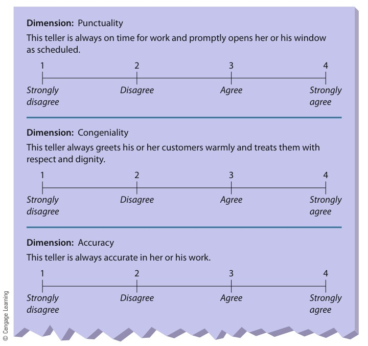
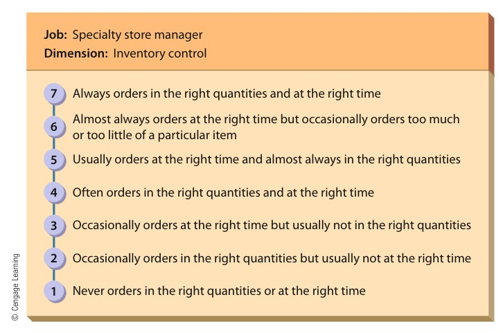

# CHAPTER 8 (Part 1): Managing Human Resources in Organizations

<!-- Page 252 -->

CHAPTER 8Managing HumanResources in Organizations

Learning Outcomes

After studying this chapter, you should be able to:

1Describe the environmental context of human resource management, including its strategic importanceand its relationship with legal and social factors.

2Discuss how organizations attract human resources, including human resource planning, recruiting,and selecting.

3Describe how organizations develop human resources, including training and development,performance appraisal, and performance feedback.

4Discuss how organizations maintain human resources, including the determination of compensationand benefits and career planning.

5Discuss the nature of diversity, including its meaning, associated trends, impact, andmanagement.

6Describe labor relations, including how employees form unions and the mechanics of collectivebargaining.

7Describe the issues associated with managing knowledge and contingent and temporaryworkers.

Management in Action

No Company for Old-Fashioned Management

#### “Anything that requires knowledge and service gives us a reason to be.”

—Danny Wegman, CEO of Wegmans Food Markets

If you’re looking for the best Parmesan cheese for your chicken parmigianarecipe, you might try Wegmans, especially if you happen to live in the vicinityof Pittsford, New York. Cheese department manager Carol Kent will be happyto recommend the best brand because her job calls for knowing cheese, aswell as managing some 20 subordinates. Kent is a knowledgeable employee,and knowledgeable employees, says Wegmans CEO Danny Wegman, are“something our competitors don’t have and our customers couldn’t get anywhereelse.”Wegmans Food Markets, a family-owned East Coast chain with nearly80 outlets in six states, prides itself on its commitment to customers, and itshows: It ranks at the top of the latest Consumer Reports survey of the bestnational and regional grocery stores. But commitment to customers is onlyhalf of Wegmans’s overall strategy, which calls for reaching its customers

<!-- Page 253 -->

Wegmans has achieved success by building a long-term mutually beneficial relationship with itsemployees. This Wegmans fish department manager is explaining cooking options for wild-caughtswordfish to a customer.

through its employees. “How do we differentiate ourselves?” asks Wegman,who then proceeds to answer his own question: “If we can sell products thatrequire knowledge in terms of how you use them, that’s our strategy.Anything that requires knowledge and service gives us a reason to be.”That’s the logic behind one of Carol Kent’s recent assignments—one whichshe understandably regards as a perk: Wegmans sent her to Italy toconduct a personal study of Italian cheese. “We sat with the families” thatmake the cheeses, she recalls, and “broke bread with them. It helped meunderstand that we’re not just selling a piece of cheese. We’re selling atradition, a quality.”Kent and the employees in her department also enjoy the best benefitspackage in the industry, including fully paid health insurance. And that includespart-timers, who make up about two-thirds of the company’s workforce ofmore than 37,000. In part, the strategy of extending benefits to this largesegment of the labor force is intended to make sure that stores have enoughgood workers for crucial peak periods, but there’s no denying that the costs ofemployee-friendly policies can mount up. At 15 to 17 percent of sales, forexample, Wegmans’ labor costs are well above the 12 percent figure for mostsupermarkets. But according to one company HR executive, holding down laborcosts isn’t necessarily a strategic priority: “We would have stopped offering freehealth insurance [to part-timers] a long time ago,” she admits, “if we tried tojustify the costs.”Besides, employee turnover at Wegmans is about 6 percent—a merefraction of an industry average that hovers around 19 percent (and can

<!-- Page 254 -->

approach 100 percent for part-timers). And this is an industry in which totalturnover costs have been known to outstrip total annual profits by 40 percent.Wegmans employees tend to be knowledgeable because about 20 percent ofthem have been with the company for at least ten years, and many havelogged at least a quarter century. Says one 19-year-old college student whoworks at an upstate New York Wegmans while pursuing a career as a highschool history teacher, “I love this place. If teaching doesn’t work out, Iwould so totally work at Wegmans.” Edward McLaughlin, who directs theFood Industry Management Program at Cornell University, understands thissort of attitude: “When you’re a 16-year-old kid, the last thing you want todo is wear a geeky shirt and work for a supermarket,” but at Wegmans, heexplains, “it’s a badge of honor. You’re not a geeky cashier. You’re part ofthe social fabric.”In 2012, Wegmans placed fifth in Fortune magazine’s annual list of “100 BestCompanies to Work For”—good for 14 consecutive years on the list and sevenstraight top-seven finishes. “It says that we’re doing something right,” says acompany spokesperson, “and that there’s no better way to take care of ourcustomers than to be a great place for our employees to work.” In addition to itshealth-care package, Wegmans has been cited for such perks as fitness centerdiscounts,compressedworkweeks,telecommuting,anddomestic-partnerbenefits (which extend to same-sex partners).Finally, under the company’s Employee Scholarship Program, full-timeworkers can receive up to $2,200 a year for four years and part-timers up to$1,500. Since its inception in 1984, the program has handed out over $76million in scholarships to more than 23,500 employees. Like most Wegmanpolicies, this one combines employee outreach with long-term corporatestrategy: “This program has made a real difference in the lives of manyyoung people,” says President Colleen Wegman, who adds that it’s also “oneof the reasons we’ve been able to attract the best and the brightest to work atWegmans.”Granted, Wegmans, which has remained in family hands since its foundingin 1915, has an advantage in being as generous with its resources as its familyof top executives wants to be: It doesn’t have to do everything with quarterlyprofits in mind, and the firm likes to point out that taking care of itsemployees is a long-standing priority. Profit sharing and fully funded medicalcoverage were introduced in 1950 by Robert Wegman, son and nephew ofbrothers Walter and John, who opened the firm’s original flagship store inRochester, New York, in 1930. Why did Robert Wegman make such generousgestures to his employees way back then? “Because,” he says simply, “I wasno different from them.”1

This chapter is about how organizations manage the people that comprise them. That’swhy our opening story is about a company that’s reaped big dividends from a strategythat integrates customer satisfaction with employee satisfaction. The set of processes bywhich Wegmans and other companies manage their people is called “human resourcemanagement,” or HRM. We start by describing the environmental context of HRM. Wethen discuss how organizations attract human resources. Next, we describe how organi-zations seek to further develop the capacities of their human resources. We also examine

<!-- Page 255 -->

> human resourcemanagement (HRM)The set oforganizationalactivities directed atattracting,developing, andmaintaining aneffective workforce

> human capitalReflects theorganization’sinvestment inattracting, retaining,and motivating aneffective workforce

how high-quality human resources are maintained by organizations. We conclude bydiscussing workforce diversity, labor relations, and new challenges in the changingworkplace.

## THE ENVIRONMENTAL CONTEXT OF HRM

Human Resource Management (HRM) is the set of organizational activities directed atattracting, developing, and maintaining an effective workforce.2 HRM takes place withina complex and ever-changing environmental context. Three particularly vital compo-nents of this context are HRM’s strategic importance and the legal and social environ-ments of HRM.

### The Strategic Importance of HRM

Human resources are critical for effective organizational functioning. HRM (or “person-nel,” as it is sometimes called) was once relegated to second-class status in many organi-zations, but its importance has grown dramatically in the last two decades. Its newimportance stems from increased legal complexities, the recognition that humanresources are a valuable means for improving productivity, and the awareness today ofthe costs associated with poor HRM.3 For example, Microsoft recently announced thatit was eliminating 5,000 jobs in business areas that are expected to shrink. At the sametime, though, the firm began developing strategies for hiring high-talent people for jobsrelated to Internet search, an important growth area for the company.4 This careful andsystematic approach of reducing human resources in areas where they are no longerneeded and adding new human resources to key growth areas reflects a strategicapproach to HRM.Indeed, managers now realize that the effectiveness of their HR function has asubstantial impact on the bottom-line performance of the firm. Poor human resourceplanning can result in spurts of hiring followed by layoffs—costly in terms ofunemployment compensation payments, training expenses, and morale. Haphazardcompensation systems do not attract, keep, or motivate good employees, andoutmoded recruitment practices can expose the firm to expensive and embarrassingdiscrimination lawsuits. Consequently, the chief human resource executive of mostlarge businesses is a vice president directly accountable to the CEO, and many firmsare developing strategic HR plans and integrating those plans with other strategic planningactivities.5

Even organizations with as few as 200 employees usually have a human resourcemanager and a human resource department charged with overseeing these activities.Responsibility for HR activities, however, is shared between the HR department andline managers. The HR department may recruit and initially screen candidates, but thefinal selection is usually made by managers in the department where the new employeewill work. Similarly, although the HR department may establish performance appraisalpolicies and procedures, the actual evaluation and coaching of employees are done bytheir immediate superiors.The growing awareness of the strategic significance of HRM has even led to newterminology to reflect a firm’s commitment to people. Human capital reflects the orga-nization’s investment in attracting, retaining, and motivating an effective workforce.Hence, just as the phrase financial capital is an indicator of a firm’s financial resourcesand reserves, so, too, does human capital serve as a tangible indicator of the value of thepeople who comprise an organization.6

<!-- Page 256 -->

> As much as any areaof management,HRM is subject towide-ranging lawsand court decisions.These laws anddecisions affect thehuman resourcefunction in manyareas. For example,AT&T was oncefined several milliondollars for violatingTitle VII of the CivilRights Act of 1964.

> © Cengage Learning

### The Legal Environment of HRM

A number of laws regulate various aspects of employee–employer relations, especially in theareas of equal employment opportunity, compensation and benefits, labor relations, andoccupational safety and health. Several major ones are summarized in Table 8.1.

### Table 8.1: The Legal Environment of Human Resource Management

| Legal Area | Law / Regulation | Key Provisions |
| :--- | :--- | :--- |
| **Equal Employment Opportunity** | Title VII of the Civil Rights Act of 1964 (as amended by the Equal Employment Opportunity Act of 1972) | Forbids discrimination in all areas of the employment relationship |
| | Age Discrimination in Employment Act | Outlaws discrimination against people older than 40 years |
| | Various executive orders, especially Executive Order 11246 in 1965 | Requires employers with government contracts to engage in affirmative action |
| | Pregnancy Discrimination Act | Specifically outlaws discrimination on the basis of pregnancy |
| | Vietnam Era Veterans Readjustment Assistance Act | Extends affirmative action mandate to military veterans who served during the Vietnam War |
| | Americans with Disabilities Act | Specifically outlaws discrimination against disabled persons |
| | Civil Rights Act of 1991 | Makes it easier for employees to sue an organization for discrimination but limits punitive damage awards if they win |
| **Compensation and Benefits** | Fair Labor Standards Act | Establishes minimum wage and mandated overtime pay for work in excess of 40 hours per week |
| | Equal Pay Act of 1963 | Requires that men and women be paid the same amount for doing the same job |
| | Employee Retirement Income Security Act of 1974 (ERISA) | Regulates how organizations manage their pension funds |
| | Family and Medical Leave Act of 1993 | Requires employers to provide up to 12 weeks of unpaid leave for family and medical emergencies |
| **Labor Relations** | National Labor Relations Act (Wagner Act) | Spells out procedures by which employees can establish labor unions and requires organizations to bargain collectively with legally formed unions |
| | Labor Management Relations Act (Taft–Hartley Act) | Limits union power and specifies management rights during union-organizing campaign |
| **Health and Safety** | Occupational Safety and Health Act of 1970 (OSHA) | Mandates the provision of safe working conditions |

<!-- Page 257 -->

> Title VII of the CivilRights Act of 1964Forbids discrimin-ation on the basis ofsex, race, color,religion, or nationalorigin in all areas ofthe employmentrelationship

> adverse impactWhen minoritygroup membersmeet or pass aselection standard ata rate less than 80percent of the passrate of majoritygroup members

> Equal EmploymentOpportunityCommissionCharged withenforcing Title VII ofthe Civil Rights Act of1964

> Age Discriminationin Employment ActOutlawsdiscriminationagainst people olderthan 40 years; passedin 1967, amended in1978 and 1986

> affirmative actionIntentionally seekingand hiring qualifiedor qualifiableemployees fromracial, sexual, andethnic groups that areunderrepresented inthe organization

> Americans withDisabilities ActForbidsdiscriminationagainst people withdisabilities

#### Equal Employment Opportunity Title VII of the Civil Rights Act of 1964

Thislaw forbids discrimination in all areas of the employment relationship. The intent ofTitle VII of the Civil Rights Act of 1964 is to ensure that employment decisions aremade on the basis of an individual’s qualifications rather than on the basis of personalbiases. The law has reduced direct forms of discrimination (such as refusing to promoteAfrican Americans into management, failing to hire men as flight attendants, or refusingto hire women as construction workers) as well as indirect forms of discrimination (suchas using employment tests that whites pass at a higher rate than African Americans).Employment requirements such as test scores and other qualifications are legallydefined as having an adverse impact on minorities and women when such individualsmeet or pass the requirement at a rate less than 80 percent of the rate of majoritygroup members. Criteria that have an adverse impact on protected groups can be usedonly when there is solid evidence that they effectively identify individuals who are betterable than others to do the job. The Equal Employment Opportunity Commission ischarged with enforcing Title VII as well as several other employment-related laws.The Age Discrimination in Employment Act, passed in 1967, amended in 1978, andamended again in 1986, is an attempt to prevent organizations from discriminatingagainst older workers. In its current form, it outlaws discrimination against peopleolder than 40 years. Both the Age Discrimination in Employment Act and Title VIIrequire passive nondiscrimination, or equal employment opportunity. Employers arenot required to seek out and hire minorities, but they must treat all who apply fairly.As much as any area of management, HRM is subject to wide-ranging laws and courtdecisions. These laws and decisions affect the human resource function in many areas.For example, AT&T was once fined several million dollars for violating Title VII of theCivil Rights Act of 1964.Several executive orders, however, require that employers holding government con-tracts engage in affirmative action—intentionally seeking and hiring employees fromgroups that are underrepresented in the organization. These organizations must have awritten affirmative action plan that spells out employment goals for underutilized groupsand how those goals will be met. These employers are also required to act affirmativelyin hiring Vietnam-era veterans (as a result of the Vietnam Era Veterans ReadjustmentAssistance Act) and qualified disabled individuals. Finally, the Pregnancy DiscriminationAct forbids discrimination against women who are pregnant.In 1990, Congress passed the Americans with Disabilities Act, which forbids dis-crimination on the basis of disabilities and requires employers to provide reasonableaccommodations for disabled employees. More recently, the Civil Rights Act of 1991amended the original Civil Rights Act as well as other related laws by both making iteasier to bring discrimination lawsuits (which partially explains the aforementionedbacklog of cases) and limiting the amount of punitive damages that can be awarded inthose lawsuits.

#### Compensation and Benefits

Certain laws also regulate compensation and benefits.The Fair Labor Standards Act, passed in 1938 and amended frequently since then, sets aminimum wage and requires the payment of overtime rates for work in excess of 40hours per week. Salaried professional, executive, and administrative employees areexempt from the minimum hourly wage and overtime provisions. The Equal Pay Actof 1963 requires that men and women be paid the same amount for doing the samejob. Attempts to circumvent the law by having different job titles and pay rates for menand women who perform the same work are also illegal. Basing an employee’s pay onseniority or performance is legal, however, even if it means that a man and woman arepaid different amounts for doing the same job.

<!-- Page 258 -->

> Civil Rights Actof 1991Amends the originalCivil Rights Act,making it easier tobring discriminationlawsuits while alsolimiting punitivedamages

> Fair LaborStandards ActSets a minimumwage and requiresovertime pay forwork in excess of40 hours per week;passed in 1938 andamended frequentlysince then

> Equal Pay Act of 1963Requires that menand women be paidthe same amount fordoing the same job

> EmployeeRetirement IncomeSecurity Act of 1974(ERISA)A law that setsstandards forpension planmanagement andprovides federalinsurance if pensionfunds go bankrupt

> Family and MedicalLeave Act of 1993Requires employersto provide up to 12weeks of unpaidleave for family andmedical emergencies

> National LaborRelations ActPassed in 1935 to setup procedures foremployees to voteon whether to have aunion; also known asthe Wagner Act

Marc F. Henning/Alamy

Walmart has been criticized in recent years for its low wages, weak health-care benefits, lack offull-time jobs, and other human resource practices. These Walmart employees are protesting someof these practices outside the retailer’s home office in Bentonville, Arkansas.

The provision of benefits is also regulated in some ways by state and federal laws.Certain benefits are mandatory—for example, worker’s compensation insurance foremployees who are injured on the job. Employers who provide a pension plan for theiremployees are regulated by the Employee Retirement Income Security Act of 1974(ERISA). The purpose of this act is to help ensure the financial security of pensionfunds by regulating how they can be invested. The Family and Medical Leave Act of 1993requires employers to provide up to 12 weeks of unpaid leave for family and medicalemergencies.In the last few years, some large employers, most notably Walmart, have come underfire because they do not provide health care for all their employees. In response to this,the state of Maryland passed a law, informally called the Walmart Bill, that requiresemployers with more than 10,000 workers to spend at least 8 percent of their payrollson health care or else pay a comparable amount into a general fund for uninsured workers.Walmart appealed this ruling and the case is still pending; meanwhile, several other statesare considering the passage of similar laws.7

### Labor Relations

Union activities and management’s behavior toward unions constitute anotherheavily regulated area. The National Labor Relations Act (also known as theWagner Act), passed in 1935, sets up a procedure for employees to vote on whetherto have a union. If they vote for a union, management is required to bargain collec-tively with the union. The National Labor Relations Board (NLRB) was establishedby the Wagner Act to enforce its provisions. Following a series of severe strikes in1946, the Labor-Management Relations Act (also known as the Taft–Hartley Act)was passed in 1947 to limit union power. The law increases management’s rights during

<!-- Page 259 -->

> National LaborRelations Board(NLRB)Established by theWagner Act toenforce itsprovisions

> Labor-ManagementRelations ActPassed in 1947 tolimit union power;also known as theTaft–Hartley Act

> Occupational Safetyand Health Act of1970 (OSHA)Directly mandatesthe provision of safeworking conditions

> job analysisA systematizedprocedure forcollecting andrecordinginformation aboutjobs within anorganization

an organizing campaign. The Taft–Hartley Act also contains the National Emergency Strikeprovision, which allows the president of the United States to prevent or end a strike thatendangers national security. Taken together, these laws balance union and managementpower. Employees can be represented by a legally created and managed union, but the busi-ness can make non-employee-related business decisions without interference.

#### Health and Safety

The Occupational Safety and Health Act of 1970 (OSHA)directly mandates the provision of safe working conditions. It requires that employers(1) provide a place of employment that is free from hazards that may cause death orserious physical harm, and (2) obey the safety and health standards established by theU.S. Department of Labor. Safety standards are intended to prevent accidents, whereasoccupational health standards are concerned with preventing occupational disease. Forexample, standards limit the concentration of cotton dust in the air because this contami-nant has been associated with lung disease in textile workers. The standards are enforcedby OSHA inspections, which are conducted when an employee files a complaint of unsafeconditions or when a serious accident occurs. Spot inspections of plants in especiallyhazardous industries such as mining and chemicals are also made. Employers who fail tomeet OSHA standards may be fined.Investigators have been looking into claims that chemical agents in the butterflavoring used in microwave popcorn are harmful to workers where such productsare made. At least 30 workers at one plant in Jasper, Missouri, contracted a rarelung disease, and some doctors believe that it resulted from conditions on their jobsite. Although federal health officials point out that there is no danger to those cookingor eating microwave popcorn, research is ongoing into potential hazards to those whowork in the industry.8

#### Emerging Legal Issues

Several other areas of legal concern have emerged during thepast few years. One is sexual harassment. Although sexual harassment is forbidden underTitle VII, it has received additional attention in the courts recently, as more and morevictims have decided to publicly confront the problem. Another emerging HRM issue isalcohol and drug abuse. Both alcoholism and drug dependence are major problemstoday. Recent court rulings have tended to define alcoholics and drug addicts as disabled,protecting them under the same laws that protect other disabled people. Finally, AIDShas emerged as an important legal issue as well. AIDS victims, too, are most oftenprotected under various laws protecting the disabled.

## ATTRACTING HUMAN RESOURCES

With an understanding of the environmental context of HRM as a foundation, we arenow ready to address its first substantive concern—attracting qualified people who areinterested in employment with the organization.

### Human Resource Planning

The starting point in attracting qualified human resources is planning. HR planning, inturn, involves job analysis and forecasting the demand and supply of labor.

#### Job Analysis

Job analysis is a systematic analysis of jobs within an organization. Ajob analysis is made up of two parts. The job description lists the duties of a job, thejob’s working conditions, and the tools, materials, and equipment used to perform it.The job specification lists the skills, abilities, and other credentials needed to do the job.Job analysis information is used in many human resource activities. For instance,

<!-- Page 260 -->

knowing about job content and job requirements is necessary to develop appropriateselection methods and job-relevant performance appraisal systems and to set equitablecompensation rates.

#### Forecasting Human Resource Demand and Supply

After managers fully under-stand the jobs to be performed within the organization, they can start planning for theorganization’s future human resource needs. Figure 8.1 summarizes the steps most oftenfollowed. The manager starts by assessing trends in past human resource usage, futureorganizational plans, and general economic trends. A good sales forecast is often thefoundation, especially for smaller organizations. Historical ratios can then be used topredict demand for employees such as operating employees and sales representatives.Of course, large organizations use much more complicated models to predict their futurehuman resource needs. Several years ago, Walmart went through an exhaustive planningprocess that projected that the firm would need to hire 1 million people. Of this pro-jected total, 800,000 were to be new positions created as the firm grows, and the other200,000 were to replace current workers who were expected to leave for various reasons.9

As time has passed, of course, Walmart adjusted these figures both up and down. But asthings turned out, by the end of the forecast period, Walmart did indeed employ about800,000 more people than when the plan was first completed.

*Figure 8.1 — Human Resource Planning (Source: Page 260)*

Attracting human resources cannot be left to chance if an organization expects tofunction at peak efficiency. Human resource planning involves assessing trends,forecasting supply and demand of labor, and then developing appropriate strategiesfor addressing any differences.

<!-- Page 261 -->

> replacement chartLists each importantmanagerial positionin the organization,who occupies it, howlong he or she willprobably remain inthe position, andwho is or will be aqualifiedreplacement

> employeeinformation system(skills inventory)Contains informationon each employee’seducation, skills,experience, andcareer aspirations;usuallycomputerized

> recruitingThe process ofattracting individualsto apply for jobs thatare open

> internal recruitingConsidering currentemployees asapplicants for higher-level jobs in theorganization

Forecasting the supply of labor is really two tasks: forecasting the internal supply (thenumber and type of employees who will be in the firm at some future date) and forecast-ing the external supply (the number and type of people who will be available for hiringin the labor market at large).10 The simplest approach merely adjusts present staffinglevels for anticipated turnover and promotions. Again, though, large organizations useextremely sophisticated models to make these forecasts. At higher levels of the organiza-tion, managers plan for specific people and positions. The technique most commonlyused is the replacement chart, which lists each important managerial position, whooccupies it, how long he or she will probably stay in it before moving on, and who (byname) is now qualified or soon will be qualified to move into the position. This tech-nique allows ample time to plan developmental experiences for persons identified aspotential successors to critical managerial jobs.11 In February 2012, Warren Buffettannounced that he has a successor in mind to replace him as CEO of Berkshire Hath-away and stated the eventual transfer of power would be seamless.12

To facilitate both planning and identifying persons for current transfer or promotion,some organizations also have an employee information system, or skills inventory,which is usually computerized and contains information on each employee’s education,skills, work experience, and career aspirations. Such a system can quickly locate all theemployees in the organization who are qualified to fill a position requiring, for instance,a degree in chemical engineering, three years of experience in an oil refinery, and fluencyin Spanish. Enterprise resource planning (ERP) systems, as described in Chapter 7,generally include capabilities for measuring and managing the internal supply of laborin ways that best fit the needs of the organization.Forecasting the external supply of labor is a different problem altogether. How does amanager, for example, predict how many electrical engineers will be seeking work inGeorgia three years from now? To get an idea of the future availability of labor, plannersmust rely on information from outside sources such as state employment commissions,government reports, and figures supplied by colleges on the number of students in majorfields.

#### Matching Human Resource Supply and Demand

After comparing futuredemand and internal supply, managers can make plans to manage predicted shortfallsor overstaffing. If a shortfall is predicted, new employees can be hired, present employeescan be retrained and transferred into the understaffed area, individuals approachingretirement can be convinced to stay on, or labor-saving or productivity-enhancingsystems can be installed.If the organization needs to hire, the external labor supply forecast helps managersplan how to recruit, based on whether the type of person needed is readily available orscarce in the labor market. As we noted earlier in this chapter, the trend in temporaryworkers also helps managers in staffing by affording them extra flexibility. If overstaffingis expected to be a problem, the main options are transferring the extra employees, notreplacing individuals who quit, encouraging early retirement, and laying people off.

### Recruiting Human Resources

Once an organization has an idea of its future human resource needs, the next phase isusually recruiting new employees.13 Recruiting is the process of attracting qualifiedpersons to apply for jobs that are open. Where do recruits come from? Some recruitsare found internally; others come from outside the organization.

Internal recruiting means considering present employees as candidates for openings.Promotion from within can help build morale and keep high-quality employees fromleaving the firm. In unionized firms, the procedures for notifying employees of internal

<!-- Page 262 -->

> external recruitingGetting people fromoutside theorganization to applyfor jobs

> realistic job preview(RJP)Provides theapplicant with a realpicture of what itwould be like toperform the job thatthe organization istrying to fill

> validationDetermining theextent to which aselection device isreally predictive offuture jobperformance

> © Michal Kowalski/Shutterstock.com

job change opportunities are usually spelled out in the union contract. For higher-levelpositions, a skills inventory system may be used to identify internal candidates, or man-agers may be asked to recommend individuals who should be considered. Most busi-nesses today routinely post job openings on their internal communication network, orintranet. One disadvantage of internal recruiting is its ripple effect. When an employeemoves to a different job, someone else must be found to take his or her old job. In oneorganization, 454 job movements were necessary as a result of filling 195 initialopenings.

External recruiting involves attracting persons outside the organization to apply forjobs. External recruiting methods include advertising, campus interviews, employmentagencies or executive search firms, union hiring halls, referrals by present employees,and hiring “walk-ins” or “gate-hires” (people who show up without being solicited).Increasingly, firms are using the Internet to post job openings and to solicit applicants.Of course, a manager must select the most appropriate methods, using the state employ-ment service to find maintenance workers but not a nuclear physicist, for example. Pri-vate employment agencies can be a good source of clerical and technical employees, andexecutive search firms specialize in locating top-management talent. In general, “helpwanted” ads in newspapers and in online job posting sites are often used because theyreach a wide audience and thus allow a large number of people to find out about andapply for job openings.One generally successful method for facilitating a good person–job fit is the so-calledrealistic job preview (RJP), which involves providing the applicant with a real picture ofwhat it would be like to perform the job that the organization is trying to fill.14 Forexample, it would not make sense for a firm to tell an applicant that the job is excitingand challenging when in fact it is routine and straightforward; yet some managers dothis to hire the best people. The likely outcome will be a dissatisfied employee who willquickly be looking for a better job. If the company is more realistic about a job, though,the person hired will be more likely to remain in the job for a longer period of time.

Realistic job previews play a big role in helping people better understand thenature of potential job opportunities. This senior manager, for example, isexplaining the details of a potential new work assignment to one of hissubordinates. By building familiarity and awareness in advance, businessescan reduce turnover and dissatisfaction later.

### Selecting Human Resources

Oncetherecruitingprocesshasattracted a pool of applicants, the nextstep is to select whom to hire. Theintent of the selection process is togatherfromapplicantsinformationthat will predict their job success andthen to hire the candidates likely to bemost successful.15 Of course, the organi-zation can gather information onlyabout factors that are predictive of futureperformance. The process of determiningthe predictive value of information iscalled validation.

#### Application Blanks

The first stepin selection is usually asking the candi-date to fill out an application blank.Applicationblanksareanefficientmethod of gathering information aboutthe applicant’s previous work history,

<!-- Page 263 -->

educational background, and other job-related demographic data. They should notcontain questions about areas not related to the job, such as gender, religion, or nationalorigin. Application blank data are generally used informally to decide whether a candidatemerits further evaluation, and interviewers use application blanks to familiarize themselveswith candidates before interviewing them. Unfortunately, in recent years, there has beena trend toward job applicants’ either falsifying or inflating their credentials to stand abetter chance of getting a job. Indeed, one recent survey of 2.6 million job applicationsfound that an astounding 44 percent of them contained some false information.16

#### Tests

Tests of ability, skill, aptitude, or knowledge that is relevant to the particular jobare usually the best predictors of job success, although tests of general intelligence orpersonality are occasionally useful. In addition to being validated, tests should be admin-istered and scored consistently. All candidates should be given the same directions,should be allowed the same amount of time, and should experience the same testingenvironment (temperature, lighting, and distractions).17

#### Interviews

Although a popular selection device, interviews are sometimes poor pre-dictors of job success. For example, biases inherent in the way that people perceive andjudge others at a first meeting affect subsequent evaluations by the interviewer. Interviewvalidity can be improved by training interviewers to be aware of potential biases and byincreasing the structure of the interview. In a structured interview, questions are writtenin advance, and all interviewers follow the same question list with each candidate theyinterview. This procedure introduces consistency into the interview procedure and allowsthe organization to validate the content of the questions to be asked.18

#### Assessment Centers

Assessment centers are a popular method used to select man-agers and are particularly good for selecting current employees for promotion. Theassessment center is a content-valid simulation of major parts of the managerial job. Atypical center lasts two to three days, with groups of 6 to 12 persons participating in avariety of managerial exercises. Centers may also include interviews, public speaking, andstandardized ability tests. Candidates are assessed by several trained observers, usuallymanagers several levels above the job for which the candidates are being considered.Assessment centers are quite valid if properly designed and are fair to members ofminority groups and women.19 For some firms, the assessment center is a permanentfacility created for these activities. For other firms, the assessment activities are per-formed in a multipurpose location such as a conference room. AT&T pioneered theassessment center concept. For years, the firm has used assessment centers to make vir-tually all of its selection decisions for management positions.

#### Other Techniques

Organizations also use other selection techniques depending onthe circumstances. Polygraph tests, once popular, are declining in popularity. On the otherhand, more and more organizations are requiring that applicants in whom they areinterested take physical exams. Organizations are also increasingly using drug tests, espe-cially in situations in which drug-related performance problems could create serious safetyhazards. For example, applicants for jobs in a nuclear power plant would likely be tested fordrug use. Some organizations today even run credit checks on prospective employees.

## DEVELOPING HUMAN RESOURCES

Regardless of how effective a selection system is, however, most employees need addi-tional training if they are to grow and develop in their jobs. Evaluating their performanceand providing feedback are also necessary.

<!-- Page 264 -->

> trainingTeaching operationalor technicalemployees how todo the job for whichthey were hired

> developmentTeaching managersand professionalsthe skills needed forboth present andfuture jobs

### Training and Development

In HRM, training usually refers to teaching operational or technical employees how to dothe job for which they were hired. Development refers to teaching managers and profes-sionals the skills needed for both present and future jobs. Most organizations provide reg-ular training and development programs for managers and employees. For example, IBMspends more than $700 million annually on programs and has a vice president in chargeof employee education. U.S. businesses spend more than $125 billion annually on trainingand development programs away from the workplace. And this figure does not includewages and benefits paid to employees while they are participating in such programs.20

#### Assessing Training Needs

The first step in developing a training plan is to determinewhat needs exist. For example, if employees do not know how to operate the machinerynecessary to do their job, a training program on how to operate the machinery is clearlyneeded. On the other hand, when a group of office workers is performing poorly, trainingmay not be the answer. The problem could be motivation, aging equipment, poor supervi-sion, inefficient work design, or a deficiency of skills and knowledge. Only the last could beremedied by training. As training programs are being developed, the manager should setspecific and measurable goals specifying what participants are to learn. The manager shouldalso plan to evaluate the training program after employees complete it.

#### Common Training Methods

Many different training and development methods areavailable. Selection of methods depends on many considerations, but perhaps the mostimportant is training content. When the training content is factual material (such ascompany rules or explanations for how to fill out forms), assigned reading, programmedlearning, and lecture methods work well. When the content is interpersonal relations orgroup decision making, however, firms must use a method that allows interpersonalcontact, such as role-playing or case discussion groups. When employees must learn aphysical skill, methods allowing practice and the actual use of tools and materials areneeded, as in on-the-job training or vestibule training. (Vestibule training enablesparticipants to focus on safety, learning, and feedback rather than on productivity.)Web-based and other electronic-media–based training are becoming very popular.Such methods allow a mix of training content, are relatively easy to update and revise, letparticipants use a variable schedule, and lower travel costs.21 On the other hand, they arelimited in their capacity to simulate real activities and facilitate face-to-face interaction.Xerox, Massachusetts Mutual Life Insurance, and Ford have all reported tremendous successwith these methods. In addition, most training programs actually rely on a mix of methods.Boeing, for example, sends managers to an intensive two-week training seminar involvingtests, simulations, role-playing exercises, and DVD flight simulation exercises.22

Finally, some larger businesses have started creating their own self-contained trainingfacility, often called a corporate university. McDonald’s was among the first to start thispractice with its so-called Hamburger University in Illinois. All management trainees ofthe firm attend training programs there to learn exactly how long to grill a burger, howto maintain good customer service, and so on. The cult hamburger chain In-N-OutBurger also has a similar training venue called In-N-Out University. Other firms usingthis approach include Shell Oil and General Electric.23

#### Evaluation of Training

Training and development programs should always beevaluated. Typical evaluation approaches include measuring one or more relevant criteria(such as attitudes or performance) before and after the training, and determining whetherthe criteria changed. Evaluation measures collected at the end of training are easy to get,but actual performance measures collected when the trainee is on the job are moreimportant. Trainees may say that they enjoyed the training and learned a lot, but the truetest is whether their job performance improves after their training.

<!-- Page 265 -->

> ZUMA Press, Inc./Alamy

AT YOUR SERVICE

## Darden Invests in Employee Development

Darden Restaurants owns such popular brands asOlive Garden, LongHorn Steakhouse, and Capital Grill.Darden has a reputation for being one of the best placesto work in America, in part because of its aggressiveemployee development and promote-from-within policies.Clarence Otis, the firm’s CEO, believes that investing inDarden employees helps keep the business strong andprofitable.

Some businesses see wages and salaries as anexpense.Butothersseeemployeesasvitalresources that can give them a real competitiveadvantage. Darden Restaurants falls clearly in thesecond set. Darden operates such popular eateries as Bahama Breeze, Olive Garden, LongHorn Steak-house, and Capital Grill. All told, the firm has about180,000 employees and 1,900 restaurants (all com-pany owned, not franchised).Darden was recently named the second-bestcompany to work for in America (behind FedEx) byFortune magazine, the only restaurant businessthat’severmadethislist.Thefirm’sannualemployee turnover is about 20 percent lower thanits industry average, and many Darden top managersstarted at the bottom and worked themselves up thecorporate ladder. Indeed, that is one major reasonthat Darden’s employees enjoy working there somuch.Take Mike Stroud, for example. Stroud started asa busboy at a Red Lobster (once a part of Darden) inGeorgia in 1973. Today he is a senior vice presidentoverseeing 215 locations. Likewise, Lisa Hoggsjoined the company waiting tables at a LongHornSteakhouse. Now she is a managing partner, runninga  million location in Atlanta. About 42 percent ofits employees are minorities, and 39 percent of itsmanagers are women.What’s Darden’s secret? For one thing it tries toimpress upon its employees that working for Dardencan be a career not just a job. The firm investsheavily in talent development and offers extensivecareer planning to all employees. The company alsooffers its employees an array of other meaningfulbenefits as well. For example, its supports a creditunion that provides low-interest loans to employees,strong health-care packages, and substantial trainingand development opportunities.Darden recently announced plans to open 500new restaurants in the next five years and hirealmost 50,000 new employees. Given its trackrecord in hiring, nurturing, and promoting employees,there seems to be little question that it will succeed.And who knows—one day soon Bahama Breeze andOlive Garden may be as common as McDonalds andStarbucks.

References: “Serving Up the American Dream,” Fortune,May 20, 2013, p. 34; Hoover’s Handbook of AmericanBusiness 2013 (Austin: Mergent, Inc.), pp. 243–244; “Dardento Sell Red Lobster,” New York Times, May 16, 2014, p. B1.

<!-- Page 266 -->

> performanceappraisalA formal assessmentof how well anemployee is doinghis or her job

### Performance Appraisal

Once employees are trained and settled into their jobs, one of management’s nextconcerns is performance appraisal. Performance appraisal is a formal assessment ofhow well employees are doing their jobs. Employees’ performance should be evaluatedregularly for many reasons. One reason is that performance appraisal may be neces-sary for validating selection devices or assessing the impact of training programs. Asecond reason is administrative—to aid in making decisions about pay raises, promo-tions, and training. Still another reason is to provide feedback to employees to helpthem improve their present performance and plan future careers.24 Because perfor-mance evaluations often help determine wages and promotions, they must be fairand nondiscriminatory.

#### Common Appraisal Methods

Two basic categories of appraisal methods commonlyused in organizations are objective methods and judgmental methods. Objectivemeasures of performance include actual output (that is, number of units produced),scrap rate, dollar volume of sales, and number of claims processed. This may be contam-inated by “opportunity bias” if some persons have a better chance to perform thanothers. For example, a sales representative selling snowblowers in Michigan has a greateropportunity than a colleague selling the same in Arkansas. Fortunately, adjusting rawperformance figures for the effect of opportunity bias and thereby arriving at figuresthat accurately represent each individual’s performance are often possible.Another type of objective measure, the special performance test, is a method in whicheach employee is assessed under standardized conditions. This kind of appraisal alsoeliminates opportunity bias. For example, Verizon Southwest has a series of prerecordedcalls that operators in a test booth answer. The operators are graded on speed, accuracy,and courtesy in handling the calls. Performance tests measure ability but do not measurethe extent to which one is motivated to use that ability on a daily basis. (A high-abilityperson may be a lazy performer except when being tested.) Special performance testsmust therefore be supplemented by other appraisal methods to provide a completepicture of performance.Judgmental methods, including ranking and rating techniques, are the most commonways to measure performance. Ranking compares employees directly with one anotherand orders them from best to worst. Ranking has a number of drawbacks. Ranking isdifficult for large groups because the persons in the middle of the distribution may behard to distinguish from one another accurately. Comparisons of people in differentwork groups are also difficult. For example, an employee ranked third in a stronggroup may be more valuable than an employee ranked first in a weak group. Anothercriticism of ranking is that the manager must rank people on the basis of overall perfor-mance, although each person likely has both strengths and weaknesses. Furthermore,rankings do not provide useful information for feedback. To be told that one is rankedthird is not nearly as helpful as to be told that the quality of one’s work is outstanding,its quantity is satisfactory, one’s punctuality could use improvement, or one’s paperworkis seriously deficient.Rating differs from ranking in that it compares each employee with a fixed standardrather than comparison with other employees. A rating scale provides the standard.Figure 8.2 gives examples of three graphic rating scales for a bank teller. Each consistsof a performance dimension to be rated (punctuality, congeniality, and accuracy),followed by a scale on which to make the rating. In constructing graphic rating scales,performance dimensions that are relevant to job performance must be selected. Inparticular, they should focus on job behaviors and results rather than on personalitytraits or attitudes.

<!-- Page 267 -->

> BehaviorallyAnchored RatingScale (BARS)A sophisticatedrating method inwhich supervisorsconstruct a ratingscale associated withbehavioral anchors

This teller is always on time for work and promptly opens her or his windowas scheduled.

This teller always greets his or her customers warmly and treats them withrespect and dignity.

This teller is always accurate in her or his work.

*Figure 8.2 — Graphic Rating Scales for a Bank Teller (Source: Page 267)*

Graphic rating scales are common methods for evaluating employee performance.The manager who is doing the rating circles the point on each scale that best reflectsher or his assessment of the employee on that scale. Graphic rating scales arewidely used for many different kinds of jobs.

The Behaviorally Anchored Rating Scale (BARS) is a sophisticated and useful ratingmethod. Supervisors construct rating scales associated with behavioral anchors. Theyfirst identify relevant performance dimensions and then generate anchors—specific,observable behaviors typical of each performance level. Figure 8.3 shows an example ofa BARS for the dimension “Inventory control.”The other scales in this set, developed for the job of department manager in a chainof specialty stores, include “Handling customer complaints,” “Planning special promo-tions,” “Following company procedures,” “Supervising sales personnel,” and “Diagnosingand solving special problems.” BARS can be effective because it requires that manage-ment takes proper care in constructing the scales and it provides useful anchors forsupervisors to use in evaluating people. It is costly, however, because outside expertiseis usually needed and because scales must be developed for each job within theorganization.

#### Errors in Performance Appraisal

Errors or biases can occur in any kind of ratingor ranking system.25 One common problem is recency error—the tendency to base

<!-- Page 268 -->

> 360-degreefeedbackA performanceappraisal system inwhich managers areevaluated byeveryone aroundthem—their boss,their peers, and theirsubordinates

*Figure 8.3 — Behaviorally Anchored Rating Scale (Source: Page 268)*

Behaviorally anchored rating scales help overcome some of the limitations ofstandard rating scales. Each point on the scale is accompanied by a behavioralanchor—a summary of an employee behavior that fits that spot on the scale.

judgments on the subordinate’s most recent performance because it is most easilyrecalled. Often a rating or ranking is intended to evaluate performance over an entiretime period, such as six months or a year, so the recency error does introduce errorinto the judgment. Other errors include overuse of one part of the scale—being toolenient, being too severe, or giving everyone a rating of “average.” Halo error is allowingthe assessment of an employee on one dimension to “spread” to ratings of that employeeon other dimensions. For instance, if an employee is outstanding on quality of output, arater might tend to give him or her higher marks than deserved on other dimensions.Errors can also occur because of race, sex, or age discrimination, intentionally or unin-tentionally. The best way to offset these errors is to ensure that a valid rating system isdeveloped at the outset and then to train managers in how to use it.One interesting innovation in performance appraisal used in some organizationstoday is called 360-degree feedback, in which managers are evaluated by everyonearound them—their boss, their peers, and their subordinates. Such a complete andthorough approach provides people with a far richer array of information about theirperformance than does a conventional appraisal given just by the boss. Of course, sucha system also takes considerable time and must be handled so as not to breed fear andmistrust in the workplace.26

### Performance Feedback

The last step in most performance appraisal systems is giving feedback to subordinatesabout their performance. This is usually done in a private meeting between the personbeing evaluated and his or her boss. The discussion should generally be focused on thefacts—the assessed level of performance, how and why that assessment was made, andhow it can be improved in the future. Feedback interviews are not easy to conduct.

<!-- Page 269 -->

> compensationThe financialremuneration givenby the organizationto its employees inexchange for theirwork

Many managers are uncomfortable with the task, especially if feedback is negative andsubordinates are disappointed by what they hear. Properly training managers, however,can help them conduct more effective feedback interviews.27

Some firms use a very aggressive approach to terminating people who do not meetexpectations. General Electric has long used a system whereby each year the bottom 10percent of its workforce is terminated and replaced with new employees. Companyexecutives claim that this approach, although stressful for all employees, helps it to con-tinuously upgrade its workforce. Other firms have started using this same approach.However, both Ford and Goodyear recently agreed to abandon similar approaches inresponse to age discrimination lawsuits.28

## MAINTAINING HUMAN RESOURCES

After organizations have attracted and developed an effective workforce, they must alsomake every effort to maintain that workforce. To do so requires effective compensationand benefits as well as career planning. “Leading the Way” describes how one firm,Nucor Steel, uses compensation to maintain a strong workforce.

### Determining Compensation

Compensation is the financial remuneration given by the organization to its employeesin exchange for their work. There are three basic forms of compensation. Wages are thehourly compensation paid to operating employees. The minimum hourly wage paid inthe United States today is $7 25 (some states have higher minimums). Salary refers tocompensation paid for total contributions, as opposed to pay based on hours worked.For example, managers earn an annual salary, usually paid monthly. They receive thesalary regardless of the number of hours they work. Some firms have started paying alltheir employees a salary instead of hourly wages. For example, all employees at Chapar-ral Steel earn a salary, starting at $30,000 a year for entry-level operating employees.Finally, incentives represent special compensation opportunities that are usually tied toperformance. Sales commissions and bonuses are among the most common incentives.Compensation is an important and complex part of the organization–employee relation-ship. Basic compensation is necessary to provide employees with the means to maintain areasonable standard of living. Beyond this, however, compensation also provides a tangiblemeasure of the value of the individual to the organization. If employees do not earn enoughto meet their basic economic goals, they will seek employment elsewhere. Likewise, if theybelieve that their contributions are undervalued by the organization, they may leave orexhibit poor work habits, low morale, and little commitment to the organization. Thus,designing an effective compensation system is clearly in the organization’s best interests.29

A good compensation system can help attract qualified applicants, retain presentemployees, and stimulate high performance at a cost reasonable for one’s industry andgeographic area. To set up a successful system, management must make decisions aboutwage levels, the wage structure, and the individual wage determination system. Somefirms used the recent recession as an opportunity to refine their compensation systems.While many firms reduced their workforces through layoffs, others used targeted salarycuts to avoid layoffs. For instance, at Hewlett-Packard, the CEO first cut his own salaryby 20 percent. The firm’s very top performers kept their same pay levels. But others weregiven tiered salary cuts ranging from as little as 2.5 percent to as much as 20 percent. Afew firms went even further. CareerBuilder.com, for instance, not only instituted pay cutsfor all employees but also told everyone they only had to work half a day on Fridays.30

<!-- Page 270 -->

> AP Images/The Decatur Daily/John Godbey

LEADING THE WAY

## Holding True at Nucor Steel

Nucor Steel, the largest steelmaker in the United States, has achieved consistent profits and lowemployee turnover by using an innovative compensation model. Nucor Steel employees have a baseguaranteed wage that is somewhat lower than the industry average but can earn considerably morethan average wages by being productive. Compensation for every Nucor employee includes someform of incentive pay.

Nucor, the country’s largest steelmaker, has neverlaid employees off or eliminated jobs. As a result ofthe recent recession, for example, the U.S. steelindustry laid off some 10,000 workers in January2009. But at its 11 U.S. facilities, Nucor employeeswere busy rewriting safety manuals, getting a headstart on maintenance jobs, mowing the lawns, andcleaningthebathrooms—andstilldrawingpay-checks. How has Nucor been able to pull this off?Experts point to two things: the firm’s employeesand culture. The firm’s culture originated in the1960s as the result of policies established by KenIverson, who brought a radical perspective on howto manage a company’s human resources to thejob of CEO. Iverson figured that workers would bemuch more productive if an employer went out ofits way to share authority with them, respect whatthey accomplished, and compensate them as hand-somely as possible. Today, the basics of the com-pany’s HR model are summed up in its “EmployeeRelations Principles”:

•Management is obligated to manage Nucor insuch a way that employees will have the oppor-tunity to earn according to their productivity.•Employees should feel confident that if they dotheir jobs properly, they will have a job tomorrow.•Employees have the right to be treated fairly andmust believe that they will be.•Employees must have an avenue of appeal whenthey believe they are being treated unfairly.

The Iverson approach is based on a highly originalpay system. Base pay is actually below the industryaverage,buttheNucorcompensationplanisdesigned to pay more if employees perform better.For example, if a shift can turn out a defect-freebatch of steel, every worker is entitled to a bonusthat’s paid weekly and that can potentially triple hisor her take-home pay. In addition, there are one-timeannual bonuses and profit-sharing payouts. In a goodyear, for example, the average steelworker can takehome $79,000 in base pay and weekly bonuses, plus

(continued)
