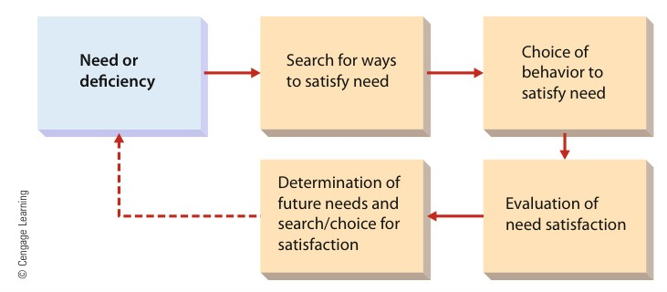
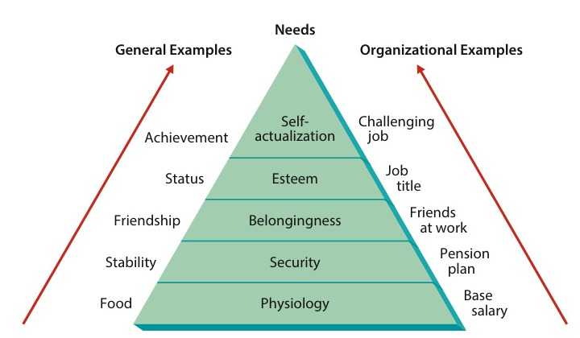
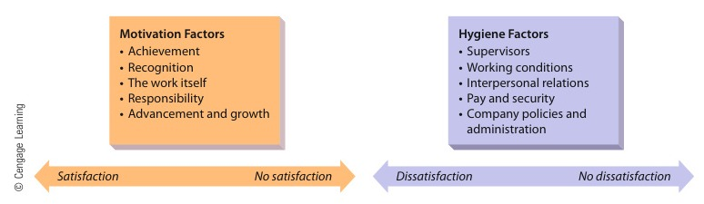
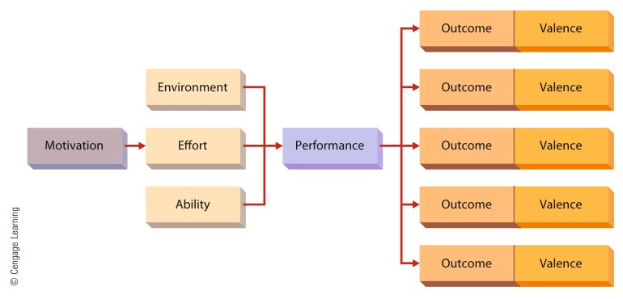
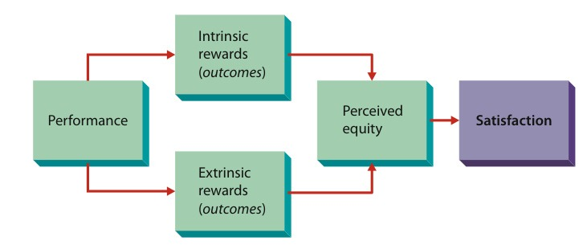

# CHAPTER 10 (Part 1): Managing Employee Motivation and Performance

<!-- Page 321 -->

> Jim West/Alamy

CHAPTER 10Managing EmployeeMotivation and Performance

Learning Outcomes

After studying this chapter, you should be able to:

1Characterize the nature of motivation, including its importance and basic historical perspectives.

2Identify and describe the major content perspectives on motivation.

3Identify and describe the major process perspectives on motivation.

4Describe reinforcement perspectives on motivation.

5Identify and describe popular motivational strategies.

6Describe the role of organizational reward systems in motivation.

Management in Action

Motivating the Whole Person

#### “If I put our mission in simple terms, it would be, No. 1, to change the way the world eats and, No. 2, to create a workplace based on love and respect.”

—Whole Foods co-CEO Walter Robb

Whole Foods Market (WFM) startedout in 1980 as 1 store with 19employeesinAustin,Texas.Today, with 350 stores and 54,000employees in North America andGreatBritain,it’stheleadingnaturalandorganicfoodssupermarket(andninth-largestfood and drug chain in the UnitedStates). Along the way, it’s alsogained a considerable reputationas a socially responsible companyand a good place to work. WFM’smottois“WholeFoods,WholePeople,WholePlanet,”anditsguiding “core value,” according toco-CEO Walter Robb, is “customersfirst, then team members, balancedwithwhat’sgoodforotherstakeholders…. If I put our mission

Whole Foods is often recognized as a great place to work. Employees suchas this one are motivated by Whole Foods’ competitive pay and benefits,although some criticism has been directed at the firm’s health-care plan.

<!-- Page 322 -->

in simple terms,” Robb continues, “it would be, No. 1, to change the way the worldeats and, No. 2, to create a workplace based on love and respect.”WFM made Fortune magazine’s very first list of the “100 Best Companies toWork For” in 1998 and is one of 13 organizations to have made it every yearsince. Citations have acknowledged the company’s growth (which means morejobs), salary-cap limits (the top earner gets no more than 19 times the averagefull-time salary), and generous health plan. The structure of the company’scurrent health-care program, which revolves around high deductibles and so-called health savings accounts (HSAs), was first proposed in 2003. Under such aplan, an employee (a “team member,” in WFM parlance) pays a deductible beforehis or her expenses are covered. Meanwhile, the employer funds a specialaccount (an HSA) for each employee, who can spend the money to cover health-related expenditures. The previous WFM plan had covered 100 percent of allexpenses, and when some employees complained about the proposed change,the company decided to put it to a vote. Nearly 90 percent of the workforce wentto the polls, with 77 percent voting for the new plan. In 2006, employees voted toretain the plan, which now carries a deductible of around $1,300; HSAs may go ashigh as $1,800 (and accrue for future use). The company pays 100 percent of thepremiums for eligible employees (about 89 percent of the workforce).High-deductible plans save money for the employer (the higher the deductible,the lower the premium), and more important—at least according to founder andco-CEO John Mackey—they also make employees more responsible consumers.When the first $1,300 of their medical expenses comes out of their own pockets(or their own HSAs), he argues, people “start asking how much things cost. Orthey get a bill and say, ‘Wow, that’s expensive.’ They begin to ask questions.They may not want to go to the emergency room if they wake up with ahangnail in the middle of the night. They may schedule an appointment now.”Mackey believes that “the individual is the best judge of what’s right for theindividual,” and he’s so convinced of the value of plans like the one offered byhis company that in August 2009 he wrote an op-ed in the Wall Street Journal inwhich he recommended “The Whole Foods Alternative to ObamaCare.” Healthcare, he wrote, “is a service that we all need, but just like food and shelter, it isbest provided through voluntary and mutually beneficial market exchanges.”Going a step further, Mackey argued against an “intrinsic right to health care,”and on this point he stirred up a reaction among his customers that ran thegamut from surprise to boycotting. “I’m boycotting [Whole Foods],” said onecustomer who’d been shopping WFM several times a week, “because allAmericans need health care. While Mackey is worried about health-care andstimulus spending, he doesn’t seem too worried about expensive wars and taxbreaks for the wealthy and big businesses such as his own that contribute to the[national] deficit.”Consumer advocates and HR specialists also attacked Mackey’s proposals andpolicies. “High-deductible plans for low-wage workers,” says Judy Dugan,research director of Consumer Watchdog, “are the next best thing to beinguninsured: The up-front costs are so high that workers have to weigh gettinghealth care against paying the rent (to the detriment of their health).” A formerWFMexecutivepointsout,forexample,thatthefirm’splanentails“astronomical deductibles and co-pays.” As for the HSA, it has to cover allco-pays and all expenses not covered by the plan (such as mental health care).“There’s way more going on here than ‘health insurance,’” concludes theanonymous former exec. “… [The] system has massive hidden charges that

<!-- Page 323 -->

> motivationThe set of forces thatcause people tobehave in certainways

routinely threaten and undermine the financial stability and, ultimately, [the] well-being of the employees.”Responding to the backlash against Mackey’s WSJ piece, the WFM CustomerCommunications Team hastened to point out that “our team members vote onour plan … to make sure they continue to have a voice in our benefits.”Mackey’s intent, said the press release, “was to express his personal opinions—not those of Whole Foods Market team members or our company as a whole.”The release also offered an apology for having “offended some of ourcustomers,” but for many onetime WFM loyalists, the apology was too little toolate. “I will no longer be shopping at Whole Foods,” announced one New Jerseyshopper, explaining that “a CEO should take care that if he speaks about politics,his beliefs reflect at least the majority of his clients.” In fact, WFM had become, inthe words of one reporter, “the granola set’s chain of choice,” and much of itscustomer base consists of people whose opinions on such issues as health-carereform are quite different from Mackey’s. His WSJ article, declared a contributorto the company’s online forum, was “an absolute slap in the face to the millionsof progressive-minded consumers that have made [Whole Foods] what it istoday.”The potential repercussions weren’t lost on the WFM board. In late August,following the appearance of the WSJ op-ed piece, shareholder activists called forMackey’s removal. The CEO, they charged, had “attempted to capitalize on thebrand reputation of Whole Foods to champion his personal political views buthas instead deeply offended a key segment of Whole Foods consumer base.”The company’s stock had also slipped 30 percent over the previous five-yearperiod. The board eventually compromised by convincing Mackey to step downas chairman of the board.1

Obviously, managers can’t always motivate people to perform in ways that are in the bestinterests of the organization. But managers are responsible for encouraging high perfor-mance from their employees, so it’s always worthwhile trying to figure out what makesemployees more (or less) productive. Whether it’s pay, benefits, or job security, the issuealmost invariably comes down to motivation, which is the subject of this chapter. Wefirst examine the nature of employee motivation and then explore the major perspectiveson motivation. Newly emerging approaches are then discussed. We conclude with adescription of rewards and their role in motivation.

## THE NATURE OF MOTIVATION

Motivation is the set of forces that cause people to behave in certain ways.2 On anygiven day, an employee may choose to work as hard as possible at a job, work justhard enough to avoid a reprimand, or do as little as possible. The goal for the manageris to maximize the likelihood of the first behavior and minimize the likelihood of thelast. This goal becomes all the more important when we understand how importantmotivation is in the workplace.Individual performance is generally determined by three things: motivation (the desireto do the job), ability (the capability to do the job), and the work environment (theresources needed to do the job). If an employee lacks ability, the manager can provide

<!-- Page 324 -->

> contentperspectivesApproach tomotivation that triesto answer thequestion “Whatfactors motivatepeople?”

*Figure 10.1 — The Motivation Framework (Source: Page 324)*

The motivation process progresses through a series of discrete steps. Content,process, and reinforcement perspectives on motivation address different parts of thisprocess.

training or replace the worker. If there is a resource problem, the manager can correct it.But, if motivation is the problem, the task for the manager is more challenging.3 Individ-ual behavior is a complex phenomenon, and the manager may be hard pressed to figureout the precise nature of the problem and how to solve it. Thus, motivation is importantbecause of its significance as a determinant of performance and because of its intangiblecharacter.4

The motivation framework in Figure 10.1 is a good starting point for understandinghow motivated behavior occurs. The motivation process begins with a need deficiency.For example, when a worker feels that she is underpaid, she experiences a need formore income. In response, the worker searches for ways to satisfy the need, such asworking harder to try to earn a raise or seeking a new job. Next, she chooses an optionto pursue. After carrying out the chosen option—working harder and putting in morehours for a reasonable period of time, for example—she then evaluates her success. Ifher hard work resulted in a pay raise, she probably feels good about things and willcontinue to work hard. But, if no raise has been provided, she is likely to try anotheroption.

## CONTENT PERSPECTIVES ON MOTIVATION

Content perspectives on motivation deal with the first part of the motivation process—needs and need deficiencies. More specifically, content perspectives address the ques-tion “What factors in the workplace motivate people?” Labor leaders often argue thatworkers can be motivated by more pay, shorter working hours, and improved workingconditions. Meanwhile, some experts suggest that motivation can be more effectivelyenhanced by providing employees with more autonomy and greater responsibility.5

Both of these views represent content views of motivation. The former asserts thatmotivation is a function of pay, working hours, and working conditions; the lattersuggests that autonomy and responsibility are the causes of motivation. Two widelyknown content perspectives on motivation are the needs hierarchy and the two-factortheory.

<!-- Page 325 -->

> Maslow’s hierarchyof needsSuggests that peoplemust satisfy fivegroups of needs inorder—physiological,security,belongingness,esteem, and self-actualization

### The Needs Hierarchy Approach

The needs hierarchy approach has been advanced by many theorists. Needs hierarchiesassume that people have different needs that can be arranged in a hierarchy of impor-tance. The best known is Maslow’s hierarchy of needs.Abraham Maslow, a human relationist, argued that people are motivated to satisfyfive need levels.6 Maslow’s hierarchy of needs is shown in Figure 10.2. At the bottomof the hierarchy are the physiological needs—things such as food, sex, and air, whichrepresent basic issues of survival and biological function. In organizations, survivalneeds are generally satisfied by adequate wages and the work environment itself,whichprovidesrestrooms,adequatelighting,comfortabletemperatures,andventilation.Next are the security needs for a secure physical and emotional environment. Exam-ples include the desire for housing and clothing and the need to be free from worryabout money and job security. These needs can be satisfied in the workplace by assuredjob continuity (no layoffs), an effective grievance system (to protect against arbitrarysupervisory actions), and an adequate insurance and retirement benefit package (forsecurity against illness and provision of income in later life). Even today, however,depressed industries and economic decline can put people out of work and restore theprimacy of security needs.Belongingness needs relate to social processes. They include the need for love andcompanionship and the need to be accepted by one’s peers. These needs are satisfiedfor most people by family and community relationships outside work and by friendshipson the job. A manager can help satisfy these needs by allowing social interaction and bymaking employees feel like part of a team or work group.

*Figure 10.2 — Maslow’s Hierarchy of Needs (Source: Page 325)*

Maslow’s hierarchy suggests that human needs can be classified into five categoriesand that these categories can be arranged in a hierarchy of importance. A managershould understand that an employee may not be satisfied with only a salary andbenefits; he or she may also need challenging job opportunities to experience self-growth and satisfaction.

Source: Adapted from Abraham H. Maslow, “A Theory of Human Motivation,”Psychology Review, 1943, Vol. 50, pp. 370–396.

<!-- Page 326 -->

> two-factor theoryof motivationSuggests thatpeople’s satisfactionand dissatisfactionare influenced by twoindependent sets offactors—motivationfactors and hygienefactors

Esteem needs actually comprise two different sets of needs: the need for a positive self-image and self-respect and the need for recognition and respect from others. A managercan help address these needs by providing a variety of extrinsic symbols of accomplish-ment, such as job titles, nice offices, and similar rewards as appropriate. At a moreintrinsic level, the manager can provide challenging job assignments and opportunitiesfor the employee to feel a sense of accomplishment.At the top of the hierarchy are the self-actualization needs. These involve realizingone’s potential for continued growth and individual development. The self-actualizationneeds are perhaps the most difficult for a manager to address. In fact, it can be arguedthat these needs must be met entirely from within the individual. But a manager canhelp by promoting a culture wherein self-actualization is possible. For instance, amanager could give employees a chance to participate in making decisions about theirwork and the opportunity to learn new things.Maslow suggests that the five need categories constitute a hierarchy. An individual ismotivated first and foremost to satisfy physiological needs. As long as they remain unsat-isfied, the individual is motivated to fulfill only them. When satisfaction of physiologicalneeds is achieved, they cease to act as primary motivational factors, and the individualmoves “up” the hierarchy and becomes concerned with security needs. This process con-tinues until the individual reaches the self-actualization level. Maslow’s concept of theneeds hierarchy has a certain intuitive logic and has been accepted by many managers.But research has revealed certain shortcomings and defects in the theory. Some researchhas found that five levels of need are not always present and that the order of the levelsis not always the same, as postulated by Maslow.7 In addition, people from differentcultures are likely to have different need categories and hierarchies.

### The Two-Factor Theory

Another popular content perspective is the two-factor theory of motivation.8 Freder-ick Herzberg developed his theory by interviewing a group of accountants and engi-neers. He asked them to recall occasions when they had been satisfied and motivatedand occasions when they had been dissatisfied and unmotivated. Surprisingly, he foundthat different sets of factors were associated with satisfaction and with dissatisfaction—that is, a person might identify “low pay” as causing dissatisfaction but would notnecessarily mention “high pay” as a cause of satisfaction. Instead, different factors—such as recognition or accomplishment—were cited as causing satisfaction andmotivation.This finding led Herzberg to conclude that the traditional view of job satisfaction wasincomplete. That view assumed that satisfaction and dissatisfaction are at opposite endsof a single continuum. People might be satisfied, dissatisfied, or somewhere in between.But Herzberg’s interviews had identified two different dimensions altogether: one rang-ing from satisfaction to no satisfaction and the other ranging from dissatisfaction to nodissatisfaction. This perspective, along with several examples of factors that affect eachcontinuum, is shown in Figure 10.3. Note that the factors influencing the satisfactioncontinuum—called motivation factors—are related specifically to the work content. Thefactors presumed to cause dissatisfaction—called hygiene factors—are related to the workenvironment.Based on these findings, Herzberg argued that there are two stages in the process ofmotivating employees. First, managers must ensure that the hygiene factors are not defi-cient. Pay and security must be appropriate, working conditions must be safe, technicalsupervision must be acceptable, and so on. By providing hygiene factors at an appropri-ate level, managers do not stimulate motivation but merely ensure that employeesare “not dissatisfied.” Employees whom managers attempt to “satisfy” through hygiene

<!-- Page 327 -->

> need forachievementThe desire toaccomplish a goal ortask more effectivelythan in the past

> need for affiliationThe desire for humancompanionship andacceptance

*Figure 10.3 — The Two-Factor Theory of Motivation (Source: Page 327)*

The two-factor theory suggests that job satisfaction has two dimensions. A managerwho tries to motivate an employee using only hygiene factors, such as pay and goodworking conditions, will likely not succeed. To motivate employees and produce ahigh level of satisfaction, managers must also offer factors such as responsibilityand the opportunity for advancement (motivation factors).

factors alone will usually do just enough to get by. Thus, managers should proceed tostage 2—giving employees the opportunity to experience motivation factors such asachievement and recognition. The result is predicted to be a high level of satisfactionand motivation. Herzberg also went a step further than most other theorists anddescribed exactly how to use the two-factor theory in the workplace. Specifically, herecommended job enrichment, as discussed in Chapter 6. He argued that jobs shouldbe redesigned to provide higher levels of the motivation factors.Although widely accepted by many managers, Herzberg’s two-factor theory is notwithout its critics. One criticism is that the findings in Herzberg’s initial interviewsare subject to different explanations. Another charge is that his sample was not repre-sentative of the general population and that subsequent research often failed to upholdthe theory9. At the present time, Herzberg’s theory is not held in high esteem byresearchers in the field. The theory has had a major impact on managers, however,and has played a key role in increasing their awareness of motivation and its impor-tance in the workplace.

### Individual Human Needs

In addition to these theories, research has focused on specific individual human needsthat are important in organizations. The three most important individual needs, some-times referred to as manifest needs, are achievement, affiliation, and power.10

The need for achievement, the best known of the three, is the desire to accomplish agoal or task more effectively than in the past. People with a high need for achievementhave a desire to assume personal responsibility, a tendency to set moderately difficultgoals, a desire for specific and immediate feedback, and a preoccupation with their task.David C. McClelland, the psychologist who first identified this need, argues that onlyabout 10 percent of the U.S. population has a high need for achievement. In contrast,almost 25 percent of the workers in Japan have a high need for achievement.The need for affiliation is less well understood. Like Maslow’s belongingness need,the need for affiliation is a desire for human companionship and acceptance. Peoplewith a strong need for affiliation are likely to prefer (and perform better in) a job thatentails a lot of social interaction and offers opportunities to make friends. One recentsurvey found that workers with one or more good friends at work are much more likely

<!-- Page 328 -->

> need for powerThe desire to beinfluential in a groupand to control one’senvironment

> processperspectivesApproaches tomotivation that focuson why peoplechoose certainbehavioral options tosatisfy their needsand how theyevaluate theirsatisfaction afterthey have attainedthose goals

> expectancy theorySuggests thatmotivation dependson two things—howmuch we wantsomething and howlikely we think we areto get it

to be committed to their work. American Airlines, for instance, allows flight attendantsto form their own teams; those who participate tend to form teams with their friends.11

The need for power is the desire to be influential in a group and to control one’senvironment. Research has shown that people with a strong need for power are likelyto be superior performers, have good attendance records, and occupy supervisorypositions. The need for power has also received considerable attention as an importantingredient in managerial success. One study found that managers as a group tend tohave a stronger power motive than the general population and that successful managerstend to have stronger power motives than less successful managers.12 The need forpower might explain why Mark Hurd, the former CEO of Hewlett-Packard, recentlytook advantage of his power and role as head of the company. Hurd was forced to resignafter a sexual harassment claim by a female contractor alleging that Hurd had used cor-porate funds for personal gains in attempts to woo her. The former CEO had submittedpersonal receipts ranging from $1,000 to $20,000 over a two-year period.13

## PROCESS PERSPECTIVES ON MOTIVATION

Process perspectives are concerned with how motivation occurs. Rather than attemptingto identify motivational stimuli, process perspectives focus on why people choose certainbehavioral options to satisfy their needs and how they evaluate their satisfaction afterthey have attained those goals. Three useful process perspectives on motivation are theexpectancy, equity, and goal-setting theories.

### Expectancy Theory

Expectancy theory suggests that motivation depends on two things—how much we wantsomething and how likely we think we are to get it.14 Assume that you are approachinggraduation and looking for a job. You see online that Ford Motor Company is seeking anew vice president with a starting salary of $900,000 per year. Even though you mightwant the job, you will not apply because you realize that you have little chance of gettingit. You also find a job posting for someone to scrape bubble gum from underneaththeater seats for a starting wage of $8 an hour. Even though you could probably getthis job, you do not apply because you do not want it. Then you see a posting for a man-agement trainee at a big company, with a starting salary of $60,000. You will probablyapply for this job because you want it and because you think you have a reasonablechance of getting it.Expectancy theory rests on four basic assumptions. First, it assumes that behavior isdetermined by a combination of forces in the individual and in the environment.Second, it assumes that people make decisions about their own behavior in organizations.Third, it assumes that different people have different types of needs, desires, and goals.Fourth, it assumes that people make choices from among alternative plans of behavior,based on their perceptions of the extent to which a given behavior will lead to desiredoutcomes.Figure 10.4 summarizes the basic expectancy model. The model suggests that motiva-tion leads to effort and that effort, combined with employee ability and environmentalfactors, results in performance. Performance, in turn, leads to various outcomes, eachof which has an associated value, called its valence. The most important parts of theexpectancy model cannot be shown in the figure, however. These are the individual’sexpectation that effort will lead to high performance, that performance will lead tooutcomes, and that each outcome will have some kind of value.

<!-- Page 329 -->

> performance-to-outcomeexpectancyThe individual’sperception thatperformance willlead to a specificoutcome

> outcomesConsequences ofbehaviors in anorganizationalsetting, usuallyrewards

> valenceAn index of howmuch an individualvalues a particularoutcome; theattractiveness of theoutcome to theindividual

*Figure 10.4 — The Expectancy Model of Motivation (Source: Page 329)*

The expectancy model of motivation is a complex but relatively accurate portrayal ofhow motivation occurs. According to this model, a manager must understand whatemployees want (such as pay, promotions, or status) to begin to motivate them.effort-to-performanceexpectancyThe individual’sperception of theprobability that effortwill lead to highperformance

#### Effort-to-Performance Expectancy

The effort-to-performance expectancy is theindividual’s perception of the probability that effort will lead to high performance.When the individual believes that effort will lead directly to high performance, expec-tancy will be quite strong (close to 1.00). When the individual believes that effort andperformance are unrelated, expectancy is very weak (close to 0). The belief that effort issomewhat but not strongly related to performance carries with it a moderate expectancy(somewhere between 0 and 1.00).

#### Performance-to-Outcome Expectancy

The performance-to-outcome expectancyis the individual’s perception that performance will lead to a specific outcome. For exam-ple, the individual who believes that high performance will result in a pay raise has ahigh expectancy (approaching 1.00). The individual who believes that high performancemay lead to a pay raise has a moderate expectancy (between 1.00 and 0). The individualwho believes that performance has no relationship to rewards has a low expectancy(close to 0).

#### Outcomes and Valences

Expectancy theory recognizes that an individual’s behaviorresults in a variety of outcomes, or consequences, in an organizational setting. A highperformer, for example, may get bigger pay raises, faster promotions, and more praisefrom the boss. On the other hand, she may also be subject to more stress and incur resent-ment from coworkers. Each of these outcomes also has an associated value, or valence—anindex of how much an individual values a particular outcome. If the individual wants theoutcome, its valence is positive; if the individual does not want the outcome, its valence isnegative; and if the individual is indifferent to the outcome, its valence is zero.It is this part of expectancy theory that goes beyond the content perspectives on moti-vation. Different people have different needs, and they will try to satisfy these needs indifferent ways. For an employee who has a high need for achievement and a low need foraffiliation, the pay raise and promotions cited earlier as outcomes of high performancemight have positive valences, the praise and resentment zero valences, and the stress

<!-- Page 330 -->

a negative valence. For a different employee, one with a low need for achievement and ahigh need for affiliation, the pay raise, promotions, and praise might all have positivevalences, whereas both resentment and stress could have negative valences.For motivated behavior to occur, three conditions must be met. First, the effort-to-performance must be greater than 0 (the individual must believe that if effort isexpended, high performance will result). The performance-to-outcome expectancy mustalso be greater than 0 (the individual must believe that if high performance is achieved,certain outcomes will follow). And the sum of the valences for the outcomes must begreater than 0. (One or more outcomes may have negative valences if they are morethan offset by the positive valences of other outcomes. For example, the attractivenessof a pay raise, a promotion, and praise from the boss may outweigh the unattractivenessof more stress and resentment from coworkers.) Expectancy theory suggests that whenthese conditions are met, the individual is motivated to expend effort.Starbucks credits its unique stock ownership program with maintaining a dedicatedand motivated workforce. Based on the fundamental concepts of expectancy theory,Starbucks employees earn stock as a function of their seniority and performance. Thus,their hard work helps them earn shares of ownership in the company.15

#### The Porter–Lawler Extension

An interesting extension of expectancy theory hasbeen proposed by Porter and Lawler.16 Recall from Chapter 1 that the human relationistsassumed that employee satisfaction causes good performance. We also noted thatresearch has not supported such a relationship. Porter and Lawler suggested that theremay indeed be a relationship between satisfaction and performance but that it goesin the opposite direction—that is, high performance may lead to high satisfaction.Figure 10.5 summarizes Porter and Lawler’s logic. Performance results in rewards foran individual. Some of these are extrinsic (such as pay and promotions); others areintrinsic (such as self-esteem and accomplishment). The individual evaluates the equity,or fairness, of the rewards relative to the effort expended and the level of performanceattained. If the rewards are perceived to be equitable, the individual is satisfied.

*Figure 10.5 — The Porter–Lawler Extension of Expectancy Theory (Source: Page 330)*

The Porter–Lawler extension of expectancy theory suggests that if performance resultsin equitable rewards, people will be more satisfied. Thus, performance can lead tosatisfaction. Managers must therefore be sure that any system of motivation includesrewards that are fair, or equitable, for all.

Source: “The Effect of Performance on Job Satisfaction,” Industrial Relations, p. 23,Edward E. Lawler III and Lyman W. Porter. © 1967. Reproduced with permission ofJohn Wiley & Sons Ltd.

<!-- Page 331 -->

> equity theoryContends that peopleare motivated to seeksocial equity in therewards they receivefor performance

### Equity Theory

After needs have stimulated the motivation process and the individual has chosen anaction that is expected to satisfy those needs, the individual assesses the fairness, orequity, of the resultant outcome. Equity theory contends that people are motivated toseek social equity in the rewards they receive for performance.17 Equity is an individual’sbelief that the treatment he or she is receiving is fair relative to the treatment received byothers. According to equity theory, outcomes from a job include pay, recognition,promotions, social relationships, and intrinsic rewards. To get these rewards, the indi-vidual makes inputs to the job, such as time, experience, effort, education, and loyalty.The theory suggests that people view their outcomes and inputs as a ratio and thencompare it to someone else’s ratio. This other “person” may be someone in the workgroup or some sort of group average or composite. The process of comparison lookslike this:

Outcomes selfOutcomes otherInputs selfInputs other

Both the formulation of the ratios and comparisons between them are very subjectiveand based on individual perceptions. As a result of comparisons, three conditions mayresult: The individual may feel equitably rewarded, underrewarded, or overrewarded. Afeeling of equity will result when the two ratios are equal. This may occur even thoughthe other person’s outcomes are greater than the individual’s own outcomes—providedthat the other’s inputs are also proportionately greater. Suppose that Mark has a highschool education and earns $35,000. He may still feel equitably treated relative toSusan, who earns $50,000, because she has a college degree.People who feel underrewarded try to reduce the inequity. Such an individual mightdecrease her inputs by exerting less effort, increase her outcomes by asking for a raise,distort the original ratios by rationalizing, try to get the other person to change her orhis outcomes or inputs, leave the situation, or change the object of comparison. An indi-vidual may also feel overrewarded relative to another person. This is not likely to be ter-ribly disturbing to most people, but research suggests that some people who experienceinequity under these conditions are somewhat motivated to reduce it. Under such a cir-cumstance, the person might increase his inputs by exerting more effort, reduce his out-comes by producing fewer units (if paid on a per-unit basis), distort the original ratios byrationalizing, or try to reduce the inputs or increase the outcomes of the other person.Managers today may need to pay even greater attention to equity theory and itsimplications. Many firms, for example, are moving toward performance-based rewardsystems (discussed later in this chapter) as opposed to standard or across-the-board sal-ary increases. Hence, they must ensure that the bases for rewarding some people morethan others are clear and objective. Beyond legal issues such as discrimination, managersneed to be sure that they are providing fair rewards and incentives to those who do thebest work.18 Moreover, they must be sensitive to cultural differences that affect howpeople may perceive and react to equity and inequity.19

### Goal-Setting Theory

The goal-setting theory of motivation assumes that behavior is a result of conscious goalsand intentions.20 Therefore, by setting goals for people in the organization, a managershould be able to influence their behavior. Given this premise, the challenge is to develop athorough understanding of the processes by which people set goals and then work to reachthem. In the original version of goal-setting theory, two specific goal characteristics—goaldifficulty and goal specificity—were expected to shape performance.

<!-- Page 332 -->

#### Goal Difficulty

Goal difficulty is the extent to which a goal is challenging andrequires effort. If people work to achieve goals, it is reasonable to assume that they willwork harder to achieve more difficult goals. But a goal must not be so difficult that it isunattainable. If a new manager asks her sales force to increase sales by 300 percent, thegroup may become disillusioned. A more realistic but still difficult goal—perhaps a30 percent increase—would be a better incentive. A substantial body of research supportsthe importance of goal difficulty. In one study, for example, managers at Weyerhauserset difficult goals for truck drivers hauling loads of timber from cutting sites towood yards. Over a nine-month period, the drivers increased the quantity of wood theydelivered by an amount that would have required $250,000 worth of new trucks at theprevious per-truck average load.21

#### Goal Specificity

Goal specificity is the clarity and precision of the goal. A goalof “increasing productivity” is not very specific; a goal of “increasing productivity by3 percent in the next six months” is quite specific. Some goals, such as those involvingcosts, output, profitability, and growth, are readily amenable to specificity. Other goals,however, such as improving employee job satisfaction, morale, company image andreputation, ethics, and socially responsible behavior, may be much harder to state inspecific terms. Like difficulty, specificity has been shown to be consistently related toperformance. The study of timber truck drivers just mentioned, for example, alsoexamined goal specificity. The initial loads the truck drivers carried were found to be60 percent of the maximum weight each truck could haul. The managers set a new goalfor drivers of 94 percent, which the drivers were soon able to reach. Thus, the goal wasboth specific and difficult.Because the theory attracted so much widespread interest and research support fromresearchers and managers alike, an expanded model of the goal-setting process was even-tually proposed. The expanded model, shown in Figure 10.6, attempts to capture morefully the complexities of goal setting in organizations.

*Figure 10.6 — The Expanded Goal-Setting Theory of Motivation (Source: Page 332)*

One of the most important emerging theories of motivation is goal-setting theory.This theory suggests that goal difficulty, specificity, acceptance, and commitmentcombine to determine an individual’s goal-directed effort. This effort, whencomplemented by appropriate organizational support and individual abilities andtraits, results in performance. Finally, performance is seen as leading to intrinsic andextrinsic rewards that, in turn, result in employee satisfaction.

Source: Reprinted from Organizational Dynamics, Autumn 1979, Gary P. Lathamand Edwin A. Locke, A Motivational Technique That Works, p. 79, © 1979, withpermission from Elsevier.

<!-- Page 333 -->

> reinforcementtheoryApproach tomotivation thatargues that behaviorthat results inrewardingconsequences islikely to be repeated,whereas behaviorthat results inpunishingconsequences is lesslikely to be repeated

> positivereinforcementA method ofstrengtheningbehavior withrewards or positiveoutcomes after adesired behavior isperformed

> avoidanceUsed to strengthenbehavior by avoidingunpleasantconsequences thatwould result if thebehavior were notperformed

> punishmentUsed to weakenundesired behaviorsby using negativeoutcomes orunpleasantconsequences whenthe behavior isperformed

The expanded theory argues that goal-directed effort is a function of four goalattributes: difficulty and specificity, as already discussed, and acceptance and commit-ment. Goal acceptance is the extent to which a person accepts a goal as his or her own.Goal commitment is the extent to which he or she is personally interested in reaching thegoal. The manager who vows to take whatever steps are necessary to cut costs by 10 per-cent has made a commitment to achieve the goal. Factors that can foster goal acceptanceand commitment include participating in the goal-setting process, making goals chal-lenging but realistic, and believing that goal achievement will lead to valued rewards.The interaction of goal-directed effort, organizational support, and individual abilitiesand traits determines actual performance. Organizational support is whatever theorganization does to help or hinder performance. Positive support might mean makingavailable adequate personnel and a sufficient supply of raw materials; negative supportmight mean failing to fix damaged equipment. Individual abilities and traits are the skillsand other personal characteristics necessary for doing a job. As a result of performance,a person receives various intrinsic and extrinsic rewards, which in turn influencesatisfaction. Note that the latter stages of this model are quite similar to the Porter–Lawlerexpectancy model discussed earlier.22

## REINFORCEMENT PERSPECTIVES ON MOTIVATION

A third element of the motivational process addresses why some behaviors aremaintained over time and why other behaviors change. As we have seen, contentperspectives deal with needs, whereas process perspectives explain why people choosevarious behaviors to satisfy needs and how they evaluate the equity of the rewardsthey get for those behaviors. Reinforcement perspectives explain the role of thoserewards as they cause behavior to change or remain the same over time. Specifically,reinforcement theory argues that behavior that results in rewarding consequences islikely to be repeated, whereas behavior that results in punishing consequences is lesslikely to be repeated.23 The “Leading the Way” feature highlights an interestingperspective on reinforcement.

### Kinds of Reinforcement in Organizations

Four basic kinds of reinforcement can result from behavior—positive reinforcement,avoidance, punishment, and extinction.24 Two kinds of reinforcement strengthen ormaintain behavior, whereas the other two weaken or decrease behavior.

Positive reinforcement, one method of strengthening behavior, is a reward or a posi-tive outcome after a desired behavior is performed. When a manager observes anemployee doing an especially good job and offers praise, the praise serves to positivelyreinforce the behavior of good work. Other positive reinforcers in organizations includepay raises, promotions, and awards. Employees who work at General Electric’s customerservice center receive clothing, sporting goods, and even all-expenses-paid vacations asrewards for outstanding performance.The other method of strengthening desired behavior is through avoidance. Anemployee may come to work on time to avoid a reprimand. In this instance, theemployee is motivated to perform the behavior of punctuality to avoid an unpleasantconsequence that is likely to follow tardiness.

Punishment is used by some managers to weaken undesired behaviors. When anemployee is loafing, coming to work late, doing poor work, or interfering with the workof others, the manager might resort to reprimands, discipline, or fines. The logic is thatthe unpleasant consequence will reduce the likelihood that the employee will choose that

<!-- Page 334 -->

LEADING THE WAY

## To Reward or To Punish? … That Is the Question

Suppose you are the general manager of a supermarket and you’ve just finished a department-by-department year-end review of your managers’ performance. Every department—meats, dairy, seafood, deli, bakery, and so forth—has performed up to or beyond expectations. All except one: Produce fell 12 percent short of your forecast. You decide to reward all your managers with healthy bonuses except for your produce manager. In other words, you plan to use punishment to motivate your produce manager and positive reinforcement to motivate all of your other managers. You congratulate yourself for having reached a fair and logical decision.

According to Daniel Kahneman, a psychologist who won the Nobel Prize in economics for his work on behavioral and decision-making models, your decision is probably not fair (at least not altogether), and it’s certainly not logical—at least not when the reality of the situation is taken into consideration. Here’s how Kahneman sees your two-pronged decision-making model:

• Manager’s department performs well -> You reward manager -> Department continues to perform well
• Manager’s department performs poorly -> You punish manager -> Department performs better

The key to Kahneman’s perspective is called regression to the mean—the principle that, from one performance measurement to the next, the change in performance will be toward the overall average level of performance. Say, for example, that you’re a par golfer and that par for your course is 72. If you shoot 68 in one round, your next round will probably be in the direction of 72—not necessarily 72 exactly, which is your average, or 76, which would bring you exactly back to a two-round average of 72. Technically, regression to the mean is a law, and not a rule: You could shoot a second round of 70 or even 67, but most of the time, your second-round score won’t be as good as your first-round score.

Why does regression to the mean occur? Because a complex combination of factors usually determines any outcome. And because this combination is complex, it’s not likely that the same combination will repeat itself the next time you measure the outcome. Which brings us back to your produce manager: It’s not likely that his managerial performance was the sole (or even necessarily the primary) factor in his department’s poor performance. Other factors might include variations in competition, economic and market conditions, and decisions made by managers above him—all of which are largely random and which will undoubtedly be different from one performance measurement to the next.

Now that you understand a little about the reality of regression to the mean, compare your decision-making model to a model that reflects reality:

• Manager’s department performs well -> Department probably does not perform as well
• Manager’s department performs poorly -> Department probably performs better

Organizations use a variety of rewards to motivate their employees. This employee, for example, is receiving an award recognizing his high performance. His facial expression clearly communicates his sense of accomplishment and happiness at being recognized for his contributions.

(continued)

<!-- Page 335 -->

> extinctionUsed to weakenundesired behaviorsby simply ignoring ornot reinforcing them

> fixed-intervalscheduleProvidesreinforcement atfixed intervals oftime, such as regularweekly paychecks

> variable-intervalscheduleProvidesreinforcement atvarying intervals oftime, such asoccasional visits bythe supervisor

> fixed-ratio scheduleProvides reinforce-ment after a fixednumber of behaviorsregardless of the timeinterval involved,such as a bonus forevery fifth sale

LEADING THE WAY (Continued)

Your reinforcement decision will probably have little or nothing to do with next year’s outcome in any of your store’s departments. And you’ve probably been unfair to your produce manager. Kahneman isn’t inclined to be overly critical of your mistaken belief that you’ve made a logical, fair, and effective decision: “It’s very difficult for people to detect their own errors,” he admits. “You’re too busy making a mistake to detect it at the same time.” He does, however, reserve the right to be pessimistic: “The failure to recognize the import of regression,” he warns, “can have pernicious consequences…. We normally reinforce others when their behavior is good and punish them when their behavior is bad. By regression alone [however], they are most likely to improve after being punished and most likely to deteriorate after being rewarded. Consequently, we are exposed to a lifetime schedule in which we are most often rewarded for punishing others and punished for rewarding [them].”

References: Bryan Burke, “Fighter Pilots and Firing Coaches,” Advanced NFL Stats, www.advancedfootballanalytics.com, accessed on December 7, 2013; David Hall, “Daniel Kahneman Interview,” New Zealand Listener, www.listener.co.nz, accessed on December 7, 2013; Steve Miller, “We’re Not Very Good Statisticians,” Information Management, www.information-management.com, accessed on December 7, 2013; Galen Strawson, “Thinking, Fast and Slow by Daniel Kahneman—Review,” The Guardian, www.guardian.co.uk, accessed on December 7, 2013; and Judgment under Uncertainty: Heuristics and Biases, ed. Daniel Kahneman, Paul Slovic, and Amos Tversky (Cambridge, UK: Cambridge University Press, 1982), http://books.google.com, accessed on December 7, 2013.

particular behavior again. Given the counterproductive side effects of punishment (suchas resentment and hostility), it is often advisable to use the other kinds of reinforcementif at all possible. Extinction can also be used to weaken behavior, especially behavior thathas previously been rewarded. When an employee tells an offensive joke and the bosslaughs, the laughter reinforces the behavior and the employee may continue to tell offen-sive jokes. By simply ignoring this behavior and not reinforcing it, the boss can cause thebehavior to subside and eventually become “extinct.”

### Providing Reinforcement in Organizations

The kind of reinforcement is important, but when or how often it occurs also is impor-tant. Various strategies are possible for providing reinforcement. The fixed-intervalschedule provides reinforcement at fixed intervals of time, regardless of behavior.A good example of this schedule is the weekly or monthly paycheck. This methodprovides the least incentive for good work because employees know they will be paidregularly regardless of their efforts. A variable-interval schedule also uses time as thebasis for reinforcement, but the time interval varies from one reinforcement to thenext. This schedule is appropriate for praise or other rewards based on visits or inspec-tions. When employees do not know when the boss is going to drop by, they tend tomaintain a reasonably high level of effort all the time.A fixed-ratio schedule gives reinforcement after a fixed number of behaviors, regard-less of the time that elapses between behaviors. This results in an even higher level ofeffort. For example, when Sears is recruiting new credit-card customers, salespersonsget a small bonus for every fifth application returned from their department. Underthis arrangement, motivation will be high because each application gets the person closerto the next bonus. The variable-ratio schedule, the most powerful schedule in terms ofmaintaining desired behaviors, varies the number of behaviors needed for each reinforce-ment. A supervisor who praises an employee for her second order, the seventh orderafter that, the ninth after that, then the fifth, and then the third is using a variable-ratio

<!-- Page 336 -->

> variable-ratioscheduleProvidesreinforcement aftervarying numbersof behaviors areperformed, suchas the use ofcompliments by asupervisor on anirregular basis

> organizationalbehaviormodification(OB Mod)Method for applyingthe basic elements ofreinforcement theoryin an organizationalsetting

> empowermentThe process ofenabling workers toset their own workgoals, makedecisions, and solveproblems withintheir sphere ofresponsibility andauthority

> participationThe process of givingemployees a voice inmaking decisionsabout their own work

schedule. The employee is motivated to increase the frequency of the desired behaviorbecause each performance increases the probability of receiving a reward. Of course, avariable-ratio schedule is difficult (if not impossible) to use for formal rewards such aspay because it would be too complicated to keep track of who was rewarded when.Managers wanting to explicitly use reinforcement theory to motivate their employeesgenerally do so with a technique called organizational behavior modification (OB Mod).25

An OB Mod program starts by specifying behaviors that are to be increased (such as pro-ducing more units) or decreased (such as coming to work late). These target behaviors arethen tied to specific forms or kinds of reinforcement. Although many organizations(such as Procter & Gamble and Ford) have used OB Mod, the best-known applicationwas at Emery Air Freight (now a part of UPS). Management felt that the containersused to consolidate small shipments into fewer, larger shipments were not being packedefficiently. Through a system of self-monitored feedback and rewards, Emery increasedcontainer usage from 45 percent to 95 percent and saved over $3 million during the firstthree years of the program.26

## POPULAR MOTIVATIONAL STRATEGIES

Although the various theories discussed thus far provide a solid explanation for motiva-tion, managers must use various techniques and strategies to actually apply them.Among the most popular motivational strategies today are empowerment and participa-tion and alternative forms of work arrangements. Various forms of performance-basedreward systems, discussed in the next section, also reflect efforts to boost motivation andperformance.

### Empowerment and Participation

Empowerment and participation represent important methods that managers can use toenhance employee motivation. Empowerment is the process of enabling workers to settheir own work goals, make decisions, and solve problems within their sphere of respon-sibility and authority. Participation is the process of giving employees a voice in makingdecisions about their own work. Thus, empowerment is a somewhat broader conceptthat promotes participation in a wide variety of areas, including but not limited towork itself, work context, and work environment.27

The role of participation and empowerment in motivation can be expressed in termsof both content perspectives and expectancy theory. Employees who participate indecision making may be more committed to executing decisions properly. Furthermore,the successful process of making a decision, executing it, and then seeing the positiveconsequences can help satisfy one’s need for achievement, provide recognitionand responsibility, and enhance self-esteem. Simply being asked to participate in organi-zational decision making may also enhance an employee’s self-esteem. In addition,participation should help clarify expectancies; that is, by participating in decisionmaking, employees may better understand the linkage between their performance andthe rewards they want most. The “At Your Service” feature highlights the importanceof empowerment in service organizations.

### Alternative Forms of Work Arrangements

Many organizations today are also experimenting with a variety of alternativework arrangements. These alternative arrangements are generally intended to enhanceemployeemotivationandperformancebyprovidingemployeeswithgreater

<!-- Page 337 -->

> © Norman Pogson/Shutterstock.com

AT YOUR SERVICE

## Service with a Smile

More and more people are working in service jobs. Service employees are often a critical point of contact with customers so it is important that they feel good about their jobs and convey a sense of trust. Empowering service employees to make decisions and solve problems can go a long way toward building excellent customer relationships.

Service organizations generally rely on their employees’ ability to figure out what the customer wants, needs, and expects and then provide it during that experience. This means that empowerment is a necessity in services because there is no way to fully prepare, train, or teach an employee how to perform the tasks required in the way that each customer expects. So, most service organizations use empowerment extensively. Empowerment works because supervisors can’t be everywhere all the time to answer questions, coach correct employee behavior, or prepare their employees for every possible variation that customers will bring to the service encounter.

An even more critical reason that empowerment is necessary is that service failures are inevitable. Thus, employees have to be ready, willing, and able to correct those situations in which the service hasn’t gone the way the customer expected and something must be done to fix the service failure. The research on service failures tells us that the faster a service failure is resolved, the better the outcome for company and customer. The customer is happier when the problem is resolved quickly—and sometimes is even happier than if there had been no problem in the first place. The company is also happier because happy customers are more likely to return as repeat customers. Best of all, the server is happier because most customer encounters with failures are not pleasant, and having the ability to resolve a failure in a positive, quick way leads to a more positive experience for the employee as well as the customer. As one final benefit, most people feel that when they are hired they are supposed to do the jobs for which they were employed and greatly appreciate the opportunity to do them well.

When empowered to add value to the customer’s experience by personalizing the transaction, service employees feel they have more control over how to perform their jobs, more awareness of the business and their contribution to its success, and more accountability for their own performance.

Successful empowerment requires satisfying five assumptions. First, the employee must have the training, capability, and motivation to do what is needed in the service experience. Second, the outcome must be measureable in some way. Third, the employee must be committed to the organization’s mission to provide excellent service and care about sustaining his or her role in the organization’s success. Fourth, the manager must be comfortable with allowing the employee to use discretion in performing the job. Finally, the organization needs a strong culture that can guide the employee on doing the right thing when the right thing is an on-the-spot decision the employee must make as to what should be done to respond to a customer. Thus, both company and employee have to be ready, willing, and able to do what the customer wants when the customer wants it.
