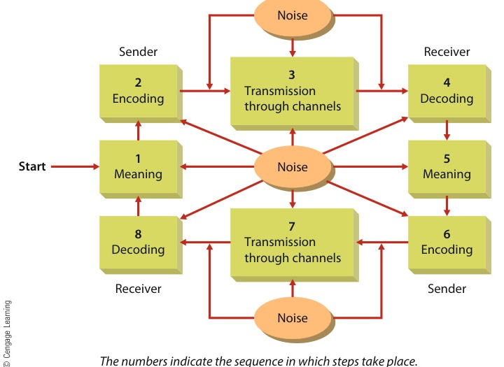
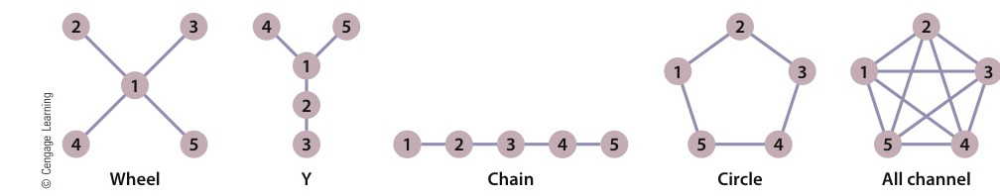
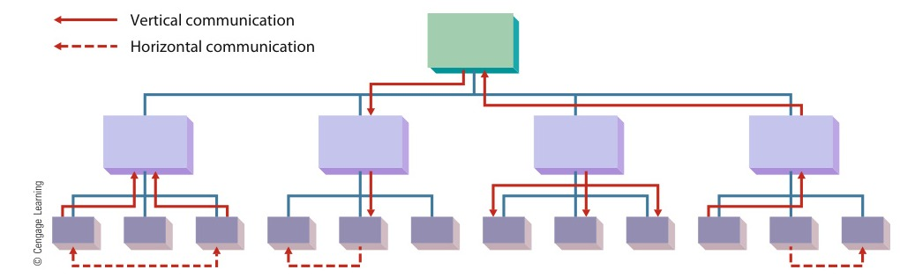
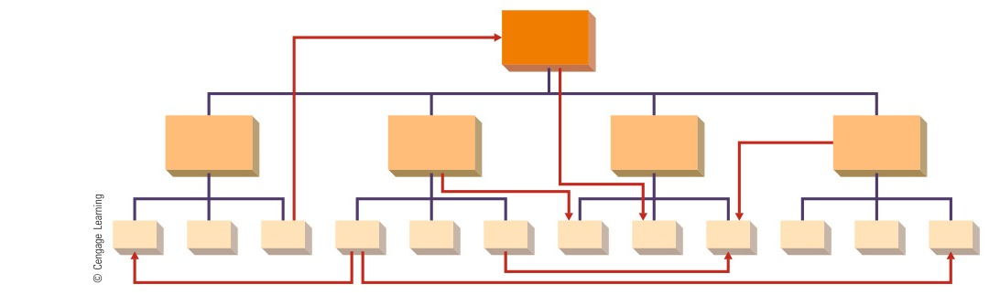
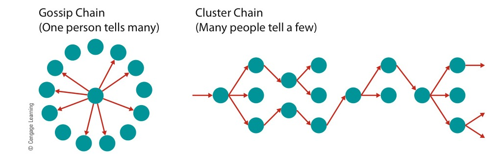
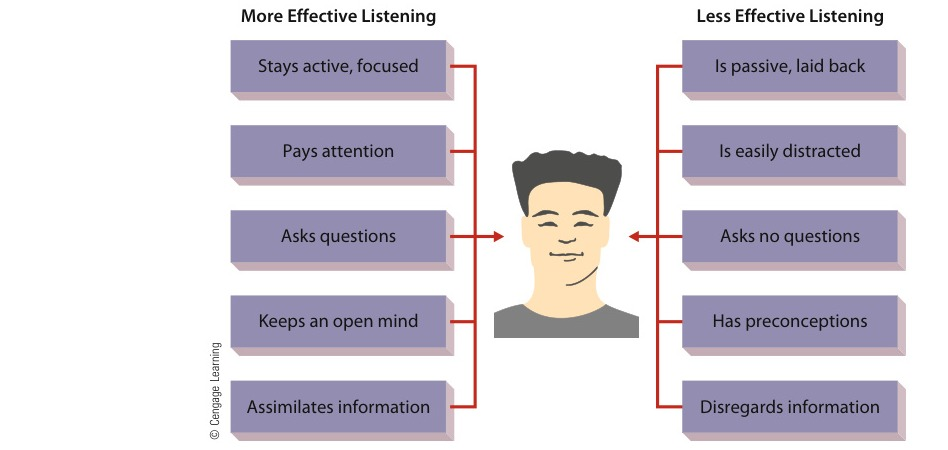

# CHAPTER 12: Communication in Organizations

<!-- Page 390 -->

CHAPTER 12Communication inOrganizations

Learning Outcomes

After studying this chapter, you should be able to:

1Describe the role and importance of communication in the manager’s job.

2Identify the basic forms of communication in organizations.

3Describe the role of digital communication in organizations.

4Discuss informal communication, including its various forms and types.

5Describe how the communication process can be managed to recognize and overcome barriers.

Management in Action

¿Qué Pasa in the Ad Agency?

#### “… it’s the current best-in-class companies that are spending more in theHispanic market in an effort to turn around those businesses.”

—AHAA chair Gisela Girard

A recent Toyota television ad: A father is explaining Toyota’s hybrid engineto his son. “[The car] runs on gas and electricity,” he says. “Mira. Miraaquí. [Look. Look here.] It uses both.” The son replies, “Like you, withEnglish and Spanish.” “Sí,” replies the father.

As the makeup of U.S. society changes, organizations have realized that theyneed to change the ways in which they communicate with diverse customerbases. It might come as something of a surprise, but this Toyota TV spotreflects a virtually revolutionary change in the way American companiesaddress potential buyers from different cultures. Once, for example, theyassumed that Hispanics living in the United States were immigrants, spoke noEnglish, and clung to old-world values. Today, however, they’re well aware ofthe fact that over half of the country’s 50 million Hispanics were born in thiscountry. Like the father and son in Toyota’s depiction of Hispanic life, mostSpanish speakers know English and mix elements not only of both languagesbut also of both U.S. and Latino culture. “This group is not about nostalgia for thehome country,” says Jaime Fortuño, managing partner of Azafrán, a New York–based ad agency.There was also a time when advertisers relied on mainstream ads—ads aimedat the center of the market where they expected to find the “typical” consumer.

<!-- Page 391 -->

Most businesses today recognize that they must have the capability to communicate withcustomers, employees, and other stakeholders in multiple languages. This automobiledealer is conversing with a customer in Spanish.

But as the purchasing power of minorities has increased, companies have putmore energy into developing targeted ads—ads aimed at specific groups ofconsumers and often delivered through language-targeted media. Today, forexample, a corporation thinks nothing of budgeting $100 million a year forHispanic-themed ads. Since 2004, about one-third of ads targeted to Hispanicshave been presented in Spanish, and that proportion is growing—for goodreason. The buying power of Hispanics grew from $490 billion in 2000 to$1 trillion in 2010—a rate of 108 percent over the decade (compared to a49 percent rate for the majority market). By 2015, Hispanic buying power will hit$1.5 trillion and will account for 11 percent of the national total.Although advertising slumped across the board in 2008 and 2009, the declinein Spanish-language media was more moderate than in the industry as a whole.And although Spanish-language advertising in 2009 was down from 2008, theAssociation of Hispanic Advertising Agencies (AHAA) reports a rebound in 2010,especially among its “best-in-class” Spanish-language advertisers—those thatallocate more than 11.8 percent of their ad budgets to Hispanic audiences. “Our2009 report,” says AHAA chair Gisela Girard, “revealed that many corporations‘don’t get it,’ [but] our 2010 … findings indicate that it’s the current best-in-classcompanies that are spending more in the Hispanic market in an effort to turnaround those businesses.”

An ad for Southwest Airlines: A virile young Hispanic rollerblades up to aparked car to admire his image in the tinted window. The windowunexpectedly rolls down to reveal two men inside the car who are alsoadmiring him. “Want to get away?” reads the punchline, which is followedby a low airfare price.

<!-- Page 392 -->

“In advertising,” observes Juan Pablo Oubiña, art director at Grupo Gallegos,an LA-area agency, “it’s not easy to be different. It takes ten times as muchwork.” And getting the language right isn’t really the hardest part of makingSpanish-language ads. Like the Southwest ad from the Hispanic-owned agencyDieste Harmel & Partners, many of the latest-vintage Spanish-language ads havesucceeded in appealing to Hispanic audiences by playing with and againststereotypes, but as one Hispanic marketing consultant observes, it’s a trickybalancing act. “Not only are Americans comfortable with positive stereotypes asa means to be politically correct,” says Jennifer Woodard, “but so are manyHispanics.” The problem of stereotyping, she reminds us, is usually twofold:Advertisers tend to rely on stereotypes because they assume that they’resomehow reflective of the mainstream, and the consumers being stereotypedtend to settle for stereotypes because they dominate the images of themselvesthat are available to them in the media.

An ad for Fox Sports Net: Returning home from a shopping trip, a Hispanicwoman detects an unpleasant odor in the house. The camera pursues her asshe follows her nose from room to room until she reaches the living room,where she realizes that her husband is so thoroughly immersed in atelevised soccer game that he’s been watching through the open door of anearby toilet.

This ad—a Grupo Gallegos creation—does a good job of playing with andagainst stereotypes because it bounces off the stereotype of the soccer-obsessedLatino in what Woodard describes as “a great example of taking a slice of lifefrom a husband and wife, no matter the culture, and pushing the ad intoentertainment.”Contrastthisad,however,withthefarmorecommonappropriation of the same stereotype in TV advertising aimed at Hispanics.Advertising agency executive Tommy Thompson thinks that far too many adstargeted at Hispanic viewers use soccer as a connecting point. “What does soccerhave to do with life insurance?” he argues. “Are there really no other insights asrelates to Hispanics’ need for life insurance that can be communicated withoutsoccer?” Thompson, founder and president of Dallas-based iNSPIRE!, argues thatadvertisersshouldfocuslessonplayingtostereotypesandmoreonunderstanding the cultures being targeted.It’s advice that Gallegos put to good use in an ad for Energizer batteries.Gallegos was originally given the task of making the brand “iconic” for Hispanicconsumers—giving it immediately familiar symbolic value so that Spanishspeakers would think of perpetual motion and say “como el conejito Energizer”the same way that English speakers think of perpetual motion and say “like theEnergizer bunny.” At Grupo Gallegos, however, brainstorming on a new accountalways starts with “Okay, aquí está el problema que tenemos when we really startlooking at the brand,” and the Gallegos team realized early on that mostHispanics don’t associate batteries with perpetual motion (or anything else): Forthem, a battery is a battery. So Gallegos came up with an ad in which a Mexicanman walks down the street and shares his realization that he’s immortal—whereupon a two-story commercial sign falls on his head. Among other things,he observes, being immortal means that you need a very long-lasting battery foryour camera.1

<!-- Page 393 -->

> **communication**: The process of transmitting information from one person to another

> effectivecommunicationThe process ofsending a messagein such a way that themessage received isas close in meaningas possible to themessage intended

> **data**: Raw figures and facts reflecting a single aspect of reality

> **information**: Data presented in a way or form that has meaning

Businesses continue to look for effective ways to communicate with their customers,employees, job seekers, customers, and investors. Adopting multiple languages is oneincreasingly common method for getting messages to different stakeholders. Communi-cation has always been a vital part of managerial work. Indeed, managers around theworld agree that communication is one of their most important tasks. It is importantfor them to communicate with others to convey their vision and goals of the organiza-tion. And it is important for others to communicate with them so that they will betterunderstand what is going on in their environment and how they and their organizationcan become more effective.This chapter discusses communication, one of the most basic forms of interactionamong people. We begin by examining communication in the context of the manager’sjob. We then identify and discuss forms of interpersonal, group, and organizational com-munication. After discussing informal means of communication, we describe how orga-nizational communication can be effectively managed.

## COMMUNICATION AND THE MANAGER’S JOB

A typical day for a manager includes doing desk work, attending scheduled meetings,placing and receiving phone calls, reading and answering correspondence (both printand electronic), attending unscheduled meetings, and making tours.2 Most of theseactivities involve communication. In fact, managers usually spend over half their timeon some form of communication. Communication always involves two or more people,so other behavioral processes, such as motivation, leadership, and group and team inter-actions, all come into play. Top executives must handle communication effectively if theyare to be true leaders.

### A Definition of Communication

Imagine three managers working in an office building. The first is all alone but is never-theless yelling for a subordinate to come help. No one appears, but he continues to yell.The second is talking on the phone to a subordinate, but a poor network connectioncauses the subordinate to misunderstand some important numbers being provided bythe manager. As a result, the subordinate sends 1,500 crates of eggs to 150 Fifth Street,when he should have sent 150 crates of eggs to 1500 Fifteenth Street. The third manageris talking in her office with a subordinate who clearly hears and understands what isbeing said. Each of these managers is attempting to communicate, but with differentresults.

Communication is the process of transmitting information from one person toanother.3 Did any of our three managers communicate? The last did, and the first didnot. How about the second? In fact, she did communicate. She transmitted information,and information was received. The problem was that the message transmitted and themessage received were not the same. The words spoken by the manager were distortedby static and noise. Effective communication, then, is the process of sending a messagein such a way that the message received is as close in meaning as possible to the mes-sage intended. Although the second manager engaged in communication, it was noteffective.A key element in effective communication is differentiating between data and informa-tion. Data are raw figures and facts reflecting a single aspect of reality. The facts that aplant has 35 machines, that each machine is capable of producing 1,000 units of output perday, that current and projected future demand for the units is 30,000 per day, and thatworkers sufficiently skilled to run the machines make $20 an hour are data. Information,

<!-- Page 394 -->

> accurateinformationProvides a valid andreliable reflection ofreality

> timely informationAvailable in time forappropriatemanagerial action

> completeinformationProvides themanager with all theinformation that heor she needs

meanwhile, is data presented in a way or form that has meaning.4 Thus, combining andsummarizing the four pieces of data just given provides information: The plant has excesscapacity and is therefore incurring unnecessary costs. Information has meaning to a man-ager and provides a basis for action. The plant manager might use the information anddecide to sell four machines (perhaps keeping one as a backup) and transfer five operatorsto other jobs.

### Characteristics of Useful Information

What characteristics make the difference between information that is useful and infor-mation that is not useful? In general, information is useful if it is accurate, timely, com-plete, and relevant.

#### Accurate

For information to be of real value to a manager, it must be accurateinformation. Accuracy means that the information must provide a valid and reliablereflection of reality. One of the first major mergers between a traditional bricks-and-mortar business and a dot-com business took place when Time Warner, an old-linemedia conglomerate, merged with AOL, one of the biggest dot-com businesses at thetime. Unfortunately, it soon became clear that the value of AOL had been inflated byimproper accounting practices and revenue overstatements. It was no surprise, then, thatthe new firm struggled to develop a unified strategy and culture while enduring multiplegovernment investigations and write-downs of corporate assets. Finally, Time Warner soldits AOL division in 2009.5

#### Timely

Information also needs to be timely. Timeliness does not necessarily meanspeediness; it means only that information needs to be available in time for appropriatemanagerial action. What constitutes timeliness is a function of the situation facing themanager. When Marriott was gathering information for a new hotel project, managersallowed themselves a six-month period for data collection. They felt this would givethem an opportunity to do a good job of getting the information they needed while notdelaying things too much. In contrast, Marriott’s reservation and accounting systems canprovide a manager today with last night’s occupancy level at any Marriott facility. UnitedAirlines once filed for bankruptcy protection while it restructured its finances. Severalyears later, an error led a South Florida newspaper to post an old story about the earlierfiling on its website in a way that made it appear as a current event. The resulting panicamong investors caused United Airlines shares to drop from $12.50 a share to less than$3 a share before the error was caught and corrected.6

#### Complete

Information must tell a complete story for it to be useful to a manager. If itis less than complete information, the manager is likely to get an inaccurate or dis-torted picture of reality. For example, managers at Kroger used to think that house-brand products were more profitable than national brands because they yielded higherunit profits. On the basis of this information, they gave house brands a great deal ofshelf space and centered promotional activities around them. As Kroger’s managersbecame more sophisticated in understanding their information, however, they realizedthat national brands were actually more profitable over time because they sold manymore units than house brands during any given period of time. Hence, although astore might sell 10 cans of Kroger coffee in a day, with a profit of 50 cents per can(total profit of $5), it would sell 15 cans of Maxwell House with a profit of 40 centsper can (total profit of $6) and 10 vacuum bags of Starbucks coffee with a profit of$1 per bag (total profit of $10). With this more complete picture, managers could doa better job of selecting the right mix of Kroger, Maxwell House, and Starbucks coffeeto display and promote.

<!-- Page 395 -->

> relevantinformationInformation that isuseful to managersin their particularcircumstances fortheir particular needs

#### Relevant

Finally, information must be relevant if it is to be useful to managers.Relevant information, like timely information, is defined according to the needs andcircumstances of a particular manager. Operations managers need information on costsand productivity, human resource managers need information on hiring needs andturnover rates, and marketing managers need information on sales projections and adver-tising rates. As Walmart contemplates countries as possible expansion opportunities, itgathers information about local regulations, customs, and so forth. But the informationabout any given country is not as relevant before a decision is made to enter that marketthan it is after the firm has made a decision to enter the market.

### The Communication Process

Figure 12.1 illustrates how communication generally takes place between people. Theprocess of communication begins when one person (the sender) wants to transmit afact, idea, opinion, or other information to someone else (the receiver). This fact, idea,or opinion has meaning to the sender, whether it is simple and concrete or complex andabstract.The next step is to encode the meaning into a form appropriate to the situation. Theencoding might take the form of words, facial expressions, gestures, or even artisticexpressions and physical actions. After the message has been encoded, it is transmittedthrough the appropriate channel or medium. The channel by which this encoded

The numbers indicate the sequence in which steps take place.

*Figure 12.1 — The Communication Process (Source: Page 395)*

As the figure shows, noise can disrupt the communication process at any step.Managers must therefore understand that a conversation in the next office, a faxmachine out of paper, and the receiver’s smartphone being out of service may allthwart the manager’s best attempts to communicate.

<!-- Page 396 -->

> **oral communication**: Face-to-face conversation, group discussions, telephone calls, and other circumstances in which the spoken word is used to transmit meaning

> writtencommunicationMemos, letters,reports, notes, andother circumstancesin which the writtenword is used totransmit meaning

message is being transmitted to you is the printed page. Common channels in organiza-tions include meetings, e-mails, memos, letters, reports, and phone calls. After themessage is received, it is decoded back into a form that has meaning for the receiver.As noted earlier, the consistency of this meaning can vary dramatically. In many cases,the meaning prompts a response, and the cycle is continued when the same steps areused to send a new message back to the original sender.“Noise” may disrupt communication anywhere along the way. Noise can be the soundof someone coughing, a loud truck driving by, or two people talking close at hand. It canalso include disruptions such as a letter lost in the mail, a dropped cell phone call, ane-mail misrouted or infected with a virus, or one of the participants in a conversationbeing called away before the communication process is completed.

## FORMS OF COMMUNICATION IN ORGANIZATIONS

Managers need to understand several kinds of communication that are common in orga-nizations today.7 These include interpersonal communication, communication in net-works and work teams, organizational communication, and electronic communication.

### Interpersonal Communication

Interpersonal communication generally takes one of two forms: oral and written. As wewill see, each has clear strengths and weaknesses.

#### Oral Communication

Oral communication takes place in conversations, groupdiscussions, phone calls, and other situations in which the spoken word is used toexpress meaning. One study (conducted before the advent of e-mail) demonstrated theimportance of oral communication by finding that most managers spent between50 and 90 percent of their time talking to people.8 Oral communication is so prevalentfor several reasons. The primary advantage of oral communication is that it promotesprompt feedback and interchange in the form of verbal questions or agreement, facialexpressions, and gestures. Oral communication is also easy (all the sender needs to dois talk), and it can be done with little preparation (though careful preparation is advis-able in certain situations). The sender does not need pencil and paper, a computer, orother equipment. In another survey, 55 percent of the executives sampled felt that theirown written communication skills were fair or poor, so they chose oral communicationto avoid embarrassment!9

However, oral communication also has drawbacks. It may suffer from problems ofinaccuracy if the speaker chooses the wrong words to convey meaning or leaves out per-tinent details, if noise disrupts the process, or if the receiver forgets part of the mes-sage.10 In a two-way discussion, there is seldom time for a thoughtful, consideredresponse or for introducing many new facts, and there is no permanent record of whathas been said. In addition, although most managers are comfortable talking to peopleindividually or in small groups, fewer enjoy speaking to larger audiences.11

#### Written Communication

“Putting it in writing” in a letter, report, memorandum,handwritten note, or e-mail can solve many of the problems inherent in oral communica-tion. Nevertheless, and perhaps surprisingly, written communication is not as common asone might imagine, nor is it a mode of communication much respected by managers. Onesample of managers indicated that only 13 percent of the printed mail they received was ofimmediate use to them.12 Over 80 percent of the managers who responded to another sur-vey indicated that the written communication they received was of fair or poor quality.13

<!-- Page 397 -->

> communicationnetworkThe pattern throughwhich the membersof a groupcommunicate

The biggest single drawback of traditional forms of written communication is thatthey inhibit feedback and interchange. When one manager sends another manager a let-ter, it must be written or dictated, typed, mailed, received, routed, opened, and read. Ifthere is a misunderstanding, it may take several days for it to be recognized, let alonerectified. Although the use of e-mail, texts, or instant messaging is, of course, much fas-ter, both sender and receiver must still have access to a computer or smartphone, andthe receiver must open and read the message for it to actually be received. A phone callcould settle the whole matter in just a few minutes. Thus, written communication ofteninhibits feedback and interchange and is usually more difficult and time consuming thanoral communication.Of course, written communication offers some advantages. It is often quite accurateand provides a permanent record of the exchange. The sender can take the time to col-lect and assimilate the information and can draft and revise it before it is transmitted.The receiver can take the time to read it carefully and can refer to it repeatedly, asneeded. For these reasons, written communication is generally preferable when impor-tant details are involved. At times, it is important to one or both parties to have a writtenrecord available as evidence of exactly what took place. Julie Regan, founder of Toucan-Do, an importing company based in Honolulu, relies heavily on formal business lettersin establishing contacts and buying merchandise from vendors in Southeast Asia. Shebelieves that such letters give her an opportunity to carefully think through what shewants to say, tailor her message to each individual, and avoid later misunderstandings.

#### Choosing the Right Form

Which form of interpersonal communication should themanager use? The best medium is determined by the situation. Oral communication ore-mail or text may be preferred when the message is personal, nonroutine, and brief.More formal written communication is usually best when the message is more imper-sonal, routine, and longer. And, given the prominent role that e-mails have playedin several recent court cases, managers should always use discretion when sendingmessages electronically.14 For example, private e-mails made public during legalproceedings have played major roles in litigation involving Enron, Tyco, WorldCom,and Morgan Stanley.15

The manager can also combine media to capitalize on the advantages of each. Forexample, a quick phone call to set up a meeting is easy and gets an immediate response.Following up the call with a reminder e-mail or handwritten note helps ensure that therecipient will remember the meeting, and it provides a record of the meeting having beencalled. Digital communication, discussed more fully later in this chapter, blurs the differ-ences between oral and written communication and can help each be more effective.

### Communication in Networks and Work Teams

Although communication among team members in an organization is clearly interper-sonal in nature, substantial research also focuses specifically on how people in networksand work teams communicate with one another. A communication network is the pat-tern through which the members of a group or team communicate. Researchers studyinggroup dynamics have discovered several typical networks in groups and teams consistingof three, four, and five members. Representative networks among members of five-member teams are shown in Figure 12.2.16

In the wheel pattern, all communication flows through one central person, who isprobably the group’s leader. In a sense, the wheel is the most centralized networkbecause one person receives and disseminates all information. The Y pattern is slightlyless centralized—two people are close to the center. The chain offers a more even flowof information among members, although two people (the ones at each end) interact

<!-- Page 398 -->

*Figure 12.2 — Types of Communication Networks (Source: Page 398)*

> verticalcommunicationCommunication thatflows up and downthe organization,usually along formalreporting lines; takesplace betweenmanagers and theirsuperiors andsubordinates andmay involve severaldifferent levels of theorganization

Types of Communication Networks

Research on communication networks has identified five basic networks for five-person groups. Thesenetworks vary in terms of information flow, position of the leader, and effectiveness for different types oftasks. Managers might strive to create centralized networks when group tasks are simple and routine.Alternatively, managers can foster decentralized groups when group tasks are complex and nonroutine.

with only one other person. This path is closed in the circle pattern. Finally, the all-channel network, the most decentralized, allows a free flow of information among allgroup members. Everyone participates equally, and the group’s leader, if there is one, isnot likely to have excessive power.Research conducted on networks suggests some interesting connections between thetype of network and group performance. For example, when the group’s task is relativelysimple and routine, centralized networks tend to perform with greatest efficiency andaccuracy. The dominant leader facilitates performance by coordinating the flow of infor-mation. When a group of accounting clerks is logging incoming invoices and distributingthem for payment, for example, one centralized leader can coordinate things efficiently.When the task is complex and nonroutine, such as making a major decision about organi-zational strategy, decentralized networks tend to be most effective because open channelsof communication permit more interaction and a more efficient sharing of relevant infor-mation. Managers should recognize the effects of communication networks on group andorganizational performance and should try to structure networks appropriately.

### Organizational Communication

Still other forms of communication in organizations are those that flow among andbetween organizational units or groups. Each of these involves oral or written communi-cation, but each also extends to broad patterns of communication across the organiza-tion.17 As shown in Figure 12.3, two of these forms of communication follow verticaland horizontal linkages in the organization.

#### Vertical Communication

Vertical communication is communication that flows upand down the organization, usually along formal reporting lines—that is, it is the com-munication that takes place between managers and their superiors and subordinates.Vertical communication may involve only two people, or it may flow through severaldifferent organizational levels.Upward communication consists of messages from subordinates to superiors. Thisflow is usually from subordinates to their direct superior, then to that person’s directsuperior, and so on up the hierarchy. Occasionally, a message might bypass a particularsuperior. The typical content of upward communication is requests, information that thelower-level manager thinks is of importance to the higher-level manager, responses torequests from the higher-level manager, suggestions, complaints, and financial informa-tion. Research has shown that upward communication is more subject to distortion than

<!-- Page 399 -->

*Figure 12.3 — Formal Communication in Organizations (Source: Page 399)*

> horizontalcommunicationCommunication thatflows laterally withinthe organization;involves colleaguesand peers at thesame level of theorganization andmay involveindividuals fromseveral differentorganizational units

Formal Communication in Organizations

Formal communication in organizations follows official reporting relationships or prescribed channels. Forexample, vertical communication, shown here with solid lines, flows between levels in the organization andinvolves subordinates and their managers. Horizontal communication, shown with dashed lines, flowsbetween people at the same level and is usually used to facilitate coordination.

downward communication. Subordinates are likely to withhold or distort information thatmakes them look bad. The greater the degree of difference in status between superior andsubordinate and the greater the degree of distrust, the more likely the subordinate is tosuppress or distort information.18 For example, subordinates might choose to withholdinformation about problems from their boss if they think the news will make him angryand if they think they can solve the problem themselves without his knowledge.Downward communication occurs when information flows down the hierarchy fromsuperiors to subordinates. The typical content of these messages is directives on howsomething is to be done, the assignment of new responsibilities, performance feedback,and general information that the higher-level manager thinks will be of value to thelower-level manager. Vertical communication can and usually should be two-way innature. In other words, give-and-take communication with active feedback is generallylikely to be more effective than one-way communication.19

#### Horizontal Communication

Whereas vertical communication involves a superiorand a subordinate, horizontal communication involves colleagues and peers at thesame level of the organization. For example, an operations manager might communicateto a marketing manager that inventory levels are running low and that projected deliverydates should be extended by two weeks. Horizontal communication probably occursmore among managers than among nonmanagers.This type of communication serves a number of purposes.20 It facilitates coordinationamong interdependent units. For example, a manager at Motorola was once researchingthe strategies of Japanese semiconductor firms in Europe. He found a great deal of infor-mation that was relevant to his assignment. He also uncovered some additional informa-tion that was potentially important to another department, so he passed it along to acolleague in that department, who used it to improve his own operations. Horizontalcommunication can also be used for joint problem solving, as when two plant managersat Northrop Grumman got together to work out a new method to improve productivity.Finally, horizontal communication plays a major role in work teams with membersdrawn from several departments.

<!-- Page 400 -->

> informationtechnology (IT)The resources usedby an organization tomanage informationthat it needs to carryout its mission

> transaction-processing systems(TPSs)An application ofinformationprocessing for basicday-to-day businesstransactions

> managementinformationsystems (MISs)An informationsystem that supportsan organization’smanagers byproviding dailyreports, schedules,plans, and budgets

> decision supportsystems (DSSs)An interactivesystem that locatesand presentsinformation neededto support thedecision-makingprocess

### Digital Communication

An increasingly important form of organizational communication relies on digital com-munication technology. Information technology (IT) consists of the resources used byan organization to manage information that it needs to carry out its mission. IT mayconsist of computers, computer networks, telephones, fax machines, smartphones, andother pieces of hardware. In addition, IT involves software that facilitates the system’sability to manage information in a way that is useful for managers. Both formal informa-tion systems and personal information technology have reshaped how managers commu-nicate with one another. The Tough Times, Tough Choices feature, The Brutally-Honest-Opinion Business, shows how some corporations are making use of blogs, oneform of digital electronic communication.

#### Information Systems

Advances in IT have made it increasingly easy for managers touse many different kinds of information systems. In this section, we discuss the mostcommon kinds of information systems used by businesses today.

Transaction-processing systems (TPSs) are applications of information processingfor basic day-to-day business transactions. Customer order taking by online retailers,approval of claims at insurance companies, receipt and confirmation of reservations byairlines, payroll processing and bill payment at almost every company—all are routinebusiness processes. Typically, the TPS for first-level (operational) activities is welldefined, with predetermined data requirements, and follows the same steps to completeall transactions in the system.Systems for knowledge workers and office applications support the activities of bothknowledge workers and employees in clerical positions. They provide assistance for dataprocessing and other office activities, including the creation of communications docu-ments. Like other departments, the information systems (IS) department includes bothknowledge workers and data workers. Systems for operations and data workers make surethat the right programs are run in the correct sequence, and they monitor equipment toensure that it is operating properly. Many organizations also have employees who enterdata into the system for processing. Knowledge-level and office systems are also increasinglywidespread. The widespread availability of text processing, document imaging, desktoppublishing, computer-aided design, simulation modeling, and similar tools has increasedthe productivity of both knowledge and office workers. Desktop publishing combinesgraphics and word-processing text to publish professional-quality print and web docu-ments. Document-imaging systems can scan paper documents and images, convert theminto digital form, store them, retrieve them, manipulate them, and/or transmit them toworkstations throughout the network, all without generating any additional paper.

Management information systems (MISs) support an organization’s managers byproviding daily reports, schedules, plans, and budgets. Each manager’s information activ-ities vary according to his or her functional area (say, accounting or marketing) andmanagement level. Whereas midlevel managers focus mostly on internal activities andinformation, higher-level managers are also engaged in external activities. Middle man-agers, the largest MIS user group, need networked information to plan upcoming activi-ties such as personnel training, materials movements, and cash flows. They also need toknow the current status of the jobs and projects being carried out in their department: Whatstage is it at now? When will it be finished? Is there an opening so we can start the next job?Many of a firm’s MISs—cash flow, sales, production scheduling, and shipping—areindispensable in helping managers find answers to such questions.

Decision support systems (DSSs) are interactive systems that locate and presentinformation needed to support the decision-making process. Whereas some DSSs aredevoted to specific problems, others serve more general purposes, allowing managers to

<!-- Page 401 -->

> © Alexey Boldin/Shutterstock.com

> ### TOUGH TIMES, TOUGH CHOICES: The Brutally-Honest-Opinion Business
> 
> Blogs have emerged as an extraordinary medium for corporate communication. They allow employees, customers, and industry observers to connect, to share thoughts, and for some readers, professionally (or semiprofessionally) posted blogs actually supplement or replace traditional news media. Blogs can also be brutally honest.
> 
> For companies, this transparency is a double-edged sword. On one hand, internal blogs allow senior leaders to bypass corporate filters and communicate directly with staff. On the other hand, disgruntled employees or critical consumers can instantly broadcast damaging grievances to a global audience.
> 
> When consumer complaints went viral on social media, Domino's Pizza faced a PR crisis. Instead of issuing defensive press releases, CEO Patrick Doyle launched a brutally candid multimedia campaign acknowledging that customers disliked the old recipe, and showed company chefs redesigning the pizza from scratch. The campaign turned around brand perception and ignited dramatic sales growth.
> 
> • How does blogging change the traditional gatekeeping role of corporate communications?
> • Under what circumstances should a manager respond directly to negative online posts?

<!-- Page 402 -->

> executive supportsystem (ESS)A quick-reference,easy-accessapplication ofinformation systemsspecially designedfor instant access byupper-levelmanagers

> artificial intelligence(AI)The construction ofcomputer systems,both hardware andsoftware, to imitatehuman behavior—that is, to performphysical tasks, usethought processes,and learn

TOUGH TIMES, TOUGH CHOICES (Continued)

more than 1.6 million posts per day, or morethan 18 updates a second.

With a survey list of nearly 20 million blogs anda 10 percent share, Umbria is actually a fairlysmall player in the blog-research market. Largercompetitors in the $20 million market includeIntelliseek, with about a third of the market, andBuzz Metrics, which doesn’t reveal how muchbusiness it does. There appears to be room formorecompetitors, however.AccordingtothesearchengineTechnorati,thereareatleast112.8 million blogs out there (not counting another72.8 million in China), with about 175,000 newblogs popping up every day. Bloggers put up

References: Matthew Boyle, “Do’s and Don’ts of Corpo-rate Blogging,” Fortune, http://money.cnn.com, accessedon January 1, 2014; Justin Martin, “What Bloggers ThinkofYourBusiness,”Fortune,http://money.cnn.com,accessed on January 1, 2014; Anne Helmond, “HowMany Blogs Are There? Is Someone Still Counting?” TheBlog Herald, www.blogherald.com, accessed on January 1,2014; and Adam Thierer, “Need Help … How Many BlogsAre There Out There?” The Technology Liberation Front,http://tech liberation.com, accessed on January 1, 2014.

analyze different types of problems. Thus, a firm that often faces decisions on plantcapacity, for example, may have a capacity DSS: The manager inputs data on anticipatedlevels of sales, working capital, and customer delivery requirements. Then the DSS’sbuilt-in transaction processors manipulate the data and make recommendations on thebest levels of plant capacity for each future time period. In contrast, a general-purposesystem, such as a marketing DSS, might respond to a variety of marketing-related pro-blems. It may be programmed to handle “What if … ?” questions, such as “When is thebest time to introduce a new product if my main competitor introduces one in 3 months,our new product has an 18-month expected life, demand is seasonal with a peak inautumn, and my goal is to gain the largest possible market share?” The DSS can helpmanagers make decisions for which predetermined solutions are unknown by usingsophisticated modeling tools and data analysis.An executive support system (ESS) is a quick-reference, easy-access application ofinformation systems specially designed for instant access by upper-level managers. ESSsare designed to assist with executive-level decisions and problems, ranging from “Whatlines of business should we be in five years from now?” to “Based on forecasted develop-ments in digital technologies, to what extent should our firm be globalized in five years?In ten years?” The ESS also uses a wide range of both internal information and externalsources, such as industry reports, global economic forecasts, and reports on competitors’capabilities. Because senior-level managers do not usually possess advanced computerskills, they prefer systems that are easily accessible and adaptable. Accordingly, ESSs arenot designed to address only specific, predetermined problems. Instead, they allow theuser some flexibility in attacking a variety of problem situations. They are easily accessi-ble by means of simple keyboard strokes or even voice commands.

Artificial intelligence (AI) can be defined as the construction of computer systems,both hardware and software, to imitate human behavior—in other words, systems thatperform physical tasks, use thought processes, and learn. In developing AI systems,knowledge workers (business specialists, modelers, and IT experts) try to designcomputer-based systems capable of reasoning, so that computers, instead of people, canperform certain business activities. One simple example is a credit evaluation system thatdecides which loan applicants are creditworthy and which ones are risky and thencomposes acceptance and rejection letters accordingly. One special form of AI, the expertsystem, is designed to imitate the thought processes of human experts in a particularfield. Expert systems incorporate the rules that an expert applies to specific types of

<!-- Page 403 -->

> intranetsA communicationnetwork similar tothe Internet butoperating within theboundaries of asingle organization

> extranetsA communicationnetwork that allowsselected outsiderslimited access to anorganization’sinternal informationsystem, or intranet

> AP Images/Ariel Schalit

problems, such as the judgments a physician makes in diagnosing illnesses. In effect,expert systems supply everyday users with “instant expertise.” A system called mainte-nance operations center advisor (MOCA), by imitating the thought processes of a main-tenance manager, schedules routine maintenance for American Airlines’s entire fleet.

Intranets, or private Internet networks, are accessible only to employees via entrythrough electronic firewalls. Firewalls are used to limit access to an intranet. Ford’s intra-net connects over 100,000 workstations in Asia, Europe, and the United States to thou-sands of Ford websites containing private information on Ford activities in production,engineering, distribution, and marketing. Sharing such information has helped reducethe lead time for getting models into production from 36 to 24 months. Ford’s latestproject in improving customer service through internal information sharing is calledmanufacturing on demand. Now, for example, the Mustang that required 50 days’ deliv-ery time in 1996 is available in fewer than 2 weeks. The savings to Ford, of course, willbe billions of dollars in inventory and fixed costs.

Extranets allow outsiders limited access to a firm’s intranet. The most common appli-cation allows buyers to enter the seller’s system to see which products are available forsale and delivery, thus providing product availability information quickly to outsidebuyers. Industrial suppliers, too, are often linked into their customers’ intranets so thatthey can see planned production schedules and make supplies ready as needed forcustomers’ upcoming operations.

#### Personal Digital Technology

In recent years, the nature of organizational communi-cation has changed dramatically, mainly because of breakthroughs in personal electroniccommunication technology, and the future promises even more change. It has becomecommon, for instance, to have teleconferences in which managers stay at their own loca-tion (such as offices in different cities) but are seen on monitors as they “meet.” A man-ager in New York can keyboard a letter or memorandum at her personal computer, pointand click with a mouse, and have it delivered to hundreds or even thousands of colleaguesaround the world in a matter of seconds. Highly detailed information can be retrieved withease from large electronic databanks. This hasgiven rise to a new version of an old workarrangement—the cottage industry. In a cottageindustry, people work at home (in their “cottage”)and periodically bring the products of theirlabors in to the company. Telecommuting is thelabel given to a new digital cottage industry. Intelecommuting, people work at home on theircomputers and communicate with colleaguesand coworkers using electronic media.Smartphones have made it even easier formanagers to communicate with one another.Many now use such phones to make callswhile commuting to and from work and carrythem in their briefcases so that they can receivecalls while at lunch. In addition, of course, theycan also send and receive documents and otherinformation. And related personal computingdevices such as the iPad are revolutionizinghow people communicate with one another.Wi-Fi technology is further extending theimpact of these devices.

Personal digital technology continues to change the way peoplecommunicate. Take this unusual image, for example. Tourists innorthern Israel can ride Wi-Fi–outfitted donkeys and use iPads orsimilar devices to see biblical reenactments as they ride through OldTestament landscapes. Visitors can then like, share, or snap theirexperiences instantly to their friends around the world.

<!-- Page 404 -->

> **grapevine**: An informal communication network among people in an organization.

> **management by wandering around**: An approach to communication that involves the manager’s literally wandering around and having spontaneous conversations with others.

## INFORMAL COMMUNICATION IN ORGANIZATIONS

Informal communication in organizations consists of interpersonal communication that takes place outside the formal structure. It arises from the informal organization and spontaneous interpersonal interactions.

*Figure 12.4 — Informal Communication in Organizations (Source: Page 404)*

Psychologists, however, are beginning to associate some problems with these communication advances. For one thing, managers who are seldom in their “real” office are likely to fall behind in their field and to be victimized by organizational politics because they are not present to protect their interests. For another, electronic communication reduces the nonverbal cues that are crucial in high-stakes negotiations.

<!-- Page 405 -->

*Figure 12.5 — Common Grapevine Chains Found in Organizations (Source: Page 405)*

The two most common grapevine chains in organizations are the gossip chain (in which one person communicates messages to many others) and the cluster chain (in which many people pass messages to a few others).

Research has found that the grapevine is remarkably fast and surprisingly accurate (usually 75 to 95 percent accurate regarding factual components), though it frequently distorts subtle details or motives. Rather than attempting to suppress the grapevine, effective managers monitor it and use formal channels to correct inaccuracies.

<!-- Page 406 -->

> management bywandering aroundAn approach tocommunication thatinvolves themanager literallywandering aroundand havingspontaneousconversations withothers

> nonverbalcommunicationAny communicationexchange that doesnot use words oruses words tocarry more meaningthan the strictdefinition of thewords themselves

ill-informed or contain incorrect information. Most experts today suggest that firmsdevelop a social media strategy, although many businesses have not yet done this.

### Management by Wandering Around

Another increasingly popular form of informal communication is called, interestinglyenough, management by wandering around.25 The basic idea is that some managerskeep in touch with what is going on by wandering around and talking with people—immediate subordinates, subordinates far down the organizational hierarchy, deliverypeople, customers, or anyone else who is involved with the company in some way. BillMarriott, for example, frequently visits the kitchens, loading docks, and custodial workareas whenever he tours a Marriott hotel. He claims that, by talking with employeesthroughout the hotel, he gets new ideas and has a better feel for the entire company.And, when United Airlines CEO Jeff Smisek travels, he makes a point of talking to flightattendants and other passengers to gain continuous insights into how the business can berun more effectively.A related form of organizational communication that really has no specific term is theinformal interchange that takes place outside the normal work setting. Employees attend-ing the company picnic, playing on the company softball team, or taking fishing tripstogether will almost always spend part of their time talking about work. For example,Texas Instruments (TI) engineers at TI’s Lewisville, Texas, facility often frequent a localbar in town after work. On any given evening, they talk about the Dallas Cowboys, thenewest government contract received by the company, the weather, their boss, thecompany’s stock price, local politics, and problems at work. There is no set agenda, andthe key topics of discussion vary from group to group and from day to day. Still, thesocial gatherings serve an important role. They promote a strong culture and enhanceunderstanding of how the organization works.

### Nonverbal Communication

Nonverbal communication is a communication exchange that does not use words or useswords to carry more meaning than the strict definition of the words themselves. Nonverbalcommunication is a powerful but little-understood form of communication in organizations.It often relies on facial expressions, body movements, physical contact, and gestures. Onestudy found that as much as 55 percent of the content of a message is transmitted by facialexpressions and body posture and that another 38 percent derives from inflection and tone.Words themselves account for only 7 percent of the content of the message.26 The At YourService feature highlights the role of nonverbal communication in service settings.Research has identified three kinds of nonverbal communication practiced bymanagers—images, settings, and body language.27 In this context, images are the kindsof words people elect to use. “Damn the torpedoes, full speed ahead” and “Even thoughthere are some potential hazards, we should proceed with this course of action” mayconvey the same meaning. Yet, the person who uses the first expression may be per-ceived as a maverick, a courageous hero, an individualist, or a reckless and foolhardyadventurer. The person who uses the second might be described as aggressive, forceful,diligent, or narrow minded and resistant to change. In short, our choice of words con-veys much more than just the strict meaning of the words themselves.The setting for communication also plays a major role in nonverbal communication.Boundaries, familiarity, the home turf, and other elements of the setting are all impor-tant. Much has been written about the symbols of power in organizations. The size andlocation of an office, the kinds of furniture in the office, and the accessibility of the per-son in the office all communicate useful information. For example, when H. Ross Perotran Electronic Data Systems (EDS), he positioned his desk so that it is always between

<!-- Page 407 -->

> © Edyta Pawlowska/Shutterstock.com

> ### AT YOUR SERVICE: Say It with a Smile
> 
> Nonverbal communication plays a decisive role in service industries. Research shows that servers who maintain eye contact, smile genuinely, and lightly touch customers on the arm or shoulder receive substantially higher tips than servers who do not.
> 
> In addition, service employees who engage in behavioral mimicry—subtly matching the customer’s rate of speech, vocal inflection, body posture, and facial expressions—create an immediate sense of rapport and psychological comfort. Customers perceive empathetic employees as more competent, attentive, and trustworthy.
> 
> However, forced or synthetic smiles (often called emotional labor) can lead to employee burnout if organizations do not support genuine employee well-being.

<!-- Page 408 -->

> © Wavebreakmedia/Shutterstock.com

him and a visitor. This signaled that he wasin charge. When he wanted a less formaldialogue, he moved around to the front ofthe desk and sat beside his visitor. MichaelDell of Dell Computer, in contrast, has hisdesk facing a side window so that, when heturns around to greet a visitor, there is neveranything between them.A third form of nonverbal communica-tion is body language.28 The distance westand from someone as we speak has mean-ing. In the United States, standing very closeto someone you are talking to generally sig-nals either familiarity or aggression. TheEnglish and Germans stand farther apartthan Americans when talking, whereas theArabs, Japanese, and Mexicans stand closertogether.29 Eye contact is another effectivemeans of nonverbal communication. Forexample,prolongedeyecontactmightsuggest either hostility or romantic interest.Other kinds of body language include bodyand hand movement, pauses in speech, andmode of dress.The manager should be aware of the importance of nonverbal communication andrecognize its potential impact. Giving an employee good news about a reward with thewrong nonverbal cues can destroy the reinforcement value of the reward. Likewise,reprimanding an employee but providing inconsistent nonverbal cues can limit theeffectiveness of the sanctions. The tone of the message, where and how the message isdelivered, facial expressions, and gestures can all amplify or weaken the message orchange the message altogether. E-mails and other digital communication may be misin-terpreted based on actual content, so some people use “emoticons” to reinforce thenotion that the message is “happy” or “sad.”

In addition to smiling, eye contact is another important form of nonverbalcommunication. An unwillingness to maintain eye contact, for instance, maysignal that an individual is hiding information or is being untruthful. Prolonged eyecontact, meanwhile, can have several different meanings. These two executivesare locked in a tough negotiation and may be using eye contact to establish thateach feels strongly about their position and may not be open to compromise.

## MANAGING ORGANIZATIONAL COMMUNICATION

In view of the importance and pervasiveness of communication in organizations, it isvital for managers to understand how to manage the communication process.30 Man-agers should understand how to maximize the potential benefits of communication andminimize the potential problems. We begin our discussion of communication manage-ment by considering the factors that might disrupt effective communication and how todeal with them.

### Barriers to Communication

Several factors may disrupt the communication process or serve as barriers to effectivecommunication.31 As shown in Table 12.1, these may be divided into two classes:individual barriers and organizational barriers.

#### Individual Barriers

Several individual barriers may disrupt effective communica-tion. One common problem is conflicting or inconsistent signals. A manager is sending

<!-- Page 409 -->

### Table 12.1: Barriers to Effective Communication

| Individual Barriers | Organizational Barriers |
| :--- | :--- |
| • Conflicting or inconsistent signals | • Semantics |
| • Credibility about the subject | • Status or power differences |
| • Reluctance to communicate | • Different perceptions |
| • Poor listening skills | • Noise |
| • Predispositions about the subject | • Overload |
| | • Language differences |

*Numerous barriers can disrupt effective communication. Some of these barriers originate within the individual; others originate within the organization.*

<!-- Page 410 -->

### Table 12.2: Overcoming Barriers to Communication

| Individual Skills | Organizational Skills |
| :--- | :--- |
| • Develop good listening skills | • Follow up |
| • Encourage two-way communication | • Regulate information flows |
| • Be aware of language and meaning | • Understand the richness of media |
| • Maintain credibility | |
| • Be sensitive to the receiver’s perspective | |
| • Be sensitive to the sender’s perspective | |

*Because communication is so important, managers have developed several techniques for overcoming barriers to communication.*

<!-- Page 411 -->

*Figure 12.6 — More and Less Effective Listening Skills (Source: Page 411)*

Effective listening skills are a vital part of communication in organizations. Thereare several barriers that can contribute to poor listening skills by individuals inorganizations. Fortunately, there are also several practices for improving listeningskills.

#### Individual Skills

The single most important individual skill for improving commu-nication effectiveness is being a good listener.36 Being a good listener requires that theindividual be prepared to listen, not interrupt the speaker, concentrate on both thewords and the meaning being conveyed, be patient, and ask questions as appropriate.37

Avoiding checking e-mail or texts when someone is talking is also a wise idea. So impor-tant are good listening skills that companies such as Delta, IBM, and Boeing conductprograms to train their managers to be better listeners. Figure 12.6 illustrates the charac-teristics of poor listeners versus good listeners.Because communication is so important, managers have developed several methods ofovercoming barriers to effective communication. Some of these methods involve individ-ual skills, whereas others are based on organizational skills.In addition to being a good listener, several other individual skills can promote effec-tive communication. Feedback, one of the most important, is facilitated by two-waycommunication. Two-way communication allows the receiver to ask questions, requestclarification, and express opinions that let the sender know whether he or she has beenunderstood. In general, the more complicated the message, the more useful is two-waycommunication. In addition, the sender should be aware of the meanings that differentreceivers might attach to various words. For example, when addressing stockholders, amanager might use the word profits often (because most stockholders, of course, seeprofits in a positive light). When addressing labor leaders, however, she may choose touse profits less often (because those individuals might see excessive profit as coming atthe expense of employee welfare).Furthermore, the sender should try to maintain credibility. This can be accomplishedby not pretending to be an expert when one is not, by “doing one’s homework” and

<!-- Page 412 -->

checking facts, and by otherwise being as accurate and honest as possible. The sendershould also try to be sensitive to the receiver’s perspective. A manager who must tell asubordinate that she has not been recommended for a promotion should recognize thatthe subordinate will be frustrated and unhappy. Therefore, the content of the messageand its method of delivery should be chosen accordingly. The manager should be primedto accept a reasonable degree of hostility and bitterness without getting angry in return.38

Finally, the receiver should also try to be sensitive to the sender’s point of view.Suppose that a manager has just received some bad news—for example, that his positionis being eliminated next year. Others should understand that he may be disappointed,angry, or even depressed for a while. Thus, they might make a special effort not to taketoo much offense if he snaps at them, and they might look for signals that he needssomeone to talk to.39

#### Organizational Skills

Three useful organizational skills can also enhance commu-nication effectiveness for both the sender and the receiver—following up, regulatinginformation flow, and understanding the richness of different media. Following upsimply involves checking at a later time to be sure that a message has been receivedand understood. After a manager e-mails a report to a colleague, she might call a fewdays later to ask whether the colleague has had an opportunity to review it or has anyquestions about it.Regulating information flow means that the sender or receiver takes steps to ensurethat overload does not occur. For the sender, this could mean not passing too muchinformation through the system at one time. For the receiver, it might mean callingattention to the fact that he is being asked to do too many things at once. Manymanagers limit the influx of information by periodically weeding out the list of journalsand routine reports they receive, or they train their assistant to screen phone calls andvisitors. Indeed, some executives now get so much e-mail that they have it routed to anassistant. That person reviews the e-mails, discards those that are not useful (such asspam), responds to those that are routine, and passes on to the executive only thosethat require his or her personal attention.Both parties should also understand the richness associated with different media.When a manager is going to lay off a subordinate temporarily, the message should bedelivered in person. A face-to-face channel of communication gives the manager anopportunity to explain the situation and answer questions. When the purpose of themessage is to grant a pay increase, written communication may be appropriate becauseit can be more objective and precise. The manager could then follow up the writtennotice with personal congratulations.

## SUMMARY OF LEARNING OUTCOMES AND KEY POINTS

1. Describe the role and importance of communica-tion in the manager’s job.

• The communication process consists ofa sender encoding meaning and transmit-ting it to one or more receivers, whoreceive the message and decode it intomeaning.• In two-way communication, the processcontinues with the roles reversed.• Noise can disrupt any part of the overallprocess.

• Communication is the process of transmittinginformation from one person to another.• Effective communication is the process ofsending a message in such a way that the mes-sage received is as close in meaning as possibleto the message intended.• For information to be useful, it must beaccurate, timely, complete, and relevant.

<!-- Page 413 -->

## SUMMARY OF LEARNING OUTCOMES AND KEY POINTS

### 1. Describe the interpersonal nature of organizations.
• Communication is the process of transmitting information from one person to another.
• Effective communication is sending a message so that the received message is as close in meaning as possible to the intended message.
• The communication process involves sender, encoding, transmission through a channel, decoding by receiver, and noise/feedback.

### 2. Identify the basic forms of communication in organizations.
• Interpersonal communication focuses on communication among a small number of people.
• Oral communication takes place in conversations, group discussions, and phone calls.
• Written communication takes place in memos, letters, reports, notes, and emails.
• Communication networks include wheel, Y, chain, circle, and all-channel patterns.

### 3. Describe how organizations use formal communication.
• Vertical communication flows upward and downward along formal reporting lines.
• Horizontal communication flows laterally among colleagues and peers at the same organizational level.

### 4. Discuss informal communication in organizations.
• Informal communication includes the grapevine, management by wandering around, and nonverbal communication.
• Common grapevine patterns are the gossip chain and the cluster chain.

### 5. Describe how information technology affects communication.
• Information technology includes transaction-processing systems, management information systems, decision support systems, and executive support systems.
• Intranets, extranets, personal digital devices, and social media have accelerated information flow.

### 6. Discuss barriers to communication and how to overcome them.
• Individual barriers include conflicting signals, credibility issues, poor listening skills, and predispositions.
• Organizational barriers include semantics, status differences, noise, overload, and language differences.
• Barriers can be overcome using good listening, two-way communication, awareness of meaning, follow-up, and regulating information flows.

<!-- Page 414 -->

## DISCUSSION QUESTIONS

### Questions for Review
1. What are the basic steps in the communication process? At what points can noise disrupt communication?
2. What are the key advantages and disadvantages of oral versus written communication?
3. What are the five basic communication networks? Which network is most effective for simple, routine tasks? Which is best for complex, nonroutine tasks?
4. What is the difference between upward and downward communication? Why does upward communication face greater distortion than downward communication?
5. What is the grapevine? How accurate is the grapevine, and how should managers handle it?

### Questions for Analysis
1. Recall an instance of serious miscommunication that occurred in a group project or workplace. What specific barrier caused the miscommunication? How could it have been avoided?
2. How has smartphone and social media technology improved communication in contemporary organizations? In what ways has it made managerial communication more difficult?
3. Why do managers often resist management by wandering around? What are the benefits of this practice for workplace morale?
4. Keep track of your own communication activities over the course of a normal day. What percentage of your communication is oral versus written? Electronic versus face-to-face?
5. How can organizations communicate effectively across international borders when team members speak different languages and operate in different time zones?

<!-- Page 415 -->

> Exercise Task

interaction again, along with any verbal cluesyou used.3.How accurate were your assessments when youhad only visual information? Explain why youwere or were not accurate.4.What does this exercise show you about the natureof nonverbal communication? What advice wouldyou now give managers about their nonverbalcommunication?

1.Observe the silent video segments that yourprofessor shows to the class. For each segment,describe the nature of the relationship andinteraction between the two individuals. Whatnonverbal clues did you use in reaching yourconclusions?2.Next, observe the same video segments, butthis time with audio included. Describe the

## SKILLS SELF-ASSESSMENT INSTRUMENT

### Gender Communications Quiz

_______8. In classroom communications, male stu-dentsreceivemorereprimandsandcriticism._______9. Women are more likely than men to dis-close information about intimate per-sonal concerns._______ 10. Female speakers are more animated intheir style than are males._______ 11. Women use less personal space thanmen._______ 12. When a male speaks, he is listened tomore carefully than a female speaker,even when she makes the identicalpresentation._______ 13. In general, women speak in a more ten-tative style than do men._______ 14. Women are more likely to answer ques-tions that are not addressed to them._______ 15. There is widespread gender segregationin schools, and it hinders effective class-room communication._______ 16. Female managers are seen by both maleand female subordinates as better com-municators than male managers._______ 17. In classroom communications, teachersare more likely to give verbal praise tofemale than to male students._______ 18. In general, men smile more often thanwomen.

Introduction:Research shows that men and womensometimes have trouble communicating effectivelywith one another at work because they have contrastingvalues and beliefs about differences between the sexes.The following assessment surveys your beliefs andvalues about each sex.

Instructions:How much do you know about howmen and women communicate? If you think a state-ment is an accurate description of communication pat-terns, mark it true. If you think it isn’t, mark it false.

### True/False

_______ 1. Men talk more than women._______ 2. Men are more likely to interrupt womenthan to interrupt other men._______ 3. Duringconversations,womenspendmore time looking at their partner thanmen do._______ 4. Nonverbal messages carry more weightthan verbal messages._______ 5. Female managers communicate with moreemotional openness and drama than malemanagers._______ 6. Men not only control the content of con-versations, they also work harder in keep-ing conversations going._______7. When people hear generic words, suchas “mankind” and “he,” they respondinclusively, indicating that the termsapply to both sexes.

Source: From Myra Sadker and Joyce Kaser, The CommunicationsGender Gap, Mid-Atlantic Center for Sex Equity, 5010 WisconsinAvenue, N.W., Suite 308, Washington, D.C. 20016, 1984.

<!-- Page 416 -->

> Instructions:

## EXPERIENTIAL EXERCISE

### Nonverbal Communication in Groups

Step 3: If any of the rules are violated, begin the taskagain from the number 1. Continue until the groupsuccessfully completes the task. Then answer thefollow-up questions.

Purpose:The role of nonverbal communication inorganizations can be just as important as oral or writtencommunication, but is often overlooked. This activity willmake you more aware of the power of nonverbalcommunication and give you some practice in using it.

### Follow-Up Questions:

1. What methods of communication did you use todetermine who would say each number? Howeffective was this method?2. How did the group arrive at this method? Forexample, did the group try several methods beforesettling on one?3. What does this exercise demonstrate to you aboutthe power of nonverbal communication?4. Can you think of examples of situations that youhave experienced in which nonverbal communi-cation played an important role?5. Can you think of examples of situations that couldoccur in business organizations in which nonverbalcommunication might play an important role?

Step 1: Your instructor will break your class into groupsof about 20. Change your seat as needed until thegroup members are sitting fairly close and facing eachother. Count the exact number of members and agreeupon the count as a group.

Step 2: Count out loud, one at a time, from 1 up to thetotalnumber of group members. The group must do this with-out discussion or planning about who will say each num-ber. Members may not use any verbal or physical signals,forexamplenopointing,nodding,ortouching.Eachmem-ber must say exactly one number, and no number maybe repeated. No two people may speak simultaneously.

## MANAGEMENT AT WORK

### The Converse of In-PersonCommunication

even inconvenient time—say, when the kids arescreaming for dinner or your roommate’s throwing aparty.

News flash: Interviews are stressful. The uncomfortabledress clothes, the need to make an instant good impres-sion, the unexpected questions. Surely phone interviewsare easier, right? Wrong. A job interview is a job inter-view, and interviews conducted on the phone pose allthe challenges of a face-to-face interview—and thensome. You need to take phone interviewing seriouslybecause nowadays many corporations use them to pre-screen applicants and, more important, because manyHR departments rely on phone interviews exclusively.Remember first of all that talking on the phone is acertain type of communication and that, as such, itposes certain communication challenges and requirescertain communication skills. It also requires a littlecommon sense, so here are a few tips on how to solvesome of the common problems that tend to accompanyphone interviews.

Solution: If the interviewer calls at a time when con-versation is truly out of the question, you’ll have tocall back. Bear in mind, however, that some inter-viewers are put off by the request, so if the call ismerely difficult but not impossible, you’re better offfollowing through with the interview.Problem 2: Preparation. Phone interviews requirethe same preparation as in-person interviews, butthey do have a potential benefit: “You cannot beseen,” points out an advisor at CollegeGrad.com, aleading website for entry-level job seekers. “Use this[fact] to your advantage.” Even while you’re on thephone, for example, do what you can to relax.

Solution: Prepare notes (yes, it’s OK to use notes) onthe points that you want to cover, and be sure toarrange them near the phone so that you can actu-ally make use of them. It’s also OK to say, “Could Ihave just a moment to look at my notes?” Referringto your notes reminds the interviewer that you’reprepared. You should also have paper and penhandy so that you can take notes.

Problem 1: Scheduling. Interviewers usually call at mutu-ally agreed-upon times. Sometimes, however, they wantto assess a candidate’s ability to think on his or herfeet and are looking for unscripted responses. Inthat case, the call may come at an unscheduled or

<!-- Page 417 -->

Problem 3: Noise. When it comes to the process ofcommunicating, “noise” means any sort of distrac-tion—like trying to talk while multitasking at yourcomputer as well as having to put up with thesounds of a nearby television. Phone conversationsare especially subject to all sorts of noise, including apoor connection or the sudden demise of a cellphone battery as well as plain environmental noise.Solution: Shut the door and try to make as littleunnecessary noise of your own as possible. If youhave a poor connection, ask the interviewer tospeak up. If your cell phone battery isn’t charged,you aren’t prepared for any kind of phone commu-nication, much less an interview for the job youwant or need. (In other words, keep your phonecharged.) Focus on the activity at hand and payattention to the conversation.Problem 4: Lack of context cues. For good or ill, anin-person conversation is affected by all sorts ofnonverbal “context cues”—gesture, body language,facial expression, dress, and so forth. In fact, onlya small portion of conversational meaning is deter-mined solely by words. A phone interview, on theother hand, allows for just one nonverbal element—tone of voice.Solution: Even though the interviewer can’t see you,smile: The information that you’re conveying willcome across as personal and intended for the personon the other end of the line. Many experts also recom-mend that you feel free to use gestures, expressions,and body language, just as if you were in a face-to-faceinterview. Take a tip from phone-sales professionals,who often stand or walk around the room in order tosound more comfortable and more energetic.

statements with good examples; people prefergood (economical) stories to dissertations, andthey get a better impression of what you’ve donein your work life.• Refer to your notes. Don’t be embarrassed aboutasking to look at your notes. It shows confidenceand preparation to ask to refer to notes.• Take the initiative. If there’s something that you feelit’s important to talk about but that doesn’t comeup, bring it up. Don’t waste any opportunity to sellyourself.• Know when a topic’s been covered (and when theconversation’s over). Don’t be tempted to fill insilences by simply continuing to talk.Finally, let’s review a few things to avoid. MattAberham, who interviews would-be program managersand engineers for Microsoft’s Online Services Business,offers the following list of five good ways to avoid fail-ing a telephone interview (at least one that he’s incharge of):

• Keep track of the time. Because most interviews areslated for 30–45 minutes, there’s time to cover severaltopics thoroughly and a couple in fairly deep detail.But no matter what you’re talking about, be con-scious of how long you’ve been talking about it. Erron the side of conciseness—if the interviewer wantsto know more, he or she will be sure to let you know.• Answer the question instead of trying to sell yourself.Don’t be afraid to discuss areas where you need (andwant) further development. “I’m not looking to besold,” says Aberham. “[I want] to get an accurateview of your experience.”• Talk about “me,” not “we.” Don’t get into the habitof saying “we” instead of “I” throughout the inter-view unless you’re trying to show how you led agroup in accomplishing its goals. Take “ownership”of what you did. “Showing ownership,” explainsAberham, “helps me figure out if … your contribu-tions are appropriate for the work we’re thinking ofhaving you do.”• Be concrete instead of abstract. Don’t give a hypo-thetical answer to a specific question. “The quickestway to fail a ‘Tell-me-about-a-time-when …’ ques-tion,” advises Aberham, “is to give me a ‘Here’s-what-I-would-do-in-that-situation …’ answer … . If[I ask you] to describe a situation you’ve never han-dled, let me know and I’ll pick a different question.”• Don’t ask, “How’d I do?” Interviewers usually don’tmind giving you some feedback about the matchbetween your skills and experiences and the

Now that you’re properly equipped to solve themost common problems that come up in phone inter-views, let’s run over a few do’s and don’ts. First, sometips on what you should do from Job Application andInterview Advice, a website written by managementand HR professionals:

• Be positive. Talk about the positive aspects of yourpresent job and what you’re looking forward to in anew one.• Know what you’re talking about and be specific. Inother words, hold the interviewer’s interest by takingcharge of context cues. “Because [interviewers]don’t have an image of your face to set you apartfrom others,” says one job counselor, “you need todraw pictures with your words.” Back up general

<!-- Page 418 -->

### Case Questions
1. How does the telephone interview differ from a face-to-face job interview in terms of communication channels and media richness?
2. What nonverbal cues can a job applicant convey—and what cues can an interviewer detect—during a phone interview?
3. How can an applicant prepare to minimize communication barriers and noise during a high-stakes telephone screening?
4. Why is asking insightful questions at the end of the interview a critical communication skill for candidates?

### Case References
“The Art of the Phone Screen,” *Wall Street Journal*, June 14, 2012, p. B1; Joyce E. A. Russell, “Mastering the Phone Interview,” *Washington Post*, March 11, 2013; Robin Madell, “Mistakes That Wreck Phone Interviews,” *U.S. News & World Report*, January 8, 2013.

### You Make the Call: Mastering Virtual Communication
1. If you were coaching college seniors for phone and video interviews, what three essential nonverbal tips would you emphasize?
2. How should hiring managers balance efficiency with accuracy when using asynchronous video screening platforms?

## ENDNOTES

1. David K. Berlo, *The Process of Communication* (New York: Holt, Rinehart & Winston, 1960).
2. Claude E. Shannon and Warren Weaver, *The Mathematical Theory of Communication* (Urbana, IL: University of Illinois Press, 1949).
3. Henry Mintzberg, *The Nature of Managerial Work* (New York: Harper & Row, 1973).
4. “Why Good Communication Is Good Business,” *Harvard Business Review*, October 2011, pp. 62–70.
5. Alex Bavelas, “Communication Patterns in Task-Oriented Groups,” *Journal of the Acoustical Society of America*, 1950, Vol. 22, pp. 725–730.
6. Harold J. Leavitt, “Some Effects of Certain Communication Patterns on Group Performance,” *Journal of Abnormal and Social Psychology*, 1951, Vol. 46, pp. 38–50.
7. See Ronald B. Adler and Jeanne Marquardt Elmhorst, *Communicating at Work*, 10th ed. (New York: McGraw-Hill, 2010).
8. Daniel Katz and Robert L. Kahn, *The Social Psychology of Organizations*, 2nd ed. (New York: Wiley, 1978).
9. Robert L. Daft and Richard H. Lengel, “Information Richness: A New Approach to Managerial Behavior and Organization Design,” *Research in Organizational Behavior*, 1984, Vol. 6, pp. 191–233.
10. “Corporate Email Overload,” *The Wall Street Journal*, May 2, 2012, p. B1.
11. Kenneth C. Laudon and Jane P. Laudon, *Management Information Systems*, 12th ed. (Upper Saddle River, NJ: Prentice Hall, 2012).
12. Efraim Turban, Dorothy Leidner, Ephraim McLean, and James Wetherbe, *Information Technology for Management*, 8th ed. (Hoboken, NJ: Wiley, 2011).
13. “Social Networking in the Enterprise,” *MIT Sloan Management Review*, Winter 2012, pp. 45–52.
14. “Smartphones and the 24/7 Workday,” *BusinessWeek*, July 16, 2012, pp. 54–60.
15. Keith Davis, “Management Communication and the Grapevine,” *Harvard Business Review*, September–October 1953, pp. 43–49.
16. Donald B. Simmons, “The Nature of the Organizational Grapevine,” *Supervisory Management*, November 1986, pp. 39–42.
17. Keith Davis and John W. Newstrom, *Human Behavior at Work*, 8th ed. (New York: McGraw-Hill, 1989).
18. Thomas J. Peters and Robert H. Waterman, Jr., *In Search of Excellence* (New York: Harper & Row, 1982).
19. Albert Mehrabian, *Silent Messages: Implicit Communication of Emotions and Attitudes*, 2nd ed. (Belmont, CA: Wadsworth, 1981).
20. Mark L. Knapp and Judith A. Hall, *Nonverbal Communication in Human Interaction*, 7th ed. (Boston: Wadsworth, 2010).

<!-- Page 419 -->

21. Keith Davis, “Management Communication and the Grapevine,” *Harvard Business Review*, September–October 1953, pp. 43–49.
22. “Spread the Word: Gossip Is Good,” *Wall Street Journal*, October 4, 1988, p. B1.
23. David M. Schweiger and Angelo S. DeNisi, “Communication with Employees Following a Merger: A Longitudinal Field Experiment,” *Academy of Management Journal*, March 1991, pp. 110–135.
24. “The Power of Body Language,” *Forbes*, September 12, 2012, pp. 88–94.
25. Edward T. Hall, *The Hidden Dimension* (Garden City, NY: Doubleday, 1966).
26. “Cross-Cultural Communication Pitfalls,” *International Business Times*, November 15, 2012.
27. “Active Listening in Executive Leadership,” *Fortune*, August 2011, pp. 64–70.
28. Carl R. Rogers and Richard E. Farson, *Active Listening* (Chicago: Industrial Relations Center, 1957).
29. “Managing Information Overload,” *Harvard Business Review*, January 2011, pp. 82–89.
30. “Overcoming Communication Barriers in Global Teams,” *Journal of International Management*, 2010, Vol. 16, pp. 340–355.
31. “The Multi-Lingual Multinational,” *The Economist*, February 18, 2012.
32. “Executive Media Habits,” *Chief Executive*, May 2013, pp. 28–34.
33. “The Return of the Face-to-Face Meeting,” *Bloomberg Businessweek*, March 2013, pp. 72–78.
34. “Virtual Collaboration Challenges,” *Sloan Management Review*, Fall 2012, pp. 30–38.
35. “Listening: The Most Neglected Leadership Skill,” *Inc.*, September 2012, pp. 40–44.
36. “Feedback That Works,” *Center for Creative Leadership Handbook*, 2011.
37. “Crisis Communication in the Digital Age,” *Public Relations Review*, 2012, Vol. 38, pp. 512–520.
38. “Employee Engagement and Open Door Policies,” *HR Executive*, July 2013, pp. 14–19.
39. “The Science of Persuasion,” *Scientific American Mind*, October 2012, pp. 48–55.
40. Aberham, “Telephone Screening Best Practices,” *Talent Acquisition Quarterly*, Spring 2013, pp. 22–29.
