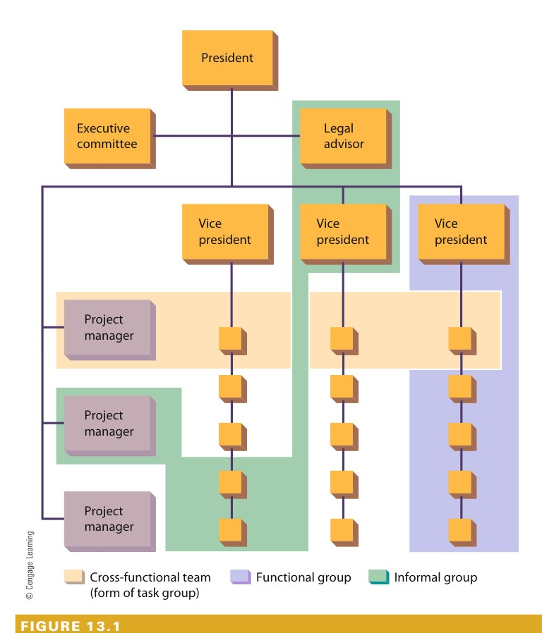
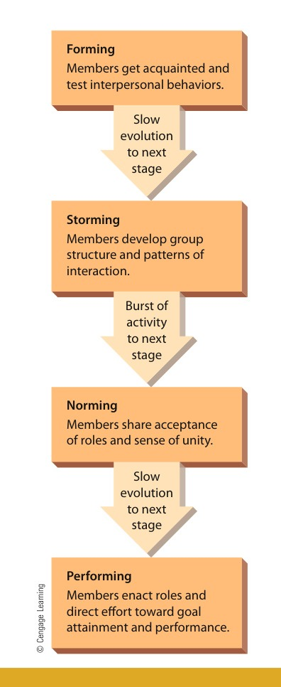
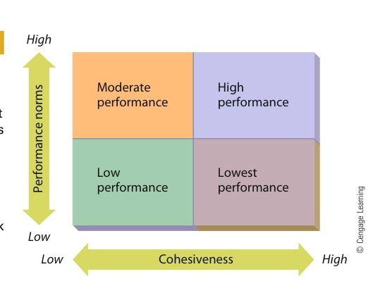
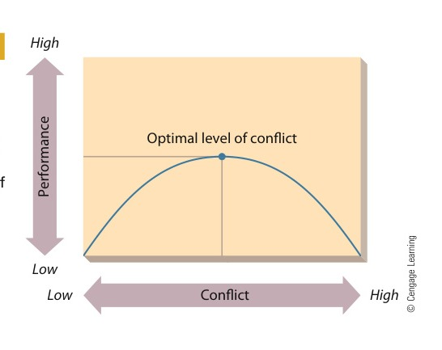

# CHAPTER 13: Managing Work Groups and Teams

<!-- Page 420 -->

## Learning Outcomes

After studying this chapter, you should be able to:

1. Define and identify types of groups and teams in organizations, discuss reasons people join groups and teams, and list the stages of group and team development.
2. Identify and discuss four essential characteristics of groups and teams.
3. Discuss interpersonal and intergroup conflict in organizations.
4. Describe how organizations manage conflict.
5. Describe the negotiation process.

---

### Management in Action: Managing by Clowning Around

> “It’s difficult to be creative in isolation.”  
> — *Lyn Heward, former president of Cirque du Soleil’s Creative Content Division*

Fourteen-year-old Guy Laliberté dropped out of high school in Québec, Canada, because he wanted to see the world. “I decided to go into street performing because it was a traveling job,” he recalls, and although his skills were limited to playing the accordion and telling stories, they were enough to get him to London by the time he was 18. From there, he not only extended his travels to Europe but also broadened his repertoire to include fire breathing, juggling, magic, and stilt walking. “It was just an adventure,” he admits, “and I was planning to go back to school and have a regular life,” but his nearly decade-long adventure had only deepened his passion for street performing. When he returned to Canada, he joined a stilt-walking troupe, and in 1984, when he was 23 years old, Lalibertépartnered with another high school dropout to form their own street-performancecompany. Today, he still runs that company, and as 80 percent owner of Cirque du Soleil, he’s one of the richest people in Canada.Cirque du Soleil, which is French for circus of the sun (“The sun,” explainsLaliberté, “stands for energy and youth, which is what I thought the circus should be about”), hascompletelytransformedthetraditionalthree-ringspectacle with trapeze artists, clowns, and lion tamers. Laliberté calls Cirque a“transdiciplinary experience”—an amalgam of breathtaking stunt work, dazzling stagecraft, surreal costumes, and pulsing music. There are currently 20 different Cirque shows, each developed around a distinctive theme and story arc, such as

<!-- Page 421 -->

Cirque du Soleil makes extensive use of teams to plan, design, and execute its elaborate shows such as Varekai, shown here being performed in Moscow.

“the urban experience in all its myriad forms” (Saltimbanco) and “a tribute to the nomadic soul” (Varekai). Headquartered in Montreal, Canada, the company now employs 5,000 people, including more than 1,300 artists, and its shows have been seen by 100 million spectators. Profits for 2012 were $250 million on revenues of $1 billion.The key to this success, according to Laliberté, is creativity: “I believe that the profits will come from the quality of your creative products,” he says. “Since the beginning, I’ve always wanted to develop a self-feeding circle of creative productions: The positive financial returns from one show would be used to develop and create a new show, and so on.” He’s also convinced that his job isto provide a working environment that fosters collective creativity: “I believe in nurturing creativity and offering a haven for creators, enabling them to develop their ideas to the fullest. With more and more talented creators being drawn to Cirque in an environment that fulfills them, these [conditions] are ideal to continue developing great new shows.”Lyn Heward, former president of Cirque’s Creative Content Division, calls the company’sprocessoftrainingandintegratingtalentedpeople“creative transformation.” “Everyone,” she says, “when they come to Cirque as an employee, even an accountant, comes there because it’s a creative and admired company, and they want to be able to contribute something creatively.” From her experience at Cirque, Heward drew up a nine-point guide to “creative transformation,” and at the heart of her list is a commitment to the value of team work. In fact, the fifth item on her list says, “Practice team work. True creativity requires stimulation and collaboration. It’s difficult to be creative in isolation.” Item 6 picks up the same theme: “Keep creativity fresh with hard-working bosses who constantly encourage and receive employees’ ideas and feedback and accept that there are often different ways of getting the same end result.”

<!-- Page 422 -->

“No matter what your product,” Heward argues, “whether it’s computers, cars, or anything else, your results [depend on] having a passionate strong team of people.” In any workplace, she explains, “our most natural resource is the people we work with—the people we build our product with. Unless there’s a strong commitment to teambuilding, passionate leadership, and creativity, even at Cirque it would not happen.” Heward is willing to admit that “incredible freedom is a problem for most people because it requires us to think differently,” but she’s also confident that getting people committed to team work is the best way to get them to develop their creativity. Take Igor Jijikine, aRussian-born acrobat-actor who helped train performers for Mystère, Cirque’spermanent show at Las Vegas’s Treasure Island Hotel and Casino. “[T]he really challenging thing,” he says,

is to change the mentality of the performers I work with. Many of our performers are former competitive gymnasts. Gymnastics is essentially an individual sport. Gymnasts never have to think creatively or be a part of a true team. They got here by being strong individuals. So, right from the start, we really challenge ourselves to erase the lines between athletics and artistry, between individuals and the group. We need to transform an individual into a team player everyone else can count on, literally with their lives.

Finally, Heward acknowledges that you can’t imbue employees with the Cirque du Soleil culture and “then tell them to go work in their cubicles.” The space in which they work, she says, “has to reflect [Cirque’s] values and vision.” All Cirque du Soleil productions are created and developed by teams working at the Montreal facility, which the company calls “the Studio” and describes as “a full-fledgedcreation, innovation, and training laboratory.”In addition to administrative space—“eight floors of uniquely designed office spaces and relaxation areas conducive to inspiration”—the complex boasts acrobatic, dance, and theatrical studios, and the effect of the whole, says Heward, is that of “a fantastical playground.” Creativity, she explains,

is fostered in work groups where people first get to know each other and then learn to trust one another. And in this playground, we recognize that a good idea can emerge from anywhere in the organization or from within a team. We make our shows from this collective creativity.

Cirque CEO Daniel Lamarre has a succinct way of explaining the company’ssuccess: “We let the creative people run it.” As for Laliberté, he, too, is content to trust his creative people—an instinct, he says, that he learned in his days as a street performer: “In the street, you have to develop that instinct of trusting people and reading people because that instinct is your lifesaver.” He lists himself as “Artistic Guide” in production notes and tries “not to be too involved in the beginning and during the process,” the better to keep his perspective“fresh” and to “be able to give constructive recommendation on the final production.” He also wants to do the same thing that he wanted to do when he was 14: “I still want to travel, I still want to entertain, and I most certainly still want to have fun.”1

<!-- Page 423 -->

> **group**: Consists of two or more people who interact regularly to accomplish a common purpose or goal.

> **functional group**: A permanent group created by the organization to accomplish a number of organizational purposes with an unspecified time horizon.

> **informal or interest group**: Created by its members for purposes that may or may not be relevant to those of the organization.

This chapter is about the processes that lead to and follow from successes like those enjoyed by Cirque de Soleil. More important, it’s also about the processes leading to and following successful group and team dynamics. In Chapter 12, we established the interpersonal nature of organizations. We extend that discussion here by first introducing basic concepts of group and team dynamics. Subsequent sections explain the characteristics of groups and teams in organizations. We then describe interpersonal and intergroup con-flict and discuss how conflict can be managed. We conclude with a brief discussion of negotiation.

## GROUPS AND TEAMS IN ORGANIZATIONS

Groups are a ubiquitous part of organizational life. They are the basis for much of the work that gets done, and they evolve both inside and outside the normal structural boundaries of the organization. We define a group as two or more people who interact regularly to accomplish a common purpose or goal.2 The purpose of a group or team may range from preparing a new advertising campaign, to informally sharing information, to making important decisions, to fulfilling social needs.

### Types of Groups and Teams

In general, three basic kinds of groups are found in organizations—functional groups, infor-mal or interest groups, and task groups and teams.3 These are illustrated in Figure 13.1.

#### Functional Groups

A functional group is a permanent group created by the organi-zation to accomplish a number of organizational purposes with an unspecified time horizon. The advertising department at Starbucks, the management department at Iowa State University, and the nursing staff at the M.D. Anderson Cancer Center. The advertising department at Starbucks, for example, seeks to plan effective advertising campaigns, increase sales, run in-store promotions, and develop a unique identity for the company. It is assumed that the functional group will remain in existence after it attains its current objectives—those objectives will be replaced by new ones.

#### Informal or Interest Groups

An informal or interest group is created by its own members for purposes that may or may not be relevant to organizational goals. It also has an unspecified time horizon. A group of employees who lunch together every day may be discussing productivity, money embezzling, or local politics and sports. As long as the group members enjoy eating together, they will probably continue to do so. When lunches cease to be pleasant, they will seek other company or a different activity.Informal groups can be a powerful force that managers cannot ignore.4 One writer described how a group of employees at a furniture factory subverted their boss’s efforts to increase production. They tacitly agreed to produce a reasonable amount of work but not to work too hard. One man kept a stockpile of completed work hidden as a backup in case he got too far behind. In another example, Auto Workers described how they left out gaskets and seals and put soft-drink bottles inside doors.5 Of course, informal groups can also be a positive force, such as when people work together to help out a colleague who has suffered a personal tragedy. For example, during and in the aftermath of Hurricane Sandy, the super-storm that devastated the northeast United States in 2012, literally dozens of incidents were reported portraying how informal groups emerged to help those in distress.In recent years, the Internet has served as a platform for the emergence of more and different kinds of informal or interest groups. As one example, Google includes a wide array of interest groups that bring together people with common interests. And increasingly,

<!-- Page 424 -->

> **task group**: A group created by the organization to accomplish a relatively narrow range of purposes within a stated or implied time horizon.

President

*Figure 13.1 — Types of Groups in Organizations (Source: Page 424)*

Every organization has many different types of groups. In this hypothetical organization, a functional group is shown within the purple area, a cross-functionalteam within the yellow area, and an informal group within the green area.

workers who lose their jobs as a result of layoffs are banding together electronically to offer moral support to one another and to facilitate networking as they all look for new jobs.6 The“At Your Service” feature illustrates other new types of groups.

#### Task Groups

A task group is a group created by the organization to accomplish a relatively narrow range of purposes within a stated or implied time horizon. Most commit-tees and task forces are task groups. The organization specifies group membership and assigns a relatively narrow set of goals, such as developing a new product or evaluating a proposed grievance procedure. The time horizon for accomplishing these purposes is either specified (a committee may be asked to make a recommendation within 30 days) or implied (the project team will disband when the new product is developed).

<!-- Page 425 -->

AT YOUR SERVICE

## Using Customer-Created Groups for Competitive Advantage

of people in their own health mean that many patients arrive at their doctor’s office not only with a lot of information about their ailment but also with an ability to identify and assemble their own support group of doctors, family and friends, and health-careprofessionals. These people want to be actively engaged in managing their own health care and they enter the doctor’s office expecting to involve members of their existing wellness group. They help integrate their primary care physician with any referred specialists and freely add in other specialists they learn about via chat rooms, public rankings of doctors, and disease-specific websites. While the historic model in health care had the family physician assembling a treatment and care team, the modern model is a proactive patient who assembles and actively manages a group of health-care providers.The second example of customer groups collaborat-ing with an organization can be seen in the phenomena

Today’s customers know a great deal and are not reluctant to tell organizations what they know. In fact, many now expect not only to participate in the shopping and buying experience in ways the organi-zation does not expect and for which in many cases is unprepared, but customers also expect to partici-pate in the creation of the experience itself as part of the organization’s creative team. Service organiza-tions have long asked customers their opinions to learn what customers want from them. Many use focus groups to solicit information about the services they provide or should provide in the future. Today’swell-informed, web-enabled customers want and expect far greater involvement in their buying experi-ence and find ways to get it. Two current trends are examples of this.The first trend is customer management of a net-worked team, which is increasingly found in health care. The availability of the Internet and the interest

Some organizations creatively use customer-created groups to function more effectively. These people are gathered to watch a street performance in Los Angeles. Performers will gauge the audience response to their early performances and then tailor their later performances to best match what the audience wants.

(continued)

<!-- Page 426 -->

> **team**: A group of workers that functions as a unit, often with little or no supervision, to carry out work-related tasks, functions, and activities.

> **virtual teams**: Teams composed of people from remote work sites who work together online.

AT YOUR SERVICE (Continued)

to participate in creating new shirt designs. TheU.S. Department of Defense offers people an opportu-nity to help test its software, the Library of Congress asked Flickr users to help identify people in its photo collection, and Walmart asks customers to vote on which new products it should stock.In all these cases, the organization is creating a nonemployee group that it must manage sometimes without even knowing who the members are. The company generally pays little or nothing for participa-tion. The individuals participating often interact with each other to argue the merits of proposed solutions.IKEA manages a website where it not only solicits new ideas for its stores but also where customers can share solutions to each other’s problems. Organi-zations using crowdsourcing must provide a problem in a manner that can be comprehended by potential participants, an interactive web platform that can be found by those knowledgeable and interested in the topic, and some process for identifying success and recognition of contribution when the problem is resolved. The point is that organizations increasingly must manage groups that they don’t employ or groups of people who they don’t even know. These groups are often customers involved in product inno-vation or their own health care but can also be com-puter gamers testing software or suggesting new code or anyone with an expertise and willingness to participate in the problem the organization wishes to solve. Crowd management will require learning new skills beyond those used for managing employees.

of crowdsourcing. Although the practice of asking a crowd for help is as old as the wanted posters on post office walls, the web has expanded this concept greatly because it can connect people anywhere in the world who want to be involved. Many newer business models are built on their ability to provide platforms for participation. Many people use crowdsourced Wikipedia as their only encyclopedia and the customer recommendations provided by Amazon, TripAdvisor, OpenTable, and Yelp as their guide for what to read and where to go, eat, or shop.In the simplest form of crowdsourcing, a group is assembled, usually online, to solve a problem or engi-neer a solution. One classic illustration is described by Tapscott and Williams in their book Wikinomics.They write of a struggling Canadian gold mining firm, Goldcorp, that decided to release all its proprietary geo-logical data about its property to the public and offered a$575 000 prize for anyone who could develop a better way to locate gold on that property. The winning team from Australia gave them an answer that enabled themtoincreasetheirproductionofgoldfromjustover50,000ounces annually at a cost of $360 an ounce to over a half million ounces annually at a cost of only $59 an ounce.Successful examples of crowdsourcing like this one have generated much interest among others seeking solutions to problems that traditional methods don’tseem to solve well. By building a web platform and posing a problem in a way that will interest potential participants, a crowd can be attracted. For example, Threadless uses its website to engage anyone wishing

Teams are a special form of task group that have become increasingly popular.7 In the sense used here, a team is a group of workers that functions as a unit, often with little orno supervision, to carry out work-related tasks, functions, and activities. Table 13.1 lists and defines some of the various types of teams that are being used today. Earlier forms of teams included autonomous work groups and quality circles. Today, teams are also sometimes called self-managed teams, cross-functional teams, or high-performance teams.Many firms today are routinely using teams to carry out most of their daily operations.8

Further, virtual teams—teams composed of people from remote work sites who work together online—are also becoming more and more common.9

Organizations create teams for a variety of reasons. For one thing, they give more responsibility for task performance to the workers who are actually performing the tasks. They also empower workers by giving them greater authority and decision-making freedom. In addition, they allow the organization to capitalize on the knowledge and motivation of their workers. Finally, they enable the organization to shed its bureau-cracy and promote flexibility and responsiveness. Ford used teams to design its newest

<!-- Page 427 -->

### Table 13.1: Types of Teams

| Team Type | Characteristics |
|:---|:---|
| **Problem-solving team** | Most popular type of team; comprises knowledge workers who gather to solve a specific problem and then disband. |
| **Management team** | Consists mainly of managers from various functions like sales and production; coordinates work among other teams. |
| **Work team** | An increasingly popular type of team; work teams are responsible for the daily work of the organization; when empowered, they are self-managed teams. |
| **Virtual team** | A new type of work team that interacts digitally; members enter and leave the network as needed and may take turns serving as leader. |
| **Quality circle** | Declining in popularity; quality circles, comprising workers and supervisors who meet intermittently to discuss workplace problems. |

*Source: From Fortune, September 5, 1994. © 1994 Time Inc. All rights reserved.*

Mustang and Focus models. Similarly, General Motors used a team to develop its newest model of the Chevrolet Corvette.When an organization decides to use teams, it is essentially implementing a major form of organization change, as discussed in Chapter 7. Thus, it is important to follow a logical and systematic approach to planning and implementing teams in an existing organization design. It is also important to recognize that resistance may be encountered.This resistance is most likely from first-line managers, who will be giving up much of their authority to the team. Many organizations find that they must change the whole management philosophy of such managers to move away from being a supervisor and toward being a coach or facilitator.10

After teams are in place, managers should continue to monitor their contributions and how effectively they are functioning. In the best circumstances, teams will become very cohesive groups with high performance norms. To achieve this state, the manager can use any or all of the techniques described later in this chapter for enhancing cohesiveness. If implemented properly, and with the support of the workers themselves, performance norms will likely be relatively high. In other words, if the change is properly implemented, the team participants will understand the value and potential of teams and the rewards they may expect to get as a result of their contributions. On the other hand, poorly designed and implemented teams will do a less effective job and may detract from organizational effectiveness.11

### Why People Join Groups and Teams

People join groups and teams for a variety of reasons. They join functional groups sim-ply by virtue of joining organizations. People accept employment to earn money or prac-tice their chosen professions. Once inside the organization, they are assigned to jobs and roles, and thus become members of functional groups. People in existing Functional Groups are told, are asked, or volunteer to serve on committees, task forces, and teams.People join informal or interest groups for a variety of reasons, most of which are quitecomplex.12 Indeed, the need to be a team player has grown so strong today that Many organizations will actively resist hiring someone who does not want to work with others.13

<!-- Page 428 -->

#### Interpersonal Attraction

One reason people choose to form informal or interest groups is that they are attracted to one another. Many different factors contribute to interpersonal attraction. When people see a lot of each other, pure proximity increases the likelihood that interpersonal attraction will develop. Attraction is increased when people have similar attitudes, personalities, or economic standings.

#### Group Activities

Individuals may also be motivated to join a group because the activities of the group appeal to them. Jogging, playing bridge or fantasy football, bowl-ing, discussing poetry, playing war games, or flying model airplanes are all activities that some people enjoy. It is more enjoyable to participate in many of them as a member of a group, and most require more than one person. Many large firms such as Exxon Mobil and Apple have a football, softball, or bowling league. A person may join a bowling team, not because of any particular attraction to other group members, but simply because being a member of the group allows that person to participate in a pleasant activity. Of course, if the group’s level of interpersonal attraction is very low, a person may choose to forgo the activity rather than join the team.

#### Group Goals

The goals of a group may also motivate people to join. The Sierra Club, which is dedicated to environmental conservation, is a good example of this kind of interest group. Various fund-raising groups are another illustration. Members may or may not be personally attracted to the other fund-raisers, and they probably do not enjoy the activity of knocking on doors asking for money, but they join the group because they subscribe to its goal. Workers join unions such as the United Auto Workers because they support their goals.

#### Need Satisfaction

Still another reason for joining a group is to satisfy the need for affiliation. New residents in a community may join the Newcomers Club partially as a

People sometime join groups in order to engage in certain activities. These young men, for instance, are playing flag football in a city park. They may or may not have known each other before their game, and may or may not keep in contact with one another after the game. But for the moment, they are enjoying a group activity—a game that could not be played without others.

<!-- Page 429 -->

way to meet new people and partially just to be around other people. Likewise, newly divorced people often join support groups as a way to have companionship. This need also plays a role in why some people use Facebook and other social media venues.

#### Instrumental Benefits

A final reason people join groups is that membership is sometimes seen as instrumental in providing other benefits to the individual. For exam-ple, it is fairly common for college students entering their senior year to join several pro-fessional clubs or associations because listing such memberships on a résumé is thought to enhance the chances of getting a good job. Similarly, a manager might join a certain racquet club not because she is attracted to its members (although she might be) and not because of the opportunity to play tennis (although she may enjoy it). The club’s goals are not relevant, and her affiliation needs may be satisfied in other ways. However, she may feel that being a member of this club will lead to important and useful business contacts. The racquet club membership is instrumental in establishing those contacts.Membership in civic groups such as the Junior League and Rotary may be solicited for similar reasons.

### Stages of Group and Team Development

Imagine the differences between a collection of five people who have just been brought together to form a group or team and a group or team that has functioned like a well-oiledmachine for years. Members of a new group or team are unfamiliar with how they will function together and are tentative in their interactions. In a group or team with considerable experience, members are familiar with one another’s strengths and weaknesses and are more secure in their roles in the group. The former group or team is generally considered to be immature, whereas the latter is considered mature. To progress from the immature phase to the mature phase, a group or team must go through certain stages of development, as shown in Figure 13.2.14

The first stage of development is called forming. The members of the group or team get acquainted and begin to test which interpersonal behaviors are acceptable and which are unacceptable to the other members. The members are very dependent on others at this point to provide cues about what is acceptable. The basic ground rules for the group or team are established, and a tentative group structure may emerge.15 At Reebok, for example, a merchandising team was created to handle its sportswear business. The team leader and his members were barely acquainted and had to spend a few weeks get-ting to know one another.The second stage of development, often slow to emerge, is storming. During this stage, there may be a general lack of unity and uneven interaction patterns. At the same time, some members of the group or team may begin to exert themselves to become recog-nized as the group leader or at least to play a major role in shaping the group’s agenda.In Reebok’s team, some members advocated a rapid expansion into the marketplace; others argued for a slower entry. The first faction won, with disastrous results. Because of the rush, product quality was poor and deliveries were late. As a result, the team leader was fired and a new manager placed in charge.The third stage of development, called norming, usually begins with a burst of activity.During this stage, each person begins to recognize and accept her or his role and to understand the roles of others. Members also begin to accept one another and to develop a sense of unity. There may also be temporary regressions to the previous stage. For example, the group or team might begin to accept one particular member as the leader.If this person later violates important norms or otherwise jeopardizes his or her claim to leadership, conflict might reemerge as the group rejects this leader and searches for another. Reebok’s new leader transferred several people away from the team and set up

<!-- Page 430 -->

Forming Members get acquainted and test interpersonal behaviors.

Slow evolution to next stage

Storming Members develop group structure and patterns of interaction.

Norming Members share acceptance of roles and sense of unity.

Performing Members enact roles and direct effort toward goal attainment and performance.

*Figure 13.2 — Stages of Group Development (Source: Page 430)*

As groups mature, they tend to evolve through four distinct stages of development.Managers must understand that group members need time to become acquainted, accept one another, develop a group structure, and become comfortable with their roles in the group before they can begin to work directly to accomplish goals.

a new system and structure for managing things. The remaining employees accepted his new approach and settled into doing their jobs.Performing, the final stage of group or team development, is also slow to develop. At this stage, the team really begins to focus on the problem at hand. The members enact the roles they have accepted, interaction occurs, and the efforts of the group are directed toward goal attainment. The basic structure of the group or team is no longer an issue

<!-- Page 431 -->

but has become a mechanism for accomplishing the purpose of the group. Reebok’ssportswear business is now growing consistently and has successfully avoided the pro-blems that plagued it at first.

## CHARACTERISTICS OF GROUPS AND TEAMS

As groups and teams mature and pass through the four basic stages of development, they begin to take on four important characteristics—a role structure, norms, cohesiveness, and informal leadership.16

### Role Structures

> **role**: The part an individual plays in a group that helps the group reach its goals.  
> **role structure**: The set of defined roles and interrelationships among those roles that the group members define and accept.

Each individual in a team has a part, or role, to play in helping the group reach its goals.Some people are leaders, some do the work, some interface with other teams, and so on.Indeed, a person may take on a task specialist role (concentrating on getting the group’stask accomplished) or a socioemotional role (providing social and emotional support to others on the team). A few people, usually the leaders, perform both roles; a few others may do neither. The group’s role structure is the set of defined roles and interrelation-ships among those roles that the group or team members define and accept. Each of us belongs to many groups and therefore plays multiple roles—in work groups, classes, fam-ilies, and social organizations.17

Role structures emerge as a result of role episodes, as shown in Figure 13.3. The process begins with the expected role—what other members of the team expect the individual todo. The expected role gets translated into the sent role—the messages and cues that team members use to communicate the expected role to the individual. The perceived role is what the individual perceives the sent role to mean. Finally, the enacted role is what the individual actually does in the role. The enacted role, in turn, influences future expecta-tions of the team. Of course, role episodes seldom unfold this easily. When major disrup-tions occur, individuals may experience role ambiguity, conflict, or overload.18

#### Role Ambiguity

> **role ambiguity**: Arises when the sent role is unclear and the individual does not know what is expected of him or her.

Role ambiguity arises when the sent role is unclear. If your instructor tells you to write a term paper but refuses to provide more information, you will probably experience role ambiguity. You do not know what the topic is, how long the paper should be, what format to use, or when the paper is due. In work set-tings, role ambiguity can stem from poor job descriptions, vague instructions from a supervisor, or unclear cues from coworkers. The result is likely to be a subordinate

*Figure 13.3 — The Development of a Role (Source: Page 431)*

Roles and role structures within a group generally evolve through a series of role episodes. The first two stages of role development are group processes, as the group members let individuals know what is expected of them. The other two parts are individual processes, as the new group members perceive and enact their roles.

<!-- Page 432 -->

> **role conflict**: Occurs when the messages and cues composing the sent role are clear but contradictory or mutually exclusive.

> **role overload**: Occurs when expectations for the role exceed the individual’s capabilities to perform.

who does not know what to do. Role ambiguity can be a significant problem for both the individual who must contend with it and the organization that expects the employee to perform.

#### Role Conflict

Role conflict occurs when the messages and cues composing the sent role are clear but contradictory or mutually exclusive.19 One common form is interrole conflict—conflict between roles. For example, if a person’s boss says that one must work over time and on weekends to get ahead, and the same person’s coworkers say that you can succeed without working nights and weekends, conflict may result. In a matrix organization, interrole conflict often arises between the roles one plays in differ-ent teams as well as between team roles and one’s permanent role in a functional group.Intrarole conflict may occur when the person gets conflicting demands from differ-ent sources within the context of the same role. A manager’s boss may tell the manager that she needs to put more pressure on subordinates to follow new work rules. At the same time, her subordinates may indicate that they expect her to get the rules changed.Thus, the cues are in conflict, and the manager may be unsure about which course to follow. Intrasender conflict occurs when a single source sends clear but contradictory messages. This might arise if the boss says one morning that there can be no more over time for the next month but after lunch tells someone to work late that same even-ing. Person–role conflict results from a discrepancy between the role requirements and the individual’s personal values, attitudes, and needs. If a person is told to do some-thing unethical or illegal, or if the work is distasteful (for example, firing a close friend), person–role conflict is likely. Role conflict of all varieties is of particular concern to managers. Research has shown that conflict may occur in a variety of situa-tions and lead to a variety of adverse consequences, including stress, poor performance, and rapid turnover.

#### Role Overload

A final consequence of a weak role structure is role overload, which occurs when expectations for the role exceed the individual’s capabilities. When a man-ager gives an employee several major assignments at once, while increasing the person’sregular workload, the employee will probably experience role overload. Role overload may also result when an individual takes on too many roles at one time. For example, a person trying to work extra hard at a job, run for election to the school board, serve on a committee in church, coach Little League baseball, maintain an active exercise program, and be a contributing member to her or his family will probably encounter Role Overload.In a functional group or team, the manager can take steps to avoid role ambiguity, conflict, and overload. Having clear and reasonable expectations and sending clear and straightforward cues go a long way toward eliminating role ambiguity. Consistent expectations that take into account the employee’s other roles and personal value sys-tem may minimize role conflict. Role overload can be avoided simply by recognizing the individual’s capabilities and limits. In friendship and interest groups, role struc-tures are likely to be less formal; hence, the possibility of role ambiguity, conflict, or overload may not be so great. However, if one or more of these problems does occur, they may be difficult to handle. Because roles in friendship and interest groups are less likely to be partially defined by a formal authority structure or written job descriptions, the individual cannot turn to those sources to clarify a role. The “Sustainability Matters” feature highlights how more and more research is being conducted by teams of researchers from different disciplines, each of whom adopts a specific role in the research project.

<!-- Page 433 -->

SUSTAINABILITY MATTERS

## Measuring Carbon Footprints

If you’re one of the world’s 700 million richest peo-ple, you’re probably a “high emitter” living a “carbon-intensive” lifestyle (at least statistically speaking). In plain English, becauseyourlifestyleprobablyincludes air travel, the use of a car, and a house to heat and cool, you’re probably responsible for releas-ing more than your share of carbon dioxideCO2into the Earth’s atmosphere. “We estimate that …half the world’s emissions come from just 700 mil-lion people,” explains Shoibal Chakravarty, lead author of a recent study conducted by researchers at Princeton University. “It’s mischievous,” admits coauthor Robert Socolow, “but it’s meant to be alogjam-breaking concept,” and the proposals for cut-ting CO2 emissions offered by the Princeton team have been widely praised for the fairness that they inject into a debate that’s been stalemated for nearly20 years.The research team’s report lists six coauthors.Shoibal Chakravarty, a physicist specializing in CO2emissions, is a research associate at the Princeton Environmental Institute(PEI), an interdisciplinary

center for environmental research and education.Also associated with PEI is Massimo Tavoni, an economist who studies international policies on cli-mate change. Stephen Pacala, who’s the director of PEI, is a professor of ecology and evolutionary biol-ogy who focuses on the interactions of climate and the global biosphere. Robert Socolow, a professor ofmechanicalandaerospaceengineering, studies global carbon management. Ananth Chikkatur, ofHarvard’s Belfer Center for Science and International Affairs, is a physicist who specializes in energy policy and technology innovation. Heleen de Coninck, a chemist, works on international climate policy and technology at the Energy Research Centre of the Netherlands.Needless to say, the carbon footprint team was a diverse group in terms of academic discipline (not to mention nationality). Its innovative approach to the problem of CO2 emissions—one which shows that it’s possible to cut emissions and reduce poverty at the same time—resulted from an approach to high-level scientific problem solving that’s typically called

The carbon footprint team is a diverse group of scientists working together to learn more about sustainability. More and more often, important scientific discoveries are being made by teams rather than by individuals working alone.

(continued)

<!-- Page 434 -->

> **norms**: Standards of behavior that the group accepts for and expects of its members.

SUSTAINABILITY MATTERS (Continued)

What about collaboration that extends beyond the confines of academia? As it happens, Robert Socolow and Stephen Pacala, in addition to working on the carbon footprint team, are codirectors of the carbon Mitigation Initiative (CMI), a partnership among Princeton, Ford, and BP, the world’s third-largest oil company. BP picks up 75 percent of the tab for research that has as its goal, according toCMI’s mission statement, “a compelling and sustain-able solution of the carbon and climate change problem.” CMI seeks “a novel synergy across funda-mental science, technological development, and busi-ness principles that accelerates the pace of discovery,”and collaboration is essential to its work because it crosses the borders between scientific, technological, and business interests. CMI is divided into research groups, including the Capture Group, which works on technologies for capturing emissions from fossil fuels, and the Storage Group, which investigates the poten-tial risks of injecting CO2underground. Working through CMI, BP has been able to launch a CCS trial at a gas-development facility in Algeria.

interdisciplinary or multidisciplinary research. The global footprint study, says Pacala, “represents a col-laboration among young people from disparate disci-plines—physics, economics, political science …. The team,” he stresses, “worked together to formulate a novel approach to a long-standing and intractable problem,” and its interdisciplinary approach to that problem reflects the prevailing model for the study of today’s most complex and daunting issues, such as AIDS, terrorism, and global climate change.To determine the extent to which team-basedresearch has supplanted individual research among academics, a group at Northwestern University examined nearly 20 million papers published over a period of five decades. They found that

teams increasingly dominate solo authors in the production of knowledge. Research is increasingly done in teams across virtually all fields. Teams typically produce more highly cited research than individuals do, and this advantage is increasing over time. Teams now also produce the excep-tionally high-impact research …

References: Douglas Fischer, “Solving the Climate Dilemma One Billion Emitters at a Time,” Daily Climate, http://www.goodhousekeeping.com/home/green-living/the-daily-green, accessed on January 1, 2014; Kitta McPherson, “New Prin-cetonMethodMayHelpAllocateCarbonEmissionsResponsibility among Nations,” News at Princeton, July 6,2009, www.princeton.edu, accessed on January 1, 2014; Shoibal Chakravarty et al., “Sharing Global CO2 Emission Reductions among One Billion High Emitters,” Proceedings of the National Academy of Sciences, Vol. 106 (July 2009), www.pnas.org, accessed on January 1, 2014; Stefan Wuchty et al., “The Increasing Dominance of Teams in production of Knowledge,” Sciencexpress, www.kellogg.northwestern.edu, accessed on January 1, 2014; and Carbon Mitigation Initiative, “About the Carbon Mitigation Initiative,” Princeton University, February 24, 2011, http://cmi.princeton.edu, accessed on January 1, 2014.

The shift from the individual to the team-basedmodel of research has been most significant in the sciences, where there’s been, says the Northwest-ern study, “a substantial shift toward collective research.” One reason for the shift, suggest the authors, may be “the increasing capital intensity of research” in laboratory sciences, where the growth of collaboration has been particularly striking. The increasing tendency toward specialization may be another reason. As knowledge grows in a discipline, scientists tend to devote themselves to specialty areas, the discipline itself becomes fragmented into “finer divisions of labor,” and studies of largerissuesinthedisciplinethusrequiregreatercollaboration.

### Behavioral Norms

Norms are standards of behavior that the group or team accepts and expects of its members. Most committees, for example, develop norms governing their discussions.A person who talks too much is perceived as doing so to make a good impression or to get his or her own way. Other members may not talk much to this person, may not sit nearby, may glare at the person, and may otherwise “punish” the individual for violating the norm. Norms, then, define the boundaries between acceptable and unacceptablebehavior.20 Some groups develop norms that limit the upper bounds of behavior to“make life easier” for the group—for example, do not make more than two comments

<!-- Page 435 -->

> **socialization**: Generalized norm conformity that occurs as a person makes the transition from being an outsider to being an insider in the organization.

in a committee discussion or do not produce any more than you have to. In general, these norms are counterproductive. Other groups may develop norms that limit the lower bounds of behavior—for example, do not come to meetings unless you have read the reports to be discussed or have produced as much as you can. These norms tend to reflect motivation, commitment, and high performance. Managers can sometimes use norms for the betterment of the organization. For example, Kodak successfully used group norms to reduce injuries in some of its plants.21

#### Norm Generalization

The norms of one group cannot always be generalized to another group. Some academic departments, for example, have a norm that suggests that faculty members dress up on teaching days. People who fail to observe this norm are “punished” by sarcastic remarks or even formal reprimands. In other departments, the norm may be casual clothes, and the person unfortunate enough to wear dress clothes may be punished just as vehemently. Even within the same work area, similar groups or teams can develop different norms. One team may strive always to produce above its assigned quota; another may maintain productivity just be low its quota. The norm of one team may be to be friendly and cordial to its supervisor; that of another team may be to remain aloof and distant. Some differences are due primarily to the composition of the teams.

#### Norm Variation

In some cases, norm variation also can occur within a group or team. A common norm is that the least senior member of a group is expected to perform unpleasant or trivial tasks for the rest of the group. These tasks might be to wait on cus-tomers who are known to be small tippers (in a restaurant), to deal with complaining customers (in a department store), or to handle the low-commission line of merchandise(in a sales department). Another example is when certain individuals, especially informal leaders, may violate some norms. If the team is going to meet at 8 a.m., anyone arriving late will be chastised for holding things up. Occasionally, however, the informal leader may arrive a few minutes late. As long as this does not happen too often, the group probably will not do anything about it.

#### Norm Conformity

Four sets of factors contribute to norm conformity. First, factors associated with the group are important. For example, some groups or teams may exert more pressure for conformity than others. Second, the initial stimulus that prompts behavior can affect conformity. The more ambiguous the stimulus (for example, news that the team is going to be transferred to a new unit), the more pressure there is to conform. Third, individual traits determine the individual’s propensity to conform (for example, more intelligent people are often less susceptible to pressure to conform).Finally, situational factors, such as team size and unanimity, influence conformity. Asan individual learns the group’s norms, he can do several different things. The most obvious is to adopt the norms. For example, the new male professor who notices that all the other men in the department dress up to teach can also start wearing a suit.A variation is to try to obey the “spirit” of the norm while retaining individuality. The professor may recognize that the norm is actually to wear a tie; thus, he might succeed by wearing a tie with his sport shirt, jeans, and sneakers.The individual may also ignore the norm. When a person does not conform, several things can happen. At first, the group may increase its communication with the deviant individual to try to bring her back in line. If this does not work, communication may decline. Over time, the group may begin to exclude the individual from its activities and, in effect, ostracize the person. Finally, we need to briefly consider another aspect of norm conformity—socialization. Socialization is generalized norm conformity that occurs as a person makes the transition from being an outsider to being an insider.

<!-- Page 436 -->

> **cohesiveness**: The extent to which members are loyal and committed to the group; the degree of mutual attractiveness within the group.

A newcomer to an organization, for example, gradually begins to learn about such norms as dress, working hours, and interpersonal relations. As the newcomer adopts these norms, she is being socialized into the organizational culture. Some organizations, such as Texas Instruments, work to actively manage the socialization process; others leave it to happenstance.

### Cohesiveness

A third important team characteristic is cohesiveness. Cohesiveness is the extent to which members are loyal and committed to the group. In a highly cohesive team, the members work well together, support and trust one another, and are generally effective at achieving their chosen goals.22 In contrast, a team that lacks cohesiveness is not very coordinated, its members do not necessarily support one another fully, and it may have a difficult time reaching goals. Of particular interest are the factors that increase and reduce cohesiveness and the consequences of team cohesiveness. These are listed in Table 13.2.Several different factors can influence the cohesiveness of a group. For example, a manager can establish intergroup competition, assign compatible members to the group, create opportunities for success, establish acceptable goals, and foster interaction to increase cohesiveness. Other factors can be used to decrease cohesiveness.

#### Factors That Increase Cohesiveness

Five factors can increase the level of cohesive-ness in a group or team. One of the strongest is intergroup competition. When two or more groups are in direct competition (for example, three sales groups competing for top sales honors or two football teams competing for a conference championship), each group is likely to become more cohesive. Second, just as personal attraction plays a role in causing a group to form, so, too, does attraction seem to enhance cohesiveness. Third, favorable evaluation of the entire group by outsiders can increase cohesiveness. Thus, a group’s winning a sales contest or a conference title or receiving recognition and praise from a superior tends to increase cohesiveness.Similarly, if all the members of the group or team agree on their goals, cohesiveness is likely to increase.23 And the more frequently members of the group interact with one another, the more likely the group is to become cohesive. A manager who wants to foster a high level of cohesiveness in a team might do well to establish some form of intergroup competition, assign members to the group who are likely to be attracted to one another, provide opportunities for success, establish goals that all members are likely to accept, and allow ample opportunities for interaction.24

### Table 13.2: Factors That Influence Group Cohesiveness

| Factors That Increase Cohesiveness | Factors That Reduce Cohesiveness |
|:---|:---|
| Intergroup competition | Group size |
| Personal attraction | Disagreement on goals |
| Favorable evaluation | Intragroup competition |
| Agreement on goals | Domination |
| Interaction | Unpleasant experiences |

<!-- Page 437 -->

*Figure 13.4 — The Interaction Between Cohesiveness and Performance Norms*

#### Factors That Reduce Cohesiveness

There are also five factors that are known to reduce team cohesiveness. First of all, cohesiveness tends to decline as a group increases in size. Second, when members of a team disagree on what the goals of the group should be, cohesiveness may decrease. For example, when some members believe the group should maximize output and others think output should be restricted, cohesiveness declines. Third, intragroup competition reduces cohesiveness. When members are competing among themselves, they focus more on their own actions and behaviors than on those of the group.Fourth, domination by one or more persons in the group or team may cause over all cohesiveness to decline. Other members may feel that they are not being given an oppor-tunity to interact and contribute, and they may become less attracted to the group as a consequence. Finally, unpleasant experiences that result from group membership may reduce cohesiveness. A sales group that comes in last in a sales contest, an athletic team that sustains a long losing streak, and a work group reprimanded for poor-qualitywork may all become less cohesive as a result of their unpleasant experiences.

#### Consequences of Cohesiveness

In general, as teams become more cohesive, their members tend to interact more frequently, conform more to norms, and become more satisfied with the team. Cohesiveness may also influence team performance. However, performance is also influenced by the team’s performance norms. Figure 13.4 shows how cohesiveness and performance norms interact to help shape team performance.When both cohesiveness and performance norms are high, high performance should result because the team wants to perform at a high level (norms) and its members are working together toward that end (cohesiveness). When norms are high and cohesive-ness is low, performance will be moderate. Although the team wants to perform at a high level, its members are not necessarily working well together. When norms are low, performance will be low, regardless of whether group cohesiveness is high or low. The least desirable situation occurs when low performance norms are combined with high cohesiveness. In this case, all team members embrace the standard of restricting performance (owing to the low performance norm), and the group is united in its efforts to maintain that standard (owing to the high cohesiveness). If cohesiveness were low, the manager might be able to raise performance norms by establishing high goals and rewarding goal attainment or by bringing in new group members who are high performers. But a highly cohesive group is likely to resist these interventions.25

The Interaction Between Cohesiveness and performance Norms

High performance Moderate performance

Performance norms

Group cohesiveness and performance norms interact to determine group performance. From the manager’sperspective, high cohesiveness combined with high performance norms comprise the best situation, and high cohesiveness combined with low performance norms create the worst situation. Managers who can influence the level of cohesiveness and performance norms can greatly improve the effectiveness of a work group.

Low performance Lowest performance

Low

Cohesiveness

Low High

<!-- Page 438 -->

> **informal leader**: A person who engages in leadership activities but whose right to do so has not been formally recognized by the organization or group.

> **conflict**: A disagreement among two or more individuals or groups.

### Formal and Informal Leadership

Most functional groups and teams have a formal leader—that is, one appointed by the organization or chosen or elected by the members of the group. Because friendship and interest groups are formed by the members themselves, however, any formal leader must be elected or designated by the members. Although some groups do designate such a leader (a softball team may elect a captain, for example), many do not. Moreover, even when a formal leader is designated, the group or team may also look to others for lead-ership. An informal leader is a person who engages in leadership activities but whose right to do so has not been formally recognized. The formal and the informal leader In any group or team may be the same person, or they may be different people. We noted earlier the distinction between the task specialist and socioemotional roles within groups. An informal leader is likely to be a person capable of carrying out both roles effectively. If the formal leader can fulfill one role but not the other, an informal leader often emerges to supplement the formal leader’s functions. If the formal leader can fill neither role, one or more informal leaders may emerge to carry out both sets of functions.Is informal leadership desirable? In many cases, informal leaders are quite powerful because they draw from referent or expert power. When they are working in the best interests of the organization, they can be a tremendous asset. Not able athletes like Peyton Manning and Abby Wambach are examples of informal leaders. However, when informal leaders work counter to the goals of the organization, they can cause significant difficulties. Such leaders may lower performance norms, instigate walkouts or wildcat strikes, or otherwise disrupt the organization.

## INTERPERSONAL AND INTERGROUP CONFLICT

Of course, when people work together in an organization, things do not always go smoothly. Indeed, conflict is an inevitable element of interpersonal relationships in organizations. In this section, we look at how conflict affects over all performance. We also explore the causes of conflict between individuals, between groups, and between an organization and its environment.

### The Nature of Conflict

Conflict is a disagreement among two or more individuals, groups, or organizations.This disagreement may be relatively superficial or very strong. It may be short-lived or exist for months or even years, and it may be work related or personal. Conflict may manifest itself in a variety of ways. People may compete with one another, glare at one another, shout, or withdraw. Groups may band together to protect popular members or oust unpopular members. Organizations may seek legal remedies.Most people assume that conflict is something to be avoided because it connotes antagonism, hostility, unpleasantness, and dissension. Indeed, managers and manage-ment theorists have traditionally viewed conflict as a problem to be avoided.26 In recent years, however, we have come to recognize that, although conflict can be a major prob-lem, certain kinds of conflict may also be beneficial.27 For example, when two members of a site selection committee disagree over the best location for a new plant, each may be forced to more thoroughly study and defend his or her preferred alternative. As a result of more systematic analysis and discussion, the committee may make a better decision and be better prepared to justify it to others than if everyone had agreed from the outset and accepted an alternative that was perhaps less well analyzed.

<!-- Page 439 -->

*Figure 13.5 — The Nature of Organizational Conflict*

The Nature of Organizational Conflict

Either too much or too little conflict can be dysfunctional for an organization. In either case, performance may be low. However, an optimal level of conflict that sparks motivation, creativity, innovation, and initiative can result in higher levels of performance.

Performance

Optimal level of conflict

Low

Conflict

Low High

As long as conflict is handled in a cordial and constructive manner, it is probably serving a useful purpose in the organization. On the other hand, when working relation-ships are disrupted and the conflict has reached destructive levels, it has likely become dysfunctional and needs to be addressed.28 We discuss ways of dealing with such conflict later in this chapter.Figure 13.5 depicts the general relationship between conflict and performance for a group or an organization. If there is absolutely no conflict in the group or organization, its members may become complacent and apathetic. As a result, group or organizational performance and innovation may begin to suffer. A moderate level of conflict among group or organizational members, on the other hand, can spark motivation, creativity, innovation, and initiative and raise performance. Too much conflict, though, can pro-duce such undesirable results as hostility and lack of cooperation, which lower perfor-mance. The key for managers is to find and maintain the optimal amount of conflict that fosters performance. Of course, what constitutes optimal conflict varies with both the situation and the people involved.29

### Causes of Conflict

Conflict may arise in both interpersonal and intergroup relationships. Occasionally, conflict between individuals and groups may be caused by particular organizational strat-egies and practices. A third arena for conflict is between an organization and its environment.

#### Interpersonal Conflict

Conflict between two or more individuals is almost certain to occur in any organization, given the great variety in perceptions, goals, attitudes, and so forth among its members. Bill Gates, founder of Microsoft, and Kazuhiko Nishi, a former business associate from Japan, once ended a lucrative long-term busi-ness relationship because of interpersonal conflict. Nishi accused Gates of becoming too political, while Gates charged that Nishi became too unpredictable and erratic in his behavior.30

A frequent source of interpersonal conflict in organizations is what many people call a personality clash—when two people distrust each other’s motives, dislike each other, or for some other reason simply cannot get a long.31 Conflict may also arise between people who have different beliefs or perceptions about some aspect of their work or their organization. For example, one manager might want the organization to require that all employees use Microsoft Office software, to promote standardization.

<!-- Page 440 -->

Another manager might believe that a variety of software packages should be allowed, in order to accommodate individuality. Similarly, a male manager may disagree with his female colleague over whether the organization is guilty of discriminating against women in promotion decisions. Conflict can also result from excess competitiveness among individuals. Two people vying for the same job, for example, may resort to political behavior in an effort to gain an advantage. If either competitor sees the other’sbehavior as inappropriate, accusations are likely to result. Even after the “winner” of the job is determined, such conflict may continue to undermine interpersonal relation-ships, especially if the reasons given in selecting one candidate are ambiguous or open to alternative explanations. Acer CEO and President Gianfranco Lanci resigned due to several months of unresolved conflict with the company’s board of directors. Lanci and the board had differing views on organizational growth, customer value creation, brand position enhancement, and resource allocation. Lanci pushed strongly for a move into the mobile segment to compete with Apple’s iPad, while the board wanted to maintain its core PC business.32

#### Intergroup Conflict

Conflict between two or more organizational groups is also quite common. For example, the members of a firm’s marketing group may disagree with the production group over product quality and delivery schedules. Two sales groups may disagree over how to meet sales goals, and two groups of managers may have different ideas about how best to allocate organizational resources.Many intergroup conflicts arise more from organizational causes than from interper-sonal causes. In Chapter 6, we described three forms of group interdependence—pooled, sequential, and reciprocal. Just as increased interdependence makes coordination more difficult, it increases the potential for conflict. For example, recall that in sequential inter-dependence, work is passed from one unit to another. Intergroup conflict may arise if the first group turns out too much work (the second group will fall behind), too little work (the second group will not meet its own goals), or poor-quality work.At one J. C. Penney department store, conflict arose between stockroom employees and sales associates. The sales associates claimed that the stockroom employees were slow in delivering merchandise to the sales floor where it could be priced and shelved.The stockroom employees, in turn, claimed that the sales associates were not giving them enough lead time to get the merchandise delivered and failed to understand that they had additional duties besides carrying merchandise to the sales floor.Just like people, different departments often have different goals. Further, these goals may often be incompatible. A marketing goal of maximizing sales, achieved partially by offering many products in a wide variety of sizes, shapes, colors, and models, probably conflicts with a production goal of minimizing costs, achieved partially by long production runs of a few items. Reebok recently confronted this very situation. One group of man-agers wanted to introduce a new sportswear line as quickly as possible, but other managers wanted to expand more deliberately and cautiously. Because the two groups were not able to reconcile their differences effectively, conflict arose between the two factions, which led to quality problems and delivery delays that plagued the firm for months.Competition for scarce resources can also lead to intergroup conflict. Most organizations—especially universities, hospitals, government agencies, and businesses in depressedindustries—have limited resources. In one New England town, for example, the public works department and the library battled over funds from a federal construction grant.The Buick, Pontiac, GMC, and Chevrolet divisions of General Motors frequently fought over the right to manufacture various new products developed by the company. This infighting was identified as one of many factors that led to GM’s recent problems. As part of the solution, the Pontiac brand was eventually discontinued.

<!-- Page 441 -->

> Conflict is a powerful force in organizations, and it has both nega-tive and positive con-sequences. Thus managers can draw on several different techniques to stimu-late, control, or re-solve and eliminate conflict, depending on their unique circumstances.

#### Conflict Between Organization and Environment

Conflict that arises between one organization and another is called interorganizational conflict. A moderate amount of interorganizational conflict resulting from business competition is expected, of course, but sometimes conflict becomes more extreme. For example, the owners of Jordache Enter-prises, Inc., and Guess?, Inc., battled in court for years over ownership of the Guess? label, allegations of design theft, and several other issues.33 Similarly, General Motors and Volkswagen went to court to resolve a bitter conflict that spanned more than four years. It all started when a key GM executive, Jose Ignacio Lopez de Arriortua, left for a position at Volkswagen. GM claimed that he took with him key secrets that could benefit its German competitor. After the messy departure, dozens of charges and countercharges were made by the two firms, and only a court settlement was able to put the conflict to an end.34

Conflict can also arise between an organization and other elements of its environ-ment. For example, an organization may conflict with a consumer group over claims it makes about its products. McDonald’s faced this problem a few years ago when it pub-lished nutritional information about its products that omitted details about fat content.A manufacturer might conflict with a governmental agency such as the federal Occupa-tional Safety and Health Administration (OSHA). For example, the firm’s management may believe it is in compliance with OSHA regulations, whereas officials from the agency believe that the firm is not in compliance. Or a firm might conflict with a supplier over the quality of raw materials. The firm may think the supplier is providing inferior materials, while the supplier thinks the materials are adequate.

## MANAGING CONFLICT IN ORGANIZATIONS

How do managers cope with all this potential conflict? Fortunately, as Table 13.3shows, there are ways to stimulate conflict for constructive ends, to control conflict before it gets out of hand, and to resolve it if it does. We now look at ways of manag-ing conflict.35

### Table 13.3: Methods for Managing Conflict

| Stimulating Conflict | Controlling Conflict | Resolving and Eliminating Conflict |
|:---|:---|:---|
| Increase competition among individuals and teams. | Expand resource base. | Avoid conflict. |
| Hire outsiders to shake things up. | Enhance coordination of interdependence. | Convince conflicting parties to compromise. |
| Change established procedures. | Set superordinate goals. | Bring conflicting parties together to confront and negotiate conflict. |
| | Match personalities and work habits of employees. | |

<!-- Page 442 -->

Conflict is a powerful force in organizations, and it has both negative and positive consequences. Thus, managers can draw on several different techniques to stimulate, control, or resolve and eliminate conflict, depending on their unique circumstances.

### Stimulating Conflict

In some situations, an organization may stimulate conflict by placing individual employ-ees or groups in competitive situations. Managers can establish sales contests, incentive plans, bonuses, or other competitive stimuli to spark competition. As long as the ground rules are equitable and all participants perceive the contest as fair, the conflict created by the competition is likely to be constructive because each participant will work hard to win (thereby enhancing some aspect of organizational performance).Another useful method for stimulating conflict is to bring in one or more outsiders who will shake things up and present a new perspective on organizational practices.Outsiders may be new employees, current employees assigned to an existing work group, or consultants or advisors hired on a temporary basis. Of course, this action can also provoke resentment from insiders who feel they were qualified for the position. The Beecham Group, a British company, once hired an executive from the United States for its CEO position, expressly to change how the company did business. His arrival brought with it new ways of doing things and a new enthusiasm for competitiveness. Unfortu-nately, some valued employees also chose to leave Beecham because they resented some of the changes that were made.Changing established procedures, especially procedures that have outlived their usefulness, can also stimulate conflict. Such actions cause people to reassess how they per-form their jobs and whether they perform them correctly. For example, one university president announced that all vacant staff positions could be filled only after written justification had received his approval. Conflict arose between the president and the department heads, who felt they were required to do more paperwork than was neces-sary. Most requests were approved, but because department heads now had to think through their staffing needs, a few unnecessary positions were appropriately eliminated.

### Controlling Conflict

One method of controlling conflict is to expand the resource base. Suppose a top man-ager receives two budget requests for $300,000 each. If she has only $500,000 to distrib-ute, the stage is set for conflict because each group will believe its proposal is worth funding and will be unhappy if it is not fully funded. If both proposals are indeed worth-while, it may be possible for the manager to come up with the extra $100,000 from some other source and thereby avoid difficulty.As noted earlier, pooled, sequential, and reciprocal interdependence can all result in con-flict. If managers use an appropriate technique for enhancing coordination, they can reduce the probability that conflict will arise. Techniques for coordination (described in Chapter 6) include making use of the managerial hierarchy, relying on rules and procedures, enlisting liaison people, forming task forces, and integrating departments. At the J. C. Penney store mentioned earlier, the conflict was addressed by providing salespeople with clearer forms on which to specify the merchandise they needed and in what sequence. If one coordination technique does not have the desired effect, a manager might shift to another one.Competing goals can also be a source of conflict among individuals and groups. Managers can sometimes focus employee attention on higher-level, or superordinate, goals as a way of eliminating lower-level conflict. When labor unions such as the United Auto Workers make wage concessions to ensure survival of the automobile industry, they are responding to a superordinate goal. Their immediate goal may be higher wages for members, but they realize that, without the automobile industry, their members would not even have jobs.

<!-- Page 443 -->

> **negotiation**: The process in which two or more parties (people or groups) reach agreement on an issue even though they have different preferences regarding that issue.

Finally, managers should try to match the personalities and work habits of employees soas to avoid conflict between individuals. For instance, two valuable subordinates, one a chain smoker and the other a vehement antismoker, probably should not be required to work together in an enclosed space. If conflict does arise between incompatible individuals, a manager might seek an equitable transfer for one or both of them to other units.

### Resolving and Eliminating Conflict

Despite everyone’s best intentions, conflict sometimes flares up. If it is disrupting the work-place, creating too much hostility and tension, or otherwise harming the organization, attempts must be made to resolve it.36 Some managers who are uncomfortable dealing with conflict choose to avoid the conflict and hope it will go away. Avoidance may sometimes be effective in the short run for some kinds of interpersonal disagreements, but it does little to resolve long-run or chronic conflicts. Even more unadvisable, though, is “smoothing”—minimizing the conflict and telling everyone that things will “get better.” Often, though, avoiding conflict may only make it worse as people continue to brood over it.Compromise is striking a middle-range position between two extremes. This approach can work if it is used with care, but in most compromise situations, someone wins and someone loses. Budget problems are one of the few areas amenable to compromise because of their objective nature. Assume, for example, that additional resources are not available to the manager mentioned earlier. She has $500,000 to divide, and Each of two groups claims to need $300,000. If the manager believes that both projects warrant funding, she can allocate $200,000 to each. The fact that the two groups have at least been treated equally may minimize the potential conflict.The confrontational approach to conflict resolution—also called interpersonal problem solving—consists of bringing the parties together to confront the conflict. The parties dis-cuss the nature of their conflict and attempt to reach an agreement or a solution.Confrontation requires a reasonable degree of maturity on the part of the participants, and the manager must structure the situation carefully. If handled well, this approach can be an effective means of resolving conflict. In recent years, many organizations have experimented with a technique called alternative dispute resolution, using a team of employees to arbitrate conflict in this way.37 Negotiation, a closely related method, is discussed in our final section of this chapter.Regardless of the approach, organizations and their managers should realize that conflict must be addressed if it is to serve constructive purposes and be prevented from bringing about destructive consequences. Conflict is inevitable in organizations, but its negative effects can be constrained with proper attention. For example, Union Carbide sent 200 of its managers to a three-day workshop on conflict management. The managers engaged in a variety of exercises and discussions to learn with whom they were most likely to come in conflict and how they should try to resolve it. As a result, managers at the firm later reported that hostility and resentment in the organization had been greatly diminished and that people in the firm reported more pleasant working relationships.38

## NEGOTIATION

Negotiation is the process in which two or more parties (people or groups) reach agreement on an issue even though they have different preferences regarding that issue. In a sense, then, negotiation is also a form of conflict resolution. In its simplest form, the parties involved may be two individuals who are trying to decide who will pay for lunch. A little more complexity is involved when two people, such as an

<!-- Page 444 -->

employee and a manager, sit down to decide on per-sonal performance goals for the next year against which the employee’s performance will be measured.Even more complex are the negotiations that take place between labor unions and the management ofa company or between two companies as they nego-tiate the terms of a joint venture. The key issues in such negotiations are that at least two parties are involved, their preferences are different, and they need to reach agreement. Interest in negotiation hasgrownsteadilyinrecentyears.Four primary approaches to negotiation have dominated its study:individual differences, situational characteristics, game theory, and cognitive approaches.39

Early psychological approaches concentrated on the personality traits of the negotiators.40 Traits inves-tigated have included demographic characteristics and personality variables.Demographic characteristics have included age, gender, and race, among others.Personality variables have included risk taking, locus of control, tolerance for ambiguity, self-esteem, authoritarianism, and Machiavellianism. The assump-tion of this type of research was that the key to successful negotiation was selecting the right person to do the negotiating, one who had the appropriate demographic character-istics or personality. This assumption seemed to make sense because negotiation is such a personal and interactive process. However, the research rarely showed the positive results expected because situational variables negated the effects of the individual differences.41

Negotiations can take a variety of forms and deal with many different issues. For instance, people negotiate over salary, contract terms, job assignments, and a variety of other business activities. These representatives from different organizations have just reached an agreement to co-sponsor an advertising campaign and are “sealing the deal” with a symbolic handshake.

Situational characteristics are the context within which negotiation takes place. They include such things as the types of communication between negotiators, the potential outcomes of the negotiation, the relative power of the parties (both positional and per-sonal), the time frame available for negotiation, the number of people representing each side, and the presence of other parties. Some of this research has contributed to our understanding of the negotiation process. However, the shortcomings of the situational approach are similar to those of the individual characteristics approach. Many situational characteristics are external to the negotiators and beyond their control. Often the negotiators cannot change their relative power positions or the setting within which the negotiation occurs. So, although we have learned a lot from research on the situational issues, we still need to learn much more about the process.Game theory was developed by economists using mathematical models to predict the outcome of negotiation situations (as illustrated in the Academy Award–winning movie A Beautiful Mind). It requires that every alternative and outcome be analyzed with probabilities and numerical outcomes reflecting the preferences of negotiating parties for each outcome. In addition, the order in which different parties can make choices and every possible move are predicted, a long with associated preferences for outcomes. The outcomes of this approach are exactly what negotiators want: a predictive model of how negotiation should be conducted. One major drawback is that it requires the ability to describe all possi-ble options and outcomes for every possible move in every situation before the negotiation starts. This is often very tedious, if possible at all. Another problem is that this theory assumes that negotiators are rational at all times. However, it is unlikely that negotiators will in fact always act rationally. Therefore, this approach, although elegant in its prescriptions, is usually unworkable in a real negotiation situation.

<!-- Page 445 -->

The fourth approach is the cognitive approach, which recognizes that negotiators often depart from perfect rationality during negotiation; it tries to predict how and when negotiators will make these departures. Howard Raiffa’s decision analytic approach focuses on providing advice to negotiators actively involved in negotiation.42 Bazerman and Neale have added to Raiffa’s work by specifying eight ways in which negotiators systematically deviate from rationality.43 The types of deviations they describe include escalating commitment to a previously selected course of action, overrelying on readily available information, assuming that the negotiations can produce fixed-sum outcomes, and anchoring negotiation in irrelevant information. These cognitive approaches have advanced the study of negotiation a long way beyond the early individual and situational approaches. Negotiators can use them to attempt to predict in advance how the negotiation might take place.

## SUMMARY OF LEARNING OUTCOMES AND KEY POINTS

1. Define and identify types of groups and teams in organizations, discuss the reasons people join groups and teams, and list the stages of group and team development.

• Norms are standards of behavior for group members.• Cohesiveness is the extent to which members are loyal and committed to the team and to one another.• Informal leaders are those leaders the group members themselves choose to follow.

• A group is two or more people who interact reg-ularly to accomplish a common purpose or goal.• General kinds of groups in organizations are

3. Discuss interpersonal and intergroup conflict in organizations.

• functional groups.• task groups and teams.• informal or interest groups.

•Conflict is a disagreement between two or more people, groups, or organizations.•Too little or too much conflict may hurt performance; an optimal level of conflict may improve performance.•Interpersonal and intergroup conflict in orga-nizations may be caused by personality differ-ences or by particular organizational strategies and practices.

• A team is a group of workers that functions as a unit, often with little or no supervision, to carry out organizational functions.

2. Identify and discuss four essential characteristics of groups and teams.

• People join functional groups and teams to pursue a career.• Their reasons for joining informal or interest groups include interpersonal attraction, Group Activities, group goals, need satisfaction, and potential instrumental benefits.• The stages of team development include testing and dependence, intragroup conflict and hos-tility, development of group cohesion, and focusing on the problem at hand.• Four important characteristics of teams are Role Structures, behavioral norms, cohesiveness, and informal leadership.

4. Describe how organizations manage conflict.

•Organizations may encounter conflict with one another and with various elements of the environment.•Three methods of managing conflict are

• to stimulate it.• to control it.• to resolve and eliminate it.

5. Describe the negotiation process

•Negotiation is the process in which two or more parties reach agreement on an issue, even though they have different preferences regard-ing that issue.

• Role structures define task and socioemo-tional specialists, and they may be disrupted by role ambiguity, role conflict, or Role Overload.

<!-- Page 446 -->

## DISCUSSION QUESTIONS

### Questions for Review
1. What is a group? Describe the several different types of groups and indicate the similarities and differences among them. What is the difference between a group and a team?
2. Identify the stages of group development. Do all teams develop through all the stages discussed in this chapter? Why or why not? How might the management of a mature team differ from the management of teams that are not yet mature?
3. Describe the development of a role within a group. Tell how each role leads to the next.
4. Identify two examples of informal leaders. Can a person be a formal and an informal leader at the same time?
5. Describe the causes of conflict in organizations. What can a manager do to control conflict? To resolve and eliminate conflict?

### Questions for Analysis
1. Individuals join groups for a variety of reasons. Most groups contain members who joined for different reasons. What is likely to be the result when members join a group for different reasons? What can a group leader do to reduce the negative impact of a conflict in reasons for joining the group?
2. Consider the case of a developed group, where all members have been socialized. What are the benefits to the individuals of norm conformity? What are the benefits of not conforming to the group’s norms? What are the benefits to an organization of conformity? What are the benefits to an organization of nonconformity?
3. Do you think teams are a valuable new management technique that will endure, or are they just a fad that will be replaced with something else in the near future?
4. Think of several groups of which you have been a member. Why did you join each? Did each group progress through the stages of development discussed in this chapter? If not, why do you think it did not?
5. Describe a case of interpersonal conflict that you have observed in an organization. Describe a case of intergroup conflict that you have observed. (If you have not observed any, interview a worker or manager to obtain examples.) In each case, was the conflict beneficial or harmful to the organization, and why?

---

## BUILDING EFFECTIVE CONCEPTUAL SKILLS

### Exercise Overview
Conceptual skills require you to think in the abstract. This exercise will allow you to practice your conceptual skills as they apply to the activities of work teams in organizations.

### Exercise Background
Business organizations, of course, don’t have a monopoly on effective groups. Basketball teams and military squadrons are teams, as is a government policy group such as the president’s cabinet, the leadership of a church or civic organization, or even a student committee.

### Exercise Task
1. Use the Internet to identify an example of a real-life team. Be sure to choose one that meets two criteria: (1) It’s not part of a for-profit business, and (2) you can argue that it’s highly effective.
2. Determine the reasons for the team’s effectiveness. (Hint: You might look for websites sponsored by the group itself, review online news sources for current articles about it, or enter the group name in a search engine.) Consider team characteristics and activities, such as role structures, norms, cohesiveness, and conflict management.
3. What can a manager learn from the characteristics and activities of this particular team? How might the factors that contribute to this team’s success be adopted in a business setting?

---

<!-- Page 447 -->

## BUILDING EFFECTIVE COMMUNICATION SKILLS

### Exercise Overview
Communication skills refer to the ability to not only convey information and ideas to others but also to handle information and ideas received from them. They’re essential to effective teamwork because teams depend on the ability of members to send and receive information that’s accurate. This exercise invites you to play a game designed to demonstrate how good communication skills can lead to improved teamwork and team performance.

### Exercise Background
You’ll play this game in three separate rounds. In round 1, you’re on your own. In round 2, you’ll work in a small group and share information. You’ll also work in a small group in round 3, but this time your group will focus on ways to improve upon the performance of individual members.

### Exercise Task
1. Play the Name Game that your professor will explain to you. In round 1, work out your answers individually and then report your individual score to the class.
2. For round 2, you’ll join a group of three to five students. Work out your answers together and write your group answers on a single sheet of paper. Now, allow each group member to look at the answer sheet. If you can do so without being overheard by other groups, have each group member whisper the answers on the sheet to the group. Report your group score to the class.
3. Your professor will then ask the highest-performing individuals and groups to share their methods with the class. At this point, your professor will make some suggestions. Be sure to consider at least two strategies for improving your score.
4. Now play round 3, working together in the same small groups in which you participated in round 2. Report your group scores to the class.
5. Did average group scores improve upon average individual scores? Why or why not?
6. Did average group scores improve after methods for improvement were discussed at the end of round 2? Why or why not?
7. What has this game taught you about teamwork and effectiveness? Share your thoughts with the class.

---

## SKILLS SELF-ASSESSMENT INSTRUMENT

### Using Teams

#### Introduction:
The use of groups and teams is becoming more common in organizations throughout the world. The following assessment surveys your beliefs about the effective use of teams in work organizations.

#### Instructions:
You will agree with some of the statements and disagree with others. In some cases, you may find it difficult to make a decision, but you should force yourself to make a choice. Record your answers next to each statement according to the following scale:

#### Rating Scale
- 4 = Strongly agree
- 3 = Somewhat agree
- 2 = Somewhat disagree
- 1 = Strongly disagree

_______ 1. Each individual in a work team should have a clear assignment so that individual accountability can be maintained.  
_______ 2. For a team to function effectively, the team must be given complete authority over all aspects of the task.  
_______ 3. One way to get teams to work is simply to assemble a group of people, tell them in general what needs to be done, and let them work out the details.  
_______ 4. Once a team gets going, management can turn its attention to other matters.  
_______ 5. To ensure that a team develops into a cohesive working unit, managers should be especially careful not to intervene in any way during the initial start-up period.  

<!-- Page 448 -->

_______ 6. Training is not critical to a team because the team will develop any needed skills on its own.  
_______ 7. It’s easy to provide teams with the support they need because they are basically self-motivating.  
_______ 8. Teams need little or no structure to function effectively.  
_______ 9. Teams should set their own direction, with managers determining the means to the selected end.  
_______ 10. Teams can be used in any organization.  

*Source: Test adapted from J. Richard Hackman, ed., Groups That Work (and Those That Don’t), San Francisco: Jossey-Bass Publishers, 1990, pp. 493–504.*

---

## EXPERIENTIAL EXERCISE

### Team Size and Performance

#### Purpose:
Choosing the number of members in a team is an important decision that will affect team processes and outcomes. A team with too few members will have low performance because it is not receiving all the benefits of effective teamwork. A team that is too large won’t be able to develop strong cohesion and, again, performance will suffer. The best team size in a particular situation depends on the members themselves, the tasks they will perform, and the nature of the interaction among them.

#### Instructions:
- **Step 1:** In a small class, the class will be divided into groups of four by the instructor. In a larger class, four students may be asked to volunteer to demonstrate in front of the whole group.
- **Step 2:** Each group will receive a regular deck of 52 playing cards from the instructor. One group member is chosen to be the “sorter.” The cards should be shuffled thoroughly and placed in a stack on the desk in front of the sorter. Another group member is the timer.
- **Step 3:** At a signal from the instructor, the sorter or sorters pick up the cards. The timer notes the starting time. They must place the cards into four stacks by suit, arranging each stack from lowest to highest card. Aces are considered to be high. The task is done when the cards are in the four stacks. The timer records the elapsed time.
- **Step 4:** After thoroughly shuffling the cards, repeat Step 3. This time, however, the sorter will have a helper. The help may take any form—advice, encouragement, moving the cards, or anything else. After a brief discussion of the actions the helper will take to aid the sorter, begin timing and start the task. At the end, the timer notes the elapsed time.
- **Step 5:** After thoroughly shuffling the cards, repeat Step 3. This time, however, the sorter will have three helpers. The help may take any form—advice, encouragement, moving the cards, or anything else. After a brief discussion of the actions the helpers will take to aid the sorter, begin timing and start the task. At the end, the timer notes the elapsed time.

#### Follow-Up Questions:
1. Which of the three trials happened the most quickly? Which was the slowest? Which seemed to go the most smoothly for the sorter? Which seemed to be the most challenging for the sorter? Explain.
2. What was the impact of the help? Were three helpers better than one?
3. What types of help were effective, and what types were ineffective?
4. In what ways is this exercise similar to a situation in a business organization? In what ways is it dissimilar? What lessons might managers learn from this exercise?

---

## MANAGEMENT AT WORK

### On the One Hand (Or Maybe on the Other Hand)

Each of the following operating-room mishaps occurred in hospitals in the state of Rhode Island:
• A surgeon drilled into the wrong side of a patient’s head in a procedure to drain blood.
• A surgeon operated on the wrong knee of a patient undergoing arthroscopic surgery.

<!-- Page 449 -->

• A surgeon operated on the wrong side of a child’s mouth during surgery to correct a cleft palate.
• A surgeon anesthetized the wrong eye of a patient about to undergo eye surgery.
• A surgeon operated on the wrong finger of a patient during hand surgery.

One of the latest instances of so-called wrong-site surgery—an operation conducted on a body part other than the one intended by patient and surgeon—took place at Rhode Island Hospital, the state’s largest and the main teaching hospital of prestigious Brown University. According to the chief quality officer of the hospital’s parent company, Lifespan, the incident served to underscore how difficult it is to prevent such errors. The hospital, said Mary Reich Cooper, is committed to safety, and “every time one of these kinds of things happens, that commitment is just made stronger.”

There’s apparently some question, however, about how many times such errors have to happen before a hospital’s commitment is strong enough. Only two years earlier, the state department of health had fined Rhode Island Hospital ,000 for the occurrence of three wrong-site surgical errors in a one-year span—all of them involving procedures in which doctors drilled into the wrong side of a patient’s head. “Frustrating—in capital letters—is probably the best way to describe the mood here,” said department director David R. Gifford after the wrong-finger incident. Asked if there might be some fundamental flaw in the hospital’s procedural system, Gifford replied, “I’m wondering that myself.”

All the incidents of wrong-site surgery on our list occurred in one state during a period of just over two years, and the Joint Commission on Accreditation of Healthcare Organizations, which evaluates more than 15,000 health-care facilities and programs in the United States, estimates that wrong-site surgery occurs about 40 times a week around the country. A study in Pennsylvania conducted by the state’s Patient Safety Authority added “near misses” into the mix and found that an “adverse event” (in other words, wrong-site surgery) or a “near miss” occurred every other day at Pennsylvania health-care facilities. “To be frank,” says Dr. Stan Mullens, vice president of the Authority’s board of directors, “wrong-site surgeries in Pennsylvania should never occur.” But he hastens to add, “We’re not alone. Wrong-site surgeries are no more common in Pennsylvania than they are in other states.”

The Joint Commission has spent 15 years looking for ways to reduce the number of wrong-site surgical errors, but the results so far haven’t been very promising; in fact, the rate of occurrence is the same as it was 15 years ago. So, what’s the underlying problem? According to the Commission, it is communications breakdown, and some studies show that communications failure is a factor in two-thirds of all surgical mishaps resulting in serious patient harm or death.

Surgery, of course, is performed by teams, and the typical surgical team has at least three core members: the surgeon, who performs the operation and leads the team; the anesthesiologist, whose responsibility is pain management and patient safety; and the operating nurse, who provides comprehensive care, assistance, and pain management at every stage of the operation.

Perhaps the most logical question to start with, therefore, is: What are the barriers to communication among the core members of a surgical team? According to some researchers, the most serious barrier results from team members’ different perceptions about the nature and quality of the group’s teamwork and communications. According to a study commissioned by the Department of Veterans Affairs, the “most common pattern” of differing perceptions reflects a disparity between the perceptions of nurses and anesthesiologists on the one hand and those of surgeons on the other. In particular, surgeons tend to believe that both teamwork and communications are more effective than nurses and anesthesiologists do.

One item on the research questionnaire, for example, asked team members to respond to the statement “I am comfortable intervening in a procedure if I have concerns about what is occurring.” While surgeons reported that the operating room (OR) environment did indeed support intervention, nurses and anesthesiologists generally did not. Surgeons were also more likely to report that “morale on our team is high.” In assessing such results as these, the authors of the study wonder, “If surgical team members have disparate perceptions about how well they are communicating or collaborating with each other, how is it possible for them to be collaborating optimally with other members of the surgical team for the care of their patients?”

When the results of a study at Johns Hopkins revealed a similar breakdown in perceptions, the lead researcher, who is also a surgeon, admitted that “the study is somewhat humbling to me …. We need to balance out the captain-of-the-ship doctrine,” suggested Dr. Martin A. Makary. Makary believes that a standardized OR briefing program is one way to improve surgical-team communication and has helped to make

<!-- Page 450 -->

brief two-minute “team meetings” a regular step in surgical procedure at Johns Hopkins and other university hospitals. During the meeting, which is conducted just after anesthesia is administered, all members of the OR team state their names and roles and the surgeon verifies the critical aspects of the procedure, including the correct site.

Where the policy has been adopted, according to Makary, researchers have observed an increase in “the awareness of OR personnel with regard to the site and procedure and their perceptions of operating room safety.” Without such a policy, Makary points out, many surgeons simply walk into the OR and start operating without even asking the names of the other medical personnel in the room. Such measures as team meetings hold some promise in the effort to reduce surgical error, as do checklists and time-outs, both of which require periodic confirmation of the critical components of a procedure. But “the unfortunate truth,” cautions Dr. Mark R. Chassin, president of the Joint Commission, “is that no hospital today … can guarantee that [surgical errors] will never happen. We do not know how to perfect our processes….” In some hospitals, he admits, the Commission has even encountered “denial or serious avoidance of the potential for real problems,” and he recommends that patients everywhere ask surgeons in advance what steps will be taken to prevent errors while they’re in the OR.44

### Case Questions
1. Explain a surgical team as a kind of functional group. What features does it share with most functional groups? What features distinguish it from most functional groups?
2. Explain a surgical team in terms of its role structures. What factors might lead to role ambiguity? To role conflict? To role overload?
3. Explain a surgical team in terms of its behavioral norms. How might norm variation and norm conformity contribute to either effective or ineffective communications?
4. How do various strategies for improving surgical-team communications reflect a desire to achieve cohesiveness? Is increased cohesiveness always a desirable goal? Why or why not?

### Case References
Felice J. Freyer, “Another Wrong-Site Surgery at R.I. Hospital,” Providence (RI) Journal, October 28, 2009, www.providencejournal.com, accessed on January 1, 2014; “Wrong-Site Surgery Problems Common: Study,” Philadelphia Business Journal, www.bizjournals.com, accessed on January 1, 2014; Steven Reinberg, “Errors in Surgical Procedure Persist,” HealthDay, http://health.usnews.com, accessed on January 1, 2014; Peter Mills, Julia Neily, and Ed Dunn, “Teamwork and Communication in Surgical Teams: Implications for Patient Safety,” Journal of the American College of Surgeons, Vol. 206 (January 2008), https://www.facs.org/education/nora-institute, accessed on January 1, 2014; and Johns Hopkins Medicine, “RX for Wrong-Site Surgery: Two Minutes of Conversation,” press release, January 23, 2007, www.hopkinsmedicine.org, accessed on January 1, 2014.

---

## YOU MAKE THE CALL: Managing By Clowning Around
1. What role do groups play at Cirque du Soleil?
2. How easy or difficult would it be for a traditional organization to adopt the team-based methods used at Cirque Du Soleil?
3. If for some reason Cirque du Soleil decided to move away from team-based decision making, what difficulties might it encounter?
4. How do organizations like Cirque du Soleil most likely manage conflict?

---

## ENDNOTES
1. “Stick to Your Dream—Guy Laliberté,” Young Entrepreneur, www.entrepreneur.com/topic/young-entrepreneurs, accessed on January 1, 2014; “Business Lessons from Poker—Guy Laliberté,” Young Entrepreneur, www.entrepreneur.com/topic/young-entrepreneurs, accessed on January 1, 2014; Jason Zinoman, “Defiant Showman Demands His ‘Wow,’” New York Times, June 3, 2011, www.nytimes.com, accessed on January 1, 2014; “Laliberté, Guy,” eNotes.com, 2013, www.enotes.com, accessed on January 1, 2014; Cirque du Soleil,

<!-- Page 451 -->

15. See Gilad Chen, “Newcomer Adaptation in Teams: Multilevel Antecedents and Outcomes,” Academy of Management Journal,2005, Vol. 48, No. 1, pp. 101–116.
16. For a review of other team characteristics, see Michael Campion, Gina Medsker, and A. Catherine Higgs, “Relations between Work group Characteristics and Effectiveness: Implications for Designing Effective Work Groups,” Personnel Psychology, Winter1993, pp. 823–850.
17. David Katz and Robert L. Kahn, The Social Psychology of organizations, 2nd ed. (New York: Wiley, 1978), pp. 187–221.See also Greg L. Stewart and Murray R. Barrick, “Team Structure and Performance: Assessing the Mediating Role of Intrateam Process and the Moderating Role of Task Type,” Academy of Management Journal, 2000, Vol. 43, No. 2, pp. 135–148; and Michael G. Pratt and Peter O. Foreman, “Classifying Managerial Responses to Multiple Organizational Identities,” Academy of Management Review, 2000, Vol. 25, No. 1, pp. 18–42.
18. See Travis C. Tubre and Judith M. Collins, “Jackson and Schuler(1985) Revisited: A Meta-Analysis of the Relationships between Role Ambiguity, Role Conflict, and Job Performance,” Journal of Management, 2000, Vol. 26, No. 1, pp. 155–169. See also David M. Sluss, Rolf van Dick, and Bryant S. Thompson, “Role Theory in Organizations: A Relational Perspective,” in Sheldon Zedeck(ed.), Handbook of Industrial and Organizational Psychology, Vol. 1: Building and Developing the Organization (Washington, DC: American Psychological Association, 2010), pp. 503–534.
19. Robert L. Kahn, D. M. Wolfe, R. P. Quinn, J. D. Snoek, and R. A.Rosenthal, Organizational Stress: Studies in Role Conflict and role Ambiguity (New York: Wiley, 1964).
20. Daniel C. Feldman, “The Development and Enforcement of group Norms,” Academy of Management Review, January 1984, Vol. 9, No. 1, pp. 47–53.
21. “Companies Turn to Peer Pressure to Cut Injuries as Psychologists Join the Battle,” Wall Street Journal, March 29, 1991, pp. B1, B3.
22. James Wallace Bishop and K. Dow Scott, “How Commitment Affects Team Performance,” HRMagazine, February 1997, pp. 107–115.
23. Anne O’Leary-Kelly, Joseph Martocchio, and Dwight Frink, “A review of the Influence of Group Goals on Group Performance,”Academy of Management Journal, 1994, Vol. 37, No. 5, pp. 1285–1301.
24. For an interesting application of these ideas, see Anat Drach-Zahavy and Anat Freund, “Team Effectiveness under Stress: A Structural Contingency Approach,” Journal of Organizational Behavior, 2007, Vol. 28, pp. 423–450.
25. Philip M. Podsakoff, Michael A. Hearne, and Scott B. MacKenzie,“Organizational Citizenship Behavior and the Quantity and quality of Work Group Performance,” Journal of Applied Psychology, 1997, Vol. 82, No. 2, pp. 262–270.
26. Suzy Wetlaufer, “Common Sense and Conflict,” Harvard Business Review, January–February 2000, pp. 115–125.
27. Kathleen M. Eisenhardt, Jean L. Kahwajy, and L. J. Bourgeois III,“How Management Teams Can Have a Good Fight,” Harvard Business Review, July–August 1997, pp. 77–89.
28. Thomas Bergmann and Roger Volkema, “Issues, Behavioral Responses and Consequences in Interpersonal Conflicts,” Journal of Organizational Behavior, 1994, Vol. 15, pp. 467–471; see also Carsten K. W. De Dreu, “The Virtue and Vice of Workplace

“Cirque du Soleil at a Glance” (2012), http://www.Cirque du Soleil.com/en/home/shows.aspx, accessed on January 1, 2014; Lyn Heward and John U. Bacon, Spark: Igniting the Creative Fire That Lives within Us All (Toronto: Doubleday Canada, 2006); Arupa Tesolin, “Igniting the Creative Spark at Cirque du Soleil,” SelfGrowth.com, www.selfgrowth.com, accessed on January 1, 2014; Geoff Keighly, “The Phantasmagoria Factory,” CNNMoney.com, http://money.cnn.com, accessed on January 1, 2014; Glenn Collins, “Run Away to the Circus? No Need. It’s Staying Here,” New York Times, April 29, 2009, www.nytimes.com, accessed on January 1, 2014.
2. For a review of definitions of groups, see Gregory Moorhead and Ricky W. Griffin, Organizational Behavior, 11th ed. (Boston:Houghton Mifflin, 2013).
3. Dorwin Cartwright and Alvin Zander, eds., Group Dynamics:Research and Theory, 3rd ed. (New York: Harper & Row, 1968).
4. Rob Cross, Nitin Nohria, and Andrew Parker, “Six Myths about Informal Networks—and How to Overcome Them,” Sloan Management Review, Spring 2002, pp. 67–77. See also Richard McDermott and Douglas Archibald, “Harnessing Your Staff’sInformal Networks,” Harvard Business Review, March 2010, pp. 82–89.
5. Robert Schrank, Ten Thousand Working Days (Cambridge, Mass.: MIT Press, 1978); and Bill Watson, “Counter Planning on the Shop Floor,” in Peter Frost, Vance Mitchell, and Walter Nord (eds.), Organizational Reality, 2nd ed. (Glenview, IL: Scott, Foresman, 1982), pp. 286–294.
6. “After Layoffs, More Workers Band Together,” Wall Street Journal, February 26, 2002, p. B1.
7. Bradley L. Kirkman and Benson Rosen, “Powering Up Teams,”Organizational Dynamics, Winter 2000, pp. 48–58.
8. John Mathieu, M. Travis Maynard, Tammy Rapp, and Lucy Gibson, “Team Effectiveness 1997–2007: A Review of Recent Advancements and a Glimpse into the Future,” Journal of Management, 2008, Vol. 34, No. 3, pp. 410–476.
9. Arvind Malhotra, Ann Majchrzak, and Benson Rosen, “Leading Virtual Teams,” Academy of Management Perspectives, 2007, Vol. 21, No. 1, pp. 60–70.
10. “Why Teams Fail,” USA Today, February 25, 1997, pp. 1B, 2B.
11. Brian Dumaine, “The Trouble with Teams,” Fortune, September5, 1994, pp. 86–92. See also Susan G. Cohen and Diane E. Bailey,“What Makes Teams Work: Group Effectiveness Research from the Shop Floor to the Executive Suite,” Journal of Management,1997, Vol. 23, No. 3, pp. 239–290; and John Mathieu, Lucy Gilson, and Thomas Ruddy, “Empowerment and Team Effec-tiveness: An Empirical Test of an Integrated Model,” Journal of Applied Psychology, 2006, Vol. 91, No. 1, pp. 97–108.
12. Marvin E. Shaw, Group Dynamics: The Psychology of Small Group Behavior, 4th ed. (New York: McGraw-Hill, 1985).
13. “How to Avoid Hiring the Prima Donnas Who Hate Team work,”Wall Street Journal, February 15, 2000, p. B1.
14. See Connie Gersick, “Marking Time: Predictable Transitions in Task Groups,” Academy of Management Journal, June 1989, Vol. 32, No. 2, pp. 274–309. See also Janis A. Cannon-Bowersand Clint Bowers, “Team Development and Functioning,” in Sheldon Zedeck (ed.), Handbook of Industrial and Organiza-tional Psychology, Vol. 1: Building and Developing the Organiza-tion (Washington, DC: American Psychological Association,2010), pp. 597–650.

<!-- Page 452 -->

39. See Kimberly Wade-Benzoni, Andrew Hoffman, Leigh Thomp-son, Don Moore, James Gillespie, and Max Bazerman, “Barriers to Resolution in Ideologically Based Negotiations: The Role of Values and Institutions,” Academy of Management Review, 2002, Vol. 27, No. 1, pp. 41–57.
40. J. Z. Rubin and B. R. Brown, The Social Psychology of Bargaining and Negotiation (New York: Academic Press, 1975).
41. R. J. Lewicki and J. A. Litterer, Negotiation (Homewood, IL:Irwin, 1985).
42. Howard Raiffa, The Art and Science of Negotiation (Cambridge, MA: Belknap, 1982).
43. K. H. Bazerman and M. A. Neale, Negotiating Rationally (New York: Free Press, 1992).
44. Felice J. Freyer, “Another Wrong-Site Surgery at R.I. Hospital,”Providence (R.I.) Journal, October 28, 2009, www.providencejournal.com, accessed on April 30, 2011; “Wrong-Site Surgery Problems Common: Study,” Philadelphia Business Journal, June26, 2007, www.bizjournals.com, accessed on August 15, 2012; Steven Reinberg, “Errors in Surgical Procedure Persist,” Health-Day, November 19, 2009, http://health.usnews.com, accessed on August 15, 2012; Peter Mills, Julia Neily, and Ed Dunn,“Team work and Communication in Surgical Teams: Implications for Patient Safety,” Journal of the American College of Surgeons, Vol. 206 (January 2008), https://www.facs.org/education/nora-institute, accessed on April 30, 2011; and Johns Hopkins Medicine,“RX for Wrong-Site Surgery: Two Minutes of Conversation,” press release, January 23, 2007, www.Hopkins Medicine.org, accessed on August 15, 2012.

Conflict: Food for (Pessimistic) Thought,” Journal of Organiza-tional Behavior, 2008, Vol. 29, pp. 5–18.
29. Robin Pinkley and Gregory Northcraft, “Conflict Frames of Reference: Implications for Dispute Processes and Outcomes,”Academy of Management Journal, 1994, Vol. 37, No. 1, pp. 193–205.
30. “How 2 Computer Nuts Transformed Industry before Messy Breakup,” Wall Street Journal, August 27, 1996, pp. A1, A10.
31. Bruce Barry and Greg L. Stewart, “Composition, Process, and performance in Self-Managed Groups: The Role of Personality,”Journal of Applied Psychology, 1997, Vol. 82, No. 1, pp. 62–78.
32. “Acer CEO Resigns Suddenly amid Conflict with Board,” Gadget News Today, March 31, 2011.
33. “A ‘Blood War’ in the Jeans Trade,” BusinessWeek, November 13,1999, pp. 74–81.
34. Peter Elkind, “Blood Feud,” Fortune, April 14, 1997, pp. 90–102.
35. See Patrick Nugent, “Managing Conflict: Third-Party Interven-tions for Managers,” Academy of Management Executive, 2002, Vol. 16, No. 1, pp. 139–148.
36. See Kristin J. Behfar, Randall S. Peterson, Elizabeth A. Mannix, and William M. K. Trochim, “The Critical Role of Conflict resolution in Teams: A Close Look at the Links between Conflict, Conflict Management Strategies, and Team Outcomes,” Journal of Applied Psychology, 2008, Vol. 93, No. 1, pp. 170–188.
37. “Solving Conflicts in the Workplace without Making Losers,”Wall Street Journal, May 27, 1997, p. B1.
38. “Teaching Business How to Cope with Workplace Conflicts,”BusinessWeek, February 18, 1990, pp. 136, 139.
