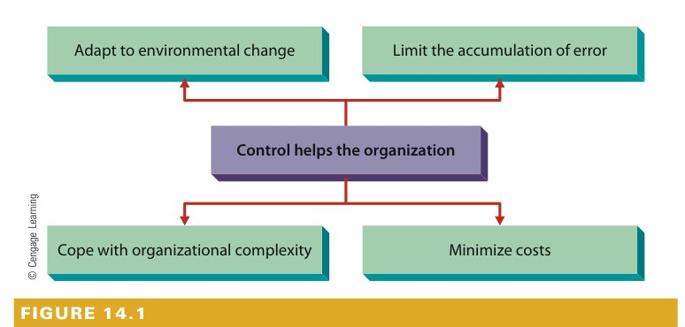
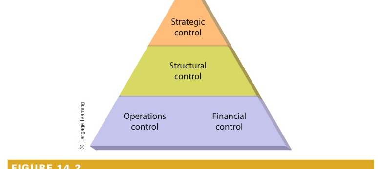
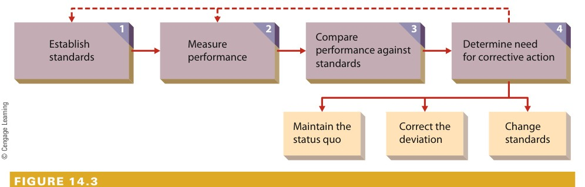
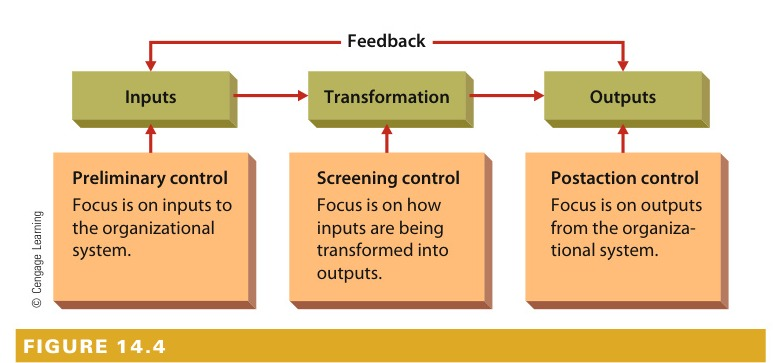
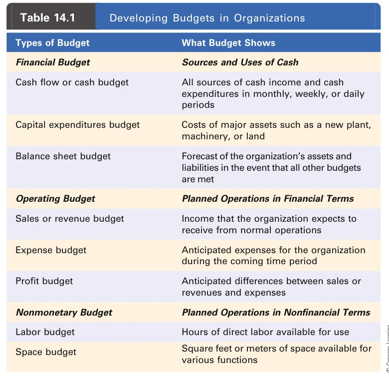
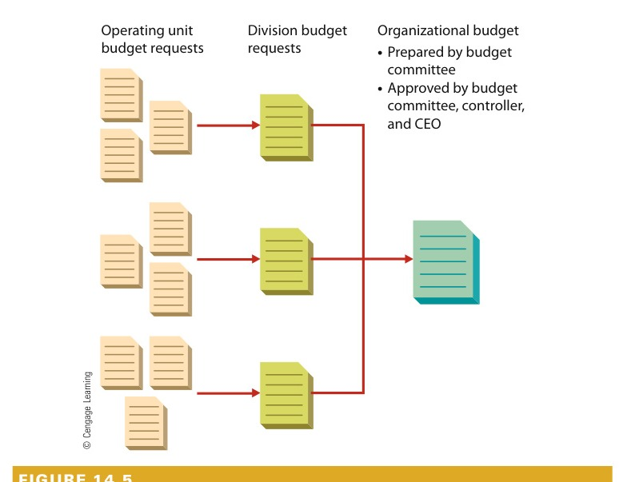
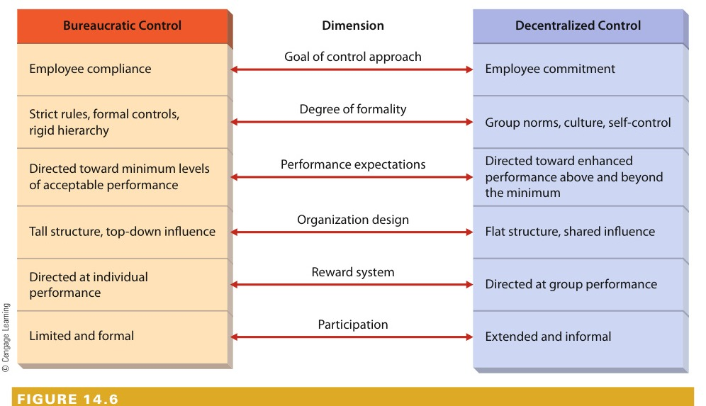

# CHAPTER 14: Basic Elements of Control

<!-- Page 453 -->

## Learning Outcomes

After studying this chapter, you should be able to:

1. Explain the purpose of control, identify different types of control, and describe the steps in the control process.
2. Identify and explain the three forms of operations control.
3. Describe budgets and other tools for financial control.
4. Identify and distinguish between two opposing forms of structural control.
5. Discuss the relationship between strategy and control.
6. Identify characteristics of effective control, why people resist control, and how managers can overcome this resistance.

---

### Management in Action: Shifting Gears in the Auto Industry

> "We’ve been sticking to our guns, and it’s worked well so far."  
> — *Chrysler Group CEO Sergio Marchionne on his strategy for reviving Chrysler*

In November 2008, U.S. automaker Chrysler announced that it was cutting 25 percent of its workforce and acknowledged that domestic sales had dropped 35 percent in 12 months. Then-CEO Robert Nardelli also admitted that the company could survive only by means of an alliance with another automaker and an infusion of government cash. In December, Chrysler announced that it would shut down all production through January 2009, that it planned to file for bankruptcy, and that it ultimately expected to cease production permanently. Federal aid to both Chrysler and General Motors was authorized in the same month and had topped \$17 billion by March 2009, when the Obama administration gave Chrysler 30 days to finalize a previously announced merger agreement with the Italian carmaker Fiat or face the loss of another \$6 billion in government subsidies.

Fiat? Things, it seems, had changed since the days when, for many American car buyers, Fiat stood for "Fix It Again, Tony." As recently as 2005, GM had been only too happy to pay \$2 billion to bail out of a joint venture with Fiat, which was wallowing in debt after accumulated losses of \$14 billion. A year later, however, Fiat had actually shown a profit—its first since 2000—and its stock price had doubled. By 2009, it was on *Fortune* magazine’s list of the "World’s Most

<!-- Page 454 -->

Admired Companies." It’s now Europe’s third-largest car company, behind only Volkswagen and Peugeot Citroën and ahead of Renault, Daimler (Mercedes Benz), and BMW, and number nine in the world, producing more cars than Hyundai or Mitsubishi.

The credit for this remarkable turnaround goes to CEO Sergio Marchionne, an accountant and industry outsider who, in 2004, became Fiat’s fifth CEO in two years. Billie Blair, a consultant specializing in corporate change management, reports that Marchionne brought an "unconventional approach" to the task of managing a car company in the twenty-first century. In the process, she says—citing Marchionne’s own explanation of his success at Fiat—he "revolutionized the [Fiat] culture in a way that will keep the company competitive in the long term." Adds David Johnston, whose Atlanta-based marketing company has worked with Chrysler: Marchionne "has been able to garner respect for Fiat again after its down years and reestablish it as a business leader."

What was Marchionne’s "unconventional approach"? It’s the same approach that he’s trying to bring to Chrysler. Taking over Fiat after nearly 15 years of continuously poor performance, Marchionne was forced to lay off employees, but he focused his job-cutting strategy on longer-term goals: He cut 10 percent of the company’s white-collar workforce of about 20,000, stripping away layers of management and making room for a younger generation of managers with experience in brand marketing rather than engineering. Refocusing the company on market-driven imperatives, he cut the design-to-market process from 4 years to 18 months, and, even more important, he spurred the introduction of a slew of new products. The Grande Punto, which was launched in mid-2005, was the best-selling subcompact in Western Europe a year later and spearheaded Fiat’s return to profitability. The retro-styled Cinquecento (500)

<!-- Page 455 -->

(think Volkswagen New Beetle), was first introduced in 2007. Both the car and its marketing launch were designed with heavy customer involvement, and the 500, like the Grande Punto, was an immediate success, with first-year sales outstripping Fiat’s original target by 160 percent.

Under the merger agreement reached with Fiat in June 2009, the 500 became one of at least seven Fiat vehicles that Chrysler will begin building and selling in the United States by 2014. Produced in four versions—hatchback, sporty hatchback, convertible, and station wagon—the U.S. adaptation of the 500 went to market in 2011, and Marchionne was convinced that, with a full range of body styles, “the 500 … will be a smash if we do it right.” Strategically, Marchionne knew that he had to reposition Chrysler from a maker of clunky gas-guzzlers to a marketer of stylish energy-efficient technology, and the 500, which one marketing association in Japan has declared “the sexiest car in the world,” has been designated the flagship of Fiat Chrysler’s new North American fleet.

Many analysts, however, remained skeptical about Marchionne’s prospects for turning Chrysler around even if the 500 turned out to be “a smash.” A big issue, they say, is time: Can “New Chrysler” (officially Chrysler Group LLC) hang on financially until projected new-product revenues start filling the company coffers? Completely new and improved Chryslers didn’t hit showrooms until 2013, but the new management has managed to roll out some new products, including a revamped Jeep Compass and an all-new Chrysler 300 sedan. “We’ve attacked the bulk of the product portfolio,” says Marchionne. “What we’ve got now is a commercially viable set of products in the marketplace.” He also points out that Chrysler sales are ahead of internal targets and claims that he’s more confident now about the prospects for a turnaround than he had been when the merger plans were being drawn up. “We’ve been sticking to our guns,” he says, “and it’s worked well so far.”1

Sergio Marchionne has used control effectively first at Fiat and more recently at Chrysler. As we discussed in Chapter 1, control is one of the four basic managerial functions that provide the organizing framework for this book. This is the first of two chapters devoted to this important area. In the first section of this chapter, we explain the purpose of control. We then look at types of control and the steps in the control process. The rest of the chapter examines the four levels of control that most organizations must employ to remain effective: operations, financial, structural, and strategic control. We conclude by discussing the characteristics of effective control, noting why some people resist control and describing what organizations can do to overcome this resistance. The next chapter in this part focuses on managing operations, quality, and productivity.

---

## The Nature of Control

Control is the regulation of organizational activities so that some targeted element of performance remains within acceptable limits. Without this regulation, organizations have no indication of how well they are performing in relation to their goals. Control, like a ship’s rudder, keeps the organization moving in the proper direction. At any point in time, it compares where the organization is in terms of performance (financial, productive, or otherwise) to where it is supposed to be. Like a rudder, control provides an organization with a mechanism for adjusting its course if performance falls outside acceptable boundaries.

> **control**: The regulation of organizational activities in such a way as to facilitate goal attainment.

<!-- Page 456 -->

For example, FedEx has a performance goal of delivering 99.9 percent of its packages on time. If on-time deliveries fall to, say, 99.6 percent, control systems will signal the problem to managers so that they can make necessary adjustments in operations to regain the target level of performance. An organization without effective control procedures is not likely to reach its goals—or, if it does reach them, to know that it has!

### The Purpose of Control

As Figure 14.1 illustrates, control provides an organization with ways to adapt to environmental change, to limit the accumulation of error, to cope with organizational complexity, and to minimize costs. These four functions of control are worth a closer look.

#### Adapting to Environmental Change
In today’s complex and turbulent business environment, all organizations must contend with change.2 If managers could establish goals and achieve them instantaneously, control would not be needed. But, between the time a goal is established and the time it is reached, many things can happen in the organization and its environment to disrupt movement toward the goal—or even to change the goal itself. A properly designed control system can help managers anticipate, monitor, and respond to changing circumstances.3 In contrast, an improperly designed system can result in organizational performance that falls far below acceptable levels.

For example, Michigan-based Metalloy, a 60-year-old, family-run metal-casting company, signed a contract to make engine seal castings for NOK, a big Japanese auto parts maker. Metalloy was satisfied when its first 5,000-unit production run yielded 4,985 acceptable castings and only 15 defective ones. NOK, however, was quite unhappy with this performance and insisted that Metalloy raise its standards. In short, global quality standards in most industries are such that customers demand near perfection from their suppliers. A properly designed control system can help managers like those at Metalloy stay better attuned to rising standards.

#### Limiting the Accumulation of Error
Small mistakes and errors do not often seriously damage the financial health of an organization. Over time, however, small errors may accumulate and become very serious. For example, Whistler Corporation, a large

*Figure 14.1 — The Purpose of Control*

> **Figure 14.1: The Purpose of Control**  
> Control is one of the four basic management functions in organizations. The control function, in turn, has four basic purposes. Properly designed control systems can fulfill each of these purposes.

<!-- Page 457 -->

radar detector manufacturer, was once faced with such rapidly escalating demand that quality essentially became irrelevant. The defect rate rose from 4 percent to 9 percent to 15 percent and eventually reached 25 percent. One day, a manager started paying more attention to this and realized that 100 of the plant’s 250 employees were spending all their time fixing defective units and that \ million worth of inventory was awaiting repair. Had the company adequately controlled quality as it responded to increased demand, the problem would never have reached such proportions. Similarly, a routine quality-control inspection of a prototype of Boeing’s 787 Dreamliner revealed that a fastener had not been installed correctly. Closer scrutiny then revealed that literally thousands of fasteners had been installed incorrectly in each prototype under construction. As a result, the entire project was delayed several months. If the inspection process had been more rigorous, the error would likely have been found and corrected much earlier, rather than accumulating into a major problem for Boeing.4

#### Coping with Organizational Complexity
When a firm purchases only one raw material, produces one product, has a simple organization design, and enjoys constant demand for its product, its managers can maintain control with a very basic and simple system. But a business that produces many products from myriad raw materials and has a large market area, a complicated organization design, and many competitors needs a sophisticated system to maintain adequate control. When large firms merge, the short-term results are often disappointing. The typical reason for this is that the new enterprise is so large and complex that the existing control systems are simply inadequate. When United Airlines and Continental Airlines agreed to merge at the end of 2010, the two firms faced myriad challenges in how to merge two complex flight operations centers, their human resource practices, their frequent flyer programs, and so forth. As a result, it took over two years for the merger to be completed, in large part due to the complex nature of the two organizations and their industry. And when American Airlines agreed to merge with US Airways in 2013, experts predicted a similar time frame for completing the merger.

#### Minimizing Costs
When it is practiced effectively, control can also help reduce costs and boost output. For example, Georgia-Pacific Corporation, a large wood products company, learned of a new technology that could be used to make thinner blades for its saws. The firm’s control system was used to calculate the amount of wood that could be saved from each cut made by the thinner blades relative to the costs used to replace the existing blades. The results have been impressive—the wood that is saved by the new blades each year fills 800 rail cars. As Georgia-Pacific discovered, effective control systems can eliminate waste, lower labor costs, and improve output per unit of input. Starbucks recently instructed its coffee shops to stop automatically brewing decaffeinated coffee after lunch. Sales of decaf plummet after lunch, and Starbucks realized that baristas were simply pouring most of it down the drain. Now, between noon and early evening, they brew decaf only by the cup and only when a customer orders it.5 Similarly, many businesses are cutting back on everything from health insurance coverage to overnight shipping to business lunches for clients in their quest to lower costs.6 The “Tough Times, Tough Choices” feature highlights how FedEx uses control as a central part of its business model.

### Types of Control
The examples of control given thus far have illustrated the regulation of several organizational activities, from producing quality products to coordinating complex organizations. Organizations practice control in a number of different areas, and at different levels, and the responsibility for managing control is widespread.

<!-- Page 458 -->

### Tough Times, Tough Choices: Engineering Time

Among the reasons for FedEx’s long-term success are its commitments to customer service and prompt, accurate delivery. The company’s information systems are critical to its ability to keep these commitments because they support the firm’s complex operations (including over 90,000 vehicles, 677 airplanes, and 200,000 employees in 220 countries) and allow it to deliver 6 million packages daily.

"We engineer time," explains executive vice president and chief information officer Rob Carter. "We … allow you to engineer time to make things happen along time schedules that weren’t possible [before]." Texas-based Motion Computing, for example, outsources assembly to a factory in China, and FedEx is able to transport a finished PC from the assembly plant directly to the consumer in about five days. Why is such speed so important to Motion? "We have no inventory tied up in the process anywhere," says CEO Scott Eckert. "Frankly, our business is enabled by FedEx."

FedEx founder and CEO Fred Smith once remarked that information about a package is as important as the package itself, and his company has for a long time been putting this insight into practice by means of an extensive online tracking system. Recently, the entire system has been reconfigured so that customers can stay ahead of deliveries rather than merely keeping up with them. "[We] took the whole tracking mechanism and turned it around," reports Carter, "so that as opposed to having to track a package, you say, 'I want to know what’s coming to me today.' You can go out there now and see every inbound package, regardless of whether you knew someone was sending it."

It’s important to FedEx that it was the first company in the package-delivery industry to recognize the strategic value of information systems. Rival UPS, asserts Carter, still lags behind even though "it’s easier to copy than it is to innovate." While granting that UPS offers many of the same information services as FedEx, Carter hastens to underscore what

<!-- Page 459 -->

he considers some significant differences between the two competitors. "We’ve been in a battle on customer-based technology," but FedEx, he explains, "tends to focus slightly less on operational technology. We focus a little more on revenue-generating, customer-satisfaction–generating, strategic-advantage technology.

"The key focus of my job," Carter adds, "is driving technology that increases the top line." As CIO, he puts the emphasis on effectiveness, quality, and satisfaction rather than on bottom-line efficiency and cost control. With a veteran team committed to innovation and an annual budget of \$1 billion, Carter expects FedEx’s IT operations to be a source of both strategic control and advantage for some time to come.

> **References**: Geoffrey Colvin, "The FedEx Edge," *Fortune*, http://money.cnn.com, accessed on January 1, 2014; Dean Foust, "FedEx: Taking Off Like 'A Rocket Ship,'" *BusinessWeek*, April 3, 2006, www.businessweek.com, accessed on January 1, 2014; "FedEx Recognized as One of Fortune Magazine’s '100 Best Companies to Work For,'" *Business Wire*, www.businesswire.com, accessed on January 1, 2014; "100 Best Companies to Work For," *Fortune*, http://money.cnn.com, accessed on January 1, 2014.

---

#### Areas of Control
Control can focus on any area of an organization. Most organizations define areas of control in terms of the four basic types of resources they use: physical, human, information, and financial.7 Control of physical resources includes inventory management (stocking neither too few nor too many units in inventory), quality control (maintaining appropriate levels of output quality), and equipment control (supplying the necessary facilities and machinery). Control of human resources includes selection and placement, training and development, performance appraisal, and compensation. Relatedly, organizations also attempt to control the behavior of their employees—directing them toward higher performance, for example, and away from unethical behaviors.8

Control of information resources includes sales and marketing forecasting, environmental analysis, public relations, production scheduling, and economic forecasting.9 Financial control involves managing the organization’s financial obligations so that they do not become excessive, ensuring that the firm always has enough cash on hand to meet its obligations but does not have excess cash sitting idly in a checking account, and ensuring that receivables are collected and bills are paid on a timely basis.

In many ways, the control of financial resources is the most important area, because financial resources are related to the control of all the other resources in an organization. Too much inventory leads to storage costs; poor selection of personnel leads to termination and rehiring expenses; inaccurate sales forecasts lead to disruptions in cash flows and other financial effects. Financial issues tend to pervade most control-related activities.

The crisis in the U.S. airline industry precipitated by the terrorist attacks on September 11, 2001, the economic recession of 2009 that reduced business travel, and rising fuel costs can be fundamentally traced to financial issues. Essentially, airline revenues have dropped, while their costs have increased. Because of high labor costs and other expenses, the airlines faced major problems in making appropriate adjustments. Major long-haul U.S. airlines such as United spend nearly half of their revenues on labor; in contrast, JetBlue spends only about 25 percent of its revenues on labor.

> **operations control**: Focuses on the processes that the organization uses to transform resources into products or services.  
> **financial control**: Concerned with the organization’s financial resources.

#### Levels of Control
Just as control can be broken down by area, it can also be broken down by level within the organizational system, as shown in Figure 14.2. Operations control focuses on the processes the organization uses to transform resources into products or services.10 Quality control is one type of operations control. Financial control

<!-- Page 460 -->

is concerned with the organization’s financial resources. Monitoring receivables to make sure customers are paying their bills on time is an example of financial control. Structural control is concerned with how the elements of the organization’s structure are serving their intended purpose. Monitoring the administrative ratio to make sure staff expenses do not become excessive is an example of structural control. Finally, strategic control focuses on how effectively the organization’s corporate, business, and functional strategies are succeeding in helping the organization meet its goals. For example, if a corporation has been unsuccessful in implementing its strategy of related diversification, its managers need to identify the reasons for that lack of success and either change the strategy or renew their efforts to implement it. We discuss these four levels of control more fully later in this chapter.

> **structural control**: Concerned with how the elements of the organization’s structure are serving their intended purpose.  
> **strategic control**: Focuses on how effectively the organization’s strategies are succeeding in helping the organization meet its goals.  
> **controller**: A position in organizations that helps line managers with their control activities.

*Figure 14.2 — Levels of Control*

> **Figure 14.2: Levels of Control**  
> Managers use control at several different levels. The most basic levels of control in organizations are strategic, structural, operations, and financial. Each level must be managed properly if control is to be most effective.

#### Responsibilities for Control
Traditionally, managers have been responsible for overseeing the wide array of control systems and concerns in organizations. They decide which types of control the organization will use, and they implement control systems and take actions based on the information provided by control systems. Thus, ultimate responsibility for control rests with all managers throughout an organization.

Most larger organizations also have one or more specialized managerial positions called controller. A controller is responsible for helping line managers with their control activities, for coordinating the organization’s overall control system, and for gathering and assimilating relevant information. Many businesses that use an H-form or M-form organization design have several controllers: one for the corporation and one for each division. The job of controller is especially important in organizations where control systems are complex.11

In addition, many organizations are also beginning to use operating employees to help maintain effective control. Indeed, employee participation is often used as a vehicle for allowing operating employees an opportunity to help facilitate organizational effectiveness. For example, Whistler Corporation increased employee participation in an effort to turn its quality problems around. As a starting point, the quality control unit,

<!-- Page 461 -->

formerly responsible for checking product quality at the end of the assembly process, was eliminated. Next, all operating employees were encouraged to check their own work and told that they would be responsible for correcting their own errors. As a result, Whistler has eliminated its quality problems and is now highly profitable once again.

---

## Steps in the Control Process

Regardless of the type or levels of control systems that an organization needs, each control process has four fundamental steps.12 These are illustrated in Figure 14.3.

*Figure 14.3 — Steps in the Control Process*

> **Figure 14.3: Steps in the Control Process**  
> Having an effective control system can help ensure that an organization achieves its goals. Implementing a control system, however, is a systematic process that generally proceeds through four interrelated steps.

### Establishing Standards
The first step in the control process is establishing standards. A control standard is a target against which subsequent performance will be compared.13

> **control standard**: A target against which subsequent performance will be compared.

Employees at a Taco Bell fast-food restaurant, for example, work toward the following service standards:

1. A minimum of 95 percent of all customers will be greeted within 3 minutes of their arrival.
2. Preheated tortilla chips will not sit in the warmer more than 30 minutes before they are served to customers or discarded.
3. Empty tables will be cleaned within 5 minutes after being vacated.

Standards established for control purposes should be expressed in measurable terms. Note that standard 1 has a time limit of 3 minutes and an objective target of 95 percent of all customers. In standard 3, the objective target of "all" empty tables is implied.

Control standards should also be consistent with the organization’s goals. Taco Bell has organizational goals involving customer service, food quality, and restaurant cleanliness. A control standard for a retailer like Best Buy should be consistent with its goal of increasing its annual sales volume by 25 percent within five years. A hospital trying to shorten the average hospital stay for a patient will have control standards that reflect current averages. A university reaffirming its commitment to academics might adopt a standard of graduating 80 percent of its student athletes within five years of their enrollment. Control standards can be as narrow or as broad as the level of activity to which they apply and must follow logically from organizational goals and objectives. When Airbus introduced the A380, the world’s largest passenger airplane, managers indicated that the firm needed to ship 270 planes to break even, and set a goal of delivering 18 per year.

<!-- Page 462 -->

Managers also forecast that demand for very large aircraft like the A380 and Boeing’s revamped 747 would exceed 1,200 planes during the next 20 years.14

A final aspect of establishing standards is to identify performance indicators. Performance indicators are measures of performance that provide information that is directly relevant to what is being controlled. For example, suppose an organization is following a tight schedule in building a new plant. Relevant performance indicators could be buying a site, selecting a building contractor, and ordering equipment. Monthly sales increases are not, however, directly relevant. On the other hand, if control is being focused on revenue, monthly sales increases are relevant, whereas buying land for a new plant is less relevant.

### Measuring Performance
The second step in the control process is measuring performance. Performance measurement is a constant, ongoing activity for most organizations. For control to be effective, performance measures must be valid. Daily, weekly, and monthly sales figures measure sales performance, and production performance may be expressed in terms of unit cost, product quality, or volume produced. Employees’ performance is often measured in terms of quality or quantity of output, but for many jobs, measuring performance is not so straightforward.

A research and development scientist at Texas Instruments, for example, may spend years working on a single project before achieving a breakthrough. A manager who takes over a business on the brink of failure may need months or even years to turn things around. Valid performance measurement, however difficult to obtain, is nevertheless vital in maintaining effective control, and performance indicators usually can be developed. The scientist’s progress, for example, may be partially assessed by peer review, and the manager’s success may be evaluated by her ability to convince creditors that she will eventually be able to restore profitability.

As Airbus completed the design and manufacture of its A380 jumbo jet, managers recognized that delays and cost overruns had changed its breakeven point. New calculations indicated that the company would need to sell 420 planes before it would become profitable. Its actual annual sales, of course, remained relatively easy to measure.

### Comparing Performance Against Standards
The third step in the control process is comparing measured performance against established standards. Performance may be higher than, lower than, or identical to the standard. In some cases, comparison is easy. The goal of each product manager at General Electric is to make the product either number one or number two (on the basis of total sales) in its market. Because this standard is clear and total sales are easy to calculate, it is relatively simple to determine whether this standard has been met.

Sometimes, however, comparisons are less clear-cut. If performance is lower than expected, the question is how much deviation from standards to allow before taking remedial action. For example, is increasing sales by 7.9 percent close enough when the standard was 8 percent?

<!-- Page 463 -->

The timetable for comparing performance to standards depends on a variety of factors, including the importance and complexity of what is being controlled. For longer-run and higher-level standards, annual comparisons may be appropriate. In other circumstances, more frequent comparisons are necessary. For example, a business with a severe cash shortage may need to monitor its on-hand cash reserves daily. In its first year of production, Airbus did indeed deliver 18 A380s, just as it had forecast.

### Considering Corrective Action
The final step in the control process is determining the need for corrective action. Decisions regarding corrective action draw heavily on a manager’s analytic and diagnostic skills. For example, as health-care costs have risen, many firms have sought ways to keep their own expenses in check. Some have reduced benefits; others have opted to pass on higher costs to their employees.15

After comparing performance against control standards, one of three actions is appropriate: Maintain the status quo (do nothing), correct the deviation, or change the standards. Maintaining the status quo is preferable when performance essentially matches the standards, but it is more likely that some action will be needed to correct a deviation from the standards.

Sometimes, performance that is higher than expected may also cause problems for organizations. For example, when highly anticipated new video games or game systems are first introduced, the demand may be so strong that customers are placed on waiting lists. And even some people who are among the first to purchase such products immediately turn around and list them for sale on eBay for an inflated price. The manufacturer may be unable to increase production in the short term, though, and also knows that demand will eventually drop. At the same time, however, the firm would not want to alienate potential customers. Consequently, it may decide to simply reduce its advertising. This may curtail demand a bit and limit customer frustration.

Changing an established standard usually is necessary if it was set too low or too high at the outset. This is apparent if large numbers of employees routinely beat the standard by a wide margin or if no employees ever meet the standard. Also, standards that seemed perfectly appropriate when they were established may need to be adjusted if circumstances have since changed.

As the 2008–2009 global recession began to take its toll, two major Airbus customers, Qantas and Emirates, indicated that they wanted to defer delivery of some previously ordered A380s. As a result, Airbus found it necessary to reduce its production in 2009 from 18 down to only 14. It also indicated that the plane’s breakeven point had increased, but would not reveal the new target.

---

## Operations Control

One of the four levels of control practiced by most organizations, operations control is concerned with the processes that the organization uses to transform resources into products or services. As Figure 14.4 shows, the three forms of operations control—preliminary, screening, and postaction—occur at different points in relation to the transformation processes used by the organization.

> **operations control**: Focuses on the processes the organization uses to transform resources into products or services.  
> **preliminary control**: Attempts to monitor the quality or quantity of financial, physical, human, and information resources before they actually become part of the system.

### Preliminary Control
Preliminary control concentrates on the resources—financial, material, human, and information—the organization brings in from the environment. Preliminary control attempts to monitor the quality or quantity of these resources before they enter the organization. Firms such as PepsiCo and General Mills hire only college graduates for their

<!-- Page 464 -->

management training programs, and even then only after applicants satisfy several interviewers and selection criteria. In this way, they control the quality of the human resources entering the organization. When Sears orders merchandise to be manufactured under its own brand name, it specifies rigid standards of quality, thereby controlling physical inputs. Organizations also control financial and information resources. For example, closely held companies such as Toys "R" Us and Mars limit the extent to which outsiders can buy their stock, and television networks verify the accuracy of news stories before they are broadcast.

### Screening Control
Screening control focuses on meeting standards for product or service quality or quantity during the actual transformation process itself. Screening control relies heavily on feedback processes. For example, in a Dell assembly factory, computer system components are checked periodically as each unit is being assembled. This is done to ensure that all the components that have been assembled up to that point are working properly. The periodic quality checks provide feedback to workers so that they know what, if any, corrective actions to take. Because they are useful in identifying the cause of problems, screening controls tend to be used more often than other forms of control.

More and more companies are adopting screening controls because they are an effective way to promote employee participation and catch problems early in the overall transformation process. For example, Corning adopted screening controls for use in manufacturing television glass. In the past, finished television screens were inspected only after they were finished. Unfortunately, over 4 percent of them were later returned by customers because of defects. Now the glass screens are inspected at each step in the production process, rather than at the end, and the return rate from customers has dropped to .03 percent.

> **screening control**: Relies heavily on feedback processes during the transformation process.

*Figure 14.4 — Forms of Operations Control*

> **Figure 14.4: Forms of Operations Control**  
> Most organizations develop multiple control systems that incorporate all three basic forms of control. For example, the publishing company that produced this book screens inputs by hiring only qualified employees, typesetters, and printers (preliminary control). In addition, quality is checked during the transformation process, such as after the manuscript is typeset (screening control), and the outputs—printed and bound books—are checked before they are shipped from the bindery (postaction control).

<!-- Page 465 -->

### Postaction Control
Postaction control focuses on the outputs of the organization after the transformation process is complete. Corning’s old system was postaction control—final inspection after the product was manufactured. Although Corning abandoned its postaction control system, it still may be an effective method of control, primarily if a product can be manufactured in only one or two steps or if the service is fairly simple and routine. Although postaction control alone may not be as effective as preliminary or screening control, it can provide management with information for future planning. For example, if a quality check of finished goods indicates an unacceptably high defect rate, the production manager knows that he or she must identify the causes and take steps to eliminate them. Postaction control also provides a basis for rewarding employees. Recognizing that an employee has exceeded personal sales goals by a wide margin, for example, may alert the manager that a bonus or promotion is in order.

Most organizations use more than one form of operations control. For example, Honda’s preliminary control includes hiring only qualified employees and specifying strict quality standards when ordering parts from other manufacturers. Honda uses numerous screening controls in checking the quality of components during car assembly. A final inspection and test drive as each car rolls off the assembly line is part of the company’s postaction control.16 Indeed, most successful organizations employ a wide variety of techniques to facilitate operations control.

> **postaction control**: Monitors the outputs or results of the organization after the transformation process is complete.

---

## Financial Control

Financial control is the control of financial resources as they flow into the organization (such as revenues and shareholder investments), are held by the organization (for example, working capital and retained earnings), and flow out of the organization (like pay and expenses). Businesses must manage their finances so that revenues are sufficient to cover costs and still return a profit to the firm’s owners. Not-for-profit organizations such as universities have the same concerns: Their revenues (from tax dollars or tuition) must cover operating expenses and overhead. U.S. automakers Ford and General Motors have come to realize that they have to reduce the costs of paying employees they do not need but whom they are obligated to keep due to long-standing labor agreements. Ford has offered to cover the full costs of a college education for certain of its employees if they will resign; GM, for its part, has offered lump-sum payments of varying amounts to some of its workers in return for their resignations.17 A complete discussion of financial management is beyond the scope of this book, but we will examine the control provided by budgets and other financial control tools.

> **financial control**: Concerned with the organization’s financial resources.  
> **budget**: A plan expressed in numerical terms.

### Budgetary Control
A budget is a plan expressed in numerical terms. Organizations establish budgets for work groups, departments, divisions, and the whole organization. The usual time period for a budget is one year, although breakdowns of budgets by the quarter or month are also common. Budgets are generally expressed in financial terms, but they may occasionally be expressed in units of output, time, or other quantifiable factors. When Disney launches the production of a new animated cartoon feature, it creates a budget for how much the movie should cost. Several years ago, when movies such as *The Lion King* were raking in hundreds of millions of dollars, Disney executives were fairly flexible about budget overruns. But, on the heels of several

<!-- Page 466 -->

animated-movie flops, such as *Atlantis: The Lost Empire* and *Treasure Planet*, the company had to take a much harder line on budget overruns.18 More recently, major losses on Disney live-action films like 2014’s *The Lone Ranger* have prompted increased budget scrutiny on all future films.

Because of their quantitative nature, budgets provide yardsticks for measuring performance and facilitate comparisons across departments, between levels in the organization, and from one time period to another. Budgets serve four primary purposes. They help managers coordinate resources and projects (because they describe diverse organizational activities in a common denominator: dollars). They help define the established standards for control (by providing explicit numerical targets for activities). They provide guidelines about the organization’s resources and expectations (by indicating how much spending is allowable for various purposes). Finally, budgets enable the organization to evaluate the performance of managers and organizational units (by comparing actual spending to budgeted spending).

Weak financial control can be devastating to a business, especially one operating in a volatile environment. Many small businesses did not have sufficient financial reserves to weather the 2008–2009 recession and failed. And even when firms have sufficient financial health, allegations about ongoing product defects led to the largest recall in automobile history in 2014.

#### Types of Budgets
Most organizations develop and make use of three kinds of budgets—financial, operating, and nonmonetary. Table 14.1 summarizes the characteristics of each of these.

A **financial budget** indicates where the organization expects to get its cash for the coming time period and how it plans to use it. Because financial resources are critically important, the organization needs to know where those resources will be coming from and how they are to be used. The financial budget provides answers to both these questions. Usual sources of cash include sales revenue, short- and long-term loans, the sale of assets, and the issuance of new stock.

For years, Exxon was very conservative in its capital budgeting. As a result, the firm amassed a huge financial reserve but was being overtaken in sales by Royal Dutch/Shell Group. But executives at Exxon were then able to use their reserves to help finance the firm’s merger with Mobil, creating ExxonMobil, and to regain the number-one sales position. Since that time, the firm has become more aggressive in capital budgeting to stay ahead of its European rival.

An **operating budget** is concerned with planned operations within the organization. It outlines what quantities of products or services the organization intends to create and what resources will be used to create them. IBM creates an operating budget that specifies how many of each model of its personal computers will be produced each quarter.

A **nonmonetary budget** is simply a budget expressed in nonfinancial terms, such as units of output, hours of direct labor, machine hours, or square-foot allocations. Nonmonetary budgets are most commonly used by managers at the lower levels of an organization. For example, a plant manager can schedule work more effectively knowing that he or she has 9,000 labor hours to allocate in a week, rather than trying to determine how to best spend \$96,485 in wages in a week.

<!-- Page 467 -->

*Table 14.1 — Developing Budgets in Organizations*

> **Table 14.1: Developing Budgets in Organizations**  
> Organizations use various types of budgets to help manage their control functions. The three major categories of budgets are financial, operating, and nonmonetary. There are several different types of budgets in each category. To be most effective, each budget must be carefully matched with the specific function being controlled.

| Types of Budget | What Budget Shows |
| :--- | :--- |
| **Financial Budget** | **Sources and Uses of Cash** |
| Cash flow or cash budget | All sources of cash income and cash expenditures in monthly, weekly, or daily periods |
| Capital expenditures budget | Costs of major assets such as a new plant, machinery, or land |
| Balance sheet budget | Forecast of the organization’s assets and liabilities in the event that all other budgets are met |
| **Operating Budget** | **Planned Operations in Financial Terms** |
| Sales or revenue budget | Income that the organization expects to receive from normal operations |
| Expense budget | Anticipated expenses for the organization during the coming time period |
| Profit budget | Anticipated differences between sales or revenues and expenses |
| **Nonmonetary Budget** | **Planned Operations in Nonfinancial Terms** |
| Labor budget | Hours of direct labor available for use |
| Space budget | Square feet or meters of space available for various functions |

#### Developing Budgets
Traditionally, budgets were developed by top management and the controller and then imposed on lower-level managers. Although some organizations still follow this pattern, many contemporary organizations now allow all managers to participate in the budget process. As a starting point, top management generally issues a call for budget requests, accompanied by an indication of overall patterns the budgets may take. For example, if sales are expected to drop in the next year, managers may be told up front to prepare for cuts in operating budgets.

As Figure 14.5 shows, the heads of each operating unit typically submit budget requests to the head of their division. An operating unit head might be a department manager in a manufacturing or wholesaling firm or a program director in a social service agency. The division heads might include plant managers, regional sales managers, or college deans. The division head integrates and consolidates the budget requests from operating unit heads into one overall division budget request. A great deal of interaction among managers usually takes place at this stage because the division head coordinates the budgetary needs of the various departments.

Division budget requests are then forwarded to a budget committee. The budget committee is usually composed of top managers. The committee reviews budget requests from several divisions, and once again, duplications and inconsistencies are corrected. Finally, the budget committee, the controller, and the CEO review and agree on the

<!-- Page 468 -->

overall budget for the organization, as well as specific budgets for each operating unit. These decisions are then communicated back to each manager.

*Figure 14.5 — Developing Budgets in Organizations*

> **Figure 14.5: Developing Budgets in Organizations**  
> Most organizations use the same basic process to develop budgets. Operating units are requested to submit their budget requests to divisions. These divisions, in turn, compile unit budgets and submit their own budgets to the organization. An organizational budget is then compiled for approval by the budget committee, controller, and CEO.

#### Strengths and Weaknesses of Budgeting
Budgets offer a number of advantages, but they also have weaknesses. On the plus side, budgets facilitate effective control. Placing dollar values on operations enables managers to monitor operations better and pinpoint problem areas. Budgets also facilitate coordination and communication between departments because they express diverse activities in a common denominator (dollars). Budgets help maintain records of organizational performance and are a logical complement to planning. In other words, as managers develop plans, they should simultaneously consider control measures to accompany them. Organizations can use budgets to link plans and control by first developing budgets as part of the plan and then using those budgets as part of control.

On the other hand, some managers apply budgets too rigidly. Budgets are intended to serve as frameworks, but managers sometimes fail to recognize that changing circumstances may warrant budget adjustments. Also, the process of developing budgets can be very time consuming. Finally, budgets may limit innovation and change. When all available funds have been allocated to specific operating budgets, it may be impossible to procure additional funds to take advantage of an unexpected opportunity.

<!-- Page 469 -->

Indeed, for these very reasons, some organizations are working to scale back their budgeting systems. Although most organizations are likely to continue to use budgets, the trend is toward making budgets more flexible and less time consuming, and using them in conjunction with other control procedures.

### Other Tools for Financial Control
Although budgets are the most common means of financial control, other useful tools are financial statements, ratio analysis, and financial audits.

#### Financial Statements
A financial statement is a profile of some aspect of an organization’s financial circumstances. Financial statements must be prepared and presented in commonly accepted and required ways. The two most basic financial statements prepared and used by virtually all organizations are a balance sheet and an income statement.

> **financial statement**: A profile of some aspect of an organization’s financial circumstances.  
> **balance sheet**: List of assets and liabilities of an organization at a specific point in time.  
> **income statement**: A summary of financial performance over a period of time, usually one year.  
> **ratio analysis**: The calculation of one or more financial ratios to assess some aspect of the organization’s financial health.  
> **audits**: An independent appraisal of an organization’s accounting, financial, and operational systems.

The **balance sheet** lists the assets and liabilities of the organization at a specific point in time. For example, a balance sheet may summarize the financial condition of an organization on December 31, 2015. Most balance sheets are divided into current assets (assets that are relatively liquid or easily converted into cash), fixed assets (longer-term assets such as plants, equipment, and land), current liabilities (debts that must be paid in the near future), and long-term liabilities (longer-term debt obligations). The difference between assets and liabilities represents the owners’ equity in the organization.

Whereas the balance sheet reflects a snapshot profile of an organization’s financial position at a single point in time, the **income statement** summarizes financial performance over a period of time, usually one year. For example, the income statement might cover the period from January 1, 2015, through December 31, 2015. The income statement summarizes the firm’s revenues less its expenses to report net income (profit or loss) for the period. Information from the balance sheet and income statement is used in computing important financial ratios.

#### Ratio Analysis
Financial ratios compare different elements of a balance sheet or income statement to one another. Ratio analysis is the calculation of one or more financial ratios to assess some aspect of the financial health of an organization. Organizations use a variety of financial ratios as part of financial control. For example, *liquidity ratios* indicate how liquid (easily converted into cash) an organization’s assets are. *Debt ratios* reflect ability to meet long-term financial obligations. *Return ratios* show managers and investors how much return the organization is generating relative to the assets invested. *Coverage ratios* help estimate the organization’s ability to cover interest expenses on borrowed capital. *Operating ratios* indicate the effectiveness of specific functional areas rather than the organization as a whole. The Walt Disney Company, for example, relies heavily on financial ratios to keep its financial operations on track.19

#### Financial Audits
Audits are independent appraisals of an organization’s accounting, financial, and operational systems. The two major types of financial audits are the external audit and the internal audit.

**External audits** are financial appraisals conducted by experts who are not employees of the organization. External audits are typically concerned with determining whether the organization’s accounting procedures and financial statements are compiled in an objective and verifiable manner. The external audit tests the reliability of the firm’s accounting systems and ensures that the methods by which the organization’s financial managers and accountants prepare documents and reports are legal and proper.

<!-- Page 470 -->

External audits are so important that publicly held corporations are required by law to have external audits regularly, as assurance to investors that the financial reports are reliable.

Unfortunately, flaws in the auditing process played a major role in the downfall of Enron and several other major firms. The problem can be traced back partially to the auditing groups’ problems with conflicts of interest and eventual loss of objectivity. For instance, Enron was such an important client for its auditing firm, Arthur Andersen, that the auditors started letting the firm take liberties with its accounting systems for fear that if they were too strict, Enron might take its business to another auditing firm. In the aftermath of the resulting scandal, Arthur Andersen was forced to close its doors, Enron had to liquidate all of its assets, several top managers from both firms went to jail, and the entire accounting profession was forced to reexamine its basic businesses practices.20

Some organizations are also starting to employ external auditors to review other aspects of their financial operations. For example, some auditing firms now specialize in checking corporate legal bills. An auditor for the Fireman’s Fund Insurance Company uncovered several thousands of dollars in legal-fee errors. Other auditors are beginning to specialize in real estate, employee benefits, and pension plan investments.

Whereas external audits are conducted by external accountants, an **internal audit** is handled by employees of the organization. Its objective is the same as that of an external audit—to verify the accuracy of financial and accounting procedures used by the organization. Internal audits also examine the efficiency and appropriateness of financial and accounting procedures. Because the staff members who conduct them are a permanent part of the organization, internal audits tend to be more expensive than external audits. But employees, who are more familiar with the organization’s practices, may also point out significant aspects of the accounting system besides its technical correctness. Large organizations like Halliburton and Ford have an internal auditing staff that spends all its time conducting audits of different divisions and functional areas of the organization. Smaller organizations may assign accountants to an internal audit group on a temporary or rotating basis.

Satyam Computer Services in India falsely reported profits of over \$1 billion when in reality it had only \$66 million. The Indian affiliate of PricewaterhouseCoopers, PW India, was in charge of routinely auditing the firm, but failed to follow basic auditing procedures. Rather than confirming the supposed \$1 billion cash balances with the banks, PW India relied solely on the information provided by the firm’s management. In some cases, auditors failed to follow up on confirmations sent independently by the banks that showed significant differences from the balances reported by management. PW India was eventually fined \$7.5 million—the largest penalty ever imposed by India on a foreign accounting firm.21

---

## Structural Control

Organizations can create designs for themselves that result in very different approaches to control. Two major forms of structural control, bureaucratic control and decentralized control, represent opposite ends of a continuum, as shown in Figure 14.6.22 The six dimensions shown in the figure represent perspectives adopted by the two extreme types of structural control. In other words, they have different goals, degrees of formality, performance expectations, organization designs, reward systems, and levels of participation. Although a few organizations fall precisely at one extreme or the other, most tend toward one end but may have specific characteristics of either.

<!-- Page 471 -->

*Figure 14.6 — Organizational Control*

> **Figure 14.6: Organizational Control**  
> Organizational control generally falls somewhere between the two extremes of bureaucratic and decentralized control. McDonald’s uses bureaucratic control, whereas Starbucks uses decentralized control.

### Bureaucratic Control
Bureaucratic control is an approach to organization design characterized by formal and mechanistic structural arrangements. As the term suggests, it follows the bureaucratic model. The goal of bureaucratic control is employee compliance. Organizations that use it rely on strict rules and a rigid hierarchy, insist that employees meet minimally acceptable levels of performance, and often have a tall structure. They focus their rewards on individual performance and allow only limited and formal employee participation.

McDonald’s applies structural controls that reflect many elements of bureaucracy. The organization relies on numerous rules to regulate employee travel, expense accounts, and other expenses. A new performance appraisal system precisely specifies minimally acceptable levels of performance for everyone. The organization’s structure is considerably taller than those of the other major networks, and rewards are based on individual contributions. In another example, a large oil company recently made the decision to allow employees to wear casual attire to work. But a committee then spent weeks developing a 20-page set of guidelines on what was and was not acceptable. For example, denim pants are not allowed. Similarly, athletic shoes may be worn as long as they are not white. And all shirts must have a collar. Nordstrom, the department store chain, is also moving toward bureaucratic control as it works to centralize all of its purchasing in an effort to lower costs. Similarly, Home Depot is moving more toward bureaucratic control to cut its costs and more effectively compete with its hard-charging rival, Lowe’s.

> **bureaucratic control**: A form of organizational control characterized by formal and mechanistic structural arrangements.

<!-- Page 472 -->

### Decentralized Control
Decentralized control, in contrast, is an approach to organizational control characterized by informal and organic structural arrangements. As Figure 14.6 shows, its goal is employee commitment to the organization. Accordingly, it relies heavily on group norms and a strong corporate culture, and gives employees the responsibility for controlling themselves. Employees are encouraged to perform beyond minimally acceptable levels. Organizations using this approach are usually relatively flat. They direct rewards at group performance and favor widespread employee participation.

Starbucks allows local managers considerable discretion in the décor of each coffee shop, as well as what merchandise is displayed. Another company that uses this approach is Southwest Airlines. When Southwest made the decision to "go casual," the firm resisted the temptation to develop dress guidelines. Instead, managers decided to allow employees to exercise discretion over their attire and to deal with clearly inappropriate situations on a case-by-case basis.

> **decentralized control**: An approach to organizational control based on informal and organic structural arrangements.  
> **strategic control**: Control aimed at ensuring that the organization is maintaining an effective alignment with its environment and moving toward achieving its strategic goals.

---

## Strategic Control

Given the obvious importance of an organization’s strategy, it is also important that the organization assess how effective that strategy is in helping the organization meet its goals.23 To do this requires that the organization integrate its strategy and control systems. This is especially true for the global organization.

### Integrating Strategy and Control
Strategic control generally focuses on five aspects of organizations—structure, leadership, technology, human resources, and information and operational control systems. For example, an organization should periodically examine its structure to determine whether it is facilitating the attainment of the strategic goals being sought. Suppose a firm using a functional (U-form) design has an established goal of achieving a 20 percent sales growth rate per year. However, performance indicators show that it is currently growing at a rate of only 10 percent per year. Detailed analysis might reveal that the current structure is inhibiting growth in some way (for example, by slowing decision making and inhibiting innovation) and that a divisional (M-form) design is more likely to bring about the desired growth (by speeding decision making and promoting innovation).

In this way, strategic control focuses on the extent to which implemented strategy achieves the organization’s strategic goals. If, as outlined earlier, one or more avenues of implementation are inhibiting the attainment of goals, that avenue should be changed. Consequently, the firm might find it necessary to alter its structure, replace key leaders, adopt new technology, modify its human resources, or change its information and operational control systems.

For several years, Pfizer, the world’s largest pharmaceutical company, has invested billions of dollars in research and development. Recently, though, the firm acknowledged that it was not getting an adequate return on its investment and announced that it was laying off 800 senior researchers. The firm also signaled a strategic reorientation by suggesting it would look for other drug companies to buy in order to acquire new patents and drug formulas.24 Kohl’s department stores essentially redefined how to compete effectively in the midtier retailing market and was on trajectory to leave competitors such as Sears and Dillard’s in its dust. But then the firm inexplicably stopped doing many of the very things that had led to its success—such as keeping abreast of current styles, maintaining low inventories, and keeping its stores neat and clean—and began to stumble. Now, managers are struggling to rejuvenate Kohl’s strategic focus and get it back on track.25

Because of both their relatively large size and the increased complexity associated with international business, global organizations must take an especially pronounced strategic

<!-- Page 473 -->

view of their control systems. One very basic question that has to be addressed is whether to manage control from a centralized or a decentralized perspective.26 Under a centralized system, each organizational unit around the world is responsible for frequently reporting the results of its performance to headquarters. Managers from the home office often visit foreign branches to observe firsthand how the units are functioning.

BP, Unilever, Procter & Gamble, and Sony all use this approach. They believe centralized control is effective because it allows the home office to keep better informed of the performance of foreign units and to maintain more control over how decisions are made. For example, BP discovered that its Australian subsidiary was not billing its customers for charges as quickly as were its competitors. By shortening the billing cycle, BP now receives customer payments five days faster than before. Managers believe that they discovered this oversight only because of a centralized financial control system.

Organizations that use a decentralized control system require foreign branches to report less frequently and in less detail. For example, each unit may submit summary performance statements on a quarterly basis and provide full statements only once a year. Similarly, visits from the home office are less frequent and less concerned with monitoring and assessing performance. IBM, Ford, and Shell all use this approach. Because Ford practices decentralized control of its design function, European designers have developed several innovative automobile design features. Managers believe that if they had been more centralized, designers would not have had the freedom to develop their new ideas.

---

## Managing Control in Organizations

Effective control, whether at the operations, financial, structural, or strategic level, successfully regulates and monitors organizational activities. To use the control process, managers must recognize the characteristics of effective control and understand how to identify and overcome occasional resistance to control.27 The “Leading the Way” feature highlights one example of how to manage control.

### Characteristics of Effective Control
Control systems tend to be most effective when they are integrated with planning and when they are flexible, accurate, timely, and objective.

#### Integration with Planning
Control should be linked with planning. The more explicit and precise this linkage, the more effective the control system is. The best way to integrate planning and control is to account for control as plans develop. In other words, as goals are set during the planning process, attention should be paid to developing standards that will reflect how well the plan is realized. Managers at Champion Spark Plug Company decided to broaden their product line to include a full range of automotive accessories—a total of 21 new products. As part of this plan, managers decided in advance what level of sales they wanted to realize from each product for each of the next five years. They established these sales goals as standards against which actual sales would be compared. Thus, by accounting for their control system as they developed their plan, managers at Champion did an excellent job of integrating planning and control.

#### Flexibility
The control system itself must be flexible enough to accommodate change. Consider, for example, an organization whose diverse product line requires 75 raw materials. The company’s inventory control system must be able to manage and monitor current levels of inventory for all 75 materials. When a change in product line changes the number of raw materials needed, or when the required quantities of the existing materials change, the

<!-- Page 474 -->

control system should be flexible enough to handle the revised requirements. The expense associated with the alternative—designing and implementing a new control system—would then be avoided. Champion’s control system, for example, included a mechanism that automatically shipped products to major customers to keep the inventories of those customers at predetermined levels. The firm had to adjust this system when one of its biggest customers decided not to stock the full line of Champion products. Because its control system was flexible, though, modifying it for the customer was relatively simple.

---

### Leading the Way: Balancing Control with Fun

John Caparella was hired to be the opening manager of the 1,400-room Gaylord Palms resort in Orlando, Florida. He immediately decided to create a culture that would focus his employees on how to provide excellent customer service while also meeting organizational control standards. Caparella began by assembling a leadership team that shared his beliefs. When they started hiring new employees, they also looked for people who were interested in a fun work environment but who also understood the importance of performance and control standards. People who were selected were termed "10’s" because they were the one out of ten candidates who were actually hired. To further build a language that would reinforce the cultural values, Caparella’s team coined the acronym "STARS" as a word to ideal employees: Smiles, Teamwork, Attitude, Reliability, and Service with a passion. The idea was to use language to constantly remind employees about the cultural beliefs.

To teach employees the cultural values of what customers should expect at the Palms, Caparella used the power of telling stories. He wrote a letter that would represent what he hoped the hotel would get from guests once the hotel was opened. He knew the power of stories, legends, and heroes in teaching culture and wanted to provide a strong example of a service hero in the letter that would establish a benchmark of what excellent service looked like to a customer. Eventually, once the hotel had been open long enough to receive feedback from real guests, that benchmark would be adjusted based on their comments. He also knew the power of teaching culture through what was rewarded and what was punished. He provided bonuses to employees based on the percentage of positive comments from guests.

Perhaps one of the most unusual parts of balancing fun and control was the offer of an employment guarantee to every employee. Newly hired employees were told that if the job wasn’t what was promised, they should call Caparella directly to tell him about it. Obviously, this promoted supervisory responsiveness to all employee concerns and consideration across the entire organization. The obvious question is whether all this culture building was worth it. It would seem so: The hotel was honored in multiple years as a best place to work, it was considered an outstanding place to hold meetings and events, and it made good profits. Building a service culture guided employees to fill in the gaps between what they could be trained to do and what needed to be done in successfully dealing with many different customers.

> *The Gaylord Palms resort in Orlando has a culture that emphasizes customer service. Top employees are called STARS, an acronym for Smiles, Teamwork, Attitude, Reliability, and Service.*

---

#### Accuracy
Managers make a surprisingly large number of decisions based on inaccurate information. Field representatives may hedge their sales estimates to make themselves look better. Production managers may hide costs to meet their targets. Human resource managers may overestimate their minority recruiting prospects to meet affirmative action goals. In each case, the information that other managers receive is inaccurate, and the results of

<!-- Page 475 -->

inaccurate information may be quite dramatic. If sales projections are inflated, a manager might cut advertising (thinking it is no longer needed) or increase advertising (to further build momentum). Similarly, a production manager unaware of hidden costs may quote a sales price much lower than desirable. Or a human resources manager may speak out publicly on the effectiveness of the company’s minority recruiting, only to find out later that these prospects have been overestimated. In each case, the result of inaccurate information is inappropriate managerial action.

#### Timeliness
Timeliness does not necessarily mean quickness. Rather, it describes a control system that provides information as often as is necessary. Because Champion has a wealth of historical data on its sparkplug sales, it does not need information on sparkplugs as frequently as it needs sales feedback for its newer products. Retail organizations usually need sales results daily so that they can manage cash flow and adjust advertising and promotion. In contrast, they may require information about physical inventory only quarterly or annually. In general, the more uncertain and unstable the circumstances, the more frequently measurement is needed.

#### Objectivity
The control system should provide information that is as objective as possible. To appreciate this, imagine the task of a manager responsible for control of his organization’s human resources. He asks two plant managers to submit reports. One manager notes that morale at his plant is “OK,” that grievances are “about where they should be,” and that turnover is “under control.” The other reports that absenteeism at her plant is running at 4 percent, that 16 grievances have been filed this year (compared with 24 last year), and that turnover is 12 percent. The second report will almost always be more useful than the first. Of course, managers also need to look beyond the numbers when assessing performance. For example, a plant manager may be boosting productivity and profit margins by putting too much pressure on workers and using poor-quality materials. As a result, impressive short-run gains may be overshadowed by longer-run increases in employee turnover and customer complaints.

### Resistance to Control
Managers sometimes make the mistake of assuming that the value of an effective control system is self-evident to employees. This is not always so, however. Many employees resist control, especially if they feel overcontrolled, if they think control is inappropriately focused or rewards inefficiency, or if they are uncomfortable with accountability.

#### Overcontrol
Occasionally, organizations try to control too many things. This becomes especially problematic when the control directly affects employee behavior. An organization that instructs its employees when to come to work, where to park, when to have morning coffee, and when to leave for the day exerts considerable control over people’s daily activities. Yet, many organizations attempt to control not only these but other aspects of work behavior as well. Of particular relevance in recent years are the efforts of some companies to control their employees’ access to private e-mail and the Internet during work hours. Some companies have no policies governing these activities, some attempt to limit access, and some attempt to forbid it altogether.

Troubles arise when employees perceive these attempts to limit their behavior as being unreasonable. A company that tells its employees how to dress, how to arrange their desks, and how to wear their hair may meet with more resistance. Employees at Chrysler who drove non-Chrysler vehicles used to complain because they were forced to park in a distant parking lot. People felt that these efforts to control their personal behavior (what kind of car to drive) were excessive. Managers eventually removed these controls and now allow open parking. Some employees at Abercrombie & Fitch argue that the firm is guilty of overcontrol

<!-- Page 476 -->

because of its strict dress and grooming requirements—for example, no necklaces or facial hair for men and only natural nail polish and earrings no larger than a dime for women. Likewise, Enterprise Rent-A-Car has a set of 30 dress-code rules for women and 26 rules for men. The firm was recently sued by one former employee who was fired because of the color of her hair.28 UBS, the large Swiss bank, had (until recently) a 44-page dress code that prescribed, among other things, that employees should avoid eating garlic and onions (so as to not offend customers), keep their toenails trimmed (so as to not tear their stockings or socks), and wear only skin-colored underwear (so it could remain unseen). Men were instructed in how to knot a tie, and everyone was encouraged to keep their glasses clean. (When the dress code was made public in 2011, UBS indicated that it would be making some revisions!29)

#### Inappropriate Focus
A control system may be too narrow, or it may focus too much on quantifiable variables and leave no room for analysis or interpretation. A sales standard that encourages high-pressure tactics to maximize short-run sales may do so at the expense of goodwill from long-term customers. Such a standard is too narrow. A university reward system that encourages faculty members to publish large numbers of articles but fails to consider the quality of the work is also inappropriately focused. Employees resist the intent of the control system by focusing their efforts only on the performance indicators being used.

#### Rewards for Inefficiency
Imagine two operating departments that are approaching the end of their fiscal years. Department 1 expects to have \$30,000 of its budget left over; department 2 is already \$15,000 in the red. As a result, department 1 is likely to have its budget cut for the next year ("They had money left, so they obviously got too much to begin with"), and department 2 is likely to get a budget increase ("They obviously haven’t been getting enough money"). Thus, department 1 is punished for being efficient, and department 2 is rewarded for being inefficient. (No wonder departments commonly hasten to deplete their budgets as the end of the year approaches!) As with inappropriate focus, people resist the intent of this control and behave in ways that run counter to the organization’s intent.

#### Too Much Accountability
Effective controls allow managers to determine whether employees successfully discharge their responsibilities. If standards are properly set and performance accurately measured, managers know when problems arise and which departments and individuals are responsible. People who do not want to be answerable for their mistakes or who do not want to work as hard as their boss might, therefore, resist control. For example, American Express has a system that provides daily information on how many calls each of its customer service representatives handles. If one representative has typically worked at a slower pace and handled fewer calls than other representatives, that individual’s deficient performance can now more easily be pinpointed.

### Overcoming Resistance to Control
Perhaps the best way to overcome resistance to control is to create effective control to begin with. If control systems are properly integrated with organizational planning and if the controls are flexible, accurate, timely, and objective, the organization will be less likely to overcontrol, to focus on inappropriate standards, or to reward inefficiency. Two other ways to overcome resistance are encouraging employee participation and developing verification procedures.

#### Encourage Employee Participation
Chapter 13 noted that participation can help overcome resistance to change. By the same token, when employees are involved with planning and implementing the control system, they are less likely to resist it. For instance, employee participation in planning, decision making, and quality control at

<!-- Page 477 -->

the Chevrolet Gear and Axle plant in Detroit resulted in increased employee concern for quality and a greater commitment to meeting standards.

#### Develop Verification Procedures
Multiple standards and information systems provide checks and balances in control and allow the organization to verify the accuracy of performance indicators. Suppose a production manager argues that she failed to meet a certain cost standard because of increased prices of raw materials. A properly designed inventory control system will either support or contradict her explanation. Suppose that an employee who was fired for excessive absences argues that he was not absent "for a long time." An effective human resource control system should have records that support the termination. Resistance to control declines because these verification procedures protect both employees and management. If the production manager’s claim about the rising cost of raw materials is supported by the inventory control records, she will not be held solely accountable for failing to meet the cost standard, and some action probably will be taken to lower the cost of raw materials.

---

## SUMMARY OF LEARNING OUTCOMES AND KEY POINTS

### 1. Explain the purpose of control, identify different types of control, and describe the steps in the control process.
- Control is the regulation of organizational activities so that some targeted element of performance remains within acceptable limits.
- Control provides ways to adapt to environmental change, to limit the accumulation of errors, to cope with organizational complexity, and to minimize costs.
- Control can focus on financial, physical, information, and human resources and includes operations, financial, structural, and strategic levels.
- Control is the function of managers, the controller, and, increasingly, operating employees.
- Steps in the control process are:
  - to establish standards of expected performance.
  - to measure actual performance.
  - to compare performance to the standards.
  - to evaluate the comparison and take appropriate action.

### 2. Identify and explain the three forms of operations control.
- Operations control focuses on the processes the organization uses to transform resources into products or services.
- Preliminary control is concerned with the resources that serve as inputs to the system.
- Screening control is concerned with the transformation processes used by the organization.
- Postaction control is concerned with the outputs of the organization.
- Most organizations need multiple control systems because no one system can provide adequate control.

### 3. Describe budgets and other tools for financial control.
- Financial control focuses on controlling the organization’s financial resources.
- The foundation of financial control is budgets, which are plans expressed in numerical terms.
- Most organizations rely on financial, operating, and nonmonetary budgets.
- Financial statements, various kinds of ratios, and external and internal audits are also important tools organizations use as part of financial control.

### 4. Identify and distinguish between two opposing forms of structural control.
- Structural control addresses how well an organization’s structural elements serve their intended purpose.
- Two basic forms of structural control are bureaucratic and decentralized control.
- Bureaucratic control is relatively formal and mechanistic.
- Decentralized control is informal and organic.

<!-- Page 478 -->

- Most organizations use a form of organizational control somewhere between total bureaucratic and total decentralized control.

### 5. Discuss the relationship between strategy and control.
- Strategic control focuses on how effectively the organization’s strategies are succeeding in helping the organization meet its goals.
- The integration of strategy and control is generally achieved through organization structure, leadership, technology, human resources, and information and operational control systems.
- International strategic control is generally a question of balance between centralization and decentralization.

### 6. Identify characteristics of effective control, why people resist control, and how managers can overcome this resistance.
- One way to increase the effectiveness of control is to fully integrate planning and control.
- The control system should also be as flexible, accurate, timely, and objective as possible.
- Employees may resist organizational controls because of overcontrol, inappropriate focus, rewards for inefficiency, and a desire to avoid accountability.
- Managers can overcome this resistance by improving the effectiveness of controls and by allowing employee participation and developing verification procedures.

---

## DISCUSSION QUESTIONS

### Questions for Review
1. What is the purpose of organizational control? Why is it important?
2. What are the different levels of control? What are the relationships between the different levels?
3. Describe how a budget is created in most organizations. How does a budget help a manager with financial control?
4. Describe the differences between bureaucratic and decentralized control. What are the advantages and disadvantages of each?
5. Why do some people resist control? How can managers help overcome this resistance?

### Questions for Analysis
1. How can a manager determine whether his or her firm needs improvement in control? If improvement is needed, how can the manager tell what type of control needs improvement (operations, financial, structural, or strategic)? Describe some steps a manager can take to improve each of these types of control.
2. One company uses strict performance standards. Another has standards that are more flexible. What are the advantages and disadvantages of each system?
3. Are the differences in bureaucratic control and decentralized control related to differences in organization structure? If so, how? If not, why not? (The terms do sound similar to those used to discuss the organizing process.)
4. Many organizations today are involving lower-level employees in control. Give at least two examples of specific actions that a lower-level worker could do to help his or her organization better adapt to environmental change. Then do the same for limiting the accumulation of error, coping with organizational complexity, and minimizing costs.
5. Describe ways that the top management team, midlevel managers, and operating employees can participate in each step of the control process. Do all participate equally in each step, or are some steps better suited for personnel at one level? Explain your answer.

---

## BUILDING EFFECTIVE TIME MANAGEMENT SKILLS

### Exercise Overview
It is no surprise that time management skills—which are the ability to prioritize tasks, to work efficiently, and to delegate appropriately—play a major role in performing the control function: Managers can use time management skills to control their own work activities more effectively. The purpose of this exercise is to demonstrate the relationship between time management skills and the process of controlling workplace activities.

<!-- Page 479 -->

### Exercise Background
You’re a middle manager in a small manufacturing plant. Today is Monday, and you’ve just returned from a week’s vacation. The first thing you discover is that your assistant won’t be in today (his aunt died, and he’s out of town at the funeral). He did, however, leave you the following note:

> Dear Boss:  
> Sorry about not being here today. I will be back tomorrow. In the meantime, here are some things you need to know:  
> - Ms. Hernandez [your boss] wants to see you today at 4:00.  
> - The shop steward wants to see you as soon as possible about a labor problem.  
> - Mr. Withers [one of your big customers] has a complaint about a recent shipment.  
> - Ms. Howard [one of your major suppliers] wants to discuss a change in delivery schedules.  
> - Mr. Zapata from the Chamber of Commerce wants you to attend a breakfast meeting on Wednesday to discuss our expansion plans.  
> - The legal office wants to discuss our upcoming OSHA inspection.  
> - Human resources wants to know when you can interview someone for the new supervisor’s position.  
> - Bill Woodman, the machinist you fired last month, has been hanging around the parking lot, and his presence is making some employees uncomfortable.  

### Exercise Task
Review the preceding information and then prioritize the work that needs to be done by sorting the information into three categories: very timely, moderately timely, and less timely. Then address the following questions:

1. Are importance and timeliness the same thing?
2. What additional information do you need before you can begin to prioritize all of these demands on your time?
3. How would your approach differ if your assistant were in the office?

---

## BUILDING EFFECTIVE TECHNICAL SKILLS

### Exercise Overview
Technical skills are necessary to understand or perform the specific kind of work that an organization does. This exercise allows you to develop the technical skills needed to construct and evaluate the effectiveness of a budget.

### Exercise Background
Although corporate budgets are obviously much more complicated, the basic processes of creating a corporate budget on the one hand and a personal budget on the other share a few important features. Both, for instance, begin with estimations of inflow and outflow. In addition, both compare actual results with estimated results, and both culminate in plans for corrective action.

### Exercise Task
1. Prepare lists of your estimated expenditures and income for one month. Remember: You’re dealing with budgeted amounts, not the amounts that you actually spend and take in. You’re also dealing with figures that represent a typical month or a reasonable minimum. If, for example, you estimate that you spend  a month on groceries, you need to ask yourself whether that’s a reasonable amount to spend on groceries for a month. If it’s not, perhaps a more typical or reasonable figure is, say, . First, estimate your necessary monthly expenses for tuition, rent, car payments, childcare, food, utilities, and so on. Then estimate your income from all sources, such as wages, allowance, loans, and funds borrowed on credit cards. Calculate both totals.
2. Now write down all of your actual expenses and all your actual income over the last month. If you don’t have exact figures, estimate as closely as you can. Calculate both totals.
3. Compare your estimates to your actual expenses and actual income. Are there any discrepancies? If so, what caused them?
4. Did you expect to have a surplus or a deficit for the month? Did you actually have a surplus or a deficit? What can you do to make up any deficit or manage any surplus?
5. Do you regularly use a personal budget? If yes, how is it helpful? If no, how might it be helpful?

<!-- Page 480 -->

## SKILLS SELF-ASSESSMENT INSTRUMENT: Understanding Control

### Introduction
Control systems must be carefully constructed for all organizations, regardless of their specific goals. The following assessment surveys your ideas about and approaches to control.

### Instructions
You will agree with some of the statements and disagree with others. In some cases, making a decision may be difficult, but you should force yourself to make a choice. Record your answers next to each statement according to the following scale:

**Rating Scale**
- **4** = Strongly agree
- **3** = Somewhat agree
- **2** = Somewhat disagree
- **1** = Strongly disagree

| Rating | Item |
| :---: | :--- |
| _______ | 1. Effective controls must be unbending if they are to be used consistently. |
| _______ | 2. The most objective form of control is one that uses measures such as stock prices and rate of return on investment (ROI). |
| _______ | 3. Control is restrictive and should be avoided if at all possible. |
| _______ | 4. Controlling through rules, procedures, and budgets should not be used unless measurable standards are difficult or expensive to develop. |
| _______ | 5. Overreliance on measurable control standards is seldom a problem for business organizations. |
| _______ | 6. Organizations should encourage the development of individual self-control. |
| _______ | 7. Organizations tend to try to establish behavioral controls as the first type of control to be used. |
| _______ | 8. The easiest and least costly form of control is output or quantity control. |
| _______ | 9. Short-run efficiency and long-run effectiveness result from the use of similar control standards. |
| _______ | 10. Controlling by taking into account ROI and using stock prices in making control decisions are ways of ensuring that a business organization is responding to its external market. |
| _______ | 11. Self-control should be relied on to replace other forms of control. |
| _______ | 12. Controls such as ROI are more appropriate for corporations and business units than for small groups or individuals. |
| _______ | 13. Control is unnecessary in a well-managed organization. |
| _______ | 14. The use of output or quantity controls can lead to unintended or unfortunate consequences. |
| _______ | 15. Standards of control do not depend on which constituency is being considered. |
| _______ | 16. Controlling through the use of rules, procedures, and budgets can lead to rigidity and to a loss of creativity in an organization. |
| _______ | 17. Different forms of control cannot be used at the same time. An organization must decide how it is going to control and stick to that method. |
| _______ | 18. Setting across-the-board output or quantity targets for divisions within a company can lead to destructive results. |
| _______ | 19. Control through rules, procedures, and budgets is generally not very costly. |
| _______ | 20. Reliance on individual self-control can lead to problems with integration and communication. |

> *Source: From Hill, Strategic Management, 4th Edition. © 1998 Cengage Learning.*

---

## EXPERIENTIAL EXERCISE: Control Systems at State University

### Purpose
This exercise offers you an opportunity to practice analyzing an organization’s need for controls. You also will describe likely challenges to implementation and list ways to overcome resistance to control.

### Introduction
The following case represents an organization with seriously deficient control systems, which is rather unrealistic. However, most organizations do suffer from one or more control efforts that are lacking or ineffective. In addition, implementing controls is usually more difficult than simply

<!-- Page 481 -->

diagnosing the need for controls, especially when organization members resist the control.

### Instructions
**Step 1:** The instructor will divide the class into small groups. Read "The University Control Problem" short case, which follows.

#### The University Control Problem
You are on a committee appointed by the State University Student Council to help the new president deal with a number of problems that have plagued the campus for years. For example, the university regularly runs out of funds before the academic year ends, causing major disruptions of student services. In fact, some departments seem to have no knowledge of how much money they need or how much they have spent.

Students are upset because tuition fees are constantly being changed in an effort to match the university’s varying demands for money. Department chairs have no idea how many students are being admitted, so they never schedule the appropriate number of courses.

Some buildings are in bad physical shape. Classrooms are assigned to departments, and some classrooms seem to sit empty while others are overcrowded. There seems to be an oversupply of research equipment but a shortage of computer equipment for students. Some schools, such as the business school, don’t have enough faculty to teach their classes, while some departments in liberal arts have surplus faculty with no students to teach.

**Step 2:** As a small group, reach consensus about how to complete the University Control Matrix, shown here. Identify the different controls that might be established for each of the four resources—physical, financial, human, and information—and remember to consider each type of control. Preliminary controls focus on inputs into the university. Screening controls act on the university’s transformation processes. Postaction controls control the university’s outputs.

**Step 3:** As a small group, develop responses to the following Discussion Questions. Discuss your responses with the class.

### The University Control Matrix

| System Stages | Physical Resources | Financial Resources | Human Resources | Information Resources |
| :--- | :--- | :--- | :--- | :--- |
| **Preliminary Controls** | | | | |
| **Screening Controls** | | | | |
| **Postaction Controls** | | | | |

### Discussion Questions
1. Which of the recommended controls may be the hardest to implement? To manage?
2. Will the controls receive some form of resistance? If so, describe which organization members are likely to resist and the likely form of that resistance.

> *Source: Adapted from Morable, Exercises in Management, to accompany Griffin, Management, 8th Edition.*

---

<!-- Page 482 -->

## MANAGEMENT AT WORK: Using Control at J.P. Morgan

In October 2006, the head of the mortgage-servicing department, which collects payments on home loans, informed J.P. Morgan CEO Jamie Dimon that late payments were increasing at an alarming rate. When Dimon reviewed the report, he confirmed not only that late payments were a problem at Morgan but also that things were even worse for other lenders. "We concluded," recalls Dimon, "that underwriting standards were deteriorating across the industry." Shortly thereafter, Dimon was informed that the cost of insuring securities backed by subprime mortgages was going up, even though ratings agencies persisted in rating them AAA. At the time, creating securities backed by subprime mortgages was the hottest and most profitable business on Wall Street, but by the end of the year, Dimon had decided to get out of it. "We saw no profit, and lots of risk," reports Bill Winters, co-head of Morgan’s investment arm. "It was Jamie," he adds, "who saw all the pieces."

Dimon’s caution—and willingness to listen to what his risk-management people were telling him—paid off in a big way. Between July 2007 and July 2008, when the full force of the crisis hit the country’s investment banks, Morgan recorded losses of \$5 billion on mortgage-backed securities. That’s a lot of money, but relatively little compared to the losses sustained by banks that didn’t see the writing on the wall—\$33 billion at Citibank, for example, and \$26 billion at Merrill Lynch. Citi is still in business, thanks to \$45 billion in cash infusions from the federal government, but Merrill Lynch isn’t—it was forced to sell itself to Bank of America. Morgan, though hit hard, weathered the storm and is still standing on its own Wall Street foundations. "You know," said President-elect Barack Obama as he surveyed the damage sustained by the U.S. banking industry in 2008, "… there are a lot of banks that are actually pretty well managed, J.P. Morgan being a good example. Jamie Dimon … is doing a pretty good job managing an enormous portfolio."

Ironically, Dimon got his start in banking at Citibank, where he worked closely with legendary CEO Sandy Weill for 12 years, helping to transform what’s now known as Citigroup into the largest financial institution in the United States. Dimon left Citi in 1998 and, two years later, became CEO of Bank One, then the country’s fifth-largest bank. He sold a revitalized Bank One to J.P. Morgan Chase in 2004, and in 2006, he became CEO and chairman of J.P. Morgan Chase & Co., a financial-services institution, which includes J.P. Morgan Chase Bank, a commercial-retail bank, and J.P. Morgan Trust Company, an investment bank. With assets of \$176.8 billion, J.P. Morgan Chase boasts the largest market-capitalization and deposit bases in the U.S. financial industry.

Dimon came to J.P. Morgan Chase with a few ideas about how to manage an enormous portfolio. Shortly after he took over, he increased oversight and control of Bank One’s operations and expenses, using cost-saving measures to free up \$3 billion annually by 2007. He then used the cash to finance the expansion of Morgan Chase operations, including the installation of more ATMs and the creation of new products. As improved fundamentals and expanded operations yielded greater revenues, the bank’s stock price went up (at least until the subprime crisis hit), freeing up further funds for new growth. Once the basics are right, says Dimon, "you earn the right to do a deal," and he set about building a Citi-like financial empire, relying mostly on mergers to jump-start growth in underserved regional and international markets.

Experience had shown Dimon that a large organization "can get arrogant and … lose focus, like the Roman Empire." In 2006, for example, J.P. Morgan Chase was enjoying high sales but spending a lot more than Dimon was used to spending at Bank One. Moreover, Dimon had inherited a company that had engineered multiple mergers without making much effort to integrate operations. The twofold result was ho-hum profits and a loose collection of incompatible structures and systems. Financial results from different divisions, for instance, were simply being combined, and the upshot, according to CFO Michael Cavanagh, was that even though "strong businesses were subsidizing weak ones … the numbers didn’t jump out at you. With the results mashed together, it was easy for managers to hide."

Dimon thus set out to exercise more effective operational oversight, and his control practices currently extend to virtually every aspect of J.P. Morgan Chase operations:

- Every month, managers must submit 50-page reports showing financial ratios and results, product sales, and even detailed expenses for every worker. Then Dimon and his top executives spend hours combing through the data, with the CEO asking tough questions and demanding frank answers.
- One of Dimon’s top priorities is slashing bloated budgets. "Waste hurt[s] our customers," he reminds his management team. "Cars, phones, clubs, perks—what’s that got to do with customers?" He’s also eliminated such amenities as fresh flowers, lavish expense accounts, and oversized offices and closed the in-house gym. One time, he asked a line of limousine drivers outside company headquarters for the names

<!-- Page 483 -->

of the executives they were waiting for. Then he called up each one, asking, "Too good for the subway?" or "Why don’t you try walking?" Dimon denies the story, but limo service at J.P. Morgan Chase is way down.
- Dimon also takes a close look at compensation. Regional bank managers at J.P. Morgan Chase once earned \$2 million a year, compared with Bank One’s modest salary of \$400,000. "I’d tell people they were way overpaid," says Dimon, and, as he suspected, "they already knew it." He cut pay for most staff by 20 to 50 percent, but most people elected to stay with the company. Today, a strict pay-for-performance formula keeps compensation in line.
- "In a big company," Dimon advises, "it’s easy for people to BS you. A lot of them have been practicing for decades." So he gathers outcome data from every manager, various forms of information from low-level staffers, and even candid performance critiques from suppliers. "If you just want to run your business on your own and report results," warns Steve Black, co-head of investment banking, "you won’t like working for Jamie."
- Finally, Dimon is convinced that IT is critical to the bank’s long-term strategy and once cancelled a long-running information-services contract with IBM. "When you’re outsourcing," he explained, "… people don’t care" about your performance. At J.P. Morgan Chase, "we want patriots, not mercenaries." Between 2007 and 2008, he invested \$2 billion in technology developed in-house and considers it money well spent.

Dimon, however, doesn’t like being thought of as a control freak. "It’s offensive … to be called a cost cutter," he complains, and besides, his long-run goal isn’t merely control—it’s growth. "It’s thousand-mile march," observes one J.P. Morgan analyst, "and not everyone will survive."

### Case Questions
1. In what ways is Jamie Dimon’s approach to management pretty much what you’d expect of a top-level manager in the financial industry? In what ways is it different from what you’d expect?
2. Under what circumstances might Dimon need to change his approach to organizational control?
3. Explain how Dimon has practiced each of the following levels of control at J.P. Morgan Chase: (a) financial, (b) structural, and (c) strategic. Then focus on operations control: What steps has Dimon taken to exercise each form of operations control—preliminary, screening, and postaction?
4. What aspects of Dimon’s approach to control were important in steering J.P. Morgan Chase through the subprime crisis that crippled or toppled other financial institutions?
5. Under what circumstances might Dimon need to change his approach to organizational control?

### Case References
Roger Lowenstein, "Jamie Dimon: America’s Least-Hated Banker," *New York Times*, December 1, 2010, www.nytimes.com, accessed on January 1, 2014; Felix Salmon, "Dimon in the Rough: How J.P. Morgan’s CEO Manages Risk," *Seeking Alpha*, September 3, 2008, http://seekingalpha.com/, accessed on January 1, 2014; Duff McDonald, "The Banker Who Saved Wall Street," *Newsweek*, September 11, 2009, www.newsweek.com, accessed on January 1, 2014; Shawn Tully, "How J. P. Morgan Steered Clear of the Credit Crunch," *CNNMoney.com*, http://money.cnn.com, accessed on January 1, 2014; Jamie Dimon, "No More 'Too Big to Fail,'" *Washington Post*, November 13, 2009, www.washingtonpost.com, accessed on January 1, 2014; and Mike Taylor, "Hardest-Hitting Jamie Dimon Profile Ever Still Concludes He’s Pretty Great," *The New York Observer*, November 2, 2010, http://observer.com/, accessed on January 1, 2014.

---

## YOU MAKE THE CALL: Shifting Gears in the Auto Industry

1. Identify as many examples and uses of control as you can that are especially relevant for an automobile manufacturer.
2. Sergio Marchionne’s education and early training was in accounting. In what ways might this have helped him in turning around first Fiat and then Chrysler?
3. As planned, the Fiat 500 was launched in the U.S. market in 2014. Read recent reviews and sales data online and see if the car seems to be performing as well as projected. If not, what control actions might be necessary?
4. What automobile industry events in 2014 might lead to greater revenue and profit projections for Chrysler?

---

<!-- Page 484 -->

## ENDNOTES

1. Dale Buss, "Fiat CEO Marchionne Has Led Unlikely Turnaround," *Edmunds Auto Observer*, www.edmunds.com/autoobserver-archive, accessed on January 1, 2014; John Reed, "Fiat Stays True to Formula with 500," *Financial Times*, July 5, 2007, www.ft.com, accessed on January 1, 2014; "Blair Praises Marchionne’s 'Unconventional' Approach to Auto Leadership," *Change Management Challenge*, July 20, 2009, http://changemanagementchallenge.com, accessed on January 1, 2014; Gail Edmondson, "Fiat: The Italian Repair Job," *BusinessWeek*, January 29, 2007, www.businessweek.com, accessed on January 1, 2014; Paul Ingrassia and Sharon Terlep, "Fiat CEO Gets Fast Start at Chrysler," *Wall Street Journal*, June 25, 2009, http://online.wsj.com, accessed on January 1, 2014; Jeff Bennett, "Chrysler Profit Rises 32%," *Wall Street Journal*, January 31, 2013, p. B3; "Fiat Completes Full Acquisition of Chrysler," *Reuters*, www.reuters.com, accessed on January 1, 2014; Steven J. Ewing, "Fiat Sales in U.S. Not Meeting Expectations Amidst Marketing Meltdown," *Autoblog*, September 27, 2011, www.autoblog.com, accessed on January 1, 2014; Tommaso Ebhardt and Craig Trudell, "Fiat Tries Again in the U.S.," *Bloomberg Businessweek*, March 8, 2012, www.businessweek.com, accessed on January 1, 2014; "Fiat Arboth Sells Out in US," *Daily News* (New York), June 6, 2012, www.nydailynews.com, accessed on January 1, 2014.
2. Thomas A. Stewart, "Welcome to the Revolution," *Fortune*, December 13, 1993, pp. 66–77.
3. William Taylor, "Control in an Age of Chaos," *Harvard Business Review*, November–December 1994, pp. 64–70.
4. "Fastener Woes to Delay Flight of First Boeing 787 Jets," *Wall Street Journal*, November 5, 2008, p. B1.
5. "Starbucks Brews Up New Cost Cuts by Putting Lid on Afternoon Decaf," *Wall Street Journal*, January 28, 2009, p. B1.
6. "An Apple a Day," *BusinessWeek*, October 14, 2002, pp. 122–125; "More Business People Say: Let’s Not Do Lunch," *USA Today*, December 24, 2002, p. 1B; and David Stires, "The Breaking Point," *Fortune*, March 3, 2003, pp. 107–114; see also Shawn Coyne and Edward Coyne, Sr., "When You’ve Got to Cut Costs—Now," *Harvard Business Review*, May 2010, pp. 74–83.
7. Mark Kroll, Peter Wright, Leslie Toombs, and Hadley Leavell, "Form of Control: A Critical Determinant of Acquisition Performance and CEO Rewards," *Strategic Management Journal*, 1997, Vol. 18, No. 2, pp. 85–96.
8. For an example, see Donald Lange, "A Multidimensional Conceptualization of Organizational Corruption Control," *Academy of Management Review*, 2008, Vol. 33, No. 3, pp. 710–729.
9. See Karynne Turner and Mona Makhija, "The Role of Organizational Controls in Managing Knowledge," *Academy of Management Review*, 2006, Vol. 31, No. 1, pp. 197–217.
10. Sim Sitkin, Kathleen Sutcliffe, and Roger Schroeder, "Distinguishing Control from Learning in Total Quality Management: A Contingency Perspective," *Academy of Management Review*, 1994, Vol. 19, No. 3, pp. 537–564.
11. Robert Lusch and Michael Harvey, "The Case for an Off-Balance-Sheet Controller," *Sloan Management Review*, Winter 1994, pp. 101–110.
12. Edward E. Lawler III and John G. Rhode, *Information and Control in Organizations* (Pacific Palisades, CA: Goodyear, 1976).
13. Charles W. L. Hill, "Establishing a Standard: Competitive Strategy and Technological Standards in Winner-Take-All Industries," *Academy of Management Executive*, 1997, Vol. 11, No. 2, pp. 7–16.
14. "Airbus Clips Superjumbo Production," *Wall Street Journal*, May 7, 2009, p. B1.
15. "Shifting Burden Helps Employers Cut Health Costs," *Wall Street Journal*, December 8, 2005, pp. B1, B2.
16. "An Efficiency Guru Refits Honda to Fight Auto Giants," *Wall Street Journal*, September 15, 1999, p. B1.
17. See "To Shed Idled Workers, Ford Offers to Foot Bill for College," *Wall Street Journal*, January 18, 2006, pp. B1, B3; and "GM’s Employees Buyout Offer," *Fast Company*, May 2006, p. 58.
18. "At Disney, String of Weak Cartoons Leads to Cost Cuts," *Wall Street Journal*, June 18, 2002, pp. A1, A6.
19. "Mickey Mouse, CPA," *Forbes*, March 10, 1997, pp. 42, 43.
20. Jeremy Kahn, "Do Accountants Have a Future?" *Fortune*, March 3, 2003, pp. 115–117.
21. "Indian Accounting Firm Is Fined $7.5 Million over Fraud at Satyam," *New York Times*, April 5, 2011.
22. William G. Ouchi, "The Transmission of Control through Organizational Hierarchy," *Academy of Management Journal*, June 1978, Vol. 21, No. 2, pp. 173–192; and Richard E. Walton, "From Control to Commitment in the Workplace," *Harvard Business Review*, March–April 1985, pp. 76–84.
23. Peter Lorange, Michael F. Scott Morton, and Sumantra Ghoshal, *Strategic Control* (St. Paul, MN: West, 1986). See also Joseph C. Picken and Gregory G. Dess, "Out of (Strategic) Control," *Organizational Dynamics*, Summer 1997, Vol. 26, No. 1, pp. 35–45.
24. "Pfizer Plans Layoffs in Research," *Wall Street Journal*, January 14, 2009, p. B1.
25. "Kohl’s Works to Refill Consumers’ Bags," *USA Today*, April 8, 2005, pp. B1, B7.
26. See Hans Mjoen and Stephen Tallman, "Control and Performance in International Joint Ventures," *Organization Science*, May–June 1997, Vol. 8, No. 3, pp. 257–265.
27. Diana Robertson and Erin Anderson, "Control System and Task Environment Effects on Ethical Judgment: An Exploratory Study of Industrial Salespeople," *Organization Science*, November 1993, Vol. 4, No. 4, pp. 617–629.
28. "Enterprise Takes Idea of Dressed for Success to a New Extreme," *Wall Street Journal*, November 20, 2002, p. B1.
29. "UBS Relaxing Dress Code, Which Set Underwear Standards," *USA Today*, January 25, 2011, p. 1B.
