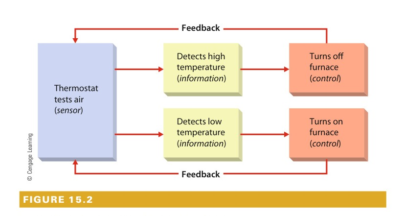
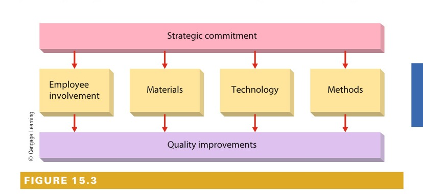
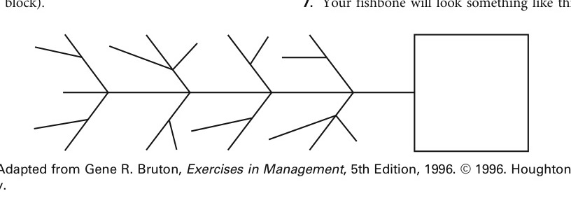

# CHAPTER 15: Managing Operations, Quality, and Productivity

<!-- Page 485 -->

> Hiroyuki Ito/Hulton Archive/Getty Images

CHAPTER 15Managing Operations,Quality, and Productivity

Learning Outcomes

After studying this chapter, you should be able to:

1Describe and explain the nature of operations management.

2Identify and discuss the components involved in designing effective operations systems.

3Discuss organizational technologies and their role in operations management.

4Identify and discuss the components involved in implementing operations systems through supplychain management.

5Explain the meaning and importance of managing quality and total quality management.

6Explain the meaning and importance of managing productivity, productivity trends, and ways to improveproductivity.

Management in Action

Orchestrating Outcomes

#### “[T]hey feel empowered. They don’t have anyone telling them what to do. Theywalk into the rehearsal hall and it’s their opportunity to influence [and] shapemusic.”

—Executive Director Graham Parker on the musicians of the Orpheus Chamber Orchestra

Reviewing a recent concert by the OrpheusChamberOrchestra,NewYorkTimesmusic critic Vivien Schweitzer wrote thatthe orchestra played Robert Schumann’sSymphony No. 2 “with remarkable co-ordination”; the “balance among strings,winds, and brass,” she added, “was impres-sively well proportioned.”Was Schweitzer, as we sometimes say,damningwithfaintpraise?Isn’tasymphony,whichmeans“harmonyofsounds,”supposedtobeplayedwithremarkablecoordination?Aren’tthevarious sections of the orchestra supposedto be well balanced? Had the conductor,whose job is to ensure a consummateperformance of the music, achieved littlemorethancoordinationandbalance?

The Orpheus Chamber Orchestra is unique in that it performs withouta conductor. By working as a team without a leader, the orchestrabuilds motivation and satisfaction among its musicians.

<!-- Page 486 -->

Actually, New York–based Orpheus doesn’t play with a conductor, and Schweitzerwas remarking on the fact the orchestra had “bravely—and successfully—attempted” such a complex work without the artistic and managerial leadershipof someone who directs rehearsals and stands at a podium waving anauthoritative baton.“For us at Orpheus,” explains executive director Graham Parker, “it’s the waywe make the music that’s the difference.” Orpheus holds to the principle that itsproduct—the music performed for audiences—is of the highest quality when itsworkers—the musicians—are highly satisfied with their jobs. All professionalorchestra musicians, of course, are highly trained and skilled, but make nomistake about it: A lot of them are not very happy workers. J. Richard Hackman,an organizational psychologist at Harvard, surveyed workers in 13 differentoccupational categories, including orchestra players, to determine relative levelsof job motivation and satisfaction. On the one hand, musicians ranked at the topin motivation, “fueled by their own pride and professionalism,” according toHackman. But when it came to general satisfaction with their jobs, orchestraplayers ranked seventh (just below federal prison guards and slightly above beersalesanddeliveryteams).Onthequestionofsatisfactionwithgrowthopportunities, they ranked ninth (again, below prison guards, though a littlehigher than operating-room nurses and hockey players).It’sthisdisconnectbetweenmotivationandsatisfaction—andbetweenmotivation and product quality—that Orpheus was conceived to rectify, and thefirst principle in what’s now known as the “Orpheus Process” is “Put power inthe hands of the people doing the work.” According to Harvey Seifter, aconsultant specializing in relationships between business and the arts, theOrpheus Process consists of five elements designed to put this principle intopractice:

1. Choosing Leaders. For each piece of music that the orchestra decides toperform, members select a leadership team composed of five to seven musi-cians. This “core team” then leads rehearsals and serves as a conduit formembers’ input. It’s also responsible for seeing that the final performancereflects “a unified vision.”2. Developing Strategies. Prior to rehearsals, the core team decides how apiece of music will be played. Its ultimate goal is to ensure “an overallinterpretive approach to the music,” and it works to meet this goal bytrying out various approaches to the music during rehearsals with the fullorchestra.3. Developing the Product. Once an interpretive approach has been chosen,rehearsals are geared toward refining it. At this point, players makesuggestions and critique the playing of their colleagues. It is, of course,a highly collaborative stage in the process, and its success depends onmutual respect. “We’re all specialists—that’s the beginning of the discus-sion,” says violinist Martha Caplin. “When I talk to … another musician inthe group, it’s on an equal level. It’s absolutely crucial that we have thatattitude.” When disagreements arise, everyone works toward a consensus,and if a consensus can’t be reached, the issue is settled by a vote. ViolinistEriko Sato also emphasizes that the process of collaborative input worksbest when members focus their contributions on outcomes of the highestpossible quality: “Fundamentally,” she says, “I don’t think everybody’s

<!-- Page 487 -->

opinion should be addressed at all times. There are certain places andtimes for certain things to be said. The appropriate moment. Everybodyknows what’s wrong, everybody can feel what’s wrong. But do you have asolution? Do you know how to solve a problem?”4. Perfecting the Product. Just before each concert, a couple of members takeseats in the hall to listen to the performance from the audience’s perspective.Then they report to the full ensemble and may suggest some finaladjustments.5. Delivering the Product. The final performance is the ultimate result of theOrpheus Process, but it isn’t the last step. When the concert is over, mem-bers get together to share their impressions of the performance and makesuggestions for even further refinements.

“If you ask any musician in the orchestra why they love playing with Orpheus,”says Parker, “it’s because they feel empowered. They don’t have anyone tellingthem what to do. They walk into the rehearsal hall and it’s their opportunity toinfluence [and] shape music, to make music with all their experience, all theirtraining coming together.” Ask double-bass player Don Palma, for instance.Palma took a sabbatical after one year with Orpheus to play with the LosAngeles Philharmonic. “I just hated it,” he says. “I didn’t like to be told what todo all the time, being treated like I wasn’t really worth anything other than to bea good soldier and just sit there and do as I was told. I felt powerless to affectthings… . I felt frustrated, and there was nothing I could … do to help make thingsbetter.” By contrast, says Palma, “Orpheus keeps me involved. I have somemeasure of participation in the direction the music is going to take. I think that’swhy a lot of us have stayed involved so long.”In most orchestras, the conductor makes more or less autocratic decisionsabout what will be played and how. The input of musicians is neither sought norwelcomed, and unsolicited advice may be sharply rebuffed—and may, in fact,serve as grounds for dismissal. At Orpheus, says Parker, “we have a completelydifferent structure to the way we approach rehearsal”: A core team of playersselected by the orchestra from each instrument section plans and leadsrehearsals for a given piece of music.To assist in meeting the inevitable challenges posed by its democraticstructure, Orpheus recruited Harvard’s Hackman to its board of trustees, and heimmediately helped the orchestra organize itself around two leadership groups.An artistic planning group consists of two staff members and three “artisticdirectors.” The executive director serves as a sort of moderator for groupdiscussions, and the general manager keeps everyone posted on market-relatedevents and initiatives. The three artistic directors, who are members of theorchestra, work with other members to find out what they’re interested inworking on and to convey their ideas to the planning group. They also serve ona senior leadership team with the executive director, the general manager, andthe directors of finance, marketing, and operations. This team determines thebest ways to do things given the organization’s commitment to democraticstructure, leadership, and roles—the best way to develop artistic agendas, tochoose players, soloists, and composers and to make the team accountable forits own artistic decisions.It’s important to remember, however, that neither the Orpheus Process northeOrpheustwo-teamstructureisanyguaranteeoforganizational

<!-- Page 488 -->

> operationsmanagementThe total set ofmanagerial activitiesused by anorganization totransform resourceinputs into products,services, or both

effectiveness. As in any organizational endeavor, execution is the differencebetween success and failure, and a study of the Orpheus approach tomanagement has revealed a variety of reasons for the effectiveness ofteamworkwithintheensemble.Everymember,forexample,clearlyunderstands the group’s purpose and mission; every member’s role is clearlystated and agreed on, and all members perform an equal amount of work inmeeting the group’s objectives.1

In this chapter, we explore operations management, quality, and productivity. All thesetopics figure in our opening story about Orpheus, which has taken a highly innovativeapproach to each of them. To better understand why Orpheus operates as it does—andwhy it’s successful in doing so—we’ll take a closer look at the basics of each of thesefactors in organizational performance. We first introduce operations management anddiscuss its role in general management and organizational strategy. The next threesections discuss the design of operations systems, organizational technologies, andimplementing operations systems. We then introduce and discuss various issues inmanaging for quality and total quality. Finally, we discuss productivity, which is closelyrelated to quality.

## THE NATURE OF OPERATIONS MANAGEMENT

Operations management is at the core of what organizations do as they add valueand create products and services. But what exactly are operations? And how arethey managed? Operations management is the set of managerial activities used byan organization to transform resource inputs into products and services. WhenHewlett-Packard buys electronic components, assembles them into PCs, and thenships them to customers, it is engaging in operations management. When a Domi-no’s employee orders food ingredients and paper products and then combinesdough, cheese, and tomato sauce to create a pizza, he or she is engaging in operationsmanagement.

### The Importance of Operations

Operations is an important functional concern for organizations because efficient andeffective management of operations goes a long way toward ensuring competitivenessand overall organizational performance, as well as quality and productivity. Inefficientor ineffective operations management, on the other hand, will almost inevitably lead topoorer performance and lower levels of both quality and productivity.In an economic sense, operations management creates value and utility of onetype or another, depending on the nature of the firm’s products or services. If theproduct is a physical good, such as a Honda motorcycle, operations creates valueand provides form utility by combining many dissimilar inputs (sheet metal, rubber,paint, internal combustion engines, and human skills) to make something (a motorcycle)that is more valuable than the actual cost of the inputs used to create it. The inputsare converted from their incoming form into a new physical form. This conversion istypicalofmanufacturingoperationsandessentiallyreflectstheorganization’stechnology.

<!-- Page 489 -->

> **manufacturing**: A form of business that combines and transforms resource inputs into tangible outcomes

> **service organization**: An organization that transforms resources into an intangible output and creates time or place utility for its business

In contrast, the operations activities of Delta Airlines create value and provide timeand place utility through its services. The airline transports passengers and freightaccording to agreed-upon departure and arrival places and times. Other service opera-tions, such as a Budweiser beer distributorship or an American Eagle retail store, createvalue and provide place and possession utility by bringing together the customer andproducts made by others. Although the organizations in these examples produce differ-ent kinds of products or services, their operations processes share many importantfeatures.2

### Manufacturing and Production Operations

Because manufacturing once dominated U.S. industry, the entire area of operations man-agement used to be called production management. Manufacturing is a form of businessthat combines and transforms resources into tangible outcomes that are then sold toothers. Firestone is a manufacturer because it combines rubber and chemical compoundsand uses blending equipment and molding machines to create tires. Broyhill is a manu-facturer because it buys wood and metal components, pads, and fabric and then com-bines them to make furniture.During the 1970s, manufacturing entered a long period of decline in the UnitedStates, primarily because of foreign competition. U.S. firms had grown lax and slug-gish, and new foreign competitors came onto the scene with better equipment andmuch higher levels of efficiency. For example, steel companies in the Far East wereable to produce high-quality steel for much lower prices than U.S. companies such asBethlehem Steel and U.S. Steel (now USX Corporation). Faced with a battle for sur-vival, many companies underwent a long and difficult period of change by eliminatingwaste and transforming themselves into leaner and more efficient and responsive enti-ties. They reduced their workforces dramatically, closed antiquated or unnecessaryplants, and modernized their remaining plants. In the last decade, their efforts havestarted to pay dividends, as U.S. businesses have regained their competitive positionsin many different industries. Although manufacturers from other parts of the worldare still formidable competitors, and U.S. firms may never again be competitive insome markets, the overall picture is much better than it was just a few years ago.And prospects continue to look bright.3

### Service Operations

During the decline of the manufacturing sector, a tremendous growth in the servicesector kept the U.S. economy from declining at the same rate. A service organiza-tion is one that transforms resources into an intangible output and creates time orplace utility for its customers. For example, E*Trade makes stock transactions for itscustomers, Hertz leases cars to its customers, and local hairdressers cut clients’ hair.In 1947, the service sector was responsible for less than half of the U.S. grossnational product (GNP). By 1975, however, this figure reached 65 percent, and by2013, it was over 80 percent. The service sector has been responsible for creatingapproximately 42 million new jobs in the United States since 1990.4 Managers havecome to see that many of the tools, techniques, and methods that are used in afactory are also useful to a service firm. For example, managers of automobile plantsand hair salons both have to decide how to design their facilities, identify the bestlocations for them, determine optimal capacities, make decisions about inventory storage,set procedures for purchasing raw materials, and set standards for productivity andquality.

<!-- Page 490 -->

© Tyler Olson/Shutterstock.com

There is a tendency to associate operations management with production and manufacturing. Butin reality operations management is also very relevant to service organizations such as this hairsalon. Operations management techniques help the salon manager schedule stylists, bookappointments, order and maintain the optimal inventory of products, and move clients throughdedicated work stations for washing, coloring, cutting, and styling.

### The Role of Operations in Organizational Strategy

It should be clear by this point that operations management is very important to organiza-tions. Beyond its direct impact on factors such as competitiveness, quality, and productiv-ity, it also directly influences the organization’s overall level of effectiveness. For example,the deceptively simple strategic decision of whether to stress high quality regardless of cost,lowest possible cost regardless of quality, or some combination of the two has numerousimportant implications. A highest-possible-quality strategy will dictate state-of-the-arttechnology and rigorous control of product design and materials specifications. A combi-nation strategy might call for lower-grade technology and less concern about productdesign and materials specifications. Just as strategy affects operations management, opera-tions management affects strategy. Suppose that a firm decides to upgrade the quality of itsproducts or services. The organization’s ability to implement the decision is dependent inpart on current production capabilities and other resources. If existing technology will notpermit higher-quality work, and if the organization lacks the resources to replace its tech-nology, increasing quality to the desired new standards will be difficult.

## DESIGNING OPERATIONS SYSTEMS

The problems, challenges, and opportunities faced by operations managers revolve aroundthe acquisition and utilization of resources for conversion. Their goals include both efficiencyand effectiveness. A number of issues and decisions must be addressed as operations systemsare designed. The most basic ones are the product–service mix, capacity, and facilities.

<!-- Page 491 -->

> **product–service mix**: How many different kinds of products, services, or both it will offer

> **capacity**: The amount of products, services, or both that can be produced by an organization

> **facilities**: The physical locations where products or services are created, stored, and distributed

> **location**: The physical positioning or geographic site of facilities

### Determining the Product–Service Mix

A natural starting point in designing operations systems is determining the product–service mix. This decision flows from corporate, business, and marketing strategies.Managers have to make a number of decisions about their products and services, startingwith how many and what kinds to offer.5 Colgate-Palmolive, for example, makes regular,tartar control, gel, and various other formulas of Colgate toothpaste and packages themin several different sizes of tubes, pumps, and other dispensers. Similarly, workers atSubway sandwich shops can combine different breads, vegetables, meats, and condimentsto create hundreds of different kinds of sandwiches. Decisions also have to be maderegarding the level of quality desired, the optimal cost of each product or service, andexactly how each is to be designed. GE recently reduced the number of parts in its indus-trial circuit breakers from 28,000 to 1,275. This whole process was achieved by carefullyanalyzing product design and production methods.

### Capacity Decisions

The capacity decision involves choosing the amount of products, services, or both that canbe produced by the organization. Determining whether to build a factory capable of mak-ing 8,000 or 10,000 units per day is a capacity decision. So, too, is deciding whether tobuild a restaurant with 125 or 175 seats, or a bank with five or ten teller stations. Thecapacity decision is truly a high-risk one because of the uncertainties of future productdemand and the large monetary stakes involved. An organization that builds capacityexceeding its needs may commit resources (capital investment) that will never be recov-ered. Alternatively, an organization can build a facility with a smaller capacity than prod-uct demand might actually support. Doing so may result in lost market opportunities, butit may also free capital resources for use elsewhere in the organization.A major consideration in determining capacity is demand. A company operating withfairly constant monthly demand might build a plant capable of producing an amounteach month roughly equivalent to its demand. But if its market is characterized by sea-sonal fluctuations, building a smaller plant to meet normal demand and then addingextra shifts staffed with temporary workers or paying permanent workers extra to workmore hours during peak periods might be the most effective choice. Likewise, a restau-rant that needs 175 seats for Saturday night but never needs more than 125 at any othertime during the week would probably be foolish to expand to 175 seats. During the rest ofthe week, it must still pay to light, heat, cool, and clean the excess capacity. Many customerservice departments have tried to improve their capacity to deal with customers whilealso lowering costs by using automated voice prompts to direct callers to the right repre-sentative. As you can see in our “At Your Service” feature, this approach to customerrelationship management isn’t necessarily what a lot of customers have in mind.

### Facilities Decisions

Facilities are the physical locations where products or services are created, stored, anddistributed. Major decisions pertain to facilities location and facilities layout.

#### Location

Location is the physical positioning or geographic site of facilities and mustbe determined by the needs and requirements of the organization. A company that reliesheavily on railroads for transportation needs to be located close to rail facilities. GEdecided that it did not need six plants to make circuit breakers, so it invested heavily inautomating one plant and closed the other five. Different organizations in the sameindustry may have different facilities requirements. Benetton uses only one distributioncenter for the entire world, whereas Amazon has several distribution centers inthe United States alone. A retail business must choose its location very carefully to beconvenient for consumers.

<!-- Page 492 -->

> **layout**: The physical configuration of facilities, the arrangement of equipment within facilities, and the assigned responsibilities associated with each facility

> **product layout**: A physical configuration of facilities arranged around the product; used when large quantities of a single product are needed

#### Layout

The choice of physical configuration, or the layout, of facilities is closelyrelated to other operations decisions. The three entirely different layout alternativesshown in Figure 15.1 help demonstrate the importance of the layout decision. Aproduct layout is appropriate when large quantities of a single product are needed. Itmakes sense to custom-design a straight-line flow of work for a product when a specifictask is performed at each workstation as each unit flows past. Most assembly lines usethis format. For example, Hewlett-Packard’s personal computer factories use a productlayout.

Process layouts are used in operations settings that create or process a variety ofproducts. Auto repair shops and health-care clinics are good examples. Each car andeach person is a separate “product.” The needs of each incoming job are diagnosed asit enters the operations system, and the job is routed through the unique sequence ofworkstations needed to create the desired finished product. In a process layout, eachtype of conversion task is centralized in a single workstation or department. All weldingis done in one designated shop location, and any car that requires welding is moved to

*Figure 15.1 — Approaches to Facilities Layout (Source: Page 492)*

When a manufacturer produces large quantities of a product (such as cars orcomputers), it may arrange its facilities in an assembly line (product layout). In aprocess layout, the work (such as patients in a hospital or custom pieces of furniture)moves through various workstations. Locomotives and bridges are bothmanufactured in a fixed-position layout.

<!-- Page 493 -->

> RIA Novosti/Alamy

> ### AT YOUR SERVICE: How to Get2 a Human
> 
> A lot of people, of course, complain about corporate call centers, but most of us mutter under our breath, put our faith in the redial function, and prepare to be reasonably civil to the next voice we hear. We have, however, neither the time nor the inclination to mount a full-scale assault on automated voice-response systems.
> 
> Paul English was different. Frustrated by automated call loops, he founded GetHuman.com, a website publishing cheat codes and shortcuts to bypass automated menus and reach living human customer service representatives at hundreds of major corporations. The site went viral, attracting millions of visitors and forcing corporate executives to rethink their call center designs.
> 
> Many companies realized that extreme automation had alienated valuable customers. By balancing interactive voice response (IVR) with rapid routing to trained human agents, firms improved customer satisfaction while preserving operational efficiency.

<!-- Page 494 -->

> fixed-positionlayoutA physicalconfiguration offacilities arrangedaround a single workarea; used for themanufacture of largeand complexproducts such asairplanes

> **cellular layouts**: A physical configuration of facilities used when families of products can follow similar flow paths

> **technology**: The set of processes and systems used by organizations to convert resources into products or services

AT YOUR SERVICE (Continued)

venture, has stated the site’s mission in a littlemore detail: “Our goal,” says the Get2Human website,“is to convince enterprises that providing high-qualitycustomer service and having satisfied customers costsmuch less than providing low-quality customer serviceand having unsatisfied customers.”

Granted, a company that’s really bent on univer-sal frustration could respond by making its phonesystem even more complex and difficult to use.Companies that require customers, on the otherhand, could take the advice of Jim Kelly, head ofcustomer service at ING Direct (now Capital One360). Kelly made his bank’s online system so easyto use that customers called to complain only 1.6times annually. And those callers got to hear thesound of a human voice every time. The thing todo, advises Kelly, is simply “eliminate most of theproblems and complaints. [Then] the only reason forpeople to call is to do business. And those are callsyou’re eager to take.”Until more companies start taking Kelly’s advice,there’s now Get2Human, which was started in 2009by Walt Tetschner, a veteran market researcher inthe call-automation industry. Tetschner, who tookover when English moved on to another start-up

References: Fuze Digital Solutions, “Gethuman.com Sur-vey Results Reveal Significant Consumer Expectations forOnline Customer Support,” press release, http://www.fuzedigital.com, accessed on January 2, 2014; ChristopherNull, “How to Get a Human on the Phone,” Yahoo! Tech,February 11, 2008, https://www.yahoo.com/tech/, accessed onJanuary 2, 2014; Burt Helm, “Building Good Web Buzz,” SingleArticles, www.singlearticles.com, accessed on January 2,2014; William C. Taylor, “Your Call Should Be Important to Us,but It’s Not,” New York Times, February 26, 2006, www.nytimes.com, accessed on January 2, 2014; GetHuman,“GetHuman History,” 2013, http://gethuman.com, accessedon January 2, 2014; and Get2Human.com, “About Us,” 2013,www.get2human.com, accessed on January 2, 2014.

that area. This setup is in contrast to the product layout, in which several different work-stations may perform welding operations if the conversion task sequence so dictates.Similarly, in a hospital, all X-rays are done in one location, all surgeries in another, andall physical therapy in yet another. Patients are moved from location to location to getthe services they need.The fixed-position layout is used when the organization is creating a few verylarge and complex products. Aircraft manufacturers like Airbus and shipbuilderslike Newport News use this method. An assembly line capable of moving one of Air-bus’s new A380 aircraft would require an enormous plant, so instead the airplaneshell itself remains stationary, and people and machines move around it as it isassembled.The cellular layout is a relatively new approach to facilities design. Cellular layoutsare used when families of products can follow similar flow paths. A clothing manufac-turer, for example, might create a cell, or designated area, dedicated to making a familyof pockets, such as pockets for shirts, coats, blouses, and slacks. Although each kind ofpocket is unique, the same basic equipment and methods are used to make all of them.Hence, all pockets might be made in the same area and then delivered directly to differ-ent product layout assembly areas where the shirts, coats, blouses, and slacks are actuallybeing assembled.

## ORGANIZATIONAL TECHNOLOGIES

One central element of effective operations management is technology. In Chapter 6, wedefined technology as the set of processes and systems used by organizations to convertresources into products or services.

<!-- Page 495 -->

> **automation**: The total process by which machines are set up to do work without human intervention

### Manufacturing Technology

Numerous forms of manufacturing technology are used in organizations. In Chapter 6,we discussed the research of Joan Woodward. Recall that Woodward identified threeforms of technology—unit or small batch, large batch or mass production, and continu-ous process.6 Each form of technology was thought to be associated with a specific typeof organization structure. Of course, newer forms of technology not considered byWoodward also warrant attention. Two of these are automation and computer-assistedmanufacturing.

#### Automation

Automation is the process of designing work so that it can becompletely or almost completely performed by machines. Because automatedmachines operate quickly and make few errors, they increase the amount of workthat can be done. Thus automation helps to improve products and services and fostersinnovation. Automation is the most recent step in the development of machines andmachine-controlling devices. Machine-controlling devices have been around since the1700s. James Watt, a Scottish engineer, invented a mechanical speed control to regu-late the speed of steam engines in 1787. The Jacquard loom, developed by the Frenchinventor Joseph-Marie Jacquard, was controlled by paper cards with holes punched inthem. Early accounting and computing equipment was controlled by similar punchedcards.Automation relies on feedback, information, sensors, and a control mechanism.Feedback is the flow of information from the machine back to the sensor. Sensors arethe parts of the system that gather information and compare it to preset standards. Thecontrol mechanism is the device that sends instructions to the automatic machine. Earlyautomatic machines were primitive, and the use of automation was relatively slow todevelop. These elements are illustrated by the example in Figure 15.2. A thermostat hassensors that monitor air temperature and compare it to a preset low value. If the airtemperature falls below the preset value, the thermostat sends an electrical signal to thefurnace, turning it on. The furnace heats the air. When the sensors detect that the airtemperature has reached a value higher than the low preset value, the thermostat stopsthe furnace. The last step (shutting off the furnace) is known as feedback, a critical com-ponent of any automated operation.The big move to automate factories began during World War II. The shortage ofskilled workers and the development of high-speed computers combined to bring abouta tremendous interest in automation. Programmable automation (the use of computersto control machines) was introduced during this era, far outstripping conventional auto-mation (the use of mechanical or electromechanical devices to control machines). Theautomobile industry began to use automatic machines for a variety of jobs. In fact, theterm automation came into use in the 1950s in the automobile industry. The chemicaland oil-refining industries also began to use computers to regulate production. Duringthe 1990s, automation became a major element in the manufacture of computers andcomputer components, such as electronic chips and circuits. It is this computerized, orprogrammable, automation that presents the greatest opportunities and challenges formanagement today.The impact of automation on people in the workplace is complex. In the short term,people whose jobs are automated may find themselves without a job. In the long term,however, more jobs are created than are lost. Nevertheless, not all companies are able tohelp displaced workers find new jobs, so the human costs are sometimes high. In thecoal industry, for instance, automation has been used primarily in mining. The outputper miner has risen dramatically from the 1950s on. The demand for coal, however,has decreased, and productivity gains resulting from automation have lessened the need

<!-- Page 496 -->

> computer-assistedmanufacturingA technology thatrelies on computersto design ormanufactureproducts

*Figure 15.2 — A Simple Automatic Control Mechanism (Source: Page 496)*

All automation includes feedback, information, sensors, and a control mechanism.A simple thermostat is an example of automation. Another example is Benetton’sdistribution center in Italy. Orders are received, items pulled from stock andpackaged for shipment, and invoices prepared and transmitted, with no humanintervention.

for miners. Consequently, many workers have lost their jobs, and the industry has notbeen able to absorb them. In contrast, in the electronics industry, the rising demand forproducts has led to increasing employment opportunities despite the use of automation.7

#### Computer-Assisted Manufacturing

Current extensions of automation generallyrevolve around computer-assisted manufacturing—a technology that relies on compu-ters to design or manufacture products. One type of computer-assisted manufacturing iscomputer-aided design (CAD)—the use of computers to design parts and completeproducts and to simulate performance so that prototypes need not be constructed.Boeing uses CAD technology to study hydraulic tubing in its commercial aircraft. Japan’sautomotive industry uses CAD to speed up car design. GE used CAD to change thedesign of circuit breakers, and Benetton uses CAD to design new styles and products.Oneida, the table flatware firm, uses CAD to design new flatware patterns; for example,it can design a new spoon in a single day. CAD is usually combined with computer-aidedmanufacturing (CAM) to ensure that the design moves smoothly to production. Theproduction computer shares the design computer’s information and is able to havemachines with the proper settings ready when production is needed. A CAM system isespecially useful when reorders come in because the computer can quickly produce thedesired product, prepare labels and copies of orders, and send the product out to whereit is wanted.Closely aligned with this approach is computer-integrated manufacturing (CIM). InCIM, CAD and CAM are linked together, and computer networks automatically adjustmachine placements and settings to enhance both the complexity and the flexibility ofscheduling. In settings that use these technologies, all manufacturing activities arecontrolled by the computer network. Because the network can access the company’sother information systems, CIM is both a powerful and a complex managementcontrol tool.

<!-- Page 497 -->

> **robot**: Any artificial device that is able to perform functions that are ordinarily thought to be appropriate for human beings

Flexible manufacturing systems (FMSs) usually have robotic work units or worksta-tions, assembly lines, and robotic carts or some other form of computer-controlled trans-port system to move material as needed from one part of the system to another. FordMotor Company used FMSs to transform a factory producing nothing but low-costcompact cars into a plant capable of making a variety of pickup trucks and SUVs.Using traditional methods, the plant would have been closed, its workers laid off, andthe facility virtually rebuilt from the ground up. But by using FMSs, Ford was able tokeep the plant open and running continuously, while new equipment was being installedand its workers were being retrained in small groups. Ford continues to be a pioneer inFMS as it adjusts plant capabilities to produce pickups, SUVs, or small hybrids,depending on fluctuations in market demand and supply.These systems are not without disadvantages, however. For example, because theyrepresent fundamental change, they also generate resistance. In addition, because oftheir tremendous complexity, CAD systems are not always reliable. CIM systems are soexpensive that they raise the breakeven point for firms using them. This means that thefirm must operate at high levels of production and sales to be able to afford the systems.

#### Robotics

Another trend in manufacturing technology is computerized robotics.A robot is any artificial device that is able to perform functions ordinarily thought tobe appropriate for human beings. Robotics refers to the science and technology of theconstruction, maintenance, and use of robots. The use of industrial robots has steadilyincreased since 1980 and is expected to continue to increase slowly as more companiesrecognize the benefits that accrue to users of industrial robots.8

Welding was one of the first applications for robots, and it continues to be the areafor most applications. A close second is materials handling. Other applications includemachine loading and unloading, painting and finishing, assembly, casting, and machin-ing applications such as cutting, grinding, polishing, drilling, sanding, buffing, anddeburring. Daimler AG, for instance, replaced about 200 welders with 50 robots on anassembly line and increased productivity about 20 percent. The use of robots in inspec-tion work is increasing. They can check for cracks and holes, and they can be equippedwith vision systems to perform visual inspections.Robots are also beginning to move from the factory floor to all manner of other appli-cations. The Dallas police used a robot to apprehend a suspect who had barricaded himselfin an apartment building. The robot smashed a window and reached with its mechanicalarm into the building. The suspect panicked and ran outside. At the Long Beach MemorialHospital in California, brain surgeons are assisted by a robot arm that drills into thepatient’s skull with excellent precision. Some newer applications involve remote work. Forexample, the use of robot submersibles controlled from the surface can help divers inremote locations. Surveillance robots fitted with microwave sensors can do things that ahuman guard cannot, such as “seeing” through nonmetallic walls and in the dark. Inother applications, automated farming (called agrimation) uses robot harvesters to pickfruit from a variety of trees.9

Robots are also used by small manufacturers. One robot slices carpeting to fit theinside of custom vans in an upholstery shop. Another stretches balloons flat so thatthey can be spray-painted with slogans at a novelties company. At a jewelry company,a robot holds class rings while they are engraved by a laser. These robots are lighter, fas-ter, stronger, and more intelligent than those used in heavy manufacturing and are thetypes that more and more organizations will be using in the future.

### Service Technology

Service technology is also changing rapidly. And it, too, is moving more and moretoward automated systems and procedures. In banking, for example, technological

<!-- Page 498 -->

> supply chainmanagementThe process ofmanagingoperations control,resource acquisitionand purchasing, andinventory so as toimprove overallefficiency andeffectiveness

breakthroughs led to automated teller machines and made it much easier to move fundsbetween accounts or between different banks. Many people now have their paycheckdeposited directly into a checking account from which many of their bills are then auto-matically paid. Electronic banking—where people can access their accounts, move moneybetween accounts, and pay bills—has become commonplace. Moreover, the capabilitiesto do these things have been extended from personal computers to cell phones andother personal electronic communication technologies.Hotels use increasingly sophisticated technology to accept and record room reser-vations. People can now, for instance, check in online and stop by the front deskonly long enough to pick up their room key. Universities use new technologies toelectronically store and provide access to books, scientific journals, governmentreports, and articles. Hospitals and other health-care organizations use new forms ofservice technology to manage patient records, dispatch ambulances and emergencymedical technicians (EMTs), and monitor patients’ vital signs. Restaurants use tech-nology to record and fill customer orders, order food and supplies, and prepare food.Given the increased role that service organizations are playing in today’s economy,even more technological innovations are certain to be developed in the years tocome.10 The “Leading the Way” feature highlights how technology can assist evenartistic performances.

## IMPLEMENTING OPERATIONS SYSTEMS THROUGHSUPPLY CHAIN MANAGEMENT

After operations systems have been properly designed and technologies developed, theymust then be put into use by the organization. Their basic functional purpose is to con-trol transformation processes to ensure that relevant goals are achieved in areas such asquality and costs. Operations management has a number of special purposes within thiscontrol framework, including purchasing and inventory management. Indeed, this areaof management has become so important in recent years that a new term—supply chainmanagement—has been coined. Specifically, supply chain management can be definedas the process of managing operations control, resource acquisition and purchasing,and inventory so as to improve overall efficiency and effectiveness.11

### Operations Management as Control

One way of using operations management as control is to coordinate it with other func-tions. Monsanto Company, for example, established a consumer products division thatproduces and distributes fertilizers and lawn chemicals. To facilitate control, the operationsfunction was organized as an autonomous profit center. Monsanto finds this effectivebecause its manufacturing division is given the authority to determine not only the costsof creating the product but also the product price and the marketing program.In terms of overall organizational control, a division like the one used by Monsantoshould be held accountable only for the activities over which it has decision-makingauthority. It would be inappropriate, of course, to make operations accountable for profit-ability in an organization that stresses sales and market share over quality and productiv-ity. Misplaced accountability results in ineffective organizational control, to say nothing ofhostility and conflict. Depending on the strategic role of operations, then, operations man-agers are accountable for different kinds of results. For example, in an organization usingbureaucratic control, accountability will be spelled out in rules and regulations. In a decen-tralized system, it is likely to be understood and accepted by everyone.

<!-- Page 499 -->

LEADING THE WAY

## Combining Technology and Artistry

theater’smotion-controlsystem,anditshouldcome as no surprise that all of an artist’s skill, prepa-ration, and caution can do little to prevent injury if heor she doesn’t get the type of support for whicharmies of Cirque technicians are responsible everynight. Executing a stunt like the plunge of the RedBird, says another Cirque choreographer, JacquesHeim, “is extremely exciting, but it’s … excitingbecause it’s terrifying.” And that’s why, he explains,every Cirque performance really consists of twoshows: the one that the performers are putting onin front of the audience and the one that the techni-cians are performing behind the scenes.Heim did the choreography for KÀ, an Egyptian-themed Cirque extravaganza in residence at theMGM Grand Hotel & Casino. KÀ was, at the time,both theatrically and technologically, the most ambi-tious production that Cirque du Soleil had evermounted. “In KÀ,” says technical director MatthewWhelan, “the machinery is so impressive that theirmovement becomes a [dance] number in itself … .The audience does see the lift movements”—thecomputer-controlled manipulation of the decks thatcomprise the mobile “stage”—“but there’s also a

For years, Canadian gymnast Natasha Chao per-formed the role of the Red Bird in Mystère, a Cirquedu Soleil production permanently staged at TreasureIsland Hotel and Casino in Las Vegas. According tothe show’s production notes, the character of theflightless Red Bird (who is male though the per-former needn’t be) “leaps ever higher in his futileattempts to take to the skies. Still convinced he canfly, he struggles against his fate.” As choreographed,his fate consists of a 60-foot headfirst free fall into ahidden net. “One thing all … Cirque artists share incommon,”saysMystèrechoreographerDebraBrown, “is a passion for doing art. Circus performers,who risk their lives, are the most passionate,” sheadds, and Chao is no exception. Working withoutan understudy, however, she couldn’t afford to gethurt, and, passion for her art notwithstanding, shewasunderstandablycautiousinperformingthestunt.In addition to maintaining her impeccable timingand keen spatial awareness, the key for Chao wasto curve her spine upright at the final moment beforecontact with the net. The tension in the net wascontinuously monitored by technicians working the

Cirque du Soleil relies on a combination of technology and artistry to create its amazingproductions. Cirque technicians and choreographers are responsible for leading performersthrough their acts in ways that maximize visual impact while minimizing the risk of injury.

(continued)

<!-- Page 500 -->

> purchasingmanagementBuying materials andresources needed toproduce productsand services

LEADING THE WAY (Continued)

system. Keith Wright, KÀ’s operations productionmanager, sees the technician’s twofold responsibilityas a basic reflection of Cirque du Soleil’s mission:“Cirque du Soleil,” he says, “is always about the art-ist and humanity, and the tools we use—no matterhow advanced—must serve the human artists.”

complete other show going on in the pit where thelifts move out of sight line to allow scenic pieces tomove from level to level in a specific choreography tomanage limited floor space.” The interaction of tech-nicians and performers is even more critical than inmost Cirque productions because, as stage architectMark Fisher puts it, the technologically managedscenery is “actually part of the landscape in whichtheperformersliveandmovetocreatetheirshow.”“There’s a constant risk of artists falling,” admitsequipment designer Jaque Paquin, and Cirque duSoleil depends on its technology and the peoplewho run it not only to enhance the performance ofits artists but to protect them as well. Paquin, afterall, is also responsible for the retractable safety netthat’s programmed into position beneath KÀ’s cen-terpiece scene—an aerial-acrobatics spectacle—bythe theater’s modular, multiuser NOMAD control

References: John Scott Lewinski, “Cirque du Soleil’sSophisticated Kà Evolves with New Tech,” Wired, www.wired.com, accessed on January 2, 2014; Joe Hunkins,“CirqueduSoleil:DramaticTechnologies,”TechnologyReport, http://technology-report.com, accessed on January 2,2014; Victoria Looseleaf, “Cirque du Soleil’s Magic,” DanceMagazine,December2007,www.dancemagazine.com,accessed on January 2, 2014; Gigi Berardi, “Circus+Dance=Cirque du Soleil,” Dance Magazine, September 1, 2002,www.thefreelibrary.com, accessed on January 2, 2014;Stephanie Gooch, “Industrial-Scale Technology in Cirque duSoleil’s KÀ,” Designfax, www.thefreelibrary.com, accessedon January 2, 2014.

Within operations, managerial control ensures that resources and activities achieveprimary goals such as a high percentage of on-time deliveries, low unit production cost,or high product reliability. Any control system should focus on the elements that aremost crucial to goal attainment. For example, firms in which product quality is a majorconcern (as it is at Rolex) might adopt a screening control system to monitor the prod-uct as it is being created. If low-cost, large quantities are a higher priority (as is the caseat Timex), a postaction system might be used to identify defects at the end of the systemwithout disrupting the manufacturing process itself.For the past several years, Boeing has been grappling with problems in launching itslatest major passenger airplane, the Boeing 787 Dreamliner. During its early develop-ment, the 787 was hailed as the most commercially successful new plane of all time.Airlines around the world preordered over 900 of the planes at a cost of $178 millioneach before they ever took a test flight, based on its projected fuel efficiency, passengercomfort, low maintenance costs, flexibility, and other major design elements. Boeingsubcontracted out the design and assembly of major components of the 787 to firms inJapan, Italy, South Carolina, and Kansas but did not impose adequate coordination acrossthese various suppliers. As a result, subassemblies did not fit together properly, there werenumerous quality and delivery issues, and myriad other problems occurred. Indeed, thefirst test flights for the plane were years late, largely because of supply chain issues;the first plane delivered to a U.S. airline was not completed until 2012. And the airplanecontinues to have manufacturing defects pop up periodically. Clearly, then, poor supplychain management can be disastrous, especially for major new products.12

### Purchasing Management

Purchasing management, also called procurement, is concerned with buying the materi-als and resources needed to produce products and services. In many ways, purchasing is

<!-- Page 501 -->

> **inventory control**: Managing the organization’s raw materials, work in process, finished goods, and products in transit

> just-in-time (JIT)methodAn inventory systemthat has necessarymaterials arriving assoon as they areneeded (just in time)so that theproduction processis not interrupted

> © Cengage Learning

at the very heart of effective supply chain management. Purchasing managers for aretailer like Walmart are responsible for buying the merchandise the stores will sell.The purchasing manager for a manufacturer buys raw materials, parts, and machinesneeded by the organization. Large companies such as Boeing, Nikon, and Siemens havelarge purchasing departments.13 The manager responsible for purchasing must balance anumber of constraints. Buying too much ties up capital and increases storage costs. Buy-ing too little might lead to shortages and high reordering costs. The manager must alsomake sure that the quality of what is purchased meets the organization’s needs, that thesupplier is reliable, and that the best financial terms are negotiated.Many firms have recently changed their approaches to purchasing as a means tolower costs and improve quality and productivity. In particular, rather than relying onhundreds or even thousands of suppliers, many companies are reducing their numberof suppliers and negotiating special production delivery arrangements.14 For example,the Honda plant in Marysville, Ohio, found a local business owner looking for a newopportunity. They negotiated an agreement whereby he would start a new company tomount car stereo speakers into plastic moldings. He delivers finished goods to the plantthree times a day, and Honda buys all he can manufacture. Thus, he has a stable salesbase, Honda has a local and reliable supplier, and both companies benefit.

### Inventory Management

Inventory control, also called materials control, is essential for effective operations man-agement. The four basic kinds of inventories are raw materials, work in process, finishedgoods, and in-transit inventories. As shown in Table 15.1, the sources of control overthese inventories are as different as their purposes. Work-in-process inventories, forexample, are made up of partially completed products that need further processing;they are controlled by the shop floor system. In contrast, the quantities and costs offinished-goods inventories are under the control of the overall production schedulingsystem, which is determined by high-level planning decisions. In-transit inventories arecontrolled by the transportation and distribution systems.Like most other areas of operations management, inventory management changed nota-bly in recent years. One particularly important breakthrough is the just-in-time (JIT)method. JIT is a recent breakthrough in inventory management. With JIT inventory

### Table 15.1: Inventory Types, Purposes, and Sources of Control

| Type | Purpose | Source of Control |
| :--- | :--- | :--- |
| **Raw materials** | Provide the materials needed to make the product | Purchasing models and systems |
| **Work in process** | Enable overall production to be divided into stages of manageable size | Shop floor control systems |
| **Finished goods** | Provide ready supply of products on customer demand and enable long, efficient production runs | High-level production scheduling systems in conjunction with marketing |
| **In transit (pipeline)** | Distribute products to customers | Transportation and distribution control systems |

<!-- Page 502 -->

> **quality**: The totality of features and characteristics of a product or service that bear on its ability to satisfy stated or implied needs

systems, materials arrive just as they are needed. JIT therefore helps an organizationcontrol its raw materials inventory by reducing the amount of space it must devote tostorage.First popularized by the Japanese, the JIT system reduces the organization’s invest-ment in storage space for raw materials and in the materials themselves. Historically,manufacturers built large storage areas and filled them with materials, parts, and suppliesthat would be needed days, weeks, and even months in the future. A manager using theJIT approach orders materials and parts more often and in smaller quantities, therebyreducing investment in both storage space and actual inventory. The ideal arrangementis for materials to arrive just as they are needed—or just in time.15

Recall our example about the small firm that assembles stereo speakers for Honda anddelivers them three times a day, making it unnecessary for Honda to carry large quanti-ties of the speakers in inventory. In an even more striking example, Johnson Controlsmakes automobile seats for Mercedes and ships them by small truckloads to a Mercedesplant 75 miles away. Each shipment is scheduled to arrive two hours before it is needed.Clearly, the JIT approach requires high levels of coordination and cooperation betweenthe company and its suppliers. If shipments arrive too early, Mercedes has no place tostore them. If they arrive too late, the entire assembly line may have to be shut down,resulting in enormous expense. When properly designed and used, the JIT method con-trols inventory very effectively.

## MANAGING TOTAL QUALITY

Quality and productivity have become major determinants of business success or failuretoday and are central issues in managing organizations. But, as we will see, achievinghigher levels of quality is not an easy accomplishment. Simply ordering that quality beimproved is about as effective as waving a magic wand.16 The catalyst for its emergenceas a mainstream management concern was foreign business, especially Japanese. Andnowhere was it more visible than in the auto industry. During the energy crisis in thelate 1970s, many people bought Toyotas, Hondas, and Nissans because they were morefuel-efficient than U.S. cars. Consumers soon found, however, that not only were theJapanese cars more fuel-efficient, but they also were of higher quality than U.S. cars.Parts fit together better, the trim work was neater, and the cars were more reliable.Thus, after the energy crisis subsided, Japanese cars remained formidable competitorsbecause of their reputation for quality.

### The Meaning of Quality

The American Society for Quality defines quality as the totality of features and char-acteristics of a product or service that bear on its ability to satisfy stated or impliedneeds.17 Quality has several different attributes. Table 15.2 lists eight basic dimensionsthat determine the quality of a particular product or service. For example, a productthat has durability and is reliable is of higher quality than a product with less durabilityand reliability.Quality is also relative. For example, a Lexus is a higher-grade car than a Toyota. Thedifference in quality stems from differences in design and other features. The Toyota,however, is still considered a high-quality car relative to its engineering specificationsand price. Quality is relevant for both products and services. Although its importancefor products like cars and computers was perhaps recognized first, service firms rangingfrom airlines to restaurants have also come to see that quality is a vitally important

<!-- Page 503 -->

> These eight dimen-sions generally cap-ture the meaning ofquality, which is acritically importantingredient to organi-zational successtoday. Understandingthe basic meaning ofquality is a good firststep to managing itmore effectively.

> malcolm BaldrigeAwardNamed after aformer secretary ofcommerce, thisprestigious award isgiven annually tofirms that achievemajor qualityimprovements

### Table 15.2

### Table 15.2: Eight Dimensions of Quality

| Dimension | Meaning / Characteristic |
| :--- | :--- |
| **1. Performance** | A product’s primary operating characteristic; examples are automobile acceleration and a television’s picture clarity. |
| **2. Features** | Supplements to a product’s basic functioning characteristics, such as power windows on a car. |
| **3. Reliability** | A probability of not malfunctioning during a specified period. |
| **4. Conformance** | The degree to which a product’s design and operating characteristics meet established standards. |
| **5. Durability** | A measure of product life. |
| **6. Serviceability** | The speed and ease of repair. |
| **7. Aesthetics** | How a product looks, feels, tastes, and smells. |
| **8. Perceived Quality** | As seen by a customer. |

*Source: Reprinted by permission of Harvard Business Review. Exhibit from “Competing on the Eight Dimensions of Quality” by David A. Garvin, November–December 1987. Copyright © 1987 by the President and Fellows of Harvard College; all rights reserved.*

determinant of their success or failure. Service quality, as we will discuss later in thischapter, has thus also become a major competitive issue in U.S. industry today.18

### The Importance of Quality

To help underscore the importance of quality, the U.S. government created the MalcolmBaldrige Award, named after the former secretary of commerce who championedquality in U.S. industry. The award, administered by an agency of the CommerceDepartment, is given annually to firms that achieve major improvements in the qualityof their products or services. In other words, the award is based on changes in quality, asopposed to absolute quality. In addition, numerous other quality awards have beencreated. For example, the Rochester Institute of Technology and USA Today awardtheir Quality Cup award not to entire organizations but to individual teams of workerswithin organizations. Quality is also an important concern for individual managers andorganizations for three very specific reasons: competition, productivity, and costs.19

These eight dimensions generally capture the meaning of quality, which is a criticallyimportant ingredient to organizational success today. Understanding the basic meaningof quality is a good first step to managing it more effectively.

#### Competition

Quality has become one of the most competitive points in businesstoday. Ford, BMW, General Motors, and Honda, for example, each implies that its carsand trucks are higher in quality than the cars and trucks of the others. And American,Delta, and United Airlines each claims that it provides the best and most reliable service.In the wake of the economic recession that started in 2008, many businesses focusedeven more attention on service quality as a competitive advantage during lean times.While some firms, for example, cut their staff at customer call centers, others did not.What impact might this have? One study found that cutting four representatives at acall center of three dozen people sent the number of customers put on hold for fourminutes from 0 to 80. Firms with especially strong reputations for service quality includeAmazon.com, USAA (an insurance firm), Lexus, Ritz-Carlton, Ace Hardware, andApple.20

#### Productivity

Managers have also come to recognize that quality and productivity arerelated. In the past, many managers thought that they could increase output (productiv-ity) only by decreasing quality. Managers today have learned the hard way that such an

<!-- Page 504 -->

> total qualitymanagement(TQM) (qualityassurance)A strategiccommitment bytop managementto change its wholeapproach tobusiness in orderto make quality aguiding factor ineverything it does

assumption is almost always wrong. If a firm installs a meaningful quality-enhancementprogram, three things are likely to result. First, the number of defects is likely todecrease, causing fewer returns from customers. Second, because the number of defectsgoes down, resources (materials and people) dedicated to reworking flawed output willbe decreased. Third, because making employees responsible for quality reduces the needfor quality inspectors, the organization is able to produce more units with fewerresources.

#### Costs

Improved quality also lowers costs. Poor quality results in higher returns fromcustomers, high warranty costs, and lawsuits from customers injured by faulty products.Future sales are lost because of disgruntled customers. An organization with qualityproblems often has to increase inspection expenses just to catch defective products. Wenoted in Chapter 14, for example, how at one point Whistler Corporation was using40 percent of its workforce just to fix poorly assembled radar detectors made by theother 60 percent.21

### Total Quality Management

Once an organization makes a decision to enhance the quality of its products and ser-vices, it must then decide how to implement this decision. The most pervasive approachto managing quality has been called total quality management (TQM) (sometimescalled quality assurance)—a real and meaningful effort by an organization to changeits whole approach to business in order to make quality a guiding factor in everythingit does.22 Figure 15.3 highlights the major ingredients in TQM.

#### Strategic Commitment

The starting point for TQM is a strategic commitment bytop management. Such commitment is important for several reasons. First, the organiza-tional culture must change to recognize that quality is not just an ideal but also an objec-tive goal that must be pursued.23 Second, a decision to pursue the goal of quality carrieswith it some real costs—for expenditures such as new equipment and facilities. Thus,without a commitment from top management, quality improvement will prove to bejust a slogan or gimmick, with little or no real change. Just a few years ago, Porsche

*Figure 15.3 — Total Quality Management (Source: Page 504)*

Quality is one of the most important issues facing organizations today. TQM is acomprehensive effort to enhance an organization’s product or service quality. TQMinvolves the five basic dimensions shown here. Each is important and must beaddressed effectively if the organization expects to truly increase quality.

<!-- Page 505 -->

> value-addedanalysisThe comprehensiveevaluation of all workactivities, materialsflows, andpaperwork todetermine the valuethat they add forcustomers

> **benchmarking**: The process of learning how other firms do things exceptionally well

had the lowest reliability of any automobile maker in the world. But a major commit-ment from top management helped turn the company around. By paying more attentionto consumer preferences and using the other methods described later in this section,Porsche shot to the top of global automobile reliability.24

#### Employee Involvement

Employee involvement is another critical ingredient inTQM. Virtually all successful quality-enhancement programs involve making the personresponsible for doing the job responsible for making sure it is done right.25 By definition,then, employee involvement is a critical component in improving quality. Work teams,discussed in Chapter 13, are common vehicles for increasing employee involvement.

#### Technology

New forms of technology are also useful in TQM programs. Automationand robots, for example, can often make products with higher precision and betterconsistency than people. Investing in higher-grade machines capable of doing jobsmore precisely and reliably often improves quality. For example, Samsung has achievednotable improvements in product quality by replacing many of its machines with newequipment. Similarly, most U.S. auto and electronics firms make regular investments innew technology to help boost quality.

#### Materials

Another important part of TQM is improving the quality of the materialsthat organizations use. Suppose that a company that assembles stereos buys chips andcircuits from another company. If the chips have a high failure rate, consumers willreturn defective stereos to the company whose nameplate appears on them, not to thecompany that made the chips. The stereo firm then loses in two ways: refunds to custo-mers and a damaged reputation. As a result, many firms have increased the qualityrequirements they impose on their suppliers as a way of improving the quality of theirown products.

#### Methods

Improved methods can improve product and service quality. Methods areoperating systems used by the organization during the actual transformation process.American Express Company, for example, has found ways to cut its approval time fornew credit cards from 22 to just 2 days. This results in improved service quality.

### TQM Tools and Techniques

Beyond the strategic context of quality, managers can also rely on several specific toolsand techniques for improving quality. Among the most popular today are value-addedanalysis, benchmarking, outsourcing, reducing cycle times, ISO 9000:2000 and ISO14000, statistical quality control (SQC), and Six Sigma.

#### Value-Added Analysis

Value-added analysis is the comprehensive evaluation of allwork activities, materials flows, and paperwork to determine the value that they add forcustomers. Such an analysis often reveals wasteful or unnecessary activities that can beeliminated without jeopardizing customer service. For example, during a value-addedanalysis, Hewlett-Packard determined that its contracts were unnecessarily long, confus-ing, and hard to understand. The firm subsequently cut its standard contract form downfrom 20 to 2 pages and experienced an 18 percent increase in its computer sales.

#### Benchmarking

Benchmarking is the process of learning how other firms do thingsin an exceptionally high-quality manner. Some approaches to benchmarking are simpleand straightforward. For example, Canon routinely buys copiers made by other firmsand takes them apart to see how they work. This enables the firm to stay abreast ofimprovements and changes its competitors are using. When Ford was planning thenewest version of the Focus, it identified the 400 features that customers identified as

<!-- Page 506 -->

> **outsourcing**: Subcontracting services and operations to other firms that can perform them more cheaply or better

> **cycle time**: The time needed by the organization to accomplish activities toward goal attainment

> Many organizationstoday are usingspeed for competitiveadvantage. Listed inthe table are sixcommon guidelinesthat organizationsfollow when theywant to shorten thetime they need to getthings accomplished.Although not everymanager can do eachof these things, mostmanagers can do atleast some of them.

being most important to them. It then found the competing cars that did the best job oneach feature. Ford’s goal was to equal or surpass each of its competitors on those 400features. Other benchmarking strategies are more indirect. For example, many firmsstudy how Amazon manages its online retail business, how Disney recruits and trainsemployees, and how FedEx tracks packages for applications they can employ in theirown businesses.26

#### Outsourcing

Another innovation for improving quality is outsourcing, which is theprocess of subcontracting services and operations to other firms that can perform themcheaper or better. If a business performs each and every one of its own administrativeand business services and operations, it is almost certain to be doing at least some ofthem in an inefficient or low-quality manner. If those areas can be identified and out-sourced, the firm will save money and realize a higher-quality service or operation.27

For example, until recently, Eastman Kodak handled all its own computing operations.Now, however, those operations are subcontracted to IBM, which handles all Kodak’scomputing. The result is higher-quality computing systems and operations at Kodakfor less money than it was spending before. Firms must be careful in their outsourcingdecisions, though, because service or delivery problems can lead to major complica-tions. As noted earlier, Boeing’s new 787 aircraft is years behind schedule because thefirms to which Boeing outsourced some of its production were not adequatelycoordinated.

#### Reducing Cycle Time

Another popular TQM technique is reducing cycle time.Cycle time is the time needed by the organization to develop, make, and distributeproducts or services.28 If a business can reduce its cycle time, quality will often improve.A good illustration of the power of cycle time reduction comes from GE. At one point,the firm needed six plants and three weeks to produce and deliver custom-made indus-trial circuit breaker boxes. By analyzing and reducing cycle time, the same product cannow be delivered in three days, and only a single plant is involved. Table 15.3 identifies anumber of basic suggestions that have helped companies reduce the cycle time of theiroperations. For example, GE found it better to start from scratch with a remodeled plant.GE also wiped out the need for approvals by eliminating most managerial positions andset up teams as a basis for organizing work. Stressing the importance of the schedulehelped Motorola build a new plant and start the production of a new product in just18 months. Nokia used to need 12 to 18 months to design new cell phone models, butcan do it now in 6 months.29

### Table 15.3

### Table 15.3: Guidelines for Increasing the Speed of Operations

| # | Guideline | Explanation |
| :---: | :--- | :--- |
| 1. | **Start from scratch** | It is usually easier than trying to do what the organization is already doing bigger, better, and faster. |
| 2. | **Minimize approvals** | Minimize the number of approvals needed to do something. The fewer people who have to say “yes,” the faster things move. |
| 3. | **Use work teams** | Use cross-functional work teams as a basis for organization to eliminate handoffs between departments. |
| 4. | **Adhere to schedule** | Develop and strictly adhere to an operational timetable. |
| 5. | **Include distribution** | Do not ignore distribution; speeding up manufacturing does not help if goods sit in warehouses. |
| 6. | **Cultural integration** | Integrate speed and responsiveness into the organization’s shared culture and reward systems. |

*Source: From Fortune, February 13, 1989. © 1989 Time, Inc. All rights reserved.*

<!-- Page 507 -->

> ISO 9000:2000A set of qualitystandards created bythe InternationalOrganization forStandardization andrevised in 2000

> ISO 14000A set of standards forenvironmentalperformance

> SQCA set of specificstatistical techniquesthat can be used tomonitor quality;includes acceptancesampling and in-process sampling

#### ISO 9000:2000 and ISO 14000

Still another useful technique for improving qualityis ISO 9000. ISO 9000:2000 refers to a set of quality standards created by the Interna-tional Organization for Standardization; the standards were revised and updated in 2000.These standards cover areas such as product testing, employee training, recordkeeping,supplier relations, and repair policies and procedures. Firms that want to meet thesestandards apply for certification and are audited by a firm chosen by the organization’sdomestic affiliate (in the United States, this is the American National Standards Insti-tute, or ANSI). These auditors review every aspect of the firm’s business operations inrelation to the standards. Many firms report that merely preparing for an ISO 9000 audithas been helpful. Many firms today, including GE, DuPont, British Telecom, and PhilipsElectronics, are urging—or in some cases requiring—that their suppliers achieve ISO 9000certification.30 All told, more than 159 countries have adopted ISO 9000 as a national stan-dard, and more than 610,000 certificates of compliance have been issued. ISO 14000 is anextension of the same concept to environmental performance. Specifically, ISO 14000requires that firms document how they are using raw materials more efficiently, managingpollution, and reducing their impact on the environment.Many organizations today are using speed for competitive advantage. Listed in Table15.3 are six common guidelines that organizations follow when they want to shorten thetime in which they must get things accomplished. Although not every manager can doeach of these things, most managers can do at least some of them.

#### Statistical Quality Control

Another quality control technique is SQC. As the termsuggests, SQC is concerned primarily with managing quality.31 Moreover, it is a set ofspecific statistical techniques that can be used to monitor quality. Acceptance samplinginvolves sampling finished goods to ensure that quality standards have been met. Accep-tance sampling is effective only when the correct percentage of products that should betested (for example, 2, 5, or 25 percent) is determined. This decision is especially impor-tant when the test renders the product useless. Batteries, wine, and collapsible steeringwheels, for example, are consumed or destroyed during testing. Another SQC method isin-process sampling, which involves evaluating products during production so thatneeded changes can be made. The painting department of a furniture company mightperiodically check the tint of the paint it is using. The company can then adjust thecolor as necessary to conform to customer standards. The advantage of in-processsampling is that it allows problems to be detected before they accumulate.

#### Six Sigma

Six Sigma was developed in the 1980s for Motorola. The tool can be usedby manufacturing or service organizations. The Six Sigma method tries to eliminatemistakes. Although firms rarely obtain Six Sigma quality, it does provide a challengingtarget. Sigma refers to a standard deviation, so a Six Sigma defect rate is six standarddeviations above the mean rate; one sigma quality would produce 690,000 errors permillion items. Obtaining three sigmas is a bit more challenging—66,000 errors permillion. Six Sigma is obtained when a firm produces a mere 3.4 mistakes per million.Implementing Six Sigma requires making corrections until errors virtually disappear. AtGE, the technique has saved the firm $8 billion in three years. GE is now teaching itscustomers, including Walmart and Dell, about the approach.

## MANAGING PRODUCTIVITY

Although the current focus on quality by U.S. companies is a relatively recent phenome-non, managers have been aware of the importance of productivity for several years. Thestimulus for this attention was a recognition that the gap between productivity in the

<!-- Page 508 -->

> **productivity**: An economic measure of efficiency that summarizes what is produced relative to the resources used to produce it

United States and productivity in other industrialized countries was narrowing. This sec-tion describes the meaning of productivity and underscores its importance. After sum-marizing recent productivity trends, we suggest ways that organizations can increasetheir productivity.

### The Meaning of Productivity

In a general sense, productivity is an economic measure of efficiency that summarizesthe value of outputs relative to the value of the inputs used to create them.32 Productivitycan be and often is assessed at different levels of analysis and in different forms.

#### Levels of Productivity

By level of productivity, we mean the units of analysis used tocalculate or define productivity. For example, aggregate productivity is the total level ofproductivity achieved by a country. Industry productivity is the total productivityachieved by all the firms in a particular industry. Company productivity, just as theterm suggests, is the level of productivity achieved by an individual company. Unit andindividual productivity refer to the productivity achieved by a unit or department withinan organization and the level of productivity attained by a single person.

#### Forms of Productivity

There are many different forms of productivity. Total factorproductivity is defined by the following formula:

ProductivityOutputsInputs

Total factor productivity is an overall indicator of how well an organization uses all ofits resources, such as labor, capital, materials, and energy, to create all of its products andservices. The biggest problem with total factor productivity is that all the ingredientsmust be expressed in the same terms—dollars (it is difficult to add hours of labor tonumber of units of a raw material in a meaningful way). Total factor productivity alsogives little insight into how things can be changed to improve productivity. Conse-quently, most organizations find it more useful to calculate a partial productivity ratio.Such a ratio uses only one category of resource. For example, labor productivity couldbe calculated by this simple formula:

Labor productivityOutputsDirect Labor

This method has two advantages. First, it is not necessary to transform the units ofinput into some other unit. Second, this method provides managers with specific insightsinto how changing different resource inputs affects productivity. Suppose that an organi-zation can manufacture 200 units of a particular product with 40 hours of direct labor.The organization’s labor productivity index is 200/40, or 5 (5 units per labor hour). Nowsuppose that worker efficiency is increased (through one of the ways discussed later inthis chapter) so that the same 40 hours of labor result in the manufacture of 240 unitsof the product. The labor productivity index increases to 240/40, or 6 (6 units per laborhour), and the firm can see the direct results of a specific managerial action.

### The Importance of Productivity

Managers consider it important that their firm maintains high levels of productivity for avariety of reasons. Firm productivity is a primary determinant of an organization’s levelof profitability and, ultimately, of its ability to survive. If one organization is more pro-ductive than another, it will have more products to sell at lower prices and have moreprofits to reinvest in other areas. Productivity also partially determines people’s standard

<!-- Page 509 -->

> Jim West/Newscom

of living within a particular country. At an economic level, businesses consume resourcesand produce goods and services. The goods and services created within a country can beused by that country’s own citizens or exported for sale in other countries. The moregoods and services the businesses within a country can produce, the more goods andservices the country’s citizens will have. Even goods that are exported result in financialresources flowing back into the home country. Thus, the citizens of a highly productivecountry are likely to have a notably higher standard of living than the citizens of a countrywith low productivity.

### Productivity Trends

The United States has one of the highest levels of productivity in the world. Sparked bygains made in other countries, however, U.S. business has begun to focus more attentionon productivity.33 Indeed, this was a primary factor in the decisions made by U.S. busi-nesses to retrench, retool, and become more competitive in the world marketplace. Forexample, GE’s dishwasher plant in Louisville cut its inventory requirements by 50 per-cent, reduced labor costs from 15 percent to only 10 percent of total manufacturingcosts, and cut product development time in half. As a result of these kinds of efforts,productivity trends have now leveled out, and U.S. workers are generally maintainingtheir lead in most industries.34

One important factor that has hurt U.S. productivity indices has been the tremendousgrowth of the service sector in the United States. Although this sector grew, its produc-tivity levels did not. One part of this problem relates to measurement. For example, it isfairly easy to calculate the number of tons of steel produced at a steel mill and divide itby the number of labor hours used; it is more difficult to determine the output of an

Quality and productivity are critical ingredients to success in the global automobile industry. FordMotor Company struggled for years with low productivity and a poor reputation for quality. But overthe last several years, Ford leaders have sharpened the firm’s focus on both quality and productivityand, as a result, Ford’s market share, revenues, and profits have been consistently growing.

<!-- Page 510 -->

Both manufacturing productivity and service productivity in the United Statescontinue to grow, although manufacturing productivity is growing at a faster pace.Total productivity, therefore, also continues to grow.

Source: U.S. Bureau of Labor Statistics.

attorney or a certified public accountant. Still, virtually everyone agrees that improvingservice sector productivity is the next major hurdle facing U.S. business.35

*Figure 15.4 — Improving ProductivityHow does a business or industry improve its productivity? Numerous specific sugges-tions made by experts generally fall into two broad categories: improving operationsand increasing employee involvement. (Source: Page 510)*

Improving OperationsOne way that firms can improve operations is by spendingmore on research and development (R&D). R&D spending helps identify new products,new uses for existing products, and new methods for making products. Each of thesecontributes to productivity. For example, Bausch & Lomb almost missed the boat onextended-wear contact lenses because the company had neglected R&D. When it became

<!-- Page 511 -->

apparent that its major competitors were almost a year ahead of Bausch & Lomb in developing the new lenses, management made R&D a top-priority concern. As a result, the company made several scientific breakthroughs, shortened the time needed to introduce new products, and greatly enhanced both productivity and product quality.

## SUMMARY OF LEARNING OUTCOMES AND KEY POINTS

### 1. Describe the nature and importance of operations management.
• Operations management is the set of managerial activities used by an organization to transform resource inputs into products, services, or both.
• Operations management plays a critical role in determining organizational efficiency and effectiveness.
• Manufacturing creates tangible goods, whereas service operations create intangible utility for customers.

### 2. Identify and discuss the primary design decisions involved in operations systems.
• Key decisions that must be made as part of operations systems design relate to the product–service mix, capacity, and facilities.
• Facilities decisions include location (geographic placement) and layout (product, process, fixed-position, and cellular layouts).

<!-- Page 512 -->

### 3. Discuss organizational technologies and their role in operations management.
• Technology is the conversion process used to transform inputs into outputs.
• In manufacturing, modern technology includes automation, programmable automation, computer-aided design (CAD), computer-aided manufacturing (CAM), and flexible manufacturing systems.
• In service organizations, technology is rapidly advancing through automated service delivery systems and wireless networks.

### 4. Describe the basic elements of supply chain management.
• Supply chain management is the process of managing operations control, resource acquisition, and inventory so as to improve overall efficiency and effectiveness.
• Key dimensions of supply chain management include purchasing management (procurement) and inventory management.
• Common types of inventory are raw materials, work in process, finished goods, and in-transit inventory.
• Just-in-time (JIT) inventory systems reduce holding costs by delivering materials as needed.

### 5. Discuss total quality management (TQM) and its primary tools and techniques.
• Quality is the totality of features and characteristics of a product or service that bear on its ability to satisfy stated or implied needs.
• Total quality management (TQM) is a real and meaningful effort by an organization to improve quality across all activities.
• Popular TQM techniques include strategic commitment, employee involvement, technology, materials, benchmarking, outsourcing, reducing cycle time, and statistical quality control (SQC).

### 6. Explain the nature and importance of productivity, and identify methods for improving it.
• Productivity is an economic measure of efficiency that summarizes what is produced relative to resources used.
• Productivity can be measured as total factor productivity or labor productivity.
• Methods for improving productivity include improving operations (R&D and capital investment) and increasing employee involvement.

<!-- Page 513 -->

> Exercise Overview

## BUILDING EFFECTIVE COMMUNICATION SKILLS

I look forward to your reply and a resolution tomy problem.Sincerely,A. N. Owner, ABC AutosAttachment: Purchase Order 00001

Communication skills refer to the ability not only toconvey information and ideas to others but also to han-dle information and ideas received from them. Thisexercise shows how you can use your communicationskills in addressing issues of quality.

### Exercise Task

### Exercise Background

1.Write an answer to the customer’s letter thatassumes that you now have the parts available.2.How would your answer differ if ABC Autos werenot a valued customer?3.How would your answer differ if you found outthat the parts were in the original shipment buthadbeenstolenbyoneofyourdeliverypersonnel?4.How would your answer differ if you found outthat the owner of ABC Autos made a mistakeand that the order had been filled correctly?5.Nowreviewyouranswerstothepreviousquestions. What are the important componentsof an effective response to a customer’s qualitycomplaint (setting the tone, expressing an apol-ogy, suggesting a solution, and so on)? How didyouuse these componentsinyourvariousresponses?

You’re the customer service manager of a large autoparts distributor. The general manager of a large autodealer, one of your best customers, has sent the follow-ing letter, and it’s your job to write a letter in response.

Dear Customer Service Manager:On the first of last month, ABC Autos submitted apurchase order to your firm. Attached to this letter isa copy of the order. Unfortunately, the parts ship-ment that we received from you did not containevery item on the order. Further, that fact was notnoted on the packing slip that accompanied yourshipment, and ABC was charged for the full amountof the order. To resolve the problem, please send themissing items immediately. If you are unable to do soby the end of the week, please cancel the remainingitems and refund the overpayment. In the future, ifyou ship a partial order, please notify us at that timeand do not bill for items not shipped.

## BUILDING EFFECTIVE DIAGNOSTIC SKILLS

### Exercise Overview

As we noted in this chapter, the quality of a product orservice is relative to price and customer expectations.This exercise is designed to show that a manager’sdiagnostic skills—his or her ability to visualize themost appropriate response to a situation—can be usefulin positioning a product’s quality relative to price andcustomer expectations.

and then a third product that you judged to be oflow or poor quality. (You should now have threeseparate products in mind.) Next, recall three paral-lelexperiencesinvolvingpurchasesofservices.Examples might include an airline, train, or bustrip; a restaurant meal; a haircut; or an oil changefor your car. (Again, you should have three examplesin total.)Finally, recall three experiences involving both pro-ducts and services. Perhaps you got some informationabout a product that you were buying or you returneda defective or broken product for a refund or warrantyrepair. Were there any instances in which there was anapparentdisparitybetweenproductandservicequality? Did a poor-quality product, for instance,receive surprisingly good service or a high-qualityproduct receive mediocre service?

### Exercise Background

Think of a recent occasion when you purchased atangible product—say, clothing, electronic equip-ment, luggage, or professional supplies—which yousubsequently came to feel was of especially highquality. Now think of another product that youregarded as being of appropriate or adequate quality,

<!-- Page 514 -->

> Exercise Task

2.Could the quality of each product or service beimproved without greatly affecting its price? If so,how?3.Can high-quality customer service offset adequateor even poor product quality? Can outstandingproduct quality offset adequate or even poor cus-tomer service?

Review your list of nine purchase experiences and thendo the following:1.Assess the extent to which the quality that youassociated with each was a function of price andyour expectations.

## SKILLS SELF-ASSESSMENT INSTRUMENT

### Defining Quality and Productivity

_______5. The concept of quality refers to theextent to which a product’s design andoperating characteristics conform to cer-tain set standards._______ 6. Productivity refers to what is created rel-ative to what it takes to create it._______7. Quality means that a product will not mal-function during a specified period of time._______8. Quality refers only to products; it isimmeasurable for services._______9. The length of time that a product or ser-vice will function is what is known asquality._______ 10. Everyone uses exactly the same definitionof quality._______ 11. Quality refers to the repair ease andspeed of a product or service._______ 12. Being treated courteously has nothing todo with the quality of anything._______ 13. How a product looks, feels, tastes, orsmells is what is meant by quality._______ 14. Price, not quality, is what determines theultimate value of service._______ 15. Quality refers to what customers think ofa product or service._______ 16. Productivity and quality cannot bothincrease at the same time.

Introduction:Quality is a complex term whose mean-ing has no doubt changed over time. The followingassessment surveys your ideas about and approaches toquality.

Instructions:You will agree with some of the state-ments and disagree with others. In some cases, makinga decision may be difficult, but you should force your-self to make a choice. Record your answers next to eachstatement according to the following rating scale:

Rating Scale4 Strongly agree3 Slightly agree2 Somewhat disagree1 Strongly disagree_______ 1. Quality refers to a product’s or service’sability to fulfill its primary operatingcharacteristics, such as providing a sharppicture for a television set._______ 2. Quality is an absolute, measurable aspectof a product or service._______ 3. The concept of quality includes supple-mental aspects of a product or service,such as the remote control for a televisionset._______ 4. Productivity and quality are inverselyrelated, so that to get one, you must sac-rifice the other.

Source: Adapted from Chapter 21, especially pp. 473–474, in DavidD. Van Fleet and Tim O. Peterson, Contemporary Management, 3rdEdition. © 1994 by Houghton Mifflin Company.

## EXPERIENTIAL EXERCISE

### Preparing the Fishbone Chart

model. It helps you develop the monitor role of theadministrative management model. One of the skillsof the monitor is the ability to analyze problems.

Purpose:The fishbone chart is an excellent proce-dure for identifying possible causes of a problem. Itprovides you with knowledge that you can use toimprove the operations of any organization. This skillexercise focuses on the administrative management

Introduction:Kaoru Ishikawa developed this tech-nique in the 1960s, and it is now considered to beone of the fundamental tools of quality management.

<!-- Page 515 -->

### Preparing the Fishbone Chart
Quality circles often use the fishbone “cause-and-effect” graphical technique to help define and initiate resolution of problems in their work areas. Preparing a fishbone chart involves the following steps:
1. Write the problem in the “head” of the fish (the large block on the right).
2. Brainstorm the major causes of the problem, and list them on the main fish “bones” (diagonal ribs).
3. Analyze each main cause and write in minor subcauses on bone subbranches.
4. Reach consensus on one or two of the major causes of the problem.
5. Explore ways to correct or remove the major causes.
6. Prepare a report recommending specific corrective actions.
7. Your fishbone will look something like this:

*Figure 15.5 — Fishbone Cause-and-Effect Diagram (Source: Page 515)*

*Source: Adapted from Gene R. Bruton, Exercises in Management, 5th Edition (Boston: Houghton Mifflin, 1999).*

## MANAGEMENT AT WORK

### Amazon Rekindles Its Flair for Technology

As you probably know, selling books and consumer merchandise online was revolutionary when Amazon.com opened for business in 1995. Though fairly commonplace among today’s online enterprises, Amazon’s automated order fulfillment centers rely on cutting-edge robotics and sophisticated logistics algorithms to achieve unmatched speed and accuracy.

<!-- Page 516 -->

Software, of course, is an important part of Ama-zon’s operations because better systems hold downlabor costs, increase accuracy and speed, enhance thecustomer experience, and support effective planning.Supply-chain software, for example, uses a complexformula to choose which goods should be carried indistribution centers and which should be drop shipped.Yet another algorithm constantly recalculates itempopularity ratings to choose which goods to store inthe most highly frequented sections of warehouses.Amazon is also a pioneer in the development ofseveral operations technologies:

hastened to add, “is that you should be able to getany book—not just any book in print, but any bookthat’s ever been in print—on this device in less than aminute.”Amazon now has 1,300,000 titles available for down-load, but Kindle is designed to handle much more thanbooks. With this device, which doesn’t require a com-puter, Amazon allows you not only to download 630,000books, but even to subscribe to newspapers and maga-zines, which will automatically be downloaded as soonas new issues go to press. You can search for materialthrough Google, follow links from blogs and other webpages, jot down notes on the page you’re reading, andeven capture selected passages with the equivalent of anelectric highlighter. Kindle 2 and Kindle DX, each withlarger displays and other new and improved features,arrived in early 2009. Newer versions have been releasedperiodically since then, and there’s also a Kindle app forthe iPhone and iPad.Eight months after its release, Amazon had soldnearly $100 million worth of Kindles, and by the endof the year, amid speculation that it was the iPod of thebook world, the Kindle had sold double its projectedsales figure (and equaled sales of the iPod in its firstyear of release). Amazon does not disclose sales of Kin-dle and Kindle-related content, but reports indicatethat it sold 8 million Kindles in 2010—a staggering60 percent over analysts’ predictions. In July 2010, thecompany did announce that it was selling 180 Kindlesfor every 100 hardback books, and in January 2011, itannounced that Kindle sales had overtaken paperbacksales as well, with U.S. customers buying 115 Kindlesfor every 100 paperback books.

• “One-click” buying allows customers to make finalpurchases with a single mouse click. (The process ispatented and licensed to other companies.)• Amazon was one of the first online retailers to letcustomers post online product reviews, which notonly boost sales but also contribute to a sense ofcommunity among users.• Customers can review their order histories, createwish and favorites lists, share information withfriends, receive personalized recommendations andgift-giving reminders, and tag items with custom-ized category data.Amazon’s operations software is so popular withother firms that the company has launched a featurecalled Amazon Web Services, which allows indepen-dent programmers and merchants to access Amazon’slibrary of software and adapt it for their own use. Thelibrary is free unless the “borrower” intends to sellthrough Amazon, in which case there’s a 15 percentcommission on each sale. The service has proven sopopular that 30 percent of Amazon’s sales are nowconducted by other merchants. In February 2009, aspart of Amazon Web Services, Amazon launched Ama-zon SimpleDB, a system that allows businesses to storeand quickly retrieve simple data. Some companiesalready rely on Amazon’s expertise to manage theirwebsites. Target and Office Depot, for instance, con-tract their online presence to Amazon.And now—for consumers—there’s Kindle, which,ironically, hearkens back to Amazon’s origins as abookseller. Developed by an Amazon subsidiary calledLab126, Kindle is a software–hardware platform forreading electronic print material. The first-generationKindle device came out at the very end of 2007 and wasaimed primarily at readers of books, which Amazonfounder and CEO Jeff Bezos promptly labeled “thelast bastion of analog…. The vision [of Kindle],” he

### Case Questions

1.Describe Amazon’s product–service mix. Whichareas of Amazon’s operations are characteristic ofa manufacturing organization? Which areas arecharacteristic of a service organization? How doboth areas relate to the marketing of Kindle andKindle-related products?2.Describe the role of technology in both Amazon’smanufacturing and service operations.3.Discuss the nature of Amazon’s supply chain interms of control, purchasing management, andinventory management. At what points in the supplychain does Amazon outsource or contract activitiesto outside parties? How does Amazon’s supply chainmanagement affect its revenues and costs?

<!-- Page 517 -->

> You Make the Call

> ENDNOTES

4.Log on to Amazon.com and select an item thatcomes from Amazon itself rather than from adrop shipper. What kinds of purchasing decisionswere necessary to make this product available atAmazon’s price? What kinds of inventory-controldecisions were necessary?5.What facets of Amazon’s operations allow it tocreate and control quality, both as a manufactur-ing organization and as a service organization?What facets of its operations allow Amazon tocontrol productivity (again, both as a manufactur-ing organization and as a service organization)?Give two or three examples of ways in whichAmazon’soperationscontributetohighproductivity.

accessed on January 2, 2014; Robert Hof, “Amazon’sBrighter Horizon?” BusinessWeek, April 26, 2006,www.businessweek.com, accessed on January 2,2014; Jeff Cogswell, “Amazon Simple DB a SolidChoiceforSimpleWeb-BasedDataStorage,”eweek, www.eweek.com, accessed on January 2,2014; Steven Levy, “The Future of Reading,” News-week, November 26, 2007, www.newsweek.com,accessedonJanuary2,2014;AmyMartinez,“Amazon Says Kindle Sales Top Its ‘Most Optimistic’Projections,” Seattle Times, April 17, 2009, http://seattletimes.com/html/home/index.html, accessed onJanuary 2, 2014; Joseph Galante and Peter Burrows,“Amazon.com Kindle Sales Are Said to ExceedEstimates,” Bloomberg, August17, 2012, www.bloomberg.com, accessed on January 2, 2014; and ClaireCain Miller, “E-Books Top Hardcovers at Amazon,”New York Times, July 19, 2010, www.nytimes.com,accessed on January 2, 2014.

### Case References

Mark Brohan, “Amazon Sales and Profits Boom in2010,” Internet Retailer, www.internetretailer.com,

Orchestrating Outcomes

1.Explain the “Orpheus Process” as a system ofoperations management. In what ways is itimportant to the orchestra’s productivity, com-petitiveness,andoverallorganizationalperformance?2.How would you explain “quality” in an orches-tral performance? In what ways are the eightdimensions of quality in Table 15.2 useful inexplaining the quality of a concert? In what

ways are they not useful (or at least difficult toapply)?3.Discuss the importance of quality in Orpheus’soperations in terms of competition, productivity,and costs.4.In what ways does the “Orpheus Process” reflectthe basic elements of total quality management,particularly strategic commitment, employee involve-ment, and methods?

1 Vivien Schweitzer, “Players with No Conductor and,Increasingly, with No Fear,” New York Times, May 7, 2007, www.nytimes.com, accessed on January 2, 2014; Jennifer Higgs,“Orpheus Chamber Orchestra Embodies Democratic Principles,”Axiom News, http://axiomnews.com/orpheus-chamber-orchestra-embodies-democratic-principles, accessed on January 2, 2014;Amanda Gordon, “Self-Governing Orpheus Chamber OrchestraHas Broader Lessons to Offer, Says Banking and Civic Leader JohnWhitehead,” New York Sun, www.nysun.com, accessed on January2, 2014; Harvey Seifter, “The Conductor-Less Orchestra,” Leaderto Leader Journal, No. 21 (Summer 2001), www.pfdf.org, accessedon January 2, 2014; and J. Richard Hackman, Leading Teams:Setting the Stage for Great Performances (Cambridge, MA:Harvard Business School Press, 2002), http://books.google.com,accessed on January 2, 2014.

2 Paul M. Swamidass, “Empirical Science: New Frontier inOperations Management Research,” Academy of ManagementReview, October 1991, Vol. 16, No. 4, pp. 793–814.3 See “Made in the U.S.A.,” Time, April 22, 2013, pp. 22–29.4 Office of Services, International Trade Administration, http://ita.doc.gov/td/sif/index.html, accessed on January 2, 2014.5 For an example, see Robin Cooper and Regine Slagmulder,“Develop Profitable New Products with Target Costing,” SloanManagement Review, Summer 1999, pp. 23–34.6 Joan Woodward, Industrial Organization: Theory and Practice(London: Oxford University Press, 1965).7 “Thinking Machines,” BusinessWeek, August 7, 2000, pp. 78–86.8 “Thinking Machines,” BusinessWeek, August 7, 2000, pp. 78–86.

<!-- Page 518 -->

9 Ryan Bradley, “Meet Your Next Surgeon,” Fortune, January 14,2013, pp. 58–64.10 James Brian Quinn and Martin Neil Baily, “InformationTechnology: Increasing Productivity in Services,” Academy ofManagement Executive, 1994, Vol. 8, No. 3, pp. 28–37.11 See Charles J. Corbett, Joseph D. Blackburn, and Luk N. VanWassenhove, “Partnerships to Improve Supply Chains,” SloanManagement Review, Summer 1999, pp. 71–82; and JeffreyK. Liker and Yen-Chun Wu, “Japanese Automakers, U.S. Suppliers,and Supply-Chain Superiority,” Sloan Management Review, Fall 2000,pp. 81–93. See also Mark Pagell and Zhaohui Wu, “Building a MoreComplete Theory of Sustainable Supply Chain Management UsingCase Studies of 10 Exemplars,” Journal of Supply Chain Management,2009, Vol. 45, No. 2, pp. 37–56.12 “Fastener Woes to Delay Flight of First Boeing 787 Jets,” WallStreet Journal, November 5, 2008.13 See “Siemens Climbs Back,”, BusinessWeek, June 5, 2000, pp. 79–82.14 See M. Bensaou, “Portfolios of Buyer-Supplier Relationships,”Sloan Management Review, Summer 1999, pp. 35–44.15 “Just-in-Time Manufacturing Is Working Overtime,” Business-Week, November 8, 1999, pp. 36–37.16 Rhonda Reger, Loren Gustafson, Samuel De Marie, and JohnMullane, “Reframing the Organization: Why Implementing TotalQuality Is Easier Said Than Done,” Academy of ManagementReview, 1994, Vol. 19, No. 3, pp. 565–584.17 Ross Johnson and William O. Winchell, Management andQuality (Milwaukee, WI: American Society for Quality Control,1989). See also Carol Reeves and David Bednar, “DefiningQuality: Alternatives and Implications,” Academy of Manage-ment Review, 1994, Vol. 19, No. 3, pp. 419–445; andC. K. Prahalad and M. S. Krishnan, “The New Meaning ofQuality in the Information Age,” Harvard Business Review,September–October 1999, pp. 109–120.18 “Quality Isn’t Just for Widgets,” BusinessWeek, July 22, 2002,pp. 72–73.19 W. Edwards Deming, Out of the Crisis (Cambridge, MA: MITPress, 1986).20 “When Service Means Survival,” BusinessWeek, March 2, 2009,pp. 26–40. See also “Customer Service Champs,” BloombergBusinessWeek, March 1, 2010, pp. 40–46.21 Joel Dreyfuss, “Victories in the Quality Crusade,” Fortune,October 10, 1988, pp. 80–88.

22 Thomas Y. Choi and Orlando C. Behling, “Top Managersand TQM Success: One More Look after All These Years,”Academy of Management Executive, 1997, Vol. 11, No. 1,pp. 37–48.23 James Dean and David Bowen, “Management Theory and TotalQuality: Improving Research and Practice through TheoryDevelopment,” Academy of Management Review, 1994, Vol. 19,No. 3, pp. 392–418.24 See “Porsche Figures Out What Americans Want,” USA Today,June 28, 2006, p. 4B.25 Edward E. Lawler, “Total Quality Management and EmployeeInvolvement: Are They Compatible?” Academy of ManagementExecutive, 1994, Vol. 8, No. 1, pp. 68–79.26 Jeremy Main, “How to Steal the Best Ideas Around,” Fortune,October 19, 1992, pp. 102–106.27 See James Brian Quinn, “Strategic Outsourcing: LeveragingKnowledge Capabilities,” Sloan Management Review, Summer1999, pp. 8–22.28 Thomas Robertson, “How to Reduce Market Penetration CycleTimes,” Sloan Management Review, Fall 1993, pp. 87–96.29 “Speed Demons,” BusinessWeek, March 27, 2006, pp. 68–76.30 Ronald Henkoff, “The Hot New Seal of Quality,” Fortune, June 28,1993, pp. 116–120. See also Mustafa V. Uzumeri, “ISO 9000 andOther Metastandards: Principles for Management Practice?” Acad-emy of Management Executive, 1997, Vol. 11, No. 1, pp. 21–28.31 Paula C. Morrow, “The Measurement of TQM Principles andWork-Related Outcomes,” Journal of Organizational Behavior,July 1997, Vol. 18, No. 4, pp. 363–376.32 John W. Kendrick, Understanding Productivity: An Introductionto the Dynamics of Productivity Change (Baltimore: JohnsHopkins University Press, 1977).33 “Study: USA Losing Competitive Edge,” USA Today, April 25,1997, p. 9D.34 “Why the Productivity Revolution Will Spread,” BusinessWeek,February 14, 2000, pp. 112–118. See also “Productivity Grows inSpite of Recession,” USA Today, July 29, 2002, pp. 1B, 2B; and“Productivity’s Second Wind,” BusinessWeek, February 17, 2003,pp. 36–37.35 Michael van Biema and Bruce Greenwald, “Managing Our Wayto Higher Service-Sector Productivity,” Harvard Business Review,July–August 1997, pp. 87–98.
