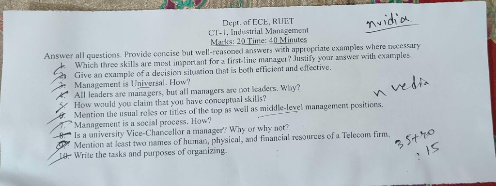
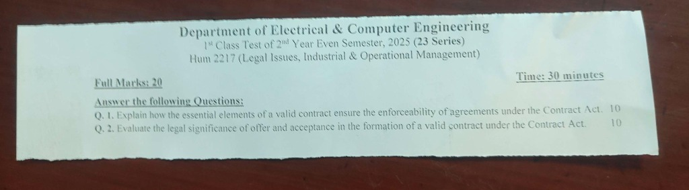
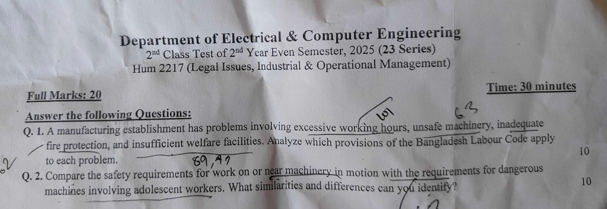
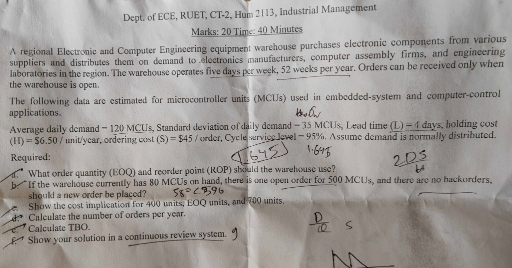

# HUM 2217: Class Test (CT) Questions & Comprehensive Solutions

**Department of Electrical & Computer Engineering (ECE)**  
**Rajshahi University of Engineering & Technology (RUET)**  
**Course Title:** Legal Issues, Industrial and Operational Management (HUM 2217 / HUM 2113)

---

## 1. Overview of Class Tests

Class tests at RUET evaluate specific course outcomes (COs) taught by the two course instructors:
1. **Shoaib Islam Sir (SI Sir):** Legal Issues (CO1): Contract Act 1872, Bangladesh Labour Code 2006, and Industrial Relations.
2. **Md. Rokonuzzaman Sir (MRI Sir):** Industrial Management (CO2) and Operational Management (CO3): Management functions, managerial skills, organizational structures, and Continuous Review Inventory Systems.

| Test Title | Instructor | Session / Series | Focus Area | CO Mapped | Full Marks | Time |
| :--- | :--- | :--- | :--- | :---: | :---: | :---: |
| **CT-1: Industrial Management** | MRI Sir | 2025 (23 Series) | Management foundations, skills, efficiency vs. effectiveness, organizing | **CO2** | 20 | 40 min |
| **CT-1: Legal Issues** | SI Sir | 2025 (23 Series) | Law of Contract, essentials of valid contract, offer and acceptance | **CO1** | 20 | 30 min |
| **CT-2: Legal Issues** | SI Sir | 2025 (23 Series) | Bangladesh Labour Code 2006, working hours, safety, adolescent machinery rules, welfare | **CO1** | 20 | 30 min |
| **CT-2: Operational Management** | MRI Sir | 2025 (23 Series) | Continuous Review ($Q$) inventory system, EOQ, ROP, cost curves, TBO | **CO3** | 20 | 40 min |

---

## 2. CT-1: Industrial Management (MRI Sir)

### 2.1 Question Paper Scan


*Figure 1: CT-1 Industrial Management Question Paper (Source: Dept. of ECE, RUET)*

### 2.2 Verbatim Question Paper Transcription

**Dept. of ECE, RUET**  
**CT-1, Industrial Management**  
**Marks: 20 | Time: 40 Minutes**

*Answer all questions. Provide concise but well-reasoned answers with appropriate examples where necessary.*

1. Which three skills are most important for a first-line manager? Justify your answer with examples.
2. Give an example of a decision situation that is both efficient and effective.
3. Management is Universal. How?
4. All leaders are managers, but all managers are not leaders. Why?
5. How would you claim that you have conceptual skills?
6. Mention the usual roles or titles of the top as well as middle-level management positions.
7. Management is a social process. How?
8. Is a university Vice-Chancellor a manager? Why or why not?
9. Mention at least two names of human, physical, and financial resources of a Telecom firm,
10. Write the tasks and purposes of organizing.

---

### 2.3 Comprehensive Solutions (CT-1 Industrial Management)

#### Q1. Which three skills are most important for a first-line manager? Justify your answer with examples.
**Answer:**  
The three most critical skills for a first-line manager are:
1. **Technical Skills:** First-line managers supervise day-to-day production. They must understand the mechanics of the job to guide workers and resolve technical snags.  
   *Example:* A software team lead must know how to debug Python or C++ code when an engineer faces a deployment error.
2. **Interpersonal (Human) Skills:** They work directly with operative employees. They must communicate, motivate, and resolve disputes daily.  
   *Example:* A shift supervisor in an electronics assembly plant resolves friction between two technicians on a PCB soldering line to maintain team morale.
3. **Communication Skills:** They act as the bridge between operative workers and middle management. They translate high-level schedules into daily tasks and report worker concerns upward.  
   *Example:* An IT supervisor clearly briefs network technicians on server maintenance procedures during an emergency outage.

#### Q2. Give an example of a decision situation that is both efficient and effective.
**Answer:**  
- **Effective** means making the right decisions and successfully attaining organizational goals.  
- **Efficient** means using resources (time, money, materials) wisely and cost-effectively without waste.  
- *Example:* A telecom operator faces severe network congestion in an urban area. The management implements an automated AI-based traffic load-balancing algorithm using existing server infrastructure instead of buying expensive new base stations.  
  - *Effectiveness:* Network call drops decrease by $95\%$, achieving the quality-of-service goal.  
  - *Efficiency:* The solution uses existing compute capacity, avoiding $\$500,000$ in unnecessary hardware expenses.

#### Q3. Management is Universal. How?
**Answer:**  
Management is universal because its core principles and four fundamental functions (Planning, Organizing, Leading, and Controlling) apply across all organizations, regardless of:
1. **Nature of enterprise:** Business corporations, hospitals, military units, educational institutions, government bodies, and sports teams all require resource coordination.
2. **Geographical boundaries:** Management principles function similarly in Bangladesh, Japan, or the United States.
3. **Hierarchical levels:** Supervisors, department heads, and board chairpersons all perform planning, organizing, leading, and controlling, differing only in scale and scope.

#### Q4. All leaders are managers, but all managers are not leaders. Why?
*(Note: As printed in original exam paper. This question tests the distinction between formal managerial authority and genuine leadership influence).*  
**Answer:**  
1. **Management relies on formal authority and position:**  
   A manager is appointed to a designated position within an organizational hierarchy. A manager possesses **legitimate power** (formal authority) to plan, organize, assign tasks, allocate budgets, and control results. However, a person can execute routine administrative tasks and enforce formal rules without inspiring, motivating, or gaining the personal trust of subordinates. Such an individual acts as a manager, but not a leader.
2. **Leadership is the ability to influence and inspire:**  
   Leadership is the capacity to influence individuals and groups toward achieving goals through vision, motivation, and personal influence (**referent power**) rather than sheer coercion or positional authority.
3. **Why the statement holds in organizational practice:**  
   - *Why all leaders in organizations function as managers:* When an individual leads an organizational group, they must establish direction, align people, coordinate group efforts, and solve operational problems. In doing so, they perform the core managerial functions of planning, organizing, leading, and controlling.
   - *Why all managers are not leaders:* A manager who relies exclusively on legitimate, reward, or coercive power to demand compliance without creating a shared vision or emotional commitment manages without leading.
   - *Kotter's distinction:* Management produces order, consistency, and predictability; leadership produces constructive change, vision, and movement. An organization needs both, but holding a managerial title does not automatically make someone a leader.

#### Q5. How would you claim that you have conceptual skills?
**Answer:**  
Conceptual skill is the mental capacity to view the organization as a whole, recognize how various units depend on one another, and foresee how external changes impact the entire system.  
You can claim conceptual skills by demonstrating that you:
1. Can understand the big picture rather than focusing only on isolated technical code or tasks.
2. Can anticipate how a delay in your software module will affect hardware testing, client delivery, and overall business cash flow.
3. Can formulate strategic solutions to ambiguous problems by connecting technology with market needs.

#### Q6. Mention the usual roles or titles of the top as well as middle-level management positions.
**Answer:**  
1. **Top-Level Management:**
   - *Roles:* Formulate overall organizational goals, define long-term strategies, interact with the external environment, and maintain corporate governance.
   - *Typical Titles:* Chief Executive Officer (CEO), President, Managing Director (MD), Vice President (VP), Chief Technology Officer (CTO), Board of Directors.
2. **Middle-Level Management:**
   - *Roles:* Implement top management policies, coordinate and supervise first-line managers, and allocate departmental resources.
   - *Typical Titles:* Plant Manager, Operations Manager, Regional Sales Director, Division Head, Department Chairperson.

#### Q7. Management is a social process. How?
**Answer:**  
Management is a social process because:
1. **Human focus:** Management gets work done through and with people. Organizations consist of individuals with diverse behaviors, emotions, and aspirations.
2. **Interpersonal relationships:** Managers spend the majority of their time communicating, motivating, resolving interpersonal conflicts, and building teamwork.
3. **Social responsibility:** Management decisions impact society at large, including customers, workers' families, local communities, and the environment.

#### Q8. Is a university Vice-Chancellor a manager? Why or why not?
**Answer:**  
**Yes, a university Vice-Chancellor is a manager.**  
*Reasons:*
1. **Resource coordination:** A Vice-Chancellor manages all four organizational resources: Human (faculty and administrative staff), Financial (university budget and research grants), Physical (campus buildings and laboratories), and Information (academic records and curricula).
2. **Execution of management functions:**
   - *Planning:* Setting academic visions, research milestones, and accreditation goals.
   - *Organizing:* Structuring faculties, departments, and administrative directorates.
   - *Leading:* Guiding deans, inspiring professors, and managing student affairs.
   - *Controlling:* Monitoring academic performance, fiscal budgets, and examination integrity.

#### Q9. Mention at least two names of human, physical, and financial resources of a Telecom firm.
**Answer:**  
For a Telecom Firm (such as Grameenphone or Banglalink):
1. **Human Resources:**
   - Radio Frequency (RF) Network Engineers
   - Customer Support Service Representatives
2. **Physical Resources:**
   - Cellular Base Transceiver Station (BTS) Towers and Antennas
   - Underground Optical Fiber Transmission Cables and Data Centers
3. **Financial Resources:**
   - Equity Capital and Investor Funds
   - Operating Revenue generated from mobile subscriber voice/data recharges

#### Q10. Write the tasks and purposes of organizing.
**Answer:**  
1. **Purposes of Organizing:**
   - To establish a clear internal structure where roles, duties, and accountability are defined.
   - To coordinate efforts across departments and avoid duplication of work.
   - To build clean reporting lines and clear lines of authority.
2. **Tasks of Organizing:**
   - *Identification and division of work:* Breaking overall operations into specific job tasks.
   - *Departmentalization:* Grouping similar jobs into functional, product, or geographical units.
   - *Assignment of duties:* Allocating specific responsibilities to qualified personnel.
   - *Delegation of authority:* Granting managers the formal right to make decisions and direct subordinates.

---

## 3. CT-1: Legal Issues (SI Sir, 23 Series, 2025)

### 3.1 Question Paper Scan


*Figure 2: CT-1 Legal Issues Question Paper (Source: Dept. of ECE, RUET)*

### 3.2 Verbatim Question Paper Transcription

**Department of Electrical & Computer Engineering**  
**1st Class Test of 2nd Year Even Semester, 2025 (23 Series)**  
**Hum 2217 (Legal Issues, Industrial & Operational Management)**

**Full Marks: 20 | Time: 30 minutes**

*Answer the following Questions:*

- **Q. 1.** Explain how the essential elements of a valid contract ensure the enforceability of agreements under the Contract Act. **[10 Marks]**
- **Q. 2.** Evaluate the legal significance of offer and acceptance in the formation of a valid contract under the Contract Act. **[10 Marks]**

---

### 3.3 Comprehensive Solutions (CT-1 Legal Issues)

#### Q1. Explain how the essential elements of a valid contract ensure the enforceability of agreements under the Contract Act. [10 Marks]
**Answer:**  
Under the **Contract Act, 1872**, an agreement is defined as *"every promise and every set of promises, forming the consideration for each other"* [`Sec 2(e)`]. A contract is defined as *"an agreement enforceable by law"* [`Sec 2(h)`].  

The fundamental legal maxim states: **"All contracts are agreements, but all agreements are not contracts."** For an agreement to become a binding, enforceable contract, it must satisfy all essential elements laid down in **Section 10** of the Contract Act, 1872:

```text
Agreement + Enforceability at Law (Section 10 Essentials) = Valid Contract
```

1. **Offer and Acceptance:**  
   There must be a lawful proposal by one party and an absolute, unqualified acceptance by the other [`Sec 2(a)`, `Sec 2(b)`]. This produces a meeting of minds (*consensus ad idem*). Without mutual assent, no agreement exists.
2. **Intention to Create Legal Relations:**  
   The parties must intend to create a binding legal obligation. Social, domestic, or moral promises (such as a dinner invitation or promises between spouses as in *Balfour v. Balfour*) lack legal intention and cannot be enforced in a court of law.
3. **Lawful Consideration [`Sec 2(d)`, `Sec 25`]:**  
   Consideration is the price paid for the promise (*quid pro quo*). It must be real, valuable, and lawful. An agreement made without consideration is void under `Sec 25`, subject to narrow statutory exceptions.
4. **Capacity of Parties [`Sec 11`, `Sec 12`]:**  
   The contracting parties must be legally competent:
   - Must have attained the age of majority (18 years under the Majority Act, 1875).
   - Must be of sound mind.
   - Must not be disqualified from contracting by any applicable law (such as alien enemies or undischarged insolvents).
   An agreement with a minor is void *ab initio* (*Mohori Bibee v. Dharmodas Ghose*).
5. **Free Consent [`Sec 13`, `Sec 14`]:**  
   The parties must agree upon the same thing in the same sense. Consent is free when it is not caused by:
   - Coercion (`Sec 15`)
   - Undue Influence (`Sec 16`)
   - Fraud (`Sec 17`)
   - Misrepresentation (`Sec 18`)
   - Mistake (`Sec 20`, `Sec 21`, `Sec 22`)  
   Absence of free consent makes the contract voidable under `Sec 19` or void under `Sec 20`.
6. **Lawful Object and Consideration [`Sec 23`]:**  
   The object must not be forbidden by law, defeat provisions of any law, be fraudulent, involve injury to person or property, or be regarded by the court as immoral or opposed to public policy.
7. **Agreements Not Expressly Declared Void:**  
   The agreement must not fall under classes explicitly declared void by statute:
   - Agreement in restraint of marriage (`Sec 26`)
   - Agreement in restraint of trade (`Sec 27`)
   - Agreement in restraint of legal proceedings (`Sec 28`)
   - Uncertain agreement (`Sec 29`)
   - Wagering agreement (`Sec 30`)
8. **Certainty and Possibility of Performance [`Sec 29`, `Sec 56`]:**  
   The terms must be definite and unambiguous. An agreement to do an impossible act is void *ab initio* under `Sec 56`.
9. **Legal Formalities:**  
   Where required by specific statutes, agreements must be in writing, attested, and registered (such as transfers of immovable property under the Registration Act).

**Conclusion:** These elements filter casual promises from binding commercial commitments. If an element is missing, the agreement is either void (`Sec 2(g)`), voidable (`Sec 2(i)`), or unenforceable.

---

#### Q2. Evaluate the legal significance of offer and acceptance in the formation of a valid contract under the Contract Act. [10 Marks]
**Answer:**  
Offer and acceptance constitute the primary foundation of contract formation. They establish mutual assent (*consensus ad idem*). As legal scholar Sir William Anson stated:  
> *"Acceptance is to an offer what a lighted match is to a train of gunpowder. It produces something which cannot be undone or recalled."*

1. **Legal Nature of Proposal (Offer) [`Sec 2(a)`]:**  
   A proposal occurs when one person signifies to another their willingness to do or abstain from doing anything, with a view to obtaining the assent of that other to such act or abstinence.
   - **Legal Significance:** An offer establishes the exact legal terms upon which the promisor is willing to be bound. It transforms an informal negotiation into an operative legal commitment once accepted.
   - **Offer vs. Invitation to Treat:** An offer must be distinguished from an invitation to receive offers (e.g., quotations, price tags, tenders, or auction notices). In ECE equipment tenders, submitting a tender is the legal offer; the company issuing the RFP merely invites proposals.

2. **Legal Nature of Acceptance [`Sec 2(b)`]:**  
   When the person to whom the proposal is made signifies their assent thereto, the proposal is said to be accepted. A proposal, when accepted, becomes a **promise**.
   - **Legal Significance:** Acceptance converts an open, revocable proposal into an irrevocable legal obligation. Before acceptance, no rights or duties exist. The instant acceptance is completed, both parties are bound.

3. **Statutory Rules Governing Enforceable Offer & Acceptance:**
   - **Absolute and Unqualified [`Sec 7(1)`]:** Acceptance must match the offer exactly (the "mirror image" rule). Any conditional acceptance, deviation, or counter-offer destroys the original proposal.
   - **Usual and Reasonable Manner [`Sec 7(2)`]:** Acceptance must be communicated in the prescribed mode, or in a reasonable manner if none is stated.
   - **Performance of Conditions [`Sec 8`]:** In general offers made to the public, performing the prescribed condition constitutes valid acceptance without prior notification (*Carlill v. Carbolic Smoke Ball Co.*).

4. **Rules on Communication and Completion [`Sec 4`]:**
   - **Communication of Proposal:** Complete when it comes to the knowledge of the person to whom it is made.
   - **Communication of Acceptance:**
     - *As against the proposer:* Complete as soon as it is put in course of transmission to him, so as to be out of the power of the acceptor. (The proposer is bound immediately).
     - *As against the acceptor:* Complete when it comes to the knowledge of the proposer. (The acceptor is bound only when the proposer receives it).
   - **Revocation [`Sec 5`]:** A proposal may be revoked at any time before the communication of its acceptance is complete as against the proposer, but not afterwards. An acceptance may be revoked at any time before the communication of acceptance is complete as against the acceptor.

**Conclusion:** Offer and acceptance define the exact moment of contract creation, determine the jurisdiction where the contract was concluded, and establish the enforceable rights and liabilities of both parties.

---

## 4. CT-2: Legal Issues (SI Sir, 23 Series, 2025)

### 4.1 Question Paper Scan


*Figure 3: CT-2 Legal Issues Question Paper (Source: Dept. of ECE, RUET)*

### 4.2 Verbatim Question Paper Transcription

**Department of Electrical & Computer Engineering**  
**2nd Class Test of 2nd Year Even Semester, 2025 (23 Series)**  
**Hum 2217 (Legal Issues, Industrial & Operational Management)**

**Full Marks: 20 | Time: 30 minutes**

*Answer the following Questions:*

- **Q. 1.** A manufacturing establishment has problems involving excessive working hours, unsafe machinery, inadequate fire protection, and insufficient welfare facilities. Analyze which provisions of the Bangladesh Labour Code apply to each problem. **[10 Marks]**
- **Q. 2.** Compare the safety requirements for work on or near machinery in motion with the requirements for dangerous machines involving adolescent workers. What similarities and differences can you identify? **[10 Marks]**

---

### 4.3 Comprehensive Solutions (CT-2 Legal Issues)

#### Q1. A manufacturing establishment has problems involving excessive working hours, unsafe machinery, inadequate fire protection, and insufficient welfare facilities. Analyze which provisions of the Bangladesh Labour Code apply to each problem. [10 Marks]
**Answer:**  
The **Bangladesh Labour Act, 2006 (BLC 2006)** establishes comprehensive statutory standards across four separate chapters to address each problem:

```text
Manufacturing Problems
  ├── 1. Excessive Working Hours  ──> Chapter IX (Sec 100, 101, 102, 103, 105, 108)
  ├── 2. Unsafe Machinery         ──> Chapter VI (Sec 61, 63, 64, 65, 67)
  ├── 3. Inadequate Fire Safety   ──> Chapter VI (Sec 62)
  └── 4. Insufficient Welfare     ──> Chapter VIII (Sec 89, 90, 91, 92, 93, 94)
```

##### 1. Excessive Working Hours (Chapter IX: Working Hours and Leave)
- **Daily Hours [`Sec 100`]:** No adult worker shall be required or allowed to work in an establishment for more than **8 hours** in any day (expandable up to 10 hours with overtime).
- **Weekly Hours [`Sec 101`]:** Normal weekly working hours shall not exceed **48 hours**. Overtime allows work up to **60 hours** in a week, provided the yearly average does not exceed 56 hours per week.
- **Weekly Holiday [`Sec 102`]:** Every worker in a factory or commercial establishment is entitled to one full day (24 consecutive hours) of rest each week.
- **Interval for Rest or Meal [`Sec 103`]:** No worker shall work continuously for more than 5 hours without a rest interval of at least 1 hour (or at least 30 minutes for work exceeding 6 hours).
- **Spread-over [`Sec 105`]:** The periods of work of an adult worker, inclusive of rest intervals, shall not spread over more than **11.5 hours** in any day.
- **Overtime Allowance [`Sec 108`]:** Any work performed beyond 8 hours/day or 48 hours/week must be compensated at **double the ordinary rate** of basic wages and dearness allowance ($2 \times \text{ordinary wage rate}$).

##### 2. Unsafe Machinery (Chapter VI: Safety)
- **Urgent Orders for Dangerous Building and Machinery [`Sec 61`]:** If any building or machine poses danger to human life or safety, the Labour Inspector may issue binding written orders prohibiting its operation until properly repaired or tested.
- **Fencing of Machinery [`Sec 63`]:** Every moving part of prime movers, flywheels, transmission machinery, and dangerous parts of electric generators or motors must be securely fenced with substantial guards of constant construction.
- **Work on or Near Machinery in Motion [`Sec 64`]:** Any examination, adjustment, lubrication, or belt-mounting on running machinery may only be carried out by a specially trained adult male worker wearing tight-fitting clothes whose name is entered in the prescribed register.
- **Striking Gear and Devices for Cutting off Power Supply [`Sec 65`]:** Suitable mechanical gear for shifting driving belts and emergency power-cutoff switches must be provided in every workroom for instantaneous power disconnection.
- **Casing of New Machinery [`Sec 67`]:** All revolving shafts, set screws, bolts, keys, pinions, and gears installed after the commencement of the Act must be completely encased or sunk to prevent worker entanglement.

##### 3. Inadequate Fire Protection (Chapter VI: Safety, `Sec 62`)
Under **Section 62** (*Precaution in case of fire*):
- **Alternative Emergency Exits [`Sec 62(1)`]:** Every establishment must have at least one alternative connecting emergency staircase per floor and certified firefighting appliances.
- **Door Construction & Accessibility [`Sec 62(3)`]:** Exit doors must never be locked while workers are inside. Doors must open outwards or slide smoothly.
- **Visual Signage [`Sec 62(4)`]:** All fire exits must be clearly marked in prominent **red Bangla letters** (*জরুরী নির্গমন পথ*).
- **Audible Alarms [`Sec 62(5)`]:** Clear, audible whistle or warning alarms must be installed to alert all occupants during an emergency.
- **Free Passageways [`Sec 62(6)`]:** Passageways and staircases must remain clear and free from stored goods, materials, or obstructions.
- **Escape Training [`Sec 62(7)`]:** In establishments where more than 10 workers work above the ground floor or inflammable materials are used, all workers must receive routine emergency escape training.
- **Mock Fire Drills [`Sec 62(8)`]:** In factories employing **50 or more workers**, mock firefighting drills must be conducted **at least once every 6 months** (as amended in 2013), with records maintained in an official register.

##### 4. Insufficient Welfare Facilities (Chapter VIII: Welfare Measures)
- **First-Aid Appliances [`Sec 89`]:** At least one equipped first-aid box per 150 workers under the charge of a trained person wearing a visible badge. Establishments with 300+ workers must maintain an equipped dispensary and sick room staffed by medical personnel.
- **Safety Record Book & Safety Committee [`Sec 90`, `Sec 90A`]:** Establishments with more than 25 workers must maintain a safety record book and constitute an active safety committee.
- **Washing Facilities [`Sec 91`]:** Adequate, clean, separate, and screened washing facilities must be provided for male and female workers.
- **Canteens [`Sec 92`]:** Mandatory in establishments employing more than **100 workers**, with a joint managing committee fixing food quality and subsidized pricing.
- **Rest Rooms & Lunch Rooms [`Sec 93`]:** Required where more than **50 workers** are employed, with clean drinking water. A separate rest space is required if female workers exceed 25.
- **Crèches / Children's Rooms [`Sec 94`]:** Mandatory where **40 or more female workers** are employed. Must accommodate children under 6 years, with trained attendants, cots, toys, milk, and an open-air playground.

---

#### Q2. Compare the safety requirements for work on or near machinery in motion with the requirements for dangerous machines involving adolescent workers. What similarities and differences can you identify? [10 Marks]
**Answer:**  
The Bangladesh Labour Act, 2006 addresses high-risk industrial equipment through three interrelated statutory provisions:
1. **Section 64:** *Work on or near machinery in motion* (Chapter VI: Safety).
2. **Section 40:** *Employment of adolescent on dangerous machines* (Chapter III: Employment of Adolescent Worker).
3. **Section 39(3):** *Prohibition of adolescents cleaning/adjusting machinery in motion* (Chapter III: Employment of Adolescent Worker).

##### 1. Statutory Provisions

```text
                               Machinery Safety Provisions
                                         |
            ┌────────────────────────────┴────────────────────────────┐
            ▼                                                         ▼
     BLC Section 64                                            BLC Section 40 & 39(3)
(Work on Machinery in Motion)                           (Adolescents on Dangerous Machines)
  • Adult male workers only                               • Adolescent workers (14 to < 18 years)
  • Tight-fitting protective clothing                     • Full instruction on dangers & precautions
  • Name entered in official register                     • Sufficient operational training
  • Absolute prohibition on women & adolescents           • OR continuous supervision by experienced adult
  • Covers examination, lubrication, belt mounting        • Sec 39(3) bars adolescents from moving machinery
```

- **Under Section 64 (Work on or near machinery in motion):**
  - Where examination, lubrication, belt-mounting, or adjustments must occur while machinery is in motion, the operation shall be carried out **only by a specially trained adult male worker**.
  - The worker must wear **tight-fitting clothing** provided by the employer.
  - The worker's name must be entered in the official factory register before undertaking the work.
  - Moving belt handling is restricted to belts less than 15 cm in width with flush/laced joints.
  - **Absolute Prohibition:** Women and adolescents are strictly barred from working on or between moving machinery parts (`Sec 64(1)` read with `Sec 39(3)`).
- **Under Section 40 (Employment of adolescent on dangerous machines):**
  - An adolescent (aged 14 to under 18 years, `Sec 2(8)`) is prohibited from operating machines declared dangerous by the Government unless:
    1. The adolescent has received **full instruction** regarding the dangers associated with the machine and the necessary precautions to observe; and
    2. The adolescent has completed **sufficient training** in operating the machine, **OR** works under the **adequate supervision** of a person with thorough knowledge and experience of the machine.
  - Furthermore, under **Section 39(3)**, even if an adolescent is trained or supervised on a machine, they are strictly prohibited from cleaning, lubricating, or adjusting any machinery while it is in motion.

##### 2. Key Similarities
1. **Preventive Objective:** Both provisions aim to prevent traumatic industrial injuries, mangling, limb amputations, and fatalities resulting from mechanical power transmission.
2. **Mandatory Knowledge & Training:** Both require specialized prior instruction and technical competence before a worker is permitted to approach or operate the machine.
3. **Statutory Employer Liability:** Both provisions impose strict legal duties on the employer and factory manager, backed by criminal penalties under Chapter XIX for non-compliance.
4. **Registry & Oversight:** Both require formal documentation available for inspection by the Inspector of Factories.

##### 3. Key Differences

| Basis of Comparison | Work on Machinery in Motion (`Sec 64`) | Dangerous Machines & Adolescents (`Sec 40` & `Sec 39(3)`) |
| :--- | :--- | :--- |
| **BLC Chapter** | Chapter VI (*Safety*) | Chapter III (*Employment of Adolescent Worker*) |
| **Governing Sections** | **Section 64** (general safety) | **Section 40** (dangerous machines) & **Section 39** (hazardous work & moving parts) |
| **Target Worker Class** | **Adult male workers only** ($\ge 18\text{ years}$) | **Adolescent workers** (14 to under 18 years) |
| **Eligibility Restrictions** | **Absolute bar** on female workers and adolescents; only certified adult males | Adolescents are permitted to operate designated dangerous machines if properly trained or supervised |
| **Operational State of Machine** | Machinery is **actively running / in motion** during inspection or adjustment | Machine is classified as **dangerous by Government notification**, covering its general operation |
| **Clothing & PPE Mandate** | Explicit statutory requirement: worker **must wear tight-fitting clothing** | Focuses on instruction, risk awareness, and operational supervision |
| **Supervision Exception** | No exception: supervision cannot substitute for adult male status or tight clothing | Work is permissible **under adequate supervision** of an experienced person even before training is complete |
| **Prohibition on Moving Parts** | Permitted exclusively for the designated registered adult male | **Section 39(3) strictly prohibits** adolescents from cleaning, lubricating, or adjusting parts while in motion |

**Conclusion:** Section 64 establishes an uncompromising standard for running machinery, restricting intervention to trained adult men in tight clothing. In contrast, Section 40 provides a structured training and supervisory framework allowing adolescent workers to safely develop technical skills on dangerous machinery, while Section 39(3) ensures they never touch running or un-fenced moving parts.

---

## 5. CT-2: Operational Management / Inventory Control (MRI Sir, HUM 2113)

### 5.1 Question Paper Scan


*Figure 4: CT-2 Industrial Management Question Paper (Source: Dept. of ECE, RUET)*

### 5.2 Verbatim Question Paper Transcription

**Dept. of ECE, RUET, CT-2, Hum 2113, Industrial Management**  
**Marks: 20 | Time: 40 Minutes**

A regional Electronic and Computer Engineering equipment warehouse purchases electronic components from various suppliers and distributes them on demand to electronics manufacturers, computer assembly firms, and engineering laboratories in the region. The warehouse operates five days per week, 52 weeks per year. Orders can be received only when the warehouse is open.

The following data are estimated for microcontroller units (MCUs) used in embedded-system and computer-control applications.

Average daily demand = 120 MCUs, Standard deviation of daily demand = 35 MCUs, Lead time (L) = 4 days, holding cost (H) = $6.50 / unit/year, ordering cost (S) = $45 / order, Cycle service level = 95%. Assume demand is normally distributed.

**Required:**  
a. What order quantity (EOQ) and reorder point (ROP) should the warehouse use?  
b. If the warehouse currently has 80 MCUs on hand, there is one open order for 500 MCUs, and there are no backorders, should a new order be placed?  
c. Show the cost implication for 400 units, EOQ units, and 700 units.  
d. Calculate the number of orders per year.  
e. Calculate TBO.  
f. Show your solution in a continuous review system.

---

### 5.3 Comprehensive Solutions (CT-2 Operational Management)

#### Step 1: Extract Given Parameters and Convert to Consistent Basis

- Operating Schedule: $5\text{ days/week} \times 52\text{ weeks/year} = 260\text{ operating days/year}$
- Average Daily Demand ($\bar{d}$): $120\text{ MCUs/day}$
- Annual Demand ($D$):
  $$D = \bar{d} \times \text{Operating Days/Year} = 120 \times 260 = 31,200\text{ units/year}$$
- Standard Deviation of Daily Demand ($\sigma_d$): $35\text{ MCUs/day}$
- Lead Time ($L$): $4\text{ days}$
- Holding Cost ($H$): $\$6.50/\text{unit/year}$
- Ordering Setup Cost ($S$): $\$45/\text{order}$
- Cycle Service Level: $95\%$
  - From standard normal distribution tables, the $z$-value corresponding to $95\%$ service level is $z = 1.645$.

---

#### Part (a): Order Quantity (EOQ) and Reorder Point (ROP)

##### 1. Economic Order Quantity ($EOQ$):
$$EOQ = \sqrt{\frac{2DS}{H}}$$

Substituting the values:
$$EOQ = \sqrt{\frac{2 \times 31,200 \times 45}{6.50}} = \sqrt{\frac{2,808,000}{6.50}} = \sqrt{432,000} \approx 657.267\text{ units}$$

Rounding to the nearest whole integer:
$$EOQ = 657\text{ units}$$

##### 2. Demand During Lead Time ($d_L$):
$$d_L = \bar{d} \times L = 120 \times 4 = 480\text{ units}$$

##### 3. Standard Deviation of Demand During Lead Time ($\sigma_L$):
$$\sigma_L = \sigma_d \sqrt{L} = 35 \sqrt{4} = 35 \times 2 = 70\text{ units}$$

##### 4. Safety Stock ($SS$):
$$SS = z \times \sigma_L = 1.645 \times 70 = 115.15\text{ units} \approx 115\text{ units}$$

##### 5. Reorder Point ($ROP$):
$$ROP = d_L + SS = 480 + 115.15 = 595.15\text{ units}$$

Rounding up for safety:
$$ROP \approx 596\text{ units} \quad (\text{or } 595\text{ units})$$

---

#### Part (b): Inventory Position Decision

Given:
- On-Hand Inventory ($OH$): $80\text{ MCUs}$
- Scheduled Receipts / Open Orders ($SR$): $500\text{ MCUs}$
- Backorders ($BO$): $0\text{ MCUs}$

##### Calculate Inventory Position ($IP$):
$$IP = OH + SR - BO = 80 + 500 - 0 = 580\text{ units}$$

##### Decision Rule:
An order of size $Q = EOQ = 657\text{ units}$ must be placed if and only if $IP \le ROP$.
- Current $IP = 580\text{ units}$
- $ROP = 596\text{ units}$ ($595.15\text{ units}$)
- Since $580 < 596$ ($IP \le ROP$):

**Decision:** **YES, a new order of $657\text{ MCUs}$ must be placed immediately.**

---

#### Part (c): Cost Implications for $Q = 400$, $Q = EOQ$, and $Q = 700$

The total annual cycle inventory cost formula is:
$$TC(Q) = \frac{D}{Q}S + \frac{Q}{2}H$$

*(Note: Total inventory cost including safety stock holding cost is $TC_{\text{total}}(Q) = \frac{D}{Q}S + \frac{Q}{2}H + SS \times H$. Since annual safety stock holding cost $SS \times H = 115.15 \times \$6.50 = \$748.48$ is constant across all order policies, both cycle cost and total cost are presented below).*

##### Case 1: For $Q = 400\text{ units}$
- Annual Ordering Cost $= \frac{31,200}{400} \times 45 = 78 \times 45 = \$3,510.00$
- Annual Holding Cost $= \frac{400}{2} \times 6.50 = 200 \times 6.50 = \$1,300.00$
- Total Annual Cycle Cost:
  $$TC(400) = 3,510.00 + 1,300.00 = \$4,810.00$$
- Total Cost including Safety Stock:
  $$TC_{\text{total}}(400) = 4,810.00 + 748.48 = \$5,558.48$$

##### Case 2: For $Q = EOQ = 657\text{ units}$ (using integer batch size $Q = 657$)
- Annual Ordering Cost $= \frac{31,200}{657} \times 45 \approx 47.4886 \times 45 = \$2,136.99$
- Annual Holding Cost $= \frac{657}{2} \times 6.50 = 328.5 \times 6.50 = \$2,135.25$
- Total Annual Cycle Cost:
  $$TC(657) = 2,136.99 + 2,135.25 = \$4,272.24$$
  *(If calculated using theoretical continuous $EOQ = 657.267$: Ordering Cost $= \$2,136.12$, Holding Cost $= \$2,136.12$, and $TC(EOQ) = \$4,272.24$)*
- Total Cost including Safety Stock:
  $$TC_{\text{total}}(657) = 4,272.24 + 748.48 = \$5,020.72$$

##### Case 3: For $Q = 700\text{ units}$
- Annual Ordering Cost $= \frac{31,200}{700} \times 45 = 44.5714 \times 45 \approx \$2,005.71$
- Annual Holding Cost $= \frac{700}{2} \times 6.50 = 350 \times 6.50 = \$2,275.00$
- Total Annual Cycle Cost:
  $$TC(700) = 2,005.71 + 2,275.00 = \$4,280.71$$
- Total Cost including Safety Stock:
  $$TC_{\text{total}}(700) = 4,280.71 + 748.48 = \$5,029.19$$

##### Summary of Cost Comparisons:

| Order Quantity ($Q$) | Annual Ordering Cost ($\frac{D}{Q}S$) | Annual Holding Cost ($\frac{Q}{2}H$) | Total Annual Cycle Cost ($TC$) | Total Cost with SS ($TC_{\text{total}}$) | Difference vs. $EOQ$ |
| :---: | :---: | :---: | :---: | :---: | :---: |
| **$400\text{ units}$** | $\$3,510.00$ | $\$1,300.00$ | **$\$4,810.00$** | **$\$5,558.48$** | $+\$537.76$ ($+12.59\%$) |
| **$EOQ = 657\text{ units}$** | $\$2,136.99$ | $\$2,135.25$ | **$\$4,272.24$** | **$\$5,020.72$** | **Optimal Baseline** |
| **$700\text{ units}$** | $\$2,005.71$ | $\$2,275.00$ | **$\$4,280.71$** | **$\$5,029.19$** | $+\$8.47$ ($+0.20\%$) |

##### Cost Implications / Managerial Insight:
1. **$EOQ$ achieves optimal cost balance:** At $EOQ \approx 657\text{ units}$, annual ordering cost and annual cycle holding cost are practically equal ($\approx \$2,136$), minimizing total cycle cost to $\$4,272.24$.
2. **Under-ordering ($Q = 400$) is financially penalizing:** Ordering only 400 units increases order frequency ($78\text{ orders/year}$), causing ordering costs to spike by $64\%$ and increasing annual inventory costs by $\$537.76$ ($12.59\%$).
3. **Over-ordering ($Q = 700$) shows a shallow cost curve:** Ordering 700 units increases holding cost to $\$2,275.00$, but total cost rises by merely $\$8.47$ ($0.20\%$). Because the total cost curve is relatively flat near the minimum, management can comfortably round batch sizes upward to accommodate standard supplier carton packaging without meaningful financial penalty.

---

#### Part (d): Number of Orders Per Year

Using optimal $EOQ = 657\text{ units}$:
$$\text{Number of Orders per Year } (N) = \frac{D}{EOQ} = \frac{31,200}{657} \approx 47.49\text{ orders/year}$$

*(Using exact $EOQ = 657.267$: $N = \frac{31,200}{657.267} = 47.47\text{ orders/year}$)*

---

#### Part (e): Time Between Orders (TBO)

TBO expresses the average time elapsed between placing successive replenishment orders:

##### In Operating Days:
$$TBO_{\text{days}} = \frac{EOQ}{D} \times \text{Operating Days/Year} = \frac{657}{31,200} \times 260 = \frac{260}{47.49} \approx 5.475\text{ operating days}$$

##### In Weeks:
$$TBO_{\text{weeks}} = \frac{EOQ}{D} \times 52\text{ weeks/year} = \frac{657}{31,200} \times 52 \approx 1.095\text{ weeks} \approx 1.1\text{ weeks}$$

The warehouse places an order approximately once every **5.5 operating days** (or roughly once every calendar week).

---

#### Part (f): Solution in a Continuous Review ($Q$) System

In a Continuous Review system, the inventory position ($IP$) is tracked continuously after every transaction. When $IP$ drops to or below the Reorder Point ($ROP$), a fixed batch size of $Q = EOQ$ is ordered.

```text
Inventory
Units
  ^
  |          Order Placed
  |             (IP <= ROP)
  |                  |
  |                  v
Q |------------------\
  |                   \                           Order Arrives
  |                    \                          (Lead time L = 4 days)
  |                     \                              |
  |                      \                             v
ROP | - - - - - - - - - - \ - - - - - - - - - - - - - - +
  |                        \                           / \
  |                         \                         /   \
  |                          \                       /     \
  |                           \                     /       \
SS|============================\===================/=========\=== (SS = 115)
  |                             \                 /
0 +------------------------------+---------------+-----------------> Time
  |<-------- TBO = 5.5 days ---->|<- L = 4 days ->|
```

##### Summary of Continuous Review Policy Parameters:
- **Order Quantity ($Q$):** $657\text{ MCUs}$
- **Reorder Point ($ROP$):** $596\text{ MCUs}$
- **Safety Stock ($SS$):** $115\text{ MCUs}$
- **Lead Time ($L$):** $4\text{ operating days}$
- **Review Policy:** Whenever $IP = (\text{On-Hand} + \text{Scheduled Receipts} - \text{Backorders}) \le 596\text{ MCUs}$, place an order for $657\text{ MCUs}$.

---

## 6. Strategic Mapping to Final Examinations

These four class tests mirror recent semester final questions:

| CT Question | Syllabus Subtopic | Relevant Semester Final Questions | Exam Weightage Status |
| :--- | :--- | :--- | :---: |
| **IM CT-1 Q1, Q5** (Managerial Skills) | `M02.3`, `M02.4` Managerial Skills | 2024 Q1c (4m), 2023 Q5c (4m), 2021 Q1c (4m) | 🔴 Tier 1 High-Yield |
| **IM CT-1 Q2** (Efficiency vs. Effectiveness) | `M01.3` Efficiency vs. Effectiveness | 2024 Q5a (2m), 2023 Q5b (4m), 2021 Q1a (3m), 2021 Q2a (3m) | 🔴 Asked in every paper |
| **IM CT-1 Q3, Q4, Q7, Q8, Q9** (Nature, Resources, Leadership) | `M01.2`, `M01.5` Resources, Nature & Leadership | 2024 Q1a (2m), 2023 Q5a (2m), 2020 Q1a (3m) | 🟠 Core Foundation |
| **IM CT-1 Q6** (Levels of Management) | `M02.1` Top & Middle Management Roles | 2023 Q5c (4m) | 🟡 Standard Theory |
| **IM CT-1 Q10** (Organizing) | `M04.3` Organizing Tasks & Elements | 2023 Q6c (5m) | 🟡 Standard Theory |
| **Legal CT-1 Q1** (Essential Elements) | `L02.3` Contract Essentials (`Sec 10`) | 2023 Q3b (4m), 2024 Q2a (2m) | 🔴 SI Sir Priority |
| **Legal CT-1 Q2** (Offer & Acceptance) | `L02.4`–`L02.7` Offer & Acceptance Rules | 2024 Q6a (2m), 2024 Q6b (4m) | 🔴 High Yield |
| **Legal CT-2 Q1** (Factory Issues & BLC) | `L05.7`, `L05.8`, `L07.1`, `L08.1`–`L08.6` | 2023 Q1c (4m), 2023 Q2b (4m) | 🔴 SI Sir Core Exam Pool |
| **Legal CT-2 Q2** (Machinery Safety Comparison) | `L07.2`, `L05.6` (`Sec 64` vs `Sec 40 & 39(3)`) | 2023 Q1b (4m), 2023 Q2b (4m) | ⚫ Excluded from Final by Voice Note |
| **OM CT-2 Q1(a–f)** (Continuous Review) | `O02.3`–`O02.8` Continuous Review ($Q$) System | 2024 Q4c (5m), 2024 Q7b (6m), 2023 Q7c (6m) | 🔴 Guaranteed Numerical |
