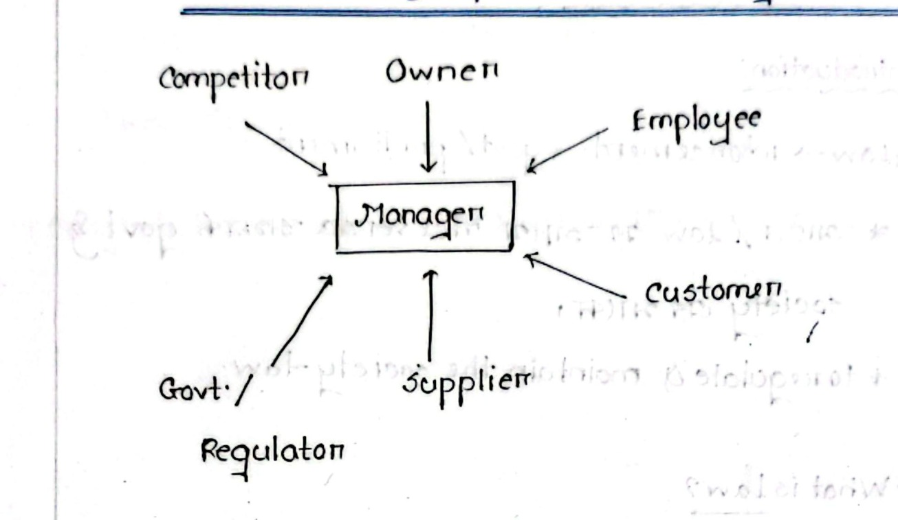
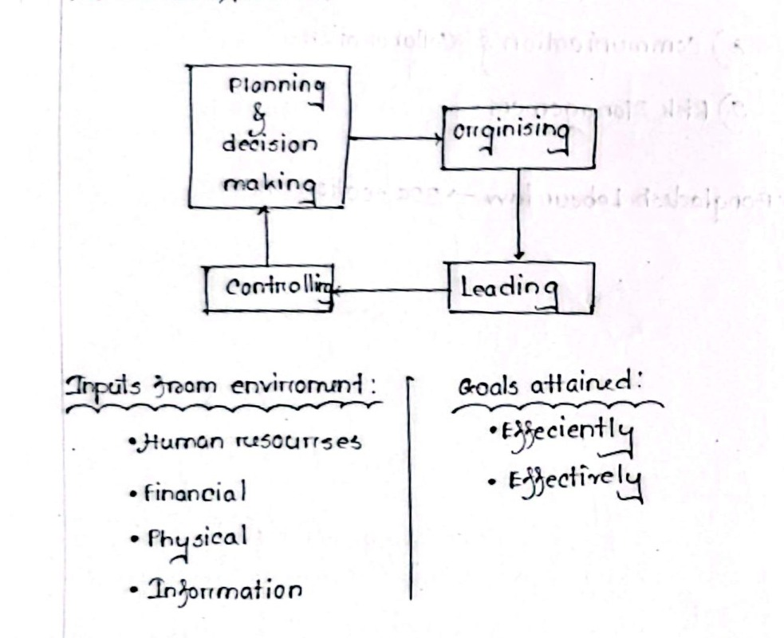
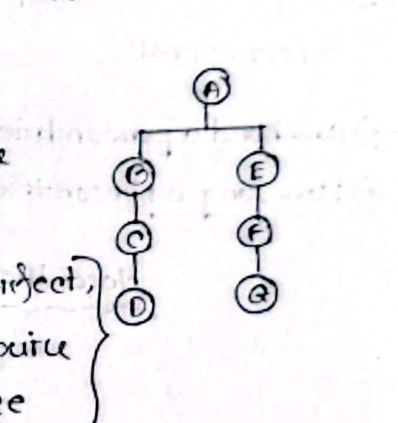
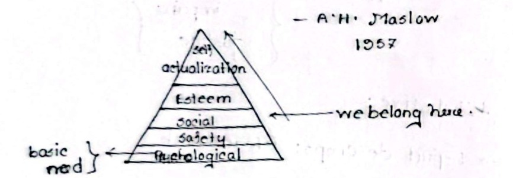
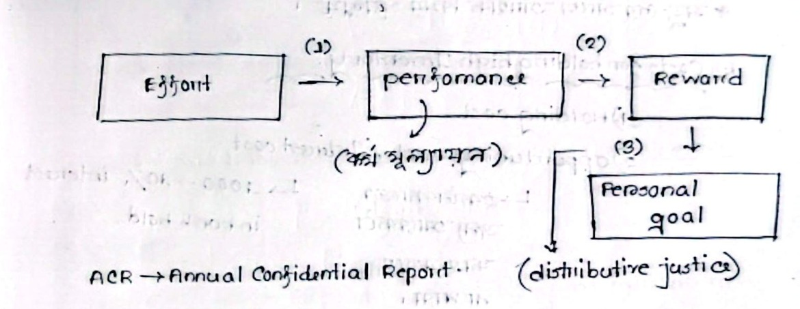
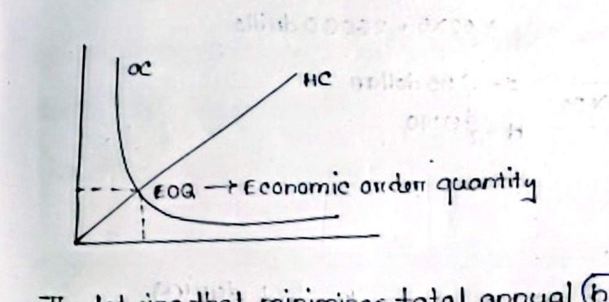
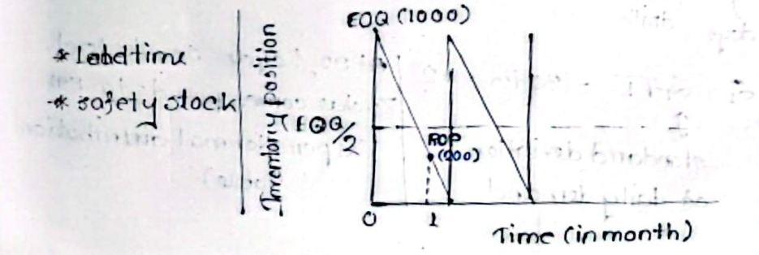
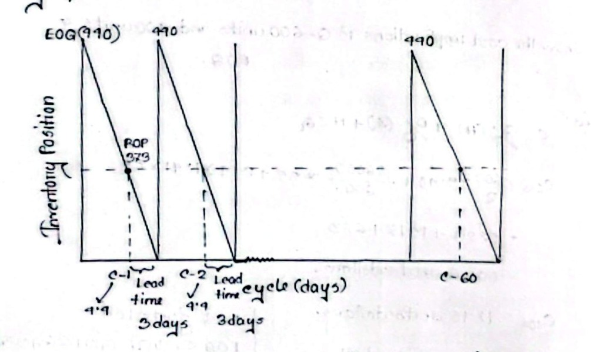

# Hum 2217: Legal Issues, Industrial & Operational Management — Class Notes

**Source:** Handwritten Class Notes by Raidah  
**Course Code:** Hum 2217  
**Course Title:** Legal Issues, Industrial & Operational Management  
**Instructors:**
- **Dr. Md. Rabiul Islam (MRI Sir)** (Industrial & Operational Management)
- **Shoaib Islam (SI Sir)** (Legal Issues & Industrial Law)

---

## Table of Contents
1. [CLASS-01 | 22.06.2026 | MRI Sir — Introduction to Industrial & Operational Management](#class-01--22062026--mri-sir--introduction-to-industrial--operational-management)
2. [CLASS-01 | 23.06.2026 | SI Sir — Legal Issues: Introduction to Law & ECE Relevance](#class-01--23062026--si-sir--legal-issues-introduction-to-law--ece-relevance)
3. [CLASS-02 | 24.06.2026 | MRI Sir — Defining Management & Organizational Resources](#class-02--24062026--mri-sir--defining-management--organizational-resources)
4. [CLASS-03 | 29.06.2026 | MRI Sir — Organizational Resources, Planning, & Leadership](#class-03--29062026--mri-sir--organizational-resources-planning--leadership)
5. [CLASS-02 | 30.06.2026 | SI Sir — Law of Contract: Definition & Essential Elements](#class-02--30062026--si-sir--law-of-contract-definition--essential-elements)
6. [CLASS-04 | 01.07.2026 | MRI Sir — The Nature & Characteristics of Management](#class-04--01072026--mri-sir--the-nature--characteristics-of-management)
7. [CLASS-05 | 06.07.2026 | MRI Sir — Reference Books & Levels of Management](#class-05--06072026--mri-sir--reference-books--levels-of-management)
8. [CLASS-03 | 07.07.2026 | SI Sir — Rules Regarding Consideration](#class-03--07072026--si-sir--rules-regarding-consideration)
9. [CLASS-06 | 08.07.2026 | MRI Sir — Managerial Skills Across Management Tiers](#class-06--08072026--mri-sir--managerial-skills-across-management-tiers)
10. [CLASS-07 | 15.07.2026 | MRI Sir — Henri Fayol's Principles of Administrative Management](#class-07--15072026--mri-sir--henri-fayols-principles-of-administrative-management)
11. [CLASS-08 | 27.07.2026 | MRI Sir — Employee Motivation & Expectancy Theory](#class-08--27072026--mri-sir--employee-motivation--expectancy-theory)
12. [CLASS-09 | 03.08.2026 | MRI Sir — Inventory Management Concepts & EOQ Basics](#class-09--03082026--mri-sir--inventory-management-concepts--eoq-basics)
13. [CLASS-10 | Inventory Control Mathematical Problem (Exercise 1.2 — Parts a-c)](#class-10--inventory-control-mathematical-problem-exercise-12--parts-a-c)
14. [CLASS-11 | Inventory Control Continuous Review & Productivity (07.09.2026)](#class-11--inventory-control-continuous-review--productivity-07092026)
15. [EXAM SUGGESTIONS | 22.09.2026 | SI Sir — Question Pattern & Key Topics](#exam-suggestions--22092026--si-sir--question-pattern--key-topics)

---

## CLASS-01 | 22.06.2026 | MRI Sir — Introduction to Industrial & Operational Management

<!-- Page 1 | CLASS-01 | 22.06.2026 | MRI SIR -->

### 1. The Manager and Organizational Stakeholders
The modern manager operates at the central nexus of an organization, directly interfacing with and responding to diverse internal and external stakeholders:


*Figure 1.1 — Manager and organizational stakeholders interaction model (Page 1)*

- **Owner**: Sets company goals, provides capital, and evaluates executive stewardship.
- **Employee**: Executes operational tasks, needing fair compensation and leadership.
- **Customer**: Drives demand, requiring quality products and reliable service.
- **Supplier**: Provides essential raw materials, components, and logistics support.
- **Government / Regulator**: Enforces compliance, legal standards, labor codes, and taxes.
- **Competitor**: Influences strategic positioning, pricing, and operational benchmarks.

### 2. Historical Genesis of Industrial Management
- **1911** $\rightarrow$ **Frederick Winslow Taylor (F.W. Taylor)** formally proposed **Industrial Management**.
  - **Professional Background**: Mechanical Engineer.
  - **Disciplinary Evolution**: Mechanical Engineering $\rightarrow$ **Industrial & Production Engineering (IPE)**.

### 3. Core Definition of Management
> *"Management is an art of doing things in the best & cheapest way."*  
> — **F.W. Taylor**

---

## CLASS-01 | 23.06.2026 | SI Sir — Legal Issues: Introduction to Law & ECE Relevance

<!-- Page 2 (Left & Right) | CLASS-01 | 23.06.2026 | SI SIR -->

### 1. Introduction to Law and Governance
- **Mechanics of Law**:
  $$\text{Law} \longrightarrow \text{Enforcement} \longrightarrow \text{Government / Parliament}$$
- **Reciprocal Relationship**:
  There is an intrinsic, vice-versa relationship between law, government, and society (*আইন / law এর সাথে vice versa সম্পর্ক govt & society এর সাথে*).
  - To regulate and maintain order within society $\rightarrow$ **Law** is indispensable.

### 2. Fundamental Legal Questions
- **What is Law?** Formal rules established by an authority to regulate societal conduct and enforce justice.
- **What is Industrial Law?** The body of legislation governing the establishment, licensing, working standards, and dispute resolutions within industrial enterprises.
- **What is Labour Law?** Statutes protecting worker rights, ensuring occupational welfare, safety, fair wages, and collective bargaining.
- **Differences between Industrial Law and Labour Law**: Industrial law regulates factory operations and corporate legal compliance broadly; labour law centers specifically on the employee-employer relationship and workforce protection.

### 3. Why ECE (Electrical & Communication Engineering) Students Should Learn Law
Engineering professionals and technical founders require legal knowledge across nine distinct areas:

1. **Intellectual Property Rights (IPR)**: Protecting circuit designs, software algorithms, patents, and technical innovations.
2. **Compliance**: Conforming to telecommunication standards, safety norms, and environmental disposal laws (e.g., e-waste).
3. **Contracts & Agreements**: Formulating, evaluating, and executing vendor, client, service-level, and employment contracts.
4. **Liability & Responsibility**: Understanding product safety liabilities, engineering negligence, and equipment failure liabilities.
5. **Ethical Considerations**: Addressing data privacy, electronic eavesdropping, surveillance ethics, and professional integrity.
6. **Startup & Entrepreneurship**: Navigating corporate incorporation, equity split agreements, seed investments, and trademarking.
7. **Regulatory Changes**: Keeping pace with rapid updates in cybersecurity laws, AI regulations, and frequency spectrum allocation policies.
8. **Communication & Collaboration**: Enabling legally binding corporate communications, non-disclosure agreements (NDAs), and cross-border tech partnerships.
9. **Risk Management**: Identifying corporate legal liabilities before commercial deployment to minimize litigation exposures.

### 4. Statutory Scope of Domestic Labour Law
- **Bangladesh Labour Act, 2006 (BLC 2006)**: Comprises **326 sections** governing employment conditions, occupational safety, health, trade unions, and industrial disputes across Bangladesh (*Bangladesh Labour law $\rightarrow$ 326 section আছে*).

---

## CLASS-02 | 24.06.2026 | MRI Sir — Defining Management & Organizational Resources

<!-- Page 3 (Left) | CLASS-02 | 24.06.2026 | MRI SIR -->

### 1. The Management Process Cycle
Management is an ongoing, integrated process comprising four primary administrative functions:


*Figure 2.1 — The Management Process Cycle, Inputs, and Goal Attainment (Page 3)*

- **Four Primary Management Functions**:
  1. **Planning & Decision Making**: Setting strategic objectives and selecting the best path to achieve them.
  2. **Organizing**: Structuring resources, defining responsibilities, and establishing authority relationships.
  3. **Leading**: Motivating, communicating with, and guiding human resources towards group objectives.
  4. **Controlling**: Measuring operational performance against standards and applying corrective actions (providing feedback back into Planning).

### 2. Environmental Inputs to the Organization
Organizations absorb four fundamental categories of inputs from their environment:
- **Human Resources**: The workforce, managers, and specialized personnel.
- **Financial Resources**: Equity capital, operating cash, credit lines, and retained earnings.
- **Physical Resources**: Real estate, manufacturing plants, machinery, and raw inventories.
- **Information Resources**: Market intelligence, sensor data, competitive analytics, and technical know-how.

### 3. Ultimate Goals Attained
- **Efficiently**: Doing things right $\rightarrow$ Minimizing input costs and waste.
- **Effectively**: Doing the right things $\rightarrow$ Achieving the stated organizational objectives and customer value.

### 4. In-Depth Focus: Human Resources
- Demonstrating genuine dedication to the chosen profession.
- Showing institutional loyalty and dedication to the organizational mission.
- Performing duties diligently as an employed contributor.
- Earning compensation/salary while actively participating in institutional capacity-building and professional development (*taking salary or participating in the development of the officials and so on*).

---

## CLASS-03 | 29.06.2026 | MRI Sir — Organizational Resources, Planning, & Leadership

<!-- Page 3 (Right) | CLASS-03 | 29.06.2026 | MRI SIR -->

### 1. Resource Categorization (Continued)
- **Financial Resource**: All capital and liquid funds ($\text{cash, bank balance}$).
- **Physical Resource**: Structural assets such as facilities ($\text{building}$) and real estate ($\text{land}$).
- **Information Resource**: Dynamic operational awareness: *"What is happening, and how does that happen?"*

### 2. Strategic Managerial Functions
- **Planning & Deciding in Advance**: Determining ahead of time what should be accomplished, who will do it, and how it will be executed.
- **Forecast & Foresight**: Anticipating environmental shifts, market patterns, and technological disruptions.
- **Decision Making**: Evaluating available courses of action and selecting the optimal alternative from amongst competitors (*choosing the best alternatives amongst the other alternatives*).

### 3. Leadership & Control Paradigms
- *"All leaders are managers."* (In an effective organization, leadership must be embedded across all managerial levels).
- **Leadership Trait Concept**: *"Leaders are born, not made."* (Classical Trait Theory perspective highlighted in lecture).
- **Controlling**: Continually verifying performance against scheduled plans and executing corrective protocols.

### 4. Mathematical & Economic Sense of Goals
- **Efficiency ($\text{Efficiency}$)**: Cost-effectiveness $\rightarrow$ Minimizing expense, maximizing production output:
  $$\text{Expenses} \downarrow \quad \text{Output} \uparrow \quad (\text{খরচ কম, output বেশি})$$
- **Effectiveness ($\text{Effectiveness}$)**: Making the correct strategic choice and successfully translating it into operational implementation (*right decision & successfully implement it*).

---

## CLASS-02 | 30.06.2026 | SI Sir — Law of Contract: Definition & Essential Elements

<!-- Page 4 (Left & Right) | CLASS-02 | 30.06.2026 | SI SIR -->

### 1. Conceptual Definition of Contract
- **Contract Act, 1872**:
  $$\text{Contract} = \text{Agreement} + \text{Enforceability by Law}$$
  An agreement that creates legal obligations between parties and is enforceable in a court of law.

> [!IMPORTANT]
> **Core Legal Maxim:**
> *"All contracts are agreements, but all agreements are not contracts."*  
> (Every contract begins as an agreement between parties, but only those agreements that fulfill all statutory conditions of enforceability become legally binding contracts).

### 2. The 10 Essential Elements of a Valid Contract
Under the Contract Act 1872, an agreement must satisfy the following ten criteria to be recognized as a valid contract:

1. **Offer & Acceptance (Lawful Offer)**: A clear, definite proposal made by one party and an unconditional acceptance by the other.
2. **Intention to Create Legal Relationship**: Both parties must intend that legal consequences will arise if the promise is breached (social or domestic agreements are excluded).
3. **Lawful Consideration**: Something of value exchanged in return (*Quid Pro Quo*); consideration must be legal and not forbidden by statute.
4. **Capacity of Parties**: Parties must be legally competent (of sound mind, having reached the age of majority, and not disqualified by any law).
5. **Free Consent**: Agreement must be reached without coercion, undue influence, fraud, misrepresentation, or mutual mistake.
6. **Legality of the Object**: The objective or purpose of the agreement must not be illegal, immoral, or opposed to public policy.
7. **Certainty**: The terms, conditions, and subject matter of the contract must be clear and definite, not vague or ambiguous.
8. **Possibility of Performance**: The act agreed upon must be capable of physical and legal performance (an agreement to perform an impossible act is void).
9. **Not Expressly Declared Void (Void Agreements)**: The agreement must not belong to the categories specifically declared void by the Contract Act.
10. **Writing, Registration & Legal Formalities**: Compliance with mandatory legal formalities where required by law (e.g., written, stamped, witnessed, and registered).

### 3. Void Agreements in the Contract Act, 1872
- **Sections 26 to 30**: Detail **5 specific types of agreements** declared expressly void by law (*Contract Act এর 26-30 ধারায় ৫টি চুক্তি void agreement হিসেবে দেওয়া আছে*):
  - Section 26: Agreement in restraint of marriage.
  - Section 27: Agreement in restraint of trade.
  - Section 28: Agreement in restraint of legal proceedings.
  - Section 29: Agreements void for uncertainty.
  - Section 30: Agreements by way of wager (wagering agreements).

### 4. Void vs. Voidable Agreements
- **Void Agreement**: An agreement not enforceable by law from its very inception (*void ab initio*); confers no legal rights on either party.
- **Voidable Agreement**: An agreement that is enforceable by law at the option of one or more of the parties thereto, but not at the option of the other or others (typically due to lack of free consent, e.g., coercion or misrepresentation).

---

## CLASS-04 | 01.07.2026 | MRI Sir — The Nature & Characteristics of Management

<!-- Page 5 (Left & Right) | CLASS-04 | 01.07.2026 | MRI SIR -->

Management exhibits eight intrinsic characteristics across organizations:

| # | Characteristic | Definition & Key Elements | Operational Dimensions |
|:---|:---|:---|:---|
| **1** | **Goal-Oriented** | Systematically driven towards achieving predefined corporate goals | - Structured strategic assessment: **SWOT** ($\text{Strength, Weakness, Opportunity \& Threat}$)<br>- Practical operational target setting |
| **2** | **Social Process** | Centered on human behavior, interpersonal relationships, and groups | - Interpersonal interaction<br>- Motivation and leadership inspiring the collective workforce |
| **3** | **Universal Application** | Applicable universally across all collective endeavors | - Relevant to technology firms, educational institutions, government bodies, and non-profits alike |
| **4** | **Dynamic & Adaptive** | Highly responsive and adaptable to changing internal & external climates | - Change movement and environmental adaptation<br>- Continuous process improvement |
| **5** | **Integrative** | Synthesizes isolated functional components into a unified enterprise | - Alignment and coordination across diverse departments<br>- Corporate strategy and functional synergy ($\text{Strategy / Synergy}$) |
| **6** | **Decision Making** | Systemic selection of optimal courses of action | - Structured problem-solving techniques<br>- Managing organizational risk and environmental uncertainty |
| **7** | **Resource Optimization** | Maximizing production output from limited organizational resources | - **Efficiency** (optimizing resource use to minimize input waste)<br>- **Effectiveness** (delivering the desired strategic impact) |
| **8** | **Continuous Learning & Development** | Ongoing elevation of institutional knowledge, capabilities, and agility | - Continuous employee skill development<br>- Systematic adaptation to evolving industry and technology trends |

---

## CLASS-05 | 06.07.2026 | MRI Sir — Reference Books & Levels of Management

<!-- Page 6 (Left) | CLASS-05 | 06.07.2026 | MRI SIR -->

### 1. Prescribed Reference Books
- **Management Theory**: *Management* by **Ricky W. Griffin**
- **Operations & Production**: *Operations Management: Processes and Supply Chains* by **Lee J. Krajewski and Larry P. Ritzman**

### 2. Hierarchical Levels of Management
Organizational management is structured into three primary hierarchical tiers:
1. **Top-Level Management**:
   - **CEO** (Chief Executive Officer), **Board of Directors (BOD)**, Managing Directors.
   - Focus: Long-term strategic planning, corporate vision, governance, and overall company performance.
2. **Middle-Level Management**:
   - **Chief Engineer**, Departmental Heads, Branch Managers, Plant Managers.
   - Focus: Translating top-level strategies into operational plans, coordinating departmental activities, and managing team leaders.
3. **Lower-Level / Operational Management**:
   - First-line supervisors, team leads, foremen, and technical specialists.
   - Focus: Direct supervision of day-to-day operations and application of specific **technical skills** ($\text{Technical skill} \rightarrow \text{Lower level}$).

---

## CLASS-03 | 07.07.2026 | SI Sir — Rules Regarding Consideration

<!-- Page 6 (Right - Top) | CLASS-03 | 07.07.2026 | SI SIR -->

- **Topic Introduced**: `RULES REGARDING CONSIDERATION`
- Consideration (*Quid pro quo* — something in return) is the vital essence of every valid contract under the Contract Act, 1872. An agreement made without consideration is void (*Ex nudo pacto non oritur actio*), subject to statutory exceptions.

---

## CLASS-06 | 08.07.2026 | MRI Sir — Managerial Skills Across Management Tiers

<!-- Page 6 (Right - Bottom) | CLASS-06 | 08.07.2026 | MRI SIR -->

Different tiers of management require differing proportions of specialized managerial skills:

```text
┌──────────────────────────────────────────────────────────┐
│  Top-Level Management                                    │
│  • Conceptual Skills (Abstract thinking & Problem Solving) │
│  • Decision-Making Skills                                │
│  • Time Management Skills                                │
├──────────────────────────────────────────────────────────┤
│  Mid-Level Management                                    │
│  • Analytic Skills                                       │
│  • Interpersonal & Coordinating Skills                   │
├──────────────────────────────────────────────────────────┤
│  Lower-Level Management                                  │
│  • Technical Skills                                      │
└──────────────────────────────────────────────────────────┘
```

- **Abstract Thinking & Problem Solving** $\rightarrow$ **Conceptual Skill** $\rightarrow$ Primarily required for **Top-Level Management**.
- **Analytic Skill** $\rightarrow$ Required for **Mid-Level Management** to interpret operational data and optimize processes.
- **Decision-Making Skill** $\rightarrow$ Essential for **Top-Level Management** to establish strategic corporate policies.
- **Time Management Skill** $\rightarrow$ Essential for **Top-Level Management** to prioritize complex corporate commitments.

---

## CLASS-07 | 15.07.2026 | MRI Sir — Henri Fayol's Principles of Administrative Management

<!-- Page 7 (Left & Right) | CLASS-07 | 15.07.2026 | MRI SIR -->

### 1. Henri Fayol and Administrative Management
- **Henri Fayol**: French mining and mechanical engineer (explicitly noted as *"Mechanical Engr."* in lecture notes) and classical management theorist known as the father of modern administrative management.
- Formulated the **14 Principles of Management**, which remain foundational to organizational administration:

### 2. The 14 Administrative Principles
1. **Division of Work (Specialization)**:
   - Specializing labor increases efficiency and dexterity; productivity can improve by up to **$350\%$** (*Division of work: $\rightarrow$ 350% পর্যন্ত বাড়ে productivity*).
2. **Authority & Responsibility**:
   - Authority is the right to give orders; responsibility is the accompanying obligation. They must be balanced.
3. **Discipline**:
   - Respecting agreements and organizational rules; maintaining workplace decorum (*কিভাবে discipline বজায় রাখা যায়?*).
4. **Unity of Command**:
   - Each employee must receive direct orders from only one superior to prevent conflicting priorities.
5. **Unity of Direction (নির্দেশনার ঐক্যনীতি)**:
   - One head and one plan for a group of activities having the same objective.
   - Work of the same nature must follow an identical operational standard (*একই pattern এর কাজ $\rightarrow$ একই নিয়মে করতে হবে*).
   - *Example*: Lecturer recruitment across all academic departments must follow identical rules and procedures (*সকল বিভাগে lecturer নিয়োগ একই নিয়ম*).
6. **Subordination of Individual Interests to General Interests**:
   - The collective organizational objectives must always supersede individual employee goals.
7. **Remuneration**:
   - Compensation must be fair, equitable, and satisfactory to both employer and employee.
8. **Centralization vs. Decentralization**:
   - Achieving the optimal balance between centralized executive control and distributed subordinate discretion.
9. **Scalar Chain (Chain of Command)**:
   - The unbroken vertical line of authority extending from the highest executive down to the lowest ranks.


*Figure 7.1 — Fayol's Scalar Chain Hierarchy Tree (Page 7)*

> [!NOTE]
> **Fayol's Gang Plank:**
> To eliminate administrative delays during urgent operational situations, Fayol introduced the **Gang Plank** (bridge). Subordinates at the same hierarchical level across different functional chains (e.g., $D$ and $G$) may communicate directly, provided their immediate superiors ($C$ and $F$) grant authorization.

10. **Order (শৃঙ্খলা)**:
    - *"People & materials should be at right place, at right time in proper condition."* (A designated place for everything, and everything in its place).
11. **Equity (ন্যায়বিচার)**:
    - Kindness, fairness, and social justice applied across all levels of employee relations (*Social justice*).
    - In organizational justice, social justice encompasses:
      - **Pure Justice**
      - **Perfect Justice**
      - **Impure Justice**
12. **Stability of Tenure of Personnel (স্থায়িত্ব)**:
    - High employee turnover creates organizational instability and inefficiency; ensuring job security fosters institutional loyalty and commitment.
13. **Initiative**:
    - Fostering an organizational culture that encourages employees to conceive and execute innovative plans.
14. **Esprit de Corps (Teamwork)**:
    - Promoting team spirit, mutual harmony, and collective unity (derived from French: *ফরাসি language*).

---

## CLASS-08 | 27.07.2026 | MRI Sir — Employee Motivation & Expectancy Theory

<!-- Page 8 (Left & Right) | 27.07.2026 | MRI SIR -->

### 1. Conceptual Basis of Employee Motivation
- **Motivation**: An internal psychological feeling or driving power that directs and sustains goal-oriented human action.
- **The Need-Drive Model (অভাব-তাড়না)**:
  $$\text{Need (অভাব)} \longrightarrow \text{Drive / Tension (তাড়না)} \longrightarrow \text{Action} \longrightarrow \text{Satisfaction}$$
- Motivation fundamentally dictates:
  - *How hard a person tries* (Effort intensity).
  - *How long a person tries* (Persistence over time).

### 2. Maslow's Hierarchy of Needs Theory
Formulated by **Abraham H. Maslow** (1954 / noted as 1957 in lecture):

> [!IMPORTANT]
> **Core Progression Principle:**
> *"A person cannot move to the next order need unless/until they fulfill their previous need."*


*Figure 8.1 — Maslow's Hierarchy of Needs Pyramid (Page 8)*

- **Hierarchy Levels (From Base to Apex)**:
  1. **Physiological Needs**: Basic biological survival essentials (food, water, air, sleep).
  2. **Safety Needs**: Job security, financial safety, physical protection, and freedom from emotional harm (*security of job, physically & emotionally hurt না হওয়া; security & protection from physical & emotional trauma*).
  3. **Social Needs**: Friendship, belongingness, companionship, love, attachment, family life, home, vehicle, financial sufficiency (*we belong here; friendship $\rightarrow$ affection $\rightarrow$ belongings $\rightarrow$ মায়ামমতা $\rightarrow$ বাসা-বাড়ি, গাড়ি, টাকা-পয়সা*).
  4. **Esteem Needs (আত্মমর্যাদা)**:
     - Self-respect, prestige, social status, executive recognition (*self-respect, status*).
     - *Example*: Prominence and social standing enjoyed by high-ranking government officials (*government officials এর উঁচু তলার লোক*).
  5. **Self-Actualization Needs (আত্মপূরণ, আত্মতৃপ্তি)**:
     - Realization of full personal potential; doing work that brings profound inner contentment and peace (*যে কাজ করে শান্তি পাওয়া যায়*).

### 3. Vroom's Expectancy Theory of Motivation
Formulated by **Victor Vroom**, explaining that motivation is a conscious cognitive choice process:


*Figure 8.2 — Victor Vroom's Expectancy Model and Reward Pathway (Page 8)*

- **The Three Links in Vroom's Framework**:
  $$\text{Effort} \xrightarrow{\quad (1)\text{ Expectancy}\quad} \text{Performance (কর্ম মূল্যায়ন)} \xrightarrow{\quad (2)\text{ Instrumentality}\quad} \text{Reward} \xrightarrow{\quad (3)\text{ Valence}\quad} \text{Personal Goal}$$
  1. **Expectancy Link (Effort $\rightarrow$ Performance)**: The belief that one's effort will result in the successful achievement of required performance goals.
     - *Performance Appraisal*: Formally assessed through administrative tools such as the **ACR** (Annual Confidential Report).
  2. **Instrumentality Link (Performance $\rightarrow$ Reward)**: The belief that meeting performance targets will reliably produce recognized rewards.
     - *Types of Rewards*:
       - **Financial Rewards**: Salary increments, bonuses, performance stipends.
       - **Non-Financial Rewards**: Public appreciation, titles, certificates, enhanced responsibilities.
  3. **Valence Link (Reward $\rightarrow$ Personal Goals)**: The perceived personal value and attractiveness that the employee assigns to the organizational reward.
- **Distributive Justice**: The perceived fairness of how outcomes and rewards are distributed relative to contributions:
  - Categorized as *pure*, *impure*, or *perfect*.

---

## CLASS-09 | 03.08.2026 | MRI Sir — Inventory Management Concepts & EOQ Basics

<!-- Page 9 (Left & Right) | 03.08.2026 | MRI SIR -->

### 1. Definition and Physical Realities of Inventory
> *"Inventory is created when the receipt of finished goods, materials or parts exceeds their disbursement. It is depleted when their disbursement exceeds receipt."*

$$\text{Manufacturing} \longrightarrow \begin{cases} \text{Materials (raw)} \\ \text{Finished goods} \\ \text{Parts} \end{cases} \longrightarrow \text{Systems}$$

- Financial liquidity and capital commitment are intrinsically tied to inventory (*মজুদের সাথে আর্থিক বিষয় সংশ্লিষ্ট*).

### 2. The Economic Trade-off of Inventory Holding
Organizations must navigate the cost trade-off between holding excessive inventory versus holding insufficient inventory:

```text
┌───────────────────────────────────────┬───────────────────────────────────────┐
│ Costs of Holding High Inventory       │ Costs of Holding Low Inventory        │
├───────────────────────────────────────┼───────────────────────────────────────┤
│ 1. Holding Cost (Carrying cost)       │ 1. Customer Service Cost (Stockout)   │
│ 2. Opportunity Cost / Interest Cost   │ 2. Setup / Ordering Cost (Frequent)   │
│ 3. Handling Cost                      │ 3. Transportation Cost (Small batches)│
│ 4. Insurance Cost                     │ 4. Payment to Suppliers (Lost rebates)│
│ 5. Shrinkage (Theft, spoilage)        │                                       │
└───────────────────────────────────────┴───────────────────────────────────────┘
```

- **Opportunity Cost / Interest Cost Breakdown**:
  - Capital committed to inventory cannot be utilized for alternative revenue-generating investments (*একটি কাজের জন্য আরেকটি কাজ করতে না পারা*).
  - *Example*: Holding $\$1000$ in idle physical stock versus maintaining it at $10\%$ interest in a bank deposit.
- **Core Operations Strategy**: We should maintain inventory levels as low as safely possible while preventing service disruptions (*we should keep inventory as low as possible*).

### 3. Economic Order Quantity (EOQ) Model
- **Definition**: The optimal order quantity lot size ($Q$) that minimizes total annual holding costs and ordering costs combined.


*Figure 9.1 — EOQ Cost Trade-off Curves (Holding Cost vs. Ordering Cost) (Page 9)*

- **Cost Dynamics**:
  - **Ordering Cost ($OC$)**: Decreases non-linearly as order batch size ($Q$) increases.
  - **Holding Cost ($HC$)**: Increases linearly as order batch size ($Q$) increases.
  - **Optimal Point ($EOQ$)**: Occurs at the exact intersection where annual holding cost equals annual ordering cost.

- **Fundamental Assumptions of the Basic EOQ Model** (*Noted as "Assumption: ?" in lecture notes*):
  1. **Constant Demand Rate**: Demand ($D$) is known, deterministic, and constant over time.
  2. **Fixed & Known Lead Time**: Lead time ($L$) between placing and receiving an order is constant.
  3. **Instantaneous Replenishment**: The entire ordered batch arrives at once in a single delivery.
  4. **No Stockouts or Shortages**: Shortages, backorders, and lost sales are not permitted.
  5. **Constant Cost Structure**: Unit purchase price, ordering cost per order ($S$), and holding cost per unit per year ($H$) remain constant regardless of quantity (no quantity discounts in basic model).

### 4. Reorder Point (ROP) Concept
- **Definition**: The inventory position threshold at which a replenishment purchase order must be issued.


*Figure 9.2 — Basic Inventory Sawtooth Cycle and Reorder Point (Page 9)*

- **Parameters Illustrated**:
  - Peak Inventory = $EOQ = 1000$
  - Average Inventory = $\frac{EOQ}{2} = 500$
  - Reorder Point ($ROP$) = $200$ units
  - Depletion period along horizontal time axis (months) governed by lead time and safety stock buffer.

---

## CLASS-10 | Inventory Control Mathematical Problem (Exercise 1.2 — Parts a-c)

<!-- Page 10 (Left & Right) | Class Exercise 1.2 -->

### 1. Problem Statement Parameters
- **Product**: Industrial electric drills
- **Lead Time ($L$)**: $3\text{ days}$
  - Definition: The total elapsed duration from placing a replenishment order until the physical receipt and stocking of goods.
- **Operating Schedule**: $52\text{ weeks/year}$, $5\text{ days/week} \implies 260\text{ operating days/year}$
- **Demand Characteristics**:
  - Weekly demand = $500\text{ drills/week}$
  - Annual Demand ($D$):
    $$D = 52 \times 500 = 26,000\text{ drills/year}$$
  - Average daily demand ($d$):
    $$d = \frac{500}{5} = 100\text{ drills/day}$$
  - Standard deviation of daily demand ($\sigma_d$):
    $$\sigma_d = 30\text{ drills/day}$$
- **Cost Parameters**:
  - Ordering Cost per order ($S$): $\$35.00$
  - Holding Cost per unit per year ($H$): $\$9.40$
- **Cycle-Service Level Target**: $92\%$
  - From standard normal distribution tables ($Z$-table), a $92\%$ cycle service level corresponds to:
    $$z = 1.41$$

---

### 2. Part (a) — Calculate the Economic Order Quantity ($EOQ$)
$$
\begin{aligned}
EOQ &= \sqrt{\frac{2DS}{H}} \\
&= \sqrt{\frac{2 \times 26,000 \times 35}{9.40}} \\
&= \sqrt{\frac{1,820,000}{9.40}} \\
&= \sqrt{193,617.02} \\
&= 440.019 \approx 440\text{ drills}
\end{aligned}
$$

$$\mathbf{EOQ \approx 440\text{ drills}}$$

---

### 3. Part (b) — Determine the Reorder Point ($ROP$)
The Reorder Point must cover both expected demand during lead time and an uncertainty safety stock buffer:
$$ROP = \text{Average Demand During Lead Time } (dL) + \text{Safety Stock } (z \sigma_L)$$

1. **Demand During Lead Time ($dL$)**:
   $$dL = d \times L = 100\text{ drills/day} \times 3\text{ days} = 300\text{ drills}$$

2. **Standard Deviation of Demand During Lead Time ($\sigma_L$)**:
   $$\sigma_L = \sigma_d \sqrt{L} = 30 \times \sqrt{3} \approx 51.96 \approx 52\text{ drills}$$

3. **Safety Stock Buffer**:
   $$\text{Safety Stock} = z \times \sigma_L = 1.41 \times 52 = 73.32\text{ drills}$$
   *(Note: The instructor/student used the rounded integer $\sigma_L = 52$ to compute $1.41 \times 52 = 73.32\text{ drills}$; unrounded $51.96$ gives $73.27$)*.

4. **Total Reorder Point**:
   $$ROP = dL + z\sigma_L = 300 + 73.32 = 373.32 \approx 373\text{ drills}$$

$$\mathbf{ROP \approx 373\text{ drills}}$$

---

### 4. Inventory Position Decision Rule
- **Current Operational Status**:
  - On-hand physical inventory = $40\text{ drills}$
  - Scheduled receipts (orders in transit) = $440\text{ drills}$
  - Backorders = $0$
- **Inventory Position ($IP$) Formula**:
  $$IP = \text{On-Hand Inventory} + \text{Scheduled Receipts} - \text{Backorders}$$
  $$IP = 40 + 440 - 0 = 480\text{ drills}$$

- **Evaluation Against Decision Criterion**:
  $$IP > ROP \implies 480 > 373$$
  - **Operational Decision**: **Do not place a new purchase order at this time.**
  - **General Operating Principle**: An order is placed if and only if inventory position drops to or below the reorder point:
    $$\text{Place Order} \iff IP \le ROP \quad (\text{ROP এর সমান বা কম হলে order দিতে হবে})$$

---

### 5. Part (c) — Cost Implications for Different Lot Sizes
Evaluate total annual costs for lot sizes $Q = 600\text{ units}$, $Q = 400\text{ units}$, and $EOQ = 440\text{ units}$.

Total annual relevant cost formula:
$$C = \frac{Q}{2}(H) + \frac{D}{Q}(S) + H(z \sigma_L)$$

Where the safety stock holding cost is:
$$H(z \sigma_L) = 9.40 \times 73.32 \approx \$689.21 \approx \$689$$

#### Evaluation for $Q = 600\text{ units}$:
$$C_{600} = \left(\frac{600}{2} \times 9.40\right) + \left(\frac{26,000}{600} \times 35\right) + 689 = 2,820 + 1,516.67 + 689 \approx \mathbf{\$5,026}$$

#### Evaluation for $Q = 400\text{ units}$:
$$C_{400} = \left(\frac{400}{2} \times 9.40\right) + \left(\frac{26,000}{400} \times 35\right) + 689 = 1,880 + 2,275 + 689 \approx \mathbf{\$4,845}$$
*(Note: Strict integer summation of the displayed rounded values gives $\$4,844$; the lecture notebook records $\$4,845$, reflecting fractional safety stock holding cost $689.21$ rounded upwards to $\$690$)*.

#### Evaluation for $EOQ = 440\text{ units}$:
$$C_{440} = \left(\frac{440}{2} \times 9.40\right) + \left(\frac{26,000}{440} \times 35\right) + 689 = 2,068 + 2,068.18 + 689 \approx \mathbf{\$4,826}$$

#### Analytical Conclusion:
- Cost of $EOQ$ is mathematically justified as the global minimum cost ($\$4826$).
- Ordering more than $EOQ$ ($Q = 600$) raises total cost to $\$5026$.
- Ordering less than $EOQ$ ($Q = 400$) raises total cost to $\$4845$.
- *Conclusion in Bengali notes*: $EOQ$ এর চেয়ে বেশি হলেও মোট খরচ বেশি, $EOQ$ এর চেয়ে কম হলেও বেশি $\rightarrow EOQ$ ensures minimum cost.

---

## CLASS-11 | Inventory Control Continuous Review & Productivity (07.09.2026)

<!-- Page 11 (Left & Right) | Class Exercise 1.2 (d-f) & Productivity 07.09.2026 -->

### 1. Summary Observation on Inventory Control
> *"Cost of EOQ is the lowest. If we order below or above the EOQ, the cost rises."*

### 2. Part (d) — Time Between Orders ($TBO$)
The time interval elapsed between successive order placements:
$$TBO = \frac{EOQ}{D} \times \text{Operating Days} = \frac{440}{26,000} \times 260\text{ days} = 4.4\text{ days}$$
$$\mathbf{TBO = 4.4\text{ operating days}}$$
A new batch of $440$ drills is ordered every $4.4$ working days.

### 3. Part (e) — Number of Orders per Year
$$\text{Number of Orders} = \frac{D}{EOQ} = \frac{26,000}{440} = 59.09 \approx \mathbf{60\text{ orders/year}}$$

### 4. Part (f) — Continuous Review ($Q$) System Graph
The continuous review system constantly monitors inventory position, placing a fixed order $Q = 440$ drills whenever $IP \le 373$ drills:


*Figure 11.1 — Continuous Review $(Q)$ Inventory Graph across 60 Cycles (Page 11)*

- **Graph Parameters**:
  - Vertical Axis: Inventory Position ($IP$).
  - Horizontal Axis: Operating time cycles ($C_1, C_2, \dots, C_{60}$).
  - Peak order arrival: $440$ drills.
  - Reorder threshold: $ROP = 373$ drills.
  - Lead time: $3\text{ days}$.
  - Cycle duration: $4.4\text{ days}$.
  *(Exercise 1.2 parts a–f complete)*.

---

### 5. Productivity Concepts & Calculations (07.09.2026 | MRI Sir)
- **General Productivity Definition**:
  $$\text{Productivity} = \frac{\text{Output}}{\text{Input}}$$

#### A. Single-Factor Labour Productivity
$$\text{Labour Productivity} = \frac{\text{Output}}{\text{Input}} = \frac{200,000}{50,000} = \mathbf{4.0}$$

- **Comparative Evaluation in Industrial Context**:
  - Must compare with the preceding month's productivity index (scenario information provided in exam questions: *তার আগের মাসের সাথে compare — info দেওয়া থাকবে*).
  - *Managerial Diagnostic Questions*:
    - Why has productivity decreased? (*কেন কমেছে?*)
    - What is the operational solution? (*Solution বের করতে হবে?*)
    - What actions must management enforce? (*Management actions?*)

#### B. Multifactor Productivity Formulations
When multiple input factors (labor, material, machine energy) are converted into homogeneous monetary or ratio values:

1. **Labour Factor Ratio**:
   $$\text{Labour Ratio} = \frac{200,000 \times 700}{50,000 \times 25}$$
2. **Material Factor Ratio**:
   $$\text{Material Ratio} = \frac{200,000}{25\text{ million}}$$
3. **Machine Factor Ratio**:
   $$\text{Machine Ratio} = \frac{200,000}{6\text{ million}}$$

#### C. Operational Improvement Strategies in Industry 4.0
The Operations Manager improves productivity through two strategic channels:
1. **Managing Human Factors**: Enhancing employee training, ergonomic workplaces, performance incentives, and motivation.
2. **Technological Modernization**:
   - Upgrading obsolete machinery and automating production processes.
   - Embracing **Industry 4.0**: Cyber-physical systems, smart industrial IoT, automated manufacturing workflows, and AI-driven process optimization (*Industry 4.0 $\rightarrow$ automating system*).

---

## EXAM SUGGESTIONS | 22.09.2026 | SI Sir — Question Pattern & Key Topics

<!-- WhatsApp Image | 22.09.2026 | SI SIR Exam Suggestions -->

*Source: Instructor lecture suggestion provided on 22-09-2026 for the final examination in Humanities (Hum 2217).*

### 1. Examination Structure & Question Pattern
- **Total Syllabus Scope**: 3 primary chapters.
- **Exam Distribution**: **4 full sets** of questions will be set from these 3 chapters (*3টা chapter $\rightarrow$ 4টা set*).

### 2. Chapter-by-Chapter Priority Guide

#### Chapter 1: Introduction to Law & Legal Systems
- **Priority**: **Must study everything thoroughly** (*প্রথম chapter $\rightarrow$ সব দেখতে হবে [all]*).
- Covers definitions of law, industrial law, labour law, reciprocal relations between government, society, and law, and the 9 reasons why engineers must understand legal principles.

#### Chapter 2: Law of Contract (Contract Act, 1872)
- **High-Priority Topics**:
  - **Essential Elements of a Valid Contract** (*Essential elements $\checkmark$*).
  - **Consideration**: Study all rules and statutory exceptions (*Consideration [সব]*).
  - **Contract & Agreement**: Definitions, relationships, and distinctions (*Contract & agreement [সব]*).
  - **Void & Voidable Agreements**: Detailed definitions and distinctions.
- **Lower-Priority Topics**:
  - **Offer & Acceptance**: Study basic rules, but noted as comparatively less important for long questions (*Offer & acceptance [কম imp.]*).

#### Chapter 3 / Labour Law: Bangladesh Labour Act 2006 (BLC 2006)
- **Maternity Benefits (BLC Chapter IV)**: Statutory rules, notice periods, and financial maternity benefits (*Rules regarding maternity benefits [imp]*).
- **Termination of Employment (BLC Chapter II)**: Statutory methods and procedures for termination of contract/employment by notice, discharge, retrenchment, and dismissal (*(chap 2) $\rightarrow$ methods of termination of contract [সব]*).

> [!IMPORTANT]
> **Case Study / Applied Question Warning:**
> An applied, real-world scenario/case problem may be set on employment termination or labour rights:
> $$\text{Scenario / Case Study Provided} \longrightarrow 3\text{ Sub-Questions} \longrightarrow \mathbf{10\text{ Marks}}$$

- **Fire Safety & Precautions**: Specific legal sections governing fire prevention, emergency exits, and equipment upkeep (*Rules regarding fire safety [specific section] $\rightarrow$ precaution of fire*).
- **Adolescent Employment**: Statutory daily and weekly working hours permitted exclusively for adolescents (*Working hours for adolescence [only]*).
- **Welfare Measures**: Complete topic is extremely important (*Rules regarding welfare measure [full topic imp]*):
  - Involves **5 to 6 statutory sections** under BLC 2006 (first aid, washing facilities, canteens, rest shelters, creches); **must study all of them** (*[5-6]টি section, সবগুলো দেখতে হবে*).

#### Short Notes & Definitional Questions (Expected 2–3 mark definitions):
- **Worker**: Legal definition under BLC 2006.
- **Factory**: Statutory criteria and scope under BLC 2006.
- **Manufacturing Process**: Statutory legal definition under BLC 2006.

---

> [!NOTE]
> **Cross-Reference to Full Audio Note ([Sohaib_Sir_Suggestion_VoiceNote.md](../Sohaib_Sir_Suggestion_VoiceNote.md)):**
> While Raidah's handwritten summary captured the instructor's suggestions through Chapter 3 definitions, Shoaib Sir's actual voice note continued through timestamp 07:24 to cover **Chapter 4: Trade Union Act & Industrial Relations** (Trade Union definition & functions, rights & privileges of a registered union, Collective Bargaining Agent / CBA, and an **Applied / Analytical Question** requiring students to apply their own intellect). Refer to the full voice note transcript for complete exam coverage.
