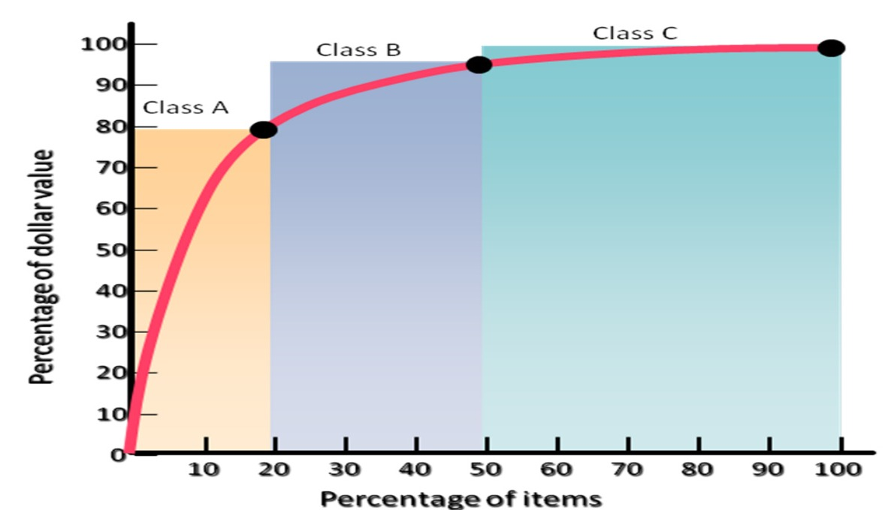
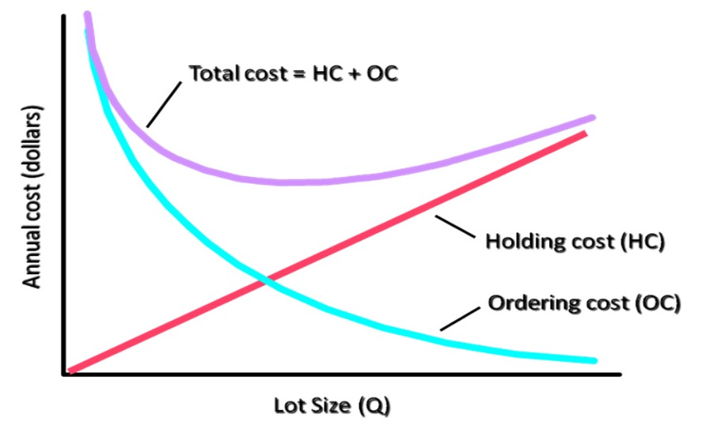
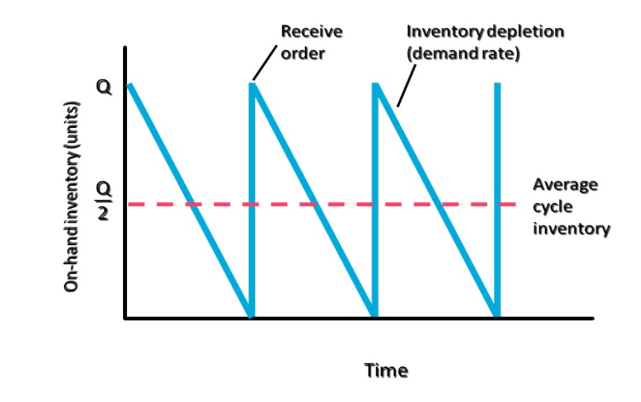

# Inventory Control

<!-- Page 1 -->

## What are the costs for holding inventory?

### Costs associated with holding high level of Inventory:
- Interest or Opportunity Cost
- Storage and Handling Costs
- Taxes, Insurance, and Shrinkage

### Costs associated with holding low level of Inventory:
- Customer Service
- Ordering Cost
- Setup Cost
- Labor and Equipment Utilization
- Transportation Costs
- Payments to Suppliers

---

## Types of Inventory

There are four types of inventory for an item. They are as follows:
1. Cycle Inventory
2. Safety Stock Inventory
3. Anticipation Inventory
4. Pipeline Inventory

The four types can not identified physically; that is, an inventory manager cannot look at a pile, but they differ conceptually.

1. **Cycle Inventory**: The portion of total inventory that varies directly with lot size is called cycle inventory. Determining how frequently to order, and in what quantity, is called lot sizing. Two principles apply:
   - **i.** If a lot is ordered every five weeks, the average lot size must equal five weeks demand.
   - **ii.** The longer the time between orders for a given item, the greater the cycle inventory must be.

2. **Safety Stock Inventory**: Safety stock inventory is surplus inventory that protects against uncertainties in demand, lead time, and supply. Safety stock is desirable when suppliers fail to deliver the desired quantity on the specified date, or when manufactured items have significant amounts of scrap or rework. Safety stock inventory ensures that operations are not disrupted when such problems occur.

3. **Anticipation Inventory**: Inventory used to absorb uneven rates of demand or supply, which business often face, is referred to as anticipation inventory. Seasonal demand pattern may lead to use anticipation inventory. Uneven demand may lead a manufacturer to stockpile anticipation inventory during periods of low demand so that output levels do not have to be increased much when demand peaks. Anticipation inventory also can help when suppliers are threatened with a strike or have severe capacity limitations.

4. **Pipeline Inventory**: Inventory moving from point to point in the materials flow system is called pipeline inventory. Materials move from suppliers to a plant, from one operation to the next in the plant, from the plant to a distribution center or customer, and from the distribution center to a retailer. Pipeline inventory consists of orders that have been placed but not yet received.

---

## What is ABC Analysis?

The process of dividing inventory items into three classes according to their dollar usage so that managers can focus on items that have the highest dollar value. The goal of ABC analysis is to identify the inventory levels of class ‘A’ items and enable management to control them tightly by using the levers.

<!-- Page 2 -->

*Figure 2.1 — ABC Analysis Classification Curve (Source: Inventory Control, Page 2)*

In the above figure, class A items typically represent only about 20 percent of total items but account for 80 percent of the dollar usage. Class B items account for another 30 percent of the items but only 15 percent of the dollar usage. Finally, 50 percent of the items fall in class C, representing a mere 5 percent of the dollar usage.

---

## What is EOQ?

EOQ is the lot size that minimizes total annual inventory holding and ordering costs.

Manufacturer often face conflicting pressures to keep inventories low enough to avoid excess inventory holding costs but high enough to reduce the frequency of orders and setups. A good starting point for balancing these conflicting pressures and determining the best cycle inventory level for an item is finding the Economic Order Quantity (EOQ)

### Assumptions of EOQ
1. Demand rate is constant
2. No constraints on lot size
3. Only relevant costs are holding and ordering/setup
4. Decisions for items are independent from other items
5. No uncertainty in lead time or supply

### Economic Order Quantity

*Figure 2.2 — Economic Order Quantity Cost Curves (Source: Inventory Control, Page 2)*

<!-- Page 3 -->

*Figure 3.1 — Cycle Inventory Depletion and Replenishment Sawtooth Pattern (Source: Inventory Control, Page 3)*

## Solved Problem

A regional warehouse purchases hand tools from various suppliers and then distributes them on demand to retailers in the region. The warehouse operates five days per week, 52 weeks per year. Only when it is open can orders be received. The following data are estimated for 3/8-inch hand drills with double insulation and variable speed.

- Average daily demand = 100 drills
- Standard deviation of daily demand ($\sigma$) = 30 drills
- Lead time ($L$) 3 days
- Holding cost ($H$) $\$9.40\text{ / unit / year}$
- Ordering cost ($S$) = $\$35\text{ / order}$
- Cycle service level = 92 percent

**Required:**
- **a.** What order quantity, $Q$ and reorder point, $R$, should be used?
- **b.** If on hand inventory is 40 units, there is one open order for 440 drills, and there are no backorders, should a new order be placed?

---

## Exercise-1

Your firm uses a continuous review system and operates 52 weeks per year. One of the items handled had the following characteristics:
- Demand ($D$) = 20,000 units /year
- Ordering cost ($S$) = $\$40\text{ / order}$
- Holding cost ($H$) = $\$2\text{ / unit / year}$
- Lead time ($L$) = 2 weeks
- Cycle service level = 95 percent

Demand is normally distributed, with a standard deviation of weekly demand of 100 units. Current on-hand inventory is 1040 units, with no scheduled receipts and no backorders.

- **a.** Calculate the item’s EOQ. What is the average time, in weeks, between orders?
- **b.** Find the safety stock and reorder point that provides a 95 percent cycle service level.
- **c.** For these policies, what are the annual costs of (i) holding the cycle inventory and (ii) placing order?
- **d.** A withdrawal of 15 units just occurred. Is it time to reorder? If so, how much should be ordered?

---

<!-- Page 4 -->

## Exercise-2

A company begins a review of ordering policies for its continuous review system by checking the current policies for a sample of items. Following are the characteristics of one item.
- Demand ($D$) = 64 units / week (assume 52 weeks per year)
- Ordering and setup cost ($S$) = $\$50\text{ / order}$
- Holding cost ($H$) = $\$13\text{ / unit / year}$
- Lead time ($L$) = 2 weeks
- Standard deviation of weekly demand = 12 units
- Cycle service level = 88 percent

- **a.** What is EOQ for these items?
- **b.** What is the desired safety stock?
- **c.** What is the reorder point?
- **d.** What are the cost implications if the current policy for this item is $Q = 200$ and $R = 180$?
