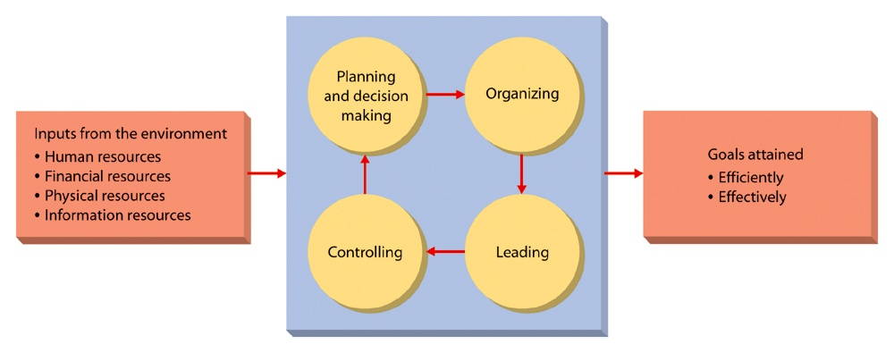
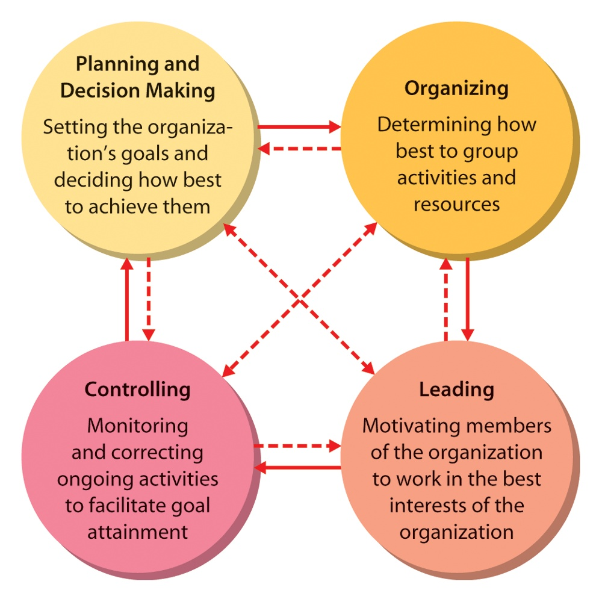

# Industrial Management — Lecture 1

<!-- Page 1 -->

## Define Management

Management is the process of coordinating and overseeing an organization's activities and resources to achieve its objectives effectively and efficiently. It involves planning, organizing, leading, and controlling organizational resources, including people, finances, and materials, to reach specific goals and respond to changes in the internal and external environment.

*Figure 1.1 — The Management Process (Source: Lecture 1, Page 1)*

**Efficiency**: By efficient, we mean using resources wisely and, in a cost, effective way. For example, a firm like Toyota Motor Corporation, which produces high quality products at relatively low costs, is efficient.

**Effectiveness**: By effective, we mean making the right decisions and successfully implementing them. For example, Toyota also makes cars with the styling and quality to inspire consumer interest and confidence.

## Key Aspects/Functions/Process of Management

*Figure 1.2 — Key Functions and Process of Management (Source: Lecture 1, Page 1)*

1. **Planning**:
   - **Definition**: The process of setting goals and determining the best way to achieve them.
   - **Activities**: Developing strategies, setting objectives, and creating action plans.

<!-- Page 2 -->

   - **Purpose**: Provides direction and ensures that resources are allocated to meet organizational goals.

2. **Organizing**:
   - **Definition**: The process of arranging resources and tasks in a structured manner to implement plans effectively.
   - **Activities**: Defining roles and responsibilities, establishing organizational structure, and allocating resources.
   - **Purpose**: Ensures that resources are utilized efficiently and tasks are performed systematically.

3. **Leading**:
   - **Definition**: The process of motivating and guiding employees to achieve organizational goals.
   - **Activities**: Inspiring and motivating team members, facilitating communication, and fostering a positive work environment.
   - **Purpose**: Ensures that employees are engaged, productive, and aligned with organizational objectives.

4. **Controlling**:
   - **Definition**: The process of monitoring and evaluating performance to ensure that goals are being met and making necessary adjustments.
   - **Activities**: Setting performance standards, measuring actual performance, and taking corrective actions.
   - **Purpose**: Ensures that organizational objectives are achieved and that deviations from plans are addressed.
