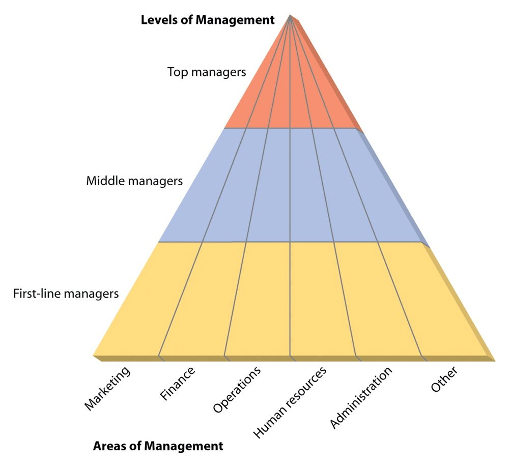

# Industrial Management — Lecture 3

<!-- Page 1 -->

Management operates at different levels within an organization and spans various areas or functions. Each level and area play a distinct role in ensuring that the organization's objectives are achieved efficiently and effectively. Here’s a detailed overview:

## Levels of Management

### 1. Top-Level Management

- **Definition**: This is the highest level of management responsible for setting the overall direction and strategic goals of the organization.
- **Key Responsibilities**:
  - **Strategic Planning**: Developing long-term goals and strategies.
  - **Organizational Vision**: Defining the vision, mission, and core values of the organization.
  - **Decision-Making**: Making high-level decisions that affect the entire organization.
  - **Policy Formulation**: Establishing policies and procedures to guide the organization.
  - **Stakeholder Relations**: Managing relationships with key stakeholders, including investors, government bodies, and the media.
- **Example Roles**: CEO (Chief Executive Officer), President, Board of Directors.

### 2. Middle-Level Management

- **Definition**: This level manages the implementation of top-level strategies and policies and oversees the operational units.
- **Key Responsibilities**:
  - **Operational Planning**: Translating strategic goals into specific, actionable plans.
  - **Coordination**: Ensuring that different departments or units work together effectively.
  - **Resource Management**: Allocating resources and managing departmental budgets.
  - **Supervision**: Overseeing and supporting lower-level managers and staff.
  - **Reporting**: Providing feedback and reports to top management about operational performance.
- **Example Roles**: Department Managers, Divisional Heads, Regional Managers.

### 3. Lower-Level Management (First-Line Management)

- **Definition**: This level is directly involved in the day-to-day operations and supervises front-line employees.
- **Key Responsibilities**:
  - **Execution of Plans**: Implementing operational plans and policies on the ground.
  - **Direct Supervision**: Managing and guiding employees performing the daily tasks.
  - **Training and Development**: Providing training, support, and development opportunities for employees.

<!-- Page 2 -->

  - **Problem-Solving**: Addressing immediate issues and challenges in daily operations.
  - **Performance Monitoring**: Evaluating employee performance and ensuring work quality.
- **Example Roles**: Supervisors, Team Leaders, Foremen.

*Figure 3.1 — Levels and Areas of Management (Source: Lecture 3, Page 2)*

## Areas of Management

### 1. Human Resource Management (HRM)

- **Definition**: Focuses on managing the organization’s workforce.
- **Key Responsibilities**:
  - **Recruitment and Selection**: Hiring the right talent for various positions.
  - **Training and Development**: Providing employees with the skills and knowledge they need.
  - **Compensation and Benefits**: Managing salaries, bonuses, and employee benefits.
  - **Employee Relations**: Addressing employee concerns and fostering a positive work environment.
  - **Performance Management**: Setting performance standards and evaluating employee performance.

### 2. Operations Management

- **Definition**: Concerned with the production and delivery of goods and services.
- **Key Responsibilities**:
  - **Process Management**: Designing and overseeing production processes and workflows.
  - **Quality Control**: Ensuring products and services meet quality standards.
  - **Supply Chain Management**: Managing the flow of materials and resources.
  - **Inventory Management**: Overseeing inventory levels and managing stock.
  - **Efficiency Improvement**: Enhancing operational efficiency and productivity.

### 3. Financial Management

- **Definition**: Deals with managing the organization’s financial resources.
- **Key Responsibilities**:
  - **Budgeting**: Planning and controlling financial resources through budgets.

<!-- Page 3 -->

  - **Financial Reporting**: Preparing financial statements and reports for stakeholders.
  - **Investment Management**: Making decisions about investments and financial strategies.
  - **Risk Management**: Identifying and managing financial risks.
  - **Cash Flow Management**: Monitoring and managing the organization’s cash flow.

### 4. Marketing Management

- **Definition**: Focuses on promoting and selling products or services.
- **Key Responsibilities**:
  - **Market Research**: Analyzing market trends and consumer behavior.
  - **Product Development**: Creating and improving products to meet customer needs.
  - **Pricing Strategy**: Setting prices to balance profitability and market competitiveness.
  - **Sales and Promotion**: Developing strategies to boost sales and market presence.
  - **Brand Management**: Building and maintaining the organization’s brand image.

### 5. Strategic Management

- **Definition**: Involves formulating and implementing long-term goals and strategies.
- **Key Responsibilities**:
  - **Strategic Planning**: Defining the organization’s long-term objectives and strategies.
  - **Competitive Analysis**: Assessing the competitive landscape and positioning the organization.
  - **Strategic Implementation**: Executing strategic plans and initiatives.
  - **Performance Measurement**: Evaluating the effectiveness of strategic initiatives.
  - **Adaptation and Adjustment**: Making necessary adjustments to strategies based on performance and changes in the environment.

### 6. Information Technology (IT) Management

- **Definition**: Focuses on managing technology resources and information systems.
- **Key Responsibilities**:
  - **IT Infrastructure**: Overseeing hardware, software, and network systems.
  - **Data Management**: Ensuring effective data storage, retrieval, and security.
  - **System Development**: Managing the development and implementation of IT systems.
  - **Tech Support**: Providing support for technical issues and system maintenance.
  - **Innovation**: Leveraging technology to drive innovation and efficiency.

### Summary

Management operates at three primary levels—top-level, middle-level, and lower-level—each with distinct responsibilities and focus areas. Additionally, management spans various functional areas, including human resource management, operations management, financial management, marketing management, strategic management, and information technology management. Each area requires specialized skills and knowledge to effectively contribute to the organization’s overall success.

<!-- Page 4 -->

## Managerial skills

Managerial skills are the competencies and abilities that managers need to perform their roles effectively and achieve organizational goals. These skills are essential for planning, organizing, leading, and controlling within an organization. Managerial skills can be broadly categorized into three main types: technical skills, human skills, and conceptual skills. Each type is important at different levels of management and contributes to overall effectiveness.

### 1. Technical Skills

- **Definition**: Technical skills refer to the ability to perform specific tasks or use specialized knowledge related to a particular field or industry.
- **Key Aspects**:
  - **Knowledge Expertise**: Understanding and applying technical information related to the manager’s field.
  - **Practical Application**: Using tools, techniques, and methods specific to the industry or job function.
  - **Problem-Solving**: Addressing technical issues and challenges using specialized knowledge.
- **Importance**:
  - **Lower-Level Management**: Technical skills are crucial for first-line managers who need to understand and oversee day-to-day operational tasks and processes.
  - **Example**: An IT manager must be proficient in software development or network administration.

### 2. Human Skills

- **Definition**: Human skills involve the ability to interact effectively with people, including communication, motivation, and conflict resolution.
- **Key Aspects**:
  - **Communication**: Effectively conveying information, listening actively, and providing feedback.
  - **Motivation**: Inspiring and encouraging employees to perform at their best and stay engaged.
  - **Conflict Resolution**: Managing and resolving interpersonal conflicts and disagreements.
  - **Team Building**: Fostering collaboration and teamwork among employees.
- **Importance**:
  - **All Levels of Management**: Human skills are essential across all levels of management, from first-line supervisors to top executives, for managing relationships and ensuring a positive work environment.
  - **Example**: A project manager needs strong communication and motivational skills to lead a team towards achieving project goals.

### 3. Conceptual Skills

- **Definition**: Conceptual skills involve the ability to understand and analyze complex situations and see the big picture, including strategic thinking and problem-solving.

<!-- Page 5 -->

- **Key Aspects**:
  - **Strategic Thinking**: Understanding and planning for long-term goals and the organization’s direction.
  - **Problem Solving**: Identifying and addressing complex issues that affect the organization.
  - **Analytical Skills**: Evaluating information, identifying patterns, and making informed decisions.
  - **Vision**: Seeing beyond day-to-day operations to anticipate future challenges and opportunities.
- **Importance**:
  - **Top-Level Management**: Conceptual skills are particularly important for senior managers who need to make strategic decisions and guide the organization towards its long-term goals.
  - **Example**: A CEO must develop a vision for the company's future and create strategies to achieve that vision.

## Additional Managerial Skills

### 1. Decision-Making Skills

- **Definition**: The ability to make informed and effective decisions based on analysis, evaluation, and judgment.
- **Key Aspects**:
  - **Analysis**: Assessing information and options.
  - **Judgment**: Evaluating alternatives and choosing the best course of action.
  - **Implementation**: Executing decisions and monitoring outcomes.
- **Importance**: Essential at all levels, but particularly crucial for higher-level management roles where decisions can have significant organizational impact.

### 2. Time Management Skills

- **Definition**: The ability to prioritize tasks, manage time efficiently, and meet deadlines.
- **Key Aspects**:
  - **Prioritization**: Identifying and focusing on the most important tasks.
  - **Scheduling**: Creating and adhering to timelines and deadlines.
  - **Delegation**: Assigning tasks appropriately to manage workload effectively.
- **Importance**: Critical for managers to ensure that tasks are completed on time and resources are utilized efficiently.

### 3. Leadership Skills

- **Definition**: The ability to inspire, influence, and guide others towards achieving goals.
- **Key Aspects**:
  - **Visionary Leadership**: Providing direction and setting goals.
  - **Empowerment**: Giving team members the authority and confidence to act.
  - **Adaptability**: Adjusting leadership style based on the needs of the team and the situation.

<!-- Page 6 -->

- **Importance**: Vital for managers at all levels to motivate and guide their teams effectively.

### 4. Negotiation Skills

- **Definition**: The ability to reach agreements and resolve conflicts through discussion and compromise.
- **Key Aspects**:
  - **Preparation**: Understanding the interests and positions of all parties involved.
  - **Communication**: Clearly presenting and articulating points of view.
  - **Compromise**: Finding mutually acceptable solutions.
- **Importance**: Important for managers involved in dealing with external partners, suppliers, and resolving internal disputes.

## Summary

Managerial skills are crucial for effective management and come in three primary types: technical skills, human skills, and conceptual skills. Technical skills pertain to specific industry knowledge and tasks, human skills involve interpersonal interactions and team management, and conceptual skills involve strategic thinking and problem-solving. Additionally, decision-making, time management, leadership, and negotiation skills are also essential for managers to perform their roles effectively and achieve organizational success.
