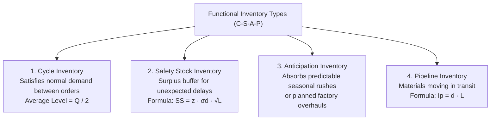
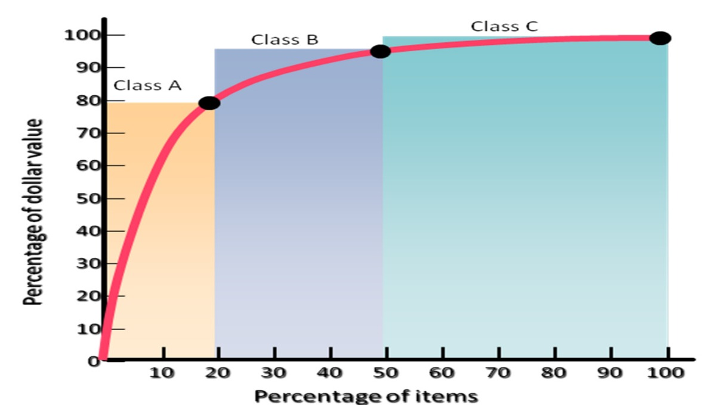
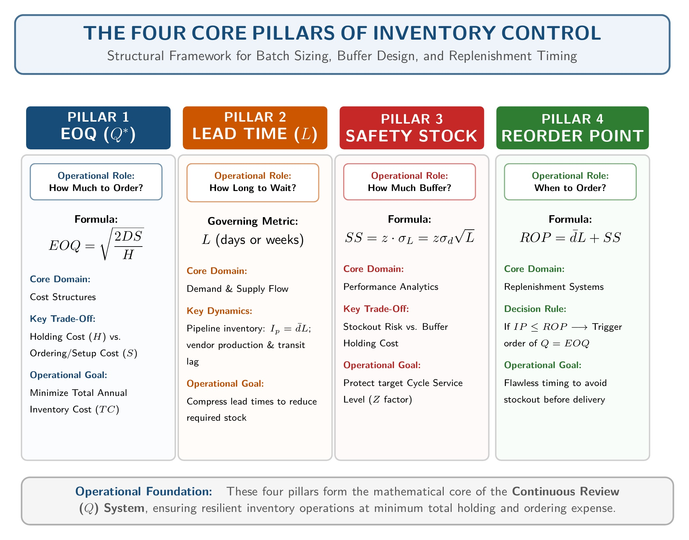
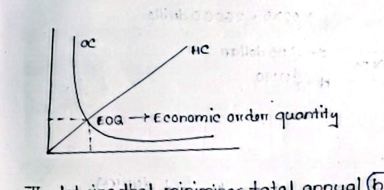
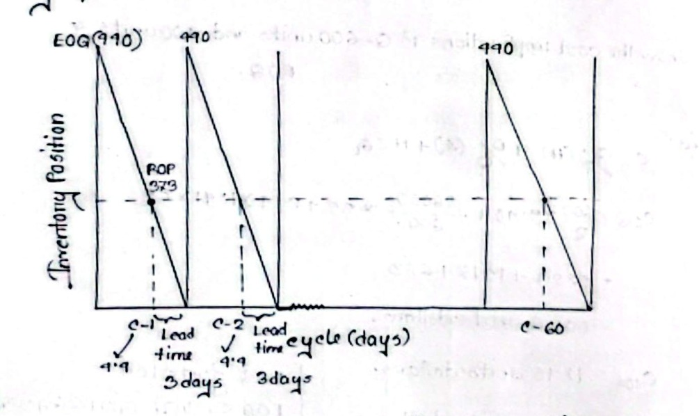
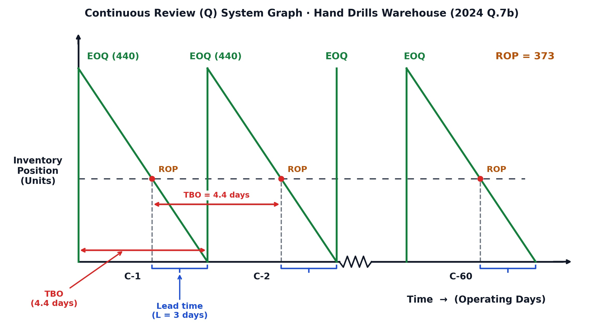
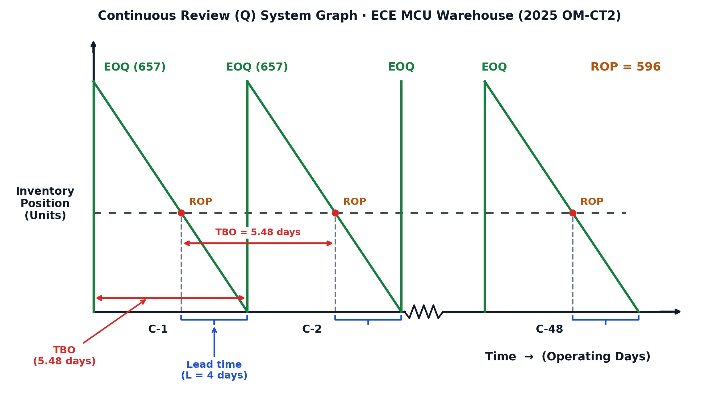
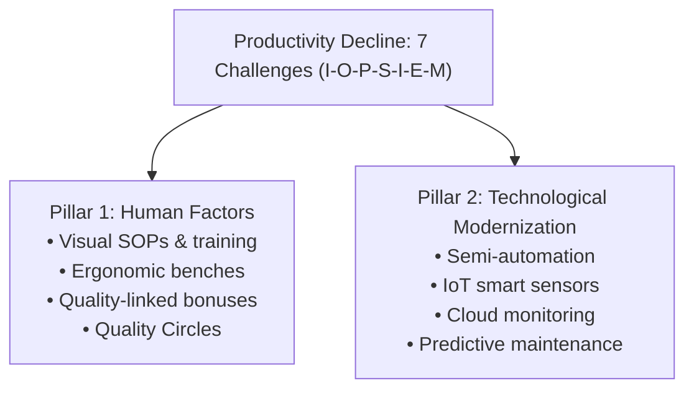

# Operational Management (CO3 · Section B · MRI Sir): All-Rounder Exam Master Note

> [!important] Fast-Track Exam Preparation Guide
> This note combines all 7 operational management topics (`O01.1` to `O03.2`) into a single, high-yield study guide. It uses simple English, short sentences, and time-saving memory hooks. It covers every required definition, formula, derivation, graph, and numerical step without skipping any content.

---

## ⚡ 2-Minute Quick Formula & Parameter Card

Keep these formulas in your head before entering the exam room:

| Concept | Core Formula | Key Exam Note |
| :--- | :--- | :--- |
| **Pipeline Inventory** | $I_p = \bar{d} L$ | Goods in transit. $\bar{d}$ and $L$ must share time units. |
| **Annual Demand (Weekly)** | $D = d \times 52\text{ weeks}$ | Standard 52-week operating year. |
| **Annual Demand (Daily)** | $D = d \times 260\text{ days}$ | **Never use 365!** $5\text{ days/week} \times 52 = 260\text{ operating days}$. |
| **Economic Order Quantity** | $EOQ = \sqrt{\dfrac{2DS}{H}}$ | Point where annual holding cost equals ordering cost ($HC = OC$). |
| **Safety Stock** | $SS = z\sigma_L = z\sigma_d\sqrt{L}$ | Buffer stock for demand/lead time uncertainty. |
| **Reorder Point (ROP)** | $ROP = dl + z\sigma_L$ | MRI Sir's mandatory 4-line presentation chain. |
| **Inventory Position (IP)** | $IP = OH + SR - BO$ | $\boxed{IP \le ROP} \to \text{Order } EOQ$ \| $\boxed{IP > ROP} \to \text{Do not order}$. |
| **Total Annual Cost (Q-Sys)** | $C = \dfrac{Q}{2}(H) + \dfrac{D}{Q}(S) + Hz\sigma_L$ | **Do not omit the third term** (safety stock holding cost). |
| **Time Between Orders (TBO)** | $TBO = \dfrac{Q}{D} \times \text{time}$ | Verbatim: *"The average length of time that elapses between two consecutive inventory orders."* |
| **Orders Per Year** | $N = \dfrac{D}{Q} \approx \dots\text{ orders/yr}$ | Defines total cycles $C\text{-}1$ to $C\text{-}N$ on the sawtooth graph. |
| **Single-Factor Prod. (SFP)** | $SFP = \dfrac{\text{Output Units}}{\text{Single Input}}$ | e.g. Labor Productivity = $\text{Units} \div \text{Labor Hours}$. |
| **Productivity % Change** | $\% \Delta P = \dfrac{P_{\text{new}} - P_{\text{old}}}{P_{\text{old}}} \times 100\%$ | Positive = efficiency gain; Negative = efficiency decline. |
| **Multifactor Prod. (MFP)** | $MFP = \dfrac{\text{Total Output Value}}{\text{Labor} + \text{Material} + \text{Machine} + \text{Overhead}}$ | Must convert all inputs to common currency (\$ or Tk). |

### Standard Normal Z-Value Reference
- $88\% \text{ Service Level} \implies Z = 1.175$
- $92\% \text{ Service Level} \implies Z = 1.41$
- $95\% \text{ Service Level} \implies Z = 1.645$ *(Use $Z = 1.43$ if specifically printed on the exam paper)*
- $97\% \text{ Service Level} \implies Z = 1.88$
- $99\% \text{ Service Level} \implies Z = 2.33$

---

## 📌 Part 1: Inventory Fundamentals, Physical States & Holding Costs

### 1. Key Definitions (2-Mark Essentials)

> **Inventory:**  
> "Inventory is created when the receipt of finished goods, materials or parts exceeds their disbursement. It is depleted when their disbursement exceeds receipt." *(MRI Sir Class 9)*  
> *Plain meaning:* A stock of physical goods stored to keep factory production smooth and satisfy customer orders.

> **Inventory Control:**  
> "The operational mechanism used to maintain stock levels within desired limits by determining when and how much to order."  
> *Plain meaning:* The day-to-day warehouse routine. It tracks stock, reorders items on time, and prevents shortages at minimal cost.

> **Inventory Management:**  
> "The broad managerial function that plans, organizes, directs, and monitors stock policies across the complete supply chain."  
> *Plain meaning:* High-level company strategy. It connects stock levels with business finance, supplier contracts, and customer service goals.

---

### 2. Four Physical Forms of Inventory

Every factory holds inventory in four distinct physical states:
1. **Raw Materials:** Unprocessed parts waiting for assembly. *(ECE: Bare circuit boards, copper wire, solder alloy, bare microcontrollers).*
2. **Work-in-Process (WIP):** Semi-finished items sitting between assembly steps. *(ECE: Boards with soldered chips waiting for casing).*
3. **Finished Goods:** Completed products tested and ready to ship. *(ECE: Packaged smart energy meters, Wi-Fi routers).*
4. **Maintenance, Repair, and Operating (MRO) Supplies:** Consumables used during factory work that do not go into the final product. *(ECE: Soldering tips, cleaning alcohol, cleanroom gloves).*

---

### 3. Inventory Control vs. Inventory Management Table

| Dimension | Inventory Control | Inventory Management |
| :--- | :--- | :--- |
| **Scope** | Specific items and stock bins inside the warehouse. | Whole supply chain from suppliers to end customers. |
| **Management Level** | Operational, daily warehouse floor. | Strategic executive planning. |
| **Key Questions** | When to order? How much to order? | What inventory strategy fits company cash flow? |
| **Core Tools** | $EOQ$, Reorder Point ($ROP$), Continuous Review ($Q$) system. | Working capital planning, vendor contracts, risk analysis. |
| **Primary Goal** | Keep stock within limits at lowest storage cost. | Maximize company profit and customer service. |

---

### 4. The Inventory Cost Dilemma: Low vs. High Inventory Pressures

Every plant manager balances two opposing financial forces:
- Holding too much stock wastes money on warehouse rent, interest, and damage.
- Holding too little stock causes factory shutdowns, frantic rush orders, and lost sales.

```
       PRESSURES FOR LOW INVENTORY                     PRESSURES FOR HIGH INVENTORY
           (Carrying Costs)                                (Shortage & Order Costs)
       ─────────────────────────                       ────────────────────────────
       • Interest on Capital (15-25%)                  • Customer Service Protection
       • Storage & Rent                                • Fewer Purchase Orders
       • Taxes & Insurance                             • Fewer Machine Setups
       • Shrinkage: Pilferage,                         • Bulk Freight Savings (FTL)
         Obsolescence, Spoilage                        • Volume Discounts
                   ▲                                               ▲
                   └───────────────[ OPTIMAL BALANCE ]─────────────┘
                                  (At Minimum Total Cost)
```

#### Pressures for Low Inventory (Carrying Costs) · Memory Hook: `I-S-H`
Carrying costs rise directly with stock levels. They usually equal **$15\%$ to $35\%$** of inventory value per year:
- **I: Interest / Opportunity Cost of Capital:** Money tied up in stored parts cannot earn bank interest or fund new research. This is the largest holding cost ($15\%$ to $25\%$ per year).
- **S: Storage and Handling Costs:** Rent for warehouse space, electricity, air conditioning, racks, forklifts, and warehouse staff wages.
- **H: Hazard, Taxes, Insurance, and Shrinkage:** Property taxes on inventory, insurance against fire and flood, plus inventory shrinkage.
  - **Shrinkage Breakdown (Memory Hook: `P-O-D`):**
    - **P: Pilferage (Theft):** Stealing of small, valuable parts like chips or sensors.
    - **O: Obsolescence:** Technology evolves, leaving stored parts worthless.
    - **D: Deterioration (Spoilage):** Parts decay over time (e.g., copper oxidizes, flux dries out, batteries self-discharge).

#### Pressures for High Inventory (Shortage & Order Costs) · Memory Hook: `C-O-S-T-P`
Low stock creates operational headaches that push managers to hold larger stock buffers:
- **C: Customer Service:** Ample stock prevents backorders, stockouts, and angry customers.
- **O: Ordering Costs:** Placing large orders reduces annual purchasing paperwork and invoice handling.
- **S: Setup Costs:** Running large production batches cuts down machine changeover downtime and tool recalibrations.
- **T: Transportation Savings:** Large orders qualify for cheap Full Truckload (FTL) freight rates instead of expensive Less-Than-Truckload (LTL) parcels.
- **P: Payment Discounts & Plant Utilization:** Suppliers give volume discounts for big purchases. Also, steady raw material buffers keep assembly lines and workers fully busy.

---

## 📦 Part 2: The 4 Functional Types of Inventory (`C-S-A-P`)

An inventory item looks the same whether it is on the shelf or in a truck. But operations management classifies inventory into four functional types based on its purpose:



### 1. Cycle Inventory
- **Purpose:** Primary stock used to satisfy regular customer demand between shipments.
- **Lot Sizing:** Deciding how often to order and how many units to buy.
- **Average Level:** Cycle stock follows a sawtooth wave. When batch $Q$ arrives, stock jumps to $Q$. As items sell at demand rate $d$, stock drops to zero.
$$
\text{Average Cycle Inventory} = \frac{Q}{2}
$$
- *Example:* If an electronics plant orders 1,200 microcontrollers every month, average cycle inventory is $1,200 / 2 = 600\text{ units}$.

### 2. Safety Stock Inventory
- **Purpose:** Surplus buffer stock held to protect against random spikes in demand or vendor delivery delays.
- **Formula:**
$$
SS = z \, \sigma_L = z \, \sigma_d \sqrt{L}
$$
- *Example:* Keeping 150 extra Wi-Fi modules so the line does not shut down if a shipment gets delayed at customs for three days.

### 3. Anticipation Inventory
- **Purpose:** Stock built up ahead of time to absorb **predictable** uneven demand or scheduled plant closures.
- **Difference from Safety Stock:** Safety stock buffers against *random surprises*. Anticipation inventory buffers against *known, planned events*.
- *Example:* Stockpiling 5,000 smart energy meters before a planned two-week factory maintenance shutdown.

### 4. Pipeline Inventory (In-Transit Inventory)
- **Purpose:** Goods that have been ordered and shipped, but not yet delivered to the destination plant.
- **Formula:**
$$
I_p = \bar{d} L
$$
Where $\bar{d}$ is average demand per time unit, and $L$ is transit lead time in the same time units.
- **Worked Exam Example:**  
  A plant uses $\bar{d} = 80\text{ microcontrollers/day}$. Transit lead time is $L = 15\text{ days}$.  
$$
I_p = 80 \times 15 = 1,200\text{ units in transit}
$$
  If the plant switches to air freight with $L = 3\text{ days}$, pipeline inventory drops to $80 \times 3 = 240\text{ units}$.

---

## 📊 Part 3: ABC Inventory Analysis (Pareto 80/20 Rule)

### 1. The Core Idea
A factory may carry 10,000 different components. A manager cannot watch every cheap screw with the same care as an expensive processor. ABC analysis applies Vilfredo Pareto's **80/20 Rule**:
- A small percentage of parts makes up most of the inventory budget.
- Most parts cost very little money.

### 2. Annual Dollar Usage
Items are ranked by their annual dollar usage:
$$
\text{Annual Dollar Usage} = \text{Annual Demand } (D) \times \text{Unit Cost } (C)
$$

### 3. The Three Tiers · Memory Hook: `20-30-50 / 80-15-5`
- **Item counts climb:** $20\% \to 30\% \to 50\%$ (Totals $100\%$).
- **Dollar values drop:** $80\% \to 15\% \to 5\%$ (Totals $100\%$).

| Class | % of Total Items | % of Annual Dollar Usage | Control Policy | Safety Stock | ECE Factory Example |
| :---: | :---: | :---: | :--- | :---: | :--- |
| **A** | **$20\%$** *(Few items)* | **$80\%$** *(Heavy money)* | Tight daily control, continuous review, frequent orders, senior manager review. | **Low** (to save cash) | Microprocessors, FPGAs, RF power modules. |
| **B** | **$30\%$** *(Moderate)* | **$15\%$** *(Moderate)* | Periodic monthly checks, automated reordering, moderate attention. | **Moderate** | Multilayer PCBs, LCD display screens, transformers. |
| **C** | **$50\%$** *(Most items)* | **$5\%$** *(Trivial money)* | Simple two-bin system, bulk orders once or twice a year, loose control. | **High** (stockouts hurt lines) | Screws, resistors, ceramic capacitors, zip ties. |


*Figure: ABC Pareto Curve (Steep rise for Class A, flattening across Class B and C)*

### 4. Fast 5-Step Method to Solve Any ABC Exam Table
1. Multiply Annual Demand ($D$) by Unit Cost ($C$) to find **Annual Dollar Usage** for each item.
2. Sort all items in **descending order** (largest dollar usage at the top).
3. Compute the **total dollar usage** of all items combined.
4. Calculate each item's **percentage of total dollar usage** and the **cumulative dollar percentage**.
5. Categorize:
   - Top items reaching up to $\approx 70\%-80\%$ cumulative value $\implies$ **Class A**.
   - Next items reaching up to $\approx 90\%-95\%$ cumulative value $\implies$ **Class B**.
   - Remaining low-value items reaching $100\%$ cumulative value $\implies$ **Class C**.

---

## ⚙️ Part 4: The 4 Core Pillars of Inventory & Basic EOQ Model


*Figure: The Four Structural Pillars of Inventory Engineering*

### 1. The Four Pillars Defined
1. **Economic Order Quantity ($EOQ$):** The order batch size that minimizes total annual inventory holding and ordering costs.
$$
EOQ = \sqrt{\frac{2DS}{H}}
$$
2. **Lead Time ($L$):** The total elapsed time between placing an order and receiving usable goods into the warehouse.
3. **Safety Stock ($SS$):** Surplus buffer stock that protects against demand spikes and vendor delays during lead time ($SS = z\sigma_d\sqrt{L}$).
4. **Reorder Point ($ROP$):** The predetermined inventory level that triggers a new replenishment order ($ROP = dl + z\sigma_L$).

---

### 2. Six Basic EOQ Assumptions · Memory Hook: `C-C-I-N-N-O`
1. **C: Constant and Known Demand Rate:** Customer demand ($D$) is uniform and completely predictable.
2. **C: Constant and Known Lead Time:** Delivery lead time ($L$) is fixed and never changes.
3. **I: Instantaneous Replenishment:** The entire batch ($Q$) arrives in a single delivery all at once.
4. **N: No Stockouts Allowed:** No shortages, backorders, or lost sales occur.
5. **N: No Quantity Discounts:** Unit purchase cost ($C$) is fixed regardless of order size.
6. **O: Only Holding and Ordering Costs Vary:** All other operating costs remain constant.

---

### 3. Annual Cost Curves & Formal Calculus Derivation

Total inventory cost is governed by two opposing curves:


*Figure: Annual Cost Curves (Minimum Total Cost occurs where $HC = OC$)*

- **Annual Ordering Cost ($OC$):**
$$
OC = \left(\frac{D}{Q}\right) S
$$
  As batch size $Q$ increases, fewer orders are placed. So $OC$ drops down as a hyperbola.
- **Annual Holding Cost ($HC$):**
$$
HC = \left(\frac{Q}{2}\right) H
$$
  As batch size $Q$ increases, average cycle inventory ($Q/2$) increases. So $HC$ rises as a straight line with slope $H/2$.
- **Total Annual Cost ($TC$):**
$$
TC(Q) = OC + HC = \left(\frac{D}{Q}\right) S + \left(\frac{Q}{2}\right) H
$$

#### Calculus Proof of $EOQ$
To find the batch size $Q$ that gives the minimum total cost, take the first derivative with respect to $Q$ and set it to zero:
$$
\frac{d(TC)}{dQ} = -\frac{DS}{Q^2} + \frac{H}{2} = 0
$$
Rearranging terms:
$$
\frac{DS}{Q^2} = \frac{H}{2} \implies \frac{D}{Q}S = \frac{Q}{2}H \quad (\text{Proving } OC = HC \text{ at the optimum})
$$
Multiply both sides by $Q^2$:
$$
Q^2 = \frac{2DS}{H} \implies Q^* = EOQ = \sqrt{\frac{2DS}{H}}
$$
Substitute $Q^*$ back into the total cost equation to get the minimum annual cost:
$$
TC^* = \sqrt{\frac{D}{\sqrt{2DS/H}}} S + \frac{\sqrt{2DS/H}}{2} H = \sqrt{\frac{DSH}{2}} + \sqrt{\frac{DSH}{2}} = \sqrt{2DSH}
$$

---

## 🏭 Part 5: The Continuous Review ($Q$) System (MRI Sir's 6-Step Method)

The Continuous Review ($Q$) System tracks warehouse stock after every single withdrawal or addition. When the **Inventory Position ($IP$)** drops to or below the **Reorder Point ($ROP$)**, an order of fixed size $Q = EOQ$ is placed.

### The Two Calendar Demand Conversion Rules
- **Weekly Schedule:** $D = d \times 52\text{ weeks/year}$.
- **Daily Operating Schedule:** $D = d \times 260\text{ operating days/year}$ ($5\text{ days/week} \times 52\text{ weeks}$).  
  > [!warning] Exam Trap  
  > Never multiply daily demand by 365! Industrial warehouses operate on working days (260 days/year).

---

### MRI Sir's Mandatory 6-Step Board Framework

Follow these six steps in order to score full marks:

#### Step 1: Extract Parameters & Convert to Annual Demand $D$
List $d$, convert to $D$, write down $S$, $H$, $L$, $\sigma$, and cycle service level with its $Z$-value.

#### Step 2: Part (a) · $EOQ$ and the Mandatory 4-Line $ROP$ Chain
1. Calculate:
$$
EOQ = \sqrt{\frac{2DS}{H}}
$$
2. State lead-time side parameters: $d = \dots$, $l = \dots$, $\sigma_L = \sigma_d\sqrt{L}$.
3. Write MRI Sir's exact 4-line $ROP$ chain:
$$
\begin{aligned}
\text{Reorder point } (ROP) &= \text{Average demand during lead time } (dl) + \text{Safety stock } (z\sigma_L) \\
&= dl + z\sigma_L \\
&= (d \times l) + (z \times \sigma_L) \\
&= \mathbf{ROP\text{ units}}
\end{aligned}
$$

#### Step 3: Part (b) · Inventory Position ($IP$) and Boxed Decision Rule
1. Calculate Inventory Position:
$$
IP = \text{On-hand supply } (OH) + \text{Scheduled Receipt } (SR) - \text{Backorder } (BO)
$$
2. State the boxed rule:
$$
\boxed{IP \le ROP} \longrightarrow \text{Place order} \quad \Big| \quad \boxed{IP > ROP} \longrightarrow \text{Do not order}
$$
3. Conclude with a clear sentence:  
   *"Yes, a new order of [EOQ = ...] units should be placed."*  
   Or: *"No, a new order should not be placed."*

#### Step 4: Part (c) · Total Annual Cost Implication
MRI Sir includes the safety stock carrying cost in the total cost formula. Do not drop the third term:
$$
C = \frac{Q}{2}(H) + \frac{D}{Q}(S) + H z \sigma_L
$$
Calculate $C$ for each requested batch size. Place a box around the minimum cost at $EOQ$: $\boxed{C_{EOQ} = \dots}$. State that $EOQ$ minimizes total cost, but the cost curve is flat near the minimum.

#### Step 5: Part (d) & (e) · Verbatim $TBO$ Definition & Order Frequency
1. Write the verbatim definition:  
   > **Time Between Orders ($TBO$):** "The average length of time that elapses between two consecutive inventory orders."
2. Calculate:
$$
TBO = \frac{EOQ}{D} \times \text{operating time} \quad (\text{weeks or days})
$$
3. Calculate order frequency:
$$
N = \frac{D}{EOQ} \approx \dots\text{ orders/year} \quad (\text{Defines cycles } C\text{-}1 \text{ to } C\text{-}N)
$$

#### Step 6: Part (f) · Continuous Review Sawtooth Graph Drawing Checklist
When drawing the graph on your answer script, include these 8 elements:
1. **Vertical Axis:** Label as `Inventory Position (Units)`.
2. **Horizontal Axis:** Label as `Time -> (Weeks)` or `Time -> (Operating Days)`.
3. **Peaks:** Label peak order heights as `EOQ (units)`.
4. **Threshold:** Draw a horizontal dashed line at `ROP = ... units`.
5. **Drop Lines:** Draw vertical dashed lines from the points where inventory touches the $ROP$ line.
6. **Lead Time Brackets:** Draw horizontal brackets showing `Lead time (L = ...)` under the time axis.
7. **TBO Arrows:** Draw horizontal double-headed arrows showing `TBO = ...`.
8. **Cycle Break:** Draw a zigzag break (`~~~~`) before the final cycle $C\text{-}N$.


*Figure: Continuous Review ($Q$) System Sawtooth Wave with ROP and Lead Time*

---

## 🧮 Part 6: Two Master Solved Q-System Problems

### 🎯 Master Problem 1: Weekly Demand Schedule (Walton Refrigerator Problem)
*(Appeared in 2023 Final Exam Q.7(c) · 06 Marks)*

**Problem Statement:**  
Walton Hi-Tech Industries produces cooling compressors. Weekly demand is $d = 650\text{ units/week}$ with standard deviation $\sigma_w = 50\text{ units}$. Order cost is $S = \text{Tk } 50,000/\text{order}$. Holding cost is $H = \text{Tk } 30/\text{unit/year}$. Lead time is $L = 2\text{ weeks}$. Cycle service level is $95\%$ (given $Z = 1.43$). The plant operates 52 weeks per year.  
Currently, on-hand inventory is 500 units, scheduled receipt is 10,614 units, and backorders are 300 units.  
1. Find $EOQ$ and $ROP$.  
2. Should a new order be placed?  
3. Compare total cost for $EOQ$ vs. a lot size of $Q = 15,000\text{ units}$.  
4. Calculate $TBO$ and orders per year $N$.

**Full Step-by-Step Solution:**

#### 1. Given Data
- Weekly demand: $d = 650\text{ units/week}$
- Annual demand: $D = 650 \times 52 = 33,800\text{ units/year}$
- Order cost: $S = \text{Tk } 50,000/\text{order}$
- Holding cost: $H = \text{Tk } 30/\text{unit/year}$
- Lead time: $L = 2\text{ weeks}$
- Demand standard deviation: $\sigma_w = 50\text{ units/week}$
- Cycle service level: $95\% \implies Z = 1.43$ (given)

#### 2. Part (a) · $EOQ$ and $ROP$
$$
EOQ = \sqrt{\frac{2DS}{H}} = \sqrt{\frac{2 \times 33,800 \times 50,000}{30}} = \sqrt{112,666,666.67} \approx \mathbf{10,614\text{ units}}
$$
Side parameters:
- $d = 650\text{ units/week}$
- $l = 2\text{ weeks}$
- $\sigma_L = \sigma_w \sqrt{L} = 50\sqrt{2} = 50 \times 1.4142 = 70.71\text{ units}$
- Safety Stock: $SS = z \sigma_L = 1.43 \times 70.71 = 101.12 \approx 101\text{ units}$

MRI Sir's 4-line $ROP$ chain:
$$
\begin{aligned}
\text{Reorder point } (ROP) &= \text{Average demand during lead time } (dl) + \text{Safety stock } (z\sigma_L) \\
&= dl + z\sigma_L \\
&= (650 \times 2) + 101 \\
&= 1,300 + 101 = \mathbf{1,401\text{ units}}
\end{aligned}
$$

#### 3. Part (b) · Inventory Position & Decision Rule
$$
IP = OH + SR - BO = 500 + 10,614 - 300 = \mathbf{10,814\text{ units}}
$$
Applying the boxed rule:
$$
\boxed{IP > ROP} \quad (10,814 > 1,401) \longrightarrow \text{Do not order}
$$
**Conclusion:** No, a new order should not be placed at this time.

#### 4. Part (c) · Total Annual Cost Comparison
Safety stock holding cost:
$$
H z \sigma_L = 30 \times 101.12 = \text{Tk } 3,033.60/\text{year}
$$

**For $EOQ = 10,614\text{ units}$:**
$$
\begin{aligned}
C_{EOQ} &= \frac{10,614}{2}(30) + \frac{33,800}{10,614}(50,000) + 3,033.60 \\
&= 159,210 + 159,223.67 + 3,033.60 = \mathbf{\text{Tk } 321,467.27/\text{year}} \quad \boxed{EOQ}
\end{aligned}
$$

**For Lot Size $Q = 15,000\text{ units}$:**
$$
\begin{aligned}
C_{15,000} &= \frac{15,000}{2}(30) + \frac{33,800}{15,000}(50,000) + 3,033.60 \\
&= 225,000 + 112,666.67 + 3,033.60 = \mathbf{\text{Tk } 340,700.27/\text{year}}
\end{aligned}
$$
**Cost Penalty:** Ordering 15,000 units wastes $\text{Tk } 340,700.27 - 321,467.27 = \text{Tk } 19,233.00/\text{year}$ due to higher warehouse holding costs.

#### 5. Part (d) & (e) · $TBO$ and Orders Per Year
> **Time Between Orders ($TBO$):** "The average length of time that elapses between two consecutive inventory orders."
$$
TBO = \frac{EOQ}{D} \times 52\text{ weeks} = \frac{10,614}{33,800} \times 52 \approx \mathbf{16.33\text{ weeks}}
$$
$$
N = \frac{D}{EOQ} = \frac{33,800}{10,614} \approx 3.18 \approx \mathbf{3\text{ to } 4\text{ orders/year}} \quad (\text{Cycles } C\text{-}1 \text{ to } C\text{-}4)
$$


*Figure: Solved Sawtooth Graph for Walton Refrigerator (Peak = 10,614, ROP = 1,401, TBO = 16.33 weeks)*

---

### 🎯 Master Problem 2: Daily Operating-Day Schedule (2024 Final Q.7(b) · Hand Drills Warehouse)
*(Appeared in 2024 Final Exam Q.7(b) · 06 Marks · Identical to Raidah Class Notes 10 & 11)*

**Problem Statement:**  
A regional warehouse purchases hand tools from various suppliers and distributes them on demand to retailers in the region. The warehouse operates 5 days per week, 52 weeks per year ($260\text{ operating days/year}$). Orders can be received only when it is open.  
The following data are estimated for $3/8\text{-inch}$ hand drills:
- Average daily demand: $d = 100\text{ drills/day}$
- Standard deviation of daily demand: $\sigma_d = 30\text{ drills}$
- Lead time: $L = 3\text{ days}$
- Holding cost: $H = \$9.40/\text{unit/year}$
- Ordering cost: $S = \$35/\text{order}$
- Cycle service level: $92\%$, which corresponds to $Z\text{-value} = 1.41$ (given)

**Questions:**
1. What order quantity $Q$ ($EOQ$) and reorder point $R$ ($ROP$) should be used?
2. If on-hand inventory is 40 units, there is an open order (scheduled receipt) for 440 drills, and there are no backorders, should a new order be placed?
3. Calculate cost for 400 units, 500 units, and units equal to $EOQ$, then comment on the cost implications.
4. Calculate $TBO$ in operating days and annual orders $N$.

**Full Step-by-Step Solution:**

#### 1. Given Parameters & Demand Conversion
- Daily demand: $d = 100\text{ drills/day}$
- Operating schedule: $5 \times 52 = 260\text{ operating days/year}$
- Annual demand: $D = 100 \times 260 = \mathbf{26,000\text{ drills/year}}$ *(Never 365!)*
- Ordering cost: $S = \$35/\text{order}$
- Holding cost: $H = \$9.40/\text{unit/year}$
- Lead time: $L = 3\text{ days}$
- Daily standard deviation: $\sigma_d = 30\text{ drills}$
- Cycle service level: $92\% \implies Z = 1.41$ (given)

#### 2. Part (1) · $EOQ$ and $ROP$
$$
EOQ = \sqrt{\frac{2DS}{H}} = \sqrt{\frac{2 \times 26,000 \times 35}{9.40}} = \sqrt{\frac{1,820,000}{9.40}} = \sqrt{193,617.02} \approx \mathbf{440\text{ drills}}
$$
Side parameters for lead time:
- $d = 100\text{ drills/day}$
- $l = 3\text{ days}$
- $\sigma_L = \sigma_d \sqrt{L} = 30\sqrt{3} \approx 51.96\text{ drills}$ *(or rounded to $52$ as in classroom lecture)*
- Safety Stock: $SS = z \sigma_L = 1.41 \times 51.96 = 73.27 \approx \mathbf{73\text{ drills}}$ *(or $1.41 \times 52 = 73.32 \approx 73$)*

MRI Sir's mandatory 4-line $ROP$ chain:
$$
\begin{aligned}
\text{Reorder point } (ROP) &= \text{Average demand during lead time } (dl) + \text{Safety stock } (z\sigma_L) \\
&= dl + z\sigma_L \\
&= (100 \times 3) + 73 \\
&= 300 + 73 = \mathbf{373\text{ drills}}
\end{aligned}
$$

#### 3. Part (2) · Inventory Position & Decision Rule
$$
IP = \text{On-hand } (OH) + \text{Scheduled Receipt } (SR) - \text{Backorder } (BO) = 40 + 440 - 0 = \mathbf{480\text{ drills}}
$$
Applying the boxed rule:
$$
\boxed{IP > ROP} \quad (480 > 373) \longrightarrow \text{Do not order}
$$
**Conclusion:** No, a new order should not be placed.

#### 4. Part (3) · Total Cost Implications for Different Lot Sizes
Constant safety stock holding cost:
$$
H z \sigma_L = 9.40 \times 73.27 \approx \mathbf{\$689.00/\text{year}} \quad (\text{exact: } \$688.74)
$$

**For $Q = 400\text{ drills}$:**
$$
C_{400} = \frac{400}{2}(9.40) + \frac{26,000}{400}(35) + 689 = 1,880 + 2,275 + 689 = \mathbf{\$4,844/\text{year}}
$$

**For $Q = EOQ = 440\text{ drills}$:**
$$
C_{440} = \frac{440}{2}(9.40) + \frac{26,000}{440}(35) + 689 = 2,068 + 2,068.18 + 689 = \mathbf{\$4,825/\text{year}} \quad \boxed{EOQ}
$$

**For $Q = 500\text{ drills}$:**
$$
C_{500} = \frac{500}{2}(9.40) + \frac{26,000}{500}(35) + 689 = 2,350 + 1,820 + 689 = \mathbf{\$4,859/\text{year}}
$$

**Managerial Comment on Cost Implications:**
- Annual cost is minimized at $\boxed{EOQ = 440\text{ drills}}$ ($\$4,825$).
- Ordering 400 units raises annual cost by $\$19$ due to more frequent purchase orders.
- Ordering 500 units raises annual cost by $\$34$ due to higher warehouse inventory holding fees.
- Both under-ordering and over-ordering increase total cost. $EOQ$ provides the lowest total cost balance.

#### 5. Part (4) · $TBO$ and Orders Per Year
> **Time Between Orders ($TBO$):** "The average length of time that elapses between two consecutive inventory orders."
$$
TBO = \frac{EOQ}{D} \times 260\text{ operating days} = \frac{440}{26,000} \times 260 = \mathbf{4.4\text{ operating days}}
$$
$$
N = \frac{D}{EOQ} = \frac{26,000}{440} \approx 59.09 \approx \mathbf{60\text{ orders/year}} \quad (\text{Cycles } C_1 \text{ to } C_{60})
$$


*Figure: Solved Sawtooth Graph for Hand Drills Warehouse (Peak = 440, ROP = 373, TBO = 4.4 days, 60 Cycles)*

---

### ⚡ Quick Companion: 2025 Class Test 2 Problem (ECE Microcontrollers · 20 Marks)
> **Parameters:** $d = 120\text{ MCUs/day}$, Operating schedule = $260\text{ days/year}$, $D = 120 \times 260 = 31,200\text{ MCUs/year}$, $S = \$45$, $H = \$6.50$, $L = 4\text{ days}$, $\sigma_d = 35$, $CSL = 95\% \implies Z = 1.645$.  
> Current status: $OH = 80$, $SR = 500$, $BO = 0$.
>
> **Fast Key Results:**
> 1. $EOQ = \sqrt{\dfrac{2 \times 31,200 \times 45}{6.50}} = \sqrt{432,000} \approx \mathbf{657\text{ MCUs}}$.
> 2. $\sigma_L = 35\sqrt{4} = 70$, $SS = 1.645 \times 70 = 115.15 \approx 115\text{ MCUs}$.  
>    $ROP = dl + z\sigma_L = (120 \times 4) + 115 = 480 + 115 = \mathbf{595\text{ or } 596\text{ MCUs}}$.
> 3. $IP = 80 + 500 - 0 = \mathbf{580\text{ MCUs}}$.  
>    Rule check: $\boxed{IP \le ROP}$ ($580 \le 596) \implies$ **Yes, place a new order of $EOQ = 657\text{ MCUs}$ immediately!**
> 4. $TBO = \dfrac{657}{31,200} \times 260 = \mathbf{5.48\text{ operating days}}$, $N = \dfrac{31,200}{657} \approx \mathbf{48\text{ orders/year}}$.
>
>   
> *Figure: Solved Sawtooth Graph for 2025 CT2 Microcontroller Problem (Peak = 657, ROP = 596, TBO = 5.48 days)*

---

## 📈 Part 7: Productivity Engineering (Formulas, SFP, MFP, and Numericals)

### 1. What is Productivity?

> **Productivity:**  
> "Productivity is a measure of how efficiently inputs (such as labor, materials, and capital) are used to produce outputs (goods or services). In its simplest form, productivity is expressed as the ratio of output to input." *(MRI Sir Class 11)*
$$
\text{Productivity} = \frac{\text{Output}}{\text{Input}}
$$

### 2. Three Paths to Increase Productivity
1. **Grow Output with the Same Input:** Produce more units with existing workers and machines by training workers and reducing idle time.
2. **Produce the Same Output with Less Input:** Cut scrap, eliminate rework, and conserve electricity while maintaining production quotas.
3. **Grow Output While Cutting Input (Ideal):** Modernize lines with semi-automation so total output rises while scrap and labor hours fall.

### 3. Why Productivity is a Relative Metric
A single productivity number means nothing by itself. Producing 4.0 circuit boards per hour is neither good nor bad until you compare it against:
- Past performance (last month or last year).
- Factory engineering targets.
- Industry competitors.

---

### 4. Single-Factor Productivity ($SFP$)
Evaluates output against exactly **one** input:
$$
\text{Labor Productivity} = \frac{\text{Total Output Units}}{\text{Total Labor Hours}}
$$
$$
\text{Machine Productivity} = \frac{\text{Total Output Units}}{\text{Machine Run Hours}}
$$
$$
\text{Material Productivity} = \frac{\text{Total Output Units}}{\text{Raw Material Consumed (kg, meters, etc.)}}
$$

#### The Single-Factor Trap
Looking only at labor productivity can mislead managers. For example, buying a \$500,000 automatic robot might cut labor hours by $80\%$, making labor productivity jump five-fold. But high machine depreciation and electricity costs might make total unit cost rise. That is why managers must look at Multifactor Productivity.

---

### 5. Period-over-Period Percentage Change
$$
\% \Delta P = \frac{P_{\text{new}} - P_{\text{old}}}{P_{\text{old}}} \times 100\%
$$
- Positive value ($+\%$): Efficiency increased.
- Negative value ($-\%$): Efficiency dropped.

---

### 6. Multifactor Productivity ($MFP$) in Common Currency

Combines all major inputs into a single monetary denominator:
$$
MFP = \frac{\text{Total Output Value}}{\text{Labor Cost} + \text{Material Cost} + \text{Machine Cost} + \text{Overhead Cost}}
$$

- Input Basket Memory Hook: **`L-M-M-O`** (Labor, Materials, Machines, Overhead).
- Interpretation:
  - $MFP > 1.0 \implies$ Operation is profitable (revenue exceeds expenses).
  - $MFP = 1.0 \implies$ Operation just breaks even.
  - $MFP < 1.0 \implies$ Operation is losing money.

#### Three Partial Factor Ratios (From Class 11 Board)
1. **Labor Factor Ratio:**
$$
\text{Labor Ratio} = \frac{\text{Total Output Value}}{\text{Total Labor Cost}} = \frac{\text{Units} \times \text{Selling Price}}{\text{Labor Hours} \times \text{Wage Rate}}
$$
2. **Material Factor Ratio:**
$$
\text{Material Ratio (Monetary)} = \frac{\text{Total Output Value}}{\text{Total Material Cost}}
$$
3. **Machine Factor Ratio:**
$$
\text{Machine Ratio (Monetary)} = \frac{\text{Total Output Value}}{\text{Total Machine Overhead Cost}}
$$

---

### 7. Solved Productivity Exam Numericals

#### 🎯 Numerical 1: Furniture Desk Factory (SFP & MFP)
A factory produces 500 desks per month. Desks sell for \$100 each.  
Inputs consumed:
- Labor: 1,200 hours at \$15/hour
- Raw Materials: \$9,000 of wood
- Machines: 500 machine hours at \$10/hour
- Other Overhead: \$2,000

**Calculations:**
1. **Total Output Value:**  
   $500\text{ desks} \times \$100 = \mathbf{\$50,000}$
2. **Labor SFP:**  
   $\dfrac{500\text{ desks}}{1,200\text{ hours}} = \mathbf{0.4167\text{ desks/labor hour}}$  
   *(Or $1,200 / 500 = 2.40\text{ hours per desk})$*
3. **Machine SFP:**  
   $\dfrac{500\text{ desks}}{500\text{ machine hours}} = \mathbf{1.00\text{ desk/machine hour}}$
4. **Multifactor Productivity (MFP):**  
   - Labor cost: $1,200 \times \$15 = \$18,000$
   - Wood cost: $\$9,000$
   - Machine cost: $500 \times \$10 = \$5,000$
   - Other overhead: $\$2,000$
   - Total input cost: $\$18,000 + \$9,000 + \$5,000 + \$2,000 = \$34,000$
$$
MFP = \frac{\$50,000}{\$34,000} = \mathbf{1.4706} \quad (\text{or } 1.5625 \text{ if overhead is excluded})
$$
   *Meaning:* Every \$1.00 spent on resources generates \$1.47 in sales revenue.

---

#### 🎯 Numerical 2: Smartphone Factory Month-over-Month Comparison
An assembly plant produces smartphones wholesale for \$700 each:
- **Month 1:** Produces 200,000 units using 50,000 labor hours at \$25/hr, \$25M materials, and \$5M machine overhead.
- **Month 2:** Output falls to 180,000 units using 48,000 labor hours at \$25/hr, \$24M materials, and \$5M machine overhead.

**Calculations:**
1. **Month 1 Labor SFP:**
$$
SFP_1 = \frac{200,000}{50,000} = \mathbf{4.00\text{ phones/hour}}
$$
2. **Month 2 Labor SFP:**
$$
SFP_2 = \frac{180,000}{48,000} = \mathbf{3.75\text{ phones/hour}}
$$
3. **Percentage Change in Labor Productivity:**
$$
\% \Delta P = \frac{3.75 - 4.00}{4.00} \times 100\% = \frac{-0.25}{4.00} \times 100\% = \mathbf{-6.25\%}
$$
**Interpretation:** Labor productivity declined by $6.25\%$. The plant produced fewer phones per worker hour in Month 2.

---

## 🚨 Part 8: Productivity Decline & Operational Solutions

When an exam question presents declining productivity numbers, MRI Sir expects you to answer three core questions:
1. Why did productivity decrease?
2. What operational solutions fix it?
3. What management actions must be taken?



### 1. The 7 Challenges of Productivity Decline · Memory Hook: `I-O-P-S-I-E-M`
- **I: Inefficiencies in Process:** Bad factory floor layout causes long walking distances. Unbalanced lines cause bottleneck stations where items pile up while other workers sit idle.
- **O: Outdated Technology:** Old machines break down frequently, cannot connect to modern software, and require long manual adjustments.
- **P: People & Human Factors:** Worker fatigue from long shifts, high absenteeism, low morale, and skill gaps lead to slow assembly and assembly mistakes.
- **S: Scarcity of Resources:** Shortages of quality raw materials, power cuts, or sudden price spikes in electricity and fuel.
- **I: Inaccurate Measurement & Data:** Using outdated paper logs instead of digital sensors hides line bottlenecks and scrap rates.
- **E: External Disruptions:** Port strikes, supplier delivery delays, and sudden drops in customer market demand.
- **M: Mistakes & Quality Trade-Offs:** Pushing workers to work too fast causes errors. Defect rates spike, and workers spend valuable time reworking bad units instead of making new ones.

---

### 2. Operational Solution Pillar 1: Managing Human Factors
1. **Visual Standard Operating Procedures (SOPs) & Skills Training:**  
   Post clear, illustrated step-by-step guides at each workstation. Train operators on optimal hand movements to eliminate wasteful motions.
2. **Ergonomic Workstation Redesign:**  
   Adjust table heights so workers do not bend. Keep tool racks within easy arm reach. Provide anti-fatigue floor mats and supportive chairs to reduce back strain and fatigue.
3. **Performance Incentives & Quality Bonuses:**  
   Offer cash bonuses to shifts that hit production quotas **while maintaining low defect rates**. Never reward pure speed without checking quality.
4. **Quality Circles (Participative Problem Solving):**  
   Organize small teams of 5 to 8 assembly workers to meet for 30 minutes every week. Operators know machine quirks best and can suggest simple, practical line fixes.

---

### 3. Operational Solution Pillar 2: Technological Modernization & Industry 4.0
1. **Semi-Automation of Repetitive Tasks:**  
   Install automated pick-and-place robots, automated screw feeders, or motorized conveyor belts. Let machines handle repetitive muscle work while humans focus on inspection and wiring.
2. **IoT Smart Sensors:**  
   Mount optical sensors and digital counters at each workstation. They detect line stoppages and station cycle times automatically in real time.
3. **Cloud Dashboards & Live Bottleneck Tracking:**  
   Stream production data to a central operations dashboard. When a station slows down, supervisors receive instant alerts and can reassign workers immediately.
4. **Predictive Maintenance:**  
   Place vibration and temperature sensors on key conveyor motors. Sensors warn technicians about bearing wear *before* a catastrophic breakdown halts the entire line.

---

## 🏆 Quick Exam Day Checklist

When tackling the Operational Management question on your exam paper:
1. **Check the demand time units:**
   - If weekly: $D = d \times 52$.
   - If daily: $D = d \times 260$ *(Never 365!)*.
2. **Write the 4-line chain for $ROP$:** Average demand during lead time ($dl$) + Safety stock ($z\sigma_L$).
3. **State the boxed rule for $IP$:** $\boxed{IP \le ROP} \to \text{Place order}$ vs. $\boxed{IP > ROP} \to \text{Do not order}$.
4. **Include safety stock in total cost:** $C = \frac{Q}{2}H + \frac{D}{Q}S + Hz\sigma_L$.
5. **Quote the verbatim $TBO$ definition:** *"The average length of time that elapses between two consecutive inventory orders."*
6. **Include all 8 elements on the sawtooth graph:** Axes with units, peaks labeled $EOQ$, horizontal dashed line $ROP$, drop lines, lead time brackets, $TBO$ arrows, cycle break `~~~~`, and cycle labels ($C\text{-}1$ to $C\text{-}N$).
7. **For productivity questions:** Convert all multifactor inputs into a common currency, show percentage change direction ($+\%$ or $-\%$), and pair any decline with the 7 challenges (`I-O-P-S-I-E-M`) and two solution pillars (Human Factors + Industry 4.0).

