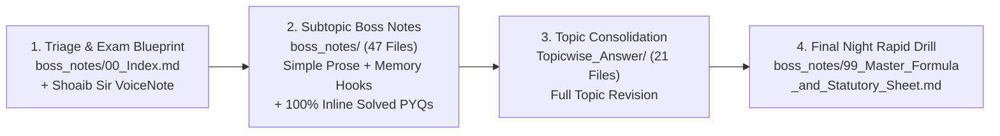

# HUM 2217: Legal Issues, Industrial & Operational Management

> [!info] Course Overview (RUET · Department of ECE · 2nd Year Even Semester)
> - **Course Code & Title:** HUM 2217 · Legal Issues, Industrial & Operational Management
> - **Credits & Exam Format:** 3.00 Credits · **60 Marks Final Exam** (3 Hours: Section A = 30 Marks, Section B = 30 Marks; 4 questions set per section, answer any 3 on separate scripts)
> - **Course Instructors:**
>   - **Section A (`CO1` · Legal Issues · 30 Marks):** Shoaib Islam (SI) Sir
>   - **Section B (`CO2` · Industrial Management & `CO3` · Operational Management · 30 Marks):** Md. Rokonuzzaman (MRI) Sir
> - **Primary Statutes & Textbook:**
>   - *The Contract Act, 1872* (Act IX of 1872)
>   - *The Bangladesh Labour Act, 2006* (Act XLII of 2006, with 2013 Amendments)
>   - Ricky W. Griffin, *Fundamentals of Management* (8th Edition, Cengage Learning)

A complete, Obsidian- and BossNotes-compatible study vault for **HUM 2217**. It unifies the **50-file subtopic-wise Boss Notes suite**, the **21-file consolidated topic answer bank**, all **109 past Final and Class Test questions**, digitized handwritten class notes, instructor exam suggestions, lecture slides, and verbatim statutory and textbook chapters in a single cross-linked repository.

---

## 1. Vault at a Glance

| Resource Layer | Directory / File | Scope & Metrics |
| :--- | :--- | :--- |
| **Boss Notes Suite (Subtopic-Wise)** | [`boss_notes/00_Index.md`](boss_notes/00_Index.md)<br>[`boss_notes/README.md`](boss_notes/README.md)<br>[`boss_notes/99_Master_Formula_and_Statutory_Sheet.md`](boss_notes/99_Master_Formula_and_Statutory_Sheet.md) | **50 files** (`22,050+` lines): **47 subtopic notes** (`L01.1`–`L12.1`, `M01.1`–`M06.2`, `O01.1`–`O03.2`), **3 master hubs**, **38+ memory hooks**, **triage study plans** (7-day, 3-day, 1-night), and **100% inline solved PYQs & CTs** written in simple, zero-stiffness English |
| **Consolidated Topic Answers** | [`Topicwise_Answer/00_Index.md`](Topicwise_Answer/00_Index.md)<br>[`Topicwise_Answer/README.md`](Topicwise_Answer/README.md) | **21 topic modules** (`L01`–`L12`, `M01`–`M06`, `O01`–`O03`) + **2 index files** consolidating all 117 subtopics into single-file topic references |
| **PYQ Analytics & Question Bank** | [`Question_Analysis_Report.md`](Question_Analysis_Report.md)<br>[`subtopicwise_list.md`](subtopicwise_list.md)<br>[`subtopicwise_questions.md`](subtopicwise_questions.md) | **4 Semester Finals** (`2020`, `2021`, `2023`, `2024`; 69 active sub-questions, 256 marks) + **4 Class Tests** (`2025` Series; 20 parts, 80 marks) = **109 questions (336 analyzed marks)** |
| **SI Sir's Legal Blueprint** | [`Shoaib_Sir_Suggestion_VoiceNote.md`](Shoaib_Sir_Suggestion_VoiceNote.md) | Verbatim breakdown of Shoaib Islam Sir's narrowed CO1 exam scope, mandatory 10-mark Contract Frustration case study alert, and strict section-citation rules |
| **Student Class Notes (Raidah)** | [`Classnote_by_Raidah/Classnotes_Hum2217_Raidah.md`](Classnote_by_Raidah/Classnotes_Hum2217_Raidah.md) | Digitized handwritten notebook covering **MRI Sir (Classes 1–11)** and **SI Sir (Classes 1–3 + Final Suggestions)** with **13 classroom diagrams** |
| **Legal Issues Notes & Slides** | [`Legal_Issues/Notes/`](Legal_Issues/Notes/Chapter-1.md)<br>[`Legal_Issues/Slides/`](Legal_Issues/Slides/Chapter-1slide.md) | SI Sir's 4 lecture note chapters (`Chapter-1.md` to `Chapter-4.md`) and 4 slide decks (`Chapter-1slide.md` to `Chapter-4 slide.md`) |
| **IM & OM Lecture Notes** | [`Industrial_and_Operations_Management/`](Industrial_and_Operations_Management/Lecture%201.md) | MRI Sir's 5 Industrial Management lectures (`Lecture 1.md` to `Lecture 5.md`), [`Inventory Control.md`](Industrial_and_Operations_Management/Inventory%20Control.md), and [`Productivity.md`](Industrial_and_Operations_Management/Productivity.md) |
| **Past Exam Archive** | [`PreviousYearQuestions/README.md`](PreviousYearQuestions/README.md) | Verbatim final exam papers ([`2020.md`](PreviousYearQuestions/2020.md), [`2021.md`](PreviousYearQuestions/2021.md), [`2023.md`](PreviousYearQuestions/2023.md), [`2024.md`](PreviousYearQuestions/2024.md)) and 2025 Class Tests ([`CT_questions.md`](PreviousYearQuestions/CT_questions.md)) |
| **Reference Statutes & Textbook** | [`Books/BangladeshLabourCode2006/README.md`](Books/BangladeshLabourCode2006/README.md)<br>[`Books/Fundamentals_of_Management_Griffin/README.md`](Books/Fundamentals_of_Management_Griffin/README.md) | Verbatim *Bangladesh Labour Act 2006* (**23 modular chapter files**, Sections 1–336) and Ricky W. Griffin *Fundamentals of Management* 8th Ed. (**20 files**, Chapters 1–15) |
| **Official Course Syllabus** | [`Syllabus.md`](Syllabus.md) | Official 7-module RUET curriculum, pre-2020 to OBE syllabus cross-map (removing legacy accounting), and resource routing guide |

---

## 2. Quick Start: How to Study from This Vault



1. **Pick your study timeline in [`boss_notes/00_Index.md`](boss_notes/00_Index.md):**
   - **7-Day Complete Mastery Plan:** Covers all 47 subtopic Boss Notes to target `55–60 / 60` marks.
   - **3-Day High-Yield Sprint:** Focuses on `🔴 Critical` and `🟠 High` priority notes, Shoaib Sir's voice-note blueprint, and MRI Sir's board numericals to target `45–55 / 60` marks.
   - **1-Night Emergency Survival Plan:** Targets the top 12 guaranteed exam locks to secure `35–45 / 60` marks in 6 to 8 hours.
2. **Study subtopic by subtopic in [`boss_notes/`](boss_notes/00_Index.md):**
   - Every Boss Note is written in plain everyday words and short sentences ($\le 20$ words) so you can memorize statutory rules and management points effortlessly.
   - Every note includes **`> [!tip] Memory Hook`** callouts, comparison tables, and **100% inline answers** to every past Final (`2020`–`2024`) and Class Test (`2025`) question under `## 🏆 Golden Questions`.
3. **Review consolidated modules in [`Topicwise_Answer/`](Topicwise_Answer/00_Index.md):**
   - If you prefer reading an entire topic (such as all of Contract Formation `L02` or all of Motivation `M05`) in a single file, use the 21 consolidated topic files in [`Topicwise_Answer/00_Index.md`](Topicwise_Answer/00_Index.md).
4. **Drill formulas and section numbers before entering the exam hall:**
   - Open [`boss_notes/99_Master_Formula_and_Statutory_Sheet.md`](boss_notes/99_Master_Formula_and_Statutory_Sheet.md) for the 10-minute rapid recall checklist covering every Contract Act section, BLC 2006 worker-count ladder, management acronym, and inventory/productivity formula.

---

## 3. Master Navigation Matrix (21 Topics · 47 Subtopic Boss Notes)

### Part A: Legal Issues (`CO1` · Shoaib Islam Sir · Section A · 30 Marks)

| Topic | Consolidated Topic File | Subtopic Boss Notes (`boss_notes/`) | Priority & Past Marks | Source Notes & Statutes |
| :---: | :--- | :--- | :---: | :--- |
| **`L01`** | [Topic L01: Intro to Law](Topicwise_Answer/L01_Introduction_to_Law.md) | • [L01.1: Definitions of Law & Society](boss_notes/L01.1_Definitions_of_Law_and_Society.md)<br>• [L01.2: Industrial Law vs. Labour Law](boss_notes/L01.2_Industrial_Law_vs_Labour_Law.md)<br>• [L01.3: Why ECE Students Must Learn Law](boss_notes/L01.3_Why_ECE_Students_Must_Learn_Law.md) | `🟠 High`<br>Final: `2m` · CT: `0m`<br>*(Ch. 1 Study All)* | [Ch-1 Note](Legal_Issues/Notes/Chapter-1.md) · [Ch-1 Slide](Legal_Issues/Slides/Chapter-1slide.md) · [Raidah §12](Classnote_by_Raidah/Classnotes_Hum2217_Raidah.md) |
| **`L02`** | [Topic L02: Contract Basics](Topicwise_Answer/L02_Contract_Basics_and_Formation.md) | • [L02.1: Contract, Agreement, Void & Voidable](boss_notes/L02.1_Contract_Agreement_Void_and_Voidable.md)<br>• [L02.2: Essential Elements (`Sec 10`)](boss_notes/L02.2_Essential_Elements_of_Valid_Contract.md)<br>• [L02.3: Offer & Acceptance Rules (`Sec 2–9`)](boss_notes/L02.3_Offer_and_Acceptance_Rules.md)<br>• [L02.4: Applied ECE Tenders & R&D Risks](boss_notes/L02.4_Applied_ECE_Tenders_and_RD_Contract_Risks.md) | `🔴 Critical`<br>Final: `18m` · CT: `20m`<br>*(Total: 38m)* | [Ch-2 Note](Legal_Issues/Notes/Chapter-2.md) · [Ch-2 Slide](Legal_Issues/Slides/Chapter-2slide.md) · [Raidah §13](Classnote_by_Raidah/Classnotes_Hum2217_Raidah.md) |
| **`L03`** | [Topic L03: Consideration](Topicwise_Answer/L03_Consideration.md) | • [L03.1: Consideration Definition, Types & Rules](boss_notes/L03.1_Consideration_Definition_Types_and_Rules.md)<br>• [L03.2: 7 Exceptions to No Consideration (`Sec 25`)](boss_notes/L03.2_Exceptions_to_No_Consideration_No_Contract.md) | `🔴 Critical` 📌<br>*(SI Sir Major Target)* | [Ch-2 Note](Legal_Issues/Notes/Chapter-2.md) · [VoiceNote §1](Shoaib_Sir_Suggestion_VoiceNote.md) |
| **`L04`** | [Topic L04: Discharge of Contract](Topicwise_Answer/L04_Discharge_of_Contract.md) | • [L04.1: 7 Modes of Discharge (`Sec 37–63`)](boss_notes/L04.1_Modes_of_Discharge_of_Contract.md)<br>• [L04.2: Doctrine of Frustration (`Sec 56`) & Case Studies](boss_notes/L04.2_Doctrine_of_Frustration_and_Case_Studies.md) | `🔴 Critical` 📌<br>Final: `4m` + **Confirmed 10m Case Study** | [Ch-2 Note](Legal_Issues/Notes/Chapter-2.md) · [VoiceNote §1](Shoaib_Sir_Suggestion_VoiceNote.md) |
| **`L05`** | [Topic L05: BLC Definitions & Adolescents](Topicwise_Answer/L05_BLC_Definitions_and_Adolescents.md) | • [L05.1: BLC Core Definitions & Age Classes (`Sec 2`)](boss_notes/L05.1_BLC_Core_Definitions_and_Age_Classes.md)<br>• [L05.2: Adolescent Working Hours (`Sec 41`)](boss_notes/L05.2_Adolescent_Working_Hours_Sec_41.md)<br>• [L05.3: Applied Factory Compliance & Adult Hours](boss_notes/L05.3_Applied_Factory_Compliance_and_Adult_Hours.md) | `🔴 Critical` 📌<br>Final: `10m` · CT: `10m`<br>*(Total: 20m)* | [Ch-3 Note](Legal_Issues/Notes/Chapter-3.md) · [BLC Ch. 1](Books/BangladeshLabourCode2006/Chapter_01_Preliminary.md) · [BLC Ch. 3](Books/BangladeshLabourCode2006/Chapter_03_Employment_of_Adolescent_Worker.md) |
| **`L06`** | [Topic L06: Maternity Benefit](Topicwise_Answer/L06_Maternity_Benefit.md) | • [L06.1: Maternity Benefits (`Sec 45–50`)](boss_notes/L06.1_Maternity_Benefits_Sec_45_to_50.md) | `🔴 Critical` 📌<br>*(SI Sir #1 Ch. 3 Target)* | [Ch-3 Note](Legal_Issues/Notes/Chapter-3.md) · [BLC Ch. 4](Books/BangladeshLabourCode2006/Chapter_04_Maternity_Benefit.md) |
| **`L07`** | [Topic L07: Fire Safety](Topicwise_Answer/L07_Fire_Safety.md) | • [L07.1: Fire Safety Precautions (`Sec 62`)](boss_notes/L07.1_Fire_Safety_Precautions_Sec_62.md)<br>• [L07.2: Machinery Safety (`Sec 63–64`) & Duties](boss_notes/L07.2_Machinery_Safety_and_Workplace_Duties.md) | `🔴 Critical` 📌<br>Final: `8m` · CT: `10m`<br>*(Total: 18m)* | [Ch-3 Note](Legal_Issues/Notes/Chapter-3.md) · [BLC Ch. 6](Books/BangladeshLabourCode2006/Chapter_06_Safety.md) |
| **`L08`** | [Topic L08: Welfare Measures](Topicwise_Answer/L08_Welfare_Measures.md) | • [L08.1: Welfare Measures (`Sec 89–99`)](boss_notes/L08.1_Welfare_Measures_Sec_89_to_99.md) | `🔴 Critical` 📌<br>*(SI Sir Ch. 3 Target)* | [Ch-3 Note](Legal_Issues/Notes/Chapter-3.md) · [BLC Ch. 8](Books/BangladeshLabourCode2006/Chapter_08_Welfare_Measures.md) |
| **`L09`** | [Topic L09: Termination of Employment](Topicwise_Answer/L09_Termination_of_Employment.md) | • [L09.1: Termination of Employment (`Sec 20–27`)](boss_notes/L09.1_Termination_of_Employment_Sec_20_to_27.md) | `🟠 High`<br>*(Raidah Class 3 Digest)* | [Raidah §14](Classnote_by_Raidah/Classnotes_Hum2217_Raidah.md) · [BLC Ch. 2](Books/BangladeshLabourCode2006/Chapter_02_Conditions_of_Employment_and_Service.md) |
| **`L10`** | [Topic L10: Trade Union](Topicwise_Answer/L10_Trade_Union.md) | • [L10.1: Trade Union Basics, Objectives & Functions](boss_notes/L10.1_Trade_Union_Basics_Objectives_and_Functions.md)<br>• [L10.2: Registration (`Sec 177–189`) & Cancellation (`Sec 190`)](boss_notes/L10.2_Trade_Union_Registration_and_Cancellation.md)<br>• [L10.3: Legal Status (`Sec 194`), Rights & Applied Role](boss_notes/L10.3_Trade_Union_Legal_Status_Rights_and_Applied_Role.md) | `🔴 Critical` 📌<br>Final: `10m`<br>*(Applied Ch. 4 Target)* | [Ch-4 Note](Legal_Issues/Notes/Chapter-4.md) · [BLC Ch. 13](Books/BangladeshLabourCode2006/Chapter_13_Trade_Unions_and_Industrial_Relations.md) |
| **`L11`** | [Topic L11: CBA & Industrial Disputes](Topicwise_Answer/L11_CBA_and_Industrial_Disputes.md) | • [L11.1: Collective Bargaining & CBA (`Sec 202`)](boss_notes/L11.1_Collective_Bargaining_and_CBA_Sec_202.md)<br>• [L11.2: Industrial Disputes & Settlement Ladder (`Sec 210`)](boss_notes/L11.2_Industrial_Disputes_and_Settlement_Ladder_Sec_210.md) | `🔴 Critical` 📌<br>Final: `8m`<br>*(Applied Dispute Ladder)* | [Ch-4 Note](Legal_Issues/Notes/Chapter-4.md) · [BLC Ch. 14](Books/BangladeshLabourCode2006/Chapter_14_Settlement_of_Disputes_and_Labour_Courts.md) |
| **`L12`** | [Topic L12: Unfair Labour Practices](Topicwise_Answer/L12_Unfair_Labour_Practices.md) | • [L12.1: Unfair Labour Practices (`Sec 195 & 196`)](boss_notes/L12.1_Unfair_Labour_Practices_Sec_195_and_196.md) | `🟠 High` 📌<br>Final: `8m` | [Ch-4 Note](Legal_Issues/Notes/Chapter-4.md) · [BLC Ch. 13](Books/BangladeshLabourCode2006/Chapter_13_Trade_Unions_and_Industrial_Relations.md) |

---

### Part B: Industrial & Operational Management (`CO2` & `CO3` · MRI Sir · Section B · 30 Marks)

| Topic | Consolidated Topic File | Subtopic Boss Notes (`boss_notes/`) | Priority & Past Marks | Source Lectures & Textbook |
| :---: | :--- | :--- | :---: | :--- |
| **`M01`** | [Topic M01: Management Foundations](Topicwise_Answer/M01_Management_Foundations.md) | • [M01.1: Definitions, Stakeholders, Resources (`H-F-P-I`) & Nature](boss_notes/M01.1_Management_Definitions_Resources_and_Nature.md)<br>• [M01.2: Efficiency vs. Effectiveness & $2 \times 2$ Matrix](boss_notes/M01.2_Efficiency_vs_Effectiveness_and_Decision_Matrix.md)<br>• [M01.3: Management Functions (`P-O-L-C`) & Leadership](boss_notes/M01.3_Management_Functions_POLC_and_Leadership.md) | `🔴 Critical`<br>Final: `25m` · CT: `14m`<br>*(Total: 39m · 4/4 Finals)* | [Lec 1](Industrial_and_Operations_Management/Lecture%201.md) · [Lec 2](Industrial_and_Operations_Management/Lecture%202.md) · [Raidah §1–2](Classnote_by_Raidah/Classnotes_Hum2217_Raidah.md) · [Griffin Ch. 1](Books/Fundamentals_of_Management_Griffin/Chapter_01_Understanding_the_Managers_Job.md) |
| **`M02`** | [Topic M02: Levels, Areas & Skills](Topicwise_Answer/M02_Levels_Areas_Skills.md) | • [M02.1: 3 Management Levels & 10 Functional Areas](boss_notes/M02.1_Management_Levels_and_Functional_Areas.md)<br>• [M02.2: 7 Managerial Skills (`T-I-C-D-C-D-T`) & Development](boss_notes/M02.2_Managerial_Skills_Evaluation_and_Development.md) | `🔴 Critical`<br>Final: `12m` · CT: `6m`<br>*(Total: 18m · 3/4 Finals)* | [Lec 3](Industrial_and_Operations_Management/Lecture%203.md) · [Raidah §3–5](Classnote_by_Raidah/Classnotes_Hum2217_Raidah.md) · [Griffin Ch. 1](Books/Fundamentals_of_Management_Griffin/Chapter_01_Understanding_the_Managers_Job.md) |
| **`M03`** | [Topic M03: Fayol & Taylor](Topicwise_Answer/M03_Fayol_and_Taylor.md) | • [M03.1: Fayol's 14 Principles (`DAD U C USSR?`) & Gangplank](boss_notes/M03.1_Fayols_14_Principles_and_Scalar_Chain.md)<br>• [M03.2: Taylor's Scientific Management & Comparison](boss_notes/M03.2_Taylors_Scientific_Management.md) | `🟠 High`<br>Final: `15m`<br>*(3/4 Finals)* | [Lec 4](Industrial_and_Operations_Management/Lecture%204.md) · [Lec 5](Industrial_and_Operations_Management/Lecture%205.md) · [Raidah §7](Classnote_by_Raidah/Classnotes_Hum2217_Raidah.md) · [Griffin Ch. 1](Books/Fundamentals_of_Management_Griffin/Chapter_01_Understanding_the_Managers_Job.md) |
| **`M04`** | [Topic M04: Planning, Organizing & Control](Topicwise_Answer/M04_Planning_Decisions_Organizing_Control.md) | • [M04.1: Planning Tiers & 6 Rational Decision Steps (`R-I-E-S-I-F`)](boss_notes/M04.1_Planning_and_Rational_Decision_Making.md)<br>• [M04.2: Departmentalization (`F-P-C-L`), Delegation & Span](boss_notes/M04.2_Organizing_Departmentalization_Delegation_and_Span.md)<br>• [M04.3: Controlling Process & 4 Steps (`S-M-C-C`)](boss_notes/M04.3_Controlling_Process_and_Steps.md) | `🟠 High`<br>Final: `19m`<br>*(2/4 Finals)* | [Raidah §6](Classnote_by_Raidah/Classnotes_Hum2217_Raidah.md) · [Griffin Ch. 3](Books/Fundamentals_of_Management_Griffin/Chapter_03_Planning_and_Strategic_Management.md), [Ch. 4](Books/Fundamentals_of_Management_Griffin/Chapter_04_Managing_Decision_Making.md), [Ch. 6](Books/Fundamentals_of_Management_Griffin/Chapter_06_Organization_Structure_and_Design.md), [Ch. 14](Books/Fundamentals_of_Management_Griffin/Chapter_14_Basic_Elements_of_Control.md) |
| **`M05`** | [Topic M05: Motivation](Topicwise_Answer/M05_Motivation.md) | • [M05.1: Motivation Basics ($P=M\times A\times E$) & Rewards](boss_notes/M05.1_Motivation_Basics_and_Financial_vs_NonFinancial.md)<br>• [M05.2: Maslow's Hierarchy (`P-S-S-E-S`) & Herzberg Two-Factor](boss_notes/M05.2_Maslow_Hierarchy_and_Herzberg_Two_Factor_Theory.md)<br>• [M05.3: Vroom's Expectancy ($M=E\times I\times V$), Theory X/Y & ERG](boss_notes/M05.3_Vroom_Expectancy_McGregor_XY_and_ERG_Theories.md) | `🔴 Critical`<br>Final: `33m`<br>*(4/4 Finals — 100% Lock)* | [Raidah §8](Classnote_by_Raidah/Classnotes_Hum2217_Raidah.md) · [Griffin Ch. 10 Pt 1](Books/Fundamentals_of_Management_Griffin/Chapter_10_Part1_Managing_Employee_Motivation.md) |
| **`M06`** | [Topic M06: HRM & Appraisal](Topicwise_Answer/M06_HRM_and_Appraisal.md) | • [M06.1: HRM, Recruitment vs. Selection & Training](boss_notes/M06.1_HRM_Recruitment_Selection_and_Training.md)<br>• [M06.2: Performance Appraisal & 6 Rating Errors (`H-L-S-C-R-C`)](boss_notes/M06.2_Performance_Appraisal_Methods_and_Rating_Errors.md) | `🔴 Critical`<br>Final: `29m`<br>*(4/4 Finals — 100% Lock)* | [Griffin Ch. 8 Pt 1](Books/Fundamentals_of_Management_Griffin/Chapter_08_Part1_Managing_Human_Resources.md) · [Griffin Ch. 8 Pt 2](Books/Fundamentals_of_Management_Griffin/Chapter_08_Part2_Managing_Human_Resources.md) |
| **`O01`** | [Topic O01: Inventory Concepts](Topicwise_Answer/O01_Inventory_Concepts.md) | • [O01.1: Inventory Control & Holding Costs (`I-S-H` vs. `C-O-S-T-P`)](boss_notes/O01.1_Inventory_Control_and_Holding_Costs.md)<br>• [O01.2: 4 Inventory Types (`C-S-A-P`) & ABC Analysis (`80/15/5`)](boss_notes/O01.2_Types_of_Inventory_and_ABC_Analysis.md) | `🔴 Critical`<br>Final: `16m`<br>*(4/4 Finals — 100% Lock)* | [Inventory Control.md](Industrial_and_Operations_Management/Inventory%20Control.md) · [Raidah §9–10](Classnote_by_Raidah/Classnotes_Hum2217_Raidah.md) |
| **`O02`** | [Topic O02: EOQ & Q-System](Topicwise_Answer/O02_EOQ_and_Q_System.md) | • [O02.1: EOQ, ROP, Safety Stock, 6 Assumptions & Cost Curves](boss_notes/O02.1_EOQ_Model_ROP_Safety_Stock_and_Cost_Curves.md)<br>• [O02.2a: Q-System Method & 3 Weekly Demand Problems](boss_notes/O02.2a_Q_System_Method_and_Weekly_Demand_Problems.md)<br>• [O02.2b: Q-System Daily Demand & MCU Problems (5-Problem Matrix)](boss_notes/O02.2b_Q_System_Daily_Demand_and_MCU_Problems.md) | `🔴 Critical`<br>Final: `34m` · CT: `20m`<br>*(Total: 54m — #1 Topic)* | [Inventory Control.md](Industrial_and_Operations_Management/Inventory%20Control.md) · [Raidah §9–11](Classnote_by_Raidah/Classnotes_Hum2217_Raidah.md) |
| **`O03`** | [Topic O03: Productivity](Topicwise_Answer/O03_Productivity.md) | • [O03.1: Productivity Formulas ($SFP, MFP, \% \Delta P$) & 7 Numericals](boss_notes/O03.1_Productivity_Formulas_SFP_MFP_and_Numericals.md)<br>• [O03.2: 7 Decline Causes (`I-O-P-S-I-E-M`), Human Factors & Industry 4.0](boss_notes/O03.2_Productivity_Decline_Human_Factors_and_Industry_4_0.md) | `🔴 Critical` ⭐<br>*(Class 11 Unasked Lock)* | [Productivity.md](Industrial_and_Operations_Management/Productivity.md) · [Raidah §11](Classnote_by_Raidah/Classnotes_Hum2217_Raidah.md) |

---

## 4. Past Exam Archive (`PreviousYearQuestions/`)

All semester-final papers and class tests are preserved verbatim in [`PreviousYearQuestions/`](PreviousYearQuestions/README.md):

| Exam Paper | Curriculum Era & Structure | Active Syllabus Marks | Key Highlights |
| :--- | :--- | :---: | :--- |
| [`2020.md`](PreviousYearQuestions/2020.md) | Pre-OBE (*Industrial Management & Accountancy*, 72m) | 48m (`M01`–`M06`, `O01`–`O02`) | Management definition & functions, Taylor's scientific management, Maslow's need hierarchy, performance appraisal errors, HRM recruitment/selection/training, inventory costs & types, EOQ/ROP definitions |
| [`2021.md`](PreviousYearQuestions/2021.md) | Transitional OBE (*Industrial Management & Accountancy*, 72m) | 48m (`M01`–`M06`, `O01`–`O02`) | Efficiency vs. effectiveness, Fayol's principles, managerial skills, effective vs. efficient decision making, controlling steps, Maslow's hierarchy & financial/non-financial motivators, inventory costs, appraisal problems |
| [`2023.md`](PreviousYearQuestions/2023.md) | Modern OBE (`CO1` Legal + `CO2` IM + `CO3` OM, 60m) | 80m printed (`60m` answered) | Factory/worker definitions, adolescent rules, workplace safety, void/voidable contracts, R&D contract risks, collective bargaining/CBA, unfair labour practices, top-level skills, rational decision steps, departmentalization/delegation/span, Vroom's expectancy theory, **Walton Q-system numerical (`Q.7c`)** |
| [`2024.md`](PreviousYearQuestions/2024.md) | Modern OBE (`CO1` Legal + `CO2` IM + `CO3` OM, 60m) | 80m printed (`60m` answered) | Industrial/labour law, ECE legal reasons, contract formation & discharge modes, ECE government tender scenario, trade union objectives/registration/technical bias, industrial dispute scenario (`Sec 210`), Herzberg's two-factor theory, Fayol's administrative management, **Optimal vs. Current Q-system (`Q.4c`)**, **Hand Drills Q-system (`Q.7b`)** |
| [`CT_questions.md`](PreviousYearQuestions/CT_questions.md) | 2025 Series (4 Class Tests · `4 × 20 = 80m`) | 80m (`CO1`, `CO2`, `CO3`) | **Law CT-1:** `Sec 10` contract elements (10m) & Offer/Acceptance (10m) · **Law CT-2:** Multi-issue factory compliance (10m) & Machinery in motion vs. Adolescents (10m) · **IM CT-1:** 10 short conceptual questions (`10 × 2m`) · **OM CT-2:** 20-mark ECE Microcontroller Warehouse Q-system problem (`a–f`) |

> [!warning] Legacy Accounting Questions Excluded
> In `2020`, `2021`, and earlier papers, Section B contained **Financial and Cost Accounting** (journals, ledgers, trial balance, balance sheet, cost sheets, CVP/break-even). Those topics were **completely removed** from the current HUM 2217 syllabus. Never spend study time on accounting questions from old PYQs.

---

## 5. High-Yield Exam Blueprint & Grading Rules

### Part A: Shoaib Islam Sir's Legal Issues Rules (`CO1` · 30 Marks)
- **Strict Section Citation:** Shoaib Sir warned in class: *"The shorter the suggestion, the stricter the script evaluation."* Always cite exact statutory section numbers (*Contract Act, 1872* or *BLC 2006*).
- **Mandatory 4-Step Legal Case Study Format:** Every applied legal scenario (especially the confirmed **10-mark Contract Frustration Case Study** under `Sec 56` in [`L04.2`](boss_notes/L04.2_Doctrine_of_Frustration_and_Case_Studies.md) and the **Industrial Dispute Scenario** under `Sec 210` in [`L11.2`](boss_notes/L11.2_Industrial_Disputes_and_Settlement_Ladder_Sec_210.md)) must be answered in four labeled steps:
  1. **Facts of the Case**
  2. **Applicable Law & Section**
  3. **Legal Analysis**
  4. **Direct Conclusion**
- **Verified BLC 2006 Section Numbers:** Always use the verified Act sections documented in [`boss_notes/99_Master_Formula_and_Statutory_Sheet.md`](boss_notes/99_Master_Formula_and_Statutory_Sheet.md):
  - **Definitions (`Sec 2`):** Manufacturing Process `Sec 2(2)` *(voice-note transcript misprinted `2(lxi)`)*, Factory `Sec 2(7)` ($\ge 5$ workers), Adolescent `Sec 2(8)` ($14$ to $<18$), Adult `Sec 2(36)` ($\ge 18$), Child `Sec 2(63)` ($<14$), Worker `Sec 2(65)`.
  - **Adolescent Working Hours (`Sec 41` only):** $5\text{ h/day}$, $30\text{ h/wk}$ ($36\text{ h}$ with OT) in factory/mine; $7\text{ h/day}$, $42\text{ h/wk}$ ($48\text{ h}$ with OT) in other establishments; no work `7:00 PM–7:00 AM`; max 2 relays, spread-over $\le 7.5\text{ h}$.
  - **Maternity Benefits (`Sec 45–50`):** `Sec 45` (8-week post-natal work ban), `Sec 46` ($8+8=16\text{ weeks}$ paid benefit, $\ge 6\text{ months}$ service, $<2$ surviving children), `Sec 47` (notice & 3 payment options within 3 working days), `Sec 48` (3-month daily average wage in cash), `Sec 49` (death rules), `Sec 50` (termination ban 6 months before to 8 weeks after delivery).
  - **Fire Safety (`Sec 62` only):** Cite both the original 2006 text (*"at least once a year"*) and the 2013 Amendment (*"at least once every 6 months"* + 18% trained staff) for mock fire drills in factories with $\ge 50$ workers under `Sec 62(8)`.
  - **Welfare Threshold Ladder (`Sec 89–99`):** `> 25` Safety record book (`Sec 90`) & female shelter room (`Sec 93`) $\to$ `>= 40 female` Crèche (`Sec 94`, children $<6\text{ yrs}$, height $\ge 360\text{ cm}$, area $\ge 6000\text{ sq. cm}$) $\to$ `> 50` Rest/lunch room (`Sec 93`) $\to$ `> 100` Canteen (`Sec 92`) & Group Insurance (`Sec 99`) $\to$ `1 per 150` First-aid box (`Sec 89(3)`) $\to$ `>= 300` Sick room & dispensary (`Sec 89(5)`).
  - **Trade Unions & Disputes (`Sec 176–211`):** `Sec 176` formation rights, `Sec 179(2)` $30\%$ registration threshold, `Sec 182` 60-day registration, `Sec 190` cancellation, `Sec 194` corporate status, `Sec 195` 12 employer ULPs, `Sec 196` 6 worker ULPs, `Sec 197–199` immunities, `Sec 202` CBA ($1/3$ votes, 2-year term) & `Sec 202(24)` 5 exclusive powers, `Sec 210` dispute ladder (`15d -> 30d -> 15d -> 10d -> 30d -> 3d -> 30d`), `Sec 211` strike notice (`7–14 days`, $\ge 2/3$ secret ballot).

### Part B: Md. Rokonuzzaman Sir's IM & OM Rules (`CO2` & `CO3` · 30 Marks)
- **Continuous Review ($Q$) System Board Format ([`O02.2a`](boss_notes/O02.2a_Q_System_Method_and_Weekly_Demand_Problems.md) & [`O02.2b`](boss_notes/O02.2b_Q_System_Daily_Demand_and_MCU_Problems.md)):** Always follow MRI Sir's exact 6-step board sequence (`D-E-R-I-C-G`):
  1. **Given Parameters:** Convert daily/weekly demand to annual demand $D$ first ($D = d \times 260\text{ operating days}$ or $d \times 52\text{ weeks}$).
  2. **Part (a) `EOQ` & `Reorder point (ROP)`:** Compute $EOQ = \sqrt{\frac{2DS}{H}}$, then write the 4-line $ROP$ chain alongside side parameters ($d, l, \sigma_L = \sigma_d\sqrt{L}$):
     $$
     \text{Reorder point } (ROP) = \text{Average demand during lead time } (dl) + \text{Safety stock } (z\sigma_L) = dl + z\sigma_L
     $$
  3. **Part (b) `Inventory Position (IP)` & Decision:** Compute $IP = OH + SR - BO$, show the boxed rule ($\boxed{IP \le ROP} \longrightarrow \text{Place order}$ vs. $\boxed{IP > ROP} \longrightarrow \text{Do not order}$), and state the exact lot size $EOQ$.
  4. **Part (c) `Cost Implication`:** Always include the safety stock holding cost term in MRI Sir's annual cost equation:
     $$
     C = \frac{Q}{2}(H) + \frac{D}{Q}(S) + H z \sigma_L
     $$
  5. **Part (d) & (e) `TBO` & `N`:** Write the verbatim definition (*"The average length of time that elapses between two consecutive inventory orders"*), then evaluate $TBO = \frac{Q}{D} \times \text{time}$ and $N = \frac{D}{Q}$.
  6. **Part (f) `Continuous review system graph`:** Draw the sawtooth diagram with `Inventory Position (Units)` on the vertical axis, `Time` on the horizontal axis with a break `~~~~` before the final cycle $C_N$, peaks at `EOQ`, dashed `ROP` line, vertical drop lines, `Lead time` brackets, and `TBO` double-headed arrows.

---

## 6. Repository Directory Structure

```text
Hum_2217/
├── README.md                                        # Vault landing page & master navigation hub
├── Syllabus.md                                      # Official 7-module syllabus & PYQ routing guide
├── Shoaib_Sir_Suggestion_VoiceNote.md               # SI Sir's narrowed CO1 exam blueprint
├── Sohaib_Sir_Suggestion_VoiceNote.md               # Identical alias kept for link compatibility
├── Question_Analysis_Report.md                      # 4-year Final & CT statistical trend analysis
├── subtopicwise_list.md                             # 21 topics, 117 subtopics & mark distribution
├── subtopicwise_questions.md                        # All 109 past Final & CT questions by subtopic
├── CT_questions.md                                  # Symlink to PreviousYearQuestions/CT_questions.md
├── boss_notes/                                      # 50-File Subtopic-Wise Boss Notes Suite
│   ├── 00_Index.md                                  # Master Index, triage plans & 2026 predictions
│   ├── README.md                                    # Course orientation & study strategy guide
│   ├── 99_Master_Formula_and_Statutory_Sheet.md     # Complete statutory, mnemonic & formula reference
│   ├── L01.1_Definitions_of_Law_and_Society.md ... L12.1_Unfair_Labour_Practices_Sec_195_and_196.md (25 CO1 files)
│   ├── M01.1_Management_Definitions_Resources_and_Nature.md ... M06.2_Performance_Appraisal_Methods_and_Rating_Errors.md (15 CO2 files)
│   ├── O01.1_Inventory_Control_and_Holding_Costs.md ... O03.2_Productivity_Decline_Human_Factors_and_Industry_4_0.md (7 CO3 files)
│   └── diagrams/                                    # 106 embedded figures + .jpg.meta.json sidecars
├── Topicwise_Answer/                                # 21 Consolidated Topic-Level Exam Answer Files
│   ├── 00_Index.md                                  # Topicwise index & quick reference
│   ├── README.md                                    # Directory guide for Topicwise_Answer/
│   ├── L01_Introduction_to_Law.md ... L12_Unfair_Labour_Practices.md (12 CO1 files)
│   ├── M01_Management_Foundations.md ... M06_HRM_and_Appraisal.md (6 CO2 files)
│   ├── O01_Inventory_Concepts.md ... O03_Productivity.md (3 CO3 files)
│   └── diagrams/                                    # 26 topicwise figures + .jpg.meta.json sidecars
├── Classnote_by_Raidah/                             # Digitized Handwritten Class Notes (MRI + SI Sir)
│   ├── Classnotes_Hum2217_Raidah.md                 # Complete notebook (Classes 1–11 + Law Classes 1–3)
│   └── diagrams/                                    # 13 hand-drawn classroom diagrams + sidecars
├── Legal_Issues/                                    # SI Sir's Verbatim Legal Notes & Slide Decks
│   ├── Notes/                                       # Chapter-1.md to Chapter-4.md
│   └── Slides/                                      # Chapter-1slide.md to Chapter-4 slide.md
├── Industrial_and_Operations_Management/            # MRI Sir's Verbatim Lecture Notes & Slides
│   ├── Lecture 1.md ... Lecture 5.md                # Industrial Management lectures
│   ├── Inventory Control.md                         # EOQ, ROP, Safety Stock, Continuous Review
│   ├── Productivity.md                              # SFP, MFP, 7 numericals, decline & solutions
│   └── diagrams/                                    # 8 extracted lecture diagrams + sidecars
├── PreviousYearQuestions/                           # Verbatim Final Exam Papers & 2025 Class Tests
│   ├── README.md                                    # Archive index & exam structure guide
│   ├── Question_Analysis_Report.md                  # Full analytical report
│   ├── CT_questions.md                              # 2025 Law CT-1, Law CT-2, IM CT-1, OM CT-2
│   ├── 2020.md, 2021.md, 2023.md, 2024.md           # Verbatim final papers
│   └── diagrams/                                    # Extracted exam figures + sidecars
└── Books/                                           # Verbatim Reference Statutes & Textbooks
    ├── BangladeshLabourCode2006/                    # BLC 2006 (23 modular chapter files + README.md)
    └── Fundamentals_of_Management_Griffin/          # Ricky W. Griffin 8th Ed. (Ch. 1–15 + README.md)
```

---

## 7. Viewing & Rendering Notes

- **Obsidian & BossNotes Dual Compatibility:** Every Markdown file in this vault adheres to strict dual-renderer rules so it renders cleanly in both **Obsidian** and **BossNotes** (`remark/rehype` + `micromark` + **KaTeX**):
  - Inline math uses `$...$` and display math uses `$$...$$` with every opening and closing double-dollar fence placed alone on its own line.
  - All code blocks carry an explicit language tag (`text` or `mermaid`).
  - Callout blocks (`> [!tip]`, `> [!important]`, `> [!warning]`, `> [!question]`) repeat the leading `>` marker on every line inside the block.
- **Anti-Stiffness & Plain-English Prose:** All newly authored notes in [`boss_notes/`](boss_notes/00_Index.md) and [`Topicwise_Answer/`](Topicwise_Answer/00_Index.md) use simple everyday words, short sentences ($\le 20$ words), bold lead-in bullets, and zero em-dashes (`—`) so legal and managerial concepts are effortless to read and recall under exam pressure.
- **Diagrams & Metadata Sidecars:** All cropped textbook, lecture, notebook, and generated Continuous Review ($Q$) System sawtooth diagrams are stored in local `diagrams/` directories alongside `<filename>.jpg.meta.json` sidecar files.
