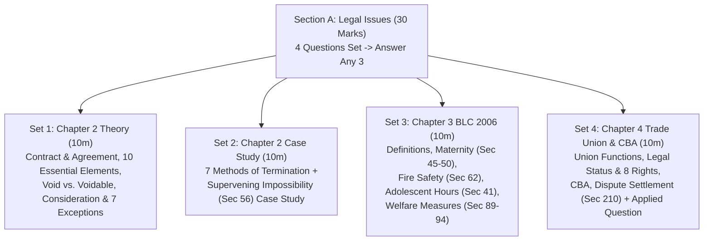

# SI Sir Exclusive: Easy 2-Hour Study Plan (30/30 Marks)

> [!important] Written in Simple, Easy-to-Memorize Lecture Language!
> Every file in this folder has been simplified to match **Shoaib Sir's actual lecture handouts and slides**: using **plain, everyday English**, **short 1-line bullet points**, and **only the core section numbers from Sir's slides**. You can read and digest the entire folder in **under 2 hours**!

---

## 1. How Section A (30 Marks) Works in the Exam

- **Total Questions Set:** **4 Full Questions** (10 Marks each = 40 Marks total).
- **You Answer:** **Any 3 Questions** ($3 \times 10 = \mathbf{30\text{ Marks}}$).

---

## 2. Your 2-Hour Fast Study Plan

Follow this exact order. Each file is short, direct, and easy to remember:

| Step | Time | File to Read | Marks Covered | What You Will Learn in Plain Words |
| :-: | :-: | :--- | :-: | :--- |
| **1** | **25 mins** | [`03_Ch2_PartB_Termination_Frustration_and_10Mark_Case_Studies.md`](03_Ch2_PartB_Termination_Frustration_and_10Mark_Case_Studies.md) | **10 Marks** *(Set 2 Case)* | The 7 simple ways a contract ends, the 5 valid excuses under `Sec 56` vs. 5 invalid excuses, and **6 short, easy solved case studies**. |
| **2** | **30 mins** | [`04_Ch3_BLC2006_Suggested_Core_Topics.md`](04_Ch3_BLC2006_Suggested_Core_Topics.md) | **10 Marks** *(Set 3)* | Simple definitions (Factory, Worker, Age groups), **Maternity (`Sec 45–50`)**, **Fire Safety (`Sec 62`)**, **Adolescent Hours (`Sec 41`)**, and **Welfare (`Sec 89–94`)**. |
| **3** | **25 mins** | [`02_Ch2_PartA_Contract_Essentials_Offer_and_Consideration.md`](02_Ch2_PartA_Contract_Essentials_Offer_and_Consideration.md) | **10 Marks** *(Set 1)* | Basic `Sec 2` definitions, *"All contracts are agreements..."*, 10 Essential Elements, Void vs. Voidable, Offer/Acceptance rules, and **Consideration (`Sec 25` exceptions)**. |
| **4** | **20 mins** | [`05_Ch4_Trade_Union_CBA_Disputes_and_Applied_Scenarios.md`](05_Ch4_Trade_Union_CBA_Disputes_and_Applied_Scenarios.md) | **10 Marks** *(Set 4)* | Trade Union 10 objectives & 7 functions, Legal Status & 8 Rights, Registration (`Sec 177–182`), **CBA (5 powers)**, **`Sec 210` Dispute Steps**, and easy applied answers. |
| **5** | **10 mins** | [`01_Ch1_Introduction_to_Law_and_ECE_Imperatives.md`](01_Ch1_Introduction_to_Law_and_ECE_Imperatives.md) | **2–6 Marks** | Holland, Salmond, Wilson definitions; Industrial vs. Labor Law table; and the **9 reasons ECE students should learn law**. |
| **6** | **10 mins** | [`99_One_Hour_Before_Exam_Cheat_Sheet.md`](99_One_Hour_Before_Exam_Cheat_Sheet.md) | **All 30 Marks** | 1-page quick revision of all section numbers, worker numbers, and day counts right before entering the exam hall. |

---

## 3. Three Golden Rules for Writing Your Exam Script Today

1. **Write in Simple, Clear Sense (Not Gazette Jargon!):**
   Shoaib Sir does not expect law-school sentences. Write the **correct meaning and sense** in your own simple words, using numbered bullet points (`1, 2, 3...`).
2. **Use Only the Main Section Numbers from Sir's Slides:**
   When writing a section number (like `Sec 46` for 16 weeks maternity leave, `Sec 62` for Fire Safety, or `Sec 210` for Industrial Disputes), just write the main section number clearly in bold. Do not worry about sub-clauses like `(1)(a)(ii)`.
3. **Always Give a 1-Line `X` and `Y` Example in Chapter 2:**
   In Contract Law questions, adding a 1-line example (like *"Mr. X invites Mr. Y to dinner"* or *"P sells his house to Q for Tk. 80,000"*) immediately shows the teacher you understand the concept!

---

👉 **Start Now:** [**`01_Ch1_Introduction_to_Law_and_ECE_Imperatives.md`**](01_Ch1_Introduction_to_Law_and_ECE_Imperatives.md) or jump straight to the 10-Mark Case Study in [**`03_Ch2_PartB_Termination_Frustration_and_10Mark_Case_Studies.md`**](03_Ch2_PartB_Termination_Frustration_and_10Mark_Case_Studies.md)!
