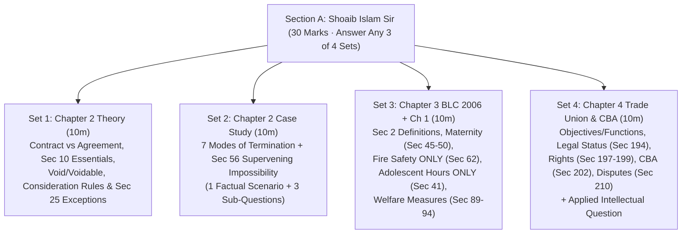

[Start Studying Now: 01 · Ch 1 Introduction to Law →](01_Ch1_Introduction_to_Law_and_ECE_Imperatives.md) | [⚡ 1-Hour Cheat Sheet](99_One_Hour_Before_Exam_Cheat_Sheet.md) | [🏠 Vault Root](../README.md)

---

# SI Sir Exclusive: Last-Night 30/30 Survival & Mastery Kit

> [!important] Why This Folder Exists
> You are on the final night before the HUM 2217 exam. Instead of reading 25 long files across the full syllabus, this folder curates **only the exact topics Shoaib Islam (SI) Sir prescribed** in his **7-minute 24-second final suggestion voice note** and **Raidah's class notes (Classes 1 to 3 and §15 Exam Suggestions)**. Every excluded topic has been stripped out. Every remaining topic is written in ready-to-reproduce exam script format with verified statutory section numbers.

---

## 1. How Section A (Shoaib Sir's Part) Works in the Exam Hall

- **Total Marks for Section A:** **30 Marks** (half of the 60-mark paper, written on a **separate answer script**).
- **Question Choice:** **4 full sets (questions)** will be set from Chapters 1, 2, 3, and 4. You must **answer any 3 out of 4 questions** ($3 \times 10 = 30\text{ Marks}$).
- **Standard Question Split:**
  - **Normal Sets (Sets 1, 3, 4):** Split into `(a) 2 marks` (definitions) + `(b) 4 marks` (statutory rules/lists) + `(c) 4 marks` (detailed rules or applied/analytical scenario) = `10 marks`.
  - **Applied Case Study Set (Set 2):** One factual scenario from Chapter 2 (Termination of Contract / Supervening Impossibility) followed by **3 analytical sub-questions** = `10 marks`.

---

## 2. What to Study vs. What to Skip Tonight

Shoaib Sir cut a huge portion of the syllabus so you can write 100% accurate answers on the remaining topics:

| Chapter | ✅ STRICTLY STUDY (100% Exam Scope) | ❌ STRICTLY SKIP Tonight (Excluded by Sir) |
| :--- | :--- | :--- |
| **Chapter 1** *(Intro to Law)* | • Definitions of Law (Holland, Salmond, Woodrow Wilson) • Industrial Law vs. Labour Law (definitions + 5-point table) • 9 Reasons Why ECE Students Must Learn Law (`I-C-C-L-E-S-R-C-R`) | Nothing skipped (Chapter 1 is short; takes 20 minutes). |
| **Chapter 2** *(Contract Act 1872)* | • Definitions: Offer `Sec 2(a)`, Acceptance `Sec 2(b)`, Consideration `Sec 2(d)`, Agreement `Sec 2(e)`, Void `Sec 2(g)`, Contract `Sec 2(h)`, Voidable `Sec 2(i)` • Maxim: *"All contracts are agreements, but all agreements are not contracts"* • 10 Essential Elements of Valid Contract (`Sec 10`) & 5 Void Agreements (`Sec 26-30`) • Basic Rules of Offer & Acceptance (`Sec 4, 7, 8, 9`) • **Consideration:** 3 Types, 7 Rules, **7 Exceptions to "No consideration, no contract" (`Sec 25`)** • **7 Modes of Discharge/Termination** + **Supervening Impossibility (`Sec 56`)** + **10-Mark Case Study** | • Deep technical history of English common law • Detailed agency, bailment, or indemnity chapters outside `Sec 127` & `Sec 185` |
| **Chapter 3** *(BLC 2006)* | • **Short Definitions (`Sec 2`):** Labour Code, Factory `Sec 2(7)`, Worker `Sec 2(65)`, Manufacturing Process `Sec 2(2)`, Child `Sec 2(63)`, Adolescent `Sec 2(8)`, Adult `Sec 2(36)`, Minor • **Maternity Benefits (`Sec 45-50`):** All 6 sections + wage math • **Safety: Fire Safety ONLY (`Sec 62`)** (*Precaution in case of fire*) • **Adolescents: Working Hours ONLY (`Sec 41`)** • **Welfare Measures (`Sec 89-94, 99`):** First-aid, Safety book, Washing, Canteens, Shelters, Crèches • *(5-min Backup)*: Ch. II Termination (`Sec 20, 22, 23-24, 26, 27`) | • **Skip** Young Person sections `Sec 34-40, 42-44` (fitness certificates, age disputes, dangerous machines) • **Skip** Adult Working Hours `Sec 100-113` • **Skip** Machinery Safety `Sec 61, 63-78A` (fencing, cranes, hoists, revolving machines, pressure plants, fumes, dust) |
| **Chapter 4** *(Trade Unions & Disputes)* | • Trade Union Definition (`Sec 176`), 10 Objectives, 7 Functions • Legal Status (`Sec 194`) & 8 Rights/Privileges (`Sec 197-199`) • Brief Registration (`Sec 177-182`, 30%) & Cancellation (`Sec 190`) • Collective Bargaining & **CBA (`Sec 202`)** + 5 Exclusive Powers (`Sec 202(24)`) • Industrial Disputes (Employer vs. Worker) & **Settlement Ladder (`Sec 210`)** • **Applied / Analytical Question** (Union/CBA philosophy & dispute scenarios) | • Long verbatim constitutional sub-clauses where summary bullets suffice |

---

## 3. Your 3.5-Hour Last-Night Battle Plan

Follow this exact sequence tonight. Every file in this folder is self-contained and ordered by exam return-on-time:

| Step | Time | File to Study | Target Marks | Core Action Tonight |
| :-: | :-: | :--- | :-: | :--- |
| **1** | **45 mins** | [`03_Ch2_PartB_Termination_Frustration_and_10Mark_Case_Studies.md`](03_Ch2_PartB_Termination_Frustration_and_10Mark_Case_Studies.md) | **10 Marks** *(Set 2 Lock)* | Memorize the 7 discharge modes, `Sec 56` valid grounds (`D-D-L-N-W`) vs. invalid excuses (`C-D-S-F-P`), and the 4-step case format across the 6 solved cases. |
| **2** | **50 mins** | [`04_Ch3_BLC2006_Suggested_Core_Topics.md`](04_Ch3_BLC2006_Suggested_Core_Topics.md) | **10 Marks** *(Set 3 Lock)* | Memorize `Sec 2` definitions, Maternity (`Sec 45-50`), Fire Safety (`Sec 62`), Adolescent Hours (`Sec 41`), and Welfare (`Sec 89-94`). |
| **3** | **45 mins** | [`02_Ch2_PartA_Contract_Essentials_Offer_and_Consideration.md`](02_Ch2_PartA_Contract_Essentials_Offer_and_Consideration.md) | **10 Marks** *(Set 1 Lock)* | Memorize `Sec 2(a-i)`, `Sec 10` (10 elements), Void vs. Voidable, Offer/Acceptance rules, and Consideration (7 rules + 7 exceptions under `Sec 25`). |
| **4** | **40 mins** | [`05_Ch4_Trade_Union_CBA_Disputes_and_Applied_Scenarios.md`](05_Ch4_Trade_Union_CBA_Disputes_and_Applied_Scenarios.md) | **10 Marks** *(Set 4 Lock)* | Memorize Union functions, Legal Status (`Sec 194`), 8 Rights (`Sec 197-199`), CBA (`Sec 202`), `Sec 210` dispute ladder, and the 5 solved applied cases. |
| **5** | **20 mins** | [`01_Ch1_Introduction_to_Law_and_ECE_Imperatives.md`](01_Ch1_Introduction_to_Law_and_ECE_Imperatives.md) | **2–6 Marks** *(Pairs w/ Set 1 or 3)* | Memorize Holland/Salmond/Wilson definitions, Industrial vs. Labour Law table, and 9 ECE legal reasons (`I-C-C-L-E-S-R-C-R`). |
| **6** | **15 mins** | [`99_One_Hour_Before_Exam_Cheat_Sheet.md`](99_One_Hour_Before_Exam_Cheat_Sheet.md) | **All 30 Marks** *(Final Polish)* | Read right before leaving for the exam hall to lock in every section number, worker threshold, and day count. |

> [!tip] Emergency Triage Tip (If You Only Have 2 Hours Total)
> You only need to answer **3 out of 4 sets** in Section A!
> - If you master **File 03 (Ch 2 Termination & Case Study)** + **File 04 (Ch 3 BLC 2006 Narrowed Topics)** + **File 02 (Ch 2 Contract Essentials & Consideration)** + **File 01 (Ch 1 Intro)**, you already cover **3 full sets (30/30 marks)** with high certainty!
> - Still read **File 05 (Ch 4 Trade Union & CBA)** for 25 minutes so you have a 4th backup set ready if any sub-question in another set feels tricky.

---

## 4. Shoaib Sir's 4 Golden Script Rules (How to Score 30/30)

In his voice note (`[03:25 - 05:05]`), Shoaib Sir gave an explicit grading promise and warning:
> *"The more concise and easier the suggestion is, the stricter the script marking will be! ... I demand a 100% complete and fully accurate answer in the examination. ... You can even score 30 out of 30! I have given 30 out of 30 in the past, and I always give full marks. If a student writes accurately, why wouldn't I award it?"*

Follow these 4 rules on your Section A answer script:
1. **Quote Exact Section Numbers:** Never write *"According to the Contract Act"* or *"According to the Labour Code"* without the section number. Write: *"Under **Section 56** of the Contract Act, 1872..."* or *"Under **Section 62(1)–(8)** of the Bangladesh Labour Act, 2006..."*.
2. **Use Numbered Lists and Bold Headings:** Do not write wall-of-text paragraphs. If a question asks for Essential Elements (`Sec 10`), list all **10 numbered points** with bold titles. If it asks for Welfare Measures, list **Sections 89, 90, 91, 92, 93, and 94** with exact worker thresholds.
3. **Give a 1-Line Concrete Example for Every Contract Rule:** In Chapter 2 (Offer, Acceptance, Consideration, Exceptions, Termination), add the classic 1-line example (*X and Y*, *Carlill v. Carbolic Smoke Ball*, or an ECE firm example) after each rule.
4. **Use the 4-Step Legal Case Format for the 10-Mark Case Study:**
   For each of the 3 sub-questions in the 10-mark case study, structure your answer as:
   - **1. Issue / Key Facts:** State the specific dispute in 1 sentence.
   - **2. Applicable Law & Section:** State the exact Act, legal doctrine, and Section number.
   - **3. Legal Analysis:** Connect the facts of the scenario to the statutory rule.
   - **4. Direct Conclusion:** Give a clear, one-sentence verdict (*"Therefore, the contract is discharged by supervening impossibility under Section 56..."*).

---

[Next: 01 · Chapter 1 Introduction to Law & ECE Imperatives →](01_Ch1_Introduction_to_Law_and_ECE_Imperatives.md)

