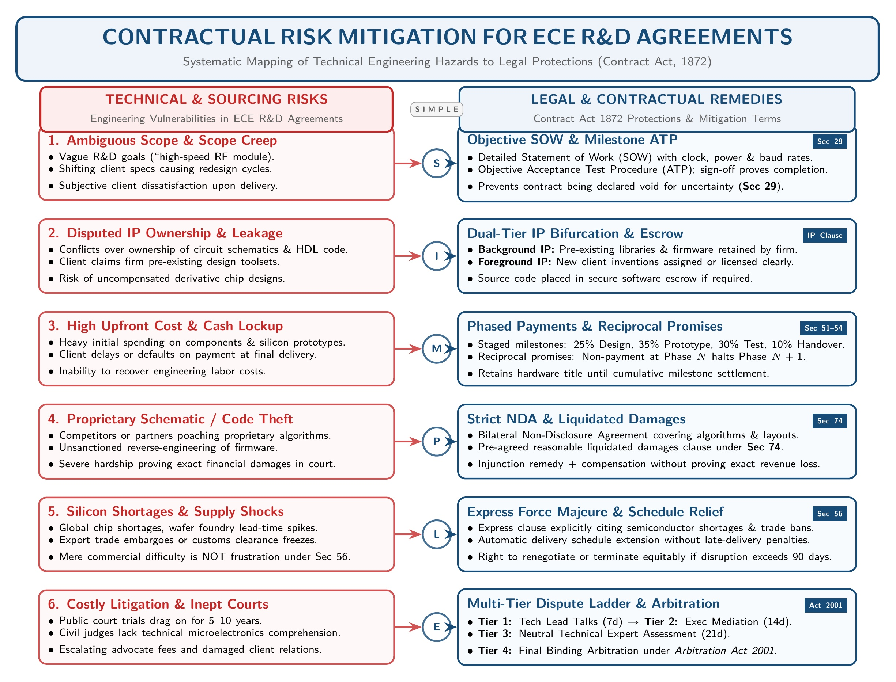

[← 00 · Master Plan & Index](00_Last_Night_Master_Plan_and_Index.md) | [⚡ 1-Hour Cheat Sheet](99_One_Hour_Before_Exam_Cheat_Sheet.md) | [Next: 02 · Ch 2 Part A (Contracts & Consideration) →](02_Ch2_PartA_Contract_Essentials_Offer_and_Consideration.md)

---

# 01 · Chapter 1: Introduction to Law & ECE Imperatives

> [!info] Exam Weight & Suggestion Status (Study Time: 20 Mins)
> - **Instructor Prescription:** Raidah's class suggestion (`Classnotes §15`) marks Chapter 1 as **"Study All"** (*প্রথম chapter -> সব দেখতে হবে [all]*).
> - **How It Appears in Finals:** Typically appears as a **2-mark part (a)** definition (*2023 Q.2(a): Define Industrial Law and Labor Law*), a **4-mark comparison table** (*Industrial Law vs. Labour Law*), or a **4-mark applied ECE question** (*Why ECE students should learn law / How to mitigate contractual risks in ECE R&D agreements, 2023 Q.3(c)*).

---

## 1. What is Law? (Sovereign Command & Juristic Definitions)

### 1.1 Law as the Command of the Sovereign
In jurisprudence, **Law** is the command of the Sovereign. This means three things:
1. **Source in Sovereign Authority:** Law originates from a determinate sovereign political authority (the State or Parliament).
2. **Accompanied by Sanctions:** Law is backed by state enforcement and a penalty or threat of displeasure if disobeyed.
3. **Compels a Course of Conduct:** Law commands people in an organized society to follow common rules so peaceful living and social order are maintained.

### 1.2 Reciprocal Relationship: Law, Government, and Society (SI Sir Class 1)
There is a direct, two-way (reciprocal) relationship between law, government, and society:

$$
\text{Law} \longleftrightarrow \text{Enforcement} \longleftrightarrow \text{Government / Parliament} \longleftrightarrow \text{Order in Society}
$$

- Society needs common rules to prevent chaos and protect life and property.
- The Government (Parliament/State) enacts and enforces those rules as Law.
- Law in turn regulates both societal conduct and governmental authority.

### 1.3 Three Classic Scholar Definitions (Must Quote Verbatim in Exam)

Memorize these three names and quotes from SI Sir's Chapter 1 notes:

1. **According to Holland:**
   > *"Law is a rule of external human action enforced by the sovereign political authority."*
   - **Three Essential Characteristics of Law (from Holland's definition):**
     1. Law is a rule relating to the actions of human beings.
     2. Law regulates the **external actions** of human beings (not internal thoughts).
     3. Law is enforced by the **State** (sovereign political authority).
2. **According to Salmond:**
   > *"Law is the body of principles recognized and applied by the State in the administration of justice."*
3. **According to Woodrow Wilson:**
   > *"Law is that portion of the established habit and thought of mankind which has gained distinct and formal recognition in the shape of uniform rules backed by the authority and power of the government."*

---

## 2. Industrial Law vs. Labour Law

### 2.1 Definition of Industrial Law
**Industrial Law** denotes the body of laws passed to regulate:
1. The physical and operational conditions under which work is carried out in factories and industrial establishments, and
2. The legal relationship between employers and employees.

**Two-Fold Objective of Industrial Legislation:**
1. **Preservation of Worker Well-Being:** Protecting the health, occupational safety, and welfare of workers inside industrial premises.
2. **Maintenance of Industrial Harmony:** Maintaining good, peaceful relations between employers and employees to prevent production disruptions.

### 2.2 Definition of Labour Law
**Labour Law** is the set of legal rules that governs the continuous process by which workers and employers determine the terms and conditions of employment.
- It defines the mutual rights and obligations of employers, employees, and labour organizations (trade unions).
- It regulates recruitment, wages/remuneration, working hours, leave conditions (especially maternity leave for women workers), social security, workman's compensation, trade union membership, and collective bargaining.
- **Domestic Statute Note (SI Sir Class 1):** In Bangladesh, domestic labour law is consolidated under **The Bangladesh Labour Act, 2006 (Act XLII of 2006)**, which contains **326 sections** across 21 chapters.

### 2.3 Comparison Table: Industrial Law vs. Labour Law

If asked to differentiate between Industrial Law and Labour Law (2 to 4 marks), write this 5-point table directly from SI Sir's notes:

| Basis | Industrial Law | Labour Law |
| :--- | :--- | :--- |
| **1. Core Definition** | Denotes laws passed to regulate the conditions under which work is carried out in factories and other industrial establishments. | A set of legal rules relating to the employment relationship that defines the rights and obligations of employees and employers. |
| **2. Primary Subject** | Primarily related to **industries, factories, and operational compliance**. | Primarily related to **workers, employers, and trade unions**. |
| **3. Scope of Application** | Covers laws regulating different types of manufacturing and industrial enterprises. | Covers industrial relations, payment of wages, working hours, leave, and workmen's compensation. |
| **4. Target Importance** | Essential for enforcing proper operational rules, licensing, and safety regulations across an industry. | Essential for protecting the rights, duties, and bargaining power of workers and employers. |
| **5. Subject Matter Breadth** | Includes a broader range of topics: factory licensing, environmental compliance, industrial contracts, and industrial relations. | Focuses specifically on worker benefits, leave conditions (e.g., maternity benefit), trade unions, and worker social security. |

---

## 3. Why Students of ECE Should Learn Law (9 Imperatives)

> [!tip] Memory Hook: `I-C-C-L-E-S-R-C-R`
> **I**PR · **C**ompliance · **C**ontracts · **L**iability · **E**thics · **S**tartups · **R**egulatory Changes · **C**ommunication · **R**isk Management

Students of Electrical and Computer Engineering (ECE) work with hardware, telecommunications, software, and embedded systems. They must learn law for **9 core reasons**:

1. **Intellectual Property Rights (IPR):**
   ECE engineers design novel circuits, VLSI layouts, embedded firmware, and software algorithms. Knowledge of patent, copyright, and trademark law protects their inventions from theft and secures commercial royalties.
2. **Regulatory & Safety Compliance:**
   ECE hardware and telecom systems must obey strict statutory standards, such as BTRC frequency spectrum rules, electrical safety codes, radiation limits, and e-waste environmental regulations.
3. **Contracts and Agreements:**
   Engineers constantly work with clients, component suppliers, and R&D partners. Understanding the Contract Act, 1872 helps engineers negotiate, draft, and interpret vendor agreements, Service Level Agreements (SLAs), and Non-Disclosure Agreements (NDAs).
4. **Product Liability and Responsibility:**
   Faulty medical electronics, power grid relays, or autonomous control software can cause severe injury or property damage. Product liability and tort law teach engineers their legal duty of care and the consequences of professional negligence.
5. **Ethical Considerations & Data Privacy:**
   Modern ECE engineers handle user data, encryption, IoT sensors, and AI surveillance. Legal training ensures compliance with cybersecurity laws, data protection rules, and digital privacy ethics.
6. **Startups and Entrepreneurship:**
   Many ECE graduates launch tech startups or hardware ventures. Business and company law is required for company incorporation, co-founder equity splits, venture capital funding, and licensing.
7. **Adapting to Rapid Regulatory Changes:**
   Technology laws governing AI, telecommunications, semiconductor exports, and cyber safety evolve rapidly. Legal awareness keeps engineers updated so their projects remain lawful.
8. **Cross-Functional Communication and Collaboration:**
   Engineers frequently interact with corporate lawyers, patent attorneys, government regulators, and union representatives. Knowing legal terms allows clear, effective collaboration.
9. **Proactive Risk Management:**
   Understanding legal obligations helps ECE project managers spot contractual, labour, and compliance risks early. This prevents costly lawsuits, project injunctions, and regulatory fines.

---

## 4. Solved Past Final Questions from Chapter 1

### Q1. Define Industrial Law and Labor Law. `[2023 · Q.2(a) | 02 Marks]`
**Model Answer:**
- **Industrial Law:** Industrial law refers to the body of legislation passed to regulate the working conditions inside factories and industrial establishments, as well as the operational relationship between employers and employees. Its two-fold objective is: (i) preserving the health, safety, and welfare of workers, and (ii) maintaining harmonious employer-employee relations.
- **Labour Law:** Labour law is the set of legal rules governing the employment relationship that defines the mutual rights and obligations of workers, employers, and trade unions. It regulates employment terms, wages, working hours, leave (such as maternity benefits), social security, and collective bargaining (governed in Bangladesh by the 326 sections of the Bangladesh Labour Act, 2006).

---

### Q2. Propose strategies for mitigating contractual risks in research and development (R&D) agreements within the field of ECE. `[2023 · Q.3(c) | 04 Marks]`
*(Note: This question bridges Chapter 1's 9 ECE Legal Imperatives with Chapter 2's Law of Contract).*

*Figure: Six-Pillar Strategy for Mitigating Contractual Risks in ECE R&D Agreements*

**Model Answer:**
Research and development (R&D) projects in Electrical and Computer Engineering (ECE) involve uncertain outcomes, high prototyping costs, and sensitive intellectual property. To mitigate contractual risks under the **Contract Act, 1872**, an ECE firm should adopt the following six strategies:

1. **Clear Scope & Milestone-Based Deliverables (`Sec 29` Certainty):**
   Avoid vague performance promises, which make agreements void for uncertainty under **Section 29**. Define exact technical specifications (e.g., clock speed, power budget, PCB layer count) and divide R&D into phased milestones (Feasibility $\to$ Prototype $\to$ Testing) rather than guaranteeing an impossible final invention upfront.
2. **Intellectual Property (IPR) Ownership & Licensing Clauses:**
   Clearly distinguish **Background IP** (existing code/circuits owned by each party before the project) from **Foreground IP** (new patents, VLSI layouts, or firmware created during R&D). Specify who owns the patent rights and whether the client receives an exclusive or non-exclusive license.
3. **Strict Non-Disclosure & Confidentiality Agreements (NDAs):**
   Include binding confidentiality clauses to protect proprietary schematics, source code, and test data from being leaked to competitors, backed by liquidated damages under **Section 74** for any breach.
4. **Force Majeure & Supervening Impossibility Clauses (`Sec 56`):**
   Semiconductor supply chains face global chip shortages, export bans, and customs delays. Include an explicit *Force Majeure* clause covering regulatory bans, natural disasters, and supply-chain disruptions so the ECE firm is excused without breach liability if performance becomes impossible (`Sec 56`).
5. **Limitation of Liability & Warranty Disclaimers:**
   Experimental ECE prototypes may fail or overheat during field testing. Cap total financial liability to the contract fee paid, exclude indirect consequential damages (`Sec 73`), and state that early prototypes are provided *"as-is"* for lab testing only.
6. **Structured Dispute Resolution & Termination Clauses (`Sec 28 Exception`, `Sec 62`):**
   Include an **Arbitration Clause** (valid under **Section 28 Exception 1**) to resolve technical disputes quickly via an independent engineering arbitrator rather than slow court litigation, alongside clear exit/termination terms (`Sec 62`) if R&D proves commercially unviable.

---

[← 00 · Master Plan & Index](00_Last_Night_Master_Plan_and_Index.md) | [Next: 02 · Ch 2 Part A (Contracts & Consideration) →](02_Ch2_PartA_Contract_Essentials_Offer_and_Consideration.md)

