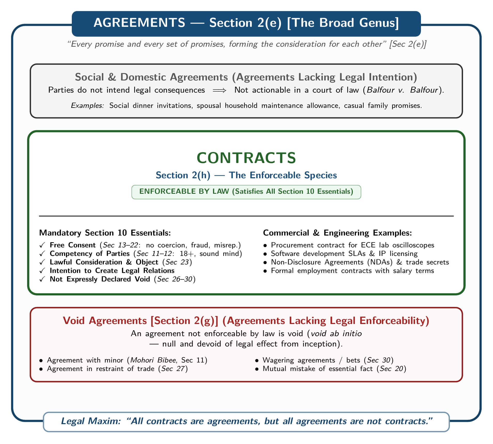
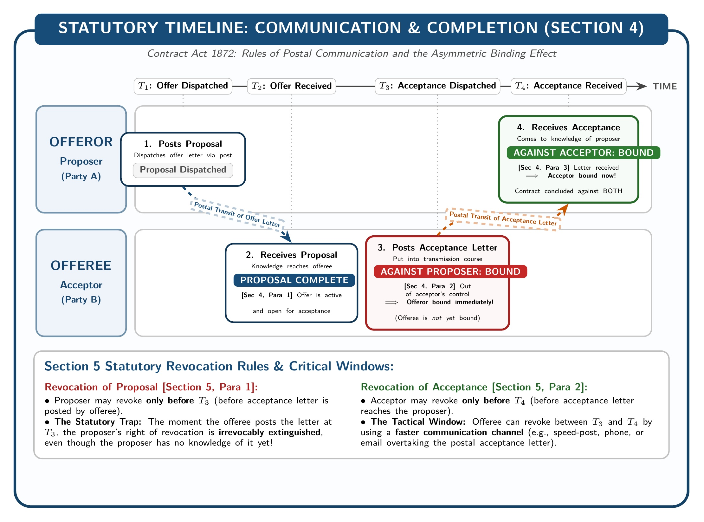
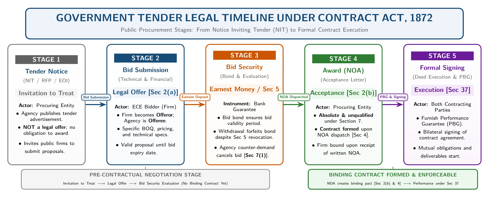

[← 01 · Ch 1 Intro to Law](01_Ch1_Introduction_to_Law_and_ECE_Imperatives.md) | [🏠 Master Plan](00_Last_Night_Master_Plan_and_Index.md) | [Next: 03 · Ch 2 Part B (Termination & 10-Mark Case Study) →](03_Ch2_PartB_Termination_Frustration_and_10Mark_Case_Studies.md)

---

# 02 · Chapter 2 (Part A): Contract Essentials, Offer & Acceptance, and Consideration

> [!info] Shoaib Sir's Exact Voice Note Prescription (`[00:00 - 00:55]`)
> *"Looking at Consideration, you can study everything related to Consideration. Everything connected to Consideration, Contract, Agreement, and Voidable Agreements: all these topics should be thoroughly reviewed. ... You must definitely study the Essential Elements of a Valid Contract; without reading that, you will not be able to answer properly. Then, review all topics related to Consideration, as well as the rules governing Offer and Acceptance."*

---

## 1. Core Statutory Definitions (`Contract Act, 1872 · Sec 2`)

Memorize these exact section numbers and definitions for 2-mark part (a) questions (`2024 Q.2(a)`, `2023 Q.3(a)`, `2024 Q.6(a)`):

| Term | Section | Statutory Definition under the Contract Act, 1872 |
| :--- | :---: | :--- |
| **Proposal (Offer)** | `Sec 2(a)` | *"When one person signifies to another his willingness to do or to abstain from doing anything, with a view to obtaining the assent of that other to such act or abstinence, he is said to make a proposal."* |
| **Acceptance & Promise** | `Sec 2(b)` | *"When the person to whom the proposal is made signifies his assent thereto, the proposal is said to be accepted. A proposal, when accepted, becomes a promise."* |
| **Promisor & Promisee** | `Sec 2(c)` | *"The person making the proposal is called the 'promisor' (or offeror), and the person accepting the proposal is called the 'promisee' (or offeree/acceptor)."* |
| **Consideration** | `Sec 2(d)` | *"When, at the desire of the promisor, the promisee or any other person has done or abstained from doing, or does or abstains from doing, or promises to do or to abstain from doing, something, such act or abstinence or promise is called a consideration for the promise."* |
| **Agreement** | `Sec 2(e)` | *"Every promise and every set of promises, forming the consideration for each other, is an agreement."* ($\text{Agreement} = \text{Offer} + \text{Acceptance}$). |
| **Void Agreement** | `Sec 2(g)` | *"An agreement not enforceable by law is said to be void."* (It has no legal effect from the very beginning: *void ab initio*). |
| **Contract** | `Sec 2(h)` | *"An agreement enforceable by law is a contract."* ($\text{Contract} = \text{Agreement} + \text{Legal Enforceability under Sec 10}$). |
| **Voidable Contract** | `Sec 2(i)` | *"An agreement which is enforceable by law at the option of one or more of the parties thereto, but not at the option of the other or others, is a voidable contract."* |

**Additional Scholar Definitions of Contract (from SI Sir's Notes):**
- **Salmond:** *"A contract is an agreement creating and defining obligations between the parties."*
- **Sir William Anson:** *"A contract is an agreement enforceable at law made between two or more persons, by which rights are acquired by one or more to acts or forbearances on the part of the other or others."*

---

## 2. Core Maxim: "All Contracts are Agreements, but All Agreements are Not Contracts"

*Figure: Relationship Between Agreements (`Sec 2(e)`) and Valid Contracts (`Sec 2(h)` & `Sec 10`)*

### How to Explain This Maxim in the Exam (4 Marks)
1. **Agreement is the Broader Genus (`Sec 2(e)`):**
   Whenever one person makes a proposal (`Sec 2(a)`) and another accepts it (`Sec 2(b)`), an **agreement** is born. It includes social, domestic, moral, religious, and commercial promises alike.
2. **Contract is the Narrower Species (`Sec 2(h)` & `Sec 10`):**
   Only those agreements that satisfy all the statutory conditions of **Section 10** (free consent, competent parties, lawful consideration, lawful object, not expressly declared void) are **enforceable in a court of law** and become **contracts**.

$$
\text{Contract } [\text{Sec } 2(\text{h})] = \text{Agreement } [\text{Sec } 2(\text{e})] + \text{Enforceability by Law } [\text{Sec } 10]
$$

3. **Concrete Examples (from SI Sir's Notes):**
   - **Agreement that is NOT a Contract:** Mr. `X` invites Mr. `Y` to dinner, and Mr. `Y` accepts. This is an agreement, but there is no intention to create a legal relationship. If `Y` fails to show up, `X` cannot sue `Y` in court. Similarly, an agreement to play cards or go to a cinema is merely a social agreement, not a contract.
   - **Agreement that IS a Contract:** Mr. `X` agrees to sell a plot of land to Mr. `Y` for $\text{Tk. } 5,00,000$. Because it involves commercial intent and satisfies `Sec 10`, it is enforceable in court. Thus, every contract starts as an agreement, but not every agreement becomes a contract.

---

## 3. Essential Elements of a Valid Contract (`Section 10`)

> **Exam History:** Asked in **2023 Q.3(b) [4 Marks]** and **2025 Law-CT1 Q.1 [10 Marks]**.

Under **Section 10** of the Contract Act, 1872: *"All agreements are contracts if they are made by the free consent of parties competent to contract, for a lawful consideration and with a lawful object, and are not hereby expressly declared to be void."*

Write all **10 Essential Elements** (matching SI Sir's Class 2 and Chapter 2 Notes):

1. **Lawful Offer and Acceptance (`Sec 2(a)`, `Sec 2(b)`):**
   There must be a definite, lawful proposal by one party and an absolute, unqualified acceptance (`Sec 7`) by the other party.
2. **Intention to Create Legal Relationship:**
   Both parties must intend that their agreement will carry legal consequences if breached. Social or domestic agreements (like inviting a friend to dinner or *Balfour v. Balfour*) lack legal intention and are not contracts.
3. **Lawful Consideration (`Sec 2(d)`, `Sec 23`, `Sec 25`):**
   Subject to narrow exceptions (`Sec 25`), each party must give and receive something in return (*quid pro quo*). Consideration may be past, present, or future, but it must be real and lawful.
4. **Capacity (Competence) of Parties (`Sec 11`, `Sec 12`):**
   The parties must be legally competent to contract. Under **Section 11**, every person is competent who:
   - Is of the **age of majority** ($\ge 18\text{ years}$),
   - Is of **sound mind** (`Sec 12`), and
   - Is **not disqualified** from contracting by any law (e.g., alien enemies, convicts, insolvents).
   *(Disability arises from minority, lunacy, idiocy, or drunkenness; a minor's agreement is void ab initio).*
5. **Free Consent (`Sec 13`, `Sec 14`):**
   Parties must agree upon the same thing in the same sense (*consensus ad idem*, `Sec 13`). Under **Section 14**, consent is **free** when it is not caused by:
   - **Coercion** (`Sec 15`),
   - **Undue Influence** (`Sec 16`),
   - **Fraud** (`Sec 17`),
   - **Misrepresentation** (`Sec 18`), or
   - **Mistake** (`Sec 20–22`).
6. **Legality of the Object (`Sec 23`):**
   The purpose or object of the agreement must be lawful. Under **Section 23**, an object is unlawful if it is forbidden by law, defeats any law, is fraudulent, injures a person or property, or is immoral or opposed to public policy.
7. **Certainty of Meaning (`Sec 29`):**
   The terms of the agreement must be clear, definite, and not vague. Under **Section 29**, agreements whose meaning is not certain or capable of being made certain are void.
8. **Possibility of Performance (`Sec 56(1)`):**
   The promised act must be physically and legally possible to perform. Under **Section 56(1)**, *"An agreement to do an act impossible in itself is void."*
9. **Not Expressly Declared Void (`Sec 26–30`):**
   The agreement must not belong to the **5 categories expressly declared void** by the Contract Act, 1872:
   - `Sec 26`: Agreement in restraint of marriage (of any person other than a minor).
   - `Sec 27`: Agreement in restraint of trade (restraining a lawful profession, trade, or business).
   - `Sec 28`: Agreement in restraint of legal proceedings.
   - `Sec 29`: Agreements void for uncertainty.
   - `Sec 30`: Agreements by way of wager (gambling/wagering agreements).
10. **Writing, Registration, and Legal Formalities:**
    While oral contracts are generally valid, where a specific statute requires an agreement to be in **writing, stamped, attested, or registered** (e.g., sale, gift, lease, or mortgage of immovable property under Section 17 of the Registration Act, or negotiable instruments), those formalities must be fulfilled.

---

## 4. Void Agreement (`Sec 2(g)`) vs. Voidable Contract (`Sec 2(i)`)

> **Exam History:** Asked in **2023 Q.3(a) [2 Marks]** and emphasized in Shoaib Sir's suggestion.

| Feature | Void Agreement (`Sec 2(g)`) | Voidable Contract (`Sec 2(i)`) |
| :--- | :--- | :--- |
| **1. Statutory Definition** | *"An agreement not enforceable by law is said to be void."* (`Sec 2(g)`). | *"An agreement which is enforceable by law at the option of one or more of the parties thereto, but not at the option of the other or others, is a voidable contract."* (`Sec 2(i)`). |
| **2. Legal Effect** | Has **zero legal effect** from inception (*void ab initio*). Confers no rights and creates no obligations. | Remains a **valid, good contract** unless and until the aggrieved party chooses to avoid (rescind) it. |
| **3. Primary Causes** | Minor's agreement (`Sec 11`), lack of consideration (`Sec 25`), unlawful object (`Sec 23`), bilateral mistake (`Sec 20`), impossible act (`Sec 56`), or expressly void (`Sec 26–30`). | Lack of free consent caused by **coercion (`Sec 15`)**, **undue influence (`Sec 16`)**, **fraud (`Sec 17`)**, or **misrepresentation (`Sec 18`)**. |
| **4. Who Can Enforce?** | **Neither party** can enforce it in a court of law. | The **aggrieved party** can either enforce it or rescind it; the guilty party cannot enforce it. |
| **5. Classic Example** | An agreement with a 15-year-old minor, or a wagering agreement (`Sec 30`). | `X` coerces `Y` at gunpoint into selling `Y`'s house to `X`. `Y` can set aside the contract, or enforce it if `Y` wishes; `X` cannot enforce it. |

*(Note on "Agreements that become void": An agreement that was valid when made may later become a **void contract** under `Sec 2(j)` / `Sec 56(2)` due to supervening impossibility or change of law).*

---

## 5. Rules Governing Offer (`Sec 2(a)`) and Acceptance (`Sec 2(b)`)

> **Exam History:** Asked in **2024 Q.6(a) [2m]**, **2024 Q.6(b) [4m]**, and **2025 Law-CT1 Q.2 [10m]**.

### 5.1 Eight Rules Regarding a Valid Offer (Proposal)
1. **May be Express or Implied (`Sec 9`):**
   - **Express Offer:** Made in spoken or written words (*Example:* `P` posts a notice offering $\text{Tk. } 5$ to any student who returns a lost book).
   - **Implied Offer:** Inferred from conduct or circumstances (*Example:* A transport company running buses/trams along a route makes an implied offer to carry passengers at scheduled fares).
2. **May be Specific or General:**
   - **Specific Offer:** Made to a definite person or class of persons (can be accepted only by them).
   - **General Offer:** Made to the world at large; anyone who performs the conditions accepts it (*Carlill v. Carbolic Smoke Ball Co.*).
3. **Must Intend to Create a Legal Relationship:** Social invitations (dinner or card games) do not constitute a valid legal offer.
4. **Terms Must be Certain, Definite, and Not Vague (`Sec 29`):** Saying *"I will give you some money if you marry Z"* is not a valid offer because *"some money"* is uncertain.
5. **Distinguished from a Mere Statement of Intention / Invitation to Offer:**
   Price lists, catalogues, newspaper advertisements, auction displays, and **government tender notices** are **invitations to offer**, not offers. In an auction, the bidder's bid is the offer, and the fall of the auctioneer's hammer is the acceptance.
6. **Must be Communicated to the Offeree (`Sec 4`):**
   A person cannot accept an offer of which they are ignorant (*Lalman Shukla v. Gauri Dutt*: servant `L` found a missing nephew without knowing his master `G` had announced a reward; held, `L` could not claim the reward).
7. **May be Conditional:** An offer can include special conditions, provided they are communicated to the offeree before acceptance.
8. **Printed / Standard Form Contracts:** Must give reasonable notice of any exemption clauses excluding liability.

### 5.2 Eight Rules Regarding a Valid Acceptance
1. **Can Only be Accepted by the Intended Offeree:** If `Z` sends an order addressed to `X` by name, `Y` (who secretly bought `X`'s business) cannot accept it (*Boulton v. Jones*).
2. **Must be Absolute and Unqualified (`Sec 7(1)`):**
   If the offeree varies even a minor term, there is no contract (*Example:* `M` offers land for $\text{Tk. } 2,80,000$; `N` replies enclosing $\text{Tk. } 80,000$ and promising monthly installments of $\text{Tk. } 50,000$. Held: no contract).
3. **Conditional Acceptance is a Counter-Offer:**
   Offering $\text{Tk. } 1,00,000$ when the seller asked for $\text{Tk. } 1,20,000$ is a counter-proposal that destroys the original offer.
4. **Must be Expressed in a Usual and Reasonable Manner (`Sec 7(2)` & `Sec 8`):**
   Can be oral, written, or **acceptance by conduct** under **Section 8** (*Carlill v. Carbolic Smoke Ball Co.*: Mrs. Carlill used the smoke ball for 2 weeks as directed and caught influenza; her conduct was valid acceptance without separate notice).
5. **Mental or Uncommunicated Assent is Invalid:** Mere silence cannot constitute acceptance.
6. **Prescribed Mode of Acceptance (`Sec 7(2)`):** If the offeror asks for acceptance *"by telegram"* and the offeree sends a letter, the offeror may insist on a telegram within a reasonable time; if the offeror does not object, he waives the requirement and is bound.
7. **Must be Given Within Prescribed or Reasonable Time (`Sec 6(2)`):** And **before the offer lapses or is revoked** (Rule 8).
8. **When Communication of Offer & Acceptance is Complete (`Section 4` Postal Rule):**

*Figure: Statutory Timeline for Completion of Offer and Acceptance under Section 4*

   - **Communication of Proposal (`Sec 4`):** Complete when it comes to the knowledge of the offeree (when `B` receives `A`'s letter).
   - **Communication of Acceptance (`Sec 4`):**
     - **As against the Proposer (`A`):** Complete as soon as the letter is **put in a course of transmission** (posted in the mailbox) so as to be out of the acceptor's (`B`'s) power. (`A` is bound the moment the letter is posted).
     - **As against the Acceptor (`B`):** Complete when it **comes to the knowledge of the proposer** (when `A` actually receives the letter). (`B` can revoke acceptance under `Sec 5` before the letter reaches `A`).

---

### 5.3 Applied Question: Offer & Acceptance When an ECE Firm Bids for a Government Project `[2024 · Q.6(b) | 04 Marks]`

*Figure: Legal Stages of Offer and Acceptance in an ECE Government Project Tender*

**Model Answer:**
When an Electrical and Computer Engineering (ECE) firm participates in a government project tender (e.g., supplying smart grid meters or installing a fiber-optic network), the rules of Offer and Acceptance under the **Contract Act, 1872** apply in four distinct legal stages:

1. **Government Tender Notice = Invitation to Offer (Not an Offer):**
   When the government agency publishes a Request for Proposal (RFP) or tender notice in newspapers, it is legally an **invitation to treat (invitation to make offers)**, not a proposal under `Sec 2(a)`. It does not bind the government to accept the lowest bid.
2. **ECE Firm's Bid Submission = The Legal Offer (`Sec 2(a)`):**
   When the ECE firm submits its sealed technical and financial bid in response to the tender notice, that bid constitutes the **formal proposal (offer)** under **Section 2(a)**. The ECE firm is the *promisor/offeror*, and the government agency is the *offeree*.
3. **Right of Revocation Before Acceptance (`Sec 5`):**
   Under **Section 5**, the ECE firm may withdraw or modify its bid at any time **before** the government communicates its acceptance (unless prohibited by a separate earnest-money bid bond agreement).
4. **Notification of Award (NOA) = Unqualified Acceptance (`Sec 2(b)`, `Sec 7`, `Sec 4`):**
   - If the government accepts the bid unconditionally by issuing an official **Notification of Award (NOA) / Work Order**, the proposal becomes a binding **promise (`Sec 2(b)`)** and a valid **contract (`Sec 2(h)`)**.
   - Under **Section 7(1)**, if the government demands price cuts or altered technical specs in the NOA, that is a **counter-offer**, which requires the ECE firm's fresh acceptance before any contract is formed.
   - Under **Section 4**, once the NOA is dispatched to the ECE firm, the government is bound; once it reaches the ECE firm, both parties are legally bound.

---

## 6. Consideration (`Section 2(d)`): "Study All" High-Yield Lock

> [!important] High-Yield Unasked Lock
> Consideration has **0 past final marks** in 2023–2024, and Shoaib Sir opened his voice note (`[00:00–00:55]`) and Class 3 by saying: *"Looking at Consideration, you can study everything related to Consideration."* Expect a direct 4-mark or 6-mark question here!

### 6.1 Definition of Consideration
- **Meaning:** Consideration means *"something in return"* (*Quid pro quo*). It is the price paid by one party for the promise of the other.
- **English Case Definition (*Currie v. Misa*):**
  > *"A valuable consideration in the sense of the law may consist either in some right, interest, profit, or benefit accruing to one party, or some forbearance, detriment, loss, or responsibility given, suffered, or undertaken by the other."*
- **Statutory Definition (`Section 2(d)` of the Contract Act, 1872):**
  > *"When, at the desire of the promisor, the promisee or any other person has done or abstained from doing, or does or abstains from doing, or promises to do or to abstain from doing, something, such act or abstinence or promise is called a consideration for the promise."*
- **Example:** `P` agrees to sell a house to `Q` for $\text{Tk. } 80,000$. For `P`'s promise, the consideration is $\text{Tk. } 80,000$. For `Q`'s promise, the consideration is the house.

---

### 6.2 Three Types of Consideration
Under `Section 2(d)` (*"has done... does... or promises to do"*), consideration is of **3 types**:

1. **Past Consideration (*"has done or abstained from doing"*):**
   When the act or consideration of one party was given **before** the date of the promise.
   - *Example:* `X` performs repair work for `Y` in January at `Y`'s request. In February, `Y` promises to pay `X` $\text{Tk. } 5,000$. `X`'s work is past consideration (valid under `Sec 2(d)` and `Sec 25(2)`).
2. **Present / Executed Consideration (*"does or abstains from doing"*):**
   When consideration moves **simultaneously** with the promise.
   - *Example:* `B` buys a router from an electronics shop and pays the cash price immediately over the counter.
3. **Future / Executory Consideration (*"promises to do or to abstain from doing"*):**
   When the consideration on one or both sides is to be performed at a **future date** (a promise in exchange for a promise).
   - *Example:* `X` promises to deliver 100 microcontrollers next month, and `Y` promises to pay the price upon delivery next month.

---

### 6.3 Seven Legal Rules Regarding Valid Consideration

Memorize all **7 rules** from SI Sir's Chapter 2 Notes:

1. **Must Move at the Desire (Request) of the Promisor (`Sec 2(d)`):**
   The act or forbearance must be done at the request of the promisor, not voluntarily or at a third party's desire.
   - *Example:* `P` sees `Q`'s house on fire and helps extinguish it without being asked by `Q`. `P` cannot demand payment because it was a voluntary act not done at `Q`'s desire.
2. **Consideration Must be Real and Competent (Not Illusory):**
   It must have some real value in the eye of the law. Physical or legal impossibility (e.g., promising to discover treasure by magic) or illusory promises cannot serve as valid consideration.
3. **Performance of an Existing Public Duty is Not Consideration:**
   Where the promisee is already under a legal public duty (e.g., a police officer investigating a crime or a witness testifying under subpoena), promising to pay them for doing their basic duty lacks consideration because they suffer no extra legal detriment.
4. **Consideration Need Not be Adequate (`Section 25, Explanation 2`):**
   An agreement freely entered into is not void merely because the consideration is inadequate (e.g., selling a $\text{Tk. } 10\text{ Lakh}$ car for $\text{Tk. } 5,000$). However, under **Section 25 (Explanation 2)**, the court may take gross inadequacy into account when determining whether the promisor's consent was **freely given**.
5. **Must Not be Illegal, Immoral, or Opposed to Public Policy (`Section 23`):**
   If the consideration involves a crime, bribe, fraud, or immorality, the entire agreement is void under `Sec 23`.
6. **May be Past, Present, or Future (`Section 2(d)`):**
   Unlike English law (which generally rejects past consideration), the Contract Act, 1872 (`Sec 2(d)`) expressly recognizes past, present, and future consideration.
7. **May Move from the Promisee OR Any Other Person (*Stranger to Consideration*):**
   Under `Sec 2(d)`, so long as there is consideration for a promise, it is immaterial who furnished it.
   - **Rule:** In Bangladesh/India, a **stranger to the consideration can sue**, provided they are a party to the contract; whereas a **stranger to the contract cannot sue** (*Privity of Contract*).
   - *Classic Case (`Chinnaya v. Ramayya`):* A father gifted properties to his wife/daughter `C`, directing her to pay an annual allowance to his brother `R`. `C` signed an agreement with `R` promising to pay the allowance. Held: `R` could sue and enforce the contract even though the consideration moved from the father and not from `R`.

---

### 6.4 Seven Exceptions to "No Consideration, No Contract" (`Section 25`)

**General Rule:** *Ex nudo pacto non oritur actio* (Out of a naked pact, no cause of action arises). Under **Section 25**, an agreement made without consideration is **void**.

**Seven Statutory Exceptions** where an agreement is valid and enforceable **even without consideration**:

| # | Exception Name | Section | Mandatory Statutory Conditions | Classic Example (from SI Sir's Notes) |
| :-: | :--- | :---: | :--- | :--- |
| **1** | **Natural Love and Affection** | `Sec 25(1)` | Must be: (i) in **writing**, (ii) **registered** under the law for registration of documents, (iii) made on account of **natural love and affection**, and (iv) between parties standing in a **near relation** to each other. | `A`, out of natural love and affection, promises to give his son `B` $\text{Tk. } 1,00,000$, puts it in writing, and registers the deed. This is a valid contract. |
| **2** | **Compensation for Past Voluntary Service** | `Sec 25(2)` | A promise to compensate (wholly or in part) a person who has **already voluntarily done something** for the promisor, or something the promisor was legally compellable to do. | `D` finds `B`'s lost purse and returns it. `B` subsequently promises to give `D` $\text{Tk. } 500$. This is an enforceable contract. |
| **3** | **Promise to Pay a Time-Barred Debt** | `Sec 25(3)` | A promise to pay (wholly or in part) an ascertained debt barred by the Limitation Act (3 years) is valid if it is: (i) in **writing**, and (ii) **signed** by the debtor or his authorized agent. *(Mere acknowledgment is not enough; must be a definite promise to pay)*. | `A` owes `B` $\text{Tk. } 50,000$, which is barred by limitation. `A` signs a written promise to pay `B` $\text{Tk. } 30,000$. This is a binding contract. |
| **4** | **Creation of Agency** | `Sec 185` | Under **Section 185**, no consideration is necessary to create a contract of agency. | `P` appoints `A` via power of attorney to act as his agent gratuitously; the agency is legally valid. |
| **5** | **Contract of Guarantee** | `Sec 127` | A surety's promise of guarantee requires no direct consideration between the creditor and the surety; the benefit given to the principal debtor is sufficient (`Sec 127`). | Bank lends money to `D` on `S`'s guarantee; `S` is bound even though `S` received nothing personally. |
| **6** | **Charity or Donation with Detriment** | Case Law (*Kedarnath v. Gorie Mohammad*) | A bare promise to donate to charity is unenforceable. **However**, if the promisee, on the strength of the promise, incurs a liability or commitment that would cause loss if the promisor backs out, the promisor is bound to the extent of the detriment. | `X` promises $\text{Tk. } 1\text{ Lakh}$ to a mosque/town hall fund; relying on this, the committee hires a building contractor. `X` is liable. |
| **7** | **Completed Gifts** | `Sec 25, Expl. 1` | *"Nothing in this section shall affect the validity, as between the donor and donee, of any gift actually made."* Once property is transferred by registered deed or physical delivery, the donor cannot demand it back for lack of consideration. | `A` gifts land to `B` via a registered gift deed under the Transfer of Property Act; the gift is irrevocable. |

---

[← 01 · Ch 1 Intro to Law](01_Ch1_Introduction_to_Law_and_ECE_Imperatives.md) | [Next: 03 · Ch 2 Part B (Termination & 10-Mark Case Study) →](03_Ch2_PartB_Termination_Frustration_and_10Mark_Case_Studies.md)
