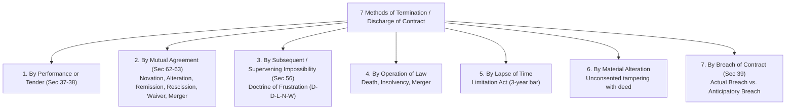
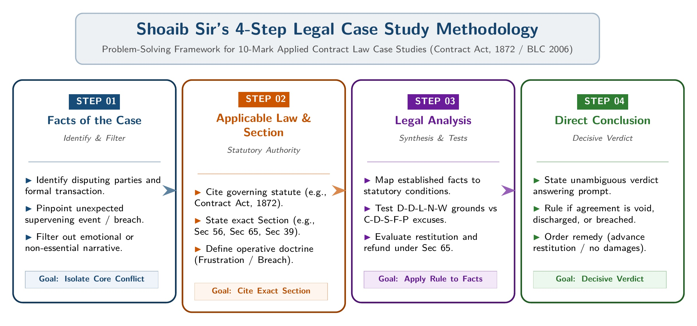
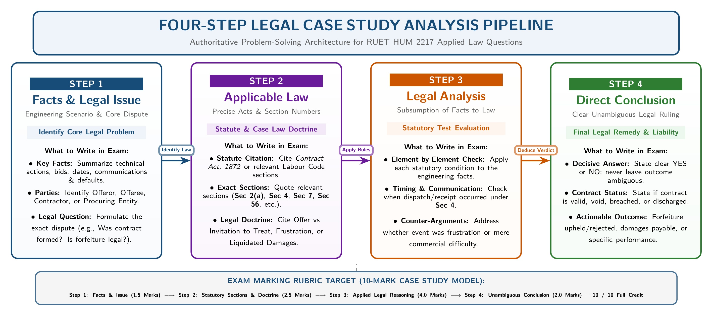

[← 02 · Ch 2 Part A (Contracts & Consideration)](02_Ch2_PartA_Contract_Essentials_Offer_and_Consideration.md) | [🏠 Master Plan](00_Last_Night_Master_Plan_and_Index.md) | [Next: 04 · Ch 3 BLC 2006 Suggested Topics →](04_Ch3_BLC2006_Suggested_Core_Topics.md)

---

# 03 · Chapter 2 (Part B): Termination of Contract, Supervening Impossibility & 10-Mark Case Studies

> [!warning] Shoaib Sir's Confirmed 10-Mark Case Study Lock (`Voice Note [01:15 - 02:22]`)
> *"Then, coming back to Contract: Methods of Termination or Discharge of Contracts. Within the topic of Termination of Contract, there was a specific concept: 'Subsequent and Supervening Impossibility'. Did you catch that? Subsequent and Supervening Impossibility. Methods of Termination of Contracts must be studied in complete detail. From that topic, you may be given an Applied Question. ... You will be given a factual Case Study. Against one case, there will be three sub-questions carrying a total of 10 marks."*

---

## 1. All 7 Methods of Termination or Discharge of Contracts

> **Exam History:** Asked directly in **2024 Q.6(c) [4 Marks]** (*"Discuss the methods of termination of a contract"*) and forms the foundation of the 10-mark case study.

When the legal obligations created by a contract come to an end, the contract is said to be **discharged** or **terminated**. Under the **Contract Act, 1872** (and SI Sir's Chapter 2 Notes), a contract may be terminated in **7 ways**:



### Method 1: Termination by Performance or Tender (`Sections 37 & 38`)
- **Actual Performance (`Sec 37`):** When all parties fulfill their respective promises according to the contract terms, the contract ends naturally and completely.
- **Offer of Performance / Tender (`Sec 38`):** If a promisor makes a valid, unconditional offer to perform his promise at the proper time and place, and the promisee refuses to accept it, the promisor is excused from further responsibility and is discharged from his obligation.

### Method 2: Termination by Mutual Agreement (`Sections 62 & 63`)
Under **Section 62**: *"If the parties to a contract agree to substitute a new contract for it, or to rescind or alter it, the original contract need not be performed."*
Termination by mutual consent occurs in **6 specific ways**:
1. **Novation (`Sec 62`):** Substituting a **new contract** in place of the old one (either between the same parties or introducing a new party, such as transferring a debt from `A` to `B` with creditor `C`'s consent). The original contract is completely discharged.
2. **Alteration (`Sec 62`):** Changing one or more material terms of the contract (e.g., changing delivery quantity or price) with the **mutual consent of all parties**.
3. **Rescission (`Sec 62`):** Cancelling all or some terms of the contract by mutual agreement before performance, or when an aggrieved party rescinds a voidable contract (`Sec 64`).
4. **Remission (`Sec 63`):** Acceptance by the promisee of a **lesser sum or lesser fulfillment** than what was originally contracted for (e.g., creditor accepting $\text{Tk. } 8,000$ in full satisfaction of a $\text{Tk. } 10,000$ debt, also called *Accord and Satisfaction*).
5. **Waiver (`Sec 63`):** Deliberate abandonment or relinquishment of a contractual right by the promisee, releasing the other party.
6. **Merger:** When an inferior right and a superior right coincide in the same person (e.g., a tenant leasing a factory building buys the building outright; the lease merges into ownership).

### Method 3: Termination by Subsequent or Supervening Impossibility (`Section 56`)
- **Initial Impossibility (`Sec 56, Para 1`):** *"An agreement to do an act impossible in itself is void."* (e.g., a promise to ride a horse to the sun; void *ab initio*).
- **Subsequent / Supervening Impossibility (`Sec 56, Para 2`: Doctrine of Frustration):**
  > *"A contract to do an act which, after the contract is made, becomes impossible, or, by reason of some event which the promisor could not prevent, unlawful, becomes void when the act becomes impossible or unlawful."*
  *(Detailed in Section 2 below with all 5 valid grounds and 5 non-qualifying excuses).*

### Method 4: Termination by Operation of Law
A contract is automatically discharged by operation of law in three cases:
1. **Death:** In contracts requiring **personal skill, talent, or service** (e.g., an artist, surgeon, or lead consulting engineer), the death of the promisor terminates the contract (`Sec 37/40`). In ordinary commercial contracts, rights and liabilities pass to the deceased's legal representatives.
2. **Insolvency:** When a court adjudges a person insolvent, their contractual rights and liabilities vest in the **Official Assignee / Official Receiver**, and the insolvent is discharged from pre-existing debts upon order of discharge.
3. **Merger:** Coincidence of an inferior right into a superior right in the same person.

### Method 5: Termination by Lapse of Time (`Limitation Act`)
Under the **Limitation Act, 1908**, a suit for breach of contract must be filed within the statutory limitation period (generally **3 years** from the date of breach). If the promisee fails to sue within that period, the legal remedy becomes **time-barred** and the debtor's liability cannot be enforced in court.

### Method 6: Termination by Unauthorized Material Alteration
If one party who holds a written contract document **materially alters** it (e.g., tampering with the amount of money payable, date of payment, place of performance, or party names) **without the consent of the other party**, the deed becomes inadmissible and the contract is immediately discharged against the non-consenting party.

### Method 7: Termination by Breach of Contract (`Section 39` & `Section 73`)
When one party breaks the contract by failing or refusing to perform, the innocent (aggrieved) party is freed from performing their part and becomes entitled to sue for **damages (`Sec 73`)**. Breach is of **2 types**:
1. **Anticipatory Breach (`Sec 39`):** Occurs **before** the scheduled date of performance when the promisor either: (i) expressly repudiates (renounces) his liability, or (ii) by his own act disables himself from performing (*Example:* `X` agrees to marry `Y` on 1st December, but marries `Z` in November; or a vendor sells the contracted custom machine to a third party before delivery day).
   - *Aggrieved Party's Two Options under `Sec 39`:* Either (a) rescind the contract immediately and sue for damages at once, OR (b) keep the contract alive until the due date of performance (at the risk of an intervening frustrating event discharging the guilty party!).
2. **Actual Breach:** Occurs **at the time when performance is due** or **during the course of performance**, when one party fails or refuses to perform (*Example:* `D` agrees to deliver 5 tons of sugar to `B` on 1st June, and fails to deliver on 1st June).

---

## 2. Deep Dive: Subsequent / Supervening Impossibility (`Section 56` · Doctrine of Frustration)

To ace the 10-mark case study, you must instantly distinguish **5 Valid Grounds of Frustration (`D-D-L-N-W`)** from **5 Non-Qualifying Excuses (`C-D-S-F-P`)**.

### 2.1 Five Valid Grounds of Supervening Impossibility (`D-D-L-N-W`)
When any of these 5 events occurs after contract formation without the promisor's fault, the contract **becomes void under Section 56(2)**, both parties are **discharged without breach**, and any advance payment must be refunded under **Section 65**:

| Code | Valid Ground of Frustration | Legal Explanation & Landmark Case |
| :-: | :--- | :--- |
| **D** | **1. Destruction of the Subject Matter** | When the specific physical object or facility essential for contract performance is destroyed without either party's fault.<br/>• *Classic Case (`Taylor v. Caldwell`):* A music hall rented for concerts burned down accidentally before the concert date. Held: Contract discharged under `Sec 56`.<br/>• *ECE Example:* A specific custom fabrication cleanroom contracted to manufacture wafers is destroyed by an earthquake. |
| **D** | **2. Death or Personal Incapacity for Personal Services** | Where a contract depends on the personal skill, health, or qualification of a specific individual, their death, severe illness, or incapacitation discharges the contract.<br/>• *Classic Case (`Robinson v. Davison`):* A pianist fell seriously ill on the day of the concert. Held: Discharged. |
| **L** | **3. Change of Law / Subsequent Illegality** | When a contract was completely legal when signed, but a subsequent Act of Parliament, government import/export ban, or regulatory order makes performance **unlawful**.<br/>• *Example:* An ECE firm contracts to import 5G radio transceivers from Country X, and the Government subsequently bans all electronics imports from Country X. |
| **N** | **4. Non-Existence / Failure of Pre-Conditions (State of Things)** | When both parties contracted on the basis of a specific future event or state of things that forms the sole foundation of the contract, and that event fails to occur.<br/>• *Classic Case (`Krell v. Henry`):* A flat was rented at a high price solely to watch the King's coronation procession; the procession was cancelled due to the King's illness. Held: Contract frustrated even though the room still physically existed. |
| **W** | **5. Outbreak of War** | When war breaks out between the parties' countries after the contract is made, trading with an alien enemy becomes unlawful and the contract is suspended or dissolved under `Sec 56`. |

---

### 2.2 Five Non-Qualifying Excuses (`C-D-S-F-P`: NOT Covered by `Sec 56`!)

> [!caution] Major Case Study Trap!
> Case studies frequently test whether a party can escape a contract by blaming inflation, a supplier's delay, or a strike. Under **Section 56**, *"impossibility"* does **NOT** mean *"commercial difficulty"*. In all 5 situations below, the contract remains **100% VALID**, and failure to perform is a **Breach of Contract (`Sec 39`)** making the party liable for **compensatory damages (`Sec 73`)**!

| Code | Non-Qualifying Excuse (NOT Frustration) | Why the Contract is NOT Discharged under `Sec 56` |
| :-: | :--- | :--- |
| **C** | **1. Commercial Hardship / Price Hikes / Loss of Profit** | A contract is not frustrated merely because raw material prices, shipping freight, or currency exchange rates rose sharply, making performance unprofitable or costly. |
| **D** | **2. Default or Failure of a Third-Party Supplier** | If Seller `A` promises to supply goods to Buyer `B` relying on Wholesaler `C`, and `C` defaults, `A` is NOT excused (unless the contract specifically named `C` as the exclusive manufacturer whose factory burned down). `A` must procure from the market or pay damages. |
| **S** | **3. Strikes, Lock-outs, and Civil Disturbances** | Labour strikes, factory lock-outs, or transport protests do not automatically frustrate a commercial contract unless specifically covered by an express *Force Majeure* clause in the contract. |
| **F** | **4. Failure of Only One Object Out of Multiple Objects** | If a contract was entered into for two or more purposes and only one fails, the contract is not frustrated (*Herne Bay Steamboat Co. v. Hutton*: boat hired both to view the naval review and to cruise around the fleet; naval review was cancelled, but fleet remained for cruising: contract NOT frustrated). |
| **P** | **5. Self-Induced Impossibility / Personal Fault** | Section 56 expressly requires *"some event which the promisor could not prevent"*. If impossibility arises from a party's own negligence, failure to renew a license, or selling the item to someone else, they are guilty of breach. |

---

### 2.3 Legal Consequences When a Contract IS Frustrated: Restitution under `Section 65`
Whenever a contract becomes void under **Section 56**, always cite **Section 65** in your 3rd sub-question:
- **Section 65 (Obligation of person who has received advantage under void agreement, or contract that becomes void):**
  > *"When an agreement is discovered to be void, or when a contract becomes void, any person who has received any advantage under such agreement or contract is bound to restore it, or to make compensation for it, to the person from whom he received it."*
- **Application:** If Buyer `B` paid $\text{Tk. } 2,00,000$ as an advance deposit to Seller `A`, and the contract becomes void under `Sec 56` (e.g., due to a government ban or factory fire), `A` cannot keep the advance! Under **Section 65**, `A` must refund the $\text{Tk. } 2,00,000$ to `B` (though neither party pays breach damages under `Sec 73`).

---

## 3. Shoaib Sir's 4-Step Answering Template for the 10-Mark Case Study


*Figure: Shoaib Sir's 4-Step Legal Reasoning Pipeline for the 10-Mark Case Study*


*Figure: Step-by-Step Contract Validity and Breach Diagnostic Flowchart*

In the exam, you will see **1 Factual Scenario** followed by **3 Sub-Questions (a), (b), and (c)** totaling **10 Marks** (typically `3 + 3 + 4 = 10` or `3 + 4 + 3 = 10`). For **each sub-question**, write these 4 bold headings:

```text
Sub-Question (a) / (b) / (c):
1. Key Facts & Legal Issue: [1-2 lines summarizing the specific dispute in this sub-question]
2. Applicable Law & Statutory Section: [Cite Contract Act, 1872 + Exact Section: e.g., Sec 56, Sec 65, Sec 39, Sec 62, Sec 73]
3. Legal Analysis: [Apply the statutory rule/ground to the characters in the scenario]
4. Direct Conclusion: [1 clear sentence stating who wins, whether the contract is void or breached, and what remedy applies]
```

---

## 4. Six Complete Solved 10-Mark Model Case Studies (Practiced for Exam Day)

Read through these 6 model cases. They cover every possible twist Shoaib Sir can set on contract termination and validity!

---

### Case Study 1: Destruction of Subject Matter + Commercial Hardship + Restitution (`Sec 56`, `Sec 65`, `Sec 73`)

> **Scenario:**
> Apex Electronics Ltd. entered into a written contract with Metro Telecom on 1st March to manufacture and supply: (Lot 1) 500 custom-fabricated RF power amplifiers from Apex's specialized Gazipur Cleanroom Plant by 1st May, and (Lot 2) 1,000 standard copper network cables by 1st May. Metro Telecom paid an advance of $\text{Tk. } 5,00,000$ for Lot 1. On 15th April, a massive accidental lightning fire completely destroyed Apex's Gazipur Cleanroom Plant, making it impossible to manufacture Lot 1. Meanwhile, the global price of copper doubled by $100\%$, and Apex refused to supply Lot 2 unless Metro Telecom paid double the contracted price.
>
> **Questions:**
> **(a)** Is Apex Electronics legally discharged from its obligation to supply Lot 1 (the 500 custom RF amplifiers)? Explain with statutory provisions. **[3 Marks]**
> **(b)** Can Apex Electronics claim termination of contract for Lot 2 (the 1,000 standard copper cables) on the ground of supervening impossibility due to the $100\%$ copper price hike? **[4 Marks]**
> **(c)** Can Metro Telecom recover the $\text{Tk. } 5,00,000$ advance paid for Lot 1, and claim damages for Lot 2? **[3 Marks]**

#### Model Answer to Case Study 1:

**Answer to Sub-Question (a): [3 Marks]**
1. **Key Facts & Legal Issue:** Apex Electronics contracted to manufacture 500 custom RF amplifiers specifically at its Gazipur Cleanroom Plant, which was accidentally destroyed by lightning before the delivery date. The issue is whether the contract for Lot 1 is discharged.
2. **Applicable Law & Statutory Section:** **Section 56 (Paragraph 2)** of the **Contract Act, 1872** (*Doctrine of Supervening Impossibility / Frustration*). Under this section, a contract to do an act which, after the contract is made, becomes impossible without the promisor's fault, becomes **void** when the act becomes impossible. Specifically, **destruction of the specific subject matter or essential facility** (*Taylor v. Caldwell*) is a valid ground of frustration.
3. **Legal Analysis:** Because Lot 1 required custom fabrication inside the specific Gazipur Cleanroom Plant, and that facility perished due to an accidental lightning fire without any negligence or fault on the part of Apex Electronics, performance became physically impossible.
4. **Direct Conclusion:** **Yes**, the contract for Lot 1 becomes **void** under **Section 56**, and Apex Electronics is completely discharged from supplying Lot 1 without any liability for breach damages.

**Answer to Sub-Question (b): [4 Marks]**
1. **Key Facts & Legal Issue:** Apex refused to supply Lot 2 (1,000 standard copper cables) because raw copper prices rose by $100\%$. The issue is whether severe price escalation constitutes supervening impossibility under `Sec 56`.
2. **Applicable Law & Statutory Section:** **Section 56** and **Section 39** of the **Contract Act, 1872**. Established legal precedent holds that *"impossibility"* under Section 56 means physical or legal impossibility, **not commercial hardship, inflation, or loss of profit**.
3. **Legal Analysis:** Standard copper cables are still available in the market and can be physically and legally supplied. A $100\%$ rise in raw material cost merely makes the contract commercially burdensome or unprofitable for Apex. Commercial hardship is a **non-qualifying excuse** and does not frustrate a contract. Apex's refusal to deliver at the agreed price constitutes an **actual/anticipatory breach of contract** under **Section 39**.
4. **Direct Conclusion:** **No**, Apex Electronics cannot claim supervening impossibility for Lot 2; the contract for Lot 2 remains valid and binding, and Apex's refusal constitutes a **breach of contract**.

**Answer to Sub-Question (c): [3 Marks]**
1. **Key Facts & Legal Issue:** Metro Telecom seeks to recover its $\text{Tk. } 5,00,000$ advance for Lot 1 and claim compensation for Apex's refusal to deliver Lot 2.
2. **Applicable Law & Statutory Section:**
   - **Section 65** of the Contract Act, 1872 (*Restitution of advantage under a contract that becomes void*).
   - **Section 73** of the Contract Act, 1872 (*Compensation for loss or damage caused by breach of contract*).
3. **Legal Analysis:**
   - Regarding **Lot 1**: Since Lot 1 became void under `Sec 56`, **Section 65** mandates that any party who has received an advantage under a contract that becomes void must restore it. Thus, Apex must refund the $\text{Tk. } 5,00,000$ advance (though Metro cannot claim extra breach damages on Lot 1).
   - Regarding **Lot 2**: Since Apex committed a breach of contract on Lot 2, Metro Telecom is entitled under **Section 73** to recover compensatory damages equal to the difference between the market price and the contract price of the 1,000 copper cables.
4. **Direct Conclusion:** Metro Telecom is legally entitled to a **full refund of $\text{Tk. } 5,00,000$ under Section 65** for Lot 1, and **compensatory breach damages under Section 73** for Lot 2.

---

### Case Study 2: Change of Law (Government Import Ban) vs. Factory Strike & Third-Party Supplier Default (`Sec 56`, `Sec 39`, `Sec 65`)

> **Scenario:**
>Orion Tech signed a contract on 1st January with Delta Power Ltd. to supply two items by 30th March: (Item A) 50 high-voltage transformers imported from Country Z, and (Item B) 200 locally assembled control panels. In February, war broke out and the Government of Bangladesh issued an official Gazette notification banning all trade and imports from Country Z. For Item B, Orion Tech's local sub-supplier failed to deliver sub-components on time, and Orion's assembly workers went on a 10-day strike demanding higher bonuses, causing Orion to fail to deliver Item B.
>
> **Questions:**
> **(a)** Examine the legal status of the contract regarding Item A (transformers from Country Z). **[3 Marks]**
> **(b)** Is Orion Tech discharged from liability regarding Item B due to its sub-supplier's default and the workers' strike? **[4 Marks]**
> **(c)** Advise Delta Power Ltd. on the legal remedies available regarding both Item A and Item B. **[3 Marks]**

#### Model Answer to Case Study 2:

**Answer to Sub-Question (a): [3 Marks]**
1. **Key Facts & Legal Issue:** Orion Tech contracted to import transformers from Country Z, after which war broke out and the Government legally banned all imports from Country Z.
2. **Applicable Law & Statutory Section:** **Section 56 (Paragraph 2)** of the **Contract Act, 1872**. Under `Sec 56`, a contract becomes **void** if, after its formation, performance becomes **unlawful** due to a **change of law** or **outbreak of war**.
3. **Legal Analysis:** Importing goods from Country Z was lawful on 1st January, but the subsequent government prohibition and outbreak of war made performance illegal. Neither party could prevent this sovereign legal ban.
4. **Direct Conclusion:** The contract for Item A is **discharged by supervening illegality/impossibility under Section 56** and becomes **void**.

**Answer to Sub-Question (b): [4 Marks]**
1. **Key Facts & Legal Issue:** Orion Tech failed to deliver Item B due to a third-party sub-supplier's default and a 10-day labour strike at its assembly plant.
2. **Applicable Law & Statutory Section:** **Section 56** and **Section 39** of the **Contract Act, 1872**. Under contract law, **default of a third-party supplier** and **labour strikes/lock-outs** are non-qualifying commercial risks and do **not** amount to supervening impossibility under `Sec 56` (in the absence of an express *Force Majeure* clause covering strikes).
3. **Legal Analysis:** Orion Tech assumed the business responsibility of procuring sub-components and managing its workforce. When its sub-supplier defaulted, Orion was obligated to source parts elsewhere. Similarly, a 10-day strike does not render performance permanently impossible.
4. **Direct Conclusion:** **No**, Orion Tech is **not discharged** regarding Item B; its failure to deliver Item B is an **actual breach of contract** under **Section 39**.

**Answer to Sub-Question (c): [3 Marks]**
1. **Key Facts & Legal Issue:** Determining Delta Power Ltd.'s legal remedies for the frustrated Item A and breached Item B.
2. **Applicable Law & Statutory Section:** **Section 65** (restitution under void contract) and **Section 73** (damages for breach of contract) of the Contract Act, 1872.
3. **Legal Analysis:**
   - For **Item A** (void under `Sec 56`): Delta Power cannot claim breach damages, but under **Section 65**, Delta Power can recover any advance money paid for Item A.
   - For **Item B** (breached under `Sec 39`): Delta Power can repudiate the obligation to pay for Item B and sue Orion Tech under **Section 73** for naturally arising monetary damages caused by the non-delivery of the 200 control panels.
4. **Direct Conclusion:** Delta Power can claim **restitution of any advance under Section 65** for Item A, and **compensatory damages for breach under Section 73** for Item B.

---

### Case Study 3: Personal Service Incapacity (`Sec 56`) vs. Failure of Pre-Conditions (`Krell v. Henry`) vs. Dual-Purpose Contract (`Herne Bay`)

> **Scenario:**
> **(i)** Dr. Rafiq, a renowned VLSI chip architect, was hired under a personal consultancy contract by SiliconBD to design a custom AI processor personally over 2 months. Two days after signing, Dr. Rafiq suffered a severe stroke and was hospitalized for 6 months.
> **(ii)** Meanwhile, SiliconBD rented a rooftop pavilion overlooking the Padma River from RiverView Ltd. for $\text{Tk. } 1,00,000$ on 16th December with the contract explicitly stating it was rented *"solely to film the National Drone Light Show"*. On 15th December, the aviation authority cancelled the Drone Light Show due to dense fog.
> **(iii)** SiliconBD also chartered a luxury boat from Marina Cruises for 16th December *"to watch the Drone Light Show and take SiliconBD's engineers on a day-long river cruise and annual dinner"*.
>
> **Questions:**
> **(a)** Is Dr. Rafiq liable for breach of contract for failing to design the AI processor? **[3 Marks]**
> **(b)** Is SiliconBD bound to pay the rent for the rooftop pavilion in situation (ii)? **[4 Marks]**
> **(c)** Can SiliconBD cancel the luxury boat charter in situation (iii) under the Doctrine of Frustration? **[3 Marks]**

#### Model Answer to Case Study 3:

**Answer to Sub-Question (a): [3 Marks]**
1. **Key Facts & Legal Issue:** Dr. Rafiq contracted to perform a personal skill-based VLSI design service but suffered a disabling stroke.
2. **Applicable Law & Statutory Section:** **Section 56** and **Section 37/40** of the **Contract Act, 1872**. Where a contract requires **personal skill, qualification, or personal service**, the **death or physical/mental incapacity** of the promisor discharges the contract (*Robinson v. Davison*).
3. **Legal Analysis:** Designing the AI processor depended specifically on Dr. Rafiq's personal expertise and could not be delegated to an ordinary substitute. His sudden stroke made personal performance impossible without his fault.
4. **Direct Conclusion:** **No**, Dr. Rafiq is not liable for breach; the consultancy contract becomes **void and is discharged under Section 56**.

**Answer to Sub-Question (b): [4 Marks]**
1. **Key Facts & Legal Issue:** The rooftop pavilion was rented *solely* to film the National Drone Light Show, which was cancelled by authorities.
2. **Applicable Law & Statutory Section:** **Section 56** (*Non-existence or failure of pre-conditions / state of things*: **Krell v. Henry**) and **Section 65** of the Contract Act, 1872.
3. **Legal Analysis:** Even though the rooftop pavilion physically still exists, the occurrence of the Drone Light Show was the **sole foundation and pre-condition** contemplated by both parties when making the contract. Its cancellation destroyed the entire foundation of the contract.
4. **Direct Conclusion:** **No**, SiliconBD is not bound to pay the rent; the contract is **frustrated and void under Section 56**, and any advance paid is refundable under **Section 65**.

**Answer to Sub-Question (c): [3 Marks]**
1. **Key Facts & Legal Issue:** The boat was chartered for **two objects**: watching the drone show AND taking engineers on a river cruise and annual dinner.
2. **Applicable Law & Statutory Section:** **Section 56** of the Contract Act, 1872 (*Failure of one object where multiple objects exist*: **Herne Bay Steamboat Co. v. Hutton**).
3. **Legal Analysis:** When a contract has multiple distinct objects and only one object fails, the entire foundation of the contract is not destroyed. SiliconBD can still use the boat for the day-long river cruise and annual engineer dinner.
4. **Direct Conclusion:** **No**, SiliconBD cannot cancel the boat charter under Section 56; the contract remains **valid and enforceable**.

---

### Case Study 4: Anticipatory Breach (`Sec 39`), Mutual Novation/Alteration (`Sec 62`), and Unauthorized Material Alteration

> **Scenario:**
> Alpha Telecom contracted with Beta Towers Ltd. on 1st May to purchase 100 steel telecom masts at $\text{Tk. } 50,000$ each, to be delivered on 1st August.
> - **Event 1:** On 1st June, Beta Towers wrote to Alpha Telecom stating: *"We have sold all our steel inventory to another buyer and will not deliver your masts on 1st August."*
> - **Event 2:** Suppose instead of suing, both companies met on 10th June and mutually signed a new agreement substituting 100 aluminum masts from Beta's sister concern in place of the original steel masts.
> - **Event 3:** Suppose in another contract deed kept in Beta's custody, Beta's manager secretly erased the price figure *"Tk. 50,000"* and wrote *"Tk. 65,000"* without Alpha Telecom's knowledge or consent.
>
> **Questions:**
> **(a)** In Event 1, what type of breach occurred on 1st June, and what two legal options does Alpha Telecom have on that date? **[4 Marks]**
> **(b)** In Event 2, how does the new agreement of 10th June affect the original contract of 1st May? **[3 Marks]**
> **(c)** In Event 3, what is the legal effect of the manager's secret change to the written contract document? **[3 Marks]**

#### Model Answer to Case Study 4:

**Answer to Sub-Question (a): [4 Marks]**
1. **Key Facts & Legal Issue:** Beta Towers renounced its obligation on 1st June, two months before the scheduled delivery date of 1st August.
2. **Applicable Law & Statutory Section:** **Section 39** of the **Contract Act, 1872** (*Anticipatory Breach of Contract*).
3. **Legal Analysis:** When a party repudiates its liability or disables itself from performing **before** the performance due date, an **Anticipatory Breach** occurs. Under **Section 39**, the aggrieved party (Alpha Telecom) has **two legal options**:
   - **Option 1 (Immediate Rescission):** Treat the contract as immediately terminated on 1st June and sue Beta Towers at once for breach damages under `Sec 73`.
   - **Option 2 (Wait Until Due Date):** Keep the contract alive until 1st August and give Beta Towers a chance to perform (though if a supervening impossibility like a government ban occurs before 1st August, Beta Towers will be excused under `Sec 56`).
4. **Direct Conclusion:** An **anticipatory breach under Section 39** occurred on 1st June, giving Alpha Telecom the option to either **sue immediately** or **wait until 1st August**.

**Answer to Sub-Question (b): [3 Marks]**
1. **Key Facts & Legal Issue:** Both parties mutually agreed on 10th June to substitute a new contract (aluminum masts / sister concern) for the old contract.
2. **Applicable Law & Statutory Section:** **Section 62** of the **Contract Act, 1872** (*Discharge by Mutual Agreement: Novation / Alteration*).
3. **Legal Analysis:** Under **Section 62**, when the parties to a contract agree to substitute a new contract for it (**Novation**) or alter its terms (**Alteration**) with mutual consent, the original contract need not be performed.
4. **Direct Conclusion:** The original contract of 1st May is **completely discharged by Novation/Alteration under Section 62**, and only the new agreement of 10th June is enforceable.

**Answer to Sub-Question (c): [3 Marks]**
1. **Key Facts & Legal Issue:** Beta's manager unilaterally altered the contract price on the deed from $\text{Tk. } 50,000$ to $\text{Tk. } 65,000$ without Alpha's consent.
2. **Applicable Law & Statutory Section:** **Termination by Unauthorized Material Alteration** under the Law of Contract.
3. **Legal Analysis:** Changing the price payable is a **material alteration** because it alters the core financial rights and liabilities of the parties. Tampering with a written deed without the other party's consent renders the document inadmissible in evidence and voids the contract from the moment of alteration.
4. **Direct Conclusion:** The contract is **discharged and rendered void/unenforceable** against Alpha Telecom due to unauthorized material alteration; Beta Towers cannot enforce it.

---

### Case Study 5: Consideration Rules (`Sec 2(d)`) & Statutory Exceptions (`Sec 25(1)`, `Sec 25(2)`, `Sec 25(3)`)

> **Scenario:**
> Consider the following three independent disputes involving Mr. Arman, the Managing Director of an electronics firm:
> - **Incident 1:** While Mr. Arman was abroad, a sudden flood threatened his private warehouse. A neighbor, Mr. Tareq, voluntarily spent $\text{Tk. } 25,000$ of his own money to hire labourers and save Mr. Arman's equipment. Upon returning, Mr. Arman was grateful and promised in writing (or orally) to pay Mr. Tareq $\text{Tk. } 30,000$, but later refused to pay, claiming he never asked Tareq to do the work.
> - **Incident 2:** Mr. Arman orally promised to gift his younger brother $\text{Tk. } 5,00,000$ out of natural love and affection to start a robotics lab, but later changed his mind and refused to pay.
> - **Incident 3:** Mr. Arman owed $\text{Tk. } 2,00,000$ to a supplier, which had become barred by the Limitation Act after 3 years. Last month, Mr. Arman sent a signed letter to the supplier promising to pay $\text{Tk. } 1,00,000$ in settlement of the old debt, but now refuses to pay.
>
> **Questions:**
> **(a)** In Incident 1, can Mr. Tareq legally recover the $\text{Tk. } 30,000$ promised by Mr. Arman? **[4 Marks]**
> **(b)** In Incident 2, can Mr. Arman's younger brother sue him to recover the $\text{Tk. } 5,00,000$? **[3 Marks]**
> **(c)** In Incident 3, is Mr. Arman legally bound to pay the $\text{Tk. } 1,00,000$? **[3 Marks]**

#### Model Answer to Case Study 5:

**Answer to Sub-Question (a): [4 Marks]**
1. **Key Facts & Legal Issue:** Mr. Tareq voluntarily saved Mr. Arman's warehouse without a prior request, and Mr. Arman subsequently promised to pay him $\text{Tk. } 30,000$. The issue is whether a subsequent promise to compensate for a past voluntary service is enforceable without fresh consideration.
2. **Applicable Law & Statutory Section:** **Section 25(2)** of the **Contract Act, 1872** (*Exception to "No consideration, no contract": Promise to compensate for past voluntary service*).
3. **Legal Analysis:** Although **Section 2(d)** normally requires consideration to move *"at the desire of the promisor"*, **Section 25(2)** carves out a statutory exception: a promise to compensate, wholly or in part, a person who has already **voluntarily done something for the promisor** is a valid, binding contract even without prior request. Since Tareq voluntarily saved Arman's property and Arman subsequently promised to pay $\text{Tk. } 30,000$, all requirements of `Sec 25(2)` are satisfied.
4. **Direct Conclusion:** **Yes**, Mr. Tareq can legally enforce the promise under **Section 25(2)** and recover $\text{Tk. } 30,000$ from Mr. Arman.

**Answer to Sub-Question (b): [3 Marks]**
1. **Key Facts & Legal Issue:** Mr. Arman made an **oral** promise without consideration to give $\text{Tk. } 5,00,000$ to his brother out of natural love and affection.
2. **Applicable Law & Statutory Section:** **Section 25** and **Section 25(1)** of the **Contract Act, 1872**. Under `Sec 25`, an agreement without consideration is void unless it meets all four conditions of **Section 25(1)**: (i) expressed in **writing**, (ii) **registered** under the law for registration of documents, (iii) made on account of **natural love and affection**, and (iv) between parties standing in a **near relation** to each other.
3. **Legal Analysis:** Although Arman and his brother stand in a near relation and the promise was motivated by natural love and affection, the promise was **purely oral** and was neither put in writing nor registered.
4. **Direct Conclusion:** **No**, the younger brother cannot sue to recover the $\text{Tk. } 5,00,000$; the oral promise is **void for want of consideration under Section 25**.

**Answer to Sub-Question (c): [3 Marks]**
1. **Key Facts & Legal Issue:** Mr. Arman signed a written letter promising to pay $\text{Tk. } 1,00,000$ toward a time-barred debt of $\text{Tk. } 2,00,000$.
2. **Applicable Law & Statutory Section:** **Section 25(3)** of the **Contract Act, 1872** (*Promise to pay a time-barred debt*).
3. **Legal Analysis:** Under **Section 25(3)**, a promise to pay, wholly or in part, a debt of which the creditor might have enforced payment but for the law for the limitation of suits is a valid and enforceable contract if it is made **in writing and signed** by the debtor (or his authorized agent). Since Mr. Arman signed a written letter promising to pay $\text{Tk. } 1,00,000$, the promise satisfies `Sec 25(3)`.
4. **Direct Conclusion:** **Yes**, Mr. Arman is legally bound under **Section 25(3)** to pay the $\text{Tk. } 1,00,000$ to the supplier.

---

### Case Study 6: Capacity of Minor (`Sec 11`), Coercion (`Sec 15 & 19`), and Restraint of Trade (`Sec 27`)

> **Scenario:**
> **(i)** Sadman, a brilliant 16-year-old student, misrepresented his age as 19 and signed a contract with ElectroMart to purchase $\text{Tk. } 80,000$ worth of luxury gaming consoles on credit, and later refused to pay.
> **(ii)** Mr. Kabir threatened to shoot Mr. Hasan unless Mr. Hasan signed a deed selling his electronics shop worth $\text{Tk. } 50,00,000$ for only $\text{Tk. } 5,00,000$. Out of fear for his life, Mr. Hasan signed the deed.
> **(iii)** TechCorp hired an ECE graduate, Nabil, with a clause in his employment contract stating: *"If Nabil ever leaves TechCorp, he shall not work for any electronics or software company anywhere in Bangladesh for 10 years."*
>
> **Questions:**
> **(a)** Can ElectroMart sue 16-year-old Sadman for breach of contract to recover the $\text{Tk. } 80,000$? **[3 Marks]**
> **(b)** What is the legal status of the sale deed signed by Mr. Hasan in situation (ii), and what remedy does he have? **[4 Marks]**
> **(c)** Is the 10-year post-employment ban against Nabil in situation (iii) legally enforceable by TechCorp? **[3 Marks]**

#### Model Answer to Case Study 6:

**Answer to Sub-Question (a): [3 Marks]**
1. **Key Facts & Legal Issue:** Sadman (aged 16, a minor under 18) bought luxury gaming consoles on credit by misrepresenting his age. The issue is whether a minor's agreement is enforceable.
2. **Applicable Law & Statutory Section:** **Section 10** and **Section 11** of the **Contract Act, 1872** (*Mohori Bibee v. Dharmodas Ghose*). Under `Sec 11`, only a person who has attained the age of majority (**18 years**) is competent to contract; any agreement with a minor is **void *ab initio*** (completely void from the beginning).
3. **Legal Analysis:** Because Sadman is only 16 years old, he lacks legal capacity under `Sec 11`. Even if a minor misrepresents his age, the law of estoppel does not apply against a minor to turn a void agreement into a valid contract (and luxury gaming consoles are not basic life necessaries under `Sec 68`).
4. **Direct Conclusion:** **No**, ElectroMart cannot sue Sadman for breach of contract; the agreement with a minor is **void *ab initio* under Section 11**.

**Answer to Sub-Question (b): [4 Marks]**
1. **Key Facts & Legal Issue:** Mr. Kabir forced Mr. Hasan to sign a sale deed at a tenth of its value by threatening to shoot him.
2. **Applicable Law & Statutory Section:** **Section 14** (Free Consent), **Section 15** (Coercion), and **Section 19** (Voidability of agreements without free consent) of the **Contract Act, 1872** (alongside **Section 25 Explanation 2** on gross inadequacy of consideration as evidence of lack of free consent).
3. **Legal Analysis:** Threatening to shoot someone is an act forbidden by the Penal Code done with the intention of causing a person to enter into an agreement, which constitutes **Coercion under Section 15**. Under **Section 19**, when consent to an agreement is caused by coercion, the contract is **voidable at the option of the aggrieved party** whose consent was so caused (Mr. Hasan).
4. **Direct Conclusion:** The contract is a **Voidable Contract under Section 2(i) and Section 19**, and Mr. Hasan has the legal right to **rescind (cancel) the sale deed** and recover his shop.

**Answer to Sub-Question (c): [3 Marks]**
1. **Key Facts & Legal Issue:** TechCorp placed a post-employment covenant barring Nabil from working in his profession anywhere in Bangladesh for 10 years after leaving the company.
2. **Applicable Law & Statutory Section:** **Section 27** of the **Contract Act, 1872** (*Agreement in restraint of trade is void*).
3. **Legal Analysis:** Under **Section 27**, every agreement by which anyone is restrained from exercising a lawful profession, trade, or business of any kind is **to that extent void** (the only statutory exception being the sale of business goodwill within reasonable local limits). A blanket 10-year ban preventing an engineer from earning his livelihood after leaving employment is an unlawful restraint of trade.
4. **Direct Conclusion:** **No**, the 10-year post-employment restriction is **expressly void and unenforceable under Section 27**.

---

[← 02 · Ch 2 Part A (Contracts & Consideration)](02_Ch2_PartA_Contract_Essentials_Offer_and_Consideration.md) | [Next: 04 · Ch 3 BLC 2006 Suggested Topics →](04_Ch3_BLC2006_Suggested_Core_Topics.md)
