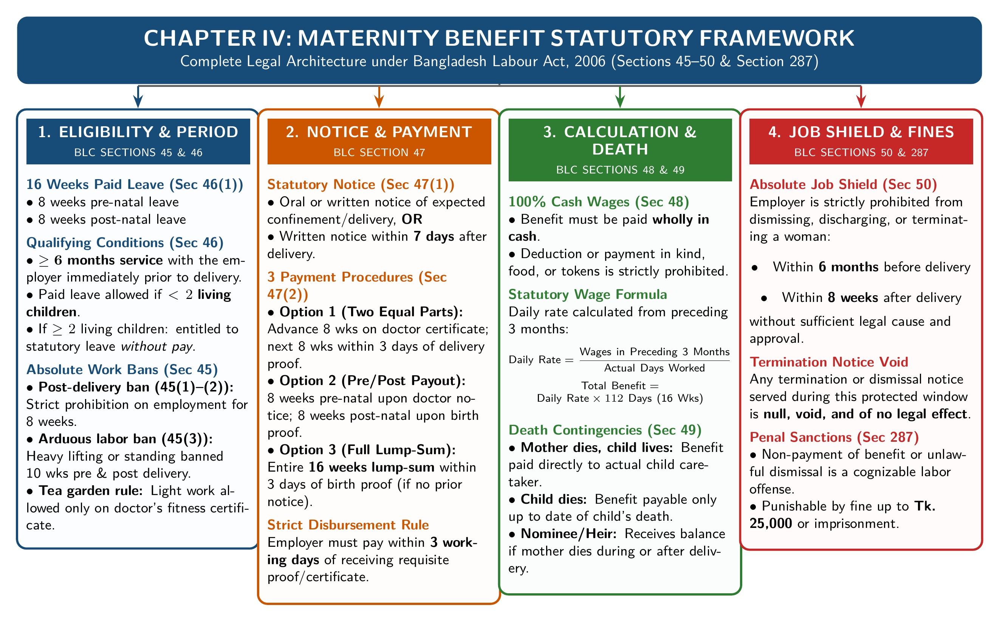

[← 03 · Ch 2 Part B (Termination & Case Studies)](03_Ch2_PartB_Termination_Frustration_and_10Mark_Case_Studies.md) | [🏠 Master Plan & Index](00_Last_Night_Master_Plan_and_Index.md) | [Next: 05 · Ch 4 Trade Union, CBA & Disputes →](05_Ch4_Trade_Union_CBA_Disputes_and_Applied_Scenarios.md)

---

# Chapter 3: The Bangladesh Labour Code, 2006 (Easy Lecture-Note Version)

> [!tip] How to Study Chapter 3 Easily
> Shoaib Sir cut out almost 70% of Chapter 3! You only need **5 short topics**:
> 1. **Short Definitions** (Slides 2–7: *no section numbers needed on slides!*)
> 2. **Maternity Benefits (`Sections 45 to 50`)**
> 3. **Fire Safety ONLY (`Section 62`: *Precaution in case of fire*)**
> 4. **Adolescent Working Hours ONLY (`Section 41`)**
> 5. **Welfare Measures (`Sections 89 to 94 & 99`)**

---

## Topic 1: Short Definitions (Slides 2 to 7)

*(Just write the plain meaning from Sir's slides: no complex sub-section numbers needed!)*

1. **Bangladesh Labour Code, 2006 (Slide 2):**
   It is the main law in Bangladesh passed to combine and update all rules regarding:
   - Employing workers and employer-worker relations,
   - Fixing minimum wages and paying wages on time,
   - Paying compensation for workplace injuries,
   - Forming trade unions and settling industrial disputes, and
   - Ensuring the **health, safety, welfare, and working conditions** of workers.

2. **Factory (Slide 3):**
   *"Factory"* means any building or premises where **5 or more workers** work on any day of the year, and in any part of which a **manufacturing process** is carried on (but it **does not include a mine**).

3. **Worker (Slide 4):**
   *"Worker"* means any person (including an **apprentice**) employed directly or through a contractor in an industry to do any **skilled, unskilled, manual, technical, trade promotional, or clerical work** for pay.
   - **Who is NOT a worker?** Anyone employed mainly in a **managerial or administrative** post.

4. **Manufacturing Process (Slides 5–6):**
   Means any of these **5 activities** done for trade or business:
   1. **Making, altering, repairing, painting, washing, packing**, or treating any article for use or sale;
   2. **Pumping** oil, gas, water, or sewage;
   3. **Generating, transforming, or transmitting** power (electricity) or gas;
   4. **Building, repairing, or breaking up** ships or vessels;
   5. **Printing** (by press, computer, or offset) or **book-binding**.

5. **Age Categories (Slide 7):**
   - **Child:** Has **not completed 14 years** of age (under 14).
   - **Adolescent:** Has completed **14 years** but has **not completed 18 years** ($14\text{ to under }18$).
   - **Adult:** Has completed **18 years** of age ($18\text{ or older}$).
   - **Minor:** Has **not completed 18 years** of age (under 18).

---

## Topic 2: Maternity Welfare Facilities (`Sections 45 to 50` · Slide 10)

*Figure: The 6 Sections of Maternity Benefits (`Sections 45–50`)*

First, draw this **6-row table from Slide 10**, then write 2 easy lines for each section:

| Section | Topic Name (From Slide 10) | Easy Points to Write in Exam |
| :---: | :--- | :--- |
| **`Sec 45`** | Prohibition of woman workers in certain cases | 1. **No work for 8 weeks after delivery:** An employer cannot employ a woman (and she cannot work) during the **8 weeks immediately after giving birth**. 2. **No heavy work for 10 weeks:** No heavy/arduous work or long standing for **10 weeks before** or **10 weeks after** delivery. *(Tea garden worker can do light work if certified fit by the estate doctor, getting normal pay + maternity benefit).* |
| **`Sec 46`** | Right to, and liability for, payment of maternity benefit | 1. **16 Weeks Paid Leave:** Every woman worker gets **8 weeks before delivery + 8 weeks after delivery = 16 weeks (112 days)** of paid maternity benefit. 2. **6 Months Service Rule:** She must have worked under that employer for **at least 6 months** before delivery. 3. **2 Surviving Children Rule:** If she already has **2 or more living children**, she gets **no cash benefit**, but she still gets **unpaid maternity leave**. |
| **`Sec 47`** | Procedure regarding payment of maternity benefit | 1. **Notice:** She can give **oral or written notice** before delivery (or **within 7 days** after giving birth) and name a **nominee**. 2. **3 Payment Options (her choice):** Employer must pay **within 3 working days** of doctor certificate/birth proof:    • *(a)* 8 weeks pay before birth + 8 weeks pay after birth;    • *(b)* Pay up to delivery day + remaining pay within 8 weeks; OR    • *(c)* **Full 16 weeks paid together** within 3 working days after birth. 3. **Birth Proof:** Birth certificate or doctor's certificate must be submitted **within 3 months** of delivery. |
| **`Sec 48`** | Amount of maternity benefit | 1. Paid **fully in cash**. 2. **Formula:** $\text{Daily Average Pay} = \frac{\text{Total wages earned in last 3 months}}{\text{Total days she actually worked in those 3 months}}$.    *(Multiply Daily Average Pay by $112\text{ days}$ for 16 weeks total).* |
| **`Sec 49`** | Payment in case of the death of a woman | 1. **If she dies during/after delivery** (within 8 weeks [8 months in handout]):    • If the **baby survives** $\to$ money is paid to the **person taking care of the baby**.    • If the **baby also dies** $\to$ money is paid to her **nominee** (or family/legal heir). 2. **If she dies before delivery:** Employer pays up to the day of death (and cannot ask back any extra money already paid in advance). |
| **`Sec 50`** | Restriction on termination of employment | If an employer fires or dismisses a woman **without a valid reason** within **6 months before** or **8 weeks after** her delivery, she **still gets her full maternity benefit**. |

---

## Topic 3: Safety of Workers: FIRE SAFETY ONLY (`Section 62` · *Precaution in case of fire*)

> [!warning] Shoaib Sir's Voice Note (`[02:40]`):
> *"Under Safety, study ONLY Fire Safety: that one section: **`Section 62` (Precaution in case of fire)**. Nothing else!"*

*Figure: The 8 Easy Points of Section 62 (Precaution in Case of Fire)*

Under **Section 62** of the Bangladesh Labour Code, 2006, every factory/establishment must follow these **8 simple fire safety rules**:

1. **Alternative Stairway & Fire Extinguishers:** Every floor must have **at least 1 alternative connecting stairway**, emergency fire escapes, and firefighting equipment.
2. **Inspector's Written Order:** If the Labour Inspector sees that fire escapes are missing, he can give a **written order** telling the employer what to fix by a set date.
3. **Unlocked Doors Opening Outwards:**
   - Room exit doors must **never be locked or bolted from inside** while anyone is working in the room.
   - All exit doors (unless sliding) must **open outwards** and must never be blocked.
4. **Fire Exits Marked in Red Bangla Letters:** Every fire-escape door or window must be clearly marked in **Bangla in red letters** (*জরুরী নির্গমন পথ*) or with a clear sign.
5. **Clearly Audible Whistle / Fire Alarm:** A loud, **clearly audible whistle or fire alarm** must be provided to warn all workers in case of fire.
6. **Clear & Unblocked Passageways:** Every room must keep a **free, unblocked path** leading to the fire exits.
7. **Escape Training (If $> 10$ Workers Above Ground Floor):** If **more than 10 workers** work above the ground floor, or if **explosives/flammables** are kept, all workers must be **trained in how to escape** during a fire.
8. **Mock Fire-Fighting Drill (If $\ge 50$ Workers):** In factories with **50 or more workers**, the employer must organize a **mock fire-fighting drill** at least **once a year** *(updated to **once every 6 months** in the amended law)* and keep a **record book**.

---

## Topic 4: Working Hours for Adolescents ONLY (`Section 41`)

> [!warning] Shoaib Sir's Voice Note (`[03:00]`):
> *"For Adolescents, study ONLY **`Section 41` (Working hours for adolescents)**. Skip all other adolescent sections!"*

*Figure: Working Hour Limits for Adolescents (`Section 41`)*

An **Adolescent** is a worker aged **14 to under 18 years**. Under **Section 41**, there are **8 simple rules** for their working hours:

1. **In a Factory or Mine:** Maximum **5 hours per day** and **30 hours per week**.
2. **In Any Other Establishment (Shop/Office):** Maximum **7 hours per day** and **42 hours per week**.
3. **No Night Work:** Adolescents cannot work between **7:00 PM and 7:00 AM**.
4. **Limit with Overtime:** If they do overtime, total working hours (including overtime) cannot cross:
   - **36 hours per week** in a factory or mine;
   - **48 hours per week** in any other establishment.
5. **Maximum 2 Shifts:** Work is limited to **at most 2 shifts**, and each shift cannot spread over more than **7.5 hours ($7\frac{1}{2}\text{ hours}$)**.
6. **Relay Change Limit:** An adolescent can work in only 1 relay, which cannot be changed more than **once in 30 days** without the Inspector's written permission.
7. **Mandatory Weekly Holiday:** Weekly holiday rules apply strictly to adolescents, and **no exemption** is allowed.
8. **No Double Employment:** An adolescent cannot work in **more than 1 establishment** on the same day.

---

## Topic 5: Welfare Measures of Workers (`Sections 89 to 94 & 99` · Slide 12)

*Figure: Worker Numbers Required for Welfare Facilities (`Sections 89–99`)*

First draw the **7-row table from Slide 12**, then write the simple worker numbers:

| Section | Welfare Facility (From Slide 12) | Worker Number & Simple Rules to Write |
| :---: | :--- | :--- |
| **`Sec 89`** | **First-aid appliances** | • **1 Box per 150 Workers:** Easy-to-reach first-aid boxes: at least **1 box for every 150 workers**. • **Trained Person with Badge:** Kept under a trained first-aid person whose name is posted in the room and who wears a **badge**. • **Sick Room & Dispensary ($\ge 300$ Workers):** If **300 or more workers** work there, the employer must provide a **sick room with a dispensary** under medical and nursing staff. |
| **`Sec 90`** | **Maintenance of Safety Record Book** | • **More than 25 Workers ($> 25$):** Every factory with **more than 25 workers** must keep a **Safety Record Book** and display a **Safety Board**. |
| **`Sec 91`** | **Washing facilities** | • **All Establishments:** Clean, easy-to-reach washing and bathing facilities must be provided. • **Separate & Screened:** Separate facilities with privacy screens must be provided for **male and female workers**. |
| **`Sec 92`** | **Canteens** | • **More than 100 Workers ($> 100$):** Must provide an adequate number of **canteens**. • **Managing Committee:** A committee (including **worker representatives**) decides the food menu and food prices. |
| **`Sec 93`** | **Shelters, etc. (Rest & Lunch Rooms)** | • **More than 50 Workers ($> 50$):** Must provide clean, cool, well-ventilated **rest shelters and a lunch room with drinking water**. • **No Eating in Workroom:** Once a lunch room is provided, workers cannot eat inside the workroom. • **For Female Workers:** If **more than 25 female workers** $\to$ **separate shelter room**; if **less than 25 female workers** $\to$ **separate space with screens**. |
| **`Sec 94`** | **Rooms for children (Crèche)** | • **40 or More Female Workers ($\ge 40$):** Must provide a clean, ventilated children's room for their **children under 6 years old**. • **Trained Woman & Safe Place:** Looked after by a **trained woman**, built with waterproof/heat-proof walls, and kept away from smoke, dust, or loud noise. • **Room Size:** Ceiling height at least **$360\text{ cm}$**, and floor space at least **$600\text{ sq. cm}$** *(6000 sq. cm in Act)* per child. • **Items Inside:** **1 cot/cradle with bedding** per child, **1 chair** per mother to feed her child, **toys**, and a **fenced shady playground** outside. |
| **`Sec 99`** | **Compulsory Group Insurance** | • **At least 200 Permanent Workers** *(100 in amended law)*: The employer must arrange **compulsory group insurance** for the workers. |

---

## Topic 6: Easy Answers for Past Exam Questions on Chapter 3

### 1. Responsibilities of Employers & Employees for Safety `[2023 Q.2(c) | 4 Marks]`
- **Employer's Duties:** (1) Keep factory buildings safe and fence dangerous machines (`Sec 61–63`), (2) Keep fire exit doors unlocked and opening outwards (`Sec 62`), (3) Install fire alarms, extinguishers, and red Bangla exit signs, (4) Hold fire drills and provide safety gear (PPE).
- **Workers' Duties:** (1) Join fire drills and follow safety rules, (2) Never block fire exits or hallways, (3) Wear safety gear/gloves properly, (4) Report any broken wire, machine fault, or fire risk to the supervisor immediately.

### 2. How BLC 2006 Fixes Factory Problems `[2025 Law-CT2 Q.1 | 10 Marks]`
If a question says a factory has **(1) long working hours, (2) unsafe machines, (3) poor fire safety, and (4) poor welfare**, just write 3 lines from each topic above:
1. **Working Hours:** For adolescents (`Sec 41`), max **5 hrs/day and 30 hrs/week** in factories (no night work 7 PM–7 AM). For adults (`Sec 100–108`), max **8 hrs/day and 48 hrs/week**, with **double pay** for overtime and a weekly holiday (`Sec 103`).
2. **Unsafe Machines (`Sec 61–65`):** Moving machine parts and motors must be **fenced with guards (`Sec 63`)**, workers must wear tight clothes (`Sec 64`), and emergency **power cut-off switches (`Sec 65`)** must be installed.
3. **Fire Safety (`Sec 62`):** Alternative stairway on every floor, unlocked doors opening outwards, red Bangla exit signs, loud whistle/alarm, unblocked paths, escape training ($>10$ workers), and mock fire drills ($\ge 50$ workers).
4. **Welfare (`Sec 89–94`):** First-aid box (`1 per 150` workers) & sick room ($\ge 300$ workers, `Sec 89`), washing rooms (`Sec 91`), rest & lunch room ($>50$ workers, `Sec 93`), canteen ($>100$ workers, `Sec 92`), and children's room ($\ge 40$ women, `Sec 94`).

---

[← 03 · Ch 2 Part B (Termination & Case Studies)](03_Ch2_PartB_Termination_Frustration_and_10Mark_Case_Studies.md) | [🏠 Master Plan & Index](00_Last_Night_Master_Plan_and_Index.md) | [Next: 05 · Ch 4 Trade Union, CBA & Disputes →](05_Ch4_Trade_Union_CBA_Disputes_and_Applied_Scenarios.md)
