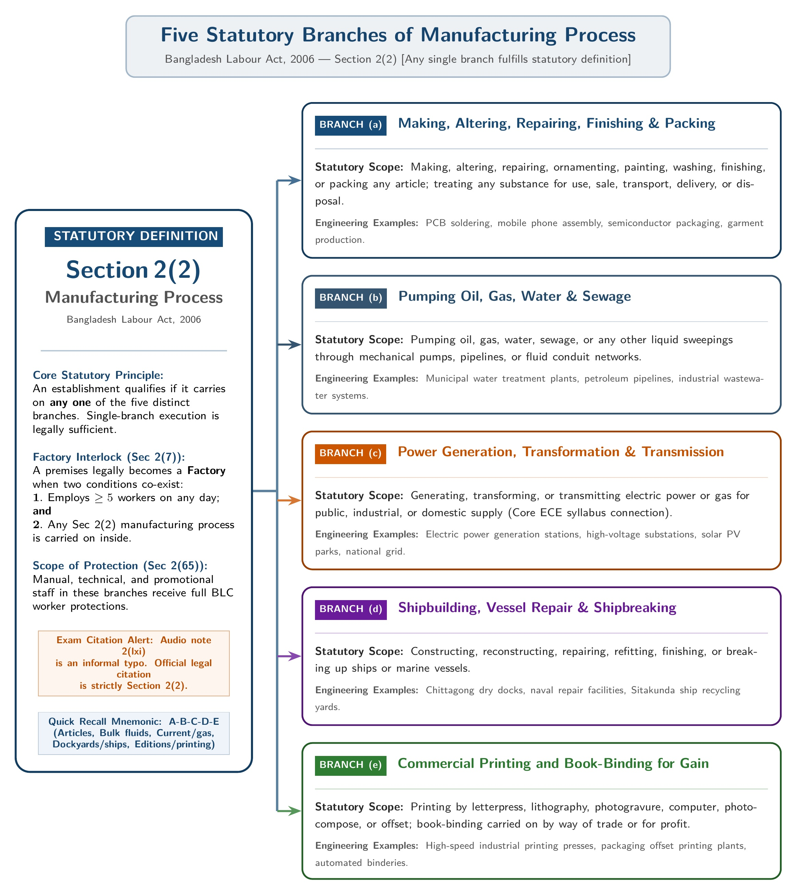
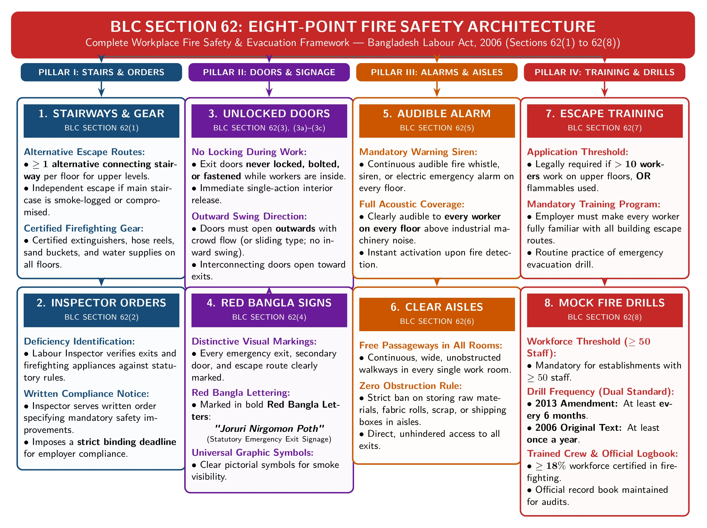
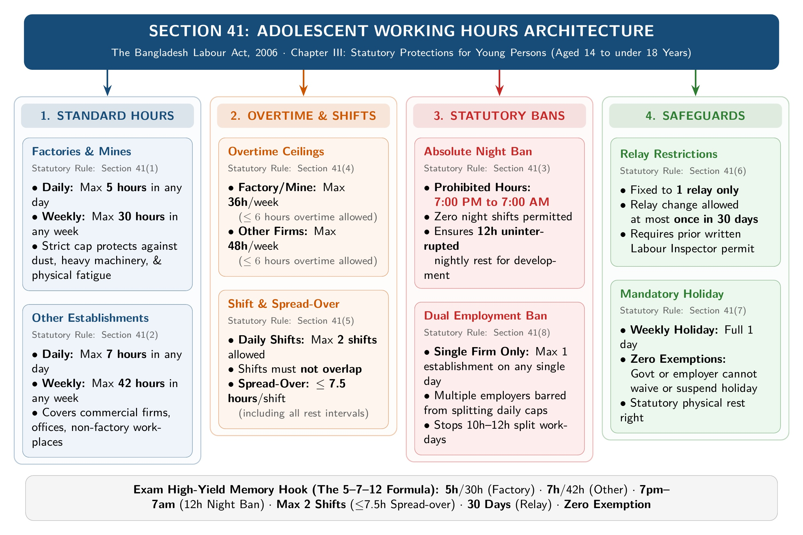
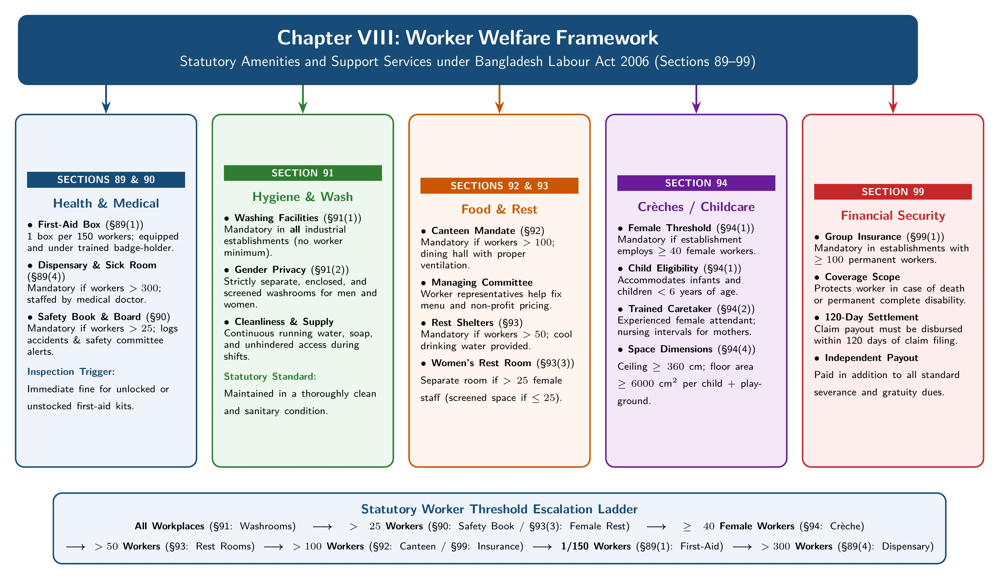
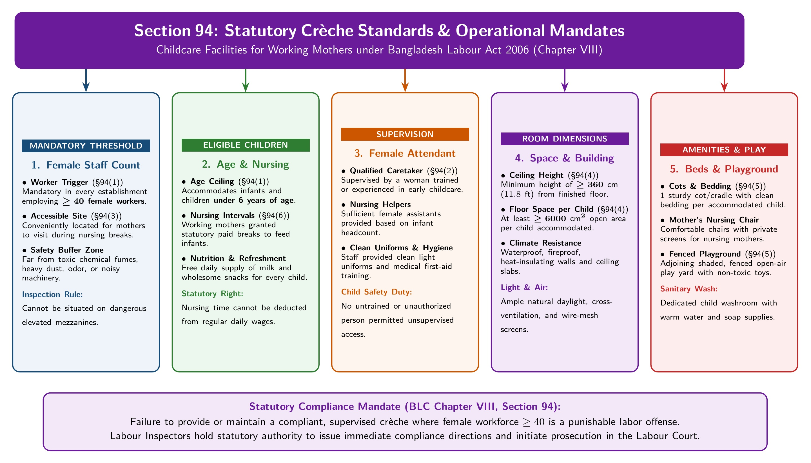
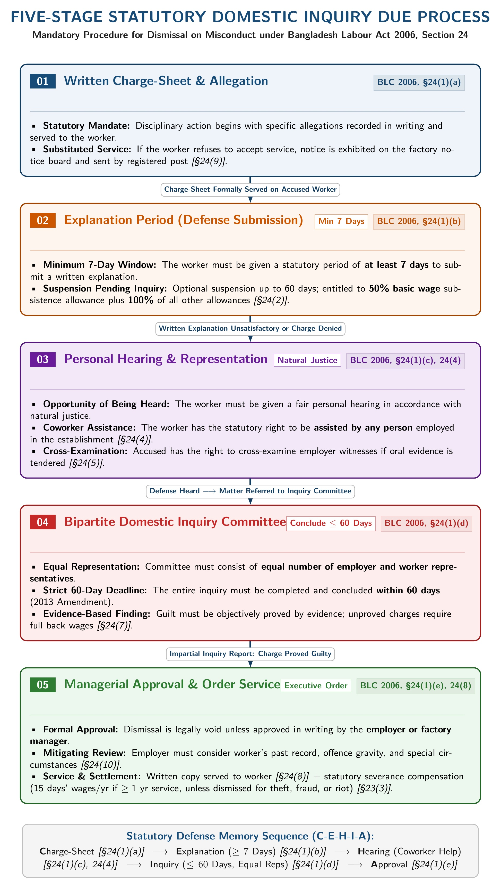
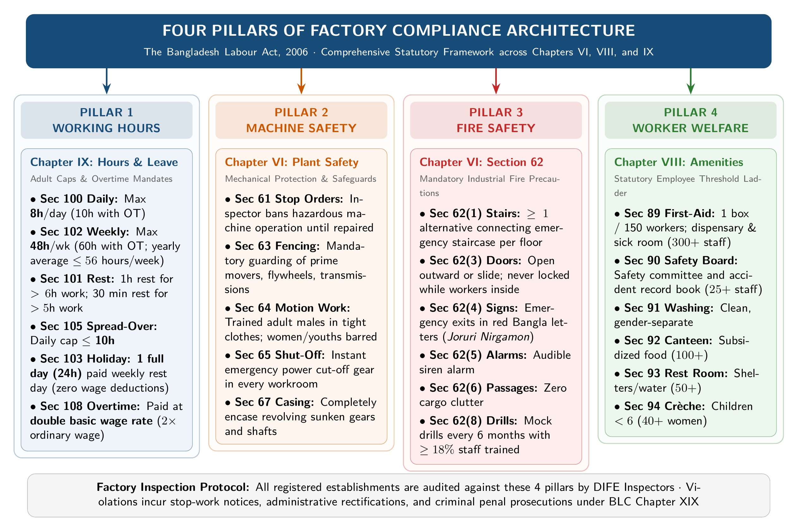
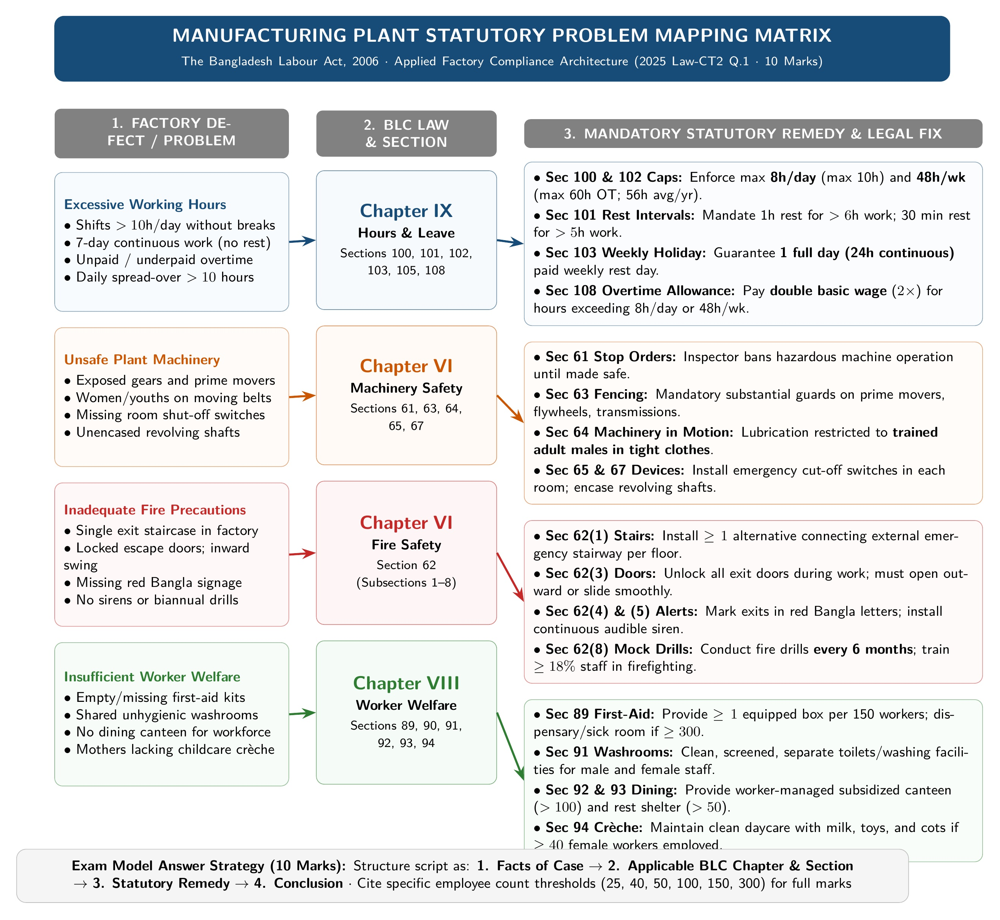

[← 03 · Ch 2 Part B (Termination & Case Studies)](03_Ch2_PartB_Termination_Frustration_and_10Mark_Case_Studies.md) | [🏠 Master Plan](00_Last_Night_Master_Plan_and_Index.md) | [Next: 05 · Ch 4 Trade Union, CBA & Disputes →](05_Ch4_Trade_Union_CBA_Disputes_and_Applied_Scenarios.md)

---

# 04 · Chapter 3: The Bangladesh Labour Code, 2006 (Strictly Narrowed Exam Scope)

> [!important] Shoaib Sir's Exact Voice Note Summary for Chapter 3 (`[05:05 - 06:40]`)
> *"So, what did I prescribe from Chapter 3? Let me summarize:*
> *1. Maternity Benefits (`Sec 45–50`).*
> *2. Precaution in case of fire (Fire Safety ONLY · `Sec 62`).*
> *3. Working hours for adolescents (ONLY working hours · `Sec 41`).*
> *4. Welfare Measures (`Sec 89, 90, 91, 92, 93, 94`).*
> *5. Short Questions and Definitions from the start of the slides: Worker, Factory, Manufacturing Process, What is Labour Code, and Age Categories."*
>
> **Do NOT waste time tonight** reading machinery fencing (`Sec 63`), cranes/hoists (`Sec 68–69`), pressure plants (`Sec 71`), adult working hours (`Sec 100–113`), or young person fitness certificates (`Sec 34–40`). Everything you need for Chapter 3 is in this single file!

---

## Topic 1: Fundamental Short Definitions (`Section 2` & Slide Intro)

> **Exam History:** Asked in **2023 Q.1(a) [2 Marks]** (*"Define factory and worker according to Bangladesh labor code 2006"*) and explicitly named by Shoaib Sir at `[06:15 - 06:40]`.

### 1.1 What is the Bangladesh Labour Code, 2006?
- **Official Title:** *The Bangladesh Labour Act, 2006 (Act XLII of 2006)*, comprising **326 sections** across 21 chapters.
- **Statutory Scope & Objective (Verbatim from SI Sir's Notes):**
  It is an Act to **amend and consolidate** the laws relating to:
  1. Employment of workers and relations between workers and employers,
  2. Determination of minimum rates of wages and payment of wages,
  3. Compensation for injuries to workers during working hours,
  4. Formation of trade unions and raising/settlement of industrial disputes,
  5. Health, safety, welfare, and working conditions/environment of workers, and
  6. Apprenticeship and ancillary matters.

### 1.2 Definition of Factory (`Section 2(7)` / `2(vii)`)
- **Statutory Definition:**
  > *"Factory"* means any precincts or premises where **five (5) or more workers** ordinarily work on any day of the year, and in any part of which a **manufacturing process** is carried on, **but does not include a mine**.
- **3 Key Elements to Highlight in Exam:**
  1. **Headcount Threshold:** Minimum **$\ge 5$ workers** working on any single day of the year.
  2. **Activity Requirement:** A *manufacturing process* (`Sec 2(2)`) must be carried out in any part of the premises.
  3. **Statutory Exclusion:** Explicitly **excludes a mine**.

### 1.3 Definition of Worker (`Section 2(65)` / `2(lxv)`)
- **Statutory Definition:**
  > *"Worker"* means any person, **including an apprentice**, employed in any establishment or industry, either **directly or through a contractor**, to do any **skilled, unskilled, manual, technical, trade promotional, or clerical work** for hire or reward, whether the terms of employment are expressed or implied, **but does not include** a person employed mainly in a **managerial or administrative** (or supervisory) capacity.

### 1.4 Definition of Manufacturing Process (`Section 2(2)`)
*(Note: Voice note summary printed `2(lxi)`, while the official BLC 2006 clause is `Section 2(2)`: write `Section 2(2)`).*

*Figure: The 5 Statutory Branches of "Manufacturing Process" under BLC 2006 Section 2(2)*

Under **Section 2(2)**, *"Manufacturing process"* means any of the following **5 processes**:
1. **Making or Treating Articles:** Making, altering, repairing, ornamenting, painting, washing, finishing, packing, or otherwise treating any article or substance for its use, sale, transport, distribution, display, or disposal.
2. **Pumping Operations:** The process of pumping oil, gas, water, sewerage, or any other liquid sweepings.
3. **Power or Gas Operations:** Generating, transforming, or transmitting power or gas.
4. **Shipbuilding & Breaking:** Constructing, reconstructing, repairing, finishing, or breaking up ships or vessels.
5. **Printing & Book-Binding:** Printing by letterpress, lithography, photogravure, computer, photocompose, offset, or similar processes, or book-binding carried on by way of trade or for gain.

### 1.5 Statutory Age Categories (`Section 2`)

| Category | Statutory Section | Age Requirement | Employment Status under BLC 2006 |
| :--- | :---: | :--- | :--- |
| **Child** | `Sec 2(63)` | Has **not completed 14 years** of age ($< 14\text{ years}$) | Employment strictly prohibited (`Sec 34(1)`), except light school-safe work at age $12+$ (`Sec 44`). |
| **Adolescent** | `Sec 2(8)` | Completed **14 years** but has **not completed 18 years** ($14 \le \text{Age} < 18$) | Permitted to work with medical fitness certificate (`Sec 34(2)`) and restricted hours (`Sec 41`). |
| **Adult** | `Sec 2(36)` | Has **completed 18 years** of age ($\ge 18\text{ years}$) | Full adult working hours (`8 hrs/day`, `48 hrs/week` under `Sec 100–102`). |
| **Minor** | Slide / Trade Union Def. | Has **not completed 18 years** of age ($< 18\text{ years}$) | Cannot enter general contracts (`Sec 11`), but may join a registered Trade Union at age $15+$ (`Chapter 4`). |

---

## Topic 2: Maternity Welfare Facilities & Benefits (`Sections 45–50` · Chapter IV)

> [!important] #1 Chapter 3 Priority (`Voice Note [00:55 - 01:15]`)
> Never asked in 2023 or 2024 finals! Shoaib Sir explicitly highlighted **Maternity Benefits (`Sections 45–50`)** first in Chapter 3. Memorize all 6 sections (`45, 46, 47, 48, 49, 50`) in sequence!

*Figure: Complete Statutory Framework of Maternity Benefits under BLC 2006 (`Sections 45–50`)*

### Summary Table of Sections 45 to 50

| Section | Statutory Title | Core Legal Rule & Numbers to Quote |
| :---: | :--- | :--- |
| **Sec 45** | Prohibition of employment of women workers in certain cases | • **Absolute 8-Week Post-Delivery Ban (`45(1)–(2)`):** No employer shall knowingly employ a woman, and no woman shall work, during the **8 weeks immediately following the day of her delivery**. • **10-Week Arduous Work Ban (`45(3)`):** No employer shall employ a woman on arduous work, work involving long hours of standing, or work likely to harm her health if she is likely to deliver within **10 weeks** OR has delivered within the preceding **10 weeks**. • *Tea Estate Proviso:* A tea plantation worker may do light work if certified fit by the estate medical practitioner, earning prevailing wages *in addition* to maternity benefit. |
| **Sec 46** | Right to, and liability for, payment of maternity benefit | • **16 Weeks Total Paid Benefit (`46(1)`):** Every woman worker is entitled to paid maternity benefit for **8 weeks preceding** expected delivery + **8 weeks immediately following** the day of delivery (**total = 16 weeks / 112 days**). • **6-Month Qualifying Service (`46(1) Proviso`):** She must have worked under the employer for **at least 6 months** immediately preceding the day of delivery. • **Two Surviving Children Limitation (`46(2)`):** No cash maternity benefit is payable if, at the time of confinement, she has **2 or more surviving children** (however, she is still entitled to **unpaid leave**). |
| **Sec 47** | Procedure regarding payment of maternity benefit | • **Notice Before Delivery (`47(1)`):** Pregnant worker may give **oral or written notice** on any day stating she expects delivery within 8 weeks, and nominate a person to receive benefit in case of her death. • **Notice After Delivery (`47(2)`):** If no prior notice was given, she must give notice **within 7 days** after giving birth. • **Leave Start (`47(3)`):** Employer must allow leave from the day after notice (if pre-delivery) or from the day of delivery until 8 weeks post-delivery. • **3 Payment Options Chosen by Woman (`47(4)`):** Paid **within 3 working days** of medical certificate/birth proof:   *(a)* Pre-natal 8 weeks paid within 3 working days of medical certificate, and post-natal 8 weeks paid within 3 working days of birth proof;   *(b)* Up to delivery day paid within 3 working days of birth proof, and remainder paid within 8 weeks of proof; OR   *(c)* Whole 16 weeks paid together within **3 working days** of birth proof. • **3-Month Proof Deadline (`47(4) Proviso` & `47(5)`):** Proof of birth (Birth Register extract under the Births and Deaths Registration Act, 2004 or medical practitioner's certificate) must be produced within **3 months** of delivery. |
| **Sec 48** | Amount of maternity benefit | • **Wholly in Cash (`48(1)`):** Paid wholly in cash at the rate of daily, weekly, or monthly average wages. • **Calculation Formula (`48(2)`):** Divide the **total wages earned during the 3 months immediately preceding the date of notice** by the **number of days she actually worked** during that 3-month period. Paid for all calendar days (112 days including holidays). |
| **Sec 49** | Payment in case of death of a woman | • **Death at Delivery or Within 8 Weeks After (`49(1)`):** *(Note: Official BLC 2006 states "8 weeks", printed as "8 months" in the lecture handout: cite both `8 weeks [8 months in lecture note]`)* If the newborn child survives, benefit due is paid to the **person who undertakes care of the child**; if the child does not survive, paid to her **nominee** (or legal representative). • **Death Before Delivery (`49(2)`):** Employer is liable only up to and including the day of her death (paid to nominee/legal heir), but any excess amount already paid in advance **cannot be recovered** by the employer. |
| **Sec 50** | Restriction on termination of employment | • **Protected Window (`Sec 50`):** If an employer gives any notice or order of discharge, dismissal, removal, or termination to a woman within **6 months before** and **8 weeks after** her delivery **without sufficient cause**, she shall **not be deprived** of any maternity benefit to which she would have become entitled. |

### Quick Numerical Formula & Example for `Section 48` (In Case a Mini-Calculation is Asked)

$$
\text{Average Daily Maternity Wage} = \frac{\text{Total Wages Earned in Preceding 3 Months}}{\text{Total Days Actually Worked in Preceding 3 Months}}
$$

$$
\text{Total Maternity Benefit (16 Weeks)} = \text{Average Daily Wage} \times 112\text{ Days} \quad (8\text{ weeks} + 8\text{ weeks} = 16 \times 7 = 112\text{ days})
$$

- *Example:* A female technician earned $\text{Tk. } 45,000$ in the 3 months prior to her maternity notice and actually worked $75\text{ days}$ during those 3 months.
  - $\text{Daily Average Wage} = \frac{45,000}{75} = \text{Tk. } 600/\text{day}$.
  - $\text{Total Cash Benefit for 16 Weeks} = 600 \times 112\text{ days} = \mathbf{\text{Tk. } 67,200}$.

---

## Topic 3: Safety of Workers: FIRE SAFETY ONLY (`Section 62` · *Precaution in Case of Fire*)

> [!warning] Shoaib Sir's Explicit Exclusion (`Voice Note [02:40 - 03:00]`)
> *"Under Safety, study ONLY Fire Safety. Fire Safety, and only Fire Safety! When I say Fire Safety, I am referring to that one specific section: 'Precaution in case of fire' [`Section 62`]. Nothing else under safety: only Precaution in case of fire."*

*Figure: Complete 8-Subsection Architecture of Section 62 (Precaution in Case of Fire)*

### All 8 Subsections of `Section 62` (*Precaution in Case of Fire*)

Write all **8 numbered subsections (`Sec 62(1)` to `Sec 62(8)`)** to guarantee full marks (`2023 Q.2(b)`, `Law-CT2 Q.1`):

1. **Alternative Connecting Stairway & Firefighting Apparatus (`Section 62(1)`):**
   Every establishment must be provided with **at least one alternative connecting stairway** with each floor, along with prescribed means of escape in case of fire and certified firefighting apparatus.
2. **Inspector's Rectification Order (`Section 62(2)`):**
   If it appears to the Labour Inspector that an establishment lacks the means of escape prescribed under `Sec 62(1)`, he may serve a **written order on the employer** specifying the safety measures to be adopted before a fixed deadline.
3. **Unlocked & Outward-Opening Exit Doors (`Section 62(3)`):**
   - Doors affording exit from any room must **never be locked, bolted, or fastened** while any worker is inside, so they can be easily and immediately opened from the inside.
   - All such exit doors (unless they are of the sliding type) must be constructed to **open outwards** (or, if between two rooms, in the direction of the nearest exit from the building), and no exit door may be obstructed while work is going on.
4. **Fire Exit Markings in Red Bangla Letters (`Section 62(4)`):**
   Every window, door, or other fire-escape exit (other than exits in ordinary daily use) must be distinctively marked in **Bangla in red letters of adequate size** (*জরুরী নির্গমন পথ*) or by another clear, effective sign.
5. **Clearly Audible Fire Alarm / Whistle (`Section 62(5)`):**
   In every establishment, a **clearly audible whistle or fire alarm** must be provided to alert every worker employed therein in case of fire or danger.
6. **Unobstructed Free Passageways (`Section 62(6)`):**
   A **clear, unobstructed free passageway** giving access to each means of fire escape must be maintained for the use of all workers in every workroom.
7. **Mandatory Escape Routine Training (`Section 62(7)`):**
   In every establishment where **more than 10 workers** are ordinarily employed in any place **above the ground floor**, OR where **explosive or highly inflammable materials** are used or stored, effective measures must be taken to ensure that all workers are familiar with the fire escapes and are **adequately trained** in the evacuation routine.
8. **Mandatory Mock Fire-Fighting Drills & Record Book (`Section 62(8)`):**
   In factories wherein **50 or more workers and employees** are employed, the employer must arrange a **mock fire-fighting drill** and maintain an official **book of records** in this regard:
   - *According to the original BLC 2006 text (in SI Sir's `Chapter-3.md`):* **At least once a year**.
   - *According to the 2013 Amendment (and Voice Note §2):* **At least once every 6 months** (with at least **18% of the workforce** trained in firefighting and rescue).
   *(Tip: Mention both "once a year in the original 2006 text, updated to once every 6 months under the 2013 Amendment" on your script: Shoaib Sir will be deeply impressed by your precision!).*

---

### Bonus: Responsibilities of Employers & Employees Regarding Workplace Safety `[2023 · Q.2(c) | 04 Marks]`
If a 4-mark part (c) asks for your opinion on employer vs. employee safety responsibilities:
- **Employer Responsibilities:** (1) Provide safe buildings, fenced machinery, and unlocked outward-opening fire exits (`Sec 61–63`), (2) Install firefighting equipment, alarms, and red Bangla signage (`Sec 62(1), (4), (5)`), (3) Conduct regular escape training and mock fire drills (`Sec 62(7)–(8)`), (4) Supply personal protective equipment (PPE) and maintain a Safety Committee & Safety Record Book (`Sec 90`).
- **Employee (Worker) Responsibilities:** (1) Actively participate in mock fire drills and safety training (`Sec 62(7)–(8)`), (2) Never block fire passageways or tamper with fire alarms/extinguishers (`Sec 62(6)`), (3) Wear prescribed PPE and tight-fitting clothing around machinery (`Sec 64`), (4) Immediately report defective equipment or fire hazards to the supervisor or Safety Committee.

---

## Topic 4: Employment of Adolescents: WORKING HOURS ONLY (`Section 41`)

> [!warning] Shoaib Sir's Explicit Exclusion (`Voice Note [03:00 - 03:25]`)
> *"Next, regarding Adolescents: study ONLY the 'Working hours for adolescents' [`Section 41`]. Only working hours! Do not worry about other adolescent sections: only the working hours for adolescents."*

*Figure: Statutory Caps on Adolescent Working Hours under BLC 2006 Section 41*

### All 8 Subsections of `Section 41` (*Working Hours for Adolescents*)

An **Adolescent** is a person who has completed **14 years** of age but has not completed **18 years** (`Sec 2(8)`). Under **Section 41(1)–(8)** of the Bangladesh Labour Act, 2006, the following **8 strict rules** govern their working hours (`2023 Q.1(b)`):

1. **Daily & Weekly Limit in a Factory or Mine (`Section 41(1)`):**
   No adolescent shall be required or allowed to work in any **factory or mine** for more than **5 hours in any day** and **30 hours in any week**.
2. **Daily & Weekly Limit in Other Establishments (`Section 41(2)`):**
   No adolescent shall be required or allowed to work in **any other establishment** (e.g., commercial shops or offices) for more than **7 hours in any day** and **42 hours in any week**.
3. **Absolute Prohibition of Night Work (`Section 41(3)`):**
   No adolescent shall be required or allowed to work in any establishment between the hours of **7:00 PM and 7:00 AM** (12-hour overnight ban).
4. **Maximum Weekly Hours Including Overtime (`Section 41(4)`):**
   If an adolescent works overtime, the total number of hours worked, **including overtime**, shall not exceed:
   - **(a) In any factory or mine:** **36 hours** in any week (max $6\text{ hours}$ overtime/week).
   - **(b) In any other establishment:** **48 hours** in any week (max $6\text{ hours}$ overtime/week).
5. **Shift Limit & Spread-Over Cap (`Section 41(5)`):**
   The period of work of an adolescent in an establishment shall be limited to **at most 2 shifts**, and each shift shall not overlap or **spread over more than 7.5 hours ($7\frac{1}{2}\text{ hours}$)**.
6. **Restriction on Relay Changes (`Section 41(6)`):**
   An adolescent shall be employed in **only one relay**, which shall not (except with the prior written permission of the Labour Inspector) be changed **more frequently than once in a period of 30 days**.
7. **Mandatory Weekly Holiday with Zero Exemption (`Section 41(7)`):**
   The provisions of the **weekly holiday (`Sec 103`)** apply strictly to adolescent workers, and **no exemption** from weekly holidays may ever be granted in respect of any adolescent.
8. **Prohibition of Double Employment (`Section 41(8)`):**
   No adolescent shall be required or allowed to work in **more than one establishment on any single day**.

### Quick Comparison Table to Draw on Your Exam Script (`Sec 41`)

| Parameter | Factory or Mine (`Sec 41(1), (4)(a)`) | Other Establishment (`Sec 41(2), (4)(b)`) |
| :--- | :---: | :---: |
| **Normal Daily Limit** | **5 hours / day** | **7 hours / day** |
| **Normal Weekly Limit** | **30 hours / week** | **42 hours / week** |
| **Max Weekly Limit (with Overtime)** | **36 hours / week** | **48 hours / week** |
| **Night Work Ban (`Sec 41(3)`)** | Prohibited **7:00 PM to 7:00 AM** | Prohibited **7:00 PM to 7:00 AM** |
| **Max Shifts & Spread-Over (`Sec 41(5)`)** | Max **2 shifts**; spread-over $\le \mathbf{7.5\text{ hours}}$ | Max **2 shifts**; spread-over $\le \mathbf{7.5\text{ hours}}$ |

---

## Topic 5: Welfare Measures of Workers (`Sections 89–94 & 99` · Chapter VIII)

> [!important] Shoaib Sir's Prescription (`Voice Note [05:30 - 05:55]` & Raidah `§15`)
> - **Voice Note:** *"Under Welfare Measures, there are several statutory items: First-aid appliances, Canteens, Shelters/Rest rooms, and other facilities. Review those welfare measures carefully."*
> - **Raidah's Class Note (`§15`):** *"Rules regarding welfare measure [full topic imp] -> [5-6]টি section, সবগুলো দেখতে হবে."*

*Figure: Statutory Worker-Count Thresholds for Welfare Facilities under BLC 2006 (`Sections 89–99`)*

### Complete Section-by-Section Breakdown (`Sections 89, 90, 91, 92, 93, 94, 99`)

#### 1. `Section 89`: First-Aid Appliances
- **Accessible First-Aid Boxes (`89(1)`):** Every establishment must provide and maintain readily accessible **first-aid boxes or cupboards** equipped with prescribed medical contents during all working hours.
- **1 Box per 150 Workers (`89(2)`):** The number of first-aid boxes shall not be less than **1 for every 150 workers** ordinarily employed in the establishment.
- **Trained Attendant & Badge (`89(3)–(4)`):** Every first-aid box must be kept under the charge of a responsible person **trained in first-aid treatment** who is always available during working hours. A notice in every workroom must state the attendant's name, and the attendant must **wear a badge** for easy identification.
- **Sick Room & Dispensary for $\ge 300$ Workers (`89(5)`):** In every establishment where **300 or more workers** are ordinarily employed, the employer must maintain a **sick room with a dispensary** of prescribed size and equipment, under the charge of prescribed **medical and nursing staff**.

#### 2. `Section 90`: Maintenance of Safety Record Book and Safety Board
- **Threshold ($> 25$ Workers):** In every establishment/factory wherein **more than 25 workers** are employed, the employer must compulsorily maintain a **Safety Record Book** and display a **Safety Board** in the prescribed manner (alongside a Safety Committee under `Sec 90A` for $\ge 50$ workers).

#### 3. `Section 91`: Washing Facilities
- **All Establishments (`91(1)`):** In every establishment:
  - **(a)** Adequate and suitable facilities for **washing and bathing** must be provided and maintained for workers;
  - **(b)** **Separate and adequately screened** facilities must be provided for **male and female workers**; and
  - **(c)** Such facilities must be conveniently accessible and kept clean and sanitary.

#### 4. `Section 92`: Canteens
- **Threshold ($> 100$ Workers, `92(1)`):** In every establishment wherein **more than 100 workers** are ordinarily employed, an adequate number of **canteens** must be provided for the use of workers.
- **Canteen Managing Committee (`92(2)–(3)`):** The Government makes rules for construction, furniture, and equipment standards, and for forming a **managing committee with worker representation**. The managing committee determines the **foodstuffs to be served and the charges/prices** therefor.

#### 5. `Section 93`: Shelters, Rest Rooms, and Lunch Rooms
- **Threshold ($> 50$ Workers, `93(1)`):** In every establishment wherein **more than 50 workers** are ordinarily employed, adequate and suitable **shelters or rest rooms** and a suitable **lunch room with drinking water** (where workers can eat meals brought by them) must be provided and maintained.
  - *Proviso 1:* A canteen maintained under `Sec 92` counts as part of this requirement.
  - *Proviso 2:* Where a lunch room exists, **no worker shall eat any food inside the workroom**.
- **Lighting & Ventilation (`93(2)`):** Must be sufficiently lighted, ventilated, and maintained in a cool and clean condition.
- **Female Worker Shelter Threshold (`93(3)`):**
  - If **more than 25 female workers** are employed $\to$ **separate shelter rooms** must be maintained.
  - If **fewer than 25 female workers** are employed $\to$ **separate and adequate spaces with privacy screens** must be provided.

#### 6. `Section 94`: Rooms for Children (Crèches / Day-Care)

*Figure: Statutory Standards for Children's Rooms (Crèches) under Section 94*

- **Threshold ($\ge 40$ Female Workers, `94(1)`):** In every establishment wherein **40 or more female workers** are ordinarily employed, the employer must provide and maintain a suitable room or rooms (crèche) for the use of their **children under 6 years of age**.
- **Trained Female Caregiver (`94(2)`):** Must be clean, sanitary, well-lighted, well-ventilated, and under the charge of a **woman trained or experienced in the care of children and infants**.
- **Safe Location (`94(3)–(4)`):** Must be conveniently accessible to mothers, solidly built with heat-resisting, waterproof walls/roof, and **away from obnoxious fumes, dust, odors, or noisy processes**.
- **Statutory Room Dimensions (`94(5)–(6)`):**
  - **Minimum Ceiling Height:** Not less than **$360\text{ cm}$** ($3.6\text{ meters}$) from floor to lowest part of roof.
  - **Minimum Floor Area per Child:** Not less than **$6000\text{ sq. cm}$** per child *(Note: SI Sir's `Chapter-3.md` handout has a typographical print of `600 sq. cm`, while the official BLC 2006 Act text is `6000 sq. cm`: write both `6000 sq. cm [printed as 600 sq. cm in lecture notes]` for 100% safety!)*.
- **Mandatory Furniture & Playground (`94(7)–(8)`):**
  - **One suitable cot or cradle with bedding** for each child,
  - **At least one chair or seat** for each mother to feed/attend to her child,
  - **Sufficient supply of suitable toys** for older children, and
  - A **fenced and shady open-air playground** for older children (unless exempted in writing by the Chief Inspector due to lack of space).

#### 7. `Section 99`: Compulsory Group Insurance
- Under **Section 99**, the employer must introduce a **compulsory group insurance scheme** in establishments where **at least 100 permanent workers** (2013 Amendment; **200 permanent workers** in original 2006 text / `Chapter-3.md`) are employed.

---

### Master Headcount Ladder for Welfare & Safety (Memorize in 30 Seconds!)

| Headcount Threshold | Statutory Requirement & Section |
| :---: | :--- |
| **$\ge 5$ workers** | Premise qualifies as a **Factory** (`Sec 2(7)`). |
| **$> 10$ workers** *(above ground floor)* | Mandatory **fire escape routine training** (`Sec 62(7)`). |
| **$> 25$ workers** | Mandatory **Safety Record Book & Safety Board** (`Sec 90`). |
| **$> 25$ female workers** | Separate **female shelter room** (`Sec 93(3)`); if $< 25$, screened space. |
| **$\ge 40$ female workers** | Mandatory **Children's Room / Crèche** for children $< 6\text{ yrs}$ (`Sec 94`). |
| **$\ge 50$ workers** | Mandatory **Mock Fire-Fighting Drill** (`Sec 62(8)`); **Safety Committee** (`Sec 90A`). |
| **$> 50$ workers** | Mandatory **Shelters, Rest Rooms & Lunch Room** with drinking water (`Sec 93`). |
| **$> 100$ workers** | Mandatory **Factory Canteen** with joint managing committee (`Sec 92`). |
| **$\ge 100$ / $200$ permanent workers** | Mandatory **Compulsory Group Insurance** (`Sec 99`). |
| **Every $150$ workers** | At least **1 equipped First-Aid Box** under a trained badge-wearing attendant (`Sec 89(2)`). |
| **$\ge 300$ workers** | Mandatory **Sick Room with Dispensary** under medical & nursing staff (`Sec 89(5)`). |

---

## Topic 6 (5-Minute Backup): Termination of Employment (`BLC Chapter II · Sections 20–27`)

*(Why this is here: Raidah's class suggestion note `§15` wrote `(chap 2) -> methods of termination of contract [সব]`. While the Voice Note `[01:15–01:50]` confirmed Sir meant Chapter 2 Contract Act termination, reviewing this 1-table summary of BLC Chapter II employment termination takes only 3 minutes and protects you against any surprise question!)*

| Termination Mode | BLC Section | Statutory Ground | Notice Requirement | Compensation / Severance Benefit |
| :--- | :---: | :--- | :--- | :--- |
| **1. Retrenchment** | `Sec 20` | **Redundancy** (excess workforce / downsizing). Follows **LIFO** (*"Last In, First Out"*, `Sec 20(2)`) and priority re-employment within 1 yr (`Sec 21`). | **1 month written notice** to worker (or 1 month's wages in lieu) + copy to Chief Inspector & CBA. | **30 days' wages** for every completed year of service (or gratuity, whichever is higher). |
| **2. Discharge** | `Sec 22` | **Physical or mental incapacity** or continued ill-health certified by a registered medical practitioner. | Medical certification of permanent unfitness. | **30 days' wages** for every completed year of service (if $\ge 1\text{ year}$ continuous service). |
| **3. Dismissal for Misconduct** | `Sec 23` & `Sec 24` | **Misconduct** (willful insubordination, theft, fraud, bribery, habitual absence $>10$ days, riot/disorderly behavior, falsifying records). | **Mandatory 5-Step Fair Inquiry (`Sec 24`):** 1. Written charge-sheet within 1 month; 2. Min **7 days** to submit written explanation; 3. Equal bipartite Inquiry Committee (max 60 days); 4. Opportunity to cross-examine witnesses; 5. Written approval of employer/manager. | **No compensation** if dismissed for theft/fraud/riot; if service $\ge 1\text{ yr}$ and employer terminates under milder misconduct/loss of confidence, **14 days' wages/year** (`Sec 23(2)`). |
| **4. Termination by Employer (Simpliciter)** | `Sec 26` | Termination of a permanent worker **otherwise than by dismissal, discharge, or retrenchment** (no fault required). | • **120 days' written notice** for monthly-rated permanent workers; • **60 days' written notice** for other permanent workers (or wages in lieu). | **30 days' wages** for every completed year of service (plus gratuity/PF if applicable). |
| **5. Resignation by Worker** | `Sec 27` | Voluntary resignation by a permanent worker. | • **60 days' written notice** for monthly-rated workers; • **30 days' written notice** for other workers. | • Service **$\ge 5$ to $< 10\text{ yrs}$:** **14 days' wages** per year; • Service **$\ge 10\text{ yrs}$:** **30 days' wages** per year. |

*Figure: Mandatory 5-Step Disciplinary Inquiry Process for Dismissal on Misconduct (`BLC Section 24`)*

---

## Topic 7: Solved Past Final & Class Test Applied Questions on BLC 2006

### 7.1 Assessing the Effectiveness of the Bangladesh Labour Act, 2006 `[2023 · Q.1(c) | 04 Marks]`
> **Question:** Assess the effectiveness of a specific Industrial Law in promoting a safe and fair working environment for workers.

*Figure: Integrated Factory Compliance Architecture under the Bangladesh Labour Act, 2006*

**Model Answer:**
The **Bangladesh Labour Act, 2006 (Act XLII of 2006)** is the primary industrial statute governing workplace safety, fair treatment, and worker welfare in Bangladesh. Its effectiveness can be evaluated across two dimensions:

1. **Statutory Strengths Promoting a Safe and Fair Workplace:**
   - **Protection of Vulnerable Workers (`Sec 34, 41, 45–50`):** The Act bans child labour under age 14 (`Sec 34`), strictly caps adolescent working hours at **5 hrs/day and 30 hrs/week** in factories with a night-work ban from 7:00 PM to 7:00 AM (`Sec 41`), and guarantees **16 weeks of paid maternity benefit** (`Sec 46`) with protection against dismissal (`Sec 50`).
   - **Comprehensive Fire & Workplace Safety (`Sec 62` & `Sec 90A`):** Section 62 mandates alternative connecting stairways, outward-opening unlocked doors, red Bangla exit signs, audible fire alarms, escape training (`> 10` workers), and **mock fire drills every 6 months** (`>= 50` workers), supported by mandatory Safety Committees (`Sec 90A`).
   - **Mandatory Welfare & Job Security (`Sec 20–27`, `Sec 89–99`):** Headcount-linked welfare facilities provide first-aid boxes (`1 per 150` workers, `Sec 89`), rest shelters (`> 50` workers, `Sec 93`), canteens (`> 100` workers, `Sec 92`), and crèches (`>= 40` female workers, `Sec 94`), while `Sec 20–27` protect workers against arbitrary dismissal without a fair inquiry (`Sec 24`).
2. **Practical Implementation Challenges:**
   - Despite strong statutory provisions, effectiveness on the ground is sometimes weakened by an insufficient number of Labour Inspectors, low statutory monetary fines, and weak compliance in informal subcontracting workshops. Strengthening digital inspection and enforcing strict penalties are essential to realize the full protective power of BLC 2006.

---

### 7.2 Comprehensive Factory Compliance Diagnostic `[2025 · Law-CT2 Q.1 | 10 Marks]`
> **Question:** A manufacturing establishment has problems involving excessive working hours, unsafe machinery, inadequate fire protection, and insufficient welfare facilities. Explain how the relevant legal provisions of the Bangladesh Labour Code, 2006 address and regulate these issues.

*Figure: Statutory Remedies under BLC 2006 for the Four Factory Compliance Failures*

**Model Answer:**
Since the establishment carries on a manufacturing process (`Sec 2(2)`) with 5 or more workers, it is legally a **Factory under `Section 2(7)`** of the **Bangladesh Labour Act, 2006**. The four compliance problems are regulated as follows:

1. **Regulating Excessive Working Hours (`Section 41` & `Sections 100–108`):**
   - **For Adolescent Workers (`Age 14 to < 18 · Section 41`):** Working hours in a factory are strictly capped at **5 hours/day** and **30 hours/week** (`Sec 41(1)`), or at most **36 hours/week including overtime** (`Sec 41(4)(a)`). Night work between **7:00 PM and 7:00 AM** is strictly prohibited (`Sec 41(3)`), shifts are limited to **2 shifts** with a maximum **7.5-hour spread-over** (`Sec 41(5)`), and weekly holidays cannot be exempted (`Sec 41(7)`).
   - **For Adult Workers (`Age >= 18 · Sections 100–108`):** Normal working hours are capped at **8 hours/day** (`Sec 100`) and **48 hours/week** (`Sec 102`), extendable up to **10 hours/day** and **60 hours/week** (yearly average $\le 56\text{ hrs/week}$) only with **double overtime pay ($2\times$ basic + dearness allowance)** under `Sec 108` and mandatory rest intervals (`Sec 101`) and weekly holidays (`Sec 103`).
2. **Regulating Unsafe Machinery (`Sections 61, 63–75`):**
   - Under **Section 61**, every moving part of a prime mover, flywheel, transmission machinery, and dangerous machine part must be **securely fenced** by safeguards of substantial construction.
   - Under **Sections 63–68**, workers working near moving machinery must be given tight-fitting clothes (`Sec 64`), young persons cannot work on dangerous machines without training and supervision (`Sec 67`), and every power workspace must have emergency **devices for cutting off power (`Sec 65`)**.
3. **Regulating Inadequate Fire Protection (`Section 62 · Precaution in Case of Fire`):**
   - Under **Section 62(1)–(8)**, the factory must provide: (i) at least **one alternative connecting stairway** per floor and firefighting equipment (`62(1)`), (ii) **unlocked doors opening outwards** (`62(3)`), (iii) fire exits marked in **red Bangla letters** (`62(4)`), (iv) a **clearly audible fire alarm/whistle** (`62(5)`), (v) **unobstructed passageways** (`62(6)`), (vi) **escape routine training** if $> 10$ workers work above the ground floor (`62(7)`), and (vii) a **mock fire-fighting drill** with a record book at least **once every 6 months** (or once a year in the 2006 text) if $\ge 50$ workers are employed (`62(8)`).
4. **Regulating Insufficient Welfare Facilities (`Sections 89–94 & 99`):**
   - **First-Aid & Medical Care (`Sec 89`):** At least **1 equipped first-aid box per 150 workers** under a badge-wearing trained attendant (`89(2)–(4)`), and a **sick room with dispensary** if $\ge 300$ workers (`89(5)`).
   - **Safety Record Book (`Sec 90`) & Washing (`Sec 91`):** Mandatory safety board/book for $> 25$ workers (`Sec 90`) and clean, separate, screened male/female washing facilities (`Sec 91`).
   - **Canteens (`Sec 92`) & Rest/Lunch Rooms (`Sec 93`):** Mandatory **shelters and lunch rooms** with drinking water for **$> 50$ workers** (separate female shelter if $> 25$ female workers, `Sec 93`), and a **canteen** with a joint managing committee for **$> 100$ workers** (`Sec 92`).
   - **Children's Crèche (`Sec 94`) & Group Insurance (`Sec 99`):** A **crèche** (height $\ge 360\text{ cm}$, area $\ge 6000\text{ sq. cm}$ [`600 sq. cm` in handout]/child) for children under 6 where **$\ge 40$ female workers** work (`Sec 94`), and **compulsory group insurance** for **$\ge 100/200$ permanent workers** (`Sec 99`).

---

[← 03 · Ch 2 Part B (Termination & Case Studies)](03_Ch2_PartB_Termination_Frustration_and_10Mark_Case_Studies.md) | [Next: 05 · Ch 4 Trade Union, CBA & Disputes →](05_Ch4_Trade_Union_CBA_Disputes_and_Applied_Scenarios.md)
