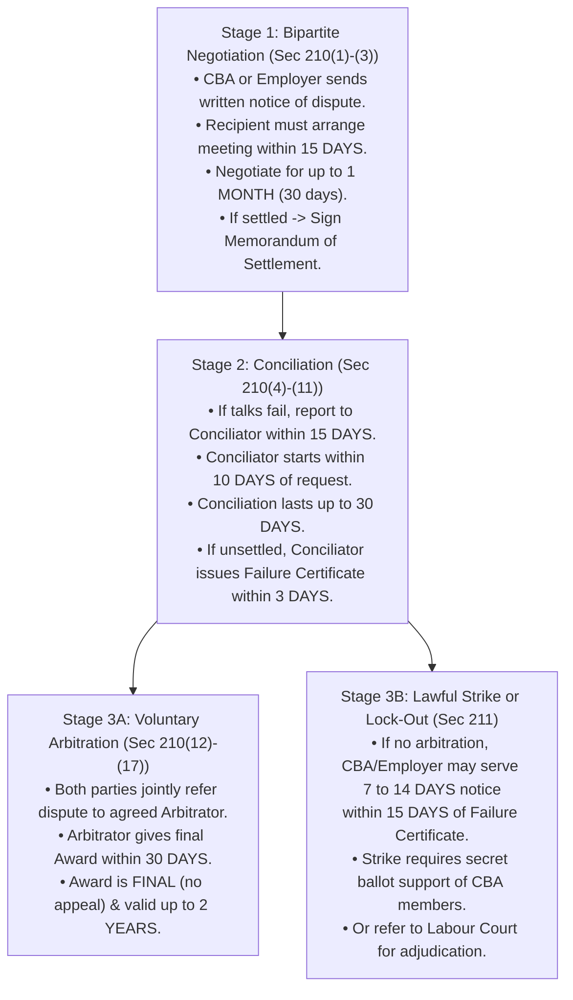

[← 04 · Ch 3 BLC 2006 Suggested Topics](04_Ch3_BLC2006_Suggested_Core_Topics.md) | [🏠 Master Plan](00_Last_Night_Master_Plan_and_Index.md) | [Next: 99 · 1-Hour Cheat Sheet →](99_One_Hour_Before_Exam_Cheat_Sheet.md)

---

# 05 · Chapter 4: Trade Union Act, CBA, Industrial Disputes & Applied Scenarios

> [!important] Shoaib Sir's Exact Voice Note Prescription (`[06:40 - 07:24]`)
> *"Next, Chapter 4: Trade Union:*
> *- Definition of Trade Union*
> *- Functions of Trade Union (and Objectives)*
> *- Industrial Disputes (and Settlement)*
> *- Collective Bargaining*
> *- Collective Bargaining Agent (CBA)*
> *- Legal Status of a registered trade union*
> *- Rights and Privileges of a registered trade union.*
> *From Trade Union, you will have an Applied / Analytical question! You will need to answer this question by applying your own intellect and understanding. When you thoroughly understand what a Trade Union is, what its real purpose is, what its functions are, and how a CBA operates, you will be able to write an excellent answer using your own intellectual reasoning."*

---

## 1. Definition, Objectives, and Functions of a Trade Union

### 1.1 Definition of Trade Union (`BLC Sec 2(62)` / `Sec 176` & Chapter 4 Notes)
- **General Meaning:** In ordinary language, a **Trade Union** (labour union) is a continuous association of workers formed to maintain or improve the conditions of their employment: such as securing fair wages, benefits, safe working conditions, reasonable hours, and job security: through the collective bargaining power of worker solidarity.
- **Right to Form Trade Unions (`BLC Section 176`):** Under **Section 176** of the Bangladesh Labour Act, 2006, all workers (and employers), without distinction whatsoever, have the fundamental statutory right to establish and join a trade union of their own choosing without prior authorization.
- **Classic Statutory Definition (Bombay Industrial Relations Act, 1956: in SI Sir's Notes):**
  > *"Trade Union means any combination, whether temporary or permanent, formed primarily to regulate the relations between workmen and employers, or between workmen and workmen, or between employers and employers, or for imposing restrictive conditions on the conduct of any trade or business, and includes any Federation of two or more Trade Unions."*

---

### 1.2 Ten Key Objectives of a Trade Union (`2024 Q.3(a) [2 Marks]`)
Directly from SI Sir's `Chapter-4.md` notes, a trade union is formed for **10 core objectives**:
1. To improve the **standard of living** of employees.
2. To **protect the legitimate interests** and rights of employees.
3. To **negotiate (bargain)** with management regarding employees' interests.
4. To improve the **financial support and wages** of employees.
5. To elevate the **social status and dignity** of employees.
6. To **prevent exploitation** of employees by employers.
7. To take effective measures for **promoting harmonious relations** between employers and workers.
8. To secure a **fair bonus** for employees out of the company's profits.
9. To secure the **welfare of employees** through group welfare schemes.
10. To support **organizational growth, industrial stability, and constructive leadership**.

---

### 1.3 Seven Core Functions of a Trade Union (Explicitly Prescribed in Voice Note)
Directly from SI Sir's `Chapter-4.md` notes, a trade union performs **7 essential functions**:

1. **Establishing Contact Between Workers and Employers (Communication Bridge):**
   In large modern industries employing hundreds or thousands of workers, individual workers rarely get to meet top managers directly to voice their grievances, and management remains unaware of shop-floor difficulties. The trade union acts as the formal communication bridge bringing worker grievances to management's attention.
2. **Securing Appropriate and Fair Wages:**
   A primary function of a trade union is to negotiate and apply collective pressure on employers so workers receive fair wages commensurate with their skills, workload, and inflation.
3. **Ensuring Job Security & Stopping Arbitrary Retrenchment:**
   Employers sometimes retrench or dismiss workers unfairly once their immediate usefulness ends. The trade union pressures employers to follow statutory procedures (`BLC Sec 20–27`) and prevents arbitrary retrenchment without acceptable cause.
4. **Reducing Excessive Working Hours:**
   The trade union compels employers to respect statutory limits on daily and weekly working hours (`Sec 100–102`) and pay double overtime rates (`Sec 108`).
5. **Stopping Exploitation of Workers:**
   Trade unions protect workers from unfair labour practices (`Sec 195`), wage deductions, forced overtime, and workplace discrimination so employers cannot deprive workers of their lawful dues.
6. **Improving Working Conditions and Factory Environment:**
   Trade unions campaign for better ventilation, fire safety (`Sec 62`), welfare facilities (`Sec 89–94`), festival bonuses, provident funds, and pensions.
7. **Arranging Insurance and Social Security:**
   Workers face risks of industrial accidents, disability, or death. Trade unions negotiate group insurance policies (`Sec 99`), medical coverage, and workmen's compensation for injured workers and their families.

---

## 2. Legal Status, Rights & Privileges of a Registered Trade Union

> [!important] Verified Section Numbers Alert (`AGENTS.md` §3.4)
> Use the verified BLC 2006 section numbers below:
> - `Sec 177–179`: Registration application & 30% membership requirement (`Sec 179(2)`).
> - `Sec 182` & `Sec 189`: Registration within 60 days & Certificate.
> - `Sec 190`: Cancellation of registration (7 grounds).
> - `Sec 194`: **Incorporation / Legal Status of Registered Trade Union** (Body Corporate).
> - `Sec 197`: Immunity from **Criminal Conspiracy**.
> - `Sec 198`: Immunity from **Civil Suits** in trade disputes.
> - `Sec 199`: **Enforceability of Agreements** (even if in restraint of trade).

### 2.1 Legal Status of a Registered Trade Union (`BLC Section 194`)
Registration (`Sec 182`) gives a trade union a distinct legal existence separate from its individual members. Under **Section 194** (and SI Sir's `Chapter-4.md` notes), the **5 legal status attributes** of a registered trade union are:
1. **Statutory Body Corporate:** A registered trade union is a statutory body corporate under the name in which it is registered.
2. **Separate Legal Entity & Perpetual Succession:** It has an independent legal personality separate from its members, with **perpetual succession** (changes in membership do not end the union's existence) and a **common seal**.
3. **Power to Own & Act as Agent:** It can hold assets and act as a legal representative/agent for workers.
4. **Power to Acquire & Hold Property:** It can acquire, own, and dispose of both **movable and immovable properties** in its own name.
5. **Capacity to Contract, Sue, and Be Sued:** It can enter into binding contracts and can **sue and be sued** in its registered corporate name.

---

### 2.2 Eight Rights and Privileges of a Registered Trade Union (`Sections 194, 197–199` & `Chapter-4.md`)

Memorize all **8 rights and privileges** from SI Sir's `Chapter-4.md` notes:

1. **Right of Incorporation (`Section 194`):**
   Every registered trade union becomes a **body corporate** by its registered name, having **perpetual succession** and a **common seal**, with the power to acquire and hold both movable and immovable property, to contract, and by the said name to **sue and be sued**.
2. **Protection (Immunity) from Criminal Prosecution (`Section 197`):**
   No officer or member of a registered trade union shall be liable to criminal punishment for conspiracy (`Penal Code`) in respect of any agreement made between the members to further a lawful object of the trade union, **unless the agreement is an agreement to commit an actual criminal offense**.
3. **Protection (Immunity) from Civil Suit in Trade Disputes (`Section 198`):**
   No civil suit or legal proceeding is maintainable in any Civil Court against a registered trade union or its officers/members for any act done in contemplation or furtherance of an **industrial dispute**, merely on the ground that such act induces a person to **break a contract of employment** or interferes with another person's right to dispose of his capital or labour.
4. **Enforceability of Agreements in Restraint of Trade (`Section 199`):**
   Notwithstanding anything in the Contract Act, 1872 (`Sec 27`), an agreement between the members of a registered trade union (e.g., agreeing not to accept work below a minimum wage) is **neither void nor voidable** merely because its objects are in restraint of trade.
5. **Right to Inspect Account Books (`Section 179(1)(h)`):**
   Every office-bearer or member of a registered trade union has the statutory right to **inspect the account books and membership list** of the union at times prescribed by the union's constitution.
6. **Right of Minors (Aged $15+$) to be Members:**
   Subject to union rules, any worker who has attained the **age of 15 years** (even though under 18) may become a member of a registered trade union and enjoy all the privileges of membership.
7. **Right to Change the Union's Name:**
   A registered trade union may legally change its name provided: (i) at least **two-thirds ($2/3$) of the total members** agree, and (ii) the proposed new name is not identical or deceptively similar to any existing registered union.
8. **Right of Amalgamation of Unions:**
   Any two or more registered trade unions may amalgamate into one union (with or without dissolution or division of funds), provided that **at least $50\%$ (one-half)** of the eligible members of each union cast their votes, and **at least $60\%$ of the votes recorded** are in favor of the amalgamation proposal.

---

### 2.3 Brief Summary: Registration (`Sec 177–182`) & Cancellation (`Sec 190`)

> **Exam History:** Registration process was asked in **2024 Q.3(b) [4 Marks]**.

- **4-Step Registration Process (`Sections 177–182`):**
  1. **Application (`Sec 177`):** Applied to the **Director of Labour / Registrar of Trade Unions** of the respective area under the signatures of the Union's **President (Chairman) and Secretary**.
  2. **9 Particulars Accompanying Application (`Sec 178` · Slides 9–11):**
     - *(i)* Name of the trade union and address of its **Head Office**;
     - *(ii)* Date of formation of the trade union;
     - *(iii)* Titles, names, ages, addresses, and occupations of the **officers** of the trade union;
     - *(iv)* Statement of **total paid membership**;
     - *(v)* Name of the establishment to which the union relates, and the **total number of workers** employed or engaged therein;
     - *(vi)* In the case of a **federation of trade unions**, the names, addresses, and registration numbers of its affiliated trade unions;
     - *(vii)* **Three (3) copies of the Constitution** of the trade union, together with a copy of the resolution by which it was adopted by the members;
     - *(viii)* A copy of the resolution by the members authorizing the **President (Chairman) and Secretary** to apply for registration; and
     - *(ix)* In the case of a federation, a resolution from each constituent union agreeing to become a member of the federation.
  3. **13 Constitutional Requirements & $30\%$ Membership Threshold (`Sec 179` · Slides 12–17):**
     - **13 Mandatory Clauses in the Union Constitution (`Sec 179(1)`):**
       *(1)* Name and address of the trade union; *(2)* Objects for which the union is formed; *(3)* Manner in which a worker becomes a member (with a declaration that **no worker is a member of another union**); *(4)* Sources of union funds and purposes for which funds shall be applicable; *(5)* Conditions under which a member becomes entitled to constitution-guaranteed benefits or faces fines/forfeiture; *(6)* Maintenance of a **list of members** with adequate facilities for inspection by officers and members; *(7)* Manner in which the constitution may be **amended, varied, or rescinded**; *(8)* Safe custody of funds, **annual audit**, and inspection of account books by officers and members; *(9)* Manner in which the union may be **dissolved**; *(10)* Manner of **election of officers** by the general body and their term of office (**between 2 and 3 years**); *(11)* Number of members of the **Executive Committee** (**between 5 and 35 members**, as prescribed by rules); *(12)* Procedure for expressing **want of confidence** in any union officer; and *(13)* Frequency of meetings: the **Executive Committee must meet at least once every 3 months**, and the **General Body must meet at least once every year**.
     - **Minimum $30\%$ Membership Threshold (`Sec 179(2)`):** A trade union of workers is **not entitled to registration** unless it has a minimum membership of **$30\%$ of the total number of workers** employed in the establishment (including group of establishments).
  4. **Registration & Certificate within 60 Days (`Sec 182` & `Sec 189`):** If satisfied that the union has complied with all requirements, the Director of Labour registers the union in the prescribed register and issues a **Registration Certificate (`Sec 189`) within 60 days** of receiving the application.
- **7 Grounds for Cancellation of Registration (`Section 190`):**
  The Director of Labour may cancel registration (with prior permission of the **Labour Court**, except for grounds 1 and 2) if:
  1. The union itself applies for cancellation;
  2. The union ceases to exist;
  3. Registration was obtained by **fraud or misrepresentation** of facts;
  4. The union violated a fundamental provision of its **constitution**;
  5. The union committed an **unfair labour practice (`Sec 196`)**;
  6. Membership fell **below the statutory $30\%$ threshold**; OR
  7. The union contravened any provision of Chapter XIII of BLC 2006.

---

## 3. Collective Bargaining & Collective Bargaining Agent (CBA · `Section 202`)

> **Exam History:** Asked in **2023 Q.4(a) [2m]** and **2024 Q.8(a) [2m]**, and emphasized in the Voice Note for the applied question!

### 3.1 What is Collective Bargaining?
**Collective Bargaining** is the formal negotiation process in which working people, acting collectively through their elected trade union (**CBA**), negotiate binding contracts with their employer to determine terms and conditions of employment: including wages, bonuses, working hours, leave, occupational health and safety, work-life balance, and grievance procedures.

### 3.2 Who is a Collective Bargaining Agent (CBA) & How is it Determined (`Section 202`)?
A **Collective Bargaining Agent (CBA)** is the registered trade union (or federation of unions) that is legally recognized under **Section 202** of the Bangladesh Labour Act, 2006 as the **exclusive representative** of all workers in an establishment for collective bargaining.
- **Case 1: Only One Registered Trade Union (`Sec 202(1)`):**
  Where there is **only one registered trade union** in an establishment (and it has at least **one-third / $33.3\%$** of the total workers as members), that trade union is **deemed to be the CBA** for that establishment.
- **Case 2: Multiple Registered Trade Unions (`Sec 202(2)–(15)`):**
  Where there is **more than one registered trade union** in an establishment, the Director of Labour conducts a **secret ballot election** among the workers within **120 days** of application. The union securing the highest vote (provided it receives votes of at least $1/3$ of total employed workers) is declared the **CBA for a 2-year tenure (`Sec 202(16)`)**.

### 3.3 Five Exclusive Powers and Rights of the CBA (`Section 202(24)`)
Under **Section 202(24)** of the BLC 2006 (and SI Sir's `Chapter-4.md` notes), the CBA has **5 exclusive statutory powers**:
1. **Bargain with the Employer:** To undertake collective bargaining with the employer on matters of employment, non-employment, terms of employment, or conditions/environment of work.
2. **Represent Workers in Proceedings:** To represent all or any of the workers in any conciliation, arbitration, or Labour Court proceedings.
3. **Give Notice of, and Declare, a Lawful Strike:** To issue a notice of strike and declare a strike strictly in accordance with Chapter XIV (`Sec 210–211`). *(No non-CBA union or individual worker group can legally call a strike!)*
4. **Nominate Worker Representatives to Welfare & Participation Funds:** To nominate representatives of workers on the board of trustees of any **Welfare Institution**, **Provident Fund**, or **Workers' Participation Fund (WPPF)** established under Chapter XV.
5. **Conduct Legal Cases:** To conduct legal cases on behalf of any individual worker or group of workers under the Bangladesh Labour Act, 2006.

---

## 4. Industrial Disputes & Settlement Ladder (`Section 210` & `Section 211`)

> **Exam History:** Asked in **2024 Q.8(a) [2m]** and **2024 Q.3(c) [4m Applied Dispute Scenario]**.

### 4.1 Definition & Forms of Industrial Disputes
- **Statutory Definition (`BLC Section 2(62)` / `Chapter-4.md`):**
  > *"Industrial dispute"* means any dispute or difference between **employers and employers**, between **employers and workers**, or between **workers and workers**, which is connected with the **employment or non-employment** or the **terms of employment or the conditions of work** of any person.
  *(Important Rule under `Sec 209`: An industrial dispute is not deemed to exist unless it is raised in writing by the **CBA** or the **Employer**).*

- **Forms of Industrial Disputes (from SI Sir's `Chapter-4.md` Notes):**

| 4 Disputes by Employers | 3 Disputes by Workers |
| :--- | :--- |
| **1. Lock-out (`Sec 2(57)`):** Closing a place of employment (wholly or partly), suspending work, or refusing to continue to employ workers in connection with an industrial dispute to compel workers to accept terms of employment. **2. Lay-off (`Sec 2(58)`):** Failure, refusal, or inability of an employer to give employment to a worker due to shortage of coal, power, or raw materials, accumulation of stock, or breakdown of machinery. **3. Retrenchment (`Sec 2(61)`):** Termination of services of workers by the employer on the ground of **redundancy** (not as punishment). **4. Dismissal (`Sec 2(39)`):** Termination of services of a worker by the employer as punishment for **misconduct**. | **1. Go-slow (`Sec 2(11)`):** An organized, deliberate, and purposeful slowing down of normal output of work by a body of workers in a concerted manner (not caused by mechanical defect or power/material shortage). **2. Strike (`Sec 2(22)`):** Cessation of work by a body of persons employed in any establishment acting in combination, or a concerted refusal under a common understanding to continue to work. **3. Boycott:** A form of protest where workers report to the workplace premises but refuse to attend or perform work until their demands are met. |

---

### 4.2 Complete Step-by-Step Settlement of Industrial Disputes (`Section 210` & `Section 211`)

*Figure: Complete Statutory Timeline for Trade Unions and Industrial Dispute Resolution (`Sec 210–211`)*

Memorize this exact **4-Stage Statutory Ladder** and its **day counts** (`15d -> 30d -> 15d -> 10d -> 30d -> 3d -> 30d`):

1. **Stage 1: Direct Bipartite Negotiation (`Section 210(1)–(3)`):**
   - **Written Notice (`210(1)`):** Either the **CBA** or the **Employer** communicates its views/demands **in writing** to the other party.
   - **Meeting Within 15 Days (`210(2)`):** Within **15 days** of receiving the written communication, the receiving party must arrange a collective bargaining meeting with authorized representatives.
   - **Dialogue Duration (`210(4)(b)`):** Negotiations continue for up to **1 month (30 days)** from the first meeting (or longer if mutually agreed in writing).
   - **If Settled (`210(3)`):** A **Memorandum of Settlement** is recorded in writing, signed by both parties, and forwarded to the Government, Director of Labour, and Conciliator.
2. **Stage 2: Conciliation by Government Conciliator (`Section 210(4)–(11)`):**
   - **Referral Within 15 Days (`210(4)`):** If no meeting is arranged within 15 days, or no settlement is reached within 1 month of talks, either party may: **within 15 days** of expiry: report the matter in writing to the **Conciliator**.
   - **Start Within 10 Days (`210(6)`):** Within **10 days** of receiving the request, the Conciliator must start conciliation and call a joint meeting.
   - **30-Day Conciliation Window (`210(9)`):** If a settlement is reached within **30 days**, the Conciliator submits a signed Memorandum of Settlement to the Government (`210(8)`). If no settlement is reached within **30 days** (unless extended by mutual written consent), conciliation fails.
   - **Failure Certificate Within 3 Days (`210(10)–(11)`):** Upon failure, the Conciliator tries to persuade both parties to refer the dispute to an **Arbitrator**. If they decline, the Conciliator must issue a **Certificate of Failure within 3 days**.
3. **Stage 3A: Voluntary Arbitration (`Section 210(12)–(17)`):**
   - **Joint Written Request (`210(12)–(13)`):** If both parties agree, they make a **joint written request** to an mutually agreed **Arbitrator** (from the Government's panel or any agreed person).
   - **Award Within 30 Days (`210(14)–(17)`):** The Arbitrator must issue his **Award within 30 days** (or mutually extended period). The Arbitrator's award is **final and binding (no appeal lies against it)** and remains valid for a period **not exceeding 2 years** as fixed by the Arbitrator.
4. **Stage 3B: Strike / Lock-Out Notice or Labour Court (`Section 211`):**
   - If the parties do not agree to arbitration, the party that raised the dispute may: **within 15 days** of the Failure Certificate: give **7 to 14 days' notice** of a **Strike** (by the CBA, after securing majority/three-fourths secret ballot approval) or a **Lock-out** (by the Employer), OR apply to the **Labour Court** for adjudication.

---

## 5. Unfair Labour Practices (`Sections 195 & 196`), Consequences & Union Strategies

*(Tested in 2023 Q.4(b), 2023 Q.4(c), and vital for analyzing employer/union misconduct in applied questions!)*

### 5.1 Unfair Labour Practices on the Part of Employers (`Section 195` · 12 Prohibited Acts)
Under **Section 195** of BLC 2006, an employer must **NOT**:
1. Put a *"yellow-dog"* condition in an employment contract restraining a worker's right to join or stay in a trade union;
2. Refuse to employ or retain a worker because they are (or are not) a union member or officer;
3. Discriminate against any worker in employment, promotion, or working conditions due to union membership/office;
4. Dismiss, discharge, remove, or threaten to harm a worker for joining, forming, or promoting a trade union;
5. Bribe or offer advantages to induce a worker not to join a union or to quit union office;
6. Compel or intimidate any **CBA officer** (by threat, confinement, assault, or cutting off water/power/telephone) to sign a settlement;
7. Interfere with or influence a **CBA secret ballot election** held under `Sec 202`;
8. **Recruit any new worker during the continuance of a lawful strike** (unless required by the Conciliator for essential maintenance);
9. Deliberately fail to implement measures recommended by the Participation Committee;
10. Fail to give a timely written reply to any communication made by the CBA regarding an industrial dispute;
11. Transfer the **President (Chairman), General Secretary, Organizing Secretary, or Treasurer** of a trade union without their consent in violation of `Sec 187`; OR
12. Commence, continue, or instigate an **illegal lock-out**.

### 5.2 Unfair Labour Practices on the Part of Workers / Trade Unions (`Section 196` · 6 Prohibited Acts)
Under **Section 196** of BLC 2006, workers or trade unions must **NOT**:
1. Intimidate or coerce any worker to become (or not become) a union member or officer;
2. Induce any worker or person to quit union office by offering an improper advantage;
3. Compel any worker by intimidation, confinement, physical injury, or utility disconnection to **pay or refrain from paying union subscriptions**;
4. Compel the **employer** by intimidation, coercion, confinement, assault, or utility disconnection to **sign a settlement or accept demands**;
5. Commence, continue, or instigate an **illegal strike or a go-slow**; OR
6. Resort to **Gherao** (surrounding/blockading managers), obstruction of transport or communication systems, or **destruction of property** in furtherance of any union demand.

- **Penalties (from SI Sir's `Chapter-4.md` Notes):**
  - *Illegal strike by worker:* Up to **6 months imprisonment** or fine of $\text{Tk. } 200$ (or $\text{Tk. } 5,000$ under updated schedules).
  - *Illegal lock-out by employer:* Up to **1 year imprisonment** or fine of $\text{Tk. } 5,000$, or both.
  - *Illegal lay-off or closure:* Up to **1 month imprisonment** or fine of $\text{Tk. } 3,000$, or both, plus $50\%$ basic wage compensation to workers.

### 5.3 Consequences of Unfair Labour Practices & Union Counter-Strategies `[2023 · Q.4(b) & Q.4(c)]`

#### (a) Potential Consequences of Unfair Labour Practices on Employers and Employees `[2023 · Q.4(b) | 04 Marks]`
1. **Consequences on Employees (Workers):**
   - **Loss of Livelihood & Victimisation:** Anti-union retaliation (`Sec 195(d)`), wrongful transfers (`Sec 187`), and yellow-dog contracts (`Sec 195(a)`) strip workers of job security and suppress lawful collective bargaining.
   - **Loss of Statutory Immunity & Criminal Penalties:** When workers resort to unfair practices under `Sec 196` (such as illegal strikes, *go-slow*, or *gherao*), they forfeit civil/criminal immunity (`Sec 197–198`), face summary dismissal (`Sec 23`), lose wages during the illegal stoppage, and risk up to **6 months imprisonment**.
2. **Consequences on Employers (Management):**
   - **Production Halts & Financial Loss:** Unfair practices trigger retaliatory strikes, high employee turnover, low morale, and damaged brand reputation among international buyers (especially in export-oriented electronics and RMG factories).
   - **Legal Prosecution & Union Deregistration:** Employers committing unfair practices under `Sec 195` or illegal lock-outs face Labour Court prosecution, fines up to $\text{Tk. } 5,000$, and **imprisonment up to 1 year**, while offending trade unions face **cancellation of registration under `Section 190(1)(e)`**.

#### (b) Strategies Trade Unions Can Employ to Address Unfair Labour Practices Effectively `[2023 · Q.4(c) | 04 Marks]`
1. **Collective Bargaining & Participation Committees (`Sec 202(24)` & `Sec 205`):** Use the elected **CBA's exclusive bargaining authority (`Sec 202(24)`)** and joint Participation Committees to establish transparent promotion, transfer, and grievance policies before disputes escalate.
2. **Statutory Grievance & Dispute Ladder (`Sec 33` & `Sec 210`):** File formal individual grievances under `Sec 33` (within 30 days) or raise a written industrial dispute under **`Section 210`** (15-day bipartite meeting $\to$ 30-day government conciliation $\to$ voluntary arbitration).
3. **Filing Complaints Before the Director of Labour & Labour Court (`Sec 195` & `Sec 202(24)(e)`):** Document evidence of anti-union discrimination or officer transfers (`Sec 187`) and file legal cases in the **Labour Court** using the CBA's statutory power under `Sec 202(24)(e)`.
4. **Worker Legal Awareness & Strict Internal Discipline (`Sec 196`):** Educate union members on BLC 2006 so they can identify employer violations (`Sec 195`) while strictly avoiding illegal *go-slow* or *gherao* tactics (`Sec 196`) that would jeopardize the union's registration (`Sec 190`).

---

## 6. Shoaib Sir's Applied / Analytical Question Toolkit (5 Solved Scenarios)

> [!tip] How to Answer ANY Applied Question from Chapter 4 (`Voice Note [07:05 - 07:24]`)
> Whenever Shoaib Sir sets an analytical/applied question on Trade Unions, CBA, or Industrial Disputes, structure your answer around **4 Analytical Pillars**:
> 1. **Identify the Core Purpose of a Trade Union (`Sec 176` & `Sec 194`):** A union is a lawful corporate body meant to equalize bargaining power, voice grievances peacefully, and protect worker welfare: **not** to sabotage production or use violence.
> 2. **Check Exclusive CBA Authority (`Sec 202` & `Sec 209`):** Only the legally elected/determined **CBA (`Sec 202`)** has the legal right to bargain, raise an industrial dispute (`Sec 209`), or call a strike (`Sec 202(24)`). Rival minority unions or wildcat worker groups cannot bypass the CBA.
> 3. **Check for Unfair Labour Practices (`Sec 195` Employer vs. `Sec 196` Worker):** If the employer fires/transfers union leaders or refuses to reply to the CBA, cite **`Sec 195`**. If workers use *Gherao*, *Go-slow*, vandalism, or strike without conciliation, cite **`Sec 196`**.
> 4. **Prescribe the `Section 210` Dispute Resolution Ladder:** Always conclude by routing the parties through the mandatory statutory ladder: **Written Notice $\to$ 15-Day Bipartite Meeting (1 Month Talks) $\to$ Conciliator (10d start, 30d window) $\to$ Voluntary Arbitrator (30d final award) or Lawful Strike Notice (`Sec 211`)**.

---

### Solved Applied Question 1: Resolving a Factory Industrial Dispute Step-by-Step `[2024 · Q.3(c) | 04 Marks]`
> **Question:** Create a hypothetical scenario of an industrial dispute in a manufacturing plant and outline the steps that would be taken to resolve it under the Bangladesh Labor Code 2006.

**Model Answer:**
1. **Hypothetical Scenario:**
   At *Sylhet Semiconductor Assembly Ltd.* (employing 400 workers), the management refuses to pay the annual festival bonus and enforces unpaid overtime. The elected **Collective Bargaining Agent (CBA)** demands immediate payment, while management threatens a **lock-out**. An **Industrial Dispute (`Sec 2(62)`)** has arisen.
2. **Step-by-Step Statutory Resolution under `Section 210` of BLC 2006:**
   - **Step 1: Raising the Dispute & Bipartite Negotiation (`Sec 210(1)–(3)`):**
     Under `Sec 209` and `Sec 210(1)`, the **CBA** submits a formal **written charter of demands** to the employer. Within **15 days** of receipt, the employer must convene a bipartite collective bargaining meeting (`Sec 210(2)`). Both sides negotiate for up to **1 month (30 days)**. If they agree, they sign a binding **Memorandum of Settlement (`Sec 210(3)`)**.
   - **Step 2: Conciliation (`Sec 210(4)–(11)`):**
     If bipartite talks fail after 1 month, the CBA reports the dispute in writing to the Government **Conciliator within 15 days** (`Sec 210(4)`). The Conciliator must begin conciliation within **10 days** (`Sec 210(6)`) and has **30 days** to mediate a settlement (`Sec 210(9)`). If conciliation fails, the Conciliator issues a **Certificate of Failure within 3 days** (`Sec 210(11)`).
   - **Step 3: Voluntary Arbitration (`Sec 210(12)–(17)`):**
     With both parties' written consent, the dispute is referred to a neutral **Arbitrator**, who must deliver a **final, non-appealable Award within 30 days**, valid for up to **2 years**.
   - **Step 4: Lawful Strike Notice or Labour Court (`Sec 211`):**
     If the employer refuses arbitration, the CBA: after securing secret-ballot approval from its members: may serve a **7 to 14 days' written Strike Notice** within **15 days** of the Failure Certificate (`Sec 211`), or refer the dispute to the **Labour Court** for binding adjudication.

---

### Solved Applied Question 2: Role of Trade Unions in Preventing Workplace Discrimination Against Technical Staff `[2024 · Q.8(c) | 04 Marks]`
> **Question:** Critically evaluate the role of trade unions in preventing workplace discrimination or bias against technical staff.

**Model Answer:**
In engineering, telecom, and manufacturing enterprises, technical staff (junior engineers, lab technicians, CAD operators, and maintenance crews) qualify as **"Workers" under `Section 2(65)`** of the Bangladesh Labour Act, 2006 (since they perform skilled/technical work and are not in managerial/administrative roles). A registered trade union and **CBA (`Sec 202`)** prevent workplace discrimination and bias against technical staff through five mechanisms:

1. **Standardized Pay Scales & Objective Promotion Criteria (`Sec 202(24)`):**
   Through collective bargaining (`Sec 202(24)`), the union replaces subjective managerial favoritism/nepotism with transparent, grade-based pay scales, skill-testing criteria, and seniority-cum-merit promotion rules.
2. **Statutory Protection Against Anti-Union & Personal Bias (`Sec 195`):**
   Under **Section 195(c) & (d)**, any discrimination against a technical worker regarding promotion, grading, training, or working conditions is a punishable **employer unfair labour practice**. The union acts as a legal watchdog to challenge biased appraisals or retaliatory transfers (`Sec 187`).
3. **Equal Access to Welfare, Safety & Maternity Rights (`Sec 45–50`, `Sec 62`, `Sec 89–94`):**
   The union ensures female technical staff are not discriminated against during pregnancy (`Sec 50`) and that shop-floor technicians receive equal safety gear, rest shelters, and overtime pay (`Sec 108` double rate).
4. **Formal Grievance Redressal & Legal Representation (`Sec 33` & `Sec 202(24)`):**
   An individual technician often fears retaliation if they complain alone against a biased department head. Under **Section 194** (body corporate status) and **Section 202(24)(b) & (e)**, the CBA represents the aggrieved technician in internal inquiries (`Sec 24`), grievance hearings (`Sec 33`), and before the **Labour Court**.
5. **Critical Limitation (Balanced Evaluation):**
   While unions excel at stopping arbitrary bias, overly rigid union seniority rules can sometimes discourage exceptional individual technical innovation if top-performing engineers are paid the exact same rate as average workers. Thus, an ideal technical trade union balances **collective equity** with **merit-based technical incentives**.

---

### Solved Applied Question 3: Wildcat Strike / Gherao vs. Employer Retaliation (Analytical Case)
> **Scenario / Question:** In an electronics factory, a group of angry workers belonging to a non-CBA minority union suddenly stopped work without notice, locked the Factory Manager inside his office (*Gherao*), and demanded a $40\%$ wage hike. In response, the employer immediately fired the President of the main CBA union without any inquiry and hired new outside workers. Analyze the legality of both parties' actions under the Bangladesh Labour Code, 2006.

**Model Answer:**
1. **Illegality of the Workers' Actions (`Sections 196, 202(24), 209–211`):**
   - **No Locus Standi to Call a Strike (`Sec 202(24)` & `Sec 209`):** Under **Section 202(24)** and **Section 209**, **only the recognized Collective Bargaining Agent (CBA)** has the legal authority to raise an industrial dispute or declare a strike. A minority non-CBA union has zero legal authority to call a strike.
   - **Violation of `Section 210–211` Procedure:** Stopping work suddenly without 15-day bipartite talks (`Sec 210`), conciliation, secret ballot, and 7-to-14-day strike notice (`Sec 211`) makes the work stoppage an **Illegal Strike (`Sec 213`)**.
   - **Unfair Labour Practice by Workers (`Section 196`):** Locking the manager inside his office (**Gherao**) and using coercion/confinement to force a demand are severe **worker unfair labour practices under `Section 196(d), (e), and (f)`**, stripping the workers of civil/criminal immunity (`Sec 197–198`).
2. **Illegality of the Employer's Actions (`Sections 24, 187, 195`):**
   - **Unlawful Summary Dismissal (`Sec 23–24`):** Even when misconduct occurs, an employer cannot dismiss any worker without following the mandatory **Section 24 disciplinary procedure** (written charge-sheet, 7-day explanation period, and domestic inquiry).
   - **Employer Unfair Labour Practice (`Section 195(d)`):** Firing the CBA President in retaliation for union activity violates **Section 195(d)** (and `Sec 187` protecting union officers).
   - **Hiring Replacement Workers:** While `Sec 195(h)` prohibits hiring new workers during a *lawful* strike, the employer must still follow lawful Labour Court procedures (`Sec 214`) to close down an illegal strike rather than retaliating against innocent CBA officers.
3. **Conclusion:** Both parties violated the Bangladesh Labour Act, 2006. The minority workers are guilty of an **illegal strike and Gherao under `Section 196`**, while the employer is guilty of **unlawful dismissal and unfair labour practice under `Section 24` and `Section 195`**.

---

### Solved Applied Question 4: Why Must a Trade Union Register & How Does CBA Prevent Multi-Union Chaos?
> **Analytical Question:** *"An unregistered association of workers is legally powerless, whereas multiple registered unions without a CBA create industrial chaos."* Critically analyze this statement in light of the Bangladesh Labour Code, 2006.

**Model Answer:**
1. **Why an Unregistered Worker Association is Powerless (`Sections 177–182, 194, 197–199`):**
   - Without registration under **Section 182** (requiring at least **$30\%$ worker membership** under `Sec 179(2)`), an informal worker group has no separate legal identity.
   - Once registered, **Section 194** transforms the union into a **body corporate** with perpetual succession, a common seal, and the power to hold property, contract, and sue/be sued.
   - Also, **only a registered trade union** enjoys statutory **criminal immunity (`Sec 197`)** from conspiracy charges, **civil immunity (`Sec 198`)** from tort suits during trade disputes, and **enforceability of restraint-of-trade agreements (`Sec 199`)**. An unregistered group calling a strike can be sued personally in civil court for breach of contract and prosecuted for conspiracy.
2. **How the CBA (`Section 202`) Prevents Multi-Union Chaos:**
   - Because `Sec 179(2)` sets the registration threshold at $30\%$, a single factory can legally have up to **3 registered trade unions** ($30\% + 30\% + 30\%$).
   - If all three unions tried to negotiate separately or call competing strikes, the employer would face conflicting demands and endless industrial paralysis.
   - **Section 202** solves this by mandating a **secret ballot election** among all workers to elect **one single Collective Bargaining Agent (CBA)** for a **2-year term**.
   - Under **Section 202(24)** and **Section 209**, **only the elected CBA** can bargain with management, sign binding settlements, nominate WPPF/welfare trustees, or serve a strike notice. This gives workers a unified voice while giving the employer a single, accountable bargaining partner.

---

[← 04 · Ch 3 BLC 2006 Suggested Topics](04_Ch3_BLC2006_Suggested_Core_Topics.md) | [Next: 99 · 1-Hour Cheat Sheet →](99_One_Hour_Before_Exam_Cheat_Sheet.md)
