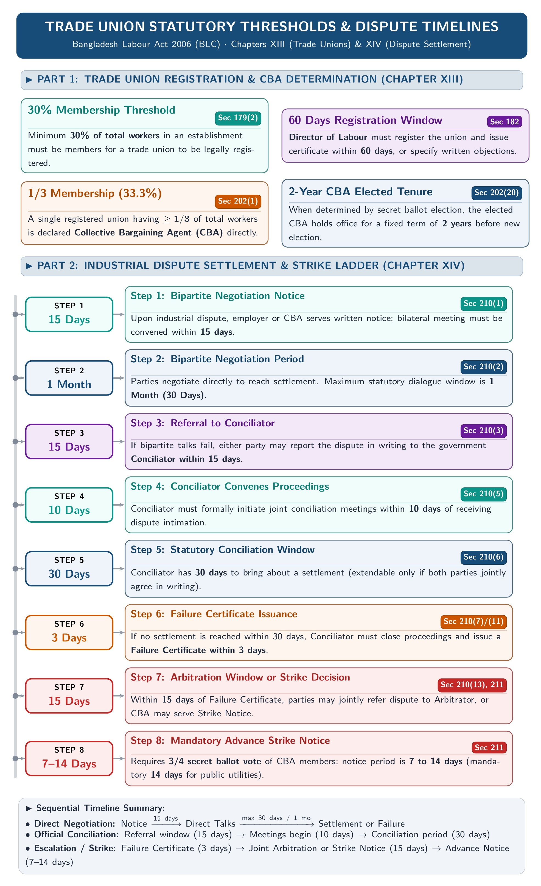
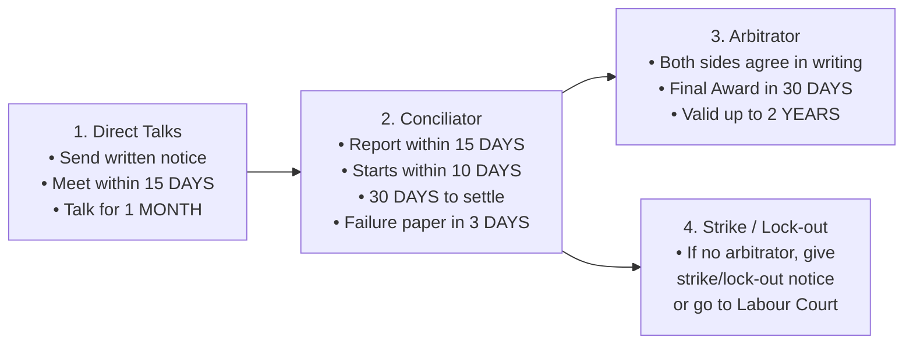

[← 04 · Ch 3 BLC 2006 Suggested Topics](04_Ch3_BLC2006_Suggested_Core_Topics.md) | [🏠 Master Plan & Index](00_Last_Night_Master_Plan_and_Index.md) | [Next: 99 · 1-Hour Cheat Sheet →](99_One_Hour_Before_Exam_Cheat_Sheet.md)

---

# Chapter 4: Trade Union Act & Industrial Disputes (Easy Lecture-Note Version)

> [!tip] How to Study Chapter 4 in 25 Minutes
> Everything below is taken **word-for-word in simple bullet points** from SI Sir's `Chapter-4.md` handout and slides. No extra section numbers: only the exact ones on Sir's slides (`Sec 177, 178, 179, 182, 190, 195, 196, 210`)!

---

## 1. Trade Union: Definition, 10 Objectives & 7 Functions (Slides 2–4)

### 1.1 What is a Trade Union? (Slide 2)
- In simple words, a **Trade Union** (or labor union) is an **association of workers** in a factory or industry formed to maintain and improve their working conditions: such as getting **better wages, bonuses, leave, healthcare, safety, and job security**: through collective bargaining with the employer.

### 1.2 Ten Objectives of a Trade Union (Slide 3)
1. To improve the **standard of living** of employees.
2. To **protect the interests** of employees.
3. To **negotiate (bargain)** regarding employees' interests.
4. To improve the **financial support** of employees.
5. To improve the **social status** of employees.
6. To **prevent exploitation** of employees by employers.
7. To take measures for **good relations** between employers and workers.
8. To secure a **bonus** for workers from the company's profit.
9. To secure the **welfare of employees** through group schemes.
10. To ensure **organizational growth, stability, and leadership**.

### 1.3 Seven Functions of a Trade Union (Slide 4 · Highlighted in Voice Note!)
1. **Establishing Contact between Workers and Employers:** In big factories with hundreds of workers, ordinary workers cannot meet top managers directly to share their problems. The trade union acts as a bridge to bring workers' complaints to management.
2. **Receiving Appropriate Wages:** The union puts collective pressure on the employer so workers get fair wages matching their skill and work.
3. **Ensuring Job Safety (Stopping Unfair Firing):** Employers sometimes fire (retrench) workers without a valid reason. The union pressures management to stop unfair retrenchment.
4. **Reducing Working Hours:** The union forces employers to follow legal working-hour limits.
5. **Stopping Exploitation:** The union protects workers so the employer cannot cheat them out of their rightful pay and benefits.
6. **Improving Working Conditions:** The union works to improve the factory environment, safety, bonuses, and pensions.
7. **Arranging Insurance:** Workers may get injured or die in factory accidents. The union helps arrange group insurance policies for injured or deceased workers.

---

## 2. Registered Trade Union: Legal Status & 8 Rights (Slides 5–7)

> **What is Registration (Slide 5)?** Registration is the legal process under the Bangladesh Labour Code, 2006 that gives a trade union a **separate legal existence** and special legal benefits.

### 2.1 Five Points on Legal Status of a Registered Trade Union (Slide 6)
1. A registered trade union is a **statutory body** (recognized by law).
2. It has a **separate legal entity** (separate from its individual members).
3. It can **own property** and act as an **agent**.
4. It can buy and hold both **movable and immovable property** (cash, land, office).
5. It can **make contracts** and **sue or be sued** in its own registered name.

### 2.2 Eight Rights & Privileges of a Registered Trade Union (Slide 7 · Voice Note Priority!)
1. **Incorporation:** It becomes a **corporate body** under its registered name with continuous existence (*perpetual succession*) and an official seal, able to hold property, sign contracts, and sue or be sued.
2. **Protection from Criminal Prosecution:** Union officers and members **cannot be punished by criminal courts** for agreements made to achieve lawful union goals (unless they agree to commit an actual crime).
3. **Protection from Civil Suit in Trade Disputes:** No **civil court case** can be filed against a registered union or its members simply because their strike/protest during a trade dispute caused workers to stop working.
4. **Enforceability of Agreements:** Agreements between union members (e.g., agreeing not to work below a minimum wage) are **valid**, even if they restrict trade.
5. **Right to Inspect Account Books:** Any union officer or member has the right to **check the union's account books** and member list.
6. **Right of Minors (Age $15+$) to Be Members:** Any worker aged **15 years or older** can become a union member and enjoy all member benefits.
7. **Right to Change the Name:** The union can change its name if **two-thirds ($2/3$) of total members agree**, and the new name is not the same as another union.
8. **Amalgamation (Merging) of Unions:** Two or more registered unions can merge into one union if **at least $50\%$ (half) of eligible members vote**, and **at least $60\%$ of those votes** support the merger.

---

## 3. Registration Process (`Sec 177–182`) & Cancellation (`Sec 190`)

### 3.1 Four Steps to Register a Trade Union (Slide 8 · Asked in `2024 Q.3(b)`)
1. **Application for Registration (`Sec-177`):** The union applies to the **Registrar / Director of Labour** signed by the union's **Chairman (President) and Secretary**.
2. **Documents Needed with Application (`Sec-178` · Slides 9–11):**
   - Union name, head office address, and date of formation;
   - Names, ages, addresses, and posts of union officers;
   - Total paid membership & name of the factory/establishment;
   - **3 copies of the Union Constitution** + resolution adopting it;
   - Resolution authorizing the President and Secretary to apply.
3. **Constitution Rules (`Sec-179` · Slides 12–17):**
   - Must state union name, goals, fund rules, annual audit, no dual membership, and minimum **$30\%$ worker membership**.
   - **Executive Committee:** **$5\text{ to }35\text{ members}$**, elected for **$2\text{ to }3\text{ years}$**.
   - **Meetings:** Executive Committee meets at least **once every 3 months**; General Body meets at least **once every year**.
4. **Registration Certificate within 60 Days (`Sec-182` · Slide 18):** If all rules are met, the **Director of Labour** registers the union and issues a **Registration Certificate within 60 days**.

### 3.2 Seven Reasons for Cancellation of Registration (`Sec-190` · Slides 19–20)
The Director of Labour can cancel a union's registration if:
1. The union itself **applies for cancellation**.
2. The union **ceases to exist** (closes down).
3. Registration was taken by **fraud or false information**.
4. The union **violated its own constitution**.
5. The union committed an **unfair labor practice**.
6. Union membership **dropped below the required minimum ($30\%$)**.
7. The union **broke any rule** of the Labour Code.

---

## 4. Collective Bargaining & CBA (Slides 21–24 · Voice Note Priority!)

### 4.1 What is Collective Bargaining? (Slide 21)
**Collective Bargaining** is the process where workers, through their union, **negotiate contracts with their employer** to fix their terms of employment: including **pay, bonuses, working hours, leave, health and safety policies, and work-life balance**.

### 4.2 What is a Collective Bargaining Agent (CBA)? (Slide 22)
- A **Collective Bargaining Agent (CBA)** is the **registered trade union elected by secret ballot** to represent all workers in an establishment.
- **Single-Union Rule:** Under the Bangladesh Labour Code, 2006, if there is **only one registered trade union** in an establishment, that union is **automatically deemed to be the CBA**. (If there are multiple unions, workers vote by secret ballot to elect one CBA for 2 years).

### 4.3 Five Powers and Rights of the CBA (Slides 23–24)
According to the Bangladesh Labour Code, 2006, only the **CBA** has the legal right to:
1. **Bargain with the employer** on job conditions, unemployment issues, or the working environment;
2. **Represent workers** in any legal or dispute proceedings;
3. **Give notice of, and declare, a lawful strike**;
4. **Nominate worker representatives** on the boards of Welfare Funds, Provident Funds, and the Workers' Participation Fund; and
5. **Conduct court cases** on behalf of any individual worker or group of workers.

---

## 5. Industrial Disputes & Settlement (`Sec-210` · Slides 25–33)

### 5.1 What is an Industrial Dispute? (Slide 25)
- **Simple Meaning:** Any disagreement or difference between **employers and workers** (or between employers and employers, or workers and workers) connected with **employment, non-employment, or working conditions**.

### 5.2 Types of Disputes by Employers vs. Workers (Slide 26)

| 4 Disputes by Employers | 3 Disputes by Workers |
| :--- | :--- |
| **1. Lock-out:** Employer closes the factory or stops work during a dispute to force workers to accept the employer's terms. **2. Lay-off:** Employer cannot give work to workers due to **shortage of power, coal, or raw materials**, or **machine breakdown**. **3. Retrenchment:** Firing excess workers due to **redundancy** (downsizing), not as punishment. **4. Dismissal:** Firing a worker as punishment for **misconduct** (bad behavior/theft). | **1. Go-slow:** Workers deliberately and purposefully **slow down their normal work output** together as a protest. **2. Strike:** Workers **stop working together** and refuse to work until their demands are met. **3. Boycott:** Workers come to the workplace premises, but **refuse to attend or do their work** until their demand is met. |

---

### 5.3 Easy 4-Stage Process to Settle an Industrial Dispute (`Sec-210` · Slides 27–33)

*Figure: Simple Step-by-Step Timeline to Settle an Industrial Dispute (`Sec-210`)*

Memorize these **4 simple stages** and the **bold day numbers**:

1. **Stage 1: Direct Negotiation Between Employer & CBA (`15 Days` + `1 Month`):**
   - The CBA or Employer sends their demand **in writing** to the other side.
   - Within **15 days** of getting the letter, the other side must arrange a **meeting**.
   - Both sides discuss for up to **1 month (30 days)**. If they agree, they sign a **Memorandum of Settlement** and send copies to the Government, Director of Labour, and Conciliator.
2. **Stage 2: Government Conciliator (`15 Days` $\to$ `10 Days` $\to$ `30 Days` $\to$ `3 Days`):**
   - If no meeting happens in 15 days, or talks fail after 1 month, either side can write to the **Conciliator within 15 days**.
   - Within **10 days**, the Conciliator starts conciliation and calls both sides to a meeting.
   - The Conciliator gets **30 days** to help them settle.
   - If they still do not settle in 30 days, conciliation fails, and the Conciliator gives a **Failure Certificate within 3 days**.
3. **Stage 3: Voluntary Arbitrator (`30 Days` Award, Valid `2 Years`):**
   - When conciliation fails, the Conciliator asks both sides to go to an **Arbitrator** (neutral judge).
   - If both sides agree in writing, the Arbitrator gives his **Award (decision) within 30 days**.
   - This Award is **final (no appeal)** and stays valid for **up to 2 years**.
4. **Stage 4: Lawful Strike / Lock-out or Labour Court:**
   - If they do not agree to an Arbitrator, the CBA can give a **legal Strike Notice** (or the employer can give a Lock-out Notice) using the Failure Certificate, or take the case to the **Labour Court**.

---

## 6. Unfair Labor Practices (`Sec-195` & `Sec-196`) & Penalties

### 6.1 Unfair Labor Practices by Employers (`Sec-195` · Easy Points)
An employer commits an unfair labor practice if he:
1. Forces a worker to sign a contract promising **not to join a trade union**;
2. Refuses to hire or keep a worker because of union membership;
3. **Discriminates** against a union member in **promotion, pay, or working conditions**;
4. **Fires or threatens** a worker for joining or forming a trade union;
5. Offers **bribes/benefits** to make a worker leave the union;
6. Uses **threats, force, lock-up, or cuts water/electricity/phone** to force the CBA to sign an agreement;
7. Interferes in the **CBA election**;
8. **Hires new workers during a lawful strike**;
9. Ignores recommendations of the Participation Committee;
10. Refuses to reply to the CBA's dispute letters;
11. Unfairly **transfers the Union President, General Secretary, Organizing Secretary, or Treasurer** without consent; OR
12. Starts an **illegal lock-out**.

### 6.2 Unfair Labor Practices by Workers (`Sec-196` · Easy Points)
Workers or unions commit an unfair labor practice if they:
1. Force or threaten another worker to join (or quit) a union;
2. Offer bribes to make a union officer quit;
3. Use force or threats to collect **union fund subscriptions**;
4. Use **threats, assault, lock-up, or cut water/power** to force the **employer** to sign an agreement;
5. Start an **illegal strike or go-slow**; OR
6. Use **Gherao** (surrounding/trapping managers), block roads/transport, or **destroy factory property**.

### 6.3 Penalties (From Handout Page 8)
- **Illegal Strike by Worker:** Up to **6 months prison** or $\text{Tk. } 200$ fine.
- **Illegal Lock-out by Employer:** Up to **1 year prison** or $\text{Tk. } 5,000$ fine, or both.
- **Illegal Lay-off / Closure by Employer:** Up to **1 month prison** or $\text{Tk. } 3,000$ fine, plus **$50\%$ basic wage compensation** to workers.

---

## 7. Easy Answers for Shoaib Sir's Applied / Analytical Questions

> **Voice Note Tip (`[07:05]`):** Sir said Chapter 4 will have an applied/intellectual question where you use your own common sense + Chapter 4 rules. Here are simple, ready-to-write answers!

### 1. Hypothetical Factory Dispute & How to Solve It `[2024 Q.3(c) | 4 Marks]`
- **Scenario:** At *ABC Electronics Factory*, management refuses to pay the Eid bonus and overtime pay. The workers' union (CBA) threatens a strike, and management threatens a lock-out.
- **How to Resolve It (`Sec-210`):**
  1. **Direct Talks:** The CBA sends a written demand to the employer. Within **15 days**, both sides meet and negotiate for up to **1 month**.
  2. **Conciliation:** If talks fail, the CBA reports to the Government **Conciliator within 15 days**. The Conciliator starts within **10 days** and tries to settle it within **30 days** (or issues a Failure Certificate in **3 days**).
  3. **Arbitration:** Both sides jointly send the dispute to a neutral **Arbitrator**, who gives a final, binding **Award within 30 days** (valid up to 2 years).
  4. **Legal Strike / Labour Court:** Only if arbitration is refused can the CBA call a lawful strike or go to the Labour Court.

### 2. How Trade Unions Stop Bias/Discrimination Against Technical Staff `[2024 Q.8(c) | 4 Marks]`
1. **Equal Pay & Promotion Rules:** Through **Collective Bargaining**, the CBA fixes clear salary grades and promotion rules so bosses cannot favor their relatives.
2. **Protection Under `Sec-195`:** Under `Sec-195`, discriminating against any worker in promotion, grading, or working conditions is illegal. The union stops unfair transfers and biased treatment.
3. **Legal Representation:** A junior technician is often afraid to complain alone against a manager. The **CBA** represents the technician in inquiries and in the **Labour Court**.
4. **Balanced View:** While unions stop unfair bias, they should also support merit-based bonuses so hardworking engineers stay motivated.

### 3. Consequences of Unfair Labor Practices & Union Solutions `[2023 Q.4(b) & Q.4(c) | 4 + 4 Marks]`
- **Consequences (`Q.4(b)`):**
  - *For Workers:* Unfair firing/transfers (`Sec-195`) cause job loss and fear; if workers do illegal strikes or *gherao* (`Sec-196`), they lose pay, lose legal protection, and face **6 months jail**.
  - *For Employers:* Causes strikes, factory shutdowns, buyer cancellations, **1 year jail / $\text{Tk. } 5,000$ fine**, and union cancellation (`Sec-190`).
- **Union Strategies to Solve It (`Q.4(c)`):**
  1. Use **Collective Bargaining (CBA)** to set fair workplace rules peacefully.
  2. Follow the **`Sec-210` Dispute Ladder** (15-day meeting $\to$ Conciliator $\to$ Arbitrator) instead of sudden violence.
  3. File legal complaints in the **Labour Court** against employer violations (`Sec-195`).
  4. Train workers not to do illegal *gherao* or property damage (`Sec-196`).

### 4. What if Non-CBA Workers Do a Sudden Strike / Gherao and the Boss Fires Them Immediately?
- **Workers' Fault:** Only the elected **CBA** has the power to call a strike, and only after `Sec-210` talks and conciliation fail. A sudden strike without notice and trapping the manager (**Gherao**) are **illegal under `Sec-196`**.
- **Employer's Fault:** Even when workers misbehave, the employer cannot fire union leaders on the spot without giving a written charge-sheet and holding a fair inquiry, and cannot punish innocent CBA officers (`Sec-195`).
- **Solution:** Both sides broke the law; they must stop the violence and follow **`Sec-210`** negotiation and conciliation.

---

[← 04 · Ch 3 BLC 2006 Suggested Topics](04_Ch3_BLC2006_Suggested_Core_Topics.md) | [🏠 Master Plan & Index](00_Last_Night_Master_Plan_and_Index.md) | [Next: 99 · 1-Hour Cheat Sheet →](99_One_Hour_Before_Exam_Cheat_Sheet.md)
