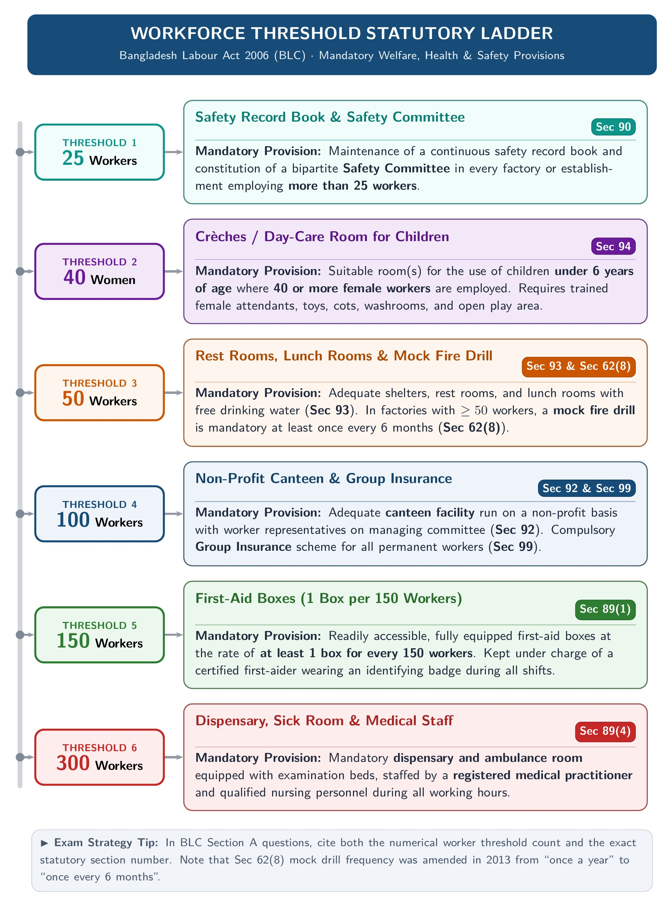

[← 05 · Ch 4 Trade Union, CBA & Disputes](05_Ch4_Trade_Union_CBA_Disputes_and_Applied_Scenarios.md) | [🏠 Master Plan & Index](00_Last_Night_Master_Plan_and_Index.md)

---

# 99 · One-Hour-Before-Exam Easy Revision Sheet (30 Marks in 10 Minutes)

> [!tip] Only What You Actually Need to Memorize!
> This sheet contains **only the exact section numbers and numbers from SI Sir's slides & handouts**, written in plain everyday words. Read this once before walking into the exam hall!

---

## 1. Chapter 1: Intro to Law (Zero Section Numbers!)

- **3 Scholar Quotes on Law:**
  - **Holland:** *"A rule of external human action enforced by the sovereign political authority."*
  - **Salmond:** *"The body of principles recognized and applied by the State in the administration of justice."*
  - **Woodrow Wilson:** *"Established habit and thought of mankind backed by the authority of the government."*
- **Industrial Law vs. Labor Law:**
  - **Industrial Law:** Regulates **working conditions inside factories/industries** (health, safety, welfare + good employer-worker relations).
  - **Labor Law:** Defines **rights and obligations of workers, employers, and trade unions** (wages, leave, maternity benefit, compensation).
- **9 Reasons ECE Students Should Learn Law:**
  1. **I**ntellectual Property Rights (patents/copyrights) · 2. **C**ompliance (safety/BTRC rules) · 3. **C**ontracts & Agreements · 4. **L**iability & Responsibility · 5. **E**thical Considerations · 6. **S**tartup & Entrepreneurship · 7. **R**egulatory Changes · 8. **C**ommunication & Collaboration · 9. **R**isk Management.

---

## 2. Chapter 2: Contract Act, 1872 (Only 12 Easy Section Numbers!)

| Section | Topic | 1-Line Easy Meaning to Write |
| :---: | :--- | :--- |
| **`Sec 2(a)`** | **Offer (Proposal)** | `X` shows willingness to do/not do something to get `Y`'s consent. |
| **`Sec 2(b)`** | **Acceptance / Promise** | `Y` agrees to the offer = **Acceptance**. Accepted offer = **Promise**. |
| **`Sec 2(c)`** | **Promisor & Promisee** | Maker of offer = **Promisor** (`X`); acceptor = **Promisee** (`Y`). |
| **`Sec 2(d)`** | **Consideration** | Something given/received in return (`P` gives house, `Q` gives $\text{Tk. } 80,000$). |
| **`Sec 2(e)`** | **Agreement** | $\text{Offer} + \text{Acceptance}$ (every promise forming consideration for each other). |
| **`Sec 2(g)`** | **Void Agreement** | **Not enforceable by law** (e.g., minor's agreement, no consideration, betting). |
| **`Sec 2(h)`** | **Contract** | **An agreement enforceable by law** ($\text{Agreement} + \text{Enforceable in court}$). |
| **`Sec 2(i)`** | **Voidable Contract** | Enforceable at the **option of the victim**, not the wrongdoer (e.g., coercion/threat). |
| **`Sec 25(1)`** | **Exception 1: Natural Love** | Valid without consideration if **in writing + registered + out of love + near relatives**. |
| **`Sec 25(2)`** | **Exception 2: Voluntary Act** | Promise to pay someone who **already voluntarily** helped you (e.g., found lost purse). |
| **`Sec 25(3)`** | **Exception 3: Time-Barred Debt** | Promise to pay an old time-expired debt, made **in writing and signed** by debtor. |
| **`Sec 26–30`** | **5 Expressly Void Agreements** | **`26`** Marriage ban · **`27`** Trade/job ban · **`28`** Court ban · **`29`** Uncertain meaning · **`30`** Betting/Wager. |
| **`Sec 56`** | **Supervening Impossibility** | Contract becomes **impossible or illegal after signing** $\to$ **Becomes Void**! |
| **`Sec 62`** | **Mutual Agreement** | Both sides agree to replace (**Novation**), change (**Alteration**), or cancel (**Rescission**). |

*(Plus: **`Sec 4`** = Acceptance complete when letter is posted; **`Sec 8`** = Acceptance by doing the condition/conduct; **`Sec 9`** = Express vs. Implied; **`Sec 127`** = Guarantee; **`Sec 185`** = Agency needs no consideration).*

### Quick Checklist for the 10-Mark Case Study (`Sec 56` Impossibility vs. Breach)
- **5 Valid Grounds (`Sec 56` Applies $\to$ Contract is VOID, Refund Advance):**
  1. **Destruction of object** (factory/hall burns down accidentally)
  2. **Change of law** (government import/trade ban)
  3. **Failure of pre-conditions** (main event cancelled)
  4. **Death or serious illness** (in personal skill jobs)
  5. **Outbreak of war**
- **5 Invalid Excuses (`Sec 56` Does NOT Apply $\to$ It is a BREACH, Pay Damages):**
  1. **Price hike / loss of profit** · 2. **Third-party supplier failed** · 3. **Workers' strike** · 4. **Only 1 purpose failed out of 2** · 5. **Own fault**.

---

## 3. Chapter 3: Bangladesh Labour Code, 2006 (Suggested Sections Only!)

*Figure: Easy Headcount Numbers to Remember for Chapter 3*

### A. Short Definitions (No Section Numbers Needed!)
- **Factory:** **$\ge 5$ workers** working on any day + **manufacturing process** (excludes mines).
- **Worker:** Person (including **apprentice**) doing **skilled, unskilled, manual, technical, trade promotional, or clerical work** for pay. *(Excludes managers/admin).*
- **Age Groups:** **Child** = under $14$; **Adolescent** = $14\text{ to under }18$; **Adult** = $18+$; **Minor** = under $18$.

### B. Maternity Benefits (`Sections 45 to 50`)
- **`Sec 45` (Work Ban):** Cannot work for **8 weeks after delivery**; no heavy/standing work **10 weeks before & 10 weeks after**.
- **`Sec 46` (16 Weeks Benefit):** **8 weeks before + 8 weeks after = 16 weeks (112 days)** paid leave. Needs **$\ge 6\text{ months}$ service**. No cash benefit if she has **$\ge 2$ surviving children** (gets unpaid leave only).
- **`Sec 47` (Notice & 3 Payment Ways):** Notice before delivery (or within **7 days** after). Paid within **3 working days** in 1 of 3 ways. Birth proof within **3 months**.
- **`Sec 48` (Cash Formula):** $\text{Daily Average Pay} = \text{Last 3 months total wages} \div \text{Actual days worked in those 3 months}$.
- **`Sec 49` (If Woman Dies):** Baby lives $\to$ paid to **person caring for baby**; baby dies $\to$ paid to **nominee/family**.
- **`Sec 50` (No Unfair Firing):** Cannot be deprived of benefit if fired without valid cause within **6 months before** or **8 weeks after** delivery.

### C. Fire Safety ONLY (`Section 62`: *Precaution in case of fire* · 8 Points)
1. **1 alternative connecting stairway** per floor + fire extinguishers.
2. **Inspector** can give written order to fix fire escapes.
3. Exit doors **unlocked from inside** and **opening outwards** (or sliding).
4. Fire exits marked in **red Bangla letters**.
5. Loud, **clearly audible whistle / fire alarm**.
6. **Unblocked free passageways** to exits.
7. **Escape training** if **$> 10$ workers** work above ground floor (or with explosives/flammables).
8. **Mock fire-fighting drill** + record book if **$\ge 50$ workers** (**once a year** in handout / **once every 6 months** in amended law).

### D. Adolescent Working Hours ONLY (`Section 41` · 8 Points)
- **Factory or Mine:** Max **5 hrs/day**, **30 hrs/week** (max **36 hrs/week** with overtime).
- **Other Establishments:** Max **7 hrs/day**, **42 hrs/week** (max **48 hrs/week** with overtime).
- **No Night Work:** Banned from **7:00 PM to 7:00 AM**.
- **Shifts & Relay:** Max **2 shifts** (spread-over $\le \mathbf{7.5\text{ hrs}}$); relay changed at most **once in 30 days**.
- **Weekly Holiday & Double Job:** Weekly holiday mandatory (no exemption); cannot work in $>1$ place on the same day.

### E. Welfare Measures (`Sections 89 to 94 & 99`)
- **`Sec 89` (First-Aid):** **1 box per 150 workers** under a trained person wearing a **badge**. **Sick room + dispensary** if **$\ge 300$ workers**.
- **`Sec 90` (Safety Book):** **Safety Record Book & Board** if **$> 25$ workers**.
- **`Sec 91` (Washing):** Clean, **separate screened** washing/bathing spaces for men and women.
- **`Sec 92` (Canteen):** Mandatory if **$> 100$ workers** (committee with worker reps sets menu & prices).
- **`Sec 93` (Shelters & Lunch Room):** Mandatory if **$> 50$ workers** (with drinking water; no eating in workroom). Separate female shelter if **$> 25$ women** (screened space if $< 25$).
- **`Sec 94` (Children's Room / Crèche):** Mandatory if **$\ge 40$ female workers** (for children **under 6 yrs**). Under a **trained woman**, height **$\ge 360\text{ cm}$**, floor area **$\ge 600\text{ sq. cm}$** *(6000 sq. cm in Act)* per child, with **cots, mother's chair, toys, and fenced shady playground**.
- **`Sec 99` (Group Insurance):** Mandatory if **$\ge 200$ permanent workers** *(100 in amended law)*.

---

## 4. Chapter 4: Trade Union Act & Industrial Disputes (Only 8 Section Numbers!)

- **7 Functions of Trade Union:** (1) Contact bridge between workers & employer, (2) Fair wages, (3) Stop unfair firing/retrenchment, (4) Reduce working hours, (5) Stop exploitation, (6) Improve factory conditions, (7) Arrange accident/death insurance.
- **5 Legal Status Points:** (1) Statutory body, (2) Separate legal entity, (3) Own property & act as agent, (4) Hold movable/immovable property, (5) Contract, sue and be sued.
- **8 Rights of Registered Union:** (1) Incorporation, (2) Protection from criminal case, (3) Protection from civil suit in disputes, (4) Enforceability of agreements, (5) Inspect account books, (6) Minor member at **age $15+$**, (7) Change name (**$2/3$** members agree), (8) Amalgamation/Merger (**$50\%$** vote turnout, **$60\%$** in favor).
- **Registration (`Sec 177, 178, 179, 182`) & Cancellation (`Sec 190`):**
  - Apply by Chairman & Secretary (`Sec 177`) + 9 details & 3 copies of constitution (`Sec 178`) + **$30\%$ workers**, $5\text{–}35$ executive members, meetings every 3m/1yr (`Sec 179`) $\to$ Registered by Director of Labour within **60 days (`Sec 182`)**.
  - **7 Cancellation Reasons (`Sec 190`):** Own request, closed down, fraud, broke constitution, unfair labor practice, membership $< 30\%$, broke Labour Code rules.
- **CBA (Collective Bargaining Agent):** Elected by **secret ballot** (or automatic if only 1 registered union).
  - **5 CBA Powers:** (1) Bargain with employer, (2) Represent workers in proceedings, (3) Give notice & declare strike, (4) Nominate reps to Welfare/PF/Participation funds, (5) Conduct court cases.
- **Settlement of Industrial Disputes (`Sec 210` Day Numbers):**
  1. **Direct Talks:** Written notice $\to$ meet within **15 days** $\to$ talk for **1 month (30 days)**.
  2. **Conciliator:** Report within **15 days** $\to$ starts within **10 days** $\to$ **30 days** to settle $\to$ Failure Certificate within **3 days**.
  3. **Arbitrator:** Both sides agree in writing $\to$ Final Award within **30 days** (no appeal, valid up to **2 years**).
- **Unfair Labor Practices:** **`Sec 195`** = by Employers (12 items: firing/transferring union leaders, bribing, hiring during strike, illegal lock-out; penalty = **1 yr jail / $\text{Tk. } 5,000$ fine**). **`Sec 196`** = by Workers (6 items: forcing workers/employer, illegal strike, go-slow, **Gherao**; penalty = **6 months jail / $\text{Tk. } 200$ fine**).

---

[← 05 · Ch 4 Trade Union, CBA & Disputes](05_Ch4_Trade_Union_CBA_Disputes_and_Applied_Scenarios.md) | [🏠 Back to 00 · Master Plan & Index](00_Last_Night_Master_Plan_and_Index.md)
