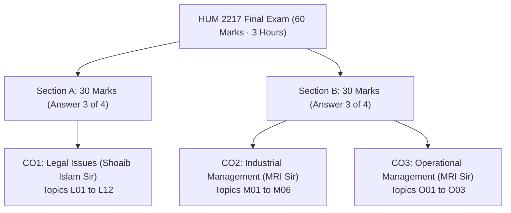
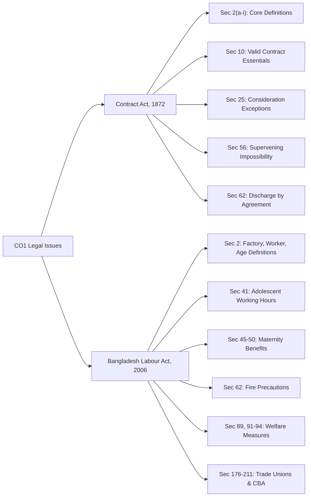
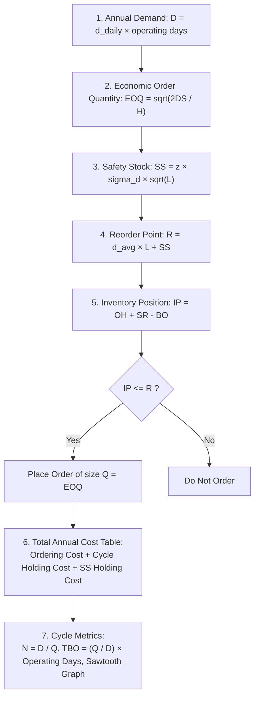

# HUM 2217: Topicwise Exam-Style Answers Master Index

> [!info] Vault Navigation & Architecture
> This master index provides links to all 21 topic answer files for **HUM 2217: Legal Issues, Industrial & Operational Management** (RUET ECE, 8th Semester / 2-2).
> - **Primary Question Bank:** [subtopicwise_questions.md](../subtopicwise_questions.md) (All 109 questions categorized across 21 topics)
> - **Weightage & Flow Specification:** [subtopicwise_list.md](../subtopicwise_list.md) (Complete marks distribution and topic order)
> - **Historical Exam Trends:** [Question_Analysis_Report.md](../PreviousYearQuestions/Question_Analysis_Report.md) (Four-year analysis of finals and class tests)

---

## 1. Syllabus Structure & Exam Blueprint

The examination carries **60 marks** over 3 hours. It is divided into two separate sections answered on distinct scripts:

### Course Outcome Summary

| Course Outcome | Primary Focus | Instructor | Topic Range | Total Final Marks ('20–'24) | '23–'24 Share | CT Marks |
| :-- | :-- | :-- | :--: | :-: | :-: | :-: |
| **CO1** | Legal Issues | Shoaib Islam (SI) Sir | `L01` to `L12` | 68 | 42.5% | 40 |
| **CO2** | Industrial Management | Md. Rokonuzzaman (MRI) Sir | `M01` to `M06` | 138 | 38.8% | 20 |
| **CO3** | Operational Management | Md. Rokonuzzaman (MRI) Sir | `O01` to `O03` | 50 | 18.8% | 20 |
| **Total** | | | **21 Topics** | **256** | **100%** | **80** |

---

## 2. Master Topic Directory (All 21 Topic Answer Files)

Click any topic link to open the exam-style answers for that module:

### Part A: CO1 Legal Issues (Shoaib Islam Sir · Section A)

| ID | Topic Title & File Link | Final Marks | '23–'24 Marks | CT Marks | Tier | Key Syllabus Coverage |
| :-- | :-- | :-: | :-: | :-: | :-: | :-- |
| `L01` | [L01 · Introduction to Law](L01_Introduction_to_Law.md) | 2 | 2 | 0 | 🟠 High | Holland, Salmond, Wilson definitions; Industrial vs. Labour Law; 9 ECE legal imperatives. |
| `L02` | [L02 · Contract Basics, Formation, Offer & Acceptance](L02_Contract_Basics_and_Formation.md) | 18 | 18 | 20 | 🔴 Critical | Contract Act 1872 `Sec 2(a–i)`, `Sec 10`; Carlill v Carbolic Smoke Ball; communication rules. |
| `L03` | [L03 · Consideration](L03_Consideration.md) | 0 | 0 | 0 | 🔴 Critical | `Sec 2(d)`; Stranger to consideration; 7 exceptions to "No consideration, no contract" (`Sec 25`). |
| `L04` | [L04 · Discharge of Contract & Applied Case Study](L04_Discharge_of_Contract.md) | 4 | 4 | 0 | 🔴 Critical | 6 modes of discharge; Supervening impossibility (`Sec 56`); 10-mark structured legal case study. |
| `L05` | [L05 · BLC Definitions, Working Hours & Multi-Issue Compliance](L05_BLC_Definitions_and_Adolescents.md) | 10 | 10 | 10 | 🔴 Critical | BLC 2006 `Sec 2(2, 7, 8, 36, 63, 65)`; Adolescent working hours (`Sec 41`); compliance scenario. |
| `L06` | [L06 · Maternity Benefit](L06_Maternity_Benefit.md) | 0 | 0 | 0 | 🔴 Critical | BLC 2006 `Sec 45–50`; 16 weeks leave; eligibility rules; notice procedure; wage calculations. |
| `L07` | [L07 · Workplace Safety: Fire Precautions & Machinery](L07_Fire_Safety.md) | 8 | 8 | 10 | 🟠 High | BLC 2006 `Sec 62`; Fire exits; escape stairs; mock drill frequencies; factory safety notices. |
| `L08` | [L08 · Welfare Measures](L08_Welfare_Measures.md) | 0 | 0 | 0 | 🟠 High | BLC 2006 `Sec 89, 91–94`; First-aid boxes; canteens; shelters; day-care crèche statutory dimensions. |
| `L09` | [L09 · Termination of Employment](L09_Termination_of_Employment.md) | 0 | 0 | 0 | 🟡 Likely | BLC 2006 Ch. II; Retrenchment (`Sec 20`); Discharge (`Sec 22`); Dismissal (`Sec 23–24`); Notice (`Sec 26`). |
| `L10` | [L10 · Trade Union: Basics, Registration, Status, Rights](L10_Trade_Union.md) | 10 | 10 | 0 | 🔴 Critical | BLC 2006 `Sec 176–179` (30% threshold), `182, 190, 194` (body corporate), `197–199` (immunities). |
| `L11` | [L11 · Collective Bargaining, CBA & Industrial Disputes](L11_CBA_and_Industrial_Disputes.md) | 8 | 8 | 0 | 🔴 Critical | BLC 2006 `Sec 202` (CBA election & powers); `Sec 210` dispute settlement ladder; `Sec 211` strike notice. |
| `L12` | [L12 · Unfair Labour Practices](L12_Unfair_Labour_Practices.md) | 8 | 8 | 0 | 🟡 Likely | BLC 2006 `Sec 195` (12 employer practices); `Sec 196` (6 worker practices); applied telecom scenarios. |

---

### Part B: CO2 Industrial Management (Md. Rokonuzzaman Sir · Section B)

| ID | Topic Title & File Link | Final Marks | '23–'24 Marks | CT Marks | Tier | Key Syllabus Coverage |
| :-- | :-- | :-: | :-: | :-: | :-: | :-- |
| `M01` | [M01 · Management Foundations](M01_Management_Foundations.md) | 30 | 17 | 12 | 🔴 Critical | Taylor vs. Griffin definitions; 4 resources; 4 management functions; Efficiency vs. Effectiveness. |
| `M02` | [M02 · Levels, Areas & Managerial Skills](M02_Levels_Areas_Skills.md) | 12 | 8 | 6 | 🟠 High | Top, Middle, First-line levels; 10 functional areas; 7 core skills; skill mix across management tiers. |
| `M03` | [M03 · Classical Management: Fayol & Taylor](M03_Fayol_and_Taylor.md) | 15 | 5 | 0 | 🟠 High | Henri Fayol's 14 principles; Scalar Chain & Gangplank diagram; F.W. Taylor Scientific Management. |
| `M04` | [M04 · Planning, Decision Making, Organizing & Controlling](M04_Planning_Decisions_Organizing_Control.md) | 19 | 10 | 2 | 🟡 Likely | Rational decision-making model; Departmentalization; Delegation of authority; Span of control. |
| `M05` | [M05 · Employee Motivation](M05_Motivation.md) | 33 | 15 | 0 | 🔴 Critical | Maslow's Hierarchy of Needs; Herzberg's Two-Factor Theory; Vroom's Expectancy Theory math. |
| `M06` | [M06 · HRM & Performance Appraisal](M06_HRM_and_Appraisal.md) | 29 | 7 | 0 | 🔴 Critical | Appraisal objectives; Methods; 5 rating errors (halo, leniency, central tendency, recency, contrast). |

---

### Part C: CO3 Operational Management (Md. Rokonuzzaman Sir · Section B)

| ID | Topic Title & File Link | Final Marks | '23–'24 Marks | CT Marks | Tier | Key Syllabus Coverage |
| :-- | :-- | :-: | :-: | :-: | :-: | :-- |
| `O01` | [O01 · Inventory Concepts](O01_Inventory_Concepts.md) | 16 | 4 | 0 | 🔴 Critical | High vs. low holding costs; 4 inventory types; ABC Analysis dollar-volume rules; EOQ assumptions. |
| `O02` | [O02 · EOQ and Continuous Review System](O02_EOQ_and_Q_System.md) | 34 | 26 | 20 | 🔴 Critical | Guaranteed numerical block: $D, EOQ, SS, R, IP$ decision, 3-lot cost table, $N, TBO$, sawtooth graph. |
| `O03` | [O03 · Productivity](O03_Productivity.md) | 0 | 0 | 0 | 🟠 High | SFP vs. MFP; Month-over-month % change; 7 decline causes; Human Factors & Industry 4.0 fixes. |

---

## 3. Shoaib Sir's CO1 Strict Evaluation Checklist

Shoaib Islam Sir issued a specific warning regarding Section A:
*"The shorter the suggestion, the stricter the script evaluation."*
A single missing or incorrect statutory section number reduces marks immediately. Accurate legal citations can secure full marks (30/30).

### Statutory Verification Directory

### Verified Statutory Rules
1. **Contract Act, 1872:**
   - **Definitions:** Proposal (`Sec 2(a)`), Acceptance/Promise (`Sec 2(b)`), Consideration (`Sec 2(d)`), Agreement (`Sec 2(e)`), Void Agreement (`Sec 2(g)`), Contract (`Sec 2(h)`), Voidable Contract (`Sec 2(i)`).
   - **Validity:** Essential elements of a valid contract under **Section 10**.
   - **Consideration Exceptions:** Natural love and affection (`Sec 25(1)`), Past voluntary service (`Sec 25(2)`), Time-barred debt (`Sec 25(3)`), Agency (`Sec 185`), Completed gifts (`Sec 25 Expl. 1`).
   - **Supervening Impossibility (`Sec 56`):** Valid grounds (destruction of subject matter, change of law, death/incapacity in personal service, outbreak of war) vs. Non-qualifying commercial excuses (market price hikes, strikes, third-party default).
   - **Discharge by Mutual Agreement (`Sec 62`):** Novation, Rescission, Alteration, Remission, Waiver.

2. **The Bangladesh Labour Act, 2006 (Act XLII of 2006):**
   - **Definitions (`Sec 2`):** Manufacturing Process (`Sec 2(2)`), Factory with $\ge 5$ workers (`Sec 2(7)`), Adolescent aged 14 to under 18 (`Sec 2(8)`), Adult aged $\ge 18$ (`Sec 2(36)`), Child aged under 14 (`Sec 2(63)`), Worker (`Sec 2(65)`).
   - **Adolescent Working Hours (`Sec 41`):** Factory/mine maximum: 5 hours/day, 30 hours/week (36 hours with overtime). Other establishments maximum: 7 hours/day, 42 hours/week (48 hours with overtime). Night work prohibited between 7:00 PM and 7:00 AM.
   - **Maternity Benefits (`Sec 45–50`):** 16 weeks total paid leave (8 weeks pre-natal and 8 weeks post-natal). Requires $\ge 6$ months service. Barred if the woman has two or more surviving children.
   - **Fire Safety (`Sec 62`):** Fire escape stairways (`62(1)`), outward-opening doors (`62(3)`), red Bangla exit signs (`62(4)`), audible alarm (`62(5)`), and mock drills for factories with $\ge 50$ workers (`62(8)`: cite both 2006 Act "once a year" and 2013 Amendment "every 6 months" with 18% trained staff).
   - **Welfare Facilities (`Sec 89, 91–94`):** First-aid box per 150 workers (`Sec 89`), washing spaces (`Sec 91`), canteen for $> 100$ workers (`Sec 92`), shelters/lunch rooms for $> 50$ workers (`Sec 93`), crèches for $\ge 40$ female workers (`Sec 94`: height $\ge 360\text{ cm}$, area $\ge 6000\text{ sq. cm}$ per child under 6 years).
   - **Trade Unions & CBA (`Chapters XIII & XIV`):** Formation right (`Sec 176`), registration & 30% membership threshold (`Sec 177–179`), cancellation grounds (`Sec 190`), body corporate legal status (`Sec 194`), employer unfair practices (`Sec 195`), worker unfair practices (`Sec 196`), civil & criminal immunities (`Sec 197–198`), CBA determination & powers (`Sec 202`), dispute settlement ladder (`Sec 210`), and strike notice (`Sec 211`).

### The 4-Step Legal Case Framework
Apply this structured layout to every legal case study or scenario question:
1. **Facts of the Case:** Summarize the core operational dispute in 1 to 2 sentences.
2. **Applicable Law & Section:** State the exact Act name, legal doctrine, and statutory section number.
3. **Legal Analysis:** Apply the legal principles directly to the disputed facts.
4. **Direct Conclusion:** Provide an unambiguous verdict.

---

## 4. MRI Sir's CO2 & CO3 Formulas and Core Frameworks

### 4.1 Industrial Management (CO2)

1. **Dual Definition of Management:**
   - **F.W. Taylor (1911):** *"Management is an art of knowing what to do and seeing that it is done in the best and cheapest way."*
   - **Ricky W. Griffin:** A set of activities (planning, decision making, organizing, leading, controlling) directed at organizational resources (human, financial, physical, information) to achieve goals efficiently and effectively.

2. **Efficiency vs. Effectiveness:**
   - **Efficiency:** Doing things right. Minimizes resource waste ($\frac{\text{Output}}{\text{Input}}$).
   - **Effectiveness:** Doing the right things. Achieves chosen strategic organizational goals.

3. **Henri Fayol's 14 Principles:**
   Division of work, Authority and responsibility, Discipline, Unity of command, Unity of direction, Subordination of individual interest, Remuneration, Centralization, Scalar chain (with Gangplank), Order, Equity, Stability of tenure, Initiative, Esprit de corps.

4. **Motivation Formulas:**
   - **Maslow:** Physiological $\to$ Safety $\to$ Social $\to$ Esteem $\to$ Self-Actualization.
   - **Herzberg:** Hygiene factors (dissatisfaction preventers) vs. Motivator factors (satisfaction builders).
   - **Vroom's Expectancy Theory:**

$$
\text{Motivation} = \text{Expectancy } (E \to P) \times \text{Instrumentality } (P \to R) \times \text{Valence } (V)
$$

5. **Performance Appraisal Rating Errors:**
   Halo error, Leniency/Strictness, Central tendency, Recency bias, Contrast error.

---

### 4.2 Operational Management (CO3)

#### 1. Continuous Review ($Q$) System Complete Formula Chain

Every step in an inventory exam numerical must be written in this sequence:

- **Annual Demand:**

$$
D = \bar{d} \times \text{Operating Days/Year}
$$

- **Economic Order Quantity ($EOQ$):**

$$
EOQ = \sqrt{\frac{2DS}{H}}
$$

- **Safety Stock ($SS$):**

$$
SS = z \sigma_d \sqrt{L}
$$

  *(Normal table values: $z(88\%) = 1.175$, $z(90\%) = 1.28$, $z(95\%) = 1.645$, $z(98\%) = 2.05$, $z(99\%) = 2.33$)*.

- **Reorder Point ($R$):**

$$
R = \bar{d} L + SS
$$

- **Inventory Position ($IP$):**

$$
IP = OH + SR - BO
$$

  *Decision Rule:* Place a replenishment order of size $Q$ if and only if $IP \le R$.

- **Total Annual Cycle Cost:**

$$
TC(Q) = \frac{D}{Q}S + \frac{Q}{2}H
$$

  *Total Policy Cost with Safety Stock:*

$$
TC_{\text{total}} = \frac{D}{Q}S + \frac{Q}{2}H + SS \times H
$$

- **Order Frequency ($N$) and Time Between Orders ($TBO$):**

$$
N = \frac{D}{Q}, \quad TBO = \frac{Q}{D} \times \text{Operating Days/Year}
$$

---

#### 2. Productivity Formulations

- **General Definition:**

$$
\text{Productivity} = \frac{\text{Output}}{\text{Input}}
$$

- **Single-Factor Labor Productivity:**

$$
SFP = \frac{\text{Total Output Units}}{\text{Labor Hours}}
$$

- **Multifactor Productivity (MFP):**

$$
MFP = \frac{\text{Total Output Value}}{\text{Labor Cost} + \text{Material Cost} + \text{Overhead / Machine Cost}}
$$

- **Period-over-Period Percentage Change:**

$$
\% \Delta P = \frac{P_{\text{new}} - P_{\text{old}}}{P_{\text{old}}} \times 100\%
$$

- **Class 11 Partial Factor Ratios:**

$$
\text{Labour Ratio} = \frac{\text{Total Revenue}}{\text{Labor Cost}}, \quad \text{Material Ratio} = \frac{\text{Output Units}}{\text{Material Cost}}, \quad \text{Machine Ratio} = \frac{\text{Output Units}}{\text{Machine Cost}}
$$

- **Seven Operational Decline Challenges:**
  Human factors, Technological issues, Quality vs. quantity trade-off, Resource constraints, Process inefficiencies, External disruptions, Measurement deficiencies.

- **Two Improvement Pillars:**
  1. *Managing Human Factors:* SOP training, ergonomic workplace redesign, output and low-defect bonuses.
  2. *Technological Modernization & Industry 4.0:* Semi-automated machinery, IIoT sensors, AI predictive maintenance, automated optical inspection cameras.

---

## 5. Exam Hall Strategy & Time Budget

1. **Allocated Time:** 180 minutes for 6 questions gives **30 minutes per 10-mark question**.
2. **Question Picking Sequence:**
   - **Step 1:** Scan Section B immediately. Pick any question containing a Continuous Review ($Q$) System numerical (`O02`) or Productivity numerical (`O03`). These questions offer objective calculations that secure 10/10 marks rapidly.
   - **Step 2:** Pick management questions with clear structured lists (Fayol's 14 principles, motivation models, or appraisal errors).
   - **Step 3:** Move to Section A. Select legal questions where you know the exact statutory section numbers cold (e.g. `Sec 56` frustration grounds, `Sec 62` fire rules, or `Sec 45–50` maternity benefits).
   - **Step 4:** Never answer questions with vague claims. Support every legal argument with bold statutory citations.

---

[🏠 Return to Root Question Bank](../subtopicwise_questions.md) | [View Weightage List](../subtopicwise_list.md) | [Read Question Analysis Report](../PreviousYearQuestions/Question_Analysis_Report.md)
