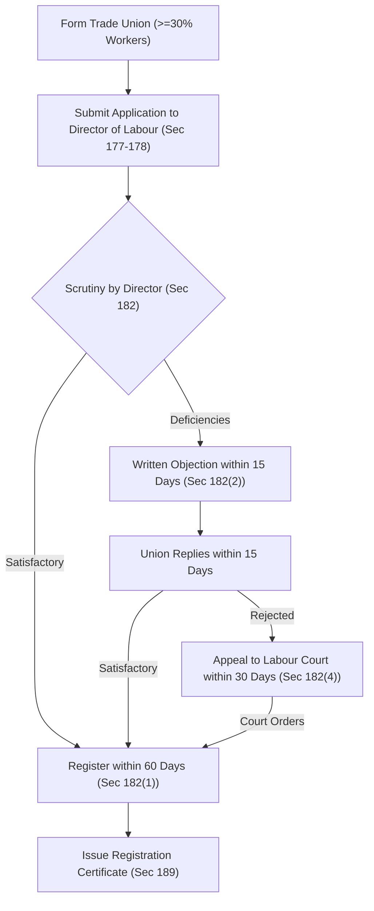

[← Prev: L09 · Termination of Employment](L09_Termination_of_Employment.md) | [🏠 Index](00_Index.md) | [Next: L11 · CBA and Industrial Disputes →](L11_CBA_and_Industrial_Disputes.md)

---

# L10 · Trade Union: Basics, Registration, Status & Rights

> [!info] Topic Summary & Exam Blueprint
> - **Course Outcome:** CO1 (Legal Issues · Shoaib Islam Sir)
> - **Exam Weightage:** 10 Final Marks (`3.9%` · 1/2 papers) + 00 CT Marks
> - **Priority Tier:** 🔴 Essential (Explicitly prescribed by Shoaib Sir for Applied / Analytical questions)
> - **Primary Sources:** `Legal_Issues/Notes/Chapter-4.md`, `Legal_Issues/Slides/Chapter-4 slide.md`, `Books/BangladeshLabourCode2006/Chapter_13_Trade_Unions_and_Industrial_Relations.md`

## Subtopics & Question Index

| ID | Subtopic | Past Marks (Final + CT) | Questions Covered | Jump |
| :-- | :-- | :---: | :-- | :-- |
| L10.1 | Definition and nature of a trade union; right to form one (`Sec 176`) | 0 + 0 | Model Q.1 (02m) | [[#L10.1 · Definition and Nature of a Trade Union; Right to Form One (Sec 176)\|Go]] |
| L10.2 | Objectives of a trade union | 2 + 0 | 2024 Q.3(a) (02m) | [[#L10.2 · Objectives of a Trade Union\|Go]] |
| L10.3 | Functions of a trade union | 0 + 0 | Model Q.1 (04m) | [[#L10.3 · Functions of a Trade Union\|Go]] |
| L10.4 | Registration process of a trade union (`Sec 177–189`; 30% threshold under `Sec 179(2)`) | 4 + 0 | 2024 Q.3(b) (04m), Model Q.1 (04m) | [[#L10.4 · Registration Process of a Trade Union (Sec 177–189)\|Go]] |
| L10.5 | Cancellation of registration of a trade union (`Sec 190`) | 0 + 0 | Model Q.1 (03m) | [[#L10.5 · Cancellation of Registration of a Trade Union (Sec 190)\|Go]] |
| L10.6 | Legal status / incorporation of a registered trade union (`Sec 194`) | 0 + 0 | Model Q.1 (04m) | [[#L10.6 · Legal Status / Incorporation of a Registered Trade Union (Sec 194)\|Go]] |
| L10.7 | Rights and privileges of a registered trade union (`Sec 197–199` & 8 general rights) | 0 + 0 | Model Q.1 (04m) | [[#L10.7 · Rights and Privileges of a Registered Trade Union (Sec 197–199 & Course Notes)\|Go]] |
| L10.8 | Applied: role of trade unions in preventing workplace discrimination or bias against technical staff | 4 + 0 | 2024 Q.8(c) (04m) | [[#L10.8 · Applied: Role of Trade Unions in Preventing Workplace Discrimination or Bias Against Technical Staff\|Go]] |

> [!tip] Memory Hook (Trade Union Numbers & Sections)
> Master Chapter XIII using these key sections and statutory numbers:
> - **Sec 176 (Right to Form):** Anyone may form unions without prior approval (`>=20% women -> >=10% executive seats`).
> - **Sec 179(2) (30% Threshold):** A union must represent at least **30% membership** of total workers in the establishment.
> - **Sec 182 (60-Day Mandate):** The Director of Labour must complete registration within **60 days**.
> - **Sec 190 (Cancellation):** **7 cancellation grounds** apply; requires prior Labour Court permission.
> - **Sec 194 (Body Corporate):** Grants legal personality, perpetual succession, common seal, and power to sue or be sued.
> - **Sec 197–199 (Immunities):** Statutory shields against criminal conspiracy (`Sec 197`) and civil suits (`Sec 198`) in trade disputes.

---

## L10.1 · Definition and Nature of a Trade Union; Right to Form One (Sec 176)

*No standalone question in past finals or class tests. Prescribed in Shoaib Sir's final exam blueprint (Voice Note at [06:40–07:05]).*

### L10.1 · Model Exam Question 1 · 02 Marks

*Suggested Topic (Chapter 4) · Target: Part (a)*

**Question.** Define Trade Union under the Bangladesh Labour Act, 2006. State the statutory rights of workers and employers to form and join trade unions under Section 176.

**Answer.**

**1. Statutory Definitions (`Section 2(15)` & `Section 2(62)`):**
- **Trade Union (`Section 2(15)`):** Under BLA 2006, a trade union means an association of workers or employers under Chapter XIII. The statutory term also includes a federation of trade unions.
- **Industrial Dispute (`Section 2(62)`):** An industrial dispute means any disagreement between employers and workers. It covers terms of employment, non-employment, or working conditions. Trade unions represent workers directly in these disputes.

**2. Nature and Purpose:**
In ordinary language, a trade union is a continuous association of workers. It aims to improve employment terms, secure fair pay, and protect workers through collective bargaining.

**3. Statutory Rights to Form and Join (`Section 176`):**
Subject to Chapter XIII of BLA 2006:
- **Workers' Right (`Sec 176(a)`):** All workers have the right to form and join trade unions of their choice. They do not need any prior authorization.
- **Employers' Right (`Sec 176(b)`):** All employers have the equal right to form and join associations or trade unions.
- **Federation and Affiliation (`Sec 176(c)`):** Trade unions can form federations. They can affiliate with national and international worker or employer organizations.
- **Autonomy (`Sec 176(d)`):** Trade unions write their own constitutions and elect leaders freely. They run daily activities without external interference.
- **Gender Representation (`Sec 176(e)`):** Suppose women form at least 20% of an establishment's workforce. The executive committee must then include at least 10% women members.

---

## L10.2 · Objectives of a Trade Union

### 2024 Q.3(a) · 02 Marks

*Section A · CO1 · Asked in: 2024 Final*

**Question.** List the key objectives of the trade union.

**Answer.**

A trade union operates to protect worker rights and maintain industrial harmony. Key objectives under Chapter 4 include:

1. **Improve Living Standards:** Secure fair wages, profit-sharing bonuses, pensions, and healthcare benefits for workers.
2. **Protect Worker Interests:** Safeguard workers against arbitrary discharge, unlawful retrenchment, and unfair dismissals.
3. **Collective Negotiation:** Negotiate fair working hours, leave entitlements, and safe shift rotations with employers.
4. **Prevent Exploitation:** Shield vulnerable workers from unfair labour practices and management abuse.
5. **Promote Industrial Harmony:** Build mutual trust and resolve industrial disputes through bipartite negotiations.
6. **Provide Mutual Welfare:** Create mutual benefit schemes, group insurance, and educational support for worker families.
7. **Ensure Organizational Stability:** Build stable worker leadership and democratic representation in factory operations.

*(Exam Tip: For 2 marks, write 4 to 6 concise points for maximum credit.)*

---

## L10.3 · Functions of a Trade Union

*Never asked in past finals or class tests. Explicitly named by Shoaib Sir in his exam blueprint (Voice Note at [06:40–07:05]).*

### L10.3 · Model Exam Question 1 · 04 Marks

*Suggested Topic (Chapter 4) · Target: Part (b) or (c)*

**Question.** Explain the core functions of a trade union in modern industry. Group these functions into their recognized categories.

**Answer.**

Trade unions perform essential functions to support workers and maintain factory productivity. In industrial management, these functions fall into four distinct categories:

**1. Militant or Protective Functions (Defensive Functions):**
- **Securing Fair Wages:** Demand pay scales matching worker skill, inflation, and living costs through collective strength.
- **Protecting Job Security:** Oppose arbitrary retrenchments and dismissals by holding management strictly to legal procedures.
- **Regulating Working Hours:** Enforce statutory limits on daily shifts, rest intervals, weekly holidays, and overtime pay.
- **Ensuring Workplace Safety:** Compel employers to maintain fire exits, machine guards, clean drinking water, and first aid facilities.

**2. Fraternal or Extramural Functions (Mutual Aid):**
- **Accident and Death Relief:** Arrange insurance schemes and emergency financial aid for workers suffering occupational injuries or death.
- **Skill Training:** Provide training sessions to enhance worker competence and trade knowledge.
- **Cooperative Benefits:** Set up credit cooperatives, subsidized canteen facilities, and affordable housing schemes for members.

**3. Social Functions:**
- **Connecting Workers and Management:** Bridge communication gaps between executive managers and factory-floor workers.
- **Community Welfare:** Promote health campaigns, literacy programs, and civic awareness in worker neighborhoods.

**4. Political and Civic Functions:**
- **Legislative Representation:** Advocate for worker-friendly labor laws and represent labour interests on national wage boards.

---

## L10.4 · Registration Process of a Trade Union (Sec 177–189)

### 2024 Q.3(b) · 04 Marks

*Section A · CO1 · Asked in: 2024 Final*

**Question.** Explain the process of registration of a trade union as outlined in the Bangladesh Labor Code 2006.

**Answer.**

Registration gives a trade union legal existence and statutory protections. Chapter XIII of the Bangladesh Labour Act, 2006 (BLA 2006) sets out the required registration process:

**1. Application Submission (`Section 177`):**
- The Chairman and Secretary of the union sign and deliver an application to the Registrar of Trade Unions.
- Under Section 177(2), the Registrar means the Director of Labour or an authorized officer.

**2. Application Requirements (`Section 178`):**
- The application must state:
  1. The union name and head office address.
  2. The date of formation.
  3. Names, parents' names, ages, addresses, jobs, and union titles of all officers.
  4. Statement of total paying members.
  5. Name of the establishment and total number of workers employed.
- The application must enclose three copies of the union constitution and the member resolution adopting it. It must also include the resolution authorizing the Chairman and Secretary to apply.

**3. Preconditions for Registration (`Section 179`):**
- **Constitution Terms (`Sec 179(1)`):** The constitution must define union objects, dues, and election terms (up to 2 years). It must schedule quarterly executive meetings, annual general meetings, and fix executive size (5 to 35 members).
- **30% Membership Threshold (`Section 179(2)`):** A workers' trade union must represent at least 30% of total workers in the establishment. All must be registered members.
- **Establishment Limit (`Sec 179(5)`):** No establishment may have more than 3 registered trade unions at any time.

**4. Scrutiny and Timelines (`Section 182`):**
- **60-Day Mandate (`Sec 182(1)`):** The Director of Labour must register the union within 60 days of receiving the application. The Director then issues a formal registration certificate.
- **Objections (`Sec 182(2)–(3)`):** If the application has errors, the Director sends written objections within 15 days. The union must reply within 15 days. If satisfied, the Director registers the union. Otherwise, the Director rejects it.
- **Appeal (`Sec 182(4)–(6)`):** If the Director rejects or delays past 60 days, the union may appeal within 30 days. The Labour Court can order registration within 7 days.

**5. Certificate of Registration (`Section 189`):**
- The Director of Labour issues a registration certificate in the prescribed form. This certificate serves as conclusive evidence of valid registration.

**6. Protection During Pendency (`Section 186`):**
- While registration is pending, the employer cannot worsen service conditions of union officers.
- Also, the employer cannot terminate any union member under Section 26 during this period.

### L10.4 · Model Exam Question 1 · 04 Marks

*Suggested Topic (Chapter 4) · Target: Part (b) or (c)*

**Question.** What are the statutory preconditions for trade union registration under Section 179 of BLA 2006? Explain the mandatory 30% membership threshold.

**Answer.**

Under **Section 179** of BLA 2006, a trade union must fulfill strict statutory rules before registration. Its constitution must satisfy several core conditions:

**1. Mandatory 30% Membership Threshold (`Section 179(2)`):**
- A workers' trade union must enroll at least **30% of total workers** in the establishment. This minimum threshold applies across single establishments or grouped units.
- This threshold stops fake unions from forming. It ensures authentic collective bargaining strength.

**2. Mandatory Constitutional Provisions (`Section 179(1)`):**
The constitution of the trade union must explicitly provide for:
1. **Objects and Fund Maintenance (`Sec 179(1)(a)–(d)`):** Clear statements of lawful union objects, fund sources, and permissible spending.
2. **Membership Admission and Dual Membership Bar (`Sec 179(1)(c)`):** Clear admission rules. Each worker must declare they belong to no other trade union in that establishment.
3. **Internal Governance & Meetings (`Sec 179(1)(m)`):** The executive committee must meet at least quarterly. The general body must hold an annual meeting.
4. **Election Terms and Executive Size (`Sec 179(1)(j)–(k)`):** Democratic election of officers for two to three years. The executive committee must have 5 to 35 members.
5. **Safe Custody and Annual Audit (`Sec 179(1)(h)`):** Safe custody of funds and an annual audit of accounts. Members have the right to inspect all account books.
6. **No-Confidence Procedure (`Sec 179(1)(l)`):** Transparent rules for moving and voting on no-confidence motions against union officers.

**3. Maximum Limit on Unions (`Section 179(5)`):**
- No establishment can have more than three registered trade unions at any time.

---

## L10.5 · Cancellation of Registration of a Trade Union (Sec 190)

*Never asked in past finals or class tests. High-yield statutory question based on Section 190 of BLA 2006 and Chapter-4.md.*

### L10.5 · Model Exam Question 1 · 03 Marks

*Suggested Topic (Chapter 4) · Target: Part (b)*

**Question.** On what grounds can the Director of Labour cancel trade union registration under Section 190 of BLA 2006? State the mandatory procedure.

**Answer.**

Under **Section 190** of the Bangladesh Labour Act, 2006, the Director of Labour may cancel union registration. Cancellation strips the trade union of its corporate status.

**1. Seven Statutory Grounds for Cancellation (`Section 190(1)`):**
1. **Union Request:** The trade union applies for its own cancellation.
2. **Dissolution:** The union has ceased to exist.
3. **Fraud or Deceit:** The union obtained registration through fraud or misrepresentation of facts.
4. **Constitutional Violation:** The union violated any basic provision of its constitution.
5. **Unfair Labour Practice:** The union committed an unfair labour practice under Section 196.
6. **Loss of Minimum Membership:** Union membership fell below the statutory 30% threshold required under Section 179(2).
7. **Statutory Violation:** The union violated any provision of Chapter XIII or the Labour Rules.

**2. Mandatory Cancellation Procedure (`Section 190(2)–(4)`):**
- The Director of Labour cannot cancel registration unilaterally.
- The Director must investigate and apply to the **Labour Court** for prior permission.
- For unfair labour practices, the application must reach the Labour Court within 3 months of the incident.
- Upon receiving Labour Court permission, the Director of Labour must cancel the registration within 30 days.
- **Right of Appeal (`Section 191`):** An aggrieved union may appeal to the Labour Appellate Tribunal within 30 days. The union continues operating until the Tribunal resolves the appeal.

---

## L10.6 · Legal Status / Incorporation of a Registered Trade Union (Sec 194)

*Never asked in past finals or class tests. Explicitly emphasized by Shoaib Sir in his exam blueprint (Voice Note at [06:40–07:05]).*

### L10.6 · Model Exam Question 1 · 04 Marks

*Suggested Topic (Chapter 4) · Target: Part (b) or (c)*

**Question.** State the legal status of a registered trade union under Section 194 of the Bangladesh Labour Act, 2006. What legal rights arise upon registration?

**Answer.**

Registration converts an informal worker association into an independent legal personality. Under **Section 194** of the Bangladesh Labour Act, 2006, registration establishes specific legal characteristics:

**1. Core Legal Status (`Section 194(1)`):**
- **Body Corporate:** Every registered trade union becomes a body corporate under its registered name. It exists as an artificial legal entity separate from its individual members.
- **Perpetual Succession:** The union enjoys unbroken continuity. Changes in leadership, worker resignations, or deaths do not affect its legal life.
- **Common Seal:** The union has an official common seal. It uses this seal to authenticate official documents, contracts, and deeds.
- **Power to Hold Property:** The union has statutory power to acquire, hold, and sell property in its own name. This includes movable assets like vehicles and immovable assets like land.
- **Power to Contract:** The union can enter valid contracts, lease premises, and hire services in its corporate name.
- **Right to Sue and Be Sued:** The union can file lawsuits in court in its registered name. Other parties can also sue the union directly under that name.

**2. Exclusion of General Corporate Laws (`Section 194(2)`):**
- General corporate laws do not apply to registered trade unions. These excluded laws include the Societies Registration Act 1860, Co-operative Societies Ordinance 1985, and Companies Act 1994.
- Any registration under those laws is void. The union operates exclusively under the Bangladesh Labour Act.

---

## L10.7 · Rights and Privileges of a Registered Trade Union (Sec 197–199 & Course Notes)

*Never asked in past finals or class tests. Prescribed by Shoaib Sir in his final exam blueprint (Voice Note at [06:40–07:05]).*

### L10.7 · Model Exam Question 1 · 04 Marks

*Suggested Topic (Chapter 4) · Target: Part (b) or (c)*

**Question.** Explain the statutory immunities of a registered trade union under Sections 197 to 199 of BLA 2006. Also list its key general rights.

**Answer.**

The Bangladesh Labour Act, 2006 provides registered trade unions with special immunities. These shields allow unions to conduct trade disputes without fear of common-law liability.

**1. Three Statutory Immunities under BLA 2006:**
- **Immunity from Criminal Conspiracy (`Section 197`):**
  - Union officers and members are immune from criminal conspiracy charges under Section 120B(2) of the Penal Code 1860. This shield covers lawful agreements made to advance legitimate union goals.
  - *Exception:* This immunity does not protect any agreement to commit an actual criminal offense.
- **Immunity from Civil Suit (`Section 198`):**
  - Civil courts cannot entertain lawsuits against a registered union, officer, or member for dispute actions solely because:
    1. The act induces someone to breach an employment contract.
    2. The act interferes with trade, business, or another person's employment.
    3. The act affects another person's right to dispose of capital or labour.
  - *Tort Liability Shield (`Sec 198(2)`):* A trade union is not liable for torts committed by its agents without executive knowledge. It is also exempt if the agent acted against express instructions.
- **Enforceability of Agreements (`Section 199`):**
  - Agreements between union members are valid even if their terms restrain trade or commerce.

**2. General Rights Recognized in Course Notes (`Chapter-4.md`):**
- **Right to Inspect Books (`Sec 181`):** Officers and members may inspect union account books and membership registers at designated times.
- **Minor Membership:** Any worker aged 15 or older can join a registered trade union and enjoy full membership privileges.
- **Change of Name:** A union can change its name if two-thirds of total members vote in favor. The proposed new name must also be unique.
- **Amalgamation:** Two or more registered unions may merge into a single union. This merger requires at least 50% voter turnout and at least 60% approval from votes cast.

---

## L10.8 · Applied: Role of Trade Unions in Preventing Workplace Discrimination or Bias Against Technical Staff

### 2024 Q.8(c) · 04 Marks

*Section B · CO1 · Asked in: 2024 Final*

**Question.** Critically evaluate the role of trade unions in preventing workplace discrimination or bias agent technical staff.  
*(Note: "bias agent" is printed in original; refers to "bias against")*

**Answer.**

We evaluate this applied scenario using the four-step legal and operational framework:

**1. Facts and Workplace Context:**
Technical staff in engineering plants, telecom networks, and automated factories face distinct challenges. Common biases include pay gaps compared to administrative staff, subjective promotion criteria, and forced night shifts without rest intervals. Technical staff may also face arbitrary job transfers and unsafe work near high-voltage gear.

**2. Applicable Law and Sections:**
- **Bangladesh Labour Act, 2006:**
  - **Section 2(65):** Defines technical personnel performing skilled or manual work as "workers".
  - **Section 195(b) & (c):** Outlaws employer discrimination in employment, promotion, or working conditions as an Unfair Labour Practice.
  - **Section 202(24)(a):** Authorizes the Collective Bargaining Agent (CBA) to negotiate binding terms of employment.
  - **Section 108 & 187:** Mandates overtime rates and protects union officers from arbitrary inter-district transfers.

**3. Critical Evaluation:**
- **Protective and Positive Role:**
  - *Objective Promotion Ladders:* Unions negotiate transparent promotion criteria based on technical certifications and objective skills. This removes managerial favoritism and subjective bias.
  - *Equal Pay and Structured Grades:* Unions establish clear salary bands through CBA agreements. This prevents arbitrary wage suppression for technicians and junior engineers.
  - *Shift and Safety Regulation:* Unions enforce statutory overtime pay and maximum spread-over limits during emergency night maintenance.
  - *Legal and Union Defense:* If an employer disciplines or targets a technician unfairly, the union provides legal aid. Union representatives defend the worker directly before the Labour Court.
- **Limitations and Risks (Critical Perspective):**
  - General unions are often dominated by non-technical workers. As a result, they may overlook specialized technical safety concerns like RF radiation or high-voltage risks.
  - Strict seniority rules favored by general unions can sometimes slow down rapid promotions for high-performing young engineers.

**4. Direct Conclusion:**
Trade unions serve as an essential collective shield against managerial bias for technical staff. They turn individual vulnerability into collective bargaining power under BLA 2006. Technical personnel should join union executive committees (`Sec 179(1)(k)`). Active participation ensures collective agreements reflect their specialized risks and skill-based pay.

---

[← Prev: L09 · Termination of Employment](L09_Termination_of_Employment.md) | [🏠 Index](00_Index.md) | [Next: L11 · CBA and Industrial Disputes →](L11_CBA_and_Industrial_Disputes.md)
