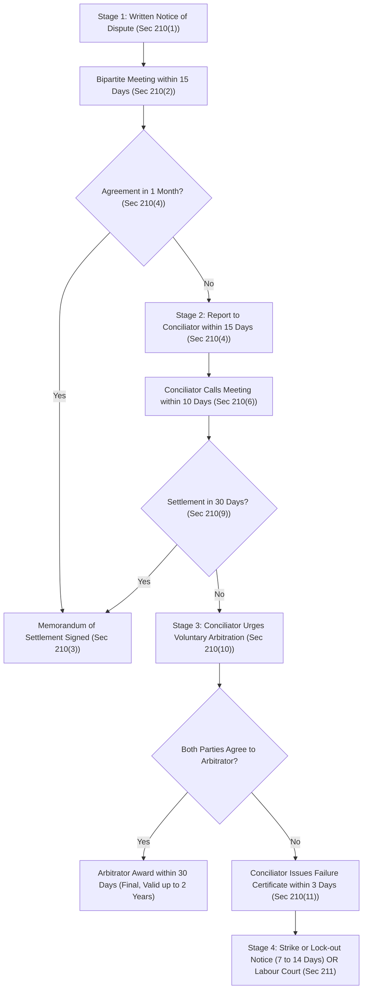

[← Prev: L10 · Trade Union](L10_Trade_Union.md) | [🏠 Index](00_Index.md) | [Next: L12 · Unfair Labour Practices →](L12_Unfair_Labour_Practices.md)

---

# L11 · Collective Bargaining, CBA & Industrial Disputes

> [!info] Topic Summary & Exam Blueprint
> - **Course Outcome:** CO1 (Legal Issues · Shoaib Islam Sir)
> - **Exam Weightage:** 08 Final Marks (`3.1%` · 2/2 Legal Papers) + 00 CT Marks
> - **Priority Tier:** 🔴 Essential (CBA Determination, Powers, Dispute Resolution Ladder & Applied Scenario)
> - **Primary Sources:** `Legal_Issues/Notes/Chapter-4.md`, `Legal_Issues/Slides/Chapter-4 slide.md`, `Books/BangladeshLabourCode2006/Chapter_13_Trade_Unions_and_Industrial_Relations.md` (Sec 202), `Books/BangladeshLabourCode2006/Chapter_14_Settlement_of_Disputes_and_Labour_Courts.md` (Sec 209–211)

## Subtopics & Question Index

| ID | Subtopic | Past Marks (Final + CT) | Questions Covered | Jump |
| :-- | :-- | :---: | :-- | :-- |
| L11.1 | Collective bargaining: definition, features, and importance | 2 + 0 | 2023 Q.4(a) (split, 01m), 2024 Q.8(a) (split, 01m) | [[#L11.1 · Collective Bargaining: Definition and Features\|Go]] |
| L11.2 | Collective Bargaining Agent (CBA): determination (`Sec 202`) & powers (`Sec 202(24)`) | 1 + 0 | 2023 Q.4(a) (split, 01m), Model Q (04m) | [[#L11.2 · Collective Bargaining Agent CBA: Determination and Exclusive Powers\|Go]] |
| L11.3 | Industrial dispute: definition (`Sec 2(62)`), forms, and standing to raise (`Sec 209`) | 1 + 0 | 2024 Q.8(a) (split, 01m), Model Q (03m) | [[#L11.3 · Industrial Dispute: Definition, Forms, and Raising of Dispute\|Go]] |
| L11.4 | Statutory settlement ladder (`Sec 210` talks → conciliation → arbitration / strike `Sec 211`) | 0 + 0 | Model Q (04m) | [[#L11.4 · Statutory Settlement Ladder of Industrial Disputes\|Go]] |
| L11.5 | Applied: hypothetical industrial dispute scenario & analytical cases | 4 + 0 | 2024 Q.3(c) (04m), Model Analytical Q (05m) | [[#L11.5 · Applied: Industrial Dispute Scenarios and Analytical Cases\|Go]] |

---

## L11.1 · Collective Bargaining: Definition and Features

### 2023 Q.4(a) & 2024 Q.8(a) · Collective Bargaining Block · 02 Marks

*2023 Final Q.4(a) (Sec A · CO1 · 01 of 02 Marks) | 2024 Final Q.8(a) (Sec B · CO1 · 01 of 02 Marks)*

**2023 Q.4(a) Verbatim Text.** What is collective bargaining and who is collective bargaining agent?

**2024 Q.8(a) Verbatim Text.** Define Industrial dispute and collective bargaining.

*Cross-ref:* Collective Bargaining Agent (CBA) is answered in full under [[#L11.2 · Collective Bargaining Agent CBA: Determination and Exclusive Powers|L11.2]]. Industrial Dispute is answered in full under [[#L11.3 · Industrial Dispute: Definition, Forms, and Raising of Dispute|L11.3]].

**Answer.**

**Collective Bargaining** is the negotiation process between an employer and workers organized through their trade union. The parties discuss and agree on employment terms, wages, working hours, benefits, health and safety, and grievance procedures.

Its primary goal is to reach a signed, written agreement called a **Memorandum of Settlement**. This agreement governs employment relations and protects workplace peace.

#### Core Features of Collective Bargaining
1. **Collective Representation:** Workers act together through their certified union instead of bargaining as vulnerable individuals.
2. **Bipartite Negotiation:** The process involves direct talks between management and worker representatives without outside control.
3. **Continuous Dialogue:** Bargaining does not stop after signing a contract. It continues through day-to-day contract administration and grievance handling.
4. **Mutual Compromise:** Both parties adjust their positions. Workers balance wage demands with factory viability. Employers balance profits with worker welfare.
5. **Legally Binding Contract:** Once signed, the settlement binds the employer and all workers in the establishment.

#### Practical Importance in Industrial Relations
- It prevents unfair labour practices by setting objective wage scales and clear working rules.
- It builds industrial stability by resolving grievances before they turn into strikes or lock-outs.
- It boosts worker morale and productivity by giving workers an active voice in setting workplace terms.

> [!tip] Exam Trimming Note (For 01-Mark Sub-Questions)
> For a 1-mark question, write only the 2-sentence definition. Add three short bullet points: collective action, bipartite dialogue, and legally binding settlement.

---

## L11.2 · Collective Bargaining Agent CBA: Determination and Exclusive Powers

### 2023 Q.4(a) · CBA Definition · 01 of 02 Marks

*Section A · CO1 · Asked in: 2023 Final*

**Question.** What is collective bargaining and who is collective bargaining agent?

*Cross-ref:* Collective bargaining is answered under [[#L11.1 · Collective Bargaining: Definition and Features|L11.1]].

**Answer.**

Under the Bangladesh Labour Act, 2006, a **Collective Bargaining Agent (CBA)** is a registered trade union. It holds exclusive legal authority to negotiate with the employer for all workers in the establishment.

If only one registered trade union exists, it is deemed the CBA (`Sec 202(1)`). But its members must make up at least one-third ($\frac{1}{3}$) of all workers (`Sec 202(5)`). If multiple registered unions exist, the Director of Labour holds a secret ballot election (`Sec 202(2)`). The elected CBA holds office for a term of 2 years (`Sec 202(16)`).

---

### L11.2 · Model Exam Question · 04 Marks

*High-Yield Statutory Question · Target: Part (b) or (c) · BLC Chapter XIII Section 202*

**Question.** Explain how a Collective Bargaining Agent (CBA) is determined in an establishment under Section 202 of the Bangladesh Labour Act, 2006. State its exclusive powers and rights under Section 202(24).

**Answer.**

**Section 202** of the Bangladesh Labour Act, 2006 governs the determination and legal authority of a Collective Bargaining Agent (CBA).

> [!tip] Memory Hook: CBA Key Numbers
> $\frac{1}{3}$ threshold (members or votes) $\rightarrow$ 120 days for ballot $\rightarrow$ $<10\%$ votes cancels registration $\rightarrow$ 2-year tenure.

#### 1. Statutory Determination of CBA (`Section 202`)
The method of determination depends on the number of registered trade unions in the establishment:

- **Single Registered Trade Union (`Sec 202(1), (5)`):**
  Where only one registered trade union exists, it is deemed the CBA. But it must include at least **one-third ($\frac{1}{3}$)** of the total workers as members.
- **Multiple Registered Trade Unions (`Sec 202(2)–(15)`):**
  If two or more registered unions exist, any union or the employer may apply to the Director of Labour. The Director then conducts a secret ballot within **120 days** of receiving the application:
  1. *Notice to Contest (`Sec 202(3)`):* The Director issues a formal notice to all registered unions. Each union has 15 days to declare whether it will contest the ballot.
  2. *Voter List Preparation (`Sec 202(6)–(12)`):* The employer submits a list of all workers with at least 3 months of service. This list excludes casual and substitute workers. The Director verifies the list and settles objections. He then sends the certified voter list to all contesting unions at least 7 days before the poll.
  3. *Conduct of Poll (`Sec 202(13)–(15)`):* The Director sets up sealed ballot boxes at polling stations. No person may canvas for votes within 45 meters of the polling station.
  4. *Winning Threshold (`Sec 202(15)(e)`):* The union receiving the highest votes is declared the CBA. But it must secure votes from at least **one-third ($\frac{1}{3}$)** of all workers in the factory.
  5. *Cancellation for Low Votes (`Sec 202(22)`):* A contesting trade union must win sufficient support. If it receives less than **10%** of the total votes cast, its registration is cancelled automatically.
- **Tenure of CBA (`Sec 202(16)`):**
  The CBA holds office for **2 years** from declaration (3 years for a group of establishments). No new CBA determination can begin during this tenure.

#### 2. Exclusive Powers and Rights of the CBA (`Section 202(24)`)
Under Section 202(24), only the certified CBA has the exclusive statutory right to:

1. **Bargain with the Employer (`Sec 202(24)(a)`):** Negotiate with the employer on employment and non-employment terms. This includes service conditions and the physical work environment.
2. **Represent Workers in Legal Proceedings (`Sec 202(24)(b)`):** Represent all or any workers in conciliation, arbitration, or Labour Court proceedings.
3. **Declare Strike (`Sec 202(24)(c)`):** Give notice of and declare a lawful strike under Chapter XIV. This requires prior approval by secret ballot.
4. **Nominate Worker Representatives (`Sec 202(24)(d)`):** Nominate worker representatives to factory welfare committees and provident funds. It also nominates trustees to the Workers' Participation Fund under Chapter XV.
5. **Conduct Legal Cases (`Sec 202(24)(e)`):** File and conduct legal cases before Labour Courts. It acts on behalf of individual workers or groups of workers.
6. **Mandatory Office Room (`Sec 202(26)`):** The employer must allot an office room inside the establishment for the elected CBA.

---

## L11.3 · Industrial Dispute: Definition, Forms, and Raising of Dispute

### 2024 Q.8(a) · Industrial Dispute Definition · 01 of 02 Marks

*Section B · CO1 · Asked in: 2024 Final*

**Question.** Define Industrial dispute and collective bargaining.

*Cross-ref:* Collective bargaining is answered under [[#L11.1 · Collective Bargaining: Definition and Features|L11.1]].

**Answer.**

Under **Section 2(62)** of the Bangladesh Labour Act, 2006, an **industrial dispute** means:
> "any dispute or difference of opinion between employers and employers, between employers and workers or between workers and workers in respect of appointment or conditions of service or conditions of work or environment of work of any person."

In practice, it is an unresolved workplace conflict. Typical causes include disputes over wages, bonus, working hours, safety appliances, or worker discipline.

---

### L11.3 · Model Exam Question · 03 Marks

*Suggested Topic · Target: Part (b) · BLC Chapter XIV Sections 2(62), 209*

**Question.** Distinguish between industrial disputes raised by employers and industrial disputes raised by workers. Explain who is legally entitled to raise an industrial dispute under Section 209 of the Bangladesh Labour Act, 2006.

**Answer.**

#### 1. Legal Standing to Raise an Industrial Dispute (`Section 209`)
Under **Section 209** of the Bangladesh Labour Act, 2006:
- No industrial dispute exists legally unless raised by an **employer** or by a certified **Collective Bargaining Agent (CBA)**.
- An individual worker or an uncertified minority union cannot raise an industrial dispute under Chapter XIV. An individual worker may only file a grievance petition for vested rights under Section 33.

#### 2. Practical Forms of Disputes: Employers vs. Workers
Industrial disputes appear through distinct actions taken by both sides:

| Party | Form of Action | Statutory Reference | Legal Meaning and Practical Nature |
| :--- | :--- | :--- | :--- |
| **Employer** | **Lock-out** | `Section 2(57)` | Closing a place of employment or suspending work to compel workers to accept employment terms during a dispute. |
| **Employer** | **Lay-off** | `Section 2(58)` | Failure or inability of an employer to give work due to power failure, coal/raw material shortage, or machine breakdown. |
| **Employer** | **Retrenchment** | `Section 2(11)` | Terminating worker services because of operational redundancy (surplus staff), not as punishment. |
| **Employer** | **Dismissal** | `Section 2(39)` | Terminating a worker for proved misconduct under Section 23 following a formal charge-sheet and inquiry. |
| **Workers** | **Strike** | `Section 2(22)` | Cessation of work or joint refusal by workers to continue working under a common understanding. |
| **Workers** | **Go-slow** | `Section 2(18)` | An organized, deliberate slowing down of normal production output, not caused by mechanical breakdown or power failure. |
| **Workers** | **Boycott / Gherao** | `Section 196(6)` | Workers attend the factory but refuse to perform tasks. Physical confinement of managers (Gherao) is an illegal unfair labour practice. |

---

## L11.4 · Statutory Settlement Ladder of Industrial Disputes

### L11.4 · Model Exam Question · 04 Marks

*High-Yield Target · BLC Chapter XIV Sections 210 & 211*

**Question.** Describe the statutory ladder for the settlement of industrial disputes under Sections 210 and 211 of the Bangladesh Labour Act, 2006.

**Answer.**

The Bangladesh Labour Act, 2006 prescribes a progressive, four-stage ladder under **Sections 210 and 211** to resolve industrial disputes peacefully.

> [!tip] Memory Hook: Dispute Settlement Timeline
> 15d bipartite start $\rightarrow$ 30d talks $\rightarrow$ 15d report to Conciliator $\rightarrow$ 10d start $\rightarrow$ 30d conciliation $\rightarrow$ 3d failure certificate $\rightarrow$ 30d Arbitrator award (2-yr validity) OR 15d window for 7–14d strike notice.

#### Stage 1: Direct Bipartite Negotiation (`Section 210(1)–(3)`)
1. **Written Notice (`Sec 210(1)`):** A dispute may be likely to arise. Either the employer or the CBA sends its views in writing to the other party.
2. **Arranging Bilateral Meeting (`Sec 210(2)`):** The recipient must arrange a collective bargaining meeting within **15 days** of receiving the notice.
3. **Dialogue Period (`Sec 210(4)(b)`):** Both parties hold direct talks. They have **1 month** from the first meeting to reach an agreement.
4. **Settlement (`Sec 210(3)`):** If an agreement is reached, both parties sign a written **Memorandum of Settlement**. The employer sends copies to the Government, the Director of Labour, and the Conciliator.

#### Stage 2: Conciliation by Government Conciliator (`Section 210(4)–(11)`)
1. **Reporting Failure (`Sec 210(4)`):** Talks may fail, or the recipient may ignore the meeting request. Either party may then report to the Conciliator within **15 days**.
2. **Commencing Conciliation (`Sec 210(6)`):** The gazetted Conciliator must begin conciliation proceedings within **10 days** of receiving the written request.
3. **Statutory Time Limit (`Sec 210(9)`):** The Conciliator has **30 days** to bring about a settlement. The parties may extend this period in writing.
4. **Successful Conciliation (`Sec 210(8)`):** If settled, the Conciliator forwards a report and the signed Memorandum of Settlement to the Government.
5. **Conciliation Failure (`Sec 210(10)–(11)`):** If no settlement is reached within 30 days, conciliation fails. The Conciliator attempts to persuade both parties to accept voluntary arbitration. If either party refuses, the Conciliator must issue a **Failure Certificate** within **3 days**.

#### Stage 3: Voluntary Arbitration (`Section 210(12)–(17)`)
1. **Joint Written Referral (`Sec 210(12)`):** If both parties consent, they refer the dispute to an Arbitrator in writing. They may choose an agreed person or pick from the Government panel.
2. **Arbitration Award (`Sec 210(14)`):** The Arbitrator issues an award within **30 days** of receiving the referral.
3. **Finality (`Sec 210(16)–(17)`):** The award of the Arbitrator is final and legally binding. No appeal lies against it. It remains in force for up to **2 years**.

#### Stage 4: Strike, Lock-out, or Labour Court Decision (`Section 211`)
1. **Strike or Lock-out Notice (`Sec 211(1)`):** Either party has **15 days** from receiving the Failure Certificate to act. The CBA may issue a strike notice, or the employer may issue a lock-out notice. The notice period must be between **7 and 14 days**.
2. **Secret Ballot Mandate for Strike (`Sec 211(1)` Proviso):** The CBA must hold a secret ballot supervised by the Conciliator. It can serve a strike notice only if at least **two-thirds ($\frac{2}{3}$)** of its members vote in favor.
3. **Labour Court Decision (`Sec 211(1), (2)`):** Either party may apply directly to the Labour Court for a settlement. They can do this instead of declaring a strike or lock-out. If a strike or lock-out has already begun, either party may still apply.
4. **Government Prohibition (`Sec 211(3)–(5)`):** The Government may prohibit any strike or lock-out lasting over 30 days. It can act even earlier for public utilities or national interest. The Government then refers the dispute to the Labour Court.
5. **Court Award (`Sec 211(6)–(7)`):** The Labour Court must give its binding award within **60 days**. The award remains in force for up to **2 years**.

---

## L11.5 · Applied: Industrial Dispute Scenarios and Analytical Cases

### 2024 Q.3(c) · 04 Marks

*Section A · CO1 · Asked in: 2024 Final*

**Question.** Develop a hypothetical scenario involving an industrial dispute in an industry and outline the steps that should be taken to resolve it under the Bangladesh Labor Code 2006.

**Answer.**

#### 1. Facts of the Case (Hypothetical Electronics Factory)
- **Establishment:** "Silicon Circuits Bangladesh Ltd.", an electronics manufacturing plant in Gazipur employing 450 workers. The plant produces telecommunication router boards and printed circuit assemblies.
- **Root Cause of Dispute:**
  1. The employer introduced mandatory 12-hour shifts during an export surge but refused to pay statutory overtime wages under Section 108.
  2. Soldering station technicians demanded exhaust ventilation hoods and protective masks to prevent inhaling toxic lead fumes.
  3. Technicians demanded a 10% technical skill allowance.
- **Dispute Inception:** Management rejected all demands. The certified CBA, "Silicon Circuits Workers' Union" (representing 320 members), declared an industrial dispute.

#### 2. Applicable Law & Sections (Hypothetical Dispute)
- **The Bangladesh Labour Act, 2006 (Act XLII of 2006).**
- **Section 2(62):** Definition of industrial dispute concerning conditions of work and wages.
- **Section 209:** Requirement that only the certified CBA or employer can raise a dispute.
- **Section 210:** Statutory multi-tier dispute settlement procedure.
- **Section 108:** Statutory overtime calculation (double the ordinary rate of basic wage and dearness allowance).

#### 3. Legal Analysis & Resolution Steps
To resolve this dispute lawfully under the Bangladesh Labour Act, 2006, the parties must follow these sequential steps:

1. **Step 1: Direct Written Communication (`Sec 210(1)`):**
   The General Secretary of the CBA prepares a written charter of demands. He serves this document on the Managing Director of Silicon Circuits Bangladesh Ltd.
2. **Step 2: Bipartite Negotiation (`Sec 210(2)–(3)`):**
   Management arranges a collective bargaining meeting within **15 days** of receiving the letter. Representatives meet over the next three weeks. Management agrees to install exhaust hoods and pay statutory overtime under Section 108. But management refuses the 10% technical allowance due to budget limits. The 1-month negotiation window expires without reaching full consensus.
3. **Step 3: Referral to Government Conciliator (`Sec 210(4)–(7)`):**
   Within **15 days** after bipartite talks stall, the CBA sends a written application to the regional Conciliator (Department of Labour). The Conciliator convenes a tripartite conciliation meeting within **10 days**.
4. **Step 4: Conciliation Settlement (`Sec 210(8)–(9)`):**
   During the 30-day conciliation period, the Conciliator proposes a compromise formula. Management agrees to clear all overtime arrears and install ventilation hoods immediately. In return, the union accepts a 6% technical allowance tied to output targets. Both parties accept this compromise on the 20th day of conciliation.
5. **Step 5: Memorandum of Settlement (`Sec 210(3), (8)`):**
   Both parties sign a formal **Memorandum of Settlement** before the Conciliator. The Conciliator registers the agreement. He sends copies to the Director of Labour and the Ministry of Labour and Employment.
6. **Contingency If Conciliation Had Failed (`Sec 210(10)–(17)` & `Sec 211`):**
   If conciliation had failed, the Conciliator would have issued a Failure Certificate within 3 days. The parties could then refer the dispute to voluntary arbitration (`Sec 210(12)`). If either party rejected arbitration, the CBA could hold a secret ballot under Conciliator supervision. With two-thirds ($\frac{2}{3}$) member approval, the CBA could issue a 7 to 14 days strike notice (`Sec 211(1)`). Alternatively, either party could apply to the Labour Court for a binding decision.

#### 4. Direct Conclusion (Hypothetical Dispute Resolution)
The industrial dispute is lawfully resolved at the conciliation stage under **Section 210(8)**. The signed Memorandum of Settlement binds the company and all 450 workers for up to 2 years. This process restores factory production while securing workplace ventilation safety and statutory overtime compensation.

---

### L11.5 · Model Analytical Question · 05 Marks

*Analytical / Intellectual Application Target · Shoaib Sir Voice Note Blueprint [07:05–07:24]*

**Question.** An optical fiber manufacturing plant with 600 workers has two registered trade unions: Union A (380 members, certified as CBA) and Union B (160 members, representing specialized technicians). When the management dismisses two technicians for alleged insubordination, Union B directly serves a 7-day strike notice on the Managing Director and files an industrial dispute with the Labour Court. Meanwhile, the employer refuses to discuss annual bonus adjustments with Union A, arguing that it will only negotiate with individual department heads.

Analyze the legal validity of the actions taken by Union B and the employer under Chapter XIII and Chapter XIV of the Bangladesh Labour Act, 2006.

**Answer.**

#### 1. Facts of the Case (Optical Fiber Plant Dispute)
- **Establishment:** Optical fiber manufacturing plant employing 600 workers.
- **Parties:** Union A (380 members, certified CBA); Union B (160 members, registered minority trade union); Plant Management.
- **Actions in Dispute:**
  1. Union B directly served a 7-day strike notice and filed an industrial dispute with the Labour Court over technician dismissals.
  2. Employer refused to negotiate annual bonus terms with certified CBA Union A, seeking separate individual departmental talks.

#### 2. Applicable Law & Sections (CBA Exclusivity and Strike Rules)
- **The Bangladesh Labour Act, 2006 (Act XLII of 2006).**
- **Section 202(24):** Exclusive statutory powers of the certified Collective Bargaining Agent.
- **Section 209:** Restriction that only an employer or CBA may raise an industrial dispute.
- **Section 211(1):** Strike notice rules, failure certificate prerequisite, and two-thirds member ballot consent.
- **Section 2(43) & Section 196(5):** Illegal strike definition and worker unfair labour practice.
- **Section 195(10):** Employer unfair labour practice for refusing to communicate or negotiate with the CBA.

#### 3. Legal Analysis (Union B and Employer Conduct)

##### Part A: Legality of Union B's Actions (Completely Illegal)
1. **Lack of Legal Standing (`Section 209`):**
   Under Section 209, no industrial dispute exists unless raised by the employer or the certified CBA. Union B is an uncertified minority union. It has zero legal authority to raise an industrial dispute under Chapter XIV.
2. **Illegal Strike Notice (`Sec 202(24)(c)` & `Sec 211(1)`):**
   Under Section 202(24)(c), the power to give notice of and declare a strike belongs exclusively to the certified CBA. Also, under Section 211(1), a strike notice can only be issued after:
   - Bilateral negotiation and conciliation have both failed.
   - The Conciliator has issued a formal Failure Certificate under Section 210(11).
   - At least two-thirds ($\frac{2}{3}$) of union members have voted in favor through a secret ballot supervised by the Conciliator.
   Union B bypassed negotiation, conciliation, and the secret ballot entirely. Its strike notice is completely void. Any work stoppage under this notice constitutes an **illegal strike** under Section 2(43). It is also an **unfair labour practice** under Section 196(5). The leaders face imprisonment, and the union risks losing its registration under Section 190.
3. **Premature Labour Court Application:**
   Chapter XIV requires completing bipartite talks and conciliation before approaching the Labour Court. A minority union cannot jump this statutory ladder. The two dismissed technicians must file individual grievance petitions under Section 33. Alternatively, certified CBA Union A may take up their case under Section 202(24)(e).

##### Part B: Legality of Employer's Actions (Completely Illegal)
1. **Violation of CBA Exclusivity (`Section 202(24)(a)`):**
   The certified CBA holds the exclusive right to bargain on all employment terms (`Sec 202(24)(a)`). The employer cannot bypass the union or negotiate separately with individual department heads.
2. **Unfair Labour Practice by Employer (`Section 195(10)`):**
   Under Section 195(10), the employer must reply to communications from the CBA about a dispute. Refusing to talk or reply constitutes an explicit unfair labour practice. The employer must negotiate with Union A.

#### 4. Direct Conclusion (Analytical Ruling)
- **Union B's actions are entirely illegal.** Union B cannot call a strike. It cannot take a dispute to the Labour Court. Doing so constitutes an unfair labour practice under Section 196(5).
- **The employer's actions are entirely illegal.** Management cannot refuse to negotiate with certified CBA Union A. Doing so is an unfair labour practice under Section 195(10).
- **Lawful Course:** The employer must begin bipartite talks with Union A under Section 210. The dismissed technicians can submit grievance petitions under Section 33. They may also ask Union A to represent them under Section 202(24)(e).

---

[← Prev: L10 · Trade Union](L10_Trade_Union.md) | [🏠 Index](00_Index.md) | [Next: L12 · Unfair Labour Practices →](L12_Unfair_Labour_Practices.md)
