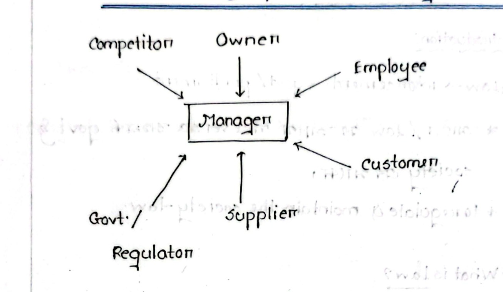
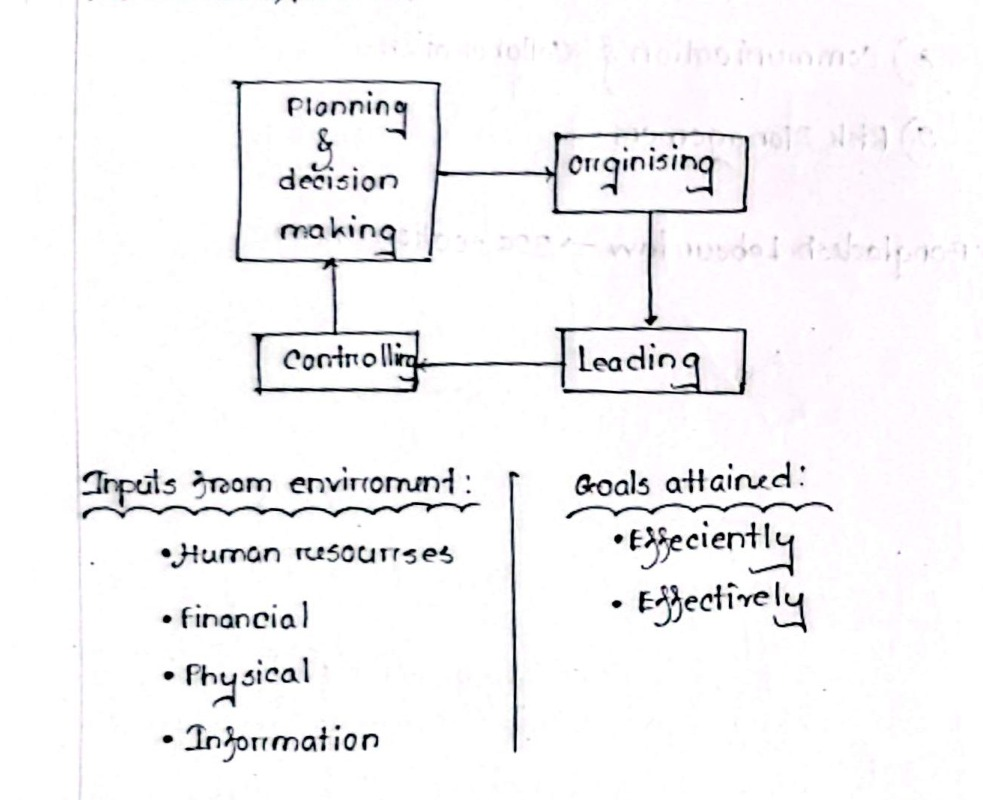

[← Prev: L12 · Unfair Labour Practices](L12_Unfair_Labour_Practices.md) | [🏠 Index](00_Index.md) | [Next: M02 · Levels, Areas and Skills →](M02_Levels_Areas_Skills.md)

---

# M01 · Management Foundations

> [!info] Topic Summary & Exam Blueprint
> - **Course Outcome:** CO2 (Industrial Management · Md. Rafiqul Islam Sir)
> - **Exam Weightage:** 30 Final Marks (`11.7%` · 4/4 papers) + 12 CT Marks
> - **Priority Tier:** 🔴 Essential (Tested in every final exam paper and CT-1)
> - **Primary Sources:** `Industrial_and_Operations_Management/Lecture 1.md`, `Lecture 2.md`, `Classnotes_Hum2217_Raidah.md` (Classes 1–4), `Books/Fundamentals_of_Management_Griffin/Chapter_01_Understanding_the_Managers_Job.md`, `PreviousYearQuestions/CT_questions.md` (§2)

## Subtopics & Question Index

| ID | Subtopic | Past Marks (Final + CT) | Questions Covered | Jump |
| :-- | :-- | :---: | :-- | :-- |
| M01.1 | Define management / industrial management | 12 + 0 | 2020 Q.1(a), 2021 Q.1(a), 2023 Q.5(a), 2024 Q.1(a), 2024 Q.5(a) | [[#M01.1 · Define Management and Industrial Management\|Go]] |
| M01.2 | Organizational stakeholders, 4 resources, and 8 features of management | 0 + 8 | 2025 IM-CT1 Q.3, Q.7, Q.8, Q.9, Model Q (04m) | [[#M01.2 · Stakeholders, Resources, and Nature of Management\|Go]] |
| M01.3 | Efficiency vs. effectiveness ($2 \times 2$ matrix and decision examples) | 7 + 2 | 2021 Q.2(a) (Part 2), 2023 Q.5(b), 2025 IM-CT1 Q.2 | [[#M01.3 · Efficiency vs. Effectiveness\|Go]] |
| M01.4 | Functions and process of management | 11 + 0 | 2020 Q.1(b), 2024 Q.1(b), 2024 Q.5(b) | [[#M01.4 · Functions and Process of Management\|Go]] |
| M01.5 | Leadership vs. management | 0 + 2 | 2025 IM-CT1 Q.4 | [[#M01.5 · Leadership vs. Management\|Go]] |

> [!tip] Memory Hook
> - **4 Resources (H-F-P-I):** **H**uman, **F**inancial, **P**hysical, **I**nformation.
> - **4 Functions (P-O-L-C):** **P**lanning & Decision Making, **O**rganizing, **L**eading, **C**ontrolling.
> - **Core Contrast:** **Efficiency = Doing things right (low waste) | Effectiveness = Doing the right things (goal hit)**.

---

## M01.1 · Define Management and Industrial Management

### 2020 Q.1(a), 2023 Q.5(a) & 2024 Q.1(a) · Define Management and Industrial Management · 03 Marks

*Section A / Section B · CO2 · Merged Block · Highest Weight: 03 Marks (2020 Q.1(a))*

**Question (2020 Q.1(a) · 03 Marks).** Define management.  
**Question (2023 Q.5(a) · 02 Marks).** Define Industrial Management.  
**Question (2024 Q.1(a) · 02 Marks).** Define Industrial Management.

**Answer.**

#### 1. Definition of Management
Management is the process of coordinating and overseeing organizational activities and resources to achieve goals efficiently and effectively.

Two authoritative definitions govern this field:
- **F.W. Taylor (1911):**
  > *"Management is an art of doing things in the best & cheapest way."*
- **Ricky W. Griffin:**
  > *"A set of activities (including planning and decision making, organizing, leading, and controlling) directed at an organization's resources (human, financial, physical, and information), with the aim of achieving organizational goals in an efficient and effective manner."*

#### 2. Definition of Industrial Management
Industrial Management is a specialized branch of management. It applies engineering and managerial principles to design, operate, control, and optimize industrial production systems.

Key dimensions include:
1. **Historical Origin:** F.W. Taylor (a mechanical engineer) formally established the discipline in 1911. It later evolved into Industrial and Production Engineering (IPE).
2. **System Integration:** It integrates workers, capital, machinery, materials, and data to convert raw inputs into finished goods.
3. **Core Objectives:**
   - Minimizing manufacturing costs and production waste.
   - Maximizing labor and equipment productivity.
   - Maintaining product quality, worker safety, and supply chain reliability.

> [!tip] Exam Trim Note (02 Marks Variant)
> In a 2-mark question, write Taylor's 1911 quotation. Follow it with the short definition of industrial management. Omit the bulleted core objectives.

---

### 2021 Q.1(a) & 2024 Q.5(a) · Define Management, Efficiency and Effectiveness · 03 Marks

*Section A / Section B · CO2 · Merged Block · Highest Weight: 03 Marks (2021 Q.1(a))*

**Question (2021 Q.1(a) · 03 Marks).** Define management, efficiency and effectiveness.  
**Question (2024 Q.5(a) · 02 Marks).** Define Management, efficiency and effectiveness.

**Answer.**

#### 1. Management
Management is the process of planning, organizing, leading, and controlling resources. It coordinates human, financial, physical, and information assets to achieve organizational goals.

#### 2. Efficiency ("Doing Things Right")
Efficiency means using resources wisely and in a cost-effective way. It focuses on the input-output ratio. The goal is to minimize waste, labor hours, and production expenses for a target output level.

$$
\text{Efficiency} = \frac{\text{Useful Output}}{\text{Total Input}}
$$

*Example:* Toyota Motor Corporation manufactures vehicles with minimal material waste and low assembly hours.

#### 3. Effectiveness ("Doing the Right Things")
Effectiveness means making the right strategic decisions and successfully implementing them. It focuses on achieving desired organizational targets, meeting market demands, and satisfying customer expectations.

*Example:* Toyota designs hybrid and electric cars that match customer preferences and comply with global emission rules.

#### Comparison Summary

| Metric | Core Orientation | Primary Question | Key Measure |
| :--- | :--- | :--- | :--- |
| **Efficiency** | Means and process | How well are resources used? | Low unit cost and zero waste |
| **Effectiveness** | Ends and results | Did we achieve the goal? | High market share and customer demand |

> [!tip] Exam Trim Note (02 Marks Variant)
> For 2 marks, give the short definition of management. Add one sentence each for efficiency and effectiveness with their core mottos. Omit the math equation and company examples.

---

## M01.2 · Stakeholders, Resources, and Nature of Management

### 2025 IM-CT1 Q.3 · 02 Marks

*CT-1 · CO2 · Asked in: 2025 Class Test 1*

**Question.** Management is Universal. How?

**Answer.**

Management is universal. Its four primary functions (planning, organizing, leading, and controlling) apply across all collective human efforts.

1. **Across Enterprise Types:** Businesses, hospitals, universities, and government agencies all need management. They must coordinate resources to achieve their goals.
2. **Across Geographies:** Core management principles work everywhere, from Bangladesh to Japan or the United States. Cultural factors differ, but the basic tasks remain identical.
3. **Across Hierarchical Levels:** Supervisors, department heads, and executives all plan, organize, lead, and monitor work. They differ only in scope and scale.

---

### 2025 IM-CT1 Q.7 · 02 Marks

*CT-1 · CO2 · Asked in: 2025 Class Test 1*

**Question.** Management is a social process. How?

**Answer.**

Management is fundamentally a social process because it centers on human interaction, collective effort, and social impact:

1. **Focus on People:** Management gets work done through and with people. Organizations consist of individuals with diverse behaviors, skills, and emotional needs.
2. **Interpersonal Relationships:** Managers spend most of their working time communicating, motivating teams, resolving conflicts, and guiding collaborative efforts.
3. **Social Impact:** Managerial decisions affect society directly. They shape worker safety, fair compensation, product quality, consumer health, and environmental sustainability.

---

### 2025 IM-CT1 Q.8 · 02 Marks

*CT-1 · CO2 · Asked in: 2025 Class Test 1*

**Question.** Is a university Vice-Chancellor a manager? Why or why not?

**Answer.**

**Yes, a university Vice-Chancellor is a top-level manager.**

A Vice-Chancellor coordinates organizational resources and executes all four management functions:

1. **Coordinates the Four Organizational Resources:**
   - *Human Resources:* Appoints, guides, and manages professors, lecturers, researchers, and administrative staff.
   - *Financial Resources:* Allocates government revenue grants, student tuition fees, and research project funds.
   - *Physical Resources:* Manages university campus land, academic buildings, engineering laboratories, and computing centers.
   - *Information Resources:* Oversees curricula, student academic records, exam data, and accreditation files.
2. **Executes the Four Management Functions:**
   - *Planning:* Sets the university vision, new academic programs, and research goals.
   - *Organizing:* Structures faculties, departments, and academic syndicates.
   - *Leading:* Inspires deans and faculty, resolves internal disputes, and represents the university externally.
   - *Controlling:* Monitors academic calendars, examination integrity, and annual budget expenditures.

---

### 2025 IM-CT1 Q.9 · 02 Marks

*CT-1 · CO2 · Asked in: 2025 Class Test 1*

**Question.** Mention at least two names of human, physical, and financial resources of a Telecom firm,

*(Note: Verbatim question text ends with a comma as printed in the original exam paper).*

**Answer.**

For a telecommunications service provider (such as Grameenphone or Banglalink):

1. **Human Resources:**
   - Radio Frequency (RF) Network Planning Engineers.
   - Customer Service Representatives.
2. **Physical Resources:**
   - Cellular Base Transceiver Station (BTS) towers and antenna arrays.
   - Underground optical fiber transmission backbones and server data centers.
3. **Financial Resources:**
   - Shareholder equity capital and retained corporate earnings.
   - Daily operating cash flow collected from subscriber recharge purchases and enterprise data packages.

---

### M01.2 · Model Exam Question · Stakeholders and 8 Features of Management · 04 Marks

*Suggested Topic (Lecture 1 & Lecture 2) · Target: Section B Part (b) or (c)*

**Question.** Illustrate the manager's relationship with organizational stakeholders. Also list and briefly describe the eight features defining the nature of management.

**Answer.**

#### 1. The Manager and Organizational Stakeholders
The modern manager sits at the central hub of an enterprise. A manager balances demands from six key internal and external stakeholders:


*Figure 1.1: Manager and organizational stakeholders interaction model (Source: Classnotes Hum 2217, Page 1)*

1. **Owner:** Provides financial capital and sets strategic performance expectations.
2. **Employee:** Executes daily operations and expects fair wages, leadership, and safe conditions.
3. **Customer:** Buys products or services, requiring quality, fair pricing, and support.
4. **Supplier:** Delivers raw materials, parts, and logistics support needed for continuous operations.
5. **Government / Regulator:** Enforces legal compliance, labor laws, safety rules, and tax collections.
6. **Competitor:** Drives pricing benchmarks, product quality standards, and technological innovation.

#### 2. The Eight Features Defining the Nature of Management
1. **Goal-Oriented:** Every management activity aims at reaching predefined organizational objectives.
2. **Universal Application:** Management practices apply across all collective endeavors, including corporate, public, and non-profit sectors.
3. **Social Process:** Management works with and through people. It relies on interpersonal communication and teamwork.
4. **Dynamic and Adaptive:** It continuously responds to technological, market, and regulatory shifts in the environment.
5. **Integrative:** It unites separate functional departments (marketing, production, finance) into a coherent operational system.
6. **Decision-Making:** It requires selecting optimal alternatives while balancing risk and uncertainty.
7. **Resource Optimization:** It balances efficiency and effectiveness to generate maximum output from limited resources.
8. **Continuous Learning and Development:** It demands ongoing professional growth and adoption of modern tools and methods.

---

## M01.3 · Efficiency vs. Effectiveness

### 2023 Q.5(b) & 2021 Q.2(a) · Clarify Efficiency and Effectiveness with Decision Examples · 04 Marks

*Section B / Section A · CO2 · Merged Block · Highest Weight: 04 Marks (2023 Q.5(b))*

**Question (2023 Q.5(b) · 04 Marks).** Clarify efficiency and effectiveness from the management perspective. Give example of a decision situation that is efficient but not effective, again effective but not efficient.  
**Question (2021 Q.2(a) · Part 2 · 03 of 06 Marks).** What is decision making? Give an example for decision making which is effective but not efficient.

*(Cross-ref: The definition of decision making from 2021 Q.2(a) is fully answered in [[M04_Planning_Decisions_Organizing_Control#M04.2 · Rational Decision-Making Process with Example|M04.2 · Rational Decision-Making Process with Example]]). Answering here focuses on the managerial comparison and decision examples.*

**Answer.**

#### 1. Managerial Perspective: Efficiency vs. Effectiveness
- **Efficiency ("Doing Things Right"):** Using resources (time, money, materials, and labor) wisely with minimum waste. It is an input-focused measure of operational economy.
- **Effectiveness ("Doing the Right Things"):** Making the right choices and successfully executing them to achieve organizational goals. It is an output-focused measure of goal attainment.

#### 2. The 2 × 2 Management Matrix

| Dimension | High Efficiency | Low Efficiency |
| :--- | :--- | :--- |
| **High Effectiveness** | **Ideal Outcome:** Goals achieved with minimal resource waste. Low unit cost, high market demand. | **Costly Success:** Goals achieved, but with massive resource waste and high expenses. |
| **Low Effectiveness** | **Wasted Effort:** Resources used perfectly, but the output fails to satisfy market demand. | **Total Failure:** Wrong goals chosen, resources squandered, and objectives missed. |

#### 3. Decision Situation: Efficient but Not Effective
- **Scenario:** An electronics firm manufactures landline telephone handsets. The plant manager re-engineers the circuit assembly line. This cuts production costs by $40\%$ and lowers defective units to zero.
- **Analysis:** The decision is **highly efficient** because it uses materials and labor with minimal waste. But it is **not effective** because consumer demand has shifted to mobile smartphones. Nobody buys the landline handsets. The company fails to generate revenue or survive in the market.

#### 4. Decision Situation: Effective but Not Efficient
- **Scenario:** A cellular telecom operator suffers a severed underground fiber-optic cable before an international cricket broadcast. The network manager charters a helicopter to fly technicians and splicing tools directly to the remote break site. They restore cellular connectivity within one hour.
- **Analysis:** The decision is **highly effective**. It achieves the critical goal of restoring customer connectivity and preventing public backlash. But it is **not efficient** because hiring a private helicopter costs five times the standard maintenance budget.

> [!tip] Exam Trim Note (03 Marks Variant in 2021 Q.2(a))
> For 3 marks, define decision making in one sentence. Next, define effectiveness and efficiency in one sentence each. Then give the helicopter repair example and skip the matrix.

---

### 2025 IM-CT1 Q.2 · 02 Marks

*CT-1 · CO2 · Asked in: 2025 Class Test 1*

**Question.** Give an example of a decision situation that is both efficient and effective.

**Answer.**

- **Effective:** Making the right decision to achieve target organizational goals.
- **Efficient:** Using organizational resources (funds, materials, labor) prudently without waste.

#### Telecommunications Example
A mobile telecom operator faces severe network congestion across dense urban areas during evening peak hours.

- **Decision Situation:** Managers deploy an AI traffic routing script across existing base stations (BTS) and servers. This avoids building expensive new cell towers.
- **Effectiveness:** Network call drops decrease by $95\%$, and data throughput meets all regulatory quality-of-service targets. The company reaches its service goal.
- **Efficiency:** The solution uses existing compute capacity, avoiding $\$500,000$ in new hardware purchases and site rental costs.

---

## M01.4 · Functions and Process of Management

### 2020 Q.1(b), 2024 Q.1(b) & 2024 Q.5(b) · Functions and Process of Management · 04 Marks

*Section A / Section B · CO2 · Merged Block · Highest Weight: 04 Marks (2020 Q.1(b) & 2024 Q.1(b))*

**Question (2020 Q.1(b) · 04 Marks).** Discuss the functions of management.  
**Question (2024 Q.1(b) · 04 Marks).** State the functions of management.  
**Question (2024 Q.5(b) · 03 Marks).** State the process of Management.

**Answer.**

#### 1. The Management Process Overview
Management is an integrated, continuous process. It transforms environmental inputs into finished outputs and organizational goals:


*Figure 1.2: Management process cycle transforming organizational inputs into goals (Source: Classnotes Hum 2217, Page 3)*

Organizations draw four fundamental resources from their environment:
1. **Human Resources:** Managerial talent, technical staff, and operative labor.
2. **Financial Resources:** Equity capital, operating cash reserves, and loans.
3. **Physical Resources:** Land, manufacturing facilities, raw materials, and machinery.
4. **Information Resources:** Sensor data, market analytics, and operational know-how.

These resources pass through four core managerial functions to attain goals **efficiently and effectively**.

#### 2. The Four Primary Functions of Management

```text
┌─────────────────────────────────┐      ┌─────────────────────────────────┐
│  Planning and Decision Making   │ ───► │           Organizing            │
│  Setting goals & paths to them  │      │  Structuring tasks & resources  │
└─────────────────────────────────┘      └─────────────────────────────────┘
                ▲                                         │
                │ (Feedback loop)                         ▼
┌─────────────────────────────────┐      ┌─────────────────────────────────┐
│           Controlling           │ ◄─── │             Leading             │
│  Monitoring & correcting work   │      │  Motivating & directing teams   │
└─────────────────────────────────┘      └─────────────────────────────────┘
```

##### 1. Planning and Decision Making
- *Definition:* Setting organizational objectives and deciding how best to achieve them.
- *Key Activities:* Setting strategic goals, finding market opportunities, and choosing the best course of action among alternatives.
- *Role:* Provides direction and determines where to allocate organizational resources.

##### 2. Organizing
- *Definition:* Arranging tasks, people, and other resources to execute plans in a structured manner.
- *Key Activities:* Grouping tasks into departments, assigning responsibilities, establishing clear reporting lines, and delegating authority.
- *Role:* Builds an orderly structure and prevents duplication of effort.

##### 3. Leading
- *Definition:* Guiding, directing, and motivating employees to work toward organizational objectives.
- *Key Activities:* Communicating organizational goals, inspiring workers, resolving interpersonal disputes, and maintaining team morale.
- *Role:* Channels human behavior and talent toward collective enterprise targets.

##### 4. Controlling
- *Definition:* Monitoring and evaluating organizational performance against predetermined benchmarks.
- *Key Activities:* Setting standards, measuring actual performance, analyzing variations, and taking corrective steps.
- *Role:* Provides essential feedback into the planning phase, ensuring the firm stays on course.

#### 3. Interrelationship Among Functions
These functions form an interactive cycle rather than an isolated checklist. While planning logically comes first, real-world managers perform multiple functions at the same time. Controlling provides direct feedback to refine future planning.

> [!tip] Exam Trim Note (03 Marks Variant in 2024 Q.5(b))
> For 3 marks, draw the 4-stage cycle with the four inputs and goals. Define each function in one sentence. Skip the detailed activity breakdowns.

---

## M01.5 · Leadership vs. Management

### 2025 IM-CT1 Q.4 · 02 Marks

*CT-1 · CO2 · Asked in: 2025 Class Test 1*

**Question.** All leaders are managers, but all managers are not leaders. Why?

*(Note: As printed in original exam paper. This question tests the distinction between formal managerial authority and genuine leadership influence).*

**Answer.**

This statement highlights the distinction between **formal authority** and **personal influence**:

#### 1. Why All Leaders in Organizations Function as Managers
When an individual guides an organizational group toward a goal, they must:
- Set targets and define operational direction (Planning).
- Coordinate team members and allocate tasks (Organizing).
- Motivate workers and help team communication (Leading).
- Track progress and ensure results (Controlling).

Because leaders coordinate human and physical assets to produce results, they inevitably perform the fundamental functions of management.

#### 2. Why All Managers Are Not Leaders
A manager is appointed to a designated position within a hierarchy. A manager possesses **legitimate power** (formal authority). 

However, many managers rely strictly on formal rules, job descriptions, and disciplinary authority. They can execute administrative tasks without inspiring, motivating, or earning the personal commitment of subordinates. Such individuals act as managers, but not leaders.

#### 3. Positional Authority vs. Personal Influence

| Attribute | Management | Leadership |
| :--- | :--- | :--- |
| **Power Source** | Positional / Legitimate authority | Personal influence / Referent power |
| **Focus** | Systems, structures, and processes | People, vision, and shared values |
| **Primary Goal** | Order, consistency, and predictability | Constructive change, movement, and inspiration |
| **Execution** | Enforces compliance through rules | Inspires voluntary effort through trust |

As organizational scholar John Kotter noted, management produces stability and order, while leadership produces change and vision. An enterprise needs both, but holding a managerial title does not make one a leader.

---

[← Prev: L12 · Unfair Labour Practices](L12_Unfair_Labour_Practices.md) | [🏠 Index](00_Index.md) | [Next: M02 · Levels, Areas and Skills →](M02_Levels_Areas_Skills.md)
