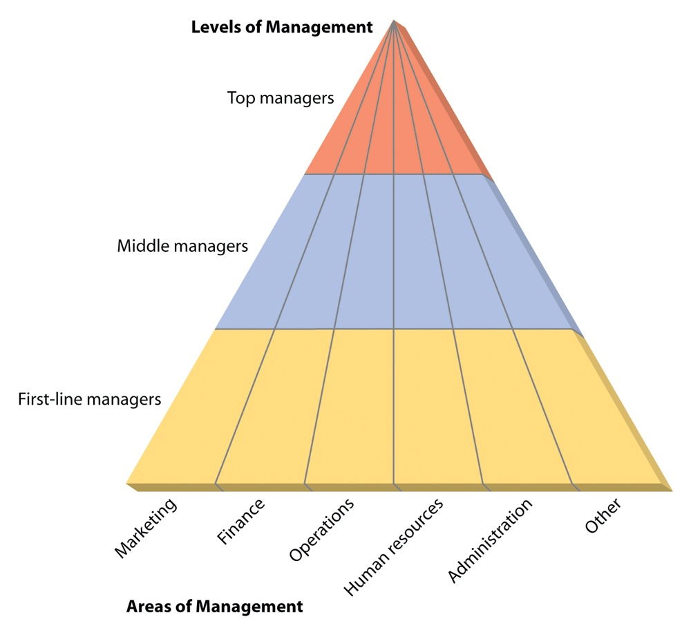

[← Prev: M01 · Management Foundations](M01_Management_Foundations.md) | [🏠 Index](00_Index.md) | [Next: M03 · Fayol and Taylor →](M03_Fayol_and_Taylor.md)

---

# M02 · Levels, Areas & Managerial Skills

> [!info] Topic Summary & Exam Blueprint
> - **Course Outcome:** CO2 (Industrial Management · Md. Rokunuzzaman Sir)
> - **Exam Weightage:** 12 Final Marks (`4.7%` · 3/4 papers) + 06 CT Marks
> - **Priority Tier:** 🟠 High Priority (Regular Final Exam and Class Test Topic)
> - **Primary Sources:** `Industrial_and_Operations_Management/Lecture 3.md`, `Classnote_by_Raidah/Classnotes_Hum2217_Raidah.md` (Classes 5 & 6), `Books/Fundamentals_of_Management_Griffin/Chapter_01_Understanding_the_Managers_Job.md`, `PreviousYearQuestions/CT_questions.md`

## Subtopics & Question Index

| ID | Subtopic | Past Marks (Final + CT) | Questions Covered | Jump |
| :-- | :-- | :---: | :-- | :-- |
| M02.1 | Levels of management: Top, Middle, and First-Line (roles and typical titles) | 0 + 2 | 2025 IM-CT1 Q.6 (02m) · Model Q.1 (04m) | [[#M02.1 · Levels of Management: Roles and Titles\|Go]] |
| M02.2 | Functional areas of management (Marketing, Financial, Operations, HR, Administrative, R&D, IT, etc.) | 0 + 0 | Model Q.2 (04m) | [[#M02.2 · Functional Areas of Management\|Go]] |
| M02.3 | Managerial skills, critically evaluated & skill distribution across levels | 8 + 4 | 2021 Q.1(c) & 2024 Q.1(c) (04m) · 2025 IM-CT1 Q.1 (02m) · 2025 IM-CT1 Q.5 (02m) | [[#M02.3 · Managerial Skills and Skill Distribution Across Levels\|Go]] |
| M02.4 | Skills necessary for a top-level manager and strategies to improve them | 4 + 0 | 2023 Q.5(c) (04m) | [[#M02.4 · Skills for Top-Level Managers and Improvement Strategies\|Go]] |

---

## M02.1 · Levels of Management: Roles and Titles

### 2025 IM-CT1 Q.6 · 02 Marks

*Class Test 1 · CO2 · Asked in: 2025 IM-CT1 (Set B)*

**Question.** Mention the usual roles or titles of the top as well as middle-level management positions.

**Answer.**

1. **Top-Level Management:**
   - **Usual Roles:** Set overall organizational goals, define long-term strategies, establish corporate policies, and represent the organization externally.
   - **Typical Titles:** Chief Executive Officer (CEO), President, Managing Director (MD), Vice President (VP), and Board of Directors.
2. **Middle-Level Management:**
   - **Usual Roles:** Translate strategic goals into actionable operational plans, coordinate departmental activities, allocate resources, and direct first-line managers.
   - **Typical Titles:** Plant Manager, Operations Manager, Regional Sales Director, Division Head, Chief Engineer, Department Chairperson.

---

### M02.1 · Model Exam Question · 04 Marks

*Suggested Topic (Lecture 3 & Griffin Ch. 1) · Target: Part (b) or (c)*

**Question.** Compare the three hierarchical levels of management in terms of primary focus, time horizon, key responsibilities, and typical job titles.

**Answer.**

Organizations divide managerial authority into three hierarchical tiers. Each level differs in its operational focus, decision horizon, and scope of responsibility:

| Feature | Top-Level Management | Middle-Level Management | First-Line (Lower) Management |
| :-- | :-- | :-- | :-- |
| **Typical Titles** | CEO, President, Managing Director, CTO, Board of Directors | Plant Manager, Division Head, Regional Director, Chief Engineer | Supervisor, Foreperson, Team Leader, Office Manager |
| **Primary Focus** | Whole organization and external environment | Departmental units and inter-unit coordination | Day-to-day operations and front-line staff |
| **Time Horizon** | Long-term (3 to 5+ years) | Medium-term (6 to 12 months) | Short-term (daily, weekly, monthly) |
| **Key Responsibilities** | Strategic planning, corporate policy, resource allocation, and external representation | Operational planning, policy execution, budget allocation, and cross-unit alignment | Task execution, direct supervision, technical coaching, and operational problem solving |
| **Primary Skill Need** | Conceptual, decision-making, and time-management skills | Human, analytical, and communication skills | Technical and interpersonal skills |

**Key Operational Relationships:**
1. **Strategic Translation:** Top managers set the company direction. Middle managers translate this direction into specific group goals. First-line supervisors ensure workers execute daily tasks to meet these goals.
2. **First-Line Operational Role:** First-line managers spend most of their time directly supervising non-managerial staff. For example, an electronics shop-floor supervisor trains technicians, inspects solder quality, and clears assembly line stops.

---

## M02.2 · Functional Areas of Management

*No direct standalone question in past finals or class tests. Prescribed in Lecture 3 and Griffin Chapter 1.*

### M02.2 · Model Exam Question · 04 Marks

*Suggested Topic (Lecture 3 & Griffin Ch. 1) · Target: Part (b) or (c)*

**Question.** Describe the primary functional areas of management in an industrial enterprise. How do these functional areas interact across management levels?

**Answer.**

Organizations group work activities into distinct functional areas. Regardless of hierarchical level, managers work within these specialized functional domains:


*Figure 2.1: Levels and Functional Areas of Management (Source: Lecture 3, Page 2)*

> [!tip] Memory Hook: 10 Functional Areas
> Use this 10-word sentence to recall all 10 areas in order:
> **"Managers Often Find Helpful Information And Resolve Public International Projects"**
>
> | Word | Functional Area | Core Activity |
> | :-- | :-- | :-- |
> | **M**anagers | **M**arketing | Pricing, sales channels, and customer relations |
> | **O**ften | **O**perations | Production scheduling, inventory, and supply chain |
> | **F**ind | **F**inancial | Capital budgeting, cash flow, and cost control |
> | **H**elpful | **H**uman Resource (HRM) | Hiring, training, payroll, and labor relations |
> | **I**nformation | **I**nformation Technology (IT) | Networks, databases, and ERP software |
> | **A**nd | **A**dministrative | General coordination across enterprise units |
> | **R**esolve | **R**esearch & Development (R&D) | Scientific tests and new product design |
> | **P**ublic | **P**ublic Relations (PR) | Media briefings and corporate reputation |
> | **I**nternational | **I**nternational | Cross-border trade and overseas operations |
> | **P**rojects | **P**roject & Risk | Time-bound delivery and hazard mitigation |
>
> **Fast Cluster Grouping:**
> - **Core Engine (4):** Marketing, Operations, Finance, HR
> - **Digital & Support (2):** IT, Administrative
> - **Growth & Boundary (4):** R&D, Public Relations, International, Project & Risk

#### The 10 Primary Functional Areas of Management

1. **Operations Management:**
   - Focuses on producing goods and services efficiently.
   - Core duties include production scheduling, inventory control, quality assurance, plant layout, and supply chain logistics.
2. **Financial Management:**
   - Governs the financial resources of the firm.
   - Key responsibilities cover financial planning, capital budgeting, cash flow control, cost accounting, and investment decisions.
3. **Marketing Management:**
   - Helps the enterprise price, promote, and sell products to consumers.
   - Areas cover market research, brand management, sales channels, advertising campaigns, and customer relationship management.
4. **Human Resource Management (HRM):**
   - Focuses on staffing and employee support.
   - Responsibilities include recruiting, training programs, compensation structures, performance reviews, labor law compliance, and dispute resolution.
5. **Information Technology (IT) Management:**
   - Directs computer infrastructure and business data networks.
   - Duties include database administration, enterprise resource planning (ERP) systems, network security, and technical software maintenance.
6. **Administrative (General) Management:**
   - Oversees general operations across several departments instead of one narrow specialty.
   - Administrative managers coordinate multi-department efforts in facilities like hospitals, plants, or branch offices.
7. **Research and Development (R&D) Management:**
   - Directs scientific experimentation and new product design.
   - R&D managers lead engineers and scientists creating next-generation hardware, firmware, and industrial designs.
8. **Public Relations (PR) Management:**
   - Protects and builds corporate reputation.
   - PR managers handle external communications, press briefings, investor disclosures, and corporate social responsibility (CSR) initiatives.
9. **International Management:**
   - Manages cross-border operations, global supply chains, international trade rules, foreign exchange exposure, and overseas partnerships.
10. **Project and Risk Management:**
    - Coordinates specialized, time-bound tasks across departments.
    - Focuses on risk detection, project milestones, workplace safety, and emergency contingency planning.

#### Cross-Level Interaction

Functional areas span vertically across all three management levels. For example, in the Operations area of a telecom equipment firm:
- A Vice President of Operations (top level) approves factory expansion and multi-year production goals.
- A Plant Operations Manager (middle level) coordinates weekly assembly volumes and parts procurement.
- A Production Line Supervisor (first-line level) directs daily circuit board testing and technician shift rotas.

---

## M02.3 · Managerial Skills and Skill Distribution Across Levels

### 2021 Q.1(c) & 2024 Q.1(c) · 04 Marks (Merged)

*Section A · CO2 · Asked in: 2021 Final (04 Marks) and 2024 Final (04 Marks)*

**Question (2024 Q.1(c)).** Critically evaluate the skills necessary to accomplish managerial tasks.  
*(Identical to 2021 Q.1(c): "Critically discuss the skills necessary to accomplish managerial tasks.")*

**Answer.**

Management theorists identify seven fundamental skills required to execute planning, organizing, leading, and controlling:

> [!tip] Memory Hook: 7 Managerial Skills (T-I-C-D-C-D-T)
> Remember this 7-word phrase to recall every skill in order:
> **"The Inspiring Chief Diagnoses Clearly, Decides Timely"**
>
> | Letter | Skill | Core Role | Primary Level |
> | :--: | :-- | :-- | :-- |
> | **T** | **T**echnical | Execute specialized tasks and guide daily operations | First-Line |
> | **I** | **I**nterpersonal | Motivate people, communicate, and resolve conflict | All Levels |
> | **C** | **C**onceptual | See the big picture and set long-term vision | Top |
> | **D** | **D**iagnostic | Pinpoint root causes of operational problems | Middle & Top |
> | **C** | **C**ommunication | Share ideas clearly and pass critical feedback | All Levels |
> | **D** | **D**ecision-Making | Choose the best option under uncertainty | Top & Middle |
> | **T** | **T**ime-Management | Prioritize high-value work and delegate routine tasks | Top & First-Line |
>
> **Two High-Yield Recall Frameworks:**
> - **Katz's Classical 3:** Technical (Hands), Interpersonal (Heart), Conceptual (Head).
> - **Griffin's Process 4:** Diagnostic (Find), Communication (Share), Decision-Making (Choose), Time-Management (Execute).

#### 1. Critical Evaluation of the 7 Managerial Skills

1. **Technical Skills:**
   - The ability to accomplish or understand specific operational tasks in an organization.
   - Essential for first-line supervisors who guide operative staff and resolve immediate machine faults.
   - *Critical evaluation:* Strong technical skills build early credibility. But relying on them too long leads managers to micromanage instead of delegating.
2. **Interpersonal (Human) Skills:**
   - The ability to communicate with, understand, and motivate individuals and teams.
   - Essential across all management tiers to build trust, resolve disputes, and maintain team cohesion.
   - *Critical evaluation:* Strong human skills ensure good workplace relations. But they cannot replace sound commercial or strategic judgment.
3. **Conceptual Skills:**
   - The mental capacity to think in the abstract, see the big picture, and understand how business units interact.
   - Dominates top-level management where executives set long-term corporate direction.
   - *Critical evaluation:* Strong conceptual ability creates forward-looking plans. But without realistic operational understanding, vision stays on paper.
4. **Diagnostic Skills:**
   - The ability to investigate symptoms, identify root causes, and choose the right solution.
   - This works like a doctor diagnosing an illness before prescribing medicine.
   - Helps managers isolate production bottlenecks, quality defects, or inventory shortages systematically.
5. **Communication Skills:**
   - The dual ability to convey ideas clearly and receive information accurately from others.
   - Essential for transmitting instructions downward, coordinating tasks with peers, and reporting progress upward.
   - Prevents costly misunderstandings between executive suites and factory floors.
6. **Decision-Making Skills:**
   - The ability to define problems accurately, generate viable alternatives, and pick the best solution under risk.
   - Effective managers make sound decisions consistently and reverse errors quickly to limit damage.
7. **Time-Management Skills:**
   - The ability to prioritize high-value tasks, work efficiently, and delegate routine duties.
   - Prevents critical strategic goals from getting buried under daily routine pressures.

#### 2. Skill Distribution Across Management Levels

The required mix of managerial skills shifts systematically across hierarchical tiers:

```text
┌────────────────────────────────────────────────────────┐
│ Top-Level Management                                   │
│ Primary Focus: Conceptual, Decision-Making, Time-Mgmt  │
│ Supporting: Interpersonal, Diagnostic                  │
├────────────────────────────────────────────────────────┤
│ Middle-Level Management                                │
│ Primary Focus: Interpersonal, Diagnostic / Analytical  │
│ Balanced: Communication, Technical, Decision-Making    │
├────────────────────────────────────────────────────────┤
│ First-Line (Lower) Management                          │
│ Primary Focus: Technical, Interpersonal, Communication │
│ Supporting: Time-Management, Routine Decision-Making   │
└────────────────────────────────────────────────────────┘
```

- **Top Managers:** Rely primarily on conceptual and decision-making skills to set company direction. Technical demands are minimal at this tier.
- **Middle Managers:** Bridge the gap between top leadership and operative staff. They require balanced interpersonal, analytical, and communication skills to coordinate departments.
- **First-Line Managers:** Require strong technical skills to instruct operative workers and resolve daily equipment faults.

*Exam Note (Trimming for 02 to 03 Marks):* For fewer marks, group skills into Katz's three clusters: Technical, Human, and Conceptual. Then summarize their distribution across tiers.

---

### 2025 IM-CT1 Q.1 · 02 Marks

*Class Test 1 · CO2 · Asked in: 2025 IM-CT1 (Set B)*

**Question.** Which three skills are most important for a first-line manager? Justify your answer with examples.

**Answer.**

The three most critical skills for a first-line manager are:

1. **Technical Skills:**
   - First-line managers supervise day-to-day production directly. They must understand operational mechanics to guide workers and fix equipment faults.
   - *Example:* A telecom supervisor must know how to use an OTDR tester to locate optical fiber cable cuts.
2. **Interpersonal (Human) Skills:**
   - Supervisors work directly with operating employees every day. They must motivate workers, resolve interpersonal grievances, and build teamwork.
   - *Example:* An SMT assembly line supervisor resolves disputes between component placement operators and quality inspection technicians.
3. **Communication Skills:**
   - Supervisors bridge the gap between workers and middle management. They translate weekly schedules into daily shift duties and report machine breakdowns upward.
   - *Example:* An IT team lead conducts daily standup briefings and explains server crash error logs to the engineering manager.

---

### 2025 IM-CT1 Q.5 · 02 Marks

*Class Test 1 · CO2 · Asked in: 2025 IM-CT1 (Set B)*

**Question.** How would you claim that you have conceptual skills?

**Answer.**

Conceptual skill is the mental ability to view the organization as a whole. It means understanding how units depend on each other and how external forces affect the business.

You can claim conceptual skills by showing that you:

1. **Understand the big picture:** You see how your technical tasks support company goals instead of viewing circuits or code in isolation.
2. **Anticipate systemic consequences:** You foresee how a hardware delay affects firmware testing, client shipment dates, and company cash flow.
3. **Create strategic solutions:** You connect market trends and customer requirements with technology choices to solve open-ended engineering problems.

---

## M02.4 · Skills for Top-Level Managers and Improvement Strategies

### 2023 Q.5(c) · 04 Marks

*Section B · CO2 · Asked in: 2023 Final*

**Question.** Identify skills necessary for a top level manager and suggest strategies to improve those skills.

**Answer.**

Top-level managers make decisions that determine the long-term survival and success of the entire organization.

#### 1. Skills Necessary for a Top-Level Manager

1. **Conceptual Skills:**
   - Top executives need abstract thinking to visualize the entire enterprise and its market environment.
   - They use conceptual ability to set the company vision and pursue new business opportunities.
2. **Decision-Making Skills:**
   - Top managers make non-programmed decisions under uncertainty and risk.
   - These decisions include allocating multi-million dollar capital budgets, launching corporate mergers, or building new facilities.
3. **Diagnostic Skills:**
   - Executives must analyze broad trends and identify underlying causes of declining performance or market threats.
4. **Interpersonal and Communication Skills:**
   - Leaders must negotiate with investors, regulators, board members, and media outlets while inspiring their employees.
5. **Time-Management Skills:**
   - Executives face competing commitments. They must prioritize high-impact strategic issues and delegate routine operational work.

#### 2. Strategies to Improve Top-Level Managerial Skills

1. **Executive Coaching and Mentorship:**
   - Working with seasoned board advisers or professional coaches helps executives uncover decision-making blind spots and refine leadership judgment.
2. **Executive Education and Advanced Case Simulations:**
   - Participating in advanced executive management programs exposes leaders to cross-industry business models and crisis simulations.
3. **360-Degree Feedback Systems:**
   - Gathering confidential evaluations from board peers, subordinate managers, and client partners helps identify communication weaknesses and leadership gaps.
4. **Structured Delegation and Time-Blocking:**
   - Implementing prioritization frameworks allows top managers to delegate operational tasks. This protects uninterrupted blocks of time for deep strategic planning.
5. **Continuous Environmental Scanning and Advisory Boards:**
   - Joining industry advisory bodies, technology councils, and economic forums expands exposure to macroeconomic trends and regulatory developments.

---

[← Prev: M01 · Management Foundations](M01_Management_Foundations.md) | [🏠 Index](00_Index.md) | [Next: M03 · Fayol and Taylor →](M03_Fayol_and_Taylor.md)
