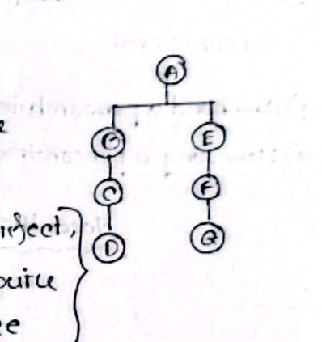
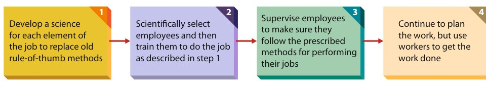

[← Prev: M02 · Levels, Areas and Skills](M02_Levels_Areas_Skills.md) | [🏠 Index](00_Index.md) | [Next: M04 · Planning, Decisions, Organizing and Control →](M04_Planning_Decisions_Organizing_Control.md)

---

# M03 · Classical Theory: Fayol and Taylor

> [!info] Topic Summary & Exam Blueprint
> - **Course Outcome:** CO2 (Industrial Management · MRI Sir)
> - **Exam Weightage:** 15 Final Marks (`5.9%` · 3/4 Papers) + 00 CT Marks
> - **Priority Tier:** 🟠 Medium-High (Classical Management Theory)
> - **Primary Sources:** `Industrial_and_Operations_Management/Lecture 4.md`, `Industrial_and_Operations_Management/Lecture 5.md`, `Classnotes_Hum2217_Raidah.md` (Class 7), `Books/Fundamentals_of_Management_Griffin/Chapter_01_Understanding_the_Managers_Job.md`

## Subtopics & Question Index

| ID | Subtopic | Past Marks (Final + CT) | Questions Covered | Jump |
| :-- | :-- | :---: | :-- | :-- |
| M03.1 | Henri Fayol's 14 Principles of Administrative Management | 10 + 0 | 2021 Q.1(b) (05m), 2024 Q.5(c) (05m) | [[#M03.1 · Henri Fayol's 14 Principles of Administrative Management\|Go]] |
| M03.2 | Scalar Chain and Gangplank (Fayol's Bridge Diagram) | 0 + 0 | Model Q.1 (03m) | [[#M03.2 · Scalar Chain and Gangplank (Fayol's Bridge Diagram)\|Go]] |
| M03.3 | F.W. Taylor's Principles of Scientific Management | 5 + 0 | 2020 Q.1(c) (05m), Model Q.2 (03m) | [[#M03.3 · F.W. Taylor's Principles of Scientific Management\|Go]] |

---

## M03.1 · Henri Fayol's 14 Principles of Administrative Management

> [!tip] Memory Hook (DAD U C USSR? O I SEE!)
> Recall all 14 principles of Henri Fayol in 15 seconds:
> - **D** - Division of work
> - **A** - Authority and responsibility
> - **D** - Discipline
> - **U** - Unity of command
> - **C** - Centralization
> - **U** - Unity of direction
> - **S** - Subordination of individual interest
> - **S** - Scalar chain
> - **R** - Remuneration (fair pay)
> - **O** - Order
> - **I** - Initiative
> - **S** - Stability of tenure
> - **E** - Equity
> - **E** - Esprit de corps

### 2021 Q.1(b) · 05 Marks

*Section A · Asked in: 2021 Final*

**Question.** Discuss the following administrative management principles: Unity of Command, Unity of Direction, Centralization, Authority and Accountability.

**Answer.**

Henri Fayol (1841–1925) created these principles in his administrative management theory. They guide managerial coordination, power distribution, and operational structure.

#### 1. Unity of Command

- **Definition:** An employee must receive orders from only one direct superior.
- **Purpose:** Dual reporting creates confusion, divided loyalty, and friction between managers. When two superiors give conflicting orders, work stalls. Discipline breaks down.
- **Engineering Example:** In an electronics assembly plant, a testing technician reports strictly to the Quality Control Supervisor. The Production Manager cannot bypass the supervisor to redirect that technician.

#### 2. Unity of Direction

- **Definition:** Activities with the same objective must have one head and one central plan.
- **Purpose:** It unifies organizational effort and stops fragmented work. All operations with the same goal must follow one shared plan.
- **Class Note Example:** Faculty recruitment across academic departments follows one common procedure. In telecom engineering, all software teams updating a mobile app follow one unified product roadmap.

#### Comparison: Unity of Command vs. Unity of Direction

| Comparison Feature | Unity of Command | Unity of Direction |
| :-- | :-- | :-- |
| **Core Meaning** | Each employee receives orders from only one supervisor. | All related operations share one leader and one plan. |
| **Primary Focus** | Manages individual workers and reporting lines. | Manages entire departments and business strategies. |
| **Target Outcome** | Prevents conflicting instructions and dual subordination. | Prevents duplicate effort and conflicting departmental goals. |
| **Scope** | Micro level (individual employee to boss). | Macro level (entire organization or division). |

#### 3. Centralization

- **Definition:** The degree to which decision-making authority stays at top management.
- **Balance Principle:** Complete centralization slows down operations. Complete decentralization weakens executive control. Managers must find the right balance for their organization.
- **Influencing Factors:** Firm size, manager competence, task complexity, and communication speed decide the balance.
- **Telecom Example:** A telecom operator centralizes spectrum bidding and capital budgets at headquarters. But it decentralizes local tower repairs to regional field engineers.

#### 4. Authority and Accountability

- **Definition of Authority:** The formal right of a manager to give orders and expect obedience.
- **Definition of Responsibility and Accountability:** Responsibility is the obligation to perform assigned duties. Accountability means answering for the final outcome.
- **Parity Principle:** Authority and responsibility must match. Authority without responsibility breeds careless choices. Responsibility without authority breeds frustration and failure.
- **Engineering Example:** A project lead is accountable for delivering a fiber link. That lead must also have authority to assign engineers and spend budget.

---

### 2024 Q.5(c) · 05 Marks

*Section B · CO2 · Asked in: 2024 Final*

**Question.** Critically evaluate the principles of administrative management.

**Answer.**

Henri Fayol proposed 14 Principles of Administrative Management in 1916. Unlike F.W. Taylor's shop-floor view, Fayol examined the entire organization from the top down.

#### The 14 Principles of Administrative Management

1. **Division of Work:** Specializing tasks boosts efficiency and worker dexterity. Raidah's class notes highlight that specialization can increase factory productivity by up to 350%.
2. **Authority and Responsibility:** Managers need formal authority to direct staff. This right must match their personal responsibility for outcomes.
3. **Discipline:** Workers and managers must honor organizational agreements. Good discipline relies on fair supervisors, clear rules, and just penalties.
4. **Unity of Command:** An employee should receive orders from only one direct superior.
5. **Unity of Direction:** Operations sharing a common goal must follow one plan under one leader.
6. **Subordination of Individual Interest to General Interest:** Company goals must come before personal, selfish, or departmental interests.
7. **Remuneration (Fair Pay):** Workers must receive fair pay for their service. Fair wages and rewards keep workers motivated and satisfied.
8. **Centralization:** Organizations must balance top-level control with subordinate operational freedom.
9. **Scalar Chain:** Authority flows down a clear chain from the top executive to the bottom worker. Direct peer contact across chains uses a temporary gangplank.
10. **Order:** Material and social order must prevail. Every tool and every person belongs in their proper place at the right time.
11. **Equity:** Managers must combine justice with kindness to earn worker loyalty and devotion.
12. **Stability of Tenure of Personnel:** High employee turnover wastes money and hurts productivity. Workers need reasonable job security to master their duties.
13. **Initiative:** Managers must encourage staff to propose and execute fresh ideas.
14. **Esprit de Corps:** Management must build team harmony and unity. It avoids dividing workers through workplace politics.

#### Critical Evaluation

##### Key Strengths

- **Universal Framework:** The principles apply to business, public administration, military units, and tech firms.
- **Clear Chain of Command:** They remove ambiguity by defining who reports to whom and who decides what.
- **Operational Balance:** Fayol stressed flexibility. He noted that management principles are guides, not rigid laws.

##### Modern Criticisms and Limitations

- **Contradictory Rules:** Some principles clash. For example, strict Unity of Command conflicts with modern matrix structures. In agile squads, software engineers report to both product owners and engineering chapter leads.
- **Mechanistic Assumption:** The model assumes stable environments. It views organizations like machines. It overlooks human emotion, creative flexibility, and informal peer networks.
- **Slow Bureaucracy:** Relying strictly on the scalar chain delays action. Fast-paced tech markets need rapid peer-to-peer collaboration without excessive red tape.

##### Conclusion

Fayol built the bedrock of administrative theory. While modern tech companies use agile squads, the core ideas of clear accountability and fair treatment remain essential.

---

## M03.2 · Scalar Chain and Gangplank (Fayol's Bridge Diagram)

### M03.2 · Model Exam Question · 03 Marks

*Suggested Topic · Lecture 4 & Raidah Class 7 · Target: Part (b)*

**Question.** Explain Henri Fayol's Scalar Chain principle. How does the "Gangplank" (Bridge) overcome delays in communication? Illustrate with a diagram and an engineering example.

**Answer.**

The **Scalar Chain** is the unbroken hierarchy of authority and communication. It runs from the top executive down to the lowest worker.

#### Standard Communication Path and Its Flaw

Under normal rules, all messages travel step by step along this chain. Subordinates cannot talk across departments without routing through every intermediate boss. This path creates severe delays, paperwork bottlenecks, and distorted instructions during urgent crises.

#### The Gangplank Concept

To solve this problem, Fayol introduced the **Gangplank** (a cross-communication bridge). It allows employees at the same organizational level in separate departments to speak directly.

Two strict rules govern the Gangplank:
1. Both employees must obtain prior permission from their immediate superiors.
2. Both employees must keep their superiors fully informed of every decision made.


*Figure 7.1: Fayol's Scalar Chain and Gangplank Bridge Diagram (Source: Raidah Class Notes Page 7 / Fig_Class07.1)*

```text
              [A] (Apex Executive)
             /   \
           [B]   [E]
           /       \
         [C]       [F]
         /           \
       [D] <=======> [G]  (Gangplank Bridge)
```

#### Diagram Analysis

In Figure 7.1, top executive $A$ heads two functional divisions:
- The left scalar line runs $A \rightarrow B \rightarrow C \rightarrow D$.
- The right scalar line runs $A \rightarrow E \rightarrow F \rightarrow G$.

Under standard scalar rules, worker $D$ cannot speak to worker $G$ directly. The message must climb up the chain ($D \rightarrow C \rightarrow B \rightarrow A$). Then it must descend the other chain ($A \rightarrow E \rightarrow F \rightarrow G$). This route takes six intermediate transfers and causes critical delays.

Using the Gangplank bridge ($D \leftrightarrow G$), worker $D$ contacts worker $G$ directly. This bypass eliminates communication lag while intermediate managers $C$ and $F$ remain informed.

#### Engineering Example

Consider a severed fiber optic backbone in a telecom network. A field transmission engineer ($D$) detects the break.

Under normal scalar routing, the report climbs through Transmission Manager ($C$), Network Director ($B$), and CTO ($A$). Next, it descends through Core IP Director ($E$) and Routing Manager ($F$) to Core Engineer ($G$).

This multi-level escalation wastes hours and extends subscriber downtime. Using the Gangplank, the field engineer ($D$) contacts Core IP Engineer ($G$) directly. They reroute data traffic across alternate microwave links within minutes. Both engineers immediately notify their respective managers ($C$ and $F$).

---

## M03.3 · F.W. Taylor's Principles of Scientific Management

### 2020 Q.1(c) · 05 Marks

*Section A · Asked in: 2020 Final*

**Question.** State the principles of scientific management.

**Answer.**

Frederick Winslow Taylor (1856–1915) founded Scientific Management. He defined management as the art of knowing what you want men to do, and seeing that they do it in the best and cheapest way (Taylor, 1911). Taylor created these principles to end deliberate slow working ("soldiering") and boost factory output.

#### The Four Foundational Principles of Scientific Management

Griffin (8th ed., p. 42) and Taylor (1911) organize the four principles into sequential steps:


*Figure 3.1: Steps in Scientific Management (Source: Griffin, Fundamentals of Management 8th ed., Page 42 / Fig. 1.3)*

1. **Develop a Science for Each Element of the Job:**
   - Replace traditional rule-of-thumb guesswork with rigorous scientific study.
   - Break tasks into basic physical motions. Use time-and-motion studies to find the single best method for each job element.

2. **Scientifically Select, Train, and Develop Workers:**
   - Stop letting workers choose their own tasks and train themselves haphazardly.
   - Evaluate physical and mental traits scientifically. Train each selected employee systematically to follow standard methods.

3. **Supervise and Cooperate Heartily with Workers:**
   - Build genuine cooperation between managers and workers.
   - Supervise employees closely to ensure work follows the scientific methods developed in Step 1.

4. **Equal Division of Work and Responsibility Between Management and Labor:**
   - Management takes over all work for which it is better suited than workers.
   - Managers assume full responsibility for designing, planning, scheduling, and standardizing tasks.
   - Workers focus entirely on executing work according to those plans. Management shoulders half the daily burden.

#### Key Operational Mechanisms and Tenets (Lecture 5)

MRI Sir's lecture notes expand Taylor's theory into concrete shop-floor mechanisms:

1. **Standardization of Work Practices, Tools, and Conditions:**
   - Standardize equipment, machine operating speeds, raw materials, and work benches. Uniform tools ensure predictable quality and reduce wasted effort.

2. **Differential Piece-Rate Incentive System:**
   - Tie wages directly to scientific output targets.
   - Pay higher piece rates to employees who hit or beat the standard. Pay lower rates to underperformers. This motivates high output and discourages slacking.

3. **Mental Revolution (Harmony, Not Discord):**
   - Both management and workers must shift their mindset completely.
   - Both sides stop fighting over profit shares. Instead, they cooperate to expand total output and profits together.

4. **Detailed Work Instructions and Functional Foremanship:**
   - Replace a single general foreman with specialized functional supervisors (route clerks, speed bosses, and repair inspectors).
   - Give workers explicit daily instruction cards showing tools, sequences, and exact timings.

5. **Maximum Output in Place of Restricted Output:**
   - Eliminate deliberate soldiering and informal worker quotas.
   - Maximize production capacity to drive down unit costs and raise enterprise wages.

---

### M03.3 · Model Exam Question · 03 Marks

*Suggested Topic · Griffin Ch. 1 & Lecture 4/5 · Target: Part (b)*

**Question.** Compare Henri Fayol's Administrative Management with F.W. Taylor's Scientific Management in terms of focus, organizational level, approach, and primary contribution.

**Answer.**

Both Henri Fayol and F.W. Taylor pioneered classical management thought, but they approached organizational efficiency from opposite directions.

#### Comparative Summary Table

| Comparison Parameter | Henri Fayol (Administrative Management) | F.W. Taylor (Scientific Management) |
| :-- | :-- | :-- |
| **Pioneer Background** | French mining engineer and senior managing director. | American mechanical engineer and shop-floor consultant. |
| **Organizational Level** | Top management and administrative leadership. | Shop-floor, assembly line, and worker execution level. |
| **Primary Focus** | Total organizational structure and general administrative processes. | Individual task efficiency, worker motions, and tool optimization. |
| **Management Approach** | Top-down: establishes broad organizational guidelines. | Bottom-up: studies micro tasks to reform upper management. |
| **View of Workers** | Recognizes employee morale, initiative, equity, and team spirit (*esprit de corps*). | Views workers as rational economic actors driven primarily by piece-rate pay. |
| **Core Method** | 14 administrative principles and 5 management functions. | Time-and-motion study, standardized tools, and differential wages. |
| **Scope of Application** | Universally applicable to business, government, military, and non-profits. | Best suited for manufacturing plants, assembly lines, and physical operations. |
| **Key Legacy** | Classical organizational structure and modern administrative theory. | Industrial engineering, ergonomics, operational standards, and modern assembly lines. |

---

[← Prev: M02 · Levels, Areas and Skills](M02_Levels_Areas_Skills.md) | [🏠 Index](00_Index.md) | [Next: M04 · Planning, Decisions, Organizing and Control →](M04_Planning_Decisions_Organizing_Control.md)
