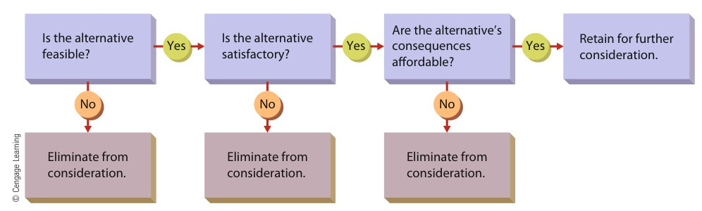
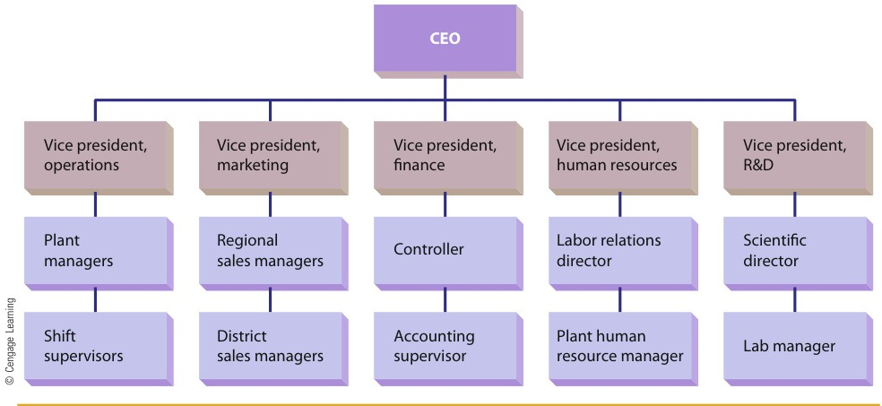
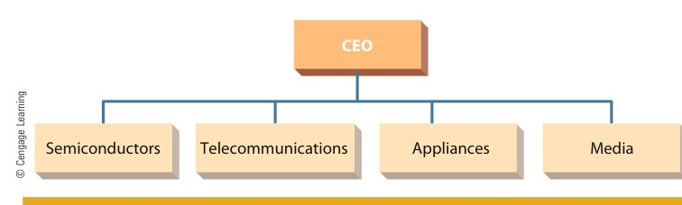
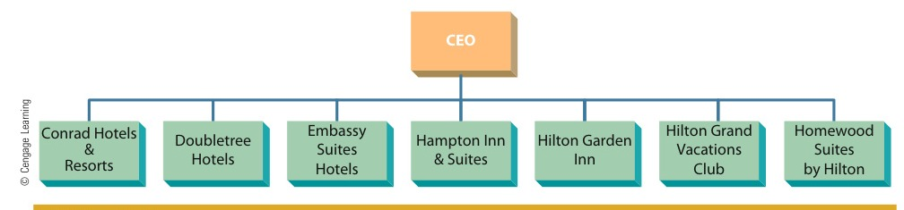
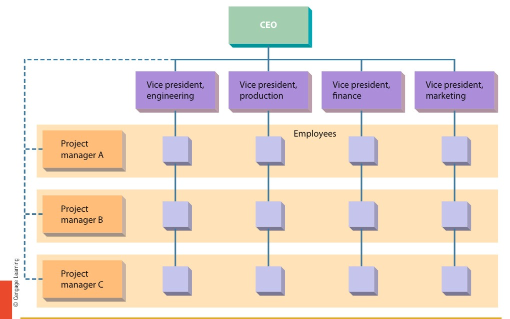
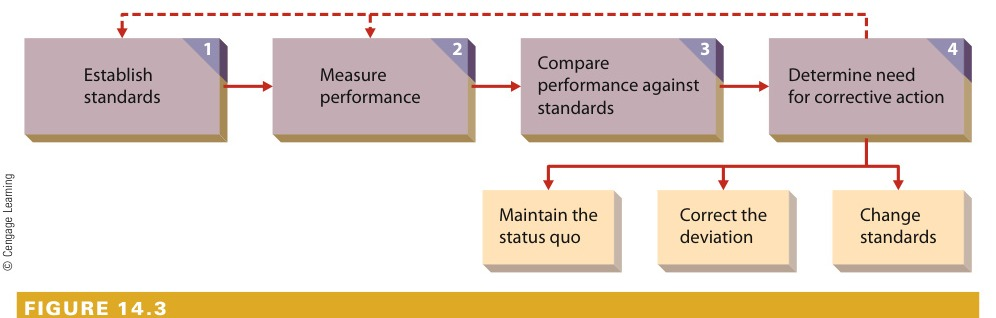

[← Prev: M03 · Fayol and Taylor](M03_Fayol_and_Taylor.md) | [🏠 Index](00_Index.md) | [Next: M05 · Employee Motivation →](M05_Motivation.md)

---

# M04 · Planning, Decision Making, Organizing & Controlling

> [!info] Topic Summary & Exam Blueprint
> - **Course Outcome:** CO2 (Industrial Management · Md. Rokonuzzaman Sir)
> - **Exam Weightage:** 19 Final Marks (`7.4%` · 2/4 papers) + 02 CT Marks
> - **Priority Tier:** 🟡 Medium (Tested in 2021 & 2023 Finals + 2025 IM-CT1)
> - **Primary Sources:** `Books/Fundamentals_of_Management_Griffin/` (Ch. 3, 4, 6, 14), `Classnote_by_Raidah/Classnotes_Hum2217_Raidah.md` (Classes 1–2), `PreviousYearQuestions/CT_questions.md` (§2)

## Subtopics & Question Index

| ID | Subtopic | Past Marks (Final + CT) | Questions Covered | Jump |
| :-- | :-- | :---: | :-- | :-- |
| M04.1 | Meaning of planning and decision making | 2 + 0 | 2023 Q.6(a) (02m), Model Q.1 (04m) | [[#M04.1 · Meaning of Planning and Decision Making\|Go]] |
| M04.2 | Rational decision-making process with example | 6 + 0 | 2021 Q.2(a) (03m), 2023 Q.6(b) (03m) | [[#M04.2 · Rational Decision-Making Process with Example\|Go]] |
| M04.3 | Organizing elements, tasks & purposes: departmentalization, delegation of authority, span of control | 5 + 2 | 2023 Q.6(c) (05m), 2025 IM-CT1 Q.10 (02m), Model Q.1 (04m) | [[#M04.3 · Organizing: Elements, Tasks, and Purposes\|Go]] |
| M04.4 | Controlling: meaning and steps of the controlling process | 6 + 0 | 2021 Q.2(b) (06m) | [[#M04.4 · Controlling: Meaning and Steps of the Control Process\|Go]] |

---

## M04.1 · Meaning of Planning and Decision Making

### 2023 Q.6(a) · 02 Marks

*Section B · CO2 · Asked in: 2023 Final*

> [!question] Past Final Examination Question
> **[2023 · Q.6(a) | 02 Marks | Sec B | CO2]**  
> What do you mean by planning and decision making?

**Answer.**

#### 1. Planning Defined
Planning is the first fundamental management function. It means setting an organization's goals and deciding in advance how best to achieve them (Ricky W. Griffin). It involves anticipating environmental changes and mapping out operational courses of action before work begins. 

Key aspects of planning:
- **Goal formulation:** Establishing strategic, tactical, and operational targets.
- **Resource alignment:** Allocating human, financial, physical, and information resources.
- **Action roadmaps:** Outlining specific timelines, policies, and schedules.

#### 2. Decision Making Defined
Decision making is the act of choosing one alternative from among a set of alternatives (Griffin Ch. 4). As a management process, it recognizes problems or opportunities. Managers then generate viable solutions and put the best option into action.

#### 3. Relationship: Decision Making as the Catalyst of Planning
Decision making is the core catalyst of planning. Planning cannot occur without decision making. Every planning stage requires managers to choose between alternative goals, paths, and budgets.

---

### M04.1 · Model Exam Question 1 · 04 Marks

*Suggested Topic (Griffin Ch. 3) · Target: Part (b) or (c)*

> [!question] Model Examination Question
> **[Model Question · 04 Marks | Griffin Ch. 3]**  
> Distinguish between strategic, tactical, and operational plans. Illustrate each plan type with an example from an engineering enterprise.

**Answer.**

Planning occurs across three distinct hierarchical tiers within an organization (Ricky W. Griffin, Chapter 3). Each plan type serves a distinct purpose, time horizon, and management tier.

#### 1. Strategic Plans
Strategic plans are broad, general plans developed by top management (CEO, Board of Directors). They establish resource allocation priorities and long-term directions for the entire organization.
- **Time Horizon:** Long term, usually three to five years or longer.
- **Focus:** Environmental threats, industry opportunities, and competitive positioning.
- **Engineering Example:** A Bangladeshi electronics firm plans to build a cleanroom semiconductor packaging plant within five years.

#### 2. Tactical Plans
Tactical plans are formulated by middle management (division heads, plant directors). They specify how to execute specific parts of the overall strategic plan.
- **Time Horizon:** Intermediate term, typically one to three years.
- **Focus:** Departmental synchronization and resource distribution among divisions.
- **Engineering Example:** The Operations Director orders equipment, hires cleanroom engineers, and procures automated wire bonders within 18 months.

#### 3. Operational Plans
Operational plans are created by lower-level managers (line supervisors, project leads). They focus on short-term tasks needed to achieve tactical targets.
- **Time Horizon:** Short term, ranging from daily to weekly or monthly schedules.
- **Focus:** Specific work routines, machine schedules, and task assignments.
- **Engineering Example:** Shift supervisors set daily inspection quotas and maintenance routines for wire bonding machines.

#### Comparison: Strategic, Tactical, and Operational Plans

| Dimension | Strategic Plan | Tactical Plan | Operational Plan |
| :--- | :--- | :--- | :--- |
| **Managerial Level** | Top management (CEO, Board) | Middle management (Plant Managers) | First-line management (Supervisors) |
| **Time Horizon** | Long term ($3\text{ to }5+\text{ years}$) | Intermediate ($1\text{ to }3\text{ years}$) | Short term (daily, weekly, monthly) |
| **Scope & Breadth** | Entire organization | Specific business unit or department | Specific task, machine, or shift |
| **Degree of Detail** | Broad and general | Moderate and departmental | Highly specific and standardized |
| **Environmental Uncertainty** | High external volatility | Moderate operational risk | Low internal uncertainty |

---

## M04.2 · Rational Decision-Making Process with Example

### 2021 Q.2(a) · 03 Marks

*Section A · Asked in: 2021 Final (Split Question: 3 Marks in M04.2 + 3 Marks in M01.3)*

*Cross-ref:* This question appeared as a 6-mark item split evenly across two topics. The efficiency and effectiveness concepts are detailed in [[M01_Management_Foundations#M01.3 · Efficiency vs. Effectiveness|M01.3 · Efficiency vs. Effectiveness]]. Both parts are answered completely below.

> [!question] Past Final Examination Question
> **[2021 · Q.2(a) | 03 of 06 Marks | Sec A]** *(split 3m in M04.2 + 3m in M01.3)*  
> What is decision making? Give an example for decision making which is effective but not efficient.

**Answer.**

#### 1. Definition of Decision Making
Decision making is the act of choosing one alternative from among a set of alternatives (Griffin Ch. 4). It is also an ongoing managerial process. Managers recognize a decision situation, identify options, select the best alternative, and put it into practice.

#### 2. Understanding Effectiveness vs. Efficiency
- **Effective:** Making the right decision to achieve targeted goals and solve the operational problem.
- **Efficient:** Operating in a cost-effective manner that minimizes the use of resources such as time, money, and labor.

#### 3. Real-World ECE / Telecom Example: Effective but Not Efficient
- **Scenario:** A core optical fiber link of a telecom operator snaps in the Rajshahi city circle during peak evening hours. The cut disrupts broadband service for 50,000 corporate and retail users.
- **Managerial Decision:** The operations director charters an emergency helicopter crew. The crew flies specialized splicing technicians from Dhaka with duplicate optical hardware. The team splices the cable and restores the network within 20 minutes.
- **Effectiveness:** The decision was **effective**. Service was restored immediately. Data traffic resumed, customer churn stopped, and service-level agreements were met.
- **Inefficiency:** The decision was **not efficient**. The emergency operation cost \$25,000. Switching traffic to a local standby microwave link would have cost \$100 and taken only 10 minutes longer. The manager achieved the goal, but wasted huge financial resources.

---

### 2023 Q.6(b) · 03 Marks

*Section B · CO2 · Asked in: 2023 Final*

> [!question] Past Final Examination Question
> **[2023 · Q.6(b) | 03 Marks | Sec B | CO2]**  
> State the process of decision making with example.

**Answer.**

The rational decision-making process consists of six sequential steps (Ricky W. Griffin, Chapter 4):

```text
[1. Recognize & Define] ──> [2. Identify Alternatives] ──> [3. Evaluate Alternatives]
                                                                     │
[6. Follow Up & Evaluate] <── [5. Implement Alternative] <── [4. Select Best Option]
```


*Figure 4.1: Evaluating Alternatives in the Decision-Making Process (Source: Griffin Ch. 4, p. 136)*

#### The Six Steps of Rational Decision Making

> [!tip] Memory Hook: 6 Steps of Rational Decision Making (`R-I-E-S-I-F`)
> Remember the acronym **R-I-E-S-I-F** to recall the six rational decision steps:
> - **R**: **R**ecognize and define the decision situation
> - **I**: **I**dentify alternatives
> - **E**: **E**valuate alternatives (feasibility, satisfactoriness, consequences)
> - **S**: **S**elect the best alternative
> - **I**: **I**mplement the chosen alternative
> - **F**: **F**ollow up and evaluate results

1. **Recognizing and defining the decision situation:** A stimulus indicates that a decision is needed. This stimulus can be a problem (declining sales) or an opportunity (a new market niche).
2. **Identifying alternatives:** The manager generates both obvious and creative courses of action. Legal rules, company policies, and resource limits constrain these options.
3. **Evaluating alternatives:** Each alternative must pass three successive tests:
   - *Feasibility:* Can the firm do it with existing resources and technology?
   - *Satisfactoriness:* Does it solve the original problem?
   - *Consequences:* Are the financial and non-financial side effects affordable?
4. **Selecting the best alternative:** The manager weighs situational trade-offs and chooses the alternative that optimizes organizational performance.
5. **Implementing the chosen alternative:** The manager executes the plan. The manager must overcome employee resistance to change and allocate operational budgets.
6. **Following up and evaluating results:** The manager checks whether the chosen alternative solved the original problem. If performance falls short, corrective action is taken.

#### Practical ECE / Telecom Engineering Example

| Step | Action Taken in a 4G Cellular Base Station (BTS) Congestion Case |
| :--- | :--- |
| **1. Recognize & Define** | Network monitoring logs show that peak-hour call drops at a BTS in Rajshahi jumped from $0.5\%$ to $6.8\%$. |
| **2. Identify Alternatives** | Engineers propose three options: (A) Install an extra 4G transceiver card; (B) Build a new tower; (C) Restrict user data speeds. |
| **3. Evaluate Alternatives** | Option B costs \$50,000 and takes six months (not feasible). Option C degrades customer satisfaction (unaffordable consequences). Option A costs \$4,000, takes two days, and handles peak capacity (feasible, satisfactory, and affordable). |
| **4. Select Best Alternative** | The engineering director approves Option A (adding the RF transceiver card). |
| **5. Implement Alternative** | Technicians mount the RF transceiver card, install updated firmwares, and adjust antenna tilt over the weekend. |
| **6. Follow Up & Evaluate** | Traffic logs the following week show call drop rates dropping to $0.4\%$, confirming that the solution worked. |

---

## M04.3 · Organizing: Elements, Tasks, and Purposes

### 2023 Q.6(c) · 05 Marks

*Section B · CO2 · Asked in: 2023 Final*

> [!question] Past Final Examination Question
> **[2023 · Q.6(c) | 05 Marks | Sec B | CO2]**  
> Discuss the following elements of organizing:  
> (i) Departmentalization  
> (ii) Delegation of authority  
> (iii) Span of control

**Answer.**

Organizing is the process of grouping activities and resources into a logical framework to achieve organizational goals (Ricky W. Griffin, Chapter 6).

#### (i) Departmentalization
Departmentalization is the process of grouping jobs into logical units or departments as an organization grows.

> [!tip] Memory Hook: 4 Departmentalization Bases (`F-P-C-L`)
> Remember the acronym **F-P-C-L** to recall the four structural bases:
> - **F**: **F**unctional (grouped by specialized function: Engineering, Marketing, Finance)
> - **P**: **P**roduct (grouped by product line: Walton AC, Fridge, TV)
> - **C**: **C**ustomer (grouped by client segment: Enterprise, Retail, Government)
> - **L**: **L**ocation (grouped by geographic circle: Dhaka, Rajshahi, Chittagong)

The four primary bases of departmentalization are:

1. **Functional Departmentalization:** Grouping jobs by organizational function (such as Engineering, Production, Marketing, and Finance).
   - *Advantage:* Staffed by experts in each discipline; supervision is straightforward.
   - *Disadvantage:* Slower cross-functional decisions; departments focus on their own goals rather than overall organizational success.
2. **Product Departmentalization:** Grouping activities around specific products or product lines. For example, Walton groups divisions into Refrigerators, Air Conditioners, Televisions, and Mobile Phones.
   - *Advantage:* Quick integration of product activities; financial performance of each line is easy to track.
   - *Disadvantage:* Administrative costs rise because each division needs separate functional specialists.
3. **Customer Departmentalization:** Grouping activities to serve distinct customer groups. For example, telecom operators divide units into Corporate Clients, Retail Consumers, and Government Accounts.
   - *Advantage:* Specialized services meet unique customer needs.
   - *Disadvantage:* Requires a large administrative staff to integrate activities across departments.
4. **Location (Geographical) Departmentalization:** Grouping jobs by geographic territory. For example, Grameenphone organizes operations into Dhaka, Rajshahi, and Chittagong circles.
   - *Advantage:* Fast response to regional demands and local environmental factors.
   - *Disadvantage:* Larger administrative staff is needed to coordinate dispersed offices.

#### (ii) Delegation of Authority
Delegation is the process through which managers assign a portion of their total workload and power to subordinates. Authority is power that has been legitimized by the organization.

The delegation process involves three basic steps:

```text
[1. Assigning Responsibility] ──> [2. Granting Authority] ──> [3. Creating Accountability]
```

1. **Assigning responsibility:** The manager assigns a specific task to a subordinate. For example, a manager directs an engineer to design a power distribution unit.
2. **Granting authority:** The manager gives the subordinate official power and resources. This access allows the subordinate to make decisions and complete the task.
3. **Creating accountability:** The subordinate accepts the obligation to perform the assigned task. The manager remains ultimately responsible for the overall outcome.

*Barriers to delegation:*
- *Manager barriers:* Reluctance to let go of control ("I can do it better myself"). Other barriers include fear of being outshined and lack of trust in subordinates.
- *Subordinate barriers:* Fear of failure, lack of self-confidence, or lack of rewards for taking on extra work.

#### (iii) Span of Control
Span of control (or span of management) refers to the number of people who report directly to a particular manager.

```text
Tall Structure (Narrow Span)                 Flat Structure (Wide Span)
          [CEO]                                        [CEO]
         /     \                                /    /   |   \    \
      [VP1]   [VP2]                           [M1] [M2] [M3] [M4] [M5]
      /   \   /   \                             │    │   │    │    │
    [M1] [M2] [M3] [M4]                      [Workers Reporting Directly]
```

- **Narrow Span (Tall Organization):** Few subordinates report to each manager. This structure creates many hierarchical layers.
  - *Advantages:* Close supervision and tight quality control.
  - *Disadvantages:* Higher overhead costs due to many managerial salaries; slower communication through multiple levels.
- **Wide Span (Flat Organization):** Many subordinates report to each manager. This structure creates few hierarchical layers.
  - *Advantages:* Lower administrative costs; faster decision making; greater employee autonomy and morale.
  - *Disadvantages:* Managers face heavy supervisory workloads and risk losing track of details.

*Factors determining the span of control:*
1. **Competence of manager and subordinates:** Highly trained workers require less supervision, allowing a wider span.
2. **Physical dispersion:** If team members work in the same laboratory, the span can be wide. Dispersed field sites require a narrower span.
3. **Task routine:** Highly standardized, routine tasks allow a wide span. Complex, non-routine tasks require a narrow span.
4. **Availability of standard procedures (SOPs):** Clear written rules allow a wider span.
5. **Use of communication technology:** Tools like email, automated ticketing systems, and messaging apps allow managers to supervise wider spans easily.

---

### 2025 IM-CT1 Q.10 · 02 Marks

*CO2 · Asked in: Class Test 1 (Industrial Management), 2025*

> [!question] Class Test Question
> **[2025 IM-CT1 · Q.10 | 02 Marks | CO2]**  
> Write the tasks and purposes of organizing.

**Answer.**

#### 1. Purposes of Organizing
- To establish a clear internal framework where roles, duties, and accountability are clearly defined.
- To coordinate human, financial, and physical resources across units to prevent duplication of work.
- To build clean reporting lines and an unbroken chain of command.

#### 2. Tasks of Organizing
- **Identification and division of work:** Breaking down overall operations into specific, manageable jobs (job specialization).
- **Departmentalization:** Grouping similar jobs into functional, product, customer, or geographical units.
- **Assignment of duties:** Allocating specific tasks and responsibilities to qualified staff.
- **Delegation of authority:** Granting managers the formal right, power, and resources to direct subordinates and make decisions.

---

### M04.3 · Model Exam Question 1 · 04 Marks

*Suggested Topic (Griffin Ch. 6) · Target: Part (b) or (c)*

> [!question] Model Examination Question
> **[Model Question · 04 Marks | Griffin Ch. 6]**  
> Discuss the four primary bases of departmentalization with organizational structures. State the core advantages and trade-offs of each base.

**Answer.**

Departmentalization groups individual jobs into logical organizational units (Ricky W. Griffin, Chapter 6). As organizations expand beyond simple owner-managed setups, managers configure structure using four primary departmental bases:

#### 1. Functional Departmentalization Structure
Groups activities by core organizational functions such as Manufacturing, Engineering, Marketing, and Accounting.


*Figure 6.2: Functional Departmentalization Structure (Source: Griffin Ch. 6, p. 206)*

- **Core Strength:** High functional expertise and streamlined internal coordination within specialized departments.
- **Trade-off:** Slower cross-functional communication and narrower focus on departmental goals over organizational success.

#### 2. Product Departmentalization Structure
Groups jobs around specific products, product families, or business divisions.


*Figure 6.3: Product Departmentalization Structure at Conglomerate Scale (Source: Griffin Ch. 6, p. 207)*

- **Core Strength:** Direct integration of product-specific activities and clear accountability for product profitability.
- **Trade-off:** High duplication of administrative and operational personnel across product lines.

#### 3. Customer Departmentalization Structure
Organizes departments to interact directly with distinct customer segments.


*Figure 6.4: Customer Departmentalization Structure (Source: Griffin Ch. 6, p. 208)*

- **Core Strength:** Tailored service delivery that directly matches customer needs.
- **Trade-off:** Larger administrative staff needed to coordinate overlapping customer programs.

#### 4. Location Departmentalization Structure
Groups activities on the basis of defined geographical territories or operational sites.


*Figure 6.5: Location and Matrix Departmentalization Structure (Source: Griffin Ch. 6, p. 209)*

- **Core Strength:** Quick responsiveness to regional market demands, local laws, and environmental factors.
- **Trade-off:** High managerial overhead required to monitor distributed physical locations.

#### Departmentalization Comparison Summary

| Departmental Base | Primary Basis | Core Advantage | Primary Weakness | Industrial Example |
| :--- | :--- | :--- | :--- | :--- |
| **Functional** | Technical function | Specialized expertise | Siloed coordination | Electronics hardware firm |
| **Product** | Product line | Product accountability | Duplicated staff costs | Walton consumer electronics |
| **Customer** | Client segment | Targeted service | High overhead | Telecom enterprise accounts |
| **Location** | Geographic zone | Local responsiveness | Distributed oversight | Nationwide wireless operator |

---

## M04.4 · Controlling: Meaning and Steps of the Control Process

### 2021 Q.2(b) · 06 Marks

*Section A · Asked in: 2021 Final*

> [!question] Past Final Examination Question
> **[2021 · Q.2(b) | 06 Marks | Sec A]**  
> What is controlling? Discuss the steps of controlling method.

**Answer.**

#### 1. Definition and Nature of Controlling
Controlling is the regulation of organizational activities in such a way as to help attain goals (Ricky W. Griffin, Chapter 14). 

Like a ship's rudder, control keeps the organization moving in the proper direction. It compares actual operational performance against planned standards. If performance drifts outside acceptable boundaries, control provides the mechanism to adjust course.

```text
               ┌────────────────────────────────────────────────────────┐
               │                                                        │
               ▼                                                        │ (Feedback)
     [1. Establish Standards] ──> [2. Measure Performance]              │
                                           │                            │
                                           ▼                            │
                       [3. Compare Performance Against Standards]       │
                                           │                            │
                                           ▼                            │
                       [4. Determine Need for Corrective Action] ───────┘
                                           │
                    ┌──────────────────────┼──────────────────────┐
                    ▼                      ▼                      ▼
           Maintain Status Quo     Correct Deviation       Change Standards
```


*Figure 14.1: Steps in the Control Process (Source: Griffin Ch. 14, p. 461)*

Control fulfills four core organizational purposes:
1. Adapting to environmental change.
2. Limiting the accumulation of small operational errors.
3. Coping with organizational complexity.
4. Minimizing costs and waste.

---

#### 2. The Four Steps of the Controlling Method

> [!tip] Memory Hook: 4 Steps in the Control Process (`S-M-C-C`)
> Remember the acronym **S-M-C-C** to recall the four stages in order:
> - **S**: **S**et standards (target metrics and tolerance limits)
> - **M**: **M**easure performance (continuous and reliable data tracking)
> - **C**: **C**ompare performance against standards (spot any gap)
> - **C**: **C**orrective action (maintain status quo, correct deviation, or change standards)

The systematic control process consists of four interrelated steps:

##### Step 1: Establish Standards
A control standard is a target against which subsequent performance will be compared.
- Standards must be measurable and objective. For example, a target might dictate producing 500 units per shift or keeping network latency below 20 ms.
- Standards must align with organizational goals.
- Managers must establish performance indicators. These are specific operational metrics directly relevant to what is being controlled.

##### Step 2: Measure Performance
Performance measurement is a continuous, ongoing management activity.
- For control to work, performance measures must be valid and reliable.
- In production, performance is measured in unit costs, defect rates, or daily output. In telecom systems, performance is measured in bandwidth throughput, uptime percentage, and packet loss.

##### Step 3: Compare Performance Against Standards
The manager compares measured performance against the established standards.
- Actual performance may be higher than, lower than, or equal to the standard.
- Managers establish a tolerance range. If performance falls within acceptable limits, no action is required. If deviation exceeds tolerance limits, management must investigate the root cause.
- The timetable for comparison depends on operational importance. For example, teams monitor server uptime every minute, but review financial budgets monthly.

##### Step 4: Determine Need for Corrective Action
The manager evaluates findings and chooses one of three courses of action:
1. **Maintain the status quo (do nothing):** Appropriate when actual performance matches or exceeds the standard within tolerance limits.
2. **Correct the deviation:** Necessary when performance falls below standard. The manager intervenes by repairing faulty machinery, adjusting code, retraining technicians, or reallocating resources.
3. **Change the standards:** Necessary if the standard was set too high or too low. It also applies when market conditions shift significantly.

*The Feedback Loop:* Information gathered in Step 4 feeds back into Step 1 to refine future standards. It also feeds into Step 2 to adjust future measurement methods.

---

#### 3. Engineering Example: Quality Control in an Electronics Assembly Line

An electronics manufacturing plant producing embedded IoT microcontroller boards applies the four steps:

1. **Establish Standards:** The quality target sets a soldering defect rate $\le 0.1\%$ per batch. It also requires automated circuit testing time $\le 12\text{ seconds}$ per board.
2. **Measure Performance:** Automated optical inspection (AOI) cameras scan every finished circuit board. The system logs all defect data into a central database.
3. **Compare Against Standards:** The quality engineer compares the daily inspection report. Today's report shows a defect rate of $0.6\%$ on Assembly Line 2, which exceeds the allowable $0.1\%$ standard.
4. **Determine Corrective Action:** The engineer inspects Line 2 and discovers a nozzle temperature drop of $15^\circ\text{C}$. After recalibrating the heating element and re-testing, the defect rate drops back to $0.05\%$.

---

[← Prev: M03 · Fayol and Taylor](M03_Fayol_and_Taylor.md) | [🏠 Index](00_Index.md) | [Next: M05 · Employee Motivation →](M05_Motivation.md)
