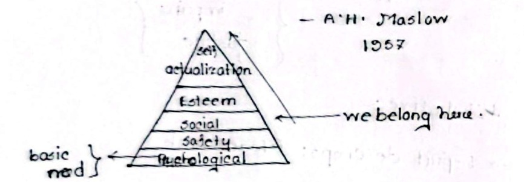
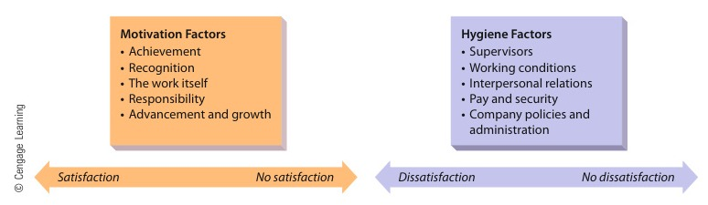
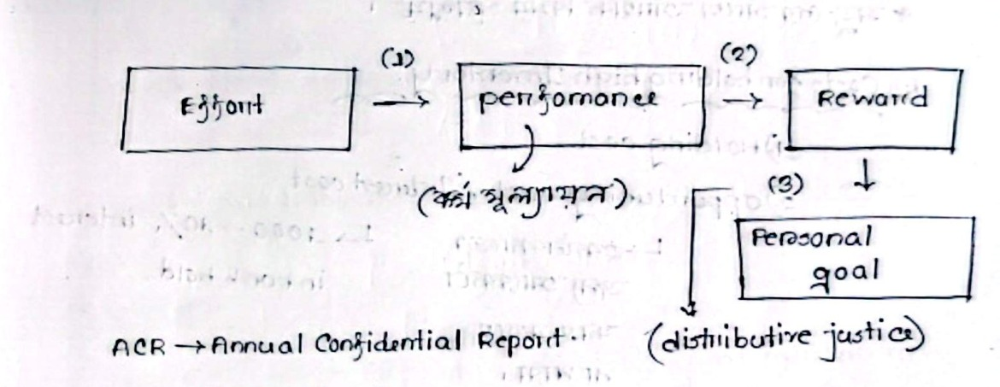

[← Prev: M04 · Planning, Decisions, Organizing and Control](M04_Planning_Decisions_Organizing_Control.md) | [🏠 Index](00_Index.md) | [Next: M06 · HRM and Performance Appraisal →](M06_HRM_and_Appraisal.md)

---

# M05 · Employee Motivation

> [!info] Topic Summary & Exam Blueprint
> - **Course Outcome:** CO2 (Industrial Management · MRI Sir)
> - **Exam Weightage:** 33 Final Marks (`12.9%` · 4/4 papers) + 00 CT Marks
> - **Priority Tier:** 🔴 Very High / Must-Study (100% lock for the final exam; tested in every paper)
> - **Primary Sources:** `Classnotes_Hum2217_Raidah.md` (Class 8), `Books/Fundamentals_of_Management_Griffin/Chapter_10_Part1_Managing_Employee_Motivation.md`, `Chapter_10_Part2_Managing_Employee_Motivation.md`

## Subtopics & Question Index

| ID | Subtopic | Past Marks (Final + CT) | Questions Covered | Jump |
| :-- | :-- | :---: | :-- | :-- |
| M05.1 | What employee motivation is and why it is important in an organization | 11 + 0 | 2020 Q.2(a) (Part 1, 02m), 2021 Q.3(a) (03m), 2023 Q.8(a) (03m), 2024 Q.2(b) (03m) | [[#M05.1 · Nature and Importance of Employee Motivation\|Go]] |
| M05.2 | Maslow's Hierarchy of Needs theory (5 levels, criticisms, and application) | 10 + 0 | 2020 Q.2(a) (Part 2, 04m), 2021 Q.3(b) (06m) | [[#M05.2 · Maslow's Need-Hierarchy Theory\|Go]] |
| M05.3 | Herzberg's Two-Factor (Hygiene-Motivator) theory (with criticism and application) | 5 + 0 | 2024 Q.2(c) (05m) | [[#M05.3 · Herzberg's Two-Factor Theory\|Go]] |
| M05.4 | Vroom's Expectancy Theory of motivation ($\text{Motivation} = E \times I \times V$, with application) | 4 + 0 | 2023 Q.8(b) (04m) | [[#M05.4 · Vroom's Expectancy Theory\|Go]] |
| M05.5 | Financial and non-financial sources of motivation | 3 + 0 | 2021 Q.3(c) (03m) | [[#M05.5 · Financial and Non-Financial Sources of Motivation\|Go]] |
| M05.6 | Other motivation theories (McGregor's Theory X and Theory Y, Alderfer's ERG) | 0 + 0 | Model Exam Question (04m) | [[#M05.6 · McGregor's Theory X and Theory Y and Alderfer's ERG Theory\|Go]] |

---

## M05.1 · Nature and Importance of Employee Motivation

### 2021 Q.3(a) · 2023 Q.8(a) · 2024 Q.2(b) · 2020 Q.2(a) (Part 1) · Merged Master Block · 03 Marks

*Section A / Section B · CO2 · Repeated Across All 4 Final Exam Papers (2020, 2021, 2023, 2024)*

**[2020 · Q.2(a) | 02 of 06 Marks | Sec A]** *(split 2m in M05.1 + 4m in M05.2)*  
What is employee motivation? State the Need-Hierarchy theory of motivation with potential application.

**[2021 · Q.3(a) | 03 Marks | Sec A]**  
What is employee motivation? Why is it important?

**[2023 · Q.8(a) | 03 Marks | Sec B | CO2]**  
What is employee Motivation? Why is it important?

**[2024 · Q.2(b) | 03 Marks | Sec A | CO2]**  
State the significance of employee motivation in organization.

**Answer.**

#### 1. Definition of Employee Motivation
Motivation is the internal psychological force that initiates, directs, and sustains goal-oriented human action. Ricky W. Griffin defines motivation as the set of forces that cause people to behave in certain ways. In simple terms, motivation determines how hard a worker tries and how long they keep trying.

#### 2. The Need-Drive Model
Motivation operates through a continuous psychological cycle:

$$
\text{Need (Deficiency)} \longrightarrow \text{Drive / Tension} \longrightarrow \text{Action} \longrightarrow \text{Satisfaction}
$$

When a person feels a deficiency, it creates internal tension. This drive leads to goal-directed action. Achieving the goal satisfies the need and relieves tension.

#### 3. Determinants of Employee Performance ($P = M \times A \times E$)
Individual job performance depends on three factors:

$$
P = M \times A \times E
$$

where:
- $P = \text{Individual Performance}$
- $M = \text{Motivation (the desire to do the job)}$
- $A = \text{Ability (the capability and skills to do the job)}$
- $E = \text{Work Environment (tools, equipment, materials, and information)}$

If an employee lacks ability, managers can provide training or reassign the task. If resources are missing, managers can supply better tools. But if motivation is missing, fixing performance is difficult. Motivation is intangible and tied to complex human feelings.

#### 4. Importance and Significance in Organizations
1. **Drives High Productivity**: Motivation turns employee potential into productive output. Motivated workers produce higher volume and superior quality.
2. **Reduces Absenteeism and Turnover**: Motivated employees show strong commitment. They arrive on time and stay with the firm longer, lowering hiring and training costs.
3. **Encourages Creative Problem-Solving**: Motivated engineers take initiative. They troubleshoot tough embedded bugs, improve hardware designs, and streamline workflows.
4. **Builds Teamwork and Goal Alignment**: Motivated employees align personal ambitions with organizational goals. This reduces conflict and eases coordination across teams.
5. **Aids Organizational Change**: Motivated staff accept technological shifts, like new software stacks or automated testing, with far less resistance.

*Exam Note / Trim Guidance:* For 2-mark questions like `2020 Q.2(a)` Part 1, write the core definition. State the $P = M \times A \times E$ formula and two brief importance points. For 3-mark questions (`2021 Q.3(a)`, `2023 Q.8(a)`, `2024 Q.2(b)`), provide the full breakdown above.

*Cross-reference:* The second half of `2020 Q.2(a)` asks for the Need-Hierarchy theory and its applications. It is answered in detail under [[#M05.2 · Maslow's Need-Hierarchy Theory|M05.2]].

---

## M05.2 · Maslow's Need-Hierarchy Theory

### 2021 Q.3(b) · 2020 Q.2(a) (Part 2) · Merged Master Block · 06 Marks

*Section A · CO2 · Asked in: 2021 Final (06m), 2020 Final (04 of 06m)*

**[2021 · Q.3(b) | 06 Marks | Sec A]**  
Briefly state the "Need-hierarchy" theory of motivation showing its criticism and potential application.

**[2020 · Q.2(a) | 04 of 06 Marks | Sec A]** *(split 2m in M05.1 + 4m in M05.2)*  
What is employee motivation? State the Need-Hierarchy theory of motivation with potential application.

**Answer.**

#### 1. Core Premise of Maslow's Theory
Abraham Maslow proposed the Need-Hierarchy theory in 1943. He argued that human beings have five distinct levels of needs. These needs follow a strict ascending hierarchy.

Maslow stated the **Satisfaction-Progression Principle**:
A person cannot move to a higher-order need until they satisfy their lower-order need. An unsatisfied need creates tension and drives human action. Once a need is satisfied, it ceases to motivate. The person then shifts attention to the next higher level.

#### 2. Maslow's Hierarchy Pyramid


*Figure 8.1: Maslow's Hierarchy of Needs Pyramid (Source: Classnotes_Hum2217_Raidah.md, Class 8)*

#### 3. The Five Need Levels (From Base to Apex)

> [!tip] Memory Hook: Maslow's 5 Levels (Bottom to Top)
> Remember **P-S-S-E-S** from base to apex:
> - **P** $\to$ **Physiological** (Base salary, clean water, rest)
> - **S** $\to$ **Security** (Safe workplace, job stability)
> - **S** $\to$ **Social** (Team bonding, peer acceptance)
> - **E** $\to$ **Esteem** (Job titles, recognition, praise)
> - **S** $\to$ **Self-Actualization** (Peak potential, creative growth)

| Level | Need Category | General Meaning & Personal Life | Organizational Application & Workplace Support |
| :---: | :--- | :--- | :--- |
| **1** | **Physiological Needs** | Basic biological survival requirements: food, water, air, sleep, and rest. | Base salary, clean drinking water, adequate lighting, ventilation, and mandatory rest intervals. |
| **2** | **Security & Safety Needs** | Protection from physical danger, emotional hurt, and financial instability. | Job security, safe workstations, PPE, health insurance, provident funds, and fair grievance handling. |
| **3** | **Belongingness / Social Needs** | Human affection, companionship, peer acceptance, and love. | Collaborative project teams, supportive culture, open communication, and company sports or social clubs. |
| **4** | **Esteem Needs** | Self-respect, autonomy, executive status, recognition, and prestige. | Prestigious job titles (e.g. Senior Firmware Lead), merit bonuses, private workspace, and public praise. |
| **5** | **Self-Actualization Needs** | Realizing one's highest personal potential, self-growth, and creative fulfillment. | Challenging technical projects, design autonomy, R&D opportunities, and decision-making authority. |

#### 4. Criticisms of Maslow's Theory
1. **Rigid Progression is Unrealistic**: People do not always follow a strict step-by-step sequence. An individual may pursue creative work or personal esteem even when basic financial or physical security is unstable.
2. **Arbitrary Five-Level Structure**: Empirical studies show that five distinct tiers do not always exist in practice. Many people operate on two or three combined levels at once.
3. **Cultural Bias**: Maslow developed his model based on Western individualistic society. In collectivistic cultures like Bangladesh, social belonging and family security often override individual self-actualization.
4. **Multiple Simultaneous Needs**: In modern workplaces, several needs motivate workers at the same time. An employee may seek a salary increase and higher professional status together.

#### 5. Potential Organizational Applications
- **Tailor Rewards to Individuals**: Managers must recognize that employees sit on different levels of the hierarchy. A uniform reward strategy will not work.
- **Secure Basic Needs First**: Management must guarantee competitive wages, safe machinery, and clean water. Without these basics, motivational seminars have no impact.
- **Provide Higher-Order Incentives for Skilled Talent**: For experienced software and hardware engineers, pay alone is not enough. Managers must offer challenging design tasks, autonomy, and public recognition.
- **Design Comprehensive Benefit Plans**: Organizations should create balanced compensation packages. These should cover healthcare (security), social events (belonging), awards (esteem), and learning budgets (self-actualization).

*Exam Note / Trim Guidance:* Sized for the 06-mark `2021 Q.3(b)` question. For a 4-mark question like `2020 Q.2(a)` Part 2, state the five levels and sketch the pyramid. Then give two workplace applications and omit detailed criticisms.

*Cross-reference:* The definition of employee motivation from `2020 Q.2(a)` is answered under [[#M05.1 · Nature and Importance of Employee Motivation|M05.1]].

---

## M05.3 · Herzberg's Two-Factor Theory

### 2024 Q.2(c) · 05 Marks

*Section A · CO2 · Asked in: 2024 Final*

**Question.** Analyze the two-factor theory of motivation with criticism and potential application.

**Answer.**

#### 1. Origin and Premise of the Two-Factor Theory
Frederick Herzberg developed the Two-Factor Theory (also known as the Motivator-Hygiene Theory) in 1959. He surveyed 200 accountants and engineers about specific workplace events that made them feel satisfied or dissatisfied.

Herzberg discovered that the factors causing job satisfaction were completely different from the factors causing job dissatisfaction.

#### 2. The Dual-Continuum Model
Traditional management viewed satisfaction and dissatisfaction as opposite ends of a single scale. Herzberg rejected this idea. He proposed two independent continuums:
- **Motivation Continuum**: Satisfaction $\longleftrightarrow$ No Satisfaction (driven by Motivators).
- **Hygiene Continuum**: Dissatisfaction $\longleftrightarrow$ No Dissatisfaction (driven by Hygiene factors).


*Figure 8.2: Frederick Herzberg's Two-Factor Dual-Continuum Model (Source: Griffin Ch. 10, Fig 10.3)*

```text
Traditional View:
Satisfaction <────────────────────────────────────────> Dissatisfaction

Herzberg's Dual View:
Motivation Factors:   Satisfaction       <────────────> No Satisfaction
Hygiene Factors:      No Dissatisfaction <────────────> Dissatisfaction
```

> [!tip] Memory Hook: Herzberg's Two-Factor Contrast
> - **Hygiene Factors (Job Context / Surroundings):** Prevent dissatisfaction when present, but never motivate on their own.
> - **Motivators (Job Content / Growth):** Create active satisfaction and drive superior performance.

#### 3. Comparison of Hygiene Factors and Motivation Factors

| Feature | Hygiene Factors (Maintenance Factors) | Motivation Factors (Satisfiers) |
| :--- | :--- | :--- |
| **Nature of Factor** | Extrinsic to the job (related to the work environment and job context). | Intrinsic to the job (related to the actual content of the work). |
| **Key Workplace Elements** | Company policies, technical supervision, working conditions, base pay, job security, and peer relations. | Achievement, recognition, challenging work, responsibility, advancement, and personal growth. |
| **Operating Scale** | Dissatisfaction $\longleftrightarrow$ No Dissatisfaction. | Satisfaction $\longleftrightarrow$ No Satisfaction. |
| **Effect When Deficient** | Causes acute dissatisfaction, grievances, poor morale, and high turnover. | Causes a lack of motivation ("No Satisfaction"), but does not cause active grievance. |
| **Effect When Adequate** | Removes grievances and creates a neutral baseline ("No Dissatisfaction"), but does NOT motivate high effort. | Inspires high effort, deep job commitment, and strong personal satisfaction. |

#### 4. Two-Stage Process for Motivating Employees
Herzberg emphasized two consecutive stages:
- **Stage 1 (Fix Hygiene Deficiencies)**:
  Managers must provide fair wages, clean workspaces, and fair company rules. This step brings employees to a neutral baseline ("No Dissatisfaction"). But hygiene alone will not produce superior performance.
- **Stage 2 (Provide Motivation Factors)**:
  Managers must enrich job content. They should delegate meaningful authority, recognize technical achievements, and offer clear promotion paths. This stage produces active satisfaction and high motivation.

#### 5. Criticisms of Herzberg's Theory
1. **Attribution Bias in Methodology**: People naturally take personal credit for satisfying achievements (motivators). But they blame outside factors like supervisors or company rules for negative events (hygiene factors).
2. **Sample Limitation**: Herzberg studied only accountants and engineers. His findings do not always apply to blue-collar or assembly-line workers. For many factory staff, wages serve as a direct motivator.
3. **Pay Plays a Dual Role**: Herzberg classified pay strictly as a hygiene factor. But performance-linked bonuses and raises carry clear recognition, acting as strong motivators.
4. **Ignores Situational Differences**: The model assumes all employees desire job enrichment and more responsibility. Some workers prefer structured, routine tasks with minimal accountability.

#### 6. Potential Workplace Applications
- **Job Enrichment (Vertical Loading)**: Restructure engineering roles to give engineers end-to-end project ownership. Avoid breaking tasks into repetitive fragments.
- **Formal Recognition Systems**: Create peer-reviewed technical awards, spot bonuses, and public commendations during department meetings.
- **Career Progression Ladders**: Provide dual-career paths with technical and managerial tracks. This lets senior engineers advance without leaving technical work.
- **Maintain Solid Hygiene Baselines**: Regularly calibrate base salaries to match local industry benchmarks and maintain clean, well-equipped engineering labs.

---

## M05.4 · Vroom's Expectancy Theory

### 2023 Q.8(b) · 04 Marks

*Section B · CO2 · Asked in: 2023 Final*

**Question.** Briefly state the Expectancy Theory of motivation with potential application.

**Answer.**

#### 1. Core Premise of Vroom's Expectancy Theory
Victor Vroom introduced Expectancy Theory in 1964. He explained that motivation is a conscious cognitive choice process. People decide their effort based on expected rewards. They also evaluate whether they can realistically achieve those goals.

Motivation is expressed by the multiplicative formula:

$$
\text{Motivation} = \text{Expectancy} \times \text{Instrumentality} \times \text{Valence}
$$

Because the factors are multiplied, if any single component is zero ($0$), total motivation drops to zero ($0$).

#### 2. Vroom's Expectancy Model


*Figure 8.3: Victor Vroom's Expectancy Model and Reward Pathway (Source: Classnotes_Hum2217_Raidah.md, Class 8)*

#### 3. The Three Core Linkages

$$
\text{Effort} \xrightarrow{\quad\text{Expectancy }(E \to P)\quad} \text{Performance} \xrightarrow{\quad\text{Instrumentality }(P \to O)\quad} \text{Outcome / Reward} \xrightarrow{\quad\text{Valence }(V)\quad} \text{Personal Goals}
$$

> [!tip] Memory Hook: Vroom's 3 Expectancy Links ($M = E \times I \times V$)
> Motivation requires all three links to be strong. If any term is zero ($0$), total motivation drops to zero ($0$):
> - **$E$ (Expectancy):** Effort $\to$ Performance ("Can I hit the target?")
> - **$I$ (Instrumentality):** Performance $\to$ Outcome ("Will I get the reward?")
> - **$V$ (Valence):** Value of Outcome ("Do I care about the reward?")

1. **Effort-to-Performance Expectancy ($E \to P$)**:
   - The employee's belief that expending effort will lead to successful task performance.
   - Probability range: $0.0$ (effort will not produce results) to $1.0$ (effort guarantees high performance).
   - Depends on: Personal skills, self-confidence, available resources, and realistic targets.
   - *Appraisal Tool*: Organizations evaluate performance using objective metrics or administrative tools like the **Annual Confidential Report (ACR)**.
2. **Performance-to-Outcome Instrumentality ($P \to O$)**:
   - The employee's belief that achieving high performance will actually produce promised organizational rewards.
   - Probability range: $0.0$ (performance brings no reward) to $1.0$ (rewards are guaranteed upon achieving goals).
   - Depends on: Trust in leadership, transparent evaluation, and past management consistency.
3. **Valence of Outcomes ($V$)**:
   - The personal value or attractiveness an employee assigns to an outcome or reward.
   - Value range: Negative (undesirable, like extreme stress), zero (indifferent), or positive (highly attractive, like cash bonuses or promotions).
   - Motivation requires the total sum of valences to be positive: $\sum V > 0$.

#### 4. Distributive Justice Moderation
Perceived distributive justice moderates the reward pathway. Employees compare their rewards against their effort and the rewards of peers. If an employee senses unfairness or favoritism, their trust in instrumentality collapses.

#### 5. Potential Workplace Applications
- **Strengthen Expectancy ($E \to P$)**: Match workers to roles fitting their skills. Provide clear technical specifications, adequate lab equipment, and relevant training. Set achievable, well-defined targets.
- **Strengthen Instrumentality ($P \to O$)**: Keep compensation promises reliably. Use transparent appraisal criteria and award bonuses promptly after milestone completions.
- **Align Rewards with Valence ($V$)**: Offer flexible reward menus. Young engineers may value paid technical certifications or flexible hours. Senior engineers may prefer stock options or cash bonuses.
- **Maintain Fairness**: Ensure appraisal evaluations are objective and unbiased to protect perceived distributive justice.

---

## M05.5 · Financial and Non-Financial Sources of Motivation

### 2021 Q.3(c) · 03 Marks

*Section A · CO2 · Asked in: 2021 Final*

**Question.** Explain the financial and non-financial sources of motivation.

**Answer.**

#### 1. Overview
Organizations motivate employees using two major categories of rewards: financial (monetary) and non-financial (non-monetary). Financial motivators primarily satisfy lower-order survival and security needs. Non-financial motivators address higher-order social, esteem, and self-actualization needs.

#### 2. Financial Sources of Motivation
Financial motivators involve direct or indirect monetary payments:
1. **Base Salary and Wages**: The foundational cash compensation paid for regular work hours. It provides basic living security.
2. **Merit Pay Plans**: Permanent salary increases awarded annually based on an employee's individual appraisal score and overall contribution.
3. **Performance Bonuses and Incentives**: Lump-sum cash rewards for specific short-term targets. An example is completing a firmware project ahead of schedule.
4. **Profit Sharing and Gainsharing (Scanlon Plan)**: Distributing a percentage of company profits or team-generated cost savings back to employees. This aligns worker effort with business success.
5. **Stock Option Plans and ESOPs**: Granting employees the right to purchase company shares at a fixed price. This gives workers a direct financial stake in company growth.

#### 3. Non-Financial Sources of Motivation
Non-financial motivators provide psychological, social, and professional satisfaction without direct cash payments:
1. **Recognition and Public Praise**: Formal awards, certificates of excellence, and verbal commendation during company meetings for outstanding technical work.
2. **Job Enrichment and Autonomy**: Expanding job responsibility, giving engineers freedom over design choices, and reducing supervisory micromanagement.
3. **Career Advancement Opportunities**: Providing clear promotional paths, prestigious job titles, and opportunities to lead high-visibility technical teams.
4. **Alternative Work Schedules**: Offering flextime, compressed workweeks, and telecommuting (work-from-home options) to support work-life balance.
5. **Supportive Work Culture and Environment**: Providing modern lab facilities, ergonomic workstations, and a respectful, collaborative team atmosphere.

#### 4. Comparison Summary

| Dimension | Financial Motivators | Non-Financial Motivators |
| :--- | :--- | :--- |
| **Form of Reward** | Direct monetary compensation or financial assets. | Psychological, professional, or environmental benefits. |
| **Target Need Level** | Physiological and Security needs on Maslow's scale. | Social, Esteem, and Self-Actualization needs. |
| **Duration of Impact** | Often short-term; employees quickly get used to higher pay. | Longer lasting; builds deep loyalty, pride, and engagement. |
| **Cost to Employer** | Direct financial expense and cash outflow. | Low monetary cost; requires thoughtful management and culture. |

---

## M05.6 · McGregor's Theory X and Theory Y and Alderfer's ERG Theory

### M05.6 · Model Exam Question · 04 Marks

*Suggested Topic (Syllabus Module 3) · Target: Part (b) or (c)*

**Question.** Compare Douglas McGregor's Theory X and Theory Y assumptions. How does Clayton Alderfer's ERG Theory modify Maslow's hierarchy of needs?

**Answer.**

#### 1. Douglas McGregor's Theory X and Theory Y
Douglas McGregor introduced Theory X and Theory Y in 1960 in *The Human Side of Enterprise*. These theories represent two contrasting sets of assumptions that managers hold about employee nature and workplace behavior.

- **Theory X (Pessimistic / Autocratic Assumptions)**:
  1. People inherently dislike work and will avoid it whenever possible.
  2. Because people dislike work, managers must coerce, control, direct, and threaten employees to achieve organizational goals.
  3. People prefer to be directed, avoid responsibility, have little ambition, and seek job security above all.
  - *Managerial Style*: Autocratic leadership, tight supervision, centralized control, and punitive rules.

- **Theory Y (Optimistic / Participative Assumptions)**:
  1. Work is as natural as play or rest. People do not naturally dislike work.
  2. People exercise self-direction and self-control when committed to organizational goals.
  3. Commitment to objectives is tied to the rewards associated with their achievement.
  4. Under proper conditions, people both accept and actively seek responsibility.
  5. The capacity to apply imagination, ingenuity, and creativity to organizational problems is widely distributed in the population.
  - *Managerial Style*: Democratic leadership, delegation of authority, participative decision-making, and job enrichment. McGregor advocated Theory Y as the superior management approach.

#### 2. Comparison: Theory X vs. Theory Y

| Dimension | Theory X | Theory Y |
| :--- | :--- | :--- |
| **View of Human Nature** | Pessimistic, lazy, and resistant to change. | Optimistic, active, and capable of self-growth. |
| **Attitude Toward Work** | Workers avoid work whenever they can. | Work is natural, meaningful, and engaging. |
| **Source of Motivation** | External rewards, close supervision, and fear of penalties. | Internal drives, personal accomplishment, and goal commitment. |
| **Managerial Approach** | Centralized authority and micromanagement. | Decentralized authority, empowerment, and autonomy. |

#### 3. Clayton Alderfer's ERG Theory
Clayton Alderfer developed the ERG Theory in 1972 to refine Maslow's hierarchy and address its empirical flaws.

- **The Three Core Need Categories**:
  - **Existence ($E$)**: Basic physical and physiological survival needs. Matches Maslow's physiological and physical safety needs (wages, safe working conditions, food).
  - **Relatedness ($R$)**: Desires for interpersonal relationships, social acceptance, and mutual respect. Matches Maslow's social belonging and external esteem needs.
  - **Growth ($G$)**: Desires for personal development, competence, and creative output. Matches Maslow's internal esteem and self-actualization needs.

- **Key Modifications to Maslow's Hierarchy**:
  1. **Multiple Active Needs**: Maslow assumed only one active need at a time. Alderfer showed that multiple need categories can motivate a person simultaneously.
  2. **Frustration-Regression Principle**: Maslow assumed only upward progression. Alderfer added frustration-regression. If an employee cannot fulfill a higher need like Growth, they regress. They demand more of a lower need, like higher pay or more team socialization under Relatedness.

---

[← Prev: M04 · Planning, Decisions, Organizing and Control](M04_Planning_Decisions_Organizing_Control.md) | [🏠 Index](00_Index.md) | [Next: M06 · HRM and Performance Appraisal →](M06_HRM_and_Appraisal.md)
