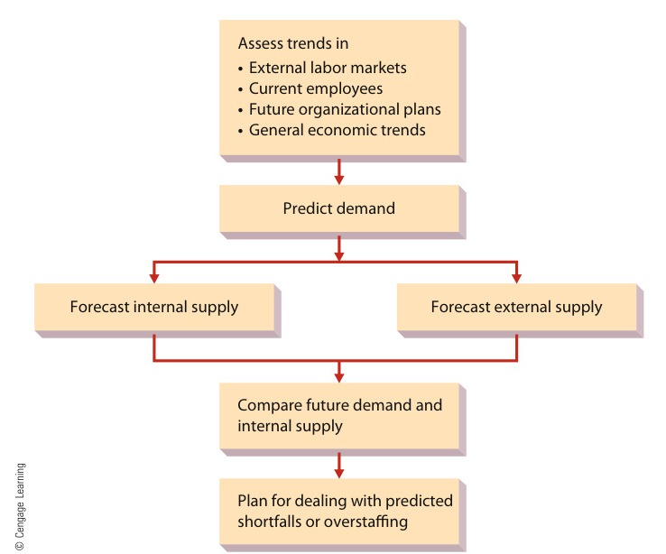
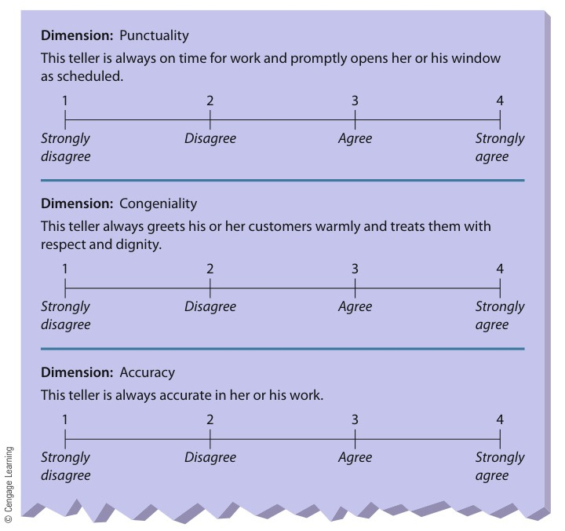
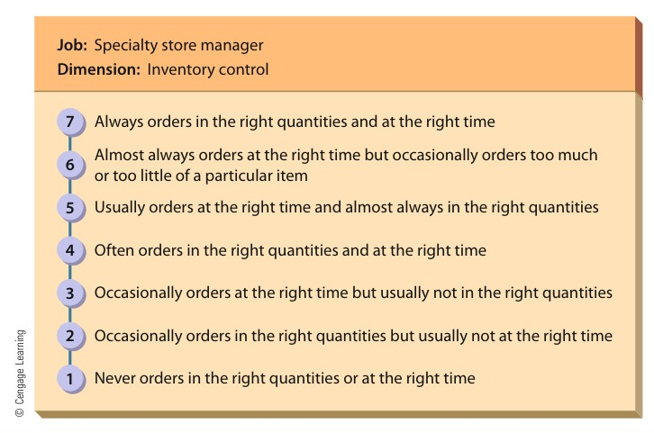

[← Prev: M05 · Employee Motivation](M05_Motivation.md) | [🏠 Index](00_Index.md) | [Next: O01 · Inventory Concepts →](O01_Inventory_Concepts.md)

---

# M06 · HRM & Performance Appraisal

> [!info] Topic Summary & Exam Blueprint
> - **Course Outcome:** CO2 (Industrial Management · Md. Rokunuzzaman Islam Sir)
> - **Exam Weightage:** 29 Final Marks (`11.3%` · 4/4 papers) + 00 CT Marks
> - **Priority Tier:** 🔴 High Priority (Appraisal and Rating Errors appear in every single paper: 2020, 2021, 2023, 2024) / 🟢 HRM Foundations
> - **Primary Sources:** Ricky W. Griffin (8th ed.), *Fundamentals of Management*, Chapter 8 (Parts 1 & 2)

## Subtopics & Question Index

| ID | Subtopic | Past Marks (Final + CT) | Questions Covered | Jump |
| :-- | :-- | :---: | :-- | :-- |
| M06.1 | Human Resources Management (HRM): definition and scope | 3 + 0 | 2020 Q.3(a) (03m) | [[#M06.1 · Human Resources Management (HRM): Definition and Scope\|Go]] |
| M06.2 | Distinction between recruitment and selection | 4 + 0 | 2020 Q.3(b) (04m) | [[#M06.2 · Distinction Between Recruitment and Selection\|Go]] |
| M06.3 | Employee training: meaning and necessity | 5 + 0 | 2020 Q.3(c) (05m) | [[#M06.3 · Employee Training: Meaning and Necessity\|Go]] |
| M06.4 | Performance appraisal / management: definition, evaluators, and methods | 7 + 0 | 2023 Q.8(c) (03m), 2020 Q.2(b) Part 1 (02m), 2021 Q.4(c) Part 1 (02m) | [[#M06.4 · Performance Appraisal and Management: Definition, Evaluators, and Methods\|Go]] |
| M06.5 | Potential rating-scale appraisal problems and ways to avoid them | 10 + 0 | 2024 Q.8(b) (04m), 2020 Q.2(b) Part 2 (04m), 2021 Q.4(c) Part 2 (02m) | [[#M06.5 · Potential Rating-Scale Appraisal Problems and Ways to Avoid Them\|Go]] |

---

## M06.1 · Human Resources Management (HRM): Definition and Scope

### 2020 Q.3(a) · 03 Marks

*Section A · CO2 · Asked in: 2020 Final*

**[2020 · Q.3(a) | 03 Marks | Sec A]**  
What is human resources management?

**Answer.**

**Human Resource Management (HRM)** is the set of organizational activities directed at attracting, developing, and maintaining an effective workforce (Ricky W. Griffin).

HRM treats employees as human capital. Human capital reflects an organization's investment in hiring, training, and retaining skilled people.

The scope of HRM spans three core functional areas:

1. **Attracting Human Resources:**
   - **Human Resource Planning:** Assessing job content through job analysis. Job analysis yields job descriptions (duties and working conditions) and job specifications (required skills and credentials).
   - **Forecasting Demand and Supply:** Projecting future workforce needs using sales estimates, staffing ratios, and skills inventories.
   - **Recruitment and Selection:** Attracting candidates from internal or external sources. Then, choosing the best applicants via tests, interviews, and assessment centers.

*Figure 8.1: The Human Resource Planning Process (Source: Griffin, Fundamentals of Management, 8th ed., p. 260)*

2. **Developing Human Resources:**
   - **Training and Development:** Teaching technical skills to operational workers and leadership skills to managers.
   - **Performance Appraisal:** Assessing job performance systematically against formal standards.
   - **Performance Feedback:** Holding coaching sessions to guide career growth and correct performance gaps.

3. **Maintaining Human Resources:**
   - **Compensation and Benefits:** Designing fair wage levels, wage structures, and employee benefits.
   - **Labor Relations:** Working with trade unions, bargaining collectively, and handling grievances.
   - **Workplace Safety:** Providing safe physical working environments and meeting statutory safety standards.

*Example:* In an electronics manufacturing firm such as Walton, HRM forecasts the need for embedded systems engineers. It recruits graduates, runs assembly line safety training, evaluates technical output, and sets competitive pay to retain talent.

---

## M06.2 · Distinction Between Recruitment and Selection

### 2020 Q.3(b) · 04 Marks

*Section A · CO2 · Asked in: 2020 Final*

**[2020 · Q.3(b) | 04 Marks | Sec A]**  
Distinguish between recruitment and selection.

**Answer.**

#### 1. Core Distinction: Recruitment vs. Selection

Recruitment and selection are two sequential steps in attracting human resources. Recruitment builds an applicant pool. Selection then evaluates candidates to choose the best person for the position.

The table below contrasts recruitment and selection across core dimensions:

| Comparison Basis | Recruitment | Selection |
| :--- | :--- | :--- |
| **1. Meaning** | The process of discovering potential applicants and encouraging them to apply for open positions. | The process of evaluating applicants to choose the most suitable candidate for employment. |
| **2. Core Purpose** | Gathers a large pool of qualified job seekers for vacant positions. | Filters candidates to pick the person most likely to succeed in the job. |
| **3. Nature of Process** | A **positive process** because it invites and attracts as many qualified applicants as possible. | A **negative process** because it screens out and rejects unsuitable candidates at each stage. |
| **4. Order and Sequence** | First stage. It precedes the selection process. | Second stage. It starts only after recruiting produces an applicant pool. |
| **5. Methods and Sources** | Internal job postings, skills inventories, campus drives, advertisements, and employment websites. | Application blanks, skill tests, structured interviews, assessment centers, and medical exams. |
| **6. Cost and Time** | Less expensive and demands less administrative time per applicant. | Expensive, rigorous, and time consuming due to extensive testing and multiple interview rounds. |
| **7. Contractual Outcome** | Creates no employment contract. It only generates candidate applications. | Ends with a formal job offer and an employment contract between employer and candidate. |

#### 2. Internal vs. External Recruitment Sources (Griffin Ch. 8)

Organizations source candidate pools through internal and external channels:

- **Internal Recruiting:** Considering current employees for openings via promotion or transfer. It builds worker morale and retains proven talent. But it creates a ripple effect by leaving another job vacant.
- **External Recruiting:** Attracting candidates from outside the organization through campus drives, online job boards, and employment agencies. It brings fresh ideas and diverse technical competencies. However, it incurs higher advertising expenses and requires longer orientation periods.

---

## M06.3 · Employee Training: Meaning and Necessity

### 2020 Q.3(c) · 05 Marks

*Section A · CO2 · Asked in: 2020 Final*

**[2020 · Q.3(c) | 05 Marks | Sec A]**  
What is meant by employee training? Why is it necessary?

**Answer.**

### 1. Meaning of Employee Training

**Employee training** means teaching operational or technical workers how to do the specific job for which they were hired (Ricky W. Griffin).

Training focuses on immediate job tasks and short-term operational performance. In contrast, **development** teaches managers and professionals broader conceptual and human skills for present and future roles.

Organizations deliver training using two primary approaches:
1. **On-the-Job Training:** Trainees learn while working on actual equipment under the guidance of an experienced supervisor. Common methods include job rotation, coaching, and apprenticeships.
2. **Off-the-Job Training:** Training takes place away from the active work site. This allows workers to focus on learning without production pressures. Common methods include classroom lectures, computer-based modules, vestibule training (simulated work stations), and corporate universities.

### 2. Necessity of Employee Training

Training is essential for engineering, industrial, and technology enterprises for several key reasons:

1. **Adaptation to Technological Change:** Modern engineering processes adopt robotics, automated SMT lines, PLCs, and new software tools. Training ensures workers master these new tools quickly and correctly.
2. **Higher Productivity and Quality:** Untrained workers work slowly and make frequent errors. Proper training improves operating speed, sharpens manual precision, lowers material scrap rates, and ensures consistent product quality.
3. **Workplace Health and Safety:** Industrial plants and electrical installations present serious physical hazards. These hazards include high voltage, toxic chemicals, and heavy machinery. Safety training teaches correct handling rules and emergency procedures. This prevents fatal accidents.
4. **Reduced Maintenance and Machine Downtime:** Trained operators handle delicate equipment properly. They spot minor equipment faults early. This minimizes costly breakdowns and machine downtime.
5. **Reduced Need for Close Supervision:** Trained workers understand their duties and resolve routine technical issues independently. This frees up managerial time and widens the manager's span of control.
6. **Higher Morale and Retention:** When companies invest in employee skills, workers feel valued. This boosts job satisfaction, loyalty, and employee retention.

---

## M06.4 · Performance Appraisal and Management: Definition, Evaluators, and Methods

### 2023 Q.8(c) · 03 Marks

*Section B · CO2 · Asked in: 2023 Final; Part 1 of 2020 Q.2(b) (02m) and 2021 Q.4(c) (02m)*

**[2023 · Q.8(c) | 03 Marks | Sec B | CO2]**  
What is performance management? Who should do the appraisal and in what ways?

**[2020 · Q.2(b) | 02 of 06 Marks | Sec A]** *(split 2m in M06.4 + 4m in M06.5)*  
What is performance appraisal? Explain the potential rating scale appraisal problems.

**[2021 · Q.4(c) | 02 of 04 Marks | Sec A]** *(split 2m in M06.4 + 2m in M06.5)*  
What is performance management? State the potential rating scale appraisal problems.

*Cross-ref:* Sibling subtopic [[#M06.5 · Potential Rating-Scale Appraisal Problems and Ways to Avoid Them|M06.5]] covers the rating-scale appraisal problems for 2020 Q.2(b) and 2021 Q.4(c).

**Answer.**

### 1. Definition of Performance Appraisal and Management

- **Performance Appraisal:** A formal assessment of how well an employee is doing their job (Ricky W. Griffin). It evaluates past work to support decisions about pay raises, promotions, and training needs.
- **Performance Management:** The broader, continuous process of defining, measuring, developing, and aligning employee performance with organizational strategic goals. It integrates clear expectations, ongoing coaching, objective appraisal, and feedback.

### 2. Who Should Do the Appraisal (Appraisal Sources)

Organizations rely on several evaluators to assess employee performance:

1. **Immediate Supervisor:** The most traditional and common evaluator. The direct manager assigns daily tasks, observes work directly, and understands specific job standards.
2. **Peers and Coworkers:** Peers see day-to-day work habits and teamwork firsthand. They offer accurate insights on collaboration and technical competence.
3. **Subordinates (Upward Appraisal):** Subordinates evaluate their managers. This method reveals leadership quality, communication clarity, and supervisory fairness.
4. **Self-Appraisal:** Employees evaluate their own work and list their accomplishments. This encourages personal reflection and guides the appraisal interview.
5. **360-Degree Feedback:** An evaluation system where managers receive ratings from everyone around them: their supervisor, peers, subordinates, and sometimes clients. It provides a balanced view of performance.

### 3. In What Ways (Appraisal Methods)

Organizations measure performance using two broad categories of methods:

#### A. Objective Methods
- **Measurable Output:** Evaluates tangible outputs like units produced, dollar sales volume, or scrap rate. Figures must be adjusted for opportunity bias.
- **Special Performance Tests:** Assesses workers under standardized test conditions. This measures actual ability without opportunity bias.

#### B. Judgmental Methods
- **Graphic Rating Scales:** Rates performance dimensions (like punctuality, congeniality, and accuracy) on a fixed numerical or descriptive scale.

*Figure 8.2: Graphic Rating Scales for a Bank Teller (Source: Griffin, Fundamentals of Management, 8th ed., p. 267)*

- **Behaviorally Anchored Rating Scales (BARS):** Replaces vague scale numbers with explicit behavioral descriptions. These descriptions define each point on the scale.
- **Ranking Techniques:** Compares employees directly with one another from best to worst. Drawbacks include difficulty distinguishing middle workers and lack of diagnostic feedback.
- **Management by Objectives (MBO):** Managers and subordinates agree on specific goals together and review actual progress at set dates.
- **Critical Incident Method:** Evaluators record exceptional positive and negative employee behaviors in a written log over time.

---
*Note for 2-mark variants:* For 2020 Q.2(b) or 2021 Q.4(c), write only Section 1. State the concise definition of performance appraisal or performance management.

---

## M06.5 · Potential Rating-Scale Appraisal Problems and Ways to Avoid Them

### 2024 Q.8(b) · 04 Marks

*Section B · CO2 · Asked in: 2024 Final; Part 2 of 2020 Q.2(b) (04m) and 2021 Q.4(c) (02m)*

**[2024 · Q.8(b) | 04 Marks | Sec B | CO2]**  
State potential rating-scale appraisal problems and suggest ways to avoid the problems.

**[2020 · Q.2(b) | 04 of 06 Marks | Sec A]** *(split 2m in M06.4 + 4m in M06.5)*  
What is performance appraisal? Explain the potential rating scale appraisal problems.

**[2021 · Q.4(c) | 02 of 04 Marks | Sec A]** *(split 2m in M06.4 + 2m in M06.5)*  
What is performance management? State the potential rating scale appraisal problems.

*Cross-ref:* Sibling subtopic [[#M06.4 · Performance Appraisal and Management: Definition, Evaluators, and Methods|M06.4]] covers the definition of performance appraisal and performance management for 2020 Q.2(b) and 2021 Q.4(c).

**Answer.**

Rating scales are widely used in performance appraisals. However, subjective judgment can introduce serious rating errors that distort evaluations.

### 1. Potential Rating-Scale Appraisal Problems

> [!tip] Memory Hook: Appraisal Errors Acronym ("H-L-S-C-R-C")
> Remember the 6 rating scale errors with **H-L-S-C-R-C**:
> - **H** = **H**alo / Horn error (one trait colors all ratings)
> - **L** = **L**eniency error (rating everyone too high)
> - **S** = **S**trictness error (rating everyone too low)
> - **C** = **C**entral tendency error (clustering everyone in the middle)
> - **R** = **R**ecency error (judging only the last few weeks)
> - **C** = **C**ontrast error (comparing against the previous worker)

1. **Halo Error:**
   - A supervisor lets an outstanding rating on one dimension spread to all other dimensions.
   - *Example:* An engineer has top-tier punctuality. The supervisor gives them high ratings for circuit design quality, even when their schematics contain errors.
   - *Note:* The opposite error is the **horns effect**, where a single weak trait pulls down all ratings.

2. **Leniency Error:**
   - An evaluator rates all employees too generously on the high end of the scale.
   - Managers do this to avoid interpersonal conflict, please subordinates, or help them get pay raises.

3. **Strictness (Severity) Error:**
   - An evaluator rates all employees too harshly at the low end of the scale.
   - The manager applies impossibly strict standards, so even top performers get mediocre marks.

4. **Central Tendency Error:**
   - An evaluator rates every employee as "average" by sticking to the middle of the scale.
   - Raters use this to play it safe and avoid defending high or low scores. But it conceals real performance differences.

5. **Recency Error:**
   - An evaluator bases ratings only on the past few weeks. They ignore performance during the rest of the year.
   - A recent success inflates a weak year. Conversely, a recent mistake ruins months of excellent work.

6. **Contrast Error and Personal Bias:**
   - **Contrast Error:** Rating an employee in comparison to the previous person evaluated instead of against fixed job standards.
   - **Personal Bias:** Allowing personal prejudices based on age, gender, race, or background to distort appraisal scores.

### 2. Concrete Ways to Avoid Appraisal Problems

Organizations use several practical strategies to reduce rating scale errors:

1. **Use Behaviorally Anchored Rating Scales (BARS):**
   - BARS anchors every scale point to specific, observable behavioral descriptions rather than vague numbers or adjectives.
   - This anchors evaluations directly in observable job facts.

*Figure 8.3: Behaviorally Anchored Rating Scale (BARS) for Inventory Control (Source: Griffin, Fundamentals of Management, 8th ed., p. 268)*

2. **Conduct Rater Training:**
   - Train evaluators to spot perceptual traps like halo, leniency, and central tendency errors.
   - Practice evaluations help managers apply consistent and objective scoring standards across departments.

3. **Keep Critical Incident Performance Diaries:**
   - Supervisors maintain continuous logs of notable positive and negative employee actions across the entire year.
   - This eliminates recency error by providing written evidence for the full appraisal cycle.

4. **Adopt Multiple Evaluators and 360-Degree Feedback:**
   - Collect performance input from supervisors, coworkers, and subordinates.
   - Multiple perspectives balance out the personal biases or leniency of an individual manager.

5. **Set Clear Standards and Use MBO:**
   - Base appraisals on concrete, measurable goals agreed upon in advance using Management by Objectives.
   - Objective benchmarks leave little room for subjective guesswork.

---
*Note for 2-mark variants:* For 2021 Q.4(c) Part 2, list the four main errors: Halo, Leniency/Strictness, Central Tendency, and Recency. Give a brief single-sentence definition for each.

---

[← Prev: M05 · Employee Motivation](M05_Motivation.md) | [🏠 Index](00_Index.md) | [Next: O01 · Inventory Concepts →](O01_Inventory_Concepts.md)
