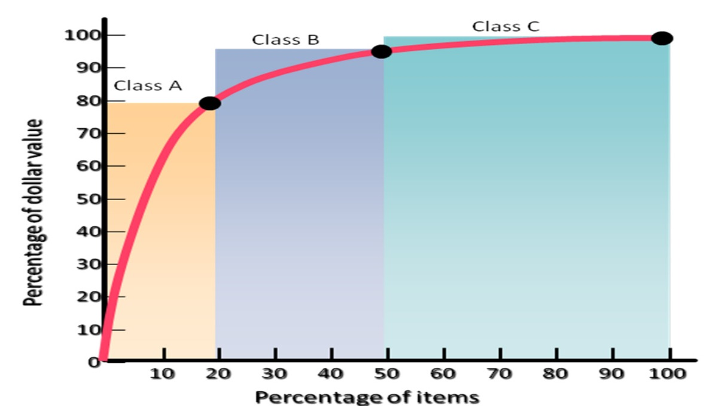

[← Prev: M06 · HRM and Performance Appraisal](M06_HRM_and_Appraisal.md) | [🏠 Index](00_Index.md) | [Next: O02 · EOQ and Continuous Review System →](O02_EOQ_and_Q_System.md)

---

# O01 · Inventory Concepts

> [!info] Topic Summary & Exam Blueprint
> - **Course Outcome:** CO3 (Operational Management · MRI Sir)
> - **Exam Weightage:** 16 Final Marks (`6.3%` · 4/4 papers) + 00 CT Marks
> - **Priority Tier:** 🔴 High (Core OM Foundation · Tested in Every Final Exam)
> - **Primary Sources:** `Industrial_and_Operations_Management/Inventory Control.md`, `Classnote_by_Raidah/Classnotes_Hum2217_Raidah.md` (Class 9)

## Subtopics & Question Index

| ID | Subtopic | Past Marks (Final + CT) | Questions Covered | Jump |
| :-- | :-- | :---: | :-- | :-- |
| O01.1 | Meaning of inventory, inventory control, and inventory management | 5 + 0 | 2020 Q.4(a) (Part 1, 02m), 2021 Q.4(a) (Part 1, 02m), 2023 Q.7(a) (Part 1, 01m) | [[#O01.1 · Meaning of Inventory, Inventory Control, and Inventory Management|Go]] |
| O01.2 | Costs for holding inventory (high-level vs. low-level inventory costs) | 7 + 0 | 2020 Q.4(a) (Part 2, 03m), 2021 Q.4(a) (Part 2, 02m), 2024 Q.4(a) (02m), Model Q.1 (04m) | [[#O01.2 · Costs for Holding Inventory|Go]] |
| O01.3 | Types of inventory (Cycle, Safety Stock, Anticipation, Pipeline) | 4 + 0 | 2020 Q.4(c) (03m), 2023 Q.7(a) (Part 2, 01m), Model Q.1 (04m) | [[#O01.3 · Types of Inventory|Go]] |
| O01.4 | ABC Analysis (Class A 20%/80%, Class B 30%/15%, Class C 50%/5%) | 0 + 0 | Model Q.1 (04m) | [[#O01.4 · ABC Analysis|Go]] |

---

## O01.1 · Meaning of Inventory, Inventory Control, and Inventory Management

*Past Exam Appearances: 2020 Q.4(a) (Part 1, 02m), 2021 Q.4(a) (Part 1, 02m), 2023 Q.7(a) (Part 1, 01m).*

### 2020 Q.4(a) (Part 1), 2021 Q.4(a) (Part 1) & 2023 Q.7(a) (Part 1) · 02 Marks (Merged)

*Section A / Section B · CO3 · Merged Split Questions*

> [!question] Past Final Examination Questions
> **[2020 · Q.4(a) | 02 of 05 Marks | Sec A]** *(split 2m in O01.1 + 3m in O01.2)*  
> What is inventory control? Discuss the costs associated with holding high level inventory.
> 
> **[2021 · Q.4(a) | 02 of 04 Marks | Sec A]** *(split 2m in O01.1 + 2m in O01.2)*  
> What is inventory management? State the costs associated with holding high level inventory.
> 
> **[2023 · Q.7(a) | 01 of 02 Marks | Sec B | CO3]** *(split 1m in O01.1 + 1m in O01.3)*  
> What is inventory control? State its types.

*Cross-ref:* The cost trade-off half of 2020 Q.4(a), 2021 Q.4(a), and 2024 Q.4(a) is answered in [[#O01.2 · Costs for Holding Inventory|O01.2]]. The inventory types half of 2023 Q.7(a) is answered in [[#O01.3 · Types of Inventory|O01.3]].

**Answer.**

#### 1. Inventory Defined
Inventory is any stock of physical goods or materials stored to support production or meet customer demand. 

As noted by MRI Sir in class:
> *"Inventory is created when the receipt of finished goods, materials or parts exceeds their disbursement. It is depleted when their disbursement exceeds receipt."*

Inventory exists in three physical forms:
1. **Raw Materials:** Unprocessed items purchased from suppliers (such as silicon wafers, copper coils, or solder paste).
2. **Work-in-Process (WIP):** Partially finished units currently undergoing assembly (such as printed circuit boards being populated).
3. **Finished Goods:** Completed products ready for customer shipment (such as packaged smartphones or smart energy meters).

#### 2. Inventory Control vs. Inventory Management
- **Inventory Control:**
  Inventory control is the operational mechanism used to maintain stock levels within desired limits. It determines when to place an order and how much to order. It uses techniques like Economic Order Quantity (EOQ) and continuous review systems. These methods minimize storage costs while avoiding stockouts.
- **Inventory Management:**
  Inventory management is the broader managerial function. It plans, organizes, directs, and monitors stock across the entire supply chain. It aligns stock policy with corporate finance, supplier networks, and customer service goals.

#### 3. Core Operational Objectives
1. **Uninterrupted Operations:** Provide adequate raw materials and parts to protect assembly lines from stockouts and delivery delays.
2. **Customer Satisfaction:** Keep enough finished products on hand to fulfill customer orders quickly.
3. **Cost Minimization:** Balance holding costs against ordering and setup costs to minimize total annual inventory expenditure.
4. **Working Capital Protection:** Avoid tying up excess cash in idle stock so capital remains free for other investments.
5. **Operating Flexibility:** Decouple successive production stages so a temporary breakdown in one workstation does not halt the entire plant.

> [!tip] Exam Trimming Note (For 1-Mark Answers)
> For a 1-mark question like 2023 Q.7(a), give a single crisp sentence:
> *"Inventory control is the operational system of maintaining item stocks at optimal levels for smooth production at minimal total cost."*

---

## O01.2 · Costs for Holding Inventory

*Past Exam Appearances: 2020 Q.4(a) (Part 2, 03m), 2021 Q.4(a) (Part 2, 02m), 2024 Q.4(a) (02m).*

### 2020 Q.4(a) (Part 2), 2021 Q.4(a) (Part 2) & 2024 Q.4(a) · 03 Marks (Merged)

*Section A · CO3 · Merged Split Questions*

> [!question] Past Final Examination Questions
> **[2020 · Q.4(a) | 03 of 05 Marks | Sec A]** *(split 2m in O01.1 + 3m in O01.2)*  
> What is inventory control? Discuss the costs associated with holding high level inventory.
> 
> **[2021 · Q.4(a) | 02 of 04 Marks | Sec A]** *(split 2m in O01.1 + 2m in O01.2)*  
> What is inventory management? State the costs associated with holding high level inventory.
> 
> **[2024 · Q.4(a) | 02 Marks | Sec A | CO3]**  
> State the costs for holding inventory.

*Cross-ref:* The definition halves of 2020 Q.4(a) and 2021 Q.4(a) are answered in [[#O01.1 · Meaning of Inventory, Inventory Control, and Inventory Management|O01.1]].

**Answer.**

Holding inventory creates an economic trade-off. Holding high inventory increases carrying costs. Holding low inventory increases ordering and stockout costs. Operations managers must balance these two cost pressures.

#### 1. Costs Associated with Holding High-Level Inventory (Carrying Costs)
These costs rise directly as the inventory level increases:

1. **Cost of Capital (Interest / Opportunity Cost):**
   This is usually the largest holding cost component. It often represents $15\%$ to $25\%$ of total inventory value per year. Capital tied up in physical inventory cannot earn interest in a bank deposit. It also cannot fund other productive projects.
2. **Storage and Handling Costs:**
   Warehousing requires physical space and equipment. Expenses include warehouse rent, electricity, heating, cooling, and security. It also includes the cost of material handling gear like forklifts and warehouse staff wages.
3. **Taxes and Insurance:**
   Governments assess property taxes based on inventory value at year-end. Firms also buy insurance policies to protect against fire, flood, theft, and natural hazards. Higher stock levels increase both tax liabilities and insurance premiums.
4. **Shrinkage Costs:**
   Shrinkage reduces physical stock below recorded book values through three main causes:
   - **Pilferage (Theft):** Loss of items due to employee theft or shoplifting. Small valuable items like microcontrollers and memory chips are especially vulnerable.
   - **Obsolescence:** Products lose market value before sale due to rapid engineering changes or new technology releases. Outdated electronic components may become worthless overnight.
   - **Deterioration (Spoilage):** Physical or chemical decay over time. Examples include the oxidation of solder leads, degradation of chemical pastes, or rust on metal frames.

#### 2. Costs Associated with Holding Low-Level Inventory (Shortage & Ordering Costs)
These costs rise when inventory levels are kept too low:

1. **Stockout and Customer Service Costs:**
   Running out of stock leads to backorders, lost sales, and dissatisfied clients. It may cause lost customer goodwill and contractual delay penalties.
2. **Ordering and Setup Costs:**
   Keeping low inventory forces small, frequent replenishment orders. Every order requires clerical work, invoice processing, inspection, and receiving labor. For in-house production, frequent setups cause machine downtime and setup labor expenses.
3. **Higher Transportation Costs:**
   Ordering small quantities prevents full-truckload (FTL) shipping. The company must use less-than-truckload (LTL) freight, which charges higher freight rates per unit.
4. **Lost Quantity Discounts:**
   Suppliers offer price discounts and rebates on large purchases. Buying in small batches forces the firm to pay top unit prices.
5. **Production Disruptions:**
   When a critical component runs out, production lines halt. Workers and machines sit idle, lowering overall plant productivity.

#### 3. Summary Comparison Table

| Cost Category | High-Level Inventory | Low-Level Inventory |
| :--- | :--- | :--- |
| **Capital & Financing** | High opportunity cost and tied-up cash | Free cash flow available for other investments |
| **Storage & Security** | High warehouse rent, handling, and security | Minimal storage space and low handling expenses |
| **Shrinkage & Risk** | High risk of theft, spoilage, and obsolescence | Minimal risk of spoilage or obsolete parts |
| **Ordering & Setup** | Low annual ordering cost due to few large orders | High annual ordering cost due to frequent batches |
| **Customer Service** | High service level with zero stockout risk | High risk of stockouts, lost sales, and delays |
| **Transportation** | Low per-unit freight costs via bulk shipping | High per-unit freight costs due to small shipments |

> [!tip] Memory Hook · Inventory Cost Pressures (I-S-H vs. C-O-S-T-P)
> Remember the two opposing forces with simple acronyms:
> - **Pressures for Low Inventory (`I-S-H`):**
>   - **I**: **I**nterest and opportunity cost of tied-up capital ($15\%$ to $25\%$).
>   - **S**: **S**torage and warehousing expenses (rent, power, security).
>   - **H**: **H**andling, shrinkage, and taxes (theft, spoilage, obsolescence, insurance).
> - **Pressures for High Inventory (`C-O-S-T-P`):**
>   - **C**: **C**ustomer service (avoids backorders, stockouts, and penalties).
>   - **O**: **O**rdering cost reductions (fewer purchase orders and clerical steps).
>   - **S**: **S**etup cost savings (longer production runs, less machine downtime).
>   - **T**: **T**ransportation savings (bulk full truckload FTL shipping rates).
>   - **P**: **P**ayment discounts (vendor volume price discounts and rebates).

> [!tip] Exam Trimming Note (For 2-Mark Answers)
> For a 2-mark question like 2024 Q.4(a), use bullet points. State the four high-level costs and four low-level costs without full paragraphs.

### O01.2 · Model Exam Question 1 · 04 Marks

*Operational Management (CO3) · Inventory Cost Pressures · Target: Part (b) or (c)*

> [!question] Model Exam Question
> **Question.** Analyze the primary cost pressures that push an operations manager to hold low levels of inventory versus high levels of inventory. Present a comparative analysis for an electronics manufacturing plant.

**Answer.**

#### Trade-Off Analysis in Inventory Levels
Every operations manager balances two conflicting cost pressures:
1. **Pressures for Low Inventory:** Aims to minimize carrying costs by keeping inventory lean.
2. **Pressures for High Inventory:** Aims to minimize order setup costs and stockout risks.

#### Pressures for Low Inventory
- **Opportunity Cost of Capital:** Tied-up cash cannot earn return or fund other investments ($15\%$ to $25\%$ per year).
- **Storage and Handling:** Physical warehouse space, power, cooling, security, and material handling labor.
- **Taxes and Insurance:** Higher stock values lead to larger tax liabilities and higher insurance premiums.
- **Inventory Shrinkage:** 
  - *Pilferage:* Theft of small, expensive parts such as microcontrollers or RF transceivers.
  - *Obsolescence:* Rapid technological changes render stored circuit boards unsellable.
  - *Deterioration:* Moisture and heat oxidize component leads or degrade soldering paste.

#### Pressures for High Inventory
- **Customer Responsiveness:** High stock avoids backorders, stockout penalties, and customer loss.
- **Reduced Ordering Costs:** Placing fewer, larger orders lowers purchasing paperwork and order processing costs.
- **Reduced Machine Setup Costs:** Long production runs minimize machine downtime and setup labor.
- **Bulk Transportation Savings:** Large shipments qualify for full truckload (FTL) rates instead of expensive partial shipments.
- **Vendor Quantity Discounts:** Suppliers offer substantial per-unit price discounts on volume purchases.

#### Inventory Decision Synthesis
In an electronics manufacturing plant, managers keep expensive, fast-evolving microchips at low inventory levels. Conversely, they hold large buffers of inexpensive, standard passive components like resistors and capacitors.

---

## O01.3 · Types of Inventory

*Past Exam Appearances: 2020 Q.4(c) (03m), 2023 Q.7(a) (Part 2, 01m).*

### 2020 Q.4(c) & 2023 Q.7(a) (Part 2) · 03 Marks (Merged)

*Section A / Section B · CO3 · Merged Past Paper Questions*

> [!question] Past Final Examination Questions
> **[2020 · Q.4(c) | 03 Marks | Sec A]**  
> Discuss the types of inventory.
> 
> **[2023 · Q.7(a) | 01 of 02 Marks | Sec B | CO3]** *(split 1m in O01.1 + 1m in O01.3)*  
> What is inventory control? State its types.

*Cross-ref:* The inventory control definition half of 2023 Q.7(a) is answered in [[#O01.1 · Meaning of Inventory, Inventory Control, and Inventory Management|O01.1]].

**Answer.**

An inventory manager cannot tell inventory types apart by looking at a physical stock pile. But inventory items differ fundamentally in their operational function. 

There are four distinct types of inventory:

#### 1. Cycle Inventory
Cycle inventory is the portion of total inventory that varies directly with lot size. 
Determining order frequency and quantity is called lot sizing. 

Cycle inventory follows two core principles:
1. If an order arrives every five weeks, the lot size must equal five weeks of demand.
2. The longer the time between orders, the greater the cycle inventory.

When a batch of size $Q$ arrives, inventory jumps to $Q$. As items are used up steadily, inventory drops toward zero. Therefore, average cycle inventory is half the lot size:
$$
\text{Average Cycle Inventory} = \frac{Q}{2}
$$

#### 2. Safety Stock Inventory
Safety stock inventory is surplus stock held to protect against uncertainties. 
It guards against unpredictable variations in customer demand, supplier delivery lead times, and manufacturing scrap or rework.

Safety stock is essential when:
- Suppliers deliver late or ship incomplete shipments.
- Customer orders surge unexpectedly above average forecasts.
- Factory assembly lines produce defective units requiring rework.

Safety stock prevents costly line shutdowns and protects customer order fulfillment.

#### 3. Anticipation Inventory
Anticipation inventory is stock built up to absorb predictable, uneven rates of demand or supply. 
Firms frequently use anticipation inventory for seasonal demand patterns.

Key applications include:
- **Seasonal Demand:** A consumer electronics firm builds stock during slow months. This satisfies peak holiday demand without paying factory overtime.
- **Supply Disruptions:** Stockpiling critical components before an announced supplier labor strike or before an overseas shipping canal closure.
- **Planned Plant Shutdowns:** Accumulating stock before scheduled annual factory maintenance or equipment overhaul.

#### 4. Pipeline Inventory (In-Transit Inventory)
Pipeline inventory consists of materials moving from one point to another within the supply chain. 
It includes goods moving from suppliers to plants. It also covers goods moving between workstations or traveling to retail centers. 

Pipeline inventory consists of orders placed and dispatched but not yet received. 
It depends on the average demand rate and total transit lead time. 

The formula for pipeline inventory ($I_p$, also written as $\overline{I}_p$) is:
$$
I_p = \bar{d} L
$$

Where:
- $I_p$ = Pipeline inventory in units.
- $\bar{d}$ = Average demand per time period (units per day or week).
- $L$ = Lead time in transit (same time periods as demand).

#### 5. Comparison Summary of Inventory Types

| Inventory Type | Primary Operational Purpose | Main Driver | Management Lever |
| :--- | :--- | :--- | :--- |
| **Cycle Inventory** | Satisfies regular demand between replenishments | Order lot size ($Q$) | Reduce ordering or setup costs |
| **Safety Stock** | Protects against demand and supply uncertainty | Demand and lead time variance | Improve supplier reliability and forecasting |
| **Anticipation** | Absorbs predictable demand spikes or supply drops | Seasonality and planned events | Level production and advance stockpiling |
| **Pipeline** | Fills transit conduits across the supply chain | Lead time and shipment distance | Select faster transport and nearer suppliers |

> [!tip] Memory Hook · 4 Types of Inventory (`C-S-A-P`)
> Remember the four types using **C-S-A-P** ("Can Stock Avoid Panic"):
> - **C**: **C**ycle Inventory (satisfies normal lot-size demand, average is $Q / 2$).
> - **S**: **S**afety Stock (cushions against unpredictable demand spikes or delivery delays).
> - **A**: **A**nticipation Inventory (buffers predictable seasonal peaks or planned maintenance).
> - **P**: **P**ipeline Inventory (goods in transit across the supply chain, $I_p = \bar{d} L$).

> [!tip] Exam Trimming Note (For 1-Mark Answers)
> For a 1-mark question like 2023 Q.7(a), simply list the four functional types: 1. Cycle Inventory, 2. Safety Stock Inventory, 3. Anticipation Inventory, and 4. Pipeline Inventory.

### O01.3 · Model Exam Question 1 · 04 Marks

*Operational Management (CO3) · Inventory Types · Target: Part (b) or (c)*

> [!question] Model Exam Question
> **Question.** Differentiate between the four functional types of inventory (Cycle, Safety Stock, Anticipation, and Pipeline inventory). Explain how pipeline inventory is calculated with a practical example.

**Answer.**

#### Functional Inventory Categories
All warehouse items look similar on storage shelves, but they serve four different operational roles:

1. **Cycle Inventory:**
   - **Role:** Satisfies demand between normal replenishment orders.
   - **Formula:** Average cycle inventory equals $\frac{Q}{2}$.
   - **Management Action:** Reduce order setup costs to allow smaller lot sizes ($Q$).

2. **Safety Stock Inventory:**
   - **Role:** Shields operations against unpredictable variations in customer demand or supplier delays.
   - **Formula:** $SS = z \sigma_d \sqrt{L}$.
   - **Management Action:** Improve supplier delivery speed and forecast accuracy to trim buffer size.

3. **Anticipation Inventory:**
   - **Role:** Absorbs predictable demand spikes or planned supply disruptions.
   - **Behavior:** Built up ahead of seasonal sales peaks or scheduled factory overhauls.
   - **Management Action:** Smooth production rates across the year to avoid peak overtime wages.

4. **Pipeline Inventory (In-Transit Inventory):**
   - **Role:** Covers items already dispatched by suppliers but not yet received at the destination factory.
   - **Formula:**
     $$
     I_p = \bar{d} L
     $$
   - **Management Action:** Contract closer suppliers or use air freight to cut transit lead time ($L$).

#### Pipeline Inventory Calculation Example
An electronics assembly plant uses $\bar{d} = 50\text{ microcontrollers/day}$. The supplier ships them by air freight with a lead time of $L = 6\text{ days}$.
$$
I_p = \bar{d} L = 50 \times 6 = 300\text{ units}
$$
The manufacturer has 300 microcontrollers in transit across the supply pipeline.

---

## O01.4 · ABC Analysis

*Never asked in past finals or CTs. Prescribed in `Inventory Control.md` and Syllabus Module 6.*

### O01.4 · Model Exam Question 1 · 04 Marks

*Operational Management (CO3) · Syllabus Module 6 · Target: Part (b) or (c)*

> [!question] Model Exam Question
> **Question.** What is ABC Analysis in inventory management? Explain its classification criteria, management control policies for each category, and illustrate the concept with a Pareto curve.

**Answer.**

#### 1. Concept and Principle of ABC Analysis
ABC Analysis is an inventory control technique. It divides inventory items into three categories based on annual dollar usage. 
Annual dollar usage is calculated as:
$$
\text{Annual Dollar Usage} = \text{Annual Demand } (D) \times \text{Unit Cost } (C)
$$

The system is based on the **Pareto Principle** ($80/20$ rule). A small percentage of critical items accounts for the majority of inventory value. Conversely, a large percentage of items accounts for very little inventory expenditure. 

Management uses ABC analysis to focus tight control on high-value items while simplifying procedures for inexpensive goods.

#### 2. The Three Classification Categories
As shown in the classification curve below, items fall into three groups:

1. **Class A Items (High Value, Low Volume):**
   - Represent about $20\%$ of total inventory items.
   - Account for about $80\%$ of total annual dollar usage.
   - *ECE Example:* High-end microcontrollers, FPGAs, cellular modems, and optical transceiver modules.
2. **Class B Items (Moderate Value, Moderate Volume):**
   - Represent about $30\%$ of total inventory items.
   - Account for about $15\%$ of total annual dollar usage.
   - *ECE Example:* Power supply modules, multilayer printed circuit boards, and custom connectors.
3. **Class C Items (Low Value, High Volume):**
   - Represent about $50\%$ of total inventory items.
   - Account for only about $5\%$ of total annual dollar usage.
   - *ECE Example:* Surface-mount resistors, ceramic capacitors, screws, washers, and solder wire.

> [!tip] Memory Hook · The ABC 20/80, 30/15, 50/5 Rule
> Remember the split by item count vs. dollar usage:
> - **Class A**: **20% items $\rightarrow$ 80% value** (Tight control, continuous $Q$-system, low safety stock).
> - **Class B**: **30% items $\rightarrow$ 15% value** (Moderate control, periodic review).
> - **Class C**: **50% items $\rightarrow$ 5% value** (Relaxed control, bulk ordering, high safety stock).
> 
> Quick rule: Item counts climb ($20\% \rightarrow 30\% \rightarrow 50\% = 100\%$). Dollar values drop ($80\% \rightarrow 15\% \rightarrow 5\% = 100\%$).

#### 3. ABC Classification Curve

*Figure 1.1: ABC Inventory Classification Curve (Source: Inventory Control Notes, Page 2)*

The curve plots cumulative percentage of dollar usage against cumulative percentage of items. The steep initial rise highlights the disproportionate financial weight of Class A items. The curve flattens out across Class B and Class C items.

#### 4. Inventory Control Policies by Class

| Dimension | Class A Items | Class B Items | Class C Items |
| :--- | :--- | :--- | :--- |
| **Control Level** | Tightest possible control | Moderate control | Simple and relaxed control |
| **Review System** | Continuous review ($Q$-system) with real-time tracking | Periodic review (bi-weekly or monthly) | Periodic review or visual two-bin system |
| **Safety Stock** | Kept very low to minimize carrying costs | Moderate buffer stock | High safety stock to prevent stockouts |
| **Order Frequency** | Frequent orders in small lot sizes | Moderate batch sizes | Large order quantities placed infrequently |
| **Record Keeping** | Exact, continuous perpetual inventory records | Standard periodic physical counts | Simplified bulk records or no detailed tracking |
| **Management Focus** | Senior purchasing and operations managers | Middle-level materials staff | Clerical staff or automated reordering |
| **Supplier Relations** | Close partnerships and negotiated deliveries | Standard commercial supplier terms | Catalog purchases and bulk contracts |

By applying ABC analysis, an electronics plant avoids tying up cash in expensive chips. At the same time, it prevents line stoppages from missing cheap capacitors.

---

[← Prev: M06 · HRM and Performance Appraisal](M06_HRM_and_Appraisal.md) | [🏠 Index](00_Index.md) | [Next: O02 · EOQ and Continuous Review System →](O02_EOQ_and_Q_System.md)
