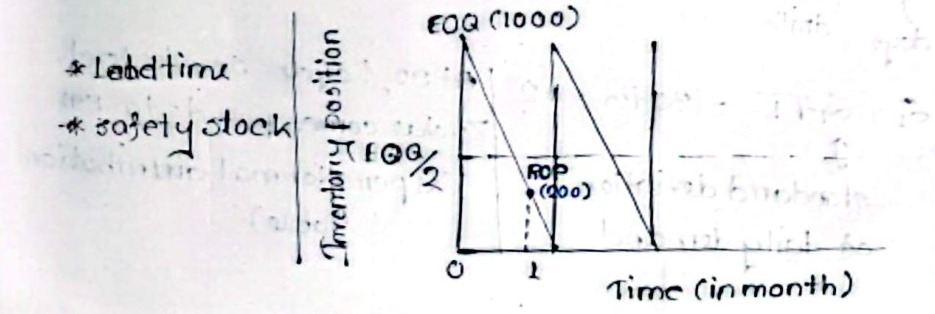
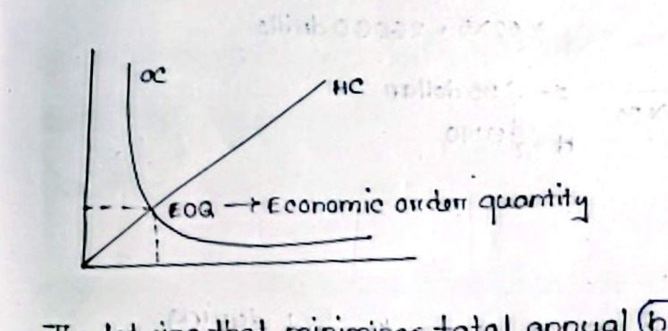
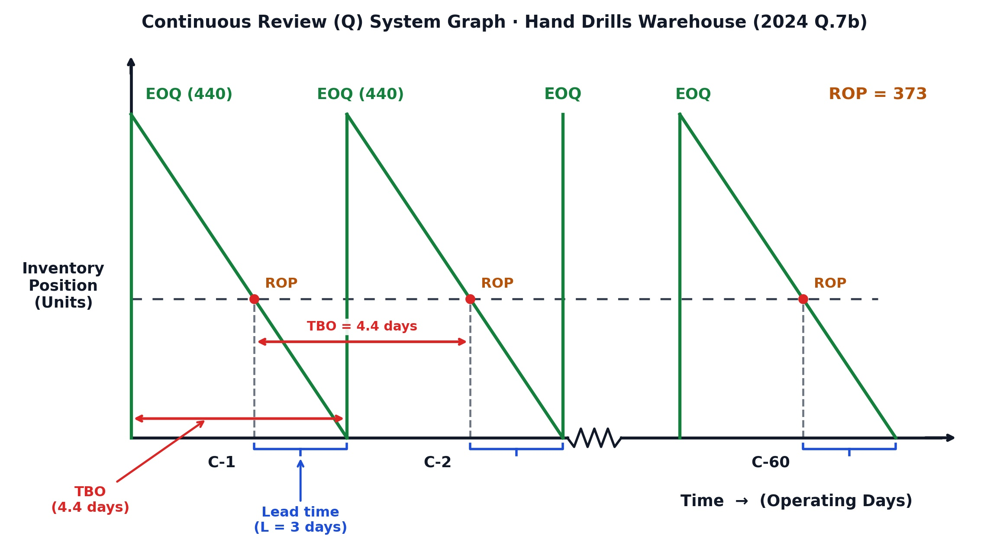
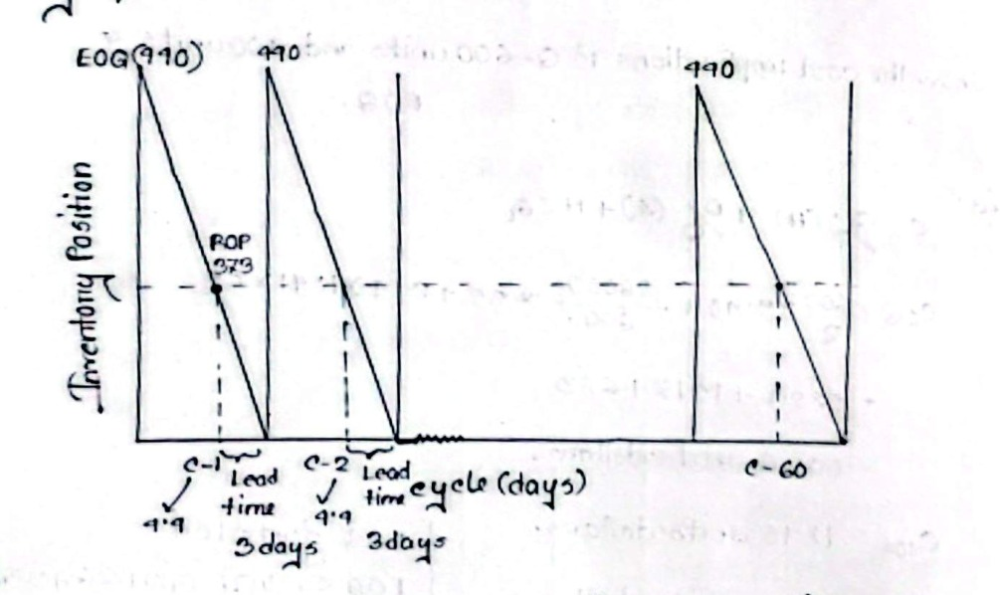
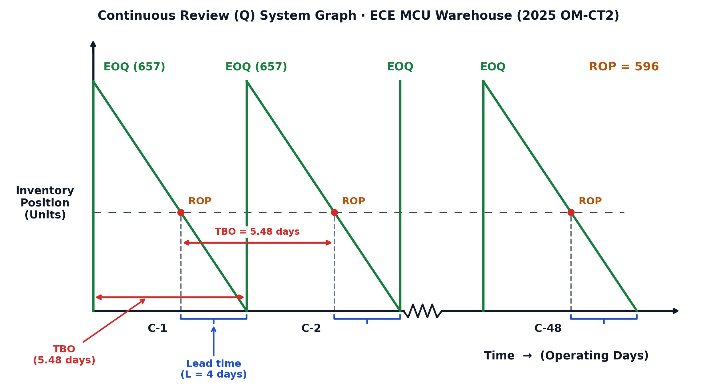
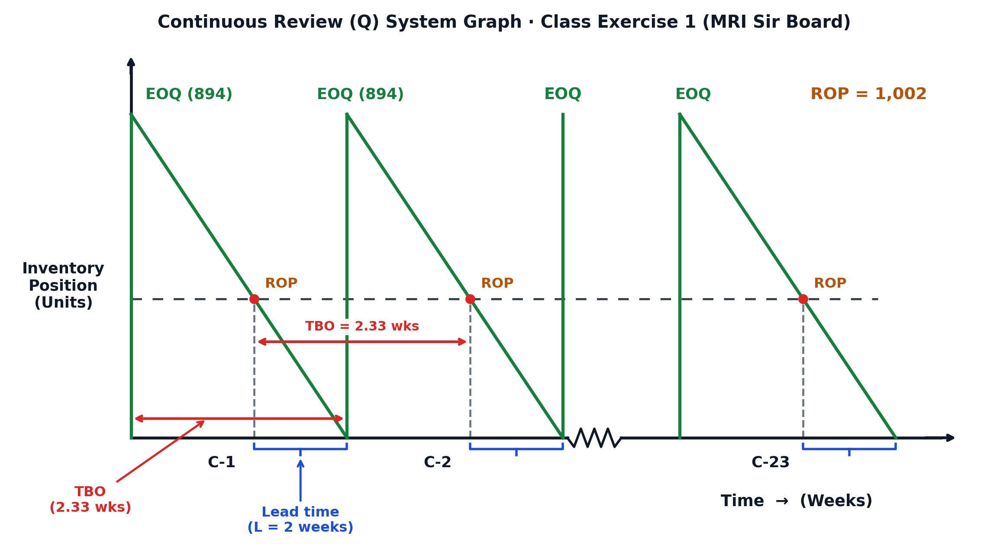

[← Prev: O01 · Inventory Concepts](O01_Inventory_Concepts.md) | [🏠 Index](00_Index.md) | [Next: O03 · Productivity →](O03_Productivity.md)

---

# O02 · EOQ & Continuous Review (Q) System

> [!info] Topic Summary & Exam Blueprint
> - **Course Outcome:** CO3 (Operational Management · Inventory Control · MRI Sir)
> - **Exam Weightage:** 34 Final Marks (`13.3%` · 4/4 Papers) + 20 CT Marks
> - **Priority Tier:** 🔴 Essential (Tested in every final exam and OM CT-2)
> - **Primary Sources:** `Industrial_and_Operations_Management/Inventory Control.md`, `Classnote_by_Raidah/Classnotes_Hum2217_Raidah.md` (Classes 9 to 11), `PreviousYearQuestions/CT_questions.md` (§5)

---

## Subtopics & Question Index

| ID | Subtopic | Past Marks (Final + CT) | Questions Covered | Jump |
| :-- | :-- | :---: | :-- | :-- |
| O02.1 | Define EOQ, Reorder Point, Lead Time, and Safety Stock | 17 + 0 | 2020 Q.4(b) (04m), 2021 Q.4(b) (04m), 2023 Q.7(b) (02m), 2024 Q.4(b) (03m), 2024 Q.7(a) (04m) | [[#O02.1 · Define EOQ, Reorder Point, Lead Time, and Safety Stock|Go]] |
| O02.2 | EOQ Assumptions and Cost Curves | 0 + 0 | Model Exam Question (04m) | [[#O02.2 · EOQ Assumptions and Cost Curves|Go]] |
| O02.3 | Full Continuous Review (Q) System Numerical Problems | 17 + 20 | 2023 Q.7(c) (06m), 2024 Q.4(c) (05m), 2024 Q.7(b) (06m), 2025 OM-CT2 Q.1(a–f) (20m) | [[#O02.3 · Full Continuous Review (Q) System Numerical Problems|Go]] |
| O02.4 | Step: Annual Demand D and EOQ Calculation | (block) | 4/4 Numerical Problems | [[#O02.4 · Step: Annual Demand D and EOQ Calculation|Go]] |
| O02.5 | Step: Safety Stock and Reorder Point Determination | (block) | 4/4 Numerical Problems | [[#O02.5 · Step: Safety Stock and Reorder Point Determination|Go]] |
| O02.6 | Step: Inventory Position Decision Rule | (block) | 3/4 Numerical Problems | [[#O02.6 · Step: Inventory Position Decision Rule|Go]] |
| O02.7 | Step: Total Annual Cost Comparison | (block) | 4/4 Numerical Problems | [[#O02.7 · Step: Total Annual Cost Comparison|Go]] |
| O02.8 | Step: Orders per Year, TBO, and Sawtooth Graph | (block) | 2/4 Numerical Problems + Class 11 | [[#O02.8 · Step: Orders per Year, TBO, and Sawtooth Graph|Go]] |

---

## O02.1 · Define EOQ, Reorder Point, Lead Time, and Safety Stock

All four final exam papers tested this core definition block (2020, 2021, 2023, and twice in 2024).

### Merged Past Final Questions · 04 Marks

**[2020 · Q.4(b) | 04 Marks | Sec A]**  
What do you mean by EOQ, ROP, Lead time and safety stock?

**[2021 · Q.4(b) | 04 Marks | Sec A]**  
Define EOQ, lead time, re-order point and safety stock inventory.

**[2023 · Q.7(b) | 02 Marks | Sec B | CO3]**  
Define EOQ, Lead Time, Reorder point, and Safety Stock.

**[2024 · Q.4(b) | 03 Marks | Sec A | CO3]**  
Define EOQ, Re-order point and lead time.

**[2024 · Q.7(a) | 04 Marks | Sec B | CO3]**  
Define EOQ, Re-order point, lead time and safety stock Inventory.

**Answer:**

#### 1. Economic Order Quantity (EOQ)
Economic Order Quantity ($EOQ$ or $Q^*$) is the optimal order size. It minimizes total annual holding and ordering costs. It balances holding costs against order setup costs:

$$
EOQ = \sqrt{\frac{2DS}{H}}
$$

Where:
- $D = \text{Annual demand for the inventory item (units/year)}$
- $S = \text{Cost of placing an order or setup cost (\$/order)}$
- $H = \text{Cost of holding one unit in inventory for one year (\$/unit/year)}$

At $EOQ$, the annual holding cost equals the annual ordering cost.

#### 2. Lead Time ($L$)
Lead time is the total elapsed time between placing an order and receiving usable stock. It includes order processing, supplier manufacturing, transit, inspection, and shelving. Lead time is expressed in working days or weeks. During this window, inventory drops steadily to satisfy ongoing demand.

#### 3. Safety Stock ($SS$)
Safety stock is surplus inventory held as a buffer. It protects against unexpected spikes in demand or delivery delays. It shields operations from stockouts when demand spikes or shipments arrive late:

$$
SS = z \, \sigma_d \sqrt{L}
$$

Where:
- $z = \text{Standard normal deviate corresponding to the desired cycle service level}$
- $\sigma_d = \text{Standard deviation of daily or weekly demand}$
- $L = \text{Supplier lead time in consistent time units (days or weeks)}$

#### 4. Reorder Point (ROP or $R$)
The reorder point is a predetermined inventory level. Reaching it signals the warehouse to place a new order of size $EOQ$. It covers expected demand during the lead time plus the safety stock buffer:

$$
ROP = \bar{d} L + SS
$$

Here $\bar{d}L$ is average lead time demand, and $SS$ is safety stock. Whenever the inventory position drops to or below $ROP$, an order is placed immediately.

*Figure 1: Basic Inventory Sawtooth Cycle and Reorder Point (Source: Classnotes Hum 2217 Raidah, Page 9)*

> [!tip] Exam Trimming Note
> - For 02 marks (`2023 Q.7(b)`): State each definition in one crisp sentence with its formula. Omit the diagram.
> - For 03 marks (`2024 Q.4(b)`): Present EOQ, Lead Time, and ROP. Omit Safety Stock because that specific paper did not request it.

---

## O02.2 · EOQ Assumptions and Cost Curves

*Suggested Topic · Never asked standalone in past finals or CTs · Taught in `Inventory Control.md` and Raidah Class 9.*

### O02.2 · Model Exam Question · 04 Marks

*Suggested Topic (Inventory Control) · Target: Section B (CO3)*

**Question.** State the key assumptions of the basic Economic Order Quantity (EOQ) model. Explain the annual holding cost, ordering cost, and total cost curves with a neat diagram.

**Answer:**

#### 1. Key Assumptions of the Basic EOQ Model
The classical EOQ model relies on six fundamental operating assumptions:
1. **Constant and known demand rate:** Customer demand ($D$) occurs at a constant, uniform rate over time.
2. **Constant and known lead time:** The lead time ($L$) between placing and receiving an order is fixed.
3. **Instantaneous replenishment:** Each order arrives in a single batch all at once.
4. **No shortages or stockouts allowed:** Demand must be met on schedule. No backorders or lost sales occur.
5. **Constant cost structure:** Unit purchase price, ordering cost ($S$), and holding cost ($H$) remain constant. Quantity discounts do not apply.
6. **Independence of items:** Replenishment decisions for an item do not affect decisions for other items.

> [!tip] Memory Hook: 6 EOQ Assumptions (**C-C-I-N-N-O**)
> Recall all 6 assumptions in 10 seconds with **C-C-I-N-N-O**:
> - **C**: Constant known demand
> - **C**: Constant lead time
> - **I**: Instantaneous receipt
> - **N**: No quantity discounts
> - **N**: No stockouts
> - **O**: Only holding & ordering costs vary

#### 2. Annual Cost Curves and Behavior

*Figure 2: Economic Order Quantity Cost Curves (Source: Classnotes Hum 2217 Raidah, Page 9)*

1. **Annual Ordering Cost ($OC$):**
   $$
   OC = \frac{D}{Q} S
   $$
   Placing larger batches ($Q$) reduces the number of orders per year ($\frac{D}{Q}$). So annual ordering cost decreases non-linearly as $Q$ increases.

2. **Annual Holding Cost ($HC$):**
   $$
   HC = \frac{Q}{2} H
   $$
   The average cycle inventory equals $\frac{Q}{2}$. Larger batches increase average warehouse stock. So annual holding cost increases linearly with $Q$.

3. **Total Annual Cycle Inventory Cost ($TC$):**
   $$
   TC(Q) = \frac{D}{Q} S + \frac{Q}{2} H
   $$
   The total cost curve is U-shaped. It reaches its minimum where the downward ordering cost curve crosses the upward holding cost line:
   $$
   \frac{D}{Q} S = \frac{Q}{2} H \implies Q^2 = \frac{2DS}{H} \implies EOQ = \sqrt{\frac{2DS}{H}}
   $$

---

## O02.3 · Full Continuous Review (Q) System Numerical Problems

This subtopic presents complete, step-by-step solutions for all four past continuous review numerical problems. Every question text is preserved verbatim.

---

### Problem 1 · 2023 Q.7(c) · 06 Marks

*Section B · CO3 · Asked in: 2023 Final*

**Question.** Walton company begins a review of ordering policies for its continuous review systems by checking the current policies for a sample of items. Following are the characteristics of one item. Demand is $650\text{ units/week}$ (assume $52\text{ weeks/year}$). Ordering and setup cost are $\text{Tk } 50,000$ per order or setup. Holding costs are $\text{Tk } 30/\text{unit/year}$. Lead time is $2\text{ weeks}$. Standard deviation of weekly demand is $50\text{ units}$. Cycle service level is $95\%$ (assume corresponding $Z$ value $1.43$).  
(i) What is EOQ for the item?  
(ii) What is derived safety stock and Re-order point?  
(iii) If on-hand-inventory is $400\text{ units}$, there is an order placed equal to EOQ and there is $200\text{ units}$ backorder. Is it time to place a new order?  
(iv) Show the cost implication between EOQ and $Q = 15000$.  
(v) Show your solution on a continuous review system.

**Answer (MRI Sir Model Answer Style):**

#### Given Parameters (Walton Company)
- Weekly demand ($d$) $= 650\text{ units/week}$ ($52\text{ weeks/year}$)
- Annual demand ($D$) $= 650 \times 52 = 33,800\text{ units/year}$
- Ordering cost ($S$) $= \text{Tk } 50,000/\text{order}$
- Holding cost ($H$) $= \text{Tk } 30/\text{unit/year}$
- Lead time ($L$) $= 2\text{ weeks}$
- Standard deviation of weekly demand ($\sigma_w$) $= 50\text{ units}$
- Cycle service level $= 95\%$, $Z = 1.43$ *(given in question)*

---

#### (i) & (ii) EOQ, Safety Stock, and Reorder Point (ROP) of Walton Item

**1. Economic Order Quantity ($EOQ$):**

$$
\begin{aligned}
EOQ &= \sqrt{\frac{2DS}{H}} \\
&= \sqrt{\frac{2 \times 33,800 \times 50,000}{30}} \\
&\approx \mathbf{10,614\text{ units}}
\end{aligned}
$$

**2. Reorder Point ($ROP$):**

Side parameters for lead time:
- $d = 650\text{ units/week}$
- $l = 2\text{ weeks}$
- $\sigma_L = \sigma_w\sqrt{L} = 50\sqrt{2} \approx 70.71\text{ units}$ *(Standard deviation of lead time)*
- $\text{Safety stock } (z\sigma_L) = 1.43 \times 50\sqrt{2} \approx \mathbf{101\text{ units}}$

$$
\begin{aligned}
\text{Reorder point } (ROP) &= \text{Average demand during lead time } (dl) + \text{Safety stock } (z\sigma_L) \\
&= dl + z\sigma_L \\
&= 650 \times 2 + 1.43 \times 50\sqrt{2} \\
&= 1,300 + 101.12 \\
&\approx \mathbf{1,401\text{ units}}
\end{aligned}
$$

---

#### (iii) Inventory Position (IP) & Ordering Decision (Walton Item)

$$
\begin{aligned}
IP &= \text{On-hand supply} + \text{Scheduled Receipt} - \text{Backorder} \\
&= 400 + 10,614 - 200 \\
&= \mathbf{10,814\text{ units}}
\end{aligned}
$$

- **Decision Rule:** $\boxed{IP \le ROP} \longrightarrow \text{Place order}$ | $\boxed{IP > ROP} \longrightarrow \text{Do not order}$
- Here, $10,814 > 1,401$ ($IP > ROP$).
- **Decision:** **No, a new order should not be placed.**

---

#### (iv) Cost Implication Between $EOQ = 10,614$ and $Q = 15,000$

Using MRI Sir's total annual cost formula (cycle cost + safety stock holding cost):

$$
C = \frac{Q}{2}(H) + \frac{D}{Q}(S) + H z \sigma_L
$$

1. **For $Q = EOQ = 10,614\text{ units}$:**
   $$
   \begin{aligned}
   C_{10,614} &= \frac{10,614}{2} \times 30 + \frac{33,800}{10,614} \times 50,000 + 30 \times 1.43 \times 50\sqrt{2} \\
   &= 159,210 + 159,224 + 3,034 \\
   &= \mathbf{\text{Tk } 321,468} \longrightarrow \boxed{EOQ\text{ (Minimum Cost)}}
   \end{aligned}
   $$
   *(Cycle cost only: $\frac{Q}{2}H + \frac{D}{Q}S = \text{Tk } 318,434$).*

2. **For $Q = 15,000\text{ units}$:**
   $$
   \begin{aligned}
   C_{15,000} &= \frac{15,000}{2} \times 30 + \frac{33,800}{15,000} \times 50,000 + 30 \times 1.43 \times 50\sqrt{2} \\
   &= 225,000 + 112,667 + 3,034 \\
   &= \mathbf{\text{Tk } 340,701}
   \end{aligned}
   $$
   *(Cycle cost only: $\text{Tk } 337,667$).*

- **Comment:** Ordering $Q = 15,000\text{ units}$ increases total cost by $\text{Tk } 19,233/\text{year}$ compared to $\boxed{EOQ = 10,614}$.

---

#### (v) Time Between Orders (TBO), Number of Orders ($N$), and Continuous Review System Graph (Walton Item)

- **Time between order ($TBO$):** The average length of time that elapses between two consecutive inventory orders.
  $$
  TBO = \frac{Q}{D} \times \text{time} = \frac{10,614}{33,800} \times 50\text{ weeks} \approx \mathbf{15.6\text{ weeks}} \quad (\text{or } 16.3\text{ weeks for } 52\text{ wks})
  $$
- **Number of order per year ($N$):**
  $$
  N = \frac{D}{Q} = \frac{33,800}{10,614} \approx 3.18 \approx \mathbf{4\text{ order/year}} \quad (\text{C-1 to C-4})
  $$

*Figure 3: Continuous Review (Q) System Graph for Walton Company across 4 Annual Cycles (EOQ = 10,614, ROP = 1,401, TBO = 15.6 weeks, L = 2 weeks)*

---

### Problem 2 · 2024 Q.4(c) · 05 Marks

*Section A · CO3 · Asked in: 2024 Final*

**Question.** A company begins a review of ordering policies for its continuous review system by checking the current policies for a sample of items. Followings are the characteristics of one item:  
• $\text{Demand } (D) = 64\text{ units/week (assume } 52\text{ weeks per year)}$  
• $\text{Ordering and setup cost } (S) = \$50/\text{order}$  
• $\text{Holding cost } (H) = \$13/\text{unit/year}$  
• $\text{Lead time } (L) = 2\text{ weeks}$  
• $\text{Standard deviation of weekly demand} = 12\text{ units}$  
• $\text{Cycle service level} = 88\text{ percent}$  

(i) What is EOQ for these items?  
(ii) What is the desired safety stack?  
*(Note: "safety stack" is printed in original; refers to safety stock)*  
(iii) What is the reorder point?  
(iv) What are the cost implications if the current policy for this item is $Q = 200$ and $R = 180$?

**Answer (MRI Sir Model Answer Style):**

#### Given Parameters (Sample Item · 2024 Q.4c)
- Weekly demand ($d$) $= 64\text{ units/week}$ ($52\text{ weeks/year}$)
- Annual demand ($D$) $= 64 \times 52 = 3,328\text{ units/year}$
- Ordering cost ($S$) $= \$50/\text{order}$
- Holding cost ($H$) $= \$13/\text{unit/year}$
- Lead time ($L$) $= 2\text{ weeks}$
- Standard deviation of weekly demand ($\sigma_w$) $= 12\text{ units}$
- Cycle service level $= 88\%$, $Z = 1.175$ *(from standard normal table)*

---

#### (i), (ii) & (iii) EOQ, Safety Stock, and Reorder Point (ROP) of Sample Item

**1. Economic Order Quantity ($EOQ$):**

$$
\begin{aligned}
EOQ &= \sqrt{\frac{2DS}{H}} \\
&= \sqrt{\frac{2 \times 3,328 \times 50}{13}} \\
&= \mathbf{160\text{ units}}
\end{aligned}
$$

**2. Desired Safety Stock ($SS$) and Reorder Point ($ROP$):**

Side parameters for lead time:
- $d = 64\text{ units/week}$
- $l = 2\text{ weeks}$
- $\sigma_L = \sigma_w\sqrt{L} = 12\sqrt{2} \approx 16.97\text{ units}$ *(Standard deviation of lead time)*
- $\text{Safety stock } (z\sigma_L) = 1.175 \times 12\sqrt{2} \approx 19.94 \approx \mathbf{20\text{ units}}$

$$
\begin{aligned}
\text{Reorder point } (ROP) &= \text{Average demand during lead time } (dl) + \text{Safety stock } (z\sigma_L) \\
&= dl + z\sigma_L \\
&= 64 \times 2 + 1.175 \times 12\sqrt{2} \\
&= 128 + 20 \\
&= \mathbf{148\text{ units}}
\end{aligned}
$$

---

#### (iv) Cost Implications of Current Policy ($Q = 200, R = 180$) vs. Optimal ($EOQ = 160, ROP = 148$)

Using MRI Sir's total annual cost formula:

$$
C = \frac{Q}{2}(H) + \frac{D}{Q}(S) + H(SS)
$$

1. **Optimal Policy ($Q = EOQ = 160\text{ units}, ROP = 148, SS = 20$):**
   $$
   \begin{aligned}
   C_{160} &= \frac{160}{2} \times 13 + \frac{3,328}{160} \times 50 + 13 \times 20 \\
   &= 1,040 + 1,040 + 260 \\
   &= \mathbf{\$2,340\text{ dollar}} \longrightarrow \boxed{EOQ\text{ (Optimal Policy)}}
   \end{aligned}
   $$

2. **Current Policy ($Q = 200\text{ units}, R = 180 \implies SS = 180 - 128 = 52\text{ units}$):**
   $$
   \begin{aligned}
   C_{200} &= \frac{200}{2} \times 13 + \frac{3,328}{200} \times 50 + 13 \times 52 \\
   &= 1,300 + 832 + 676 \\
   &= \mathbf{\$2,808\text{ dollar}}
   \end{aligned}
   $$

- **Annual Cost Savings:** $\$2,808 - \$2,340 = \mathbf{\$468\text{ dollar/year}}$ saved by switching to $\boxed{EOQ = 160, ROP = 148}$.

*Figure 4: Continuous Review (Q) System Graph for Optimal Policy (EOQ = 160, ROP = 148, TBO = 2.5 weeks, L = 2 weeks across 21 Cycles)*

---

### Problem 3 · 2024 Q.7(b) · 06 Marks

*Section B · CO3 · Asked in: 2024 Final (Identical to Class 10 Exercise 1.2)*

**Question.** A regional warehouse purchases hand tools from various suppliers and then distribute then on demand to retailers in the region. The warehouse operates five days per week, $52\text{ weeks per year}$. Only when it is open can orders be received. The following data are estimated for $3/8\text{ inch}$ hand drills with double insulation and variable speed:  
• $\text{Average daily demand} = 100\text{ drills}$  
• $\text{Standard deviation of daily demand} = 30\text{ drills}$  
• $\text{Lead time} = 3\text{ days}$  
• $\text{Holding cost} = \$9.40/\text{unit/year}$  
• $\text{Ordering cost} = \$35/\text{order}$  
• $\text{Cycle service level} = 92\%$, which corresponds to $Z\text{-value } 1.41$  

*(Note: "distribute then" is printed in original; refers to "distribute them")*  

**Required:**  
(i) What order quantity, $Q$ and reorder point, $R$, should be used?  
(ii) If on hand inventory is $40\text{ units}$, there is an open order for $440\text{ drills}$ and there are no back orders, should a new order be placed?  
(iii) Calculate cost for $400\text{ units}$, $500\text{ units}$ and units equal to EOQ, then comment on the cost implications.

**Answer (MRI Sir Model Answer Style):**

#### Given Parameters (Hand Drills · 2024 Q.7b)
- Daily demand ($d$) $= 100\text{ drills/day}$ ($5\text{ days/week} \times 52\text{ weeks} = 260\text{ days/year}$)
- Annual demand ($D$) $= 100 \times 260 = 26,000\text{ drills/year}$
- Ordering cost ($S$) $= \$35/\text{order}$
- Holding cost ($H$) $= \$9.40/\text{unit/year}$
- Lead time ($L$) $= 3\text{ days}$
- Standard deviation of daily demand ($\sigma_d$) $= 30\text{ drills}$
- Cycle service level $= 92\%$, $Z = 1.41$ *(given)*

---

#### (i) Order Quantity ($EOQ$) and Reorder Point ($ROP$) of Hand Drills

**1. Economic Order Quantity ($EOQ$):**

$$
\begin{aligned}
EOQ &= \sqrt{\frac{2DS}{H}} \\
&= \sqrt{\frac{2 \times 26,000 \times 35}{9.40}} \\
&\approx \mathbf{440\text{ drills}}
\end{aligned}
$$

**2. Reorder Point ($ROP$):**

Side parameters for lead time:
- $d = 100\text{ drills/day}$
- $l = 3\text{ days}$
- $\sigma_L = \sigma_d\sqrt{L} = 30\sqrt{3} \approx 51.96\text{ drills}$ *(Standard deviation of lead time)*

$$
\begin{aligned}
\text{Reorder point } (ROP) &= \text{Average demand during lead time } (dl) + \text{Safety stock } (z\sigma_L) \\
&= dl + z\sigma_L \\
&= 100 \times 3 + 1.41 \times 30\sqrt{3} \\
&= 300 + 73.27 \\
&\approx \mathbf{373\text{ drills}}
\end{aligned}
$$

---

#### (ii) Inventory Position (IP) & Ordering Decision (Hand Drills)

$$
\begin{aligned}
IP &= \text{On-hand supply} + \text{Scheduled Receipt} - \text{Backorder} \\
&= 40 + 440 - 0 \\
&= \mathbf{480\text{ drills}}
\end{aligned}
$$

- **Decision Rule:** $\boxed{IP \le ROP} \longrightarrow \text{Place order}$ | $\boxed{IP > ROP} \longrightarrow \text{Do not order}$
- Here, $480 > 373$ ($IP > ROP$).
- **Decision:** **No, a new order should not be placed.**

---

#### (iii) Cost Implications for $C_{400}$, $C_{440}$ ($EOQ$), and $C_{500}$

Using MRI Sir's total annual cost formula:

$$
C = \frac{Q}{2}(H) + \frac{D}{Q}(S) + H z \sigma_L
$$

1. **For $Q = 400\text{ drills}$:**
   $$
   C_{400} = \frac{400}{2} \times 9.40 + \frac{26,000}{400} \times 35 + 9.40 \times 1.41 \times 30\sqrt{3} = 1,880 + 2,275 + 689 = \mathbf{\$4,844\text{ dollar}}
   $$
2. **For $Q = EOQ = 440\text{ drills}$:**
   $$
   C_{440} = \frac{440}{2} \times 9.40 + \frac{26,000}{440} \times 35 + 9.40 \times 1.41 \times 30\sqrt{3} = 2,068 + 2,068 + 689 = \mathbf{\$4,825\text{ dollar}} \longrightarrow \boxed{EOQ}
   $$
3. **For $Q = 500\text{ drills}$:**
   $$
   C_{500} = \frac{500}{2} \times 9.40 + \frac{26,000}{500} \times 35 + 9.40 \times 1.41 \times 30\sqrt{3} = 2,350 + 1,820 + 689 = \mathbf{\$4,859\text{ dollar}}
   $$

- **Comment:** Total cost is lowest at $\boxed{EOQ = 440}$ ($\$4,825$). Ordering $400\text{ drills}$ costs $\$19$ more, and ordering $500\text{ drills}$ costs $\$34$ more per year.

---

#### Operational Cycle Parameters & Continuous Review Graph (Class 11)
- **Time between order ($TBO$):** The average length of time that elapses between two consecutive inventory orders.
  $$
  TBO = \frac{Q}{D} \times \text{time} = \frac{440}{26,000} \times 260 = \mathbf{4.4\text{ days}}
  $$
- **Number of order per year ($N$):**
  $$
  N = \frac{D}{Q} = \frac{26,000}{440} \approx 59.09 \approx \mathbf{60\text{ order/year}} \quad (\text{C-1 to C-60})
  $$

*Figure 5: Continuous Review (Q) System Graph for Hand Drills Warehouse (EOQ = 440, ROP = 373, TBO = 4.4 days, L = 3 days across 60 Cycles)*

*Figure 6: Handwritten Class Note Reference for Continuous Review (Q) Inventory Graph across 60 Cycles (Source: Classnotes Hum 2217 Raidah, Page 11)*

---

### Problem 4 · 2025 OM-CT2 · Q.1(a–f) · 20 Marks

*Operational Management CT-2 · MRI Sir · HUM 2113 / HUM 2217 · ECE MCU Application*

**Question.** A regional Electronic and Computer Engineering equipment warehouse purchases electronic components from various suppliers and distributes them on demand to electronics manufacturers, computer assembly firms, and engineering laboratories in the region. The warehouse operates five days per week, 52 weeks per year. Orders can be received only when the warehouse is open.  

The following data are estimated for microcontroller units (MCUs) used in embedded-system and computer-control applications.  

Average daily demand = $120\text{ MCUs}$, Standard deviation of daily demand = $35\text{ MCUs}$, Lead time ($L$) = $4\text{ days}$, holding cost ($H$) = $\$6.50/\text{unit/year}$, ordering cost ($S$) = $\$45/\text{order}$, Cycle service level = $95\%$. Assume demand is normally distributed.  

**Required:**  
a. What order quantity (EOQ) and reorder point (ROP) should the warehouse use?  
b. If the warehouse currently has 80 MCUs on hand, there is one open order for 500 MCUs, and there are no backorders, should a new order be placed?  
c. Show the cost implication for 400 units, EOQ units, and 700 units.  
d. Calculate the number of orders per year.  
e. Calculate TBO.  
f. Show your solution in a continuous review system.

**Answer (MRI Sir Model Answer Style):**

#### Given Parameters (ECE Microcontrollers · 2025 OM-CT2)
- Daily demand ($d$) $= 120\text{ MCUs/day}$ ($5\text{ days/week} \times 52\text{ weeks} = 260\text{ days/year}$)
- Annual demand ($D$) $= 120 \times 260 = 31,200\text{ MCUs/year}$
- Ordering cost ($S$) $= \$45/\text{order}$
- Holding cost ($H$) $= \$6.50/\text{unit/year}$
- Lead time ($L$) $= 4\text{ days}$
- Standard deviation of daily demand ($\sigma_d$) $= 35\text{ MCUs}$
- Cycle service level $= 95\%$, $Z = 1.645$

---

#### (a) Order Quantity ($EOQ$) and Reorder Point ($ROP$) of ECE MCUs

**1. Economic Order Quantity ($EOQ$):**

$$
\begin{aligned}
EOQ &= \sqrt{\frac{2DS}{H}} \\
&= \sqrt{\frac{2 \times 31,200 \times 45}{6.50}} \\
&\approx \mathbf{657\text{ unit}}
\end{aligned}
$$

**2. Reorder Point ($ROP$):**

Side parameters for lead time:
- $d = 120\text{ MCUs/day}$
- $l = 4\text{ days}$
- $\sigma_L = \sigma_d\sqrt{L} = 35\sqrt{4} = 70\text{ MCUs}$ *(Standard deviation of lead time)*

$$
\begin{aligned}
\text{Reorder point } (ROP) &= \text{Average demand during lead time } (dl) + \text{Safety stock } (z\sigma_L) \\
&= dl + z\sigma_L \\
&= 120 \times 4 + 1.645 \times 35\sqrt{4} \\
&= 480 + 115.15 \\
&\approx \mathbf{596\text{ unit}}
\end{aligned}
$$

---

#### (b) Inventory Position (IP) & Ordering Decision (ECE MCUs)

$$
\begin{aligned}
IP &= \text{On-hand supply} + \text{Scheduled Receipt} - \text{Backorder} \\
&= 80 + 500 - 0 \\
&= \mathbf{580\text{ unit}}
\end{aligned}
$$

- **Decision Rule:** $\boxed{IP \le ROP} \longrightarrow \text{Place order}$ | $\boxed{IP > ROP} \longrightarrow \text{Do not order}$
- Here, $580 < 596$ ($IP \le ROP$).
- **Decision:** **Yes, a new order of $\boxed{EOQ = 657}\text{ unit}$ should be placed.**

---

#### (c) Cost Implication for $C_{400}$, $C_{657}$ ($EOQ$), and $C_{700}$

Using MRI Sir's total annual cost formula:

$$
C = \frac{Q}{2}(H) + \frac{D}{Q}(S) + H z \sigma_L
$$

1. **For $Q = 400\text{ units}$:**
   $$
   C_{400} = \frac{400}{2} \times 6.50 + \frac{31,200}{400} \times 45 + 6.50 \times 1.645 \times 35\sqrt{4} = 1,300 + 3,510 + 748.48 = \mathbf{\$5,558\text{ dollar}}
   $$
2. **For $Q = EOQ = 657\text{ units}$:**
   $$
   C_{657} = \frac{657}{2} \times 6.50 + \frac{31,200}{657} \times 45 + 6.50 \times 1.645 \times 35\sqrt{4} = 2,135.25 + 2,136.99 + 748.48 = \mathbf{\$5,021\text{ dollar}} \longrightarrow \boxed{EOQ}
   $$
3. **For $Q = 700\text{ units}$:**
   $$
   C_{700} = \frac{700}{2} \times 6.50 + \frac{31,200}{700} \times 45 + 6.50 \times 1.645 \times 35\sqrt{4} = 2,275 + 2,005.71 + 748.48 = \mathbf{\$5,029\text{ dollar}}
   $$

---

#### (d) Number of Order per Year ($N$) of ECE MCUs

$$
N = \frac{D}{Q} = \frac{31,200}{657} \approx 47.49 \approx \mathbf{48\text{ order/year}} \quad (\text{C-1 to C-48})
$$

---

#### (e) Time Between Order ($TBO$) of ECE MCUs

> **Definition:** The average length of time that elapses between two consecutive inventory orders.

$$
TBO = \frac{Q}{D} \times \text{time} = \frac{657}{31,200} \times 260 = \mathbf{5.48\text{ days}} \quad (\text{or } 1.10\text{ weeks})
$$

---

#### (f) Solution on a Continuous Review System Graph (ECE MCUs)

*Figure 7: Continuous Review (Q) System Graph for ECE MCU Warehouse across 48 Annual Cycles (EOQ = 657, ROP = 596, TBO = 5.48 days, L = 4 days)*

---

### Problem 5 · Class Exercise 1 (MRI Sir Lecture Board) · 06 Marks

*Class 10 / Class 11 Lecture Board Model Answer · Prototype for Exam Continuous Review Questions*

> [!question] Class Exercise 1 (MRI Sir Lecture Board)
> Your firm uses a continuous review system and operates $52\text{ weeks per year}$. One of the items handled had the following characteristics:  
> • $\text{Demand } (D) = 20,000\text{ units/year}$  
> • $\text{Ordering cost } (S) = \$40/\text{order}$  
> • $\text{Holding cost } (H) = \$2/\text{unit/year}$  
> • $\text{Lead time } (L) = 2\text{ weeks}$  
> • $\text{Cycle service level} = 95\text{ percent}$ ($z = 1.645$)  
>
> Demand is normally distributed, with a standard deviation of weekly demand of $100\text{ units}$. Current on-hand inventory is $1,040\text{ units}$, with no scheduled receipts and no backorders.  
>
> **Questions:**  
> a. What order quantity, $Q$, and reorder point, $R$, should be used?  
> b. If the on-hand inventory is $40\text{ units}$, there is one open order for $440\text{ units}$, and there are no backorders, should a new order be placed?  
> c. Show the cost implications if $Q = 600\text{ units}$ and $Q = 1,000\text{ units}$ (or $Q = 400\text{ units}$).  
> d. Calculate the time between orders ($TBO$).  
> e. Calculate the number of orders per year.  
> f. Show your solution on a **continuous review system graph**.

**Answer (Verbatim MRI Sir Board Model Answer):**

#### Given Parameters (Exercise 1)
- Annual demand ($D$) $= 20,000\text{ units/year}$
- Ordering cost ($S$) $= 40$
- Holding cost ($H$) $= 2$
- Lead time ($L$) $= 2\text{ week}$
- Cycle service level $= 95\%$, $Z = 1.645$ *(Note: for $92\%$, $Z = 1.41$)*

---

#### (a) Order Quantity ($EOQ$) and Reorder Point ($ROP$) of Exercise 1

**1. Economic Order Quantity ($EOQ$):**

$$
\begin{aligned}
EOQ &= \sqrt{\frac{2DS}{H}} \\
&= \sqrt{\frac{2 \times 20,000 \times 40}{2}} \\
&\approx \mathbf{894\text{ unit}}
\end{aligned}
$$

**2. Reorder Point ($ROP$):**

Side parameters for lead time:
- $d = \frac{D}{52} = \frac{20,000}{52} \approx 385\text{ unit}$
- $l = 2\text{ week}$
- $\sigma_L = \sigma_w\sqrt{L} = 100\sqrt{2}$ *(Standard deviation of lead time)*

$$
\begin{aligned}
\text{Reorder point } (ROP) &= \text{Average demand during lead time } (dl) + \text{Safety stock } (z\sigma_L) \\
&= dl + z\sigma_L \\
&= 385 \times 2 + 1.645 \times 100\sqrt{2} \\
&= \mathbf{1,002\text{ unit}}
\end{aligned}
$$

---

#### (b) Inventory Position (IP) & Ordering Decision of Exercise 1

$$
\begin{aligned}
IP &= \text{On-hand supply} + \text{Scheduled Receipt} - \text{Backorder} \\
&= 40 + 440 - 0 \\
&= \mathbf{480\text{ unit}}
\end{aligned}
$$

- **Decision Rule:** $\boxed{IP \le ROP} \longrightarrow \text{Place order (order করব)}$ | $\boxed{IP > ROP} \longrightarrow \text{Do not order (order করব না)}$
- Here, $480 < 1,002$ ($IP \le ROP$).
- **Decision:** **Yes, a new order of $\boxed{EOQ = 894}\text{ unit}$ should be placed.**

---

#### (c) Cost Implications ($C_{600}$, $C_{894}$, $C_{1000}$, and $C_{400}$) of Exercise 1

Using MRI Sir's board formula:

$$
C = \frac{Q}{2}(H) + \frac{D}{Q}(S) + H z \sigma_L
$$

1. **For $Q = 600\text{ units}$:**
   $$
   \begin{aligned}
   C_{600} &= \frac{600}{2} \times 2 + \frac{20,000}{600} \times 40 + 2 \times 1.645 \times 100\sqrt{2} \\
   &= \mathbf{\$2,399\text{ dollar}}
   \end{aligned}
   $$

2. **For $Q = EOQ = 894\text{ units}$:**
   $$
   \begin{aligned}
   C_{894} &= \frac{894}{2} \times 2 + \frac{20,000}{894} \times 40 + 2 \times 1.645 \times 100\sqrt{2} \\
   &= \mathbf{\$2,255\text{ dollar}} \longrightarrow \boxed{EOQ}
   \end{aligned}
   $$

3. **For $Q = 1,000\text{ units}$ (Board Example):**
   $$
   \begin{aligned}
   C_{1000} &= \frac{1,000}{2} \times 2 + \frac{20,000}{1,000} \times 40 + 2 \times 1.645 \times 100\sqrt{2} \\
   &= \mathbf{\$2,266\text{ dollar}}
   \end{aligned}
   $$

4. **For $Q = 400\text{ units}$ (Slide Text Variant):**
   $$
   \begin{aligned}
   C_{400} &= \frac{400}{2} \times 2 + \frac{20,000}{400} \times 40 + 2 \times 1.645 \times 100\sqrt{2} \\
   &= \mathbf{\$2,865\text{ dollar}}
   \end{aligned}
   $$

---

#### (d) Time Between Order ($TBO$) of Exercise 1

> **Definition:** The average length of time that elapses between two consecutive inventory orders.

$$
\begin{aligned}
TBO &= \frac{Q}{D} \times \text{time} \\
&= \frac{894}{20,000} \times 52 \\
&\approx \mathbf{2.33\text{ week}}
\end{aligned}
$$

---

#### (e) Number of Order per Year ($N$) of Exercise 1

$$
N = \frac{D}{Q} = \frac{20,000}{894} \approx \mathbf{23\text{ order/year}} \quad (\text{C-1 to C-23})
$$

---

#### (f) Solution on a Continuous Review System Graph (Exercise 1)

*Figure 8: Continuous Review (Q) System Graph for Class Exercise 1 across 23 Annual Cycles (EOQ = 894, ROP = 1,002, TBO = 2.33 weeks, L = 2 weeks)*

---

## O02.4 · Step: Annual Demand D and EOQ Calculation

This section summarizes the first mathematical step in every continuous review problem.

> [!tip] 5-Step Continuous Review Exam Checklist
> `1. Annual D -> 2. EOQ -> 3. Safety Stock SS -> 4. Reorder Point R -> 5. Compare IP vs R`

### Key Equations & Conversion Rules

1. **Annual Demand Conversion:**
   Demand must always be stated on a consistent annual basis:
   - If weekly demand ($\bar{d}_w$) is given:
     $$
     D = \bar{d}_w \times 52
     $$
   - If daily demand ($\bar{d}$) is given:
     $$
     D = \bar{d} \times \text{Operating Days per Year}
     $$
     For a standard schedule of 5 days per week and 52 weeks per year:
     $$
     \text{Operating Days} = 5 \times 52 = 260\text{ days/year} \implies D = \bar{d} \times 260
     $$

2. **EOQ Derivation & Formula:**
   Equating annual holding cost to annual ordering cost gives:
   $$
   \frac{Q}{2}H = \frac{D}{Q}S \implies Q^2 = \frac{2DS}{H} \implies EOQ = \sqrt{\frac{2DS}{H}}
   $$

### Summary of Results Across Solved Problems

| Problem | Demand Input | Operating Basis | Annual Demand ($D$) | Ordering Cost ($S$) | Holding Cost ($H$) | Calculated $EOQ$ |
| :--- | :--- | :--- | :---: | :---: | :---: | :---: |
| **2023 Q.7(c)** | $650/\text{week}$ | $52\text{ weeks}$ | $33,800$ | $\text{Tk } 50,000$ | $\text{Tk } 30$ | **$10,614\text{ units}$** |
| **2024 Q.4(c)** | $64/\text{week}$ | $52\text{ weeks}$ | $3,328$ | $\$50$ | $\$13$ | **$160\text{ units}$** |
| **2024 Q.7(b)** | $100/\text{day}$ | $260\text{ days}$ | $26,000$ | $\$35$ | $\$9.40$ | **$440\text{ drills}$** |
| **2025 OM-CT2** | $120/\text{day}$ | $260\text{ days}$ | $31,200$ | $\$45$ | $\$6.50$ | **$657\text{ MCUs}$** |

*Detailed calculations appear in [[#O02.3 · Full Continuous Review (Q) System Numerical Problems|Section O02.3]].*

---

## O02.5 · Step: Safety Stock and Reorder Point Determination

This section summarizes the safety stock and reorder point formulas.

### Safety Stock and Reorder Point Formulas

1. **Standard deviation of demand during lead time ($\sigma_L$):**
   $$
   \sigma_L = \sigma_d \sqrt{L}
   $$
   *(Ensure $\sigma_d$ and $L$ use identical time units: both in days, or both in weeks).*

2. **Safety Stock ($SS$):**
   $$
   SS = z \, \sigma_L = z \, \sigma_d \sqrt{L}
   $$

3. **Reorder Point ($R$):**
   $$
   R = \bar{d} L + SS = \bar{d} L + z \, \sigma_d \sqrt{L}
   $$

### Standard Normal Deviate ($z$) Table
When the question does not state $z$, use the standard normal distribution values below:

| Cycle Service Level | 85% | 88% | 90% | 92% | 95% | 97% | 99% |
| :--- | :---: | :---: | :---: | :---: | :---: | :---: | :---: |
| **$z$-value** | 1.04 | **1.175** | 1.28 | **1.41** | **1.645** | 1.88 | 2.33 |

> [!warning] Exam Rule for $z$-Values
> - If the exam paper prints a specific $z$-value, use that exact number. For example, 2023 Q.7(c) printed $z = 1.43$ for $95\%$.
> - If no $z$-value is given, use the standard normal table value. State the value clearly ($z = 1.175$ for $88\%$, $z = 1.645$ for $95\%$) and proceed.

### Summary of Safety Stock & ROP Across Solved Problems

| Problem | Service Level | $z$-Value | $\sigma_d$ | Lead Time ($L$) | $\sigma_L = \sigma_d\sqrt{L}$ | Safety Stock ($SS$) | Lead Time Demand ($dL$) | Reorder Point ($R$) |
| :--- | :---: | :---: | :---: | :---: | :---: | :---: | :---: | :---: |
| **2023 Q.7(c)** | $95\%$ | $1.43$ (given) | $50/\text{wk}$ | $2\text{ wks}$ | $70.71$ | **$101\text{ units}$** | $1,300$ | **$1,401\text{ units}$** |
| **2024 Q.4(c)** | $88\%$ | $1.175$ (table) | $12/\text{wk}$ | $2\text{ wks}$ | $16.97$ | **$20\text{ units}$** | $128$ | **$148\text{ units}$** |
| **2024 Q.7(b)** | $92\%$ | $1.41$ (given) | $30/\text{day}$ | $3\text{ days}$ | $51.96$ | **$73\text{ drills}$** | $300$ | **$373\text{ drills}$** |
| **2025 OM-CT2** | $95\%$ | $1.645$ (table) | $35/\text{day}$ | $4\text{ days}$ | $70.00$ | **$115\text{ MCUs}$** | $480$ | **$596\text{ MCUs}$** |

*Detailed calculations appear in [[#O02.3 · Full Continuous Review (Q) System Numerical Problems|Section O02.3]].*

---

## O02.6 · Step: Inventory Position Decision Rule

### The Inventory Position Equation

Inventory position tracks total item commitments:

$$
IP = OH + SR - BO
$$

Where:
- $OH = \text{Physical On-Hand Inventory currently in the warehouse}$
- $SR = \text{Scheduled Receipts (open purchase orders placed but not yet received)}$
- $BO = \text{Backorders (unfulfilled customer commitments awaiting stock)}$

### The Decision Criterion

$$
\text{If } IP \le R \implies \mathbf{\text{Place a replenishment order of size } Q = EOQ}
$$

$$
\text{If } IP > R \implies \mathbf{\text{Do not place an order}}
$$

### Past Exam Decision Comparison

| Exam Problem | On-Hand ($OH$) | Scheduled Receipts ($SR$) | Backorders ($BO$) | Calculated $IP$ | Reorder Point ($R$) | Comparison | Final Decision |
| :--- | :---: | :---: | :---: | :---: | :---: | :---: | :--- |
| **2023 Q.7(c)** | $400$ | $10,614$ | $200$ | $10,814$ | $1,401$ | $IP > R$ | **Do NOT order** |
| **2024 Q.7(b)** | $40$ | $440$ | $0$ | $480$ | $373$ | $IP > R$ | **Do NOT order** |
| **2025 OM-CT2** | $80$ | $500$ | $0$ | $580$ | $596$ | $IP \le R$ | **YES, place order of $657\text{ MCUs}$** |

*Detailed calculations appear in [[#O02.3 · Full Continuous Review (Q) System Numerical Problems|Section O02.3]].*

---

## O02.7 · Step: Total Annual Cost Comparison

### Cost Formulas

1. **Annual Cycle Inventory Cost:**
   $$
   TC(Q) = \frac{D}{Q} S + \frac{Q}{2} H
   $$

2. **Total Annual Cost (including Safety Stock):**
   $$
   TC_{\text{total}}(Q) = \frac{D}{Q} S + \frac{Q}{2} H + (SS) H
   $$

Safety stock holding cost ($SS \times H$) stays constant for a given service level. So comparing lot sizes depends only on cycle cost.

### Core Managerial Principles

1. **Cost Minimization at EOQ:**
   At $Q = EOQ$, annual ordering cost equals annual cycle holding cost. Total cost is minimized.
2. **Under-ordering ($Q < EOQ$):**
   Ordering too little forces more orders per year. Ordering costs spike and outweigh holding savings.
3. **Over-ordering ($Q > EOQ$):**
   Ordering too much reduces order frequency. But holding costs rise due to larger warehouse stock.
4. **Flatness of the Cost Curve:**
   The U-shaped total cost curve is shallow near the minimum. Managers can round batch sizes up to full pallets or vendor minimums with tiny cost penalties.

### Cost Comparison Summary Table Across Solved Problems

| Exam Problem | Compared Policies | Cycle Cost at EOQ | Cycle Cost at Alternative $Q$ | Annual Difference vs EOQ | Managerial Insight |
| :--- | :--- | :---: | :---: | :---: | :--- |
| **2023 Q.7(c)** | $EOQ = 10,614$ vs $Q = 15,000$ | $\text{Tk } 318,434$ | $\text{Tk } 337,667$ | $+\text{Tk } 19,233$ ($+6.04\%$) | Holding costs rise more than ordering savings. Keep EOQ. |
| **2024 Q.4(c)** | Current ($Q=200, R=180$) vs Optimal ($Q=160, R=148$) | $\$2,080$ | $\$2,132$ (cycle) / $\$2,808$ (total) | Saves **$\$468.00/\text{year}$** | Current policy holds excess cycle and safety stock. |
| **2024 Q.7(b)** | $Q = 400$ vs $EOQ = 440$ vs $Q = 500$ | $\$4,136$ | $\$4,155$ ($Q=400$); $\$4,170$ ($Q=500$) | $+\$19.00$ ($400$); $+\$34.00$ ($500$) | Both under- and over-ordering raise total costs. |
| **2025 OM-CT2** | $Q = 400$ vs $EOQ = 657$ vs $Q = 700$ | $\$4,272$ | $\$4,810$ ($Q=400$); $\$4,281$ ($Q=700$) | $+\$537.76$ ($400$); $+\$8.47$ ($700$) | Under-ordering penalizes heavily. Rounding up to 700 costs almost nothing. |

*Detailed calculations appear in [[#O02.3 · Full Continuous Review (Q) System Numerical Problems|Section O02.3]].*

---

## O02.8 · Step: Orders per Year, TBO, and Sawtooth Graph

This section summarizes replenishment frequency, cycle duration, and system graphing.

### Order Cycle and Frequency Formulas

1. **Number of Orders per Year ($N$):**
   $$
   N = \frac{D}{EOQ}
   $$

2. **Time Between Orders ($TBO$):**
   The time between successive orders:
   - In operating days:
     $$
     TBO_{\text{days}} = \frac{EOQ}{D} \times \text{Operating Days per Year} = \frac{\text{Operating Days per Year}}{N}
     $$
   - In weeks:
     $$
     TBO_{\text{weeks}} = \frac{EOQ}{D} \times 52\text{ weeks} = \frac{52}{N}
     $$

### Summary of Order Cycles Across Solved Problems

| Problem | Annual Demand ($D$) | $EOQ$ | Operating Schedule | Orders per Year ($N$) | Time Between Orders ($TBO$) |
| :--- | :---: | :---: | :---: | :---: | :---: |
| **2023 Q.7(c)** | $33,800$ | $10,614$ | $52\text{ weeks}$ | $\approx 3.18\text{ orders/year}$ | $\approx 16.33\text{ weeks}$ |
| **2024 Q.4(c)** | $3,328$ | $160$ | $52\text{ weeks}$ | $= 20.80\text{ orders/year}$ | $= 2.50\text{ weeks}$ |
| **2024 Q.7(b)** | $26,000$ | $440$ | $260\text{ days}$ | $\approx 59.09 \approx \mathbf{60\text{ orders/year}}$ | $=\mathbf{4.4\text{ operating days}}$ |
| **2025 OM-CT2** | $31,200$ | $657$ | $260\text{ days}$ | $\approx \mathbf{47.49\text{ orders/year}}$ | $=\mathbf{5.48\text{ operating days}}$ |

### Essential Elements of a Continuous Review Sawtooth Graph

When drawing a continuous review system graph in the exam, always include:
1. **Vertical Axis:** Label inventory units ($IP$, $OH$).
2. **Horizontal Axis:** Label time (operating days, weeks, or cycles $C_1, C_2, \dots$).
3. **Peak Level:** Mark the arrival of order size $Q = EOQ$.
4. **Depletion Slope:** Show linear inventory consumption at daily demand rate $\bar{d}$.
5. **Reorder Threshold:** Draw a dashed horizontal line at $ROP = \bar{d}L + SS$.
6. **Lead Time Window:** Mark the interval $L$ from order placement ($IP \le ROP$) to shipment arrival.
7. **Safety Stock Floor:** Draw a horizontal line or shaded buffer at $SS$.
8. **Cycle Duration:** Mark $TBO$ along the horizontal time axis.

---

[← Prev: O01 · Inventory Concepts](O01_Inventory_Concepts.md) | [🏠 Index](00_Index.md) | [Next: O03 · Productivity →](O03_Productivity.md)
