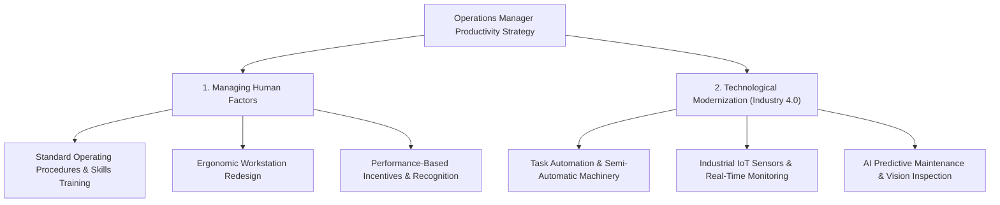
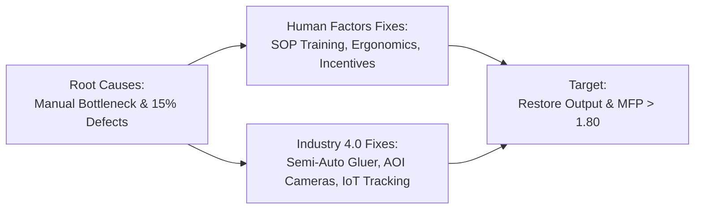

[← Prev: O02 · EOQ and Continuous Review System](O02_EOQ_and_Q_System.md) | [🏠 Index](00_Index.md) | [Next: 00 · Master Index →](00_Index.md)

---

# O03 · Productivity

> [!info] Topic Summary & Exam Blueprint
> - **Course Outcome:** CO3 (Operational Management · Md. Rokonuzzaman [MRI] Sir)
> - **Exam Weightage:** 00 Final Marks (`0%` · 0/4 papers) + 00 CT Marks (Taught in Class 11 after CT-2)
> - **Priority Tier:** 🟠 Very Likely (Prime Candidate for Final Exam CO3 Question)
> - **Primary Sources:** `Industrial_and_Operations_Management/Productivity.md`, `Classnote_by_Raidah/Classnotes_Hum2217_Raidah.md` (MRI Class 11)

## Subtopics & Question Index

| ID | Subtopic | Past Marks (Final + CT) | Questions Covered | Jump |
| :-- | :-- | :---: | :-- | :-- |
| O03.1 | Definition of productivity (output ÷ input) and key points | 0 + 0 | Model Q.1 (02m) | [[#O03.1 · Definition of Productivity\|Go]] |
| O03.2 | Types of productivity: Single-Factor vs. Multifactor Productivity | 0 + 0 | Model Q.1 (03m) | [[#O03.2 · Types of Productivity\|Go]] |
| O03.3 | Single-factor productivity numerical & period-over-period % change | 0 + 0 | Model Numericals (04m) | [[#O03.3 · Single-Factor Productivity and Percentage Change Numericals\|Go]] |
| O03.4 | Multifactor productivity numerical (labour + material + machine/overhead in common currency) | 0 + 0 | Model Numericals (04m) | [[#O03.4 · Multifactor Productivity Numericals\|Go]] |
| O03.5 | Managerial diagnosis: why productivity declines (7 challenges faced by an operations manager) | 0 + 0 | Model Q.1 (04m) | [[#O03.5 · Managerial Diagnosis of Productivity Decline\|Go]] |
| O03.6 | Operational solutions: managing human factors and technological modernization (Industry 4.0) | 0 + 0 | Model Q.1 (04m) | [[#O03.6 · Operational Solutions: Human Factors and Industry 4.0\|Go]] |
| O03.7 | Comprehensive Model Exam Question (10 Marks): SFP, MFP, % change, diagnosis, and operational fixes | 0 + 0 | Model Q.1 (10m) | [[#O03.7 · Comprehensive 10-Mark Model Exam Question and Case Study\|Go]] |

---

## O03.1 · Definition of Productivity

*Never asked in past finals or class tests. Taught in Class 11 after CT-2. High probability for a new Section B question.*

### O03.1 · Model Exam Question 1 · 02 Marks

*Suggested Topic (Class 11 & Slide 2) · Target: Part (a)*

**Question.** Define productivity. Why is productivity considered a relative measure in operations management?

**Answer.**

Productivity measures how efficiently an organization converts inputs into outputs. In operations management, it is defined as the mathematical ratio of output produced to input consumed:

$$
\text{Productivity} = \frac{\text{Output}}{\text{Input}}
$$

Key components of this metric include:
- **Output:** Goods produced or services delivered. Units include physical quantities (e.g. phones assembled) or total sales revenue.
- **Input:** Operational resources consumed. Units include labor hours, machine hours, raw materials, energy, or total operating expenses.

Productivity is a relative measure. A single isolated productivity number provides little operational insight. It becomes meaningful only when compared against:
1. Historical performance (e.g. comparing this month against last month).
2. Internal operational targets (e.g. standard hourly quotas).
3. Industry benchmarks or competitor performance.

---

## O03.2 · Types of Productivity

*Never asked in past finals or class tests. Covered in Slide 4 and Class 11 notes.*

### O03.2 · Model Exam Question 1 · 03 Marks

*Suggested Topic (Slide 4 & Class 11) · Target: Part (a) or (b)*

**Question.** Distinguish between Single-Factor Productivity (SFP) and Multifactor Productivity (MFP). Provide mathematical formulas and a comparison table.

**Answer.**

Operations managers classify productivity into two primary categories based on the scope of resources evaluated:

### 1. Single-Factor Productivity (SFP)
Single-Factor Productivity measures the ratio of output to a single input resource. Common single factors include labor hours, machine hours, or raw material volume:

$$
\text{Single-Factor Productivity (SFP)} = \frac{\text{Total Output}}{\text{Single Resource Input}}
$$

### 2. Multifactor Productivity (MFP)
Multifactor Productivity measures output against combined operational inputs. These include labor, materials, and machine overhead. Because inputs use different physical units, managers convert all resources into a common currency:

$$
\text{Multifactor Productivity (MFP)} = \frac{\text{Total Output Value}}{\text{Labor Cost} + \text{Material Cost} + \text{Overhead Cost}}
$$

### Comparison Table

| Dimension | Single-Factor Productivity (SFP) | Multifactor Productivity (MFP) |
| :-- | :-- | :-- |
| **Input Scope** | Focuses on one single input resource (e.g. labor hours). | Combines multiple resources (labor, material, capital, energy). |
| **Measurement Unit** | Physical units (e.g. units per labor hour). | Dimensionless monetary ratio or physical units per dollar spent. |
| **Operational View** | Narrow. It may misrepresent gains if machines replace workers. | Comprehensive. It captures trade-offs across all resources. |
| **Data Collection** | Simple and fast to collect on the shop floor. | Requires cost data and accounting valuations. |

---

## O03.3 · Single-Factor Productivity and Percentage Change Numericals

*Never asked in past finals or class tests. Covered in Class 11 and Problems 1, 2, 4, 5, and 6 of Productivity notes.*

### O03.3 · Model Exam Question 1 · 04 Marks

*Class 11 Apple Plant Problem · Period-over-Period Evaluation*

**Question.** Apple's smartphone manufacturing plant produced 200,000 iPhones in Month 2 using 50,000 labor hours. In Month 1, the same plant produced 220,000 iPhones using 50,000 labor hours.
(i) Compute the labor productivity for Month 1 and Month 2.
(ii) Calculate the period-over-period percentage change in labor productivity.
(iii) Interpret the operational meaning of the result.

**Answer.**

### Step 1: Compute Labor Productivity for Both Months

For Month 1 (Preceding Month):
- $\text{Output}_1 = 220,000\text{ iPhones}$
- $\text{Labor Input}_1 = 50,000\text{ hours}$

$$
P_1 = \frac{\text{Output}_1}{\text{Labor Input}_1} = \frac{220,000}{50,000} = 4.40\text{ iPhones/hour}
$$

For Month 2 (Current Month):
- $\text{Output}_2 = 200,000\text{ iPhones}$
- $\text{Labor Input}_2 = 50,000\text{ hours}$

$$
P_2 = \frac{\text{Output}_2}{\text{Labor Input}_2} = \frac{200,000}{50,000} = 4.00\text{ iPhones/hour}
$$

### Step 2: Calculate Period-over-Period Percentage Change

The percentage change in productivity is given by:

$$
\% \Delta P = \frac{P_{\text{new}} - P_{\text{old}}}{P_{\text{old}}} \times 100\%
$$

Substituting the calculated indices:

$$
\% \Delta P = \frac{4.00 - 4.40}{4.40} \times 100\% = \frac{-0.40}{4.40} \times 100\% = -9.09\%
$$

### Step 3: Operational Interpretation
Labor productivity declined by $9.09\%$. For the same 50,000 labor hours, the factory produced 20,000 fewer phones. The operations manager must investigate root causes. Likely factors include component delays, line bottlenecks, machine downtime, or worker fatigue.

---

### O03.3 · Model Exam Question 2 · 04 Marks

*Multi-Sector Single-Factor Productivity Bank (Problems 1, 2, 4, and 5)*

**Question.** Calculate the single-factor labor productivity for each of the following operational scenarios:
(a) A furniture factory produces 500 office desks using 1,200 labor hours.
(b) A garment plant produces 1,800 T-shirts using 600 labor hours.
(c) A training organization conducts 40 workshops using 800 trainer hours with 15 participants per workshop.
(d) A micro-credit agency disburses 300 loans using 900 loan officer hours.

**Answer.**

### Case A: Office Furniture Factory (Problem 1 · Labor SFP)
- $\text{Output} = 500\text{ desks}$
- $\text{Labor Input} = 1,200\text{ hours}$

$$
\text{Labor Productivity} = \frac{500\text{ desks}}{1,200\text{ hours}} = 0.417\text{ desks/hour}
$$

Equivalently, each desk requires $\frac{1,200}{500} = 2.40\text{ labor hours}$.

### Case B: Garment Factory (Problem 2 · Labor SFP)
- $\text{Output} = 1,800\text{ T-shirts}$
- $\text{Labor Input} = 600\text{ hours}$

$$
\text{Labor Productivity} = \frac{1,800\text{ T-shirts}}{600\text{ hours}} = 3.00\text{ T-shirts/hour}
$$

### Case C: Vocational Training Organization (Problem 4 · Labor SFP)
- $\text{Output (Workshops)} = 40\text{ workshops}$
- $\text{Output (Trainees)} = 40 \times 15 = 600\text{ participants}$
- $\text{Labor Input} = 800\text{ trainer hours}$

$$
\text{Workshop Productivity} = \frac{40\text{ workshops}}{800\text{ hours}} = 0.050\text{ workshops/hour}
$$

$$
\text{Participant Productivity} = \frac{600\text{ participants}}{800\text{ hours}} = 0.750\text{ participants/hour}
$$

### Case D: Micro-Credit NGO (Problem 5 · Labor SFP)
- $\text{Output} = 300\text{ loans disbursed}$
- $\text{Labor Input} = 900\text{ loan officer hours}$

$$
\text{Loan Officer Productivity} = \frac{300\text{ loans}}{900\text{ hours}} = 0.333\text{ loans/hour}
$$

Equivalently, processing each micro-loan requires $\frac{900}{300} = 3.00\text{ officer hours}$.

---

## O03.4 · Multifactor Productivity Numericals

*Never asked in past finals or class tests. Covered in Class 11 and Problems 1, 2, 3, 6, and 7.*

### O03.4 · Model Exam Question 1 · 04 Marks

*Class 11 & Problem 6 Apple Plant Multifactor Analysis & Partial Factor Ratios*

**Question.** Apple's assembly plant produced 200,000 iPhones last month. Each phone sells for a wholesale price of \$700. The plant incurred the following production inputs:
- Labor: 50,000 hours at \$25 per hour
- Components and raw materials: \$25,000,000
- Machine depreciation and electricity overhead: \$5,000,000
(i) Compute the total input cost and overall Multifactor Productivity (MFP).
(ii) Write the three partial factor ratios taught in Class 11 (Labour, Material, and Machine factor ratios).

**Answer.**

### Step 1: Compute Total Input Cost and Overall MFP

Total Output Value:

$$
\text{Total Output Value} = 200,000 \times \$700 = \$140,000,000
$$

Individual Input Costs:
- $\text{Labor Cost} = 50,000 \times \$25 = \$1,250,000$
- $\text{Material Cost} = \$25,000,000$
- $\text{Machine Overhead Cost} = \$5,000,000$

$$
\text{Total Input Cost} = \$1,250,000 + \$25,000,000 + \$5,000,000 = \$31,250,000
$$

Overall Multifactor Productivity:

$$
\text{MFP} = \frac{\text{Total Output Value}}{\text{Total Input Cost}} = \frac{\$140,000,000}{\$31,250,000} = 4.48
$$

Interpretation: The plant generates $\$4.48$ of output revenue for every $\$1.00$ spent on inputs.

### Step 2: Write the Class 11 Partial Factor Ratios

As taught by MRI Sir in Class 11, factor ratios isolate specific inputs against output:

1. **Labour Factor Ratio (Revenue per Labor Dollar):**

$$
\text{Labour Ratio} = \frac{200,000 \times 700}{50,000 \times 25} = \frac{140,000,000}{1,250,000} = 112.0
$$

2. **Material Factor Ratio (Units per Dollar):**

$$
\text{Material Ratio} = \frac{200,000\text{ units}}{\$25,000,000} = 0.008\text{ iPhones/\$}
$$

In revenue terms: $\frac{\$140,000,000}{\$25,000,000} = 5.60$.

3. **Machine Factor Ratio (Units per Dollar):**

$$
\text{Machine Ratio} = \frac{200,000\text{ units}}{\$5,000,000} = 0.040\text{ iPhones/\$}
$$

In revenue terms: $\frac{\$140,000,000}{\$5,000,000} = 28.00$.

*(Note on Class 11 Lecture Note variant: Raidah's written notes list machine overhead as \$6,000,000. In that case, Total Input Cost equals \$32,250,000. This yields $\text{MFP} = \frac{140}{32.25} = 4.34$. The machine ratio becomes $\frac{200,000}{6,000,000} = 0.0333\text{ iPhones/\$}$)*.

---

### O03.4 · Model Exam Question 2 · 04 Marks

*Multifactor Productivity Suite (Problems 1, 2, 3, and 7)*

**Question.** Calculate the Multifactor Productivity for each of the following manufacturing and service operations:
(a) A desk maker produces 500 desks priced at \$100 each. Inputs include 1,200 labor hours at \$15/hr, \$9,000 wood, and 500 machine hours at \$10/hr.
(b) A garment unit produces 1,800 shirts priced at \$10 each. Inputs include 600 labor hours at \$14/hr, \$2,500 fabric, and 300 machine hours at \$8/hr.
(c) A university delivers 25 certificate courses to 20 students per course at \$500 tuition each. Inputs include 1,000 faculty hours at \$30/hr, \$4,000 materials, and \$2,000 IT infrastructure.
(d) A bakery produces 2,400 loaves of bread in a week. Inputs include 300 labor hours at \$12/hr, \$600 ingredients, and \$200 oven electricity.

**Answer.**

### Case A: Office Furniture Factory (Problem 1 · MFP)
- $\text{Output Value} = 500 \times \$100 = \$50,000$
- $\text{Labor Cost} = 1,200 \times \$15 = \$18,000$
- $\text{Material Cost} = \$9,000$
- $\text{Machine Cost} = 500 \times \$10 = \$5,000$
- $\text{Total Input Cost} = \$18,000 + \$9,000 + \$5,000 = \$32,000$

$$
\text{MFP} = \frac{\$50,000}{\$32,000} = 1.5625
$$

### Case B: Garment Factory (Problem 2 · MFP)
- $\text{Output Value} = 1,800 \times \$10 = \$18,000$
- $\text{Labor Cost} = 600 \times \$14 = \$8,400$
- $\text{Material Cost} = \$2,500$
- $\text{Machine Cost} = 300 \times \$8 = \$2,400$
- $\text{Total Input Cost} = \$8,400 + \$2,500 + \$2,400 = \$13,300$

$$
\text{MFP} = \frac{\$18,000}{\$13,300} = 1.3534
$$

### Case C: Professional University Courses (Problem 3 · MFP)
- $\text{Total Students} = 25 \times 20 = 500\text{ students}$
- $\text{Output Value (Tuition Revenue)} = 500 \times \$500 = \$250,000$
- $\text{Faculty Labor Cost} = 1,000 \times \$30 = \$30,000$
- $\text{Course Materials} = \$4,000$
- $\text{IT Infrastructure} = \$2,000$
- $\text{Total Input Cost} = \$30,000 + \$4,000 + \$2,000 = \$36,000$

$$
\text{MFP} = \frac{\$250,000}{\$36,000} = 6.944
$$

### Case D: Commercial Bakery (Problem 7 · MFP)
- $\text{Physical Output} = 2,400\text{ loaves}$
- $\text{Labor Cost} = 300 \times \$12 = \$3,600$
- $\text{Ingredient Cost} = \$600$
- $\text{Electricity Cost} = \$200$
- $\text{Total Specified Input Cost} = \$3,600 + \$600 + \$200 = \$4,400$

$$
\text{MFP (Physical)} = \frac{2,400\text{ loaves}}{\$4,400} = 0.5455\text{ loaves/\$}
$$

If bread sells at \$2.50 per loaf ($\text{Output Value} = \$6,000$):

$$
\text{MFP (Monetary)} = \frac{\$6,000}{\$4,400} = 1.3636
$$

---

## O03.5 · Managerial Diagnosis of Productivity Decline

*Never asked in past finals or class tests. Covered in Slides 12 to 15 and Class 11 notes.*

### O03.5 · Model Exam Question 1 · 04 Marks

*Core Theory · Challenges Faced by an Operations Manager*

**Question.** Why does productivity decline in an industrial enterprise? Detail the seven challenges faced by an operations manager in diagnosing productivity loss.

**Answer.**

Productivity declines when output drops relative to inputs. It also drops when operational expenses grow without matching output gains.

An operations manager diagnoses productivity drops across seven operational dimensions:

1. **Human Factor Issues:**
   - Low employee motivation, high absenteeism, and worker turnover.
   - Fatigue and burnout from excessive overtime.
   - Skill gaps and resistance to new standard operating methods.

2. **Technological Issues:**
   - High capital costs of purchasing automation equipment.
   - Integration friction between legacy machinery and modern digital systems.
   - Rapid technological change rendering past capital investments obsolete.

3. **Quality vs. Quantity Trade-off:**
   - Pushing workers to hit volume targets creates defects.
   - High defect rates cause scrap and expensive rework, cutting net usable output.

4. **Resource Constraints:**
   - Shortages of skilled technical operators and quality raw materials.
   - Spikes in input prices (e.g. power tariffs, fuel, or imported components).

5. **Process Inefficiencies:**
   - Cluttered floor layouts and poor line balancing.
   - Bottlenecks that keep downstream workstations waiting idle.

6. **External Factors:**
   - Supply chain disruptions and delayed vendor shipments.
   - Grid power outages and shifts in consumer market demand.

7. **Measurement and Data Deficiencies:**
   - Lack of real-time sensor data to track workstation cycle times.
   - Using wrong productivity indicators that conceal shop-floor waste.

---

## O03.6 · Operational Solutions: Human Factors and Industry 4.0

*Never asked in past finals or class tests. Highlighted by MRI Sir in Class 11 (Section C).*

### O03.6 · Model Exam Question 1 · 04 Marks

*Managerial Prescription · Human Factors & Technological Modernization*

**Question.** Propose practical operational strategies to reverse declining industrial productivity. Focus on Managing Human Factors and Technological Modernization under Industry 4.0.

**Answer.**

An operations manager restores productivity using two complementary operational strategies:

> [!tip] Memory Hook · The 2 Levers of Productivity Recovery
> Remember the two operational pillars as **People vs. Machines**:
> 
> | Lever | Focus | Core Tools & Actions | Fast Exam Trigger |
> | :-- | :-- | :-- | :-- |
> | **Human Factors** (People) | Empower and protect the worker | SOP training, ergonomic benches, performance incentives | Fix worker fatigue, skill gaps, and awkward motions |
> | **Tech Modernization** (Machines) | Automate and monitor the line | Semi-auto machines, IIoT sensors, AI predictive maintenance | Fix line bottlenecks, machine breakdowns, and gluing defects |
> 
> - **Human Factors** improve *how* people work so they tire less and make fewer mistakes.
> - **Tech Modernization** improves *what* does the work so lines run faster and without downtime.

### 1. Managing Human Factors
- **Standard Operating Procedures (SOPs) & Training:** Train workers on standard assembly steps. This eliminates awkward motions and reduces errors.
- **Ergonomic Workstation Redesign:** Reorganize tool placement, bin heights, and seating. Reducing physical strain prevents fatigue and accelerates assembly pace.
- **Incentive Systems:** Introduce bonuses for meeting production targets while maintaining low defect rates. Add public recognition programs like "Worker of the Month".
- **Participative Problem-Solving:** Involve shop-floor operators in quality circles to identify bottlenecks and build employee commitment.

### 2. Technological Modernization and Industry 4.0
- **Process Automation:** Introduce semi-automatic equipment, like automated gluing and pick-and-place arms. This removes manual bottlenecks.
- **Industrial IoT (IIoT) Sensors:** Mount smart sensors on machines and conveyors. These track real-time vibration, temperature, and cycle times.
- **AI-Driven Process Optimization & Predictive Maintenance:** Use machine learning models to detect tool wear early. Servicing parts before failure avoids sudden line shutdowns.
- **Automated Optical Inspection (AOI):** Deploy smart cameras to catch defects right on the line. This stops defective units before they consume costly rework time.

---

## O03.7 · Comprehensive 10-Mark Model Exam Question and Case Study

*Suggested 10-Mark Applied Exam Question synthesizing Bright Packaging Ltd. and GreenLeaf Agro Processing.*

### O03.7 · Model Exam Question 1 · 10 Marks

*Comprehensive Applied Case Study · Target: Full 10-Mark Question (CO3)*

**Question.**
Bright Packaging Ltd. operates an industrial carton manufacturing plant in Bangladesh. The company runs three 8-hour production shifts daily. Management observed that output fell below target due to manual folding bottlenecks and high defect rates.

Production records reveal the following data for two consecutive months:
- **Month 1:** The plant employed 40 assembly workers working 200 hours each (8,000 labor hours) at \$5/hour. It produced 32,000 finished cartons sold at \$5 each. Raw material costs were \$40,000. Machine overhead was \$10,000.
- **Month 2:** Output dropped to 25,600 finished cartons due to bottlenecks and a 15% defect rate. Labor input remained 8,000 hours at \$5/hour. Material costs rose to \$45,000 due to scrap. Machine overhead was \$10,000. Selling price stayed at \$5 per carton.

You are appointed as the Operations Manager.
(a) Define Single-Factor Productivity and Multifactor Productivity with mathematical formulas. *(02 Marks)*
(b) Calculate for both Month 1 and Month 2:
    (i) Labor Productivity (cartons per labor hour),
    (ii) Total Multifactor Productivity (MFP), and
    (iii) The percentage change in both productivity measures. *(04 Marks)*
(c) Diagnose why productivity declined. Propose practical solutions using Human Factors and Industry 4.0 modernization. *(04 Marks)*

**Answer.**

### Part (a) Definitions & Mathematical Formulas (02 Marks)

**1. Single-Factor Productivity (SFP):**
Measures output relative to a single input resource:

$$
\text{SFP} = \frac{\text{Total Output}}{\text{Single Input Resource}}
$$

**2. Multifactor Productivity (MFP):**
Measures total output value relative to combined operational resources expressed in common currency:

$$
\text{MFP} = \frac{\text{Total Output Value}}{\sum \text{Input Costs}} = \frac{\text{Output Quantity} \times \text{Unit Selling Price}}{\text{Labor Cost} + \text{Material Cost} + \text{Overhead Cost}}
$$

---

### Part (b) Numerical Computations & Percentage Changes (04 Marks)

#### 1. Month 1 Calculations
- $\text{Output Quantity}_1 = 32,000\text{ cartons}$
- $\text{Total Output Value}_1 = 32,000 \times \$5 = \$160,000$
- $\text{Labor Input}_1 = 8,000\text{ hours}$
- $\text{Labor Cost}_1 = 8,000 \times \$5 = \$40,000$
- $\text{Material Cost}_1 = \$40,000$
- $\text{Machine Overhead}_1 = \$10,000$
- $\text{Total Input Cost}_1 = \$40,000 + \$40,000 + \$10,000 = \$90,000$

Labor Productivity:

$$
P_{\text{labor}, 1} = \frac{32,000\text{ cartons}}{8,000\text{ hours}} = 4.00\text{ cartons/hour}
$$

Multifactor Productivity:

$$
\text{MFP}_1 = \frac{\$160,000}{\$90,000} = 1.778
$$

#### 2. Month 2 Calculations
- $\text{Output Quantity}_2 = 25,600\text{ cartons}$
- $\text{Total Output Value}_2 = 25,600 \times \$5 = \$128,000$
- $\text{Labor Input}_2 = 8,000\text{ hours}$
- $\text{Labor Cost}_2 = 8,000 \times \$5 = \$40,000$
- $\text{Material Cost}_2 = \$45,000$
- $\text{Machine Overhead}_2 = \$10,000$
- $\text{Total Input Cost}_2 = \$40,000 + \$45,000 + \$10,000 = \$95,000$

Labor Productivity:

$$
P_{\text{labor}, 2} = \frac{25,600\text{ cartons}}{8,000\text{ hours}} = 3.20\text{ cartons/hour}
$$

Multifactor Productivity:

$$
\text{MFP}_2 = \frac{\$128,000}{\$95,000} = 1.347
$$

#### 3. Percentage Change Calculations

Percentage change in Labor Productivity:

$$
\% \Delta P_{\text{labor}} = \frac{3.20 - 4.00}{4.00} \times 100\% = \frac{-0.80}{4.00} \times 100\% = -20.00\%
$$

Percentage change in Multifactor Productivity:

$$
\% \Delta \text{MFP} = \frac{1.347 - 1.778}{1.778} \times 100\% = \frac{-0.431}{1.778} \times 100\% = -24.24\%
$$

Summary: Labor productivity dropped by $20.00\%$, while overall MFP dropped by $24.24\%$.

---

### Part (c) Managerial Diagnosis & Action Plan (04 Marks)

#### 1. Managerial Diagnosis
The $24.24\%$ decline in MFP reveals three operational failures:
- **Assembly Bottleneck:** Manual folding created a throughput restriction. Workers could not keep up with demand.
- **High Defect Rate (15%):** Defective gluing generated heavy scrap, inflating material costs from \$40,000 to \$45,000.
- **Rework Burden:** Labor was wasted fixing defective boxes rather than producing new output.

#### 2. Actionable Operational Plan

**Pillar 1: Managing Human Factors**
1. **Standardized Method Training:** Train workers on standard folding and gluing methods to eliminate inconsistent manual techniques.
2. **Ergonomic Workstation Redesign:** Rearrange material bins and folding tables to reduce awkward bending and arm strain. This lowers physical fatigue.
3. **Quality-Linked Incentives:** Offer shift bonuses tied to low scrap rates (e.g. bonus paid if defect rate stays below 3%).

**Pillar 2: Technological Modernization & Industry 4.0**
1. **Semi-Automated Folding and Gluing Machinery:** Replace manual folding with semi-automatic folder-gluers. This eliminates manual line bottlenecks and ensures uniform carton dimensions.
2. **Automated Optical Inspection (AOI):** Install smart camera sensors above conveyors to check glue lines in real time. The system kicks defective units off the line immediately.
3. **Industrial IoT (IIoT) Line Monitoring:** Deploy IoT sensors to track hourly line speed and cycle times. Real-time dashboards will alert supervisors to line slowdowns instantly.

---

[← Prev: O02 · EOQ and Continuous Review System](O02_EOQ_and_Q_System.md) | [🏠 Index](00_Index.md) | [Next: 00 · Master Index →](00_Index.md)
