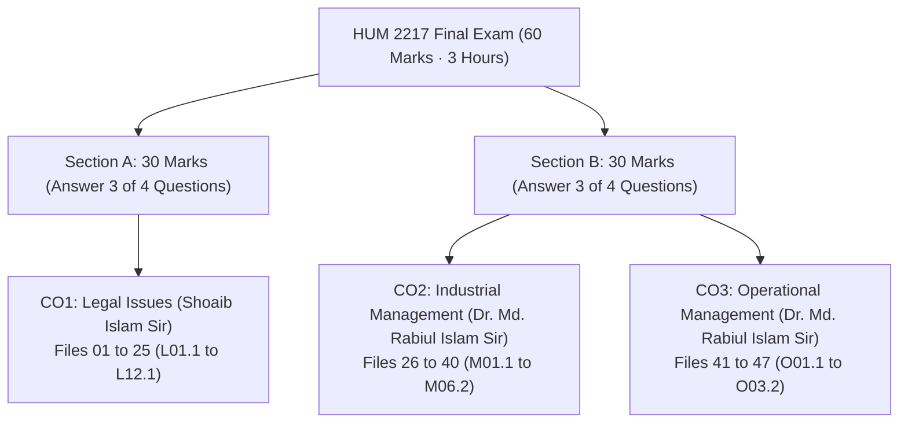

[📖 Course README](README.md) | [📐 Master Formula & Statutory Sheet](99_Master_Formula_and_Statutory_Sheet.md) | [Start Reading: L01.1 →](L01.1_Definitions_of_Law_and_Society.md)

---

# HUM 2217: Boss Notes Master Index

> [!info] Vault Navigation & Architecture
> This master index directs you through the complete 50-file Boss Notes suite for **HUM 2217: Legal Issues, Industrial & Operational Management** (RUET, Department of ECE, 2-2 / 8th Semester).
> - **Primary Question Bank:** [subtopicwise_questions.md](../subtopicwise_questions.md) (All 109 questions categorized across 21 topics)
> - **Weightage & Flow Plan:** [subtopicwise_list.md](../subtopicwise_list.md) (Marks distribution and topic order)
> - **Historical Exam Trends:** [Question_Analysis_Report.md](../Question_Analysis_Report.md) (Four-year analysis of finals and class tests)

---

## 1. Course Header & Exam Blueprint

The semester final examination carries **60 marks** over **3 hours**. It contains two distinct sections. You must write the two sections on separate answer scripts:

### Exam Architecture

- **Section A (30 Marks · CO1 Legal Issues · Shoaib Islam Sir):**
  - Contains 4 main questions (10 marks each). Answer any 3 questions.
  - Strict statutory grading: Shoaib Sir checks exact section numbers from the Contract Act 1872 and BLC 2006.
  - One question is an applied 10-mark legal case study on contract frustration or breach.
- **Section B (30 Marks · CO2 Industrial & CO3 Operational Management · Dr. Md. Rabiul Islam Sir):**
  - Contains 4 main questions (10 marks each). Answer any 3 questions.
  - Mix of theory and high-scoring numericals.
  - Always contains a complete Continuous Review ($Q$) System inventory numerical and a Productivity calculation.

### Course Outcome Summary

The analysis dataset covers 4 finals (`2020` to `2024`, active syllabus only) and 4 Class Tests (`2025` / 23 Series). It spans 69 final sub-questions (256 marks) and 20 CT parts (80 marks). This gives **336 total analyzed marks** across 109 questions:

| Course Outcome | Primary Scope | Instructor | Boss Notes Range | Final Marks ('20–'24) | '23–'24 Share | CT Marks | Total Marks |
| :-- | :-- | :-- | :-- | :-: | :-: | :-: | :-: |
| **CO1** | Legal Issues | Shoaib Islam (SI) Sir | Files 01 to 25 (`L01.1` to `L12.1`) | 68 | 42.5% | 40 | 108 |
| **CO2** | Industrial Management | Dr. Md. Rabiul Islam (MRI) Sir | Files 26 to 40 (`M01.1` to `M06.2`) | 138 | 38.8% | 20 | 158 |
| **CO3** | Operational Management | Dr. Md. Rabiul Islam (MRI) Sir | Files 41 to 47 (`O01.1` to `O03.2`) | 50 | 18.8% | 20 | 70 |
| **Total** | **All Modules** | **Both Examiners** | **47 Core Files + 3 Hub Files** | **256** | **100%** | **80** | **336** |

---

## 2. Priority & Status Legend

Every boss note carries a priority tag based on past paper frequency, instructor suggestions, and class hints:

| Tag | Priority Level | Description & Exam Weight |
| :-- | :-- | :-- |
| `🔴 Critical` | Tier 1 Lock | Must-master core topic. Appears repeatedly in finals or forms a direct exam lock. |
| `🟠 High` | Tier 2 High Yield | Very likely topic. Frequently asked or strongly emphasized in class lectures. |
| `🟡 Medium` | Tier 3 Regular | Standard syllabus topic. Often rotates across alternative exam years. |
| `🟢 Low` | Tier 4 Context | Foundational context or rarely tested directly as a standalone question. |
| `📌 Shoaib Sir Lock` | Examiner Blueprint | Explicitly confirmed by Shoaib Islam Sir in his 2026 final exam suggestion. |
| `⭐ Class 11 / Unasked Lock` | Unasked High Risk | Taught in Class 11 or CTs, but never asked in recent finals. Prime candidate for 2026. |

---

## 3. Complete 47-File Boss Notes Directory

Click any file link to open the self-contained note with complete theory and inline exam answers.

### Part A: CO1 Legal Issues (Files 01 to 25 · Shoaib Islam Sir)

| File # | Filename & Link | Subtopics | Priority | Past Marks | Key Exam Focus |
| :---: | :--- | :--- | :--- | :---: | :--- |
| **01** | [`L01.1_Definitions_of_Law_and_Society.md`](L01.1_Definitions_of_Law_and_Society.md) | `L01.1`, `L01.5` | 🟠 High | 0 Final, 0 CT | Holland, Salmond, Wilson definitions; law, government, and society. |
| **02** | [`L01.2_Industrial_Law_vs_Labour_Law.md`](L01.2_Industrial_Law_vs_Labour_Law.md) | `L01.2`, `L01.3` | 🟠 High | 2 Final, 0 CT | Definitions of industrial and labour law; 7-point difference table. |
| **03** | [`L01.3_Why_ECE_Students_Must_Learn_Law.md`](L01.3_Why_ECE_Students_Must_Learn_Law.md) | `L01.4` | 🟠 High | 0 Final, 0 CT | 9 ECE legal imperatives: IPR, contracts, liability, ethics, startups. |
| **04** | [`L02.1_Contract_Agreement_Void_and_Voidable.md`](L02.1_Contract_Agreement_Void_and_Voidable.md) | `L02.1`, `L02.2` | 🔴 Critical 📌 | 4 Final, 0 CT | `Sec 2(e, g, h, i)`; Maxim "All contracts are agreements, but..."; void vs. voidable. |
| **05** | [`L02.2_Essential_Elements_of_Valid_Contract.md`](L02.2_Essential_Elements_of_Valid_Contract.md) | `L02.3` | 🔴 Critical 📌 | 4 Final, 10 CT | `Sec 10` essential elements: consent, capacity, lawful consideration, lawful object. |
| **06** | [`L02.3_Offer_and_Acceptance_Rules.md`](L02.3_Offer_and_Acceptance_Rules.md) | `L02.4`–`L02.6` | 🔴 Critical | 2 Final, 10 CT | Offer & acceptance rules (`Sec 4, 8, 9`); *Carlill v. Carbolic Smoke Ball*. |
| **07** | [`L02.4_Applied_ECE_Tenders_and_RD_Contract_Risks.md`](L02.4_Applied_ECE_Tenders_and_RD_Contract_Risks.md) | `L02.7`, `L02.8` | 🟠 High | 8 Final, 0 CT | Tender bidding rules (invitation vs. offer); ECE R&D risk mitigation. |
| **08** | [`L03.1_Consideration_Definition_Types_and_Rules.md`](L03.1_Consideration_Definition_Types_and_Rules.md) | `L03.1`–`L03.3` | 🔴 Critical 📌 | 0 Final, 0 CT | `Sec 2(d)` quid pro quo; past, present, future types; legal consideration rules. |
| **09** | [`L03.2_Exceptions_to_No_Consideration_No_Contract.md`](L03.2_Exceptions_to_No_Consideration_No_Contract.md) | `L03.4` | 🔴 Critical 📌 | 0 Final, 0 CT | `Sec 25(1, 2, 3)` love, past service, time-barred debt; `Sec 185` agency; gifts. |
| **10** | [`L04.1_Modes_of_Discharge_of_Contract.md`](L04.1_Modes_of_Discharge_of_Contract.md) | `L04.1`–`L04.6` | 🔴 Critical | 4 Final, 0 CT | 7 discharge modes: performance, mutual agreement (`Sec 62`), breach, law. |
| **11** | [`L04.2_Doctrine_of_Frustration_and_Case_Studies.md`](L04.2_Doctrine_of_Frustration_and_Case_Studies.md) | `L04.4`, `L04.7` | 🔴 Critical 📌 | 0 Final, 0 CT | `Sec 56` Supervening Impossibility (`D-D-L-N-W`); **10-mark case study model**. |
| **12** | [`L05.1_BLC_Core_Definitions_and_Age_Classes.md`](L05.1_BLC_Core_Definitions_and_Age_Classes.md) | `L05.1`–`L05.4` | 🔴 Critical 📌 | 2 Final, 0 CT | BLC 2006 `Sec 2(2, 7, 8, 36, 63, 65)`: factory, worker, child, adolescent, adult. |
| **13** | [`L05.2_Adolescent_Working_Hours_Sec_41.md`](L05.2_Adolescent_Working_Hours_Sec_41.md) | `L05.5`, `L05.6` | 🔴 Critical 📌 | 4 Final, 0 CT | `Sec 41` hours (5h/day, 30h/week in factory); night work ban; spread-over. |
| **14** | [`L05.3_Applied_Factory_Compliance_and_Adult_Hours.md`](L05.3_Applied_Factory_Compliance_and_Adult_Hours.md) | `L05.7`, `L05.8` | 🟠 High | 4 Final, 10 CT | Multi-issue factory audit scenario; adult working hours (`Sec 100–108`). |
| **15** | [`L06.1_Maternity_Benefits_Sec_45_to_50.md`](L06.1_Maternity_Benefits_Sec_45_to_50.md) | `L06.1`–`L06.6` | 🔴 Critical 📌 | 0 Final, 0 CT | `Sec 45–50`: 16-week leave, notice procedure, wage math, dismissal protection. |
| **16** | [`L07.1_Fire_Safety_Precautions_Sec_62.md`](L07.1_Fire_Safety_Precautions_Sec_62.md) | `L07.1` | 🟠 High 📌 | 4 Final, 0 CT | `Sec 62`: fire stairs, outward doors, red Bangla signs, mock drills (2006 & 2013). |
| **17** | [`L07.2_Machinery_Safety_and_Workplace_Duties.md`](L07.2_Machinery_Safety_and_Workplace_Duties.md) | `L07.2`, `L07.3` | 🟡 Medium | 4 Final, 10 CT | Machinery fencing (`Sec 64`), young persons (`Sec 40`), safety duties opinion. |
| **18** | [`L08.1_Welfare_Measures_Sec_89_to_99.md`](L08.1_Welfare_Measures_Sec_89_to_99.md) | `L08.1`–`L08.7` | 🟠 High 📌 | 0 Final, 0 CT | `Sec 89–94`: first-aid (1:150), washing, canteen (>100), crèche (>=40 women). |
| **19** | [`L09.1_Termination_of_Employment_Sec_20_to_27.md`](L09.1_Termination_of_Employment_Sec_20_to_27.md) | `L09.1`–`L09.5` | 🟡 Medium ⭐ | 0 Final, 0 CT | Retrenchment (`Sec 20`), discharge (`Sec 22`), dismissal (`Sec 23`), notice (`Sec 26`). |
| **20** | [`L10.1_Trade_Union_Basics_Objectives_and_Functions.md`](L10.1_Trade_Union_Basics_Objectives_and_Functions.md) | `L10.1`–`L10.3` | 🔴 Critical 📌 | 2 Final, 0 CT | `Sec 176` right to form; core objectives; social, economic, civic functions. |
| **21** | [`L10.2_Trade_Union_Registration_and_Cancellation.md`](L10.2_Trade_Union_Registration_and_Cancellation.md) | `L10.4`, `L10.5` | 🔴 Critical | 4 Final, 0 CT | `Sec 177–182` registration (30% threshold, 60 days); `Sec 190` cancellation. |
| **22** | [`L10.3_Trade_Union_Legal_Status_Rights_and_Applied_Role.md`](L10.3_Trade_Union_Legal_Status_Rights_and_Applied_Role.md) | `L10.6`–`L10.8` | 🔴 Critical 📌 | 4 Final, 0 CT | `Sec 194` body corporate; `Sec 197–199` immunities; role against workplace bias. |
| **23** | [`L11.1_Collective_Bargaining_and_CBA_Sec_202.md`](L11.1_Collective_Bargaining_and_CBA_Sec_202.md) | `L11.1`, `L11.2` | 🔴 Critical 📌 | 3 Final, 0 CT | Collective bargaining features; `Sec 202` CBA election; `Sec 202(24)` powers. |
| **24** | [`L11.2_Industrial_Disputes_and_Settlement_Ladder_Sec_210.md`](L11.2_Industrial_Disputes_and_Settlement_Ladder_Sec_210.md) | `L11.3`–`L11.5` | 🔴 Critical 📌 | 5 Final, 0 CT | `Sec 210` dispute ladder (talks, conciliation, arbitration); strike notice (`Sec 211`). |
| **25** | [`L12.1_Unfair_Labour_Practices_Sec_195_and_196.md`](L12.1_Unfair_Labour_Practices_Sec_195_and_196.md) | `L12.1`–`L12.5` | 🟡 Medium | 8 Final, 0 CT | `Sec 195` employer acts; `Sec 196` worker acts; applied consequences and defenses. |

---

### Part B: CO2 Industrial Management (Files 26 to 40 · Dr. Md. Rabiul Islam Sir)

| File # | Filename & Link | Subtopics | Priority | Past Marks | Key Exam Focus |
| :---: | :--- | :--- | :--- | :---: | :--- |
| **26** | [`M01.1_Management_Definitions_Resources_and_Nature.md`](M01.1_Management_Definitions_Resources_and_Nature.md) | `M01.1`, `M01.2` | 🔴 Critical | 12 Final, 8 CT | Taylor 1911 vs. Griffin; 4 resources (`H-F-P-I`); 8 nature traits. |
| **27** | [`M01.2_Efficiency_vs_Effectiveness_and_Decision_Matrix.md`](M01.2_Efficiency_vs_Effectiveness_and_Decision_Matrix.md) | `M01.3` | 🔴 Critical | 7 Final, 2 CT | Doing things right vs. right things; 2x2 matrix with ECE case examples. |
| **28** | [`M01.3_Management_Functions_POLC_and_Leadership.md`](M01.3_Management_Functions_POLC_and_Leadership.md) | `M01.4`, `M01.5` | 🔴 Critical | 11 Final, 2 CT | `P-O-L-C` cycle diagram; Leadership vs. management distinction. |
| **29** | [`M02.1_Management_Levels_and_Functional_Areas.md`](M02.1_Management_Levels_and_Functional_Areas.md) | `M02.1`, `M02.2` | 🟠 High | 0 Final, 2 CT | Top, middle, first-line roles; 10 functional business areas. |
| **30** | [`M02.2_Managerial_Skills_Evaluation_and_Development.md`](M02.2_Managerial_Skills_Evaluation_and_Development.md) | `M02.3`, `M02.4` | 🟠 High | 12 Final, 4 CT | 7 skills (`T-I-C-D-C-D-T`); skill mix across tiers; top manager growth. |
| **31** | [`M03.1_Fayols_14_Principles_and_Scalar_Chain.md`](M03.1_Fayols_14_Principles_and_Scalar_Chain.md) | `M03.1`, `M03.2` | 🟠 High | 10 Final, 0 CT | Fayol's 14 principles (`DAD U C USSR? O I SEE!`); Scalar chain & gangplank. |
| **32** | [`M03.2_Taylors_Scientific_Management.md`](M03.2_Taylors_Scientific_Management.md) | `M03.3` | 🟠 High | 5 Final, 0 CT | Taylor's 4 scientific principles; soldiering; time-and-motion studies. |
| **33** | [`M04.1_Planning_and_Rational_Decision_Making.md`](M04.1_Planning_and_Rational_Decision_Making.md) | `M04.1`, `M04.2` | 🟡 Medium | 8 Final, 0 CT | Strategic, tactical, operational plans; 6 rational decision steps (`R-I-E-S-I-F`). |
| **34** | [`M04.2_Organizing_Departmentalization_Delegation_and_Span.md`](M04.2_Organizing_Departmentalization_Delegation_and_Span.md) | `M04.3` | 🟡 Medium | 5 Final, 2 CT | 4 departmentalization bases (`F-P-C-L`); delegation process; span of control. |
| **35** | [`M04.3_Controlling_Process_and_Steps.md`](M04.3_Controlling_Process_and_Steps.md) | `M04.4` | 🟡 Medium | 6 Final, 0 CT | Meaning of control; 4-step control process (`S-M-C-C`). |
| **36** | [`M05.1_Motivation_Basics_and_Financial_vs_NonFinancial.md`](M05.1_Motivation_Basics_and_Financial_vs_NonFinancial.md) | `M05.1`, `M05.5` | 🔴 Critical | 14 Final, 0 CT | Meaning and importance of motivation; financial vs. non-financial incentives. |
| **37** | [`M05.2_Maslow_Hierarchy_and_Herzberg_Two_Factor_Theory.md`](M05.2_Maslow_Hierarchy_and_Herzberg_Two_Factor_Theory.md) | `M05.2`, `M05.3` | 🔴 Critical | 15 Final, 0 CT | Maslow's 5 need levels (`P-S-S-E-S`); Herzberg's hygiene vs. motivator factors. |
| **38** | [`M05.3_Vroom_Expectancy_McGregor_XY_and_ERG_Theories.md`](M05.3_Vroom_Expectancy_McGregor_XY_and_ERG_Theories.md) | `M05.4`, `M05.6` | 🔴 Critical | 4 Final, 0 CT | Vroom's formula ($M = E \times I \times V$); McGregor Theory X/Y; Alderfer ERG. |
| **39** | [`M06.1_HRM_Recruitment_Selection_and_Training.md`](M06.1_HRM_Recruitment_Selection_and_Training.md) | `M06.1`–`M06.3` | 🟢 Low | 12 Final, 0 CT | HRM environmental context; recruitment vs. selection; employee training. |
| **40** | [`M06.2_Performance_Appraisal_Methods_and_Rating_Errors.md`](M06.2_Performance_Appraisal_Methods_and_Rating_Errors.md) | `M06.4`, `M06.5` | 🔴 Critical | 17 Final, 0 CT | Appraisal methods (BARS, 360-degree); 5 rating errors (`H-L-S-C-R-C`). |

---

### Part C: CO3 Operational Management (Files 41 to 47 · Dr. Md. Rabiul Islam Sir)

| File # | Filename & Link | Subtopics | Priority | Past Marks | Key Exam Focus |
| :---: | :--- | :--- | :--- | :---: | :--- |
| **41** | [`O01.1_Inventory_Control_and_Holding_Costs.md`](O01.1_Inventory_Control_and_Holding_Costs.md) | `O01.1`, `O01.2` | 🔴 Critical | 12 Final, 0 CT | Pressures for low (`I-S-H`) vs. high (`C-O-S-T-P`) inventory; holding costs. |
| **42** | [`O01.2_Types_of_Inventory_and_ABC_Analysis.md`](O01.2_Types_of_Inventory_and_ABC_Analysis.md) | `O01.3`, `O01.4` | 🔴 Critical | 4 Final, 0 CT | 4 inventory types (`C-S-A-P`); ABC Analysis dollar-volume rules (20/80, 30/15, 50/5). |
| **43** | [`O02.1_EOQ_Model_ROP_Safety_Stock_and_Cost_Curves.md`](O02.1_EOQ_Model_ROP_Safety_Stock_and_Cost_Curves.md) | `O02.1`, `O02.2` | 🔴 Critical | 17 Final, 0 CT | EOQ definitions; 6 assumptions (`C-C-I-N-N-O`); annual cost curves. |
| **44** | [`O02.2a_Q_System_Method_and_Weekly_Demand_Problems.md`](O02.2a_Q_System_Method_and_Weekly_Demand_Problems.md) | `O02.3`–`O02.8` (Weekly) | 🔴 Critical | 12 Final, 0 CT | Continuous review board method; 2023 Q7c, 2024 Q7b, Class Exercise 1.2. |
| **45** | [`O02.2b_Q_System_Daily_Demand_and_MCU_Problems.md`](O02.2b_Q_System_Daily_Demand_and_MCU_Problems.md) | `O02.3`–`O02.8` (Daily/MCU) | 🔴 Critical | 5 Final, 20 CT | Daily operating day conversions; 2024 Q4c; OM-CT2 20-mark MCU exam problem. |
| **46** | [`O03.1_Productivity_Formulas_SFP_MFP_and_Numericals.md`](O03.1_Productivity_Formulas_SFP_MFP_and_Numericals.md) | `O03.1`–`O03.4` | 🟠 High ⭐ | 0 Final, 0 CT | SFP and MFP formulas; month-over-month % change; 7 solved class numericals. |
| **47** | [`O03.2_Productivity_Decline_Human_Factors_and_Industry_4_0.md`](O03.2_Productivity_Decline_Human_Factors_and_Industry_4_0.md) | `O03.5`–`O03.7` | 🟠 High ⭐ | 0 Final, 0 CT | 7 causes of productivity drop; Human Factors fixes; Industry 4.0 automation. |

---

### Reference & Rapid Revision Sheet

| File # | Filename & Link | Scope | Priority | Usage | Content Summary |
| :---: | :--- | :--- | :--- | :--- | :--- |
| **48** | [`99_Master_Formula_and_Statutory_Sheet.md`](99_Master_Formula_and_Statutory_Sheet.md) | All CO1, CO2, CO3 | 🔴 Critical | Quick Revision | Complete statutory section directory, inventory formulas, productivity math, memory hooks. |

---

## 4. Triage Study Paths

Pick the study path that fits your remaining preparation time:

### 7-Day Complete Mastery Plan (Target: 55–60/60 Marks)

Follow this structured day-by-day roadmap to master every topic, section number, and numerical step:

- **Day 1 · Legal Foundations & Contracts:**
  - Study [`L01.1`](L01.1_Definitions_of_Law_and_Society.md), [`L01.2`](L01.2_Industrial_Law_vs_Labour_Law.md), [`L01.3`](L01.3_Why_ECE_Students_Must_Learn_Law.md).
  - Master Contract Act basics: [`L02.1`](L02.1_Contract_Agreement_Void_and_Voidable.md), [`L02.2`](L02.2_Essential_Elements_of_Valid_Contract.md), [`L02.3`](L02.3_Offer_and_Acceptance_Rules.md), [`L02.4`](L02.4_Applied_ECE_Tenders_and_RD_Contract_Risks.md).
- **Day 2 · Consideration & Discharge Case Studies:**
  - Learn consideration rules and exceptions: [`L03.1`](L03.1_Consideration_Definition_Types_and_Rules.md), [`L03.2`](L03.2_Exceptions_to_No_Consideration_No_Contract.md).
  - Practice 7 discharge modes and master the 10-mark frustration case study: [`L04.1`](L04.1_Modes_of_Discharge_of_Contract.md), [`L04.2`](L04.2_Doctrine_of_Frustration_and_Case_Studies.md).
- **Day 3 · BLC Definitions, Working Hours & Maternity:**
  - Memorize core definitions and age classes: [`L05.1`](L05.1_BLC_Core_Definitions_and_Age_Classes.md).
  - Drill adolescent working hours and factory compliance: [`L05.2`](L05.2_Adolescent_Working_Hours_Sec_41.md), [`L05.3`](L05.3_Applied_Factory_Compliance_and_Adult_Hours.md).
  - Master maternity benefits: [`L06.1`](L06.1_Maternity_Benefits_Sec_45_to_50.md).
- **Day 4 · Safety, Welfare & Industrial Relations:**
  - Memorize fire safety rules and welfare ladders: [`L07.1`](L07.1_Fire_Safety_Precautions_Sec_62.md), [`L07.2`](L07.2_Machinery_Safety_and_Workplace_Duties.md), [`L08.1`](L08.1_Welfare_Measures_Sec_89_to_99.md).
  - Review termination procedures: [`L09.1`](L09.1_Termination_of_Employment_Sec_20_to_27.md).
  - Study trade unions, CBA, and disputes: [`L10.1`](L10.1_Trade_Union_Basics_Objectives_and_Functions.md) to [`L12.1`](L12.1_Unfair_Labour_Practices_Sec_195_and_196.md).
- **Day 5 · Management Foundations, Skills & Classical Principles:**
  - Study definitions, resources, and efficiency vs. effectiveness: [`M01.1`](M01.1_Management_Definitions_Resources_and_Nature.md) to [`M01.3`](M01.3_Management_Functions_POLC_and_Leadership.md).
  - Master managerial levels and skills: [`M02.1`](M02.1_Management_Levels_and_Functional_Areas.md), [`M02.2`](M02.2_Managerial_Skills_Evaluation_and_Development.md).
  - Memorize Fayol's 14 principles and Taylor's scientific principles: [`M03.1`](M03.1_Fayols_14_Principles_and_Scalar_Chain.md), [`M03.2`](M03.2_Taylors_Scientific_Management.md).
- **Day 6 · Planning, Organizing, Motivation & Appraisal:**
  - Review decision making, departmentalization, and control: [`M04.1`](M04.1_Planning_and_Rational_Decision_Making.md) to [`M04.3`](M04.3_Controlling_Process_and_Steps.md).
  - Master all motivation models (Maslow, Herzberg, Vroom): [`M05.1`](M05.1_Motivation_Basics_and_Financial_vs_NonFinancial.md) to [`M05.3`](M05.3_Vroom_Expectancy_McGregor_XY_and_ERG_Theories.md).
  - Study appraisal methods and 5 rating errors: [`M06.1`](M06.1_HRM_Recruitment_Selection_and_Training.md), [`M06.2`](M06.2_Performance_Appraisal_Methods_and_Rating_Errors.md).
- **Day 7 · Operations Mastery & Final Review:**
  - Master inventory pressures and ABC analysis: [`O01.1`](O01.1_Inventory_Control_and_Holding_Costs.md), [`O01.2`](O01.2_Types_of_Inventory_and_ABC_Analysis.md).
  - Solve every Continuous Review ($Q$) System problem by hand: [`O02.1`](O02.1_EOQ_Model_ROP_Safety_Stock_and_Cost_Curves.md), [`O02.2a`](O02.2a_Q_System_Method_and_Weekly_Demand_Problems.md), [`O02.2b`](O02.2b_Q_System_Daily_Demand_and_MCU_Problems.md).
  - Solve productivity numericals and review decline fixes: [`O03.1`](O03.1_Productivity_Formulas_SFP_MFP_and_Numericals.md), [`O03.2`](O03.2_Productivity_Decline_Human_Factors_and_Industry_4_0.md).
  - Run through [`99_Master_Formula_and_Statutory_Sheet.md`](99_Master_Formula_and_Statutory_Sheet.md) for a final memory check.

---

### 3-Day High-Yield Sprint (Target: 45–55/60 Marks)

Focus on the guaranteed exam locks and high-scoring numericals:

- **Sprint Day 1 · Shoaib Sir's Guaranteed Legal Blueprint (30 Marks):**
  - Master [`L04.2`](L04.2_Doctrine_of_Frustration_and_Case_Studies.md) (Doctrine of Frustration `Sec 56` and 10-mark case format).
  - Master [`L03.1`](L03.1_Consideration_Definition_Types_and_Rules.md) and [`L03.2`](L03.2_Exceptions_to_No_Consideration_No_Contract.md) (Consideration & `Sec 25` exceptions).
  - Master [`L05.2`](L05.2_Adolescent_Working_Hours_Sec_41.md) (Adolescent working hours `Sec 41`).
  - Master [`L06.1`](L06.1_Maternity_Benefits_Sec_45_to_50.md) (Maternity benefits `Sec 45–50`).
  - Master [`L07.1`](L07.1_Fire_Safety_Precautions_Sec_62.md) (Fire safety `Sec 62`) and [`L08.1`](L08.1_Welfare_Measures_Sec_89_to_99.md) (Welfare measures `Sec 89–94`).
  - Review trade union status and CBA: [`L10.2`](L10.2_Trade_Union_Registration_and_Cancellation.md), [`L11.1`](L11.1_Collective_Bargaining_and_CBA_Sec_202.md), [`L11.2`](L11.2_Industrial_Disputes_and_Settlement_Ladder_Sec_210.md).
- **Sprint Day 2 · Management Theory Locks (15–20 Marks):**
  - Master [`M01.1`](M01.1_Management_Definitions_Resources_and_Nature.md) (Taylor vs. Griffin definitions, 4 resources).
  - Master [`M01.2`](M01.2_Efficiency_vs_Effectiveness_and_Decision_Matrix.md) (Efficiency vs. Effectiveness 2x2 matrix).
  - Master [`M03.1`](M03.1_Fayols_14_Principles_and_Scalar_Chain.md) (Fayol's 14 principles and Gangplank).
  - Master [`M05.2`](M05.2_Maslow_Hierarchy_and_Herzberg_Two_Factor_Theory.md) and [`M05.3`](M05.3_Vroom_Expectancy_McGregor_XY_and_ERG_Theories.md) (Motivation models).
  - Master [`M06.2`](M06.2_Performance_Appraisal_Methods_and_Rating_Errors.md) (Appraisal methods and 5 rating errors).
- **Sprint Day 3 · Guaranteed Operations Numericals (15–20 Marks):**
  - Master [`O01.1`](O01.1_Inventory_Control_and_Holding_Costs.md) and [`O01.2`](O01.2_Types_of_Inventory_and_ABC_Analysis.md) (Holding costs and ABC Analysis).
  - Solve all 5 Continuous Review ($Q$) System problems in [`O02.2a`](O02.2a_Q_System_Method_and_Weekly_Demand_Problems.md) and [`O02.2b`](O02.2b_Q_System_Daily_Demand_and_MCU_Problems.md).
  - Solve productivity numericals in [`O03.1`](O03.1_Productivity_Formulas_SFP_MFP_and_Numericals.md) and review Industry 4.0 fixes in [`O03.2`](O03.2_Productivity_Decline_Human_Factors_and_Industry_4_0.md).

---

### 1-Night Emergency Survival Plan (Target: 35–45/60 Marks)

If you only have one night (6 to 8 hours), study these top 12 guaranteed files in order:

1. **[`L04.2_Doctrine_of_Frustration_and_Case_Studies.md`](L04.2_Doctrine_of_Frustration_and_Case_Studies.md) (10 Marks Target):**
   - Memorize the 4-step framework: Facts $\to$ Law & Section $\to$ Analysis $\to$ Conclusion.
   - Memorize `Sec 56` valid grounds (`D-D-L-N-W`) versus commercial excuses (`C-D-S-F-P`).
2. **[`O02.2a_Q_System_Method_and_Weekly_Demand_Problems.md`](O02.2a_Q_System_Method_and_Weekly_Demand_Problems.md) & [`O02.2b`](O02.2b_Q_System_Daily_Demand_and_MCU_Problems.md) (10 Marks Target):**
   - Memorize MRI Sir's 6-step board layout: $D$, $EOQ$, $ROP = dl + z\sigma_L$, and $IP$ check. Include $C(Q)$ table, $N$, $TBO$, and sawtooth graph.
3. **[`O03.1_Productivity_Formulas_SFP_MFP_and_Numericals.md`](O03.1_Productivity_Formulas_SFP_MFP_and_Numericals.md) (5 to 8 Marks Target):**
   - Practice Single-Factor ($SFP$) and Multifactor Productivity ($MFP$) with % change.
4. **[`L06.1_Maternity_Benefits_Sec_45_to_50.md`](L06.1_Maternity_Benefits_Sec_45_to_50.md) (4 to 6 Marks Target):**
   - Memorize: 16 weeks leave, 6-month service qualification, 2 surviving children rule, notice procedure, daily average wage math.
5. **[`L07.1_Fire_Safety_Precautions_Sec_62.md`](L07.1_Fire_Safety_Precautions_Sec_62.md) (4 Marks Target):**
   - Memorize `Sec 62` fire escape stairs, outward doors, red Bangla signs, mock drill intervals (2006 vs. 2013).
6. **[`L05.2_Adolescent_Working_Hours_Sec_41.md`](L05.2_Adolescent_Working_Hours_Sec_41.md) (4 Marks Target):**
   - Memorize `Sec 41`: 5h/day, 30h/week in factories; 7 PM to 7 AM night ban; 7.5h spread-over.
7. **[`L03.2_Exceptions_to_No_Consideration_No_Contract.md`](L03.2_Exceptions_to_No_Consideration_No_Contract.md) (4 Marks Target):**
   - Memorize the 7 exceptions to "No consideration, no contract" (`Sec 25(1–3)`, `Sec 185`).
8. **[`M01.1_Management_Definitions_Resources_and_Nature.md`](M01.1_Management_Definitions_Resources_and_Nature.md) & [`M01.2`](M01.2_Efficiency_vs_Effectiveness_and_Decision_Matrix.md) (4 to 6 Marks Target):**
   - Memorize Taylor's definition ("best and cheapest way"), Griffin's definition, 4 resources (`H-F-P-I`), and the Efficiency vs. Effectiveness 2x2 matrix.
9. **[`M05.2_Maslow_Hierarchy_and_Herzberg_Two_Factor_Theory.md`](M05.2_Maslow_Hierarchy_and_Herzberg_Two_Factor_Theory.md) / [`M05.3`](M05.3_Vroom_Expectancy_McGregor_XY_and_ERG_Theories.md) (5 to 6 Marks Target):**
   - Memorize Maslow's 5 tiers, Herzberg's hygiene vs. motivators, or Vroom's formula ($M = E \times I \times V$).
10. **[`M06.2_Performance_Appraisal_Methods_and_Rating_Errors.md`](M06.2_Performance_Appraisal_Methods_and_Rating_Errors.md) (4 to 6 Marks Target):**
    - Memorize the 5 rating scale errors (`H-L-S-C-R-C`: halo, leniency/strictness, central tendency, recency, contrast).
11. **[`M03.1_Fayols_14_Principles_and_Scalar_Chain.md`](M03.1_Fayols_14_Principles_and_Scalar_Chain.md) (5 Marks Target):**
    - Memorize Fayol's 14 principles with the acronym hook `DAD U C USSR? O I SEE!` and the Gangplank sketch.
12. **[`99_Master_Formula_and_Statutory_Sheet.md`](99_Master_Formula_and_Statutory_Sheet.md):**
    - Read through for 20 minutes before walking into the exam hall to lock in every section number and formula.

---

## 5. Data-Driven Exam Predictions (2026 Final)

These predictions combine four years of final exam papers, 2025 Class Tests, Shoaib Islam Sir's voice-note suggestion, and MRI Sir's Class 11 lectures:

### Section A Predictions (CO1 · Shoaib Islam Sir)

1. **Confirmed 10-Mark Applied Legal Case Study (`L04.2`):**
   - Shoaib Sir confirmed that one full 10-mark question will be an applied case study with 3 sub-questions.
   - The primary target is **Discharge of Contract by Supervening Impossibility (`Sec 56`)**.
   - Questions test whether a supplier can claim frustration due to price hikes, currency inflation, or transport strikes.
   - *Key takeaway:* Commercial hardship is not frustration. Apply the 4-step framework cleanly.
2. **Consideration and Exceptions (`L03.1`, `L03.2`):**
   - Never asked in recent finals, but highlighted in Shoaib Sir's voice note.
   - Expected question: Define consideration under `Sec 2(d)` and explain the exceptions to the rule "No consideration, no contract" under `Sec 25`.
3. **Maternity Benefits Scheme (`L06.1`):**
   - Never asked in past finals, making it a high-probability question for 2026.
   - Expected question: 16-week statutory benefit, eligibility requirements, 2 surviving children rule, notice steps, and dismissal protection under `Sec 45–50`.
4. **Adolescent Working Hours (`L05.2`):**
   - Tested in 2023 Q1b.
   - Strict daily (5h) and weekly (30h/36h) limits, night prohibition (7 PM to 7 AM), and spread-over rules under `Sec 41`.
5. **Workplace Fire Safety Precautions (`L07.1`):**
   - Direct voice-note lock.
   - Requirements under `Sec 62`: fire stairs, unlocked outward-opening doors, red Bangla signs, audible whistle, and mock drill frequency (annual in 2006 Act vs. every 6 months with 18% trained staff under 2013 Amendment).
6. **Welfare Facilities Ladder (`L08.1`):**
   - Direct voice-note lock.
   - Mandatory worker thresholds: first-aid box (1 per 150), ambulance/dispensary ($\ge 300$), canteen ($> 100$), rest shelters ($> 50$), and day-care crèche ($\ge 40$ female workers).
7. **Trade Union Status, CBA & Dispute Settlement (`L10.1`–`L11.2`):**
   - Trade union legal status as a body corporate (`Sec 194`), immunities from criminal conspiracy (`Sec 197`) and civil suit (`Sec 198`).
   - Collective Bargaining Agent (CBA) election rules and exclusive powers (`Sec 202`).
   - Industrial dispute settlement ladder under `Sec 210` (bipartite talks $\to$ conciliation $\to$ arbitration $\to$ strike notice).

---

### Section B Predictions (CO2 & CO3 · Dr. Md. Rabiul Islam Sir)

1. **Guaranteed Continuous Review ($Q$) System Numerical (`O02.2a`, `O02.2b`):**
   - Present in every single semester final (`2020`, `2021`, `2023`, `2024`) and tested for 20 marks in OM-CT2.
   - Follows the exact 6-step board layout: $D$, $EOQ$, $SS$, and $ROP$. Then calculate $IP$ decision, cost table, $N$, $TBO$, and the sawtooth graph.
   - Note whether demand is given on a weekly basis (52 weeks/year) or daily basis (e.g. 260 operating days/year).
2. **Productivity Numerical & Industry 4.0 Solutions (`O03.1`, `O03.2`):**
   - Taught thoroughly in Class 11 right after CT-2, but never asked in past finals.
   - Highly expected to debut in the 2026 final as a numerical question (Single-Factor and Multifactor Productivity with % change).
   - Theory part: 7 causes of productivity drop. Learn remedies via Human Factors (ergonomics, training) and Technological Modernization (Industry 4.0 automation, IIoT sensors).
3. **Management Definitions & Efficiency vs. Effectiveness (`M01.1`, `M01.2`):**
   - Asked in 4 out of 4 finals.
   - F.W. Taylor (1911) definition ("best and cheapest way"), Ricky W. Griffin definition, 4 resources (`H-F-P-I`).
   - Efficiency vs. Effectiveness 2x2 decision matrix with real-world industry examples.
4. **Motivation Theory Rotation (`M05.1`–`M05.3`):**
   - Motivation appears in every single final paper and rotates systematically.
   - Recent trend: Maslow (`2020`, `2021`) $\to$ Vroom (`2023`) $\to$ Herzberg (`2024`).
   - For 2026, **Maslow's Hierarchy of Needs** or **Vroom's Expectancy Theory** are top contenders.
5. **Performance Appraisal Methods & Rating Errors (`M06.2`):**
   - Asked in 4 out of 4 finals.
   - Graphic Rating Scale vs. BARS, 360-degree appraisal, and 5 rating errors (`H-L-S-C-R-C`: halo, leniency/strictness, central tendency, recency, contrast).
6. **Fayol's 14 Principles of Administrative Management (`M03.1`):**
   - Asked in 2021 Q1b and 2024 Q5c.
   - Full list of 14 principles (`DAD U C USSR? O I SEE!`) and the Scalar Chain Gangplank diagram.

---

## 6. Guaranteed Marks Checklist

Master these top 12 exam locks to secure 50+ out of 60 marks:

| # | Exam Lock Topic | Exact File Link | Expected Marks | Why It Is Guaranteed |
| :-: | :--- | :--- | :-: | :--- |
| **1** | Continuous Review ($Q$) System Numerical | [`O02.2a`](O02.2a_Q_System_Method_and_Weekly_Demand_Problems.md) & [`O02.2b`](O02.2b_Q_System_Daily_Demand_and_MCU_Problems.md) | 10 Marks | Present in 4 of 4 finals and OM CT-2. Fixed 6-step board layout. |
| **2** | Applied Contract Case Study (`Sec 56`) | [`L04.2`](L04.2_Doctrine_of_Frustration_and_Case_Studies.md) | 10 Marks | Explicitly confirmed by Shoaib Islam Sir for the 2026 paper. |
| **3** | Productivity Numerical & Industry 4.0 | [`O03.1`](O03.1_Productivity_Formulas_SFP_MFP_and_Numericals.md) & [`O03.2`](O03.2_Productivity_Decline_Human_Factors_and_Industry_4_0.md) | 8–10 Marks | Taught extensively in Class 11. Prime candidate to appear on Section B. |
| **4** | Performance Appraisal 5 Rating Errors | [`M06.2`](M06.2_Performance_Appraisal_Methods_and_Rating_Errors.md) | 4–6 Marks | Present in 4 of 4 finals. Fixed definitions and avoidance strategies. |
| **5** | Motivation Theory (Maslow / Herzberg / Vroom) | [`M05.2`](M05.2_Maslow_Hierarchy_and_Herzberg_Two_Factor_Theory.md) & [`M05.3`](M05.3_Vroom_Expectancy_McGregor_XY_and_ERG_Theories.md) | 5–6 Marks | Present in 4 of 4 finals. Predictable rotation. |
| **6** | Management Definitions & Efficiency Matrix | [`M01.1`](M01.1_Management_Definitions_Resources_and_Nature.md) & [`M01.2`](M01.2_Efficiency_vs_Effectiveness_and_Decision_Matrix.md) | 4–6 Marks | Present in 4 of 4 finals. Taylor vs. Griffin + 2x2 matrix. |
| **7** | Maternity Benefits Scheme (`Sec 45–50`) | [`L06.1`](L06.1_Maternity_Benefits_Sec_45_to_50.md) | 4–6 Marks | Highlighted in Shoaib Sir's voice-note suggestion. |
| **8** | Consideration & `Sec 25` Exceptions | [`L03.1`](L03.1_Consideration_Definition_Types_and_Rules.md) & [`L03.2`](L03.2_Exceptions_to_No_Consideration_No_Contract.md) | 4–6 Marks | Voice-note suggestion lock. 7 statutory exceptions. |
| **9** | Fire Safety Precautions (`Sec 62`) | [`L07.1`](L07.1_Fire_Safety_Precautions_Sec_62.md) | 4 Marks | Direct voice-note lock. Stairs, doors, red signs, mock drills. |
| **10** | Adolescent Working Hours (`Sec 41`) | [`L05.2`](L05.2_Adolescent_Working_Hours_Sec_41.md) | 4 Marks | Direct voice-note lock. Strict numerical caps. |
| **11** | Fayol's 14 Principles & Scalar Chain | [`M03.1`](M03.1_Fayols_14_Principles_and_Scalar_Chain.md) | 5 Marks | Classical management anchor. Gangplank diagram. |
| **12** | Trade Union Status, CBA & Dispute Ladder | [`L10.3`](L10.3_Trade_Union_Legal_Status_Rights_and_Applied_Role.md) & [`L11.2`](L11.2_Industrial_Disputes_and_Settlement_Ladder_Sec_210.md) | 5–8 Marks | Direct voice-note lock. Body corporate status, immunities, dispute ladder. |

---

## 7. Exam Hall Strategy & Time Budget

1. **Total Time:** 180 minutes for 6 questions gives exactly **30 minutes per 10-mark question**.
2. **Recommended Answering Sequence:**
   - **Step 1 (First 30 minutes):** Start with the **Continuous Review ($Q$) System numerical** in Section B. It offers objective calculations and guarantees 10/10 marks when executed cleanly.
   - **Step 2 (Next 30 minutes):** Solve the **Productivity calculation** or a structured management question. Good choices are Fayol's 14 principles, motivation models, or appraisal rating errors.
   - **Step 3 (Next 30 minutes):** Complete the third question in Section B. You have now locked in 30 marks on your first script.
   - **Step 4 (Next 30 minutes):** Switch to Section A. Solve the **Applied Contract Case Study** using the 4-step framework.
   - **Step 5 (Next 45 minutes):** Solve the remaining two legal questions. Pick topics where you know the exact statutory sections cold (`Sec 56`, `Sec 45–50`, `Sec 62`, or `Sec 89–94`).
   - **Step 6 (Final 15 minutes):** Review both scripts. Check math units (units/year, order/year, days) and ensure all legal sections cite the exact Act name and section number.

---

[📖 Open Course README](README.md) | [📐 Master Formula & Statutory Sheet](99_Master_Formula_and_Statutory_Sheet.md) | [Start Reading: L01.1 →](L01.1_Definitions_of_Law_and_Society.md)
