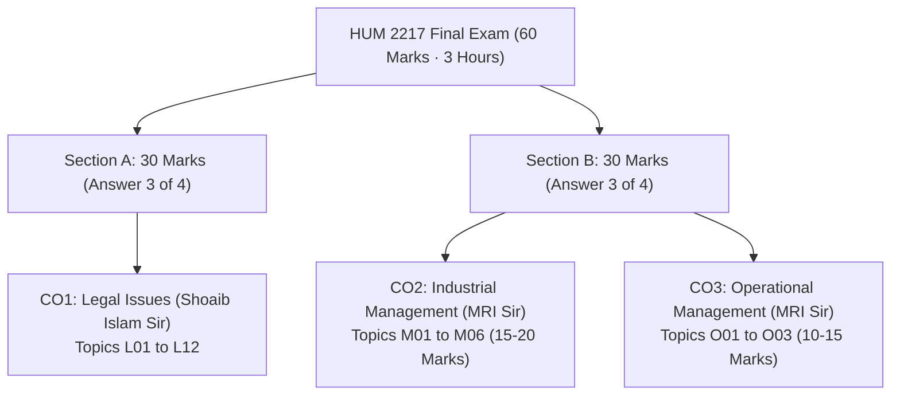
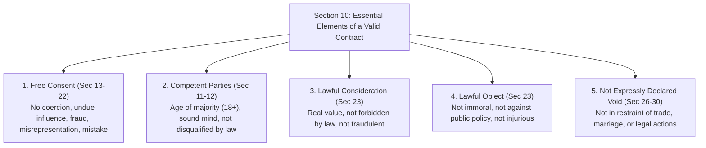
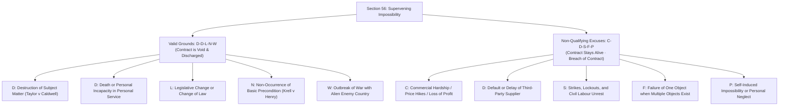
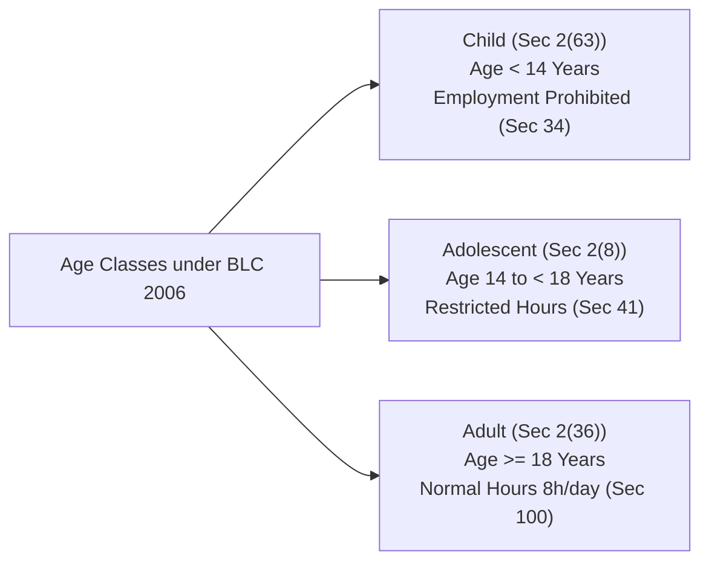
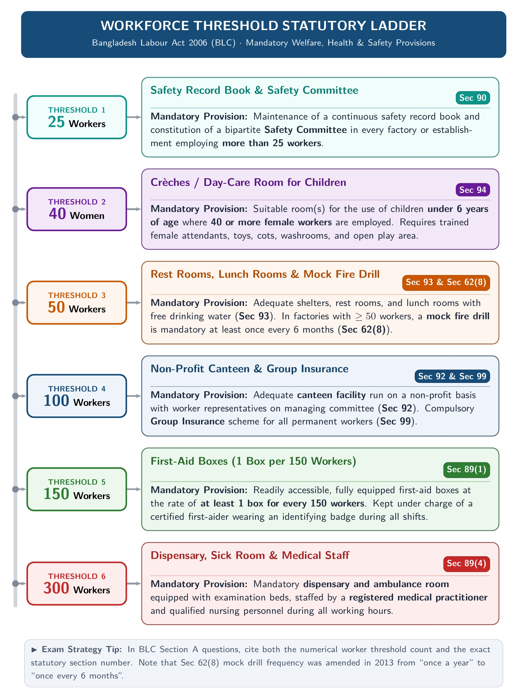
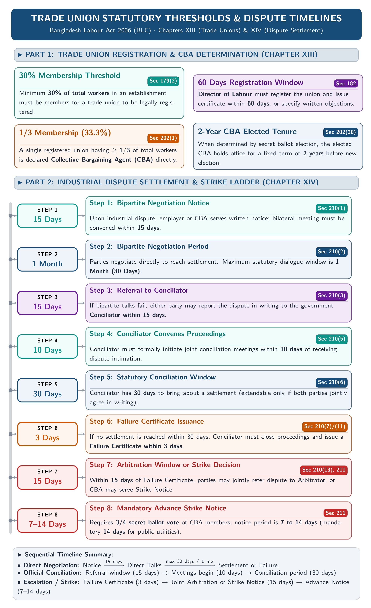
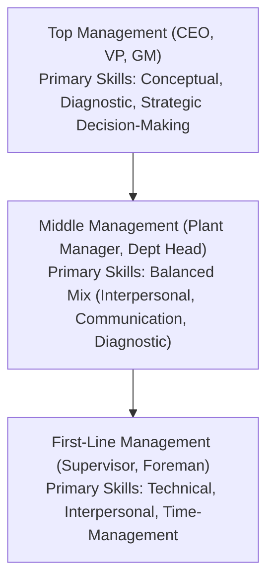
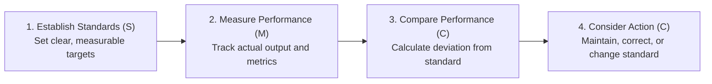
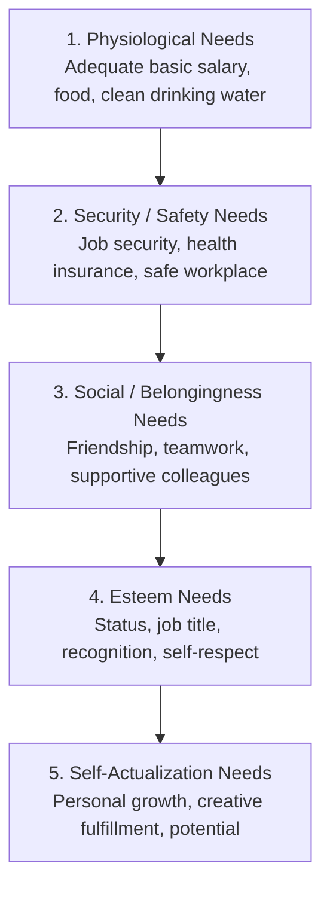
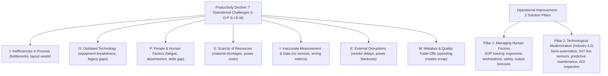

[← Previous: O03.2: Productivity Decline, Human Factors, and Industry 4.0](O03.2_Productivity_Decline_Human_Factors_and_Industry_4_0.md) | [🏠 Index](00_Index.md) | [Next: 00 Master Index →](00_Index.md)

---

# 99: Master Formula and Statutory Reference Sheet

> **Course:** HUM 2217 (Legal Issues, Industrial & Operational Management) | **RUET ECE Final Examination**
> **Scope:** Complete Formula, Statutory, Mnemonic, and Timeline Reference Sheet across CO1, CO2, and CO3.
> **Linked Notes:** Covers all 47 Topic Boss Notes ([L01.1](L01.1_Definitions_of_Law_and_Society.md) to [O03.2](O03.2_Productivity_Decline_Human_Factors_and_Industry_4_0.md)).

---

## 1. Quick Revision Blueprint and Exam Strategy

This sheet gives you an instant review of every formula, section number, and mnemonic in HUM 2217. Use it for rapid cramming before you enter the exam hall.

### 1.1 Exam Architecture and Marks Distribution

The HUM 2217 final examination carries **60 marks** over **3 hours**. It has two distinct sections written on separate answer scripts:

| Section | Focus Area | Instructor | Question Pattern | Marks Needed | Primary Boss Notes |
| :--- | :--- | :--- | :--- | :---: | :--- |
| **Section A** | CO1: Legal Issues | Shoaib Islam (SI) Sir | 4 questions set, answer any 3 (10 marks each) | 30 | [L01.1](L01.1_Definitions_of_Law_and_Society.md) to [L12.1](L12.1_Unfair_Labour_Practices_Sec_195_and_196.md) |
| **Section B** | CO2: Industrial Management | Dr. Md. Rabiul Islam (MRI) Sir | Set with CO3; 4 questions set, answer any 3 | 15–20 | [M01.1](M01.1_Management_Definitions_Resources_and_Nature.md) to [M06.2](M06.2_Performance_Appraisal_Methods_and_Rating_Errors.md) |
| **Section B** | CO3: Operational Management | Dr. Md. Rabiul Islam (MRI) Sir | Guaranteed numerical block (Q-System, Productivity) | 10–15 | [O01.1](O01.1_Inventory_Control_and_Holding_Costs.md) to [O03.2](O03.2_Productivity_Decline_Human_Factors_and_Industry_4_0.md) |

### 1.2 Shoaib Sir's Zero-Tolerance Statutory Rule (Section A)

Shoaib Sir evaluates Section A with strict precision. He gave a clear warning: *"The shorter the suggestion, the stricter the script evaluation."*
- A wrong statutory section number loses marks immediately.
- A vague descriptive answer without section citations receives zero or low marks.
- An accurate answer citing exact section numbers and following the 4-step case format can score a perfect **30/30**.

### 1.3 MRI Sir's Step-by-Step Numerical Rule (Section B)

MRI Sir awards full marks on Section B numerical problems when you write every board step:
- Convert demand to an annual basis ($D$) before any calculation.
- Write the full 4-line reorder point ($ROP$) formula: $dl + z\sigma_L$.
- State the explicit boxed decision rule: $\boxed{IP \le ROP} \implies \text{Order}$.
- Use MRI Sir's 3-part annual cost formula: $C = \frac{Q}{2}(H) + \frac{D}{Q}(S) + H z \sigma_L$.
- Draw the complete continuous review sawtooth graph with all labels.

---

## 2. Part 1 · CO1 Legal Issues Master Statutory & Timeline Reference (Shoaib Islam Sir)

### 2.1 The Contract Act 1872 Complete Section Directory

The table below catalogs every section of the Contract Act, 1872 tested in HUM 2217:

| Section | Statutory Concept | Core Meaning in Plain Words | Exam Focus / Key Case / Rule | Linked Boss Note |
| :--- | :--- | :--- | :--- | :--- |
| `Sec 2(a)` | Proposal / Offer | An expression of willingness to do or not do something to get another's assent. | Must be definite, clear, and communicated. | [L02.1](L02.1_Contract_Agreement_Void_and_Voidable.md), [L02.3](L02.3_Offer_and_Acceptance_Rules.md) |
| `Sec 2(b)` | Promise / Acceptance | When the person to whom proposal is made assents to it. | Assent turns an offer into a binding promise. | [L02.1](L02.1_Contract_Agreement_Void_and_Voidable.md), [L02.3](L02.3_Offer_and_Acceptance_Rules.md) |
| `Sec 2(c)` | Promisor and Promisee | The person making the proposal is promisor; the person accepting is promisee. | Identifies the legal parties. | [L02.1](L02.1_Contract_Agreement_Void_and_Voidable.md) |
| `Sec 2(d)` | Consideration | An act, forbearance, or promise done at the desire of the promisor. | Price paid for the promise. Must be real and lawful. | [L03.1](L03.1_Consideration_Definition_Types_and_Rules.md) |
| `Sec 2(e)` | Agreement | Every promise and every set of promises forming consideration for each other. | Agreement = Offer + Acceptance. | [L02.1](L02.1_Contract_Agreement_Void_and_Voidable.md) |
| `Sec 2(f)` | Reciprocal Promises | Promises that form the consideration or part of the consideration for each other. | Bilateral obligations in contracts. | [L02.1](L02.1_Contract_Agreement_Void_and_Voidable.md) |
| `Sec 2(g)` | Void Agreement | An agreement not enforceable by law. Has no legal effect from the beginning. | *Void ab initio*. Cannot be enforced in court. | [L02.1](L02.1_Contract_Agreement_Void_and_Voidable.md) |
| `Sec 2(h)` | Contract | An agreement enforceable by law. | Contract = Agreement + Legal Enforceability. | [L02.1](L02.1_Contract_Agreement_Void_and_Voidable.md), [L02.2](L02.2_Essential_Elements_of_Valid_Contract.md) |
| `Sec 2(i)` | Voidable Contract | An agreement enforceable by law at option of one party, but not the other. | Caused by lack of free consent (coercion, fraud). | [L02.1](L02.1_Contract_Agreement_Void_and_Voidable.md) |
| `Sec 3` | Communication & Revocation | Acts or omissions by which party communicates or revokes offer or acceptance. | Must be intentional outward acts. | [L02.3](L02.3_Offer_and_Acceptance_Rules.md) |
| `Sec 4` | Completion of Communication | Communication complete against proposer when put in transmission; against acceptor when known. | Dual-stage postal rule. Tested heavily. | [L02.3](L02.3_Offer_and_Acceptance_Rules.md) |
| `Sec 5` | Revocation Timing | Proposal revoked before acceptance is put in transmission; acceptance revoked before it reaches proposer. | Must reach other party before transmission boundary. | [L02.3](L02.3_Offer_and_Acceptance_Rules.md) |
| `Sec 6` | Revocation Modes | Revocation occurs by notice, lapse of time, failure of condition, or death/insanity. | 4 distinct statutory modes. | [L02.3](L02.3_Offer_and_Acceptance_Rules.md) |
| `Sec 7` | Absolute Acceptance | Acceptance must be absolute, unqualified, and expressed in usual or prescribed manner. | Counter-offer destroys the original offer. | [L02.3](L02.3_Offer_and_Acceptance_Rules.md) |
| `Sec 8` | Acceptance by Conduct | Performing conditions of proposal or accepting consideration constitutes acceptance. | *Carlill v. Carbolic Smoke Ball Co.* | [L02.3](L02.3_Offer_and_Acceptance_Rules.md) |
| `Sec 9` | Express and Implied Promises | Express if made in words; implied if made otherwise through conduct or circumstance. | Boarding a bus implies agreement to pay fare. | [L02.3](L02.3_Offer_and_Acceptance_Rules.md) |
| `Sec 10` | What Agreements are Contracts | All agreements are contracts if made by free consent, competent parties, lawful object, lawful consideration. | Foundation of contract law. 5 core pillars. | [L02.2](L02.2_Essential_Elements_of_Valid_Contract.md) |
| `Sec 11` | Competence to Contract | Major age (18+), sound mind, and not disqualified by any law. | Minor agreements are void *ab initio*. | [L02.2](L02.2_Essential_Elements_of_Valid_Contract.md) |
| `Sec 12` | Sound Mind for Contract | Capable of understanding terms and forming rational judgment at time of contract. | Lunatic during lucid interval can contract. | [L02.2](L02.2_Essential_Elements_of_Valid_Contract.md) |
| `Sec 13` | Consent | Two or more persons agree upon the same thing in the same sense (*Consensus ad idem*). | Core meeting of minds. | [L02.2](L02.2_Essential_Elements_of_Valid_Contract.md) |
| `Sec 14` | Free Consent | Consent is free when not caused by coercion, undue influence, fraud, misrepresentation, or mistake. | Vitiating factors make contract voidable or void. | [L02.2](L02.2_Essential_Elements_of_Valid_Contract.md) |
| `Sec 15` | Coercion | Committing or threatening any act forbidden by Penal Code, or unlawful detaining of property. | Physical threat makes contract voidable. | [L02.2](L02.2_Essential_Elements_of_Valid_Contract.md) |
| `Sec 16` | Undue Influence | One party dominates the will of another and uses position to gain unfair advantage. | Doctor-patient, parent-child relations. | [L02.2](L02.2_Essential_Elements_of_Valid_Contract.md) |
| `Sec 17` | Fraud | Intentional deceit, active concealment, false statement, or promise made without intent to perform. | Deliberate cheating. Makes contract voidable. | [L02.2](L02.2_Essential_Elements_of_Valid_Contract.md) |
| `Sec 18` | Misrepresentation | Innocent false statement of material fact believed to be true by the person making it. | Innocent error without fraudulent intent. | [L02.2](L02.2_Essential_Elements_of_Valid_Contract.md) |
| `Sec 20` | Bilateral Mistake of Fact | Both parties under mistake as to matter of fact essential to agreement. | Agreement is void. | [L02.2](L02.2_Essential_Elements_of_Valid_Contract.md) |
| `Sec 23` | Lawful Object and Consideration | Consideration or object is unlawful if forbidden by law, defeats law, fraudulent, injurious, or immoral. | Unlawful agreement is void. | [L02.2](L02.2_Essential_Elements_of_Valid_Contract.md) |
| `Sec 25` | Agreement without Consideration | Agreement without consideration is void ("No consideration, no contract"). | Core general rule with 3 strict exceptions. | [L03.2](L03.2_Exceptions_to_No_Consideration_No_Contract.md) |
| `Sec 25(1)` | Natural Love & Affection | Written and registered agreement between near relations on natural love and affection. | Enforceable without consideration. | [L03.2](L03.2_Exceptions_to_No_Consideration_No_Contract.md) |
| `Sec 25(2)` | Past Voluntary Service | Promise to compensate person who already voluntarily did something for promisor. | Enforceable without fresh consideration. | [L03.2](L03.2_Exceptions_to_No_Consideration_No_Contract.md) |
| `Sec 25(3)` | Time-Barred Debt | Written and signed promise to pay a debt barred by limitation law. | Must be in writing and signed by debtor. | [L03.2](L03.2_Exceptions_to_No_Consideration_No_Contract.md) |
| `Sec 25 Expl. 1` | Completed Gifts | Rule does not affect validity of any gift actually made between donor and donee. | Completed gift cannot be revoked for no pay. | [L03.2](L03.2_Exceptions_to_No_Consideration_No_Contract.md) |
| `Sec 25 Expl. 2` | Inadequacy of Consideration | Inadequacy of consideration does not void contract, but may be evidence of lack of free consent. | Peppercorn rule. Court checks reality, not value. | [L03.1](L03.1_Consideration_Definition_Types_and_Rules.md), [L03.2](L03.2_Exceptions_to_No_Consideration_No_Contract.md) |
| `Sec 26` | Restraint of Marriage | Agreement in restraint of marriage of any person other than a minor is void. | Freedom of marriage protected. | [L02.1](L02.1_Contract_Agreement_Void_and_Voidable.md) |
| `Sec 27` | Restraint of Trade | Agreement restraining anyone from exercising lawful profession, trade, or business is void. | Exception: sale of business goodwill. | [L02.1](L02.1_Contract_Agreement_Void_and_Voidable.md), [L10.3](L10.3_Trade_Union_Legal_Status_Rights_and_Applied_Role.md) |
| `Sec 28` | Restraint of Legal Proceedings | Agreement restricting enforcement of rights in courts or limiting time is void. | Exception: arbitration clause. | [L02.1](L02.1_Contract_Agreement_Void_and_Voidable.md) |
| `Sec 29` | Uncertainty | Agreements whose meaning is not certain or capable of being made certain are void. | Ambiguous terms destroy agreement. | [L02.1](L02.1_Contract_Agreement_Void_and_Voidable.md) |
| `Sec 30` | Wagering Agreements | Agreements by way of wager are void; no suit allowed for recovering money won on wager. | Gambling contracts unenforceable. | [L02.1](L02.1_Contract_Agreement_Void_and_Voidable.md) |
| `Sec 37` | Obligation to Perform | Parties must perform or offer to perform promises unless excused under law. | Primary performance duty. | [L04.1](L04.1_Modes_of_Discharge_of_Contract.md) |
| `Sec 38` | Tender of Performance | Offer of performance made to promisee; if rejected, promisor is not responsible for non-performance. | Tender must be unconditional and timely. | [L04.1](L04.1_Modes_of_Discharge_of_Contract.md) |
| `Sec 39` | Anticipatory Breach | Promisor refuses to perform or disables himself from performing promise in its entirety. | Promisee may end contract or treat it as alive. | [L04.1](L04.1_Modes_of_Discharge_of_Contract.md) |
| `Sec 56` | Supervening Impossibility | Contract to do act which becomes impossible or unlawful after contract is void. | Doctrine of Frustration. Major exam case topic. | [L04.1](L04.1_Modes_of_Discharge_of_Contract.md), [L04.2](L04.2_Doctrine_of_Frustration_and_Case_Studies.md) |
| `Sec 62` | Novation, Rescission, Alteration | If parties agree to substitute new contract, or rescind or alter it, original contract discharged. | Discharged by mutual agreement. | [L04.1](L04.1_Modes_of_Discharge_of_Contract.md) |
| `Sec 63` | Remission and Waiver | Promisee may dispense with or remit performance, or extend time, or accept any satisfaction. | Creditor can accept lesser sum to end debt. | [L04.1](L04.1_Modes_of_Discharge_of_Contract.md) |
| `Sec 64` | Rescission of Voidable Contract | Party rescinding voidable contract must restore benefit received to other party. | Restitution of benefits. | [L04.1](L04.1_Modes_of_Discharge_of_Contract.md) |
| `Sec 65` | Advantage under Void Agreement | Person receiving advantage under void agreement or contract must restore it or make compensation. | Prevents unjust enrichment. | [L04.1](L04.1_Modes_of_Discharge_of_Contract.md), [L04.2](L04.2_Doctrine_of_Frustration_and_Case_Studies.md) |
| `Sec 127` | Consideration for Guarantee | Anything done or promise made for benefit of principal debtor is sufficient consideration to surety. | Surety receives no direct payment. | [L03.2](L03.2_Exceptions_to_No_Consideration_No_Contract.md) |
| `Sec 185` | Consideration in Agency | No consideration is necessary to create an agency. | Agent acts on authority of principal. | [L03.2](L03.2_Exceptions_to_No_Consideration_No_Contract.md) |

---

### 2.2 Section 10: 5 Essential Elements of a Valid Contract

To turn an agreement into a binding contract, five pillars must exist under **Section 10**:

> [!tip] Memory Hook: Maxim Rule
> *"All contracts are agreements, but all agreements are not contracts."*
> - An agreement is the genus (Offer + Acceptance).
> - A contract is the species (Agreement + Enforceability under Section 10).
> - If Section 10 elements are missing, the agreement remains a void agreement under `Sec 2(g)`.

---

### 2.3 Section 25: 7 Exceptions to No Consideration No Contract

The general rule states: `Ex nudo pacto non oritur actio` (A naked promise creates no cause of action). Under **Section 25**, an agreement without consideration is void. But seven clear exceptions exist in the Act:

| # | Exception Category | Statutory Source | Legal Conditions Required | Concrete Example |
| :-: | :--- | :--- | :--- | :--- |
| 1 | Natural Love & Affection | `Sec 25(1)` | Written document, registered under law, between near relations, on natural love. | Father registers written deed gifting flat to son. |
| 2 | Past Voluntary Service | `Sec 25(2)` | Act done voluntarily in past for promisor, promisor was alive and competent, promises to compensate. | Student finds lost laptop voluntarily; owner promises \$50 reward. |
| 3 | Time-Barred Debt | `Sec 25(3)` | Debt barred by Limitation Act (3 years), promise in writing, signed by debtor or authorized agent. | Debtor signs written promise to pay \$1,000 debt expired 4 years ago. |
| 4 | Completed Gift | `Sec 25 Expl. 1` | Gift actually delivered and accepted between donor and donee. | Uncle gives car to nephew with immediate physical possession. |
| 5 | Agency Contract | `Sec 185` | Principal appoints agent to conduct transactions on principal's behalf. | Friend agrees to sign apartment lease as agent without fee. |
| 6 | Contract of Guarantee | `Sec 127` | Creditor gives loan or goods to principal debtor; consideration to debtor supports surety's guarantee. | Bank gives loan to student; brother signs as guarantor. |
| 7 | Remission / Lesser Payment | `Sec 63` | Creditor accepts smaller sum in full satisfaction of existing debt, or extends time. | Landlord agrees in writing to take \$800 instead of \$1,000 full rent. |

---

### 2.4 Section 56: Supervening Impossibility (Doctrine of Frustration)

Under **Section 56 (Paragraph 2)**, supervening impossibility makes a contract void. This occurs when performance becomes impossible or unlawful after contract formation through unforeseen events.

> [!tip] Memory Hook: 5 Frustrations vs 5 Excuses
> - **Valid Frustration Grounds:** `D-D-L-N-W` (Destruction, Death, Law change, Non-occurrence, War).
> - **Non-Frustrating Excuses:** `C-D-S-F-P` (Commercial hardship, Default of supplier, Strikes, Failure of one object, Personal fault).
> - *Rule in Exam:* If an event is `C-D-S-F-P`, the promisor must pay damages under `Sec 73`. If `D-D-L-N-W`, contract is discharged and benefits returned under `Sec 65`.

---

### 2.5 Section 62 and 63: Discharge by Mutual Consent

A valid contract can be discharged without breach if both parties mutually agree under **Sections 62 and 63**:

1. **Novation (`Sec 62`):** Substituting a new contract for the old one. This can involve the same parties or a new party. Old contract dies completely.
2. **Rescission (`Sec 62`):** Canceling the entire contract by mutual agreement before performance.
3. **Alteration (`Sec 62`):** Changing one or more contract terms with mutual consent. The rest of the contract stays alive.
4. **Remission (`Sec 63`):** Accepting a lesser performance or smaller sum in full satisfaction of debt.
5. **Waiver (`Sec 63`):** Intentionally abandoning a legal right or dispensing with performance entirely.
6. **Merger:** An inferior right merges into a superior right between the same parties. For example, a tenant buys the leased building.

---

### 2.6 The Bangladesh Labour Act 2006 Verified Section Directory

The table below catalogs every section of the Bangladesh Labour Act, 2006 (BLC 2006) tested in HUM 2217:

| Section | Statutory Scope & Topic | Legal Rule & Verification Details | Exam Focus / Threshold | Linked Boss Note |
| :--- | :--- | :--- | :--- | :--- |
| `Sec 2(2)` | Manufacturing Process | Any process for making, altering, repairing, finishing, or packing articles, or generating power. | Note: Voice note typo `2(lxi)` corrected to `2(2)`. | [L05.1](L05.1_BLC_Core_Definitions_and_Age_Classes.md) |
| `Sec 2(7)` | Factory | Premise where $\ge 5$ workers work on any day and manufacturing process is carried on. Excludes mines. | Worker count threshold is 5 workers. | [L05.1](L05.1_BLC_Core_Definitions_and_Age_Classes.md) |
| `Sec 2(8)` | Adolescent | A person who has completed 14 years of age but has not completed 18 years. | Age range: 14 to under 18 years. | [L05.1](L05.1_BLC_Core_Definitions_and_Age_Classes.md) |
| `Sec 2(36)` | Adult | A person who has completed 18 years of age. | Age 18 and above. | [L05.1](L05.1_BLC_Core_Definitions_and_Age_Classes.md) |
| `Sec 2(61)` | Retrenchment | Termination of service of worker by employer on ground of redundancy. | Due to excess staff or business downsizing. | [L09.1](L09.1_Termination_of_Employment_Sec_20_to_27.md) |
| `Sec 2(62)` | Settlement | Settlement arrived at through conciliation or bipartite negotiation with signed agreement. | Legally binding under `Sec 210`. | [L11.2](L11.2_Industrial_Disputes_and_Settlement_Ladder_Sec_210.md) |
| `Sec 2(63)` | Child | A person who has not completed 14 years of age. | Employment completely barred under `Sec 34`. | [L05.1](L05.1_BLC_Core_Definitions_and_Age_Classes.md) |
| `Sec 2(65)` | Worker | Person employed for manual, technical, clerical, or trade promotional work. Excludes management. | Managerial and administrative staff excluded. | [L05.1](L05.1_BLC_Core_Definitions_and_Age_Classes.md) |
| `Sec 20` | Retrenchment Procedure | 1 month written notice or wages in lieu; notice to Chief Inspector; 30 days compensation per year; LIFO rule. | `Sec 20(2)` requires Last In, First Out. | [L09.1](L09.1_Termination_of_Employment_Sec_20_to_27.md) |
| `Sec 22` | Discharge for Incapacity | Termination due to physical or mental incapacity certified by registered medical practitioner. | Compensation: 30 days wages per year of service. | [L09.1](L09.1_Termination_of_Employment_Sec_20_to_27.md) |
| `Sec 23` | Dismissal for Misconduct | Dismissal without notice or compensation for misconduct (theft, fraud, bribery, riot, strike incitement). | Requires full domestic inquiry under `Sec 24`. | [L09.1](L09.1_Termination_of_Employment_Sec_20_to_27.md) |
| `Sec 24` | Disciplinary Procedure | Written charge-sheet, min 7 days to explain, independent inquiry committee, worker defense, employer sign-off. | 5-step statutory fair procedure. | [L09.1](L09.1_Termination_of_Employment_Sec_20_to_27.md) |
| `Sec 26` | Termination by Notice | Employer terminates permanent worker without fault: 120 days notice (monthly) or 60 days (others) + 30 days pay/year. | Highest notice burden in Labour Code. | [L09.1](L09.1_Termination_of_Employment_Sec_20_to_27.md) |
| `Sec 27` | Resignation by Worker | Permanent worker gives 60 days notice (monthly) or 30 days (others). Compensation if service $\ge 5$ years. | 30 days pay/yr if service $> 10$ yrs; 15 days if 5–10 yrs. | [L09.1](L09.1_Termination_of_Employment_Sec_20_to_27.md) |
| `Sec 34` | Prohibition of Child Labour | No child under 14 years may work or be permitted to work in any establishment. | Absolute legal bar. | [L05.1](L05.1_BLC_Core_Definitions_and_Age_Classes.md) |
| `Sec 35` | Certificate of Fitness | Adolescent must have fitness certificate issued by registered medical practitioner to work. | Valid for 12 months. Revocable. | [L05.2](L05.2_Adolescent_Working_Hours_Sec_41.md) |
| `Sec 39` | Dangerous Machinery | No adolescent may work on dangerous machines without safety training and supervision. | Strict employer liability. | [L07.2](L07.2_Machinery_Safety_and_Workplace_Duties.md) |
| `Sec 41` | Adolescent Working Hours | Factory/mine: max 5 hrs/day, 30 hrs/wk (36 OT). Others: max 7 hrs/day, 42 hrs/wk (48 OT). Night barred. | Night prohibition: 7:00 PM to 7:00 AM. | [L05.2](L05.2_Adolescent_Working_Hours_Sec_41.md) |
| `Sec 45` | Maternity Employment Ban | Employment prohibited for 8 weeks after delivery. Arduous/standing work barred 10 weeks before delivery. | Strict liability on employer. | [L06.1](L06.1_Maternity_Benefits_Sec_45_to_50.md) |
| `Sec 46` | Right to Maternity Benefit | 16 weeks total paid leave (8 weeks pre + 8 weeks post). Requires $\ge 6$ months service. Barred if $\ge 2$ living children. | If $\ge 2$ children, unpaid leave only. | [L06.1](L06.1_Maternity_Benefits_Sec_45_to_50.md) |
| `Sec 47` | Maternity Notice & Payment | Notice oral or written before delivery or within 7 days after delivery. Paid within 3 working days of proof. | 3 payment modes available. | [L06.1](L06.1_Maternity_Benefits_Sec_45_to_50.md) |
| `Sec 48` | Maternity Wage Calculation | Average daily wage = Total wages in preceding 3 months divided by actual days worked. Paid in cash for all days. | Calendar days paid including holidays. | [L06.1](L06.1_Maternity_Benefits_Sec_45_to_50.md) |
| `Sec 49` | Payment on Woman's Death | Benefit paid to nominee or legal heir if woman dies during or after child delivery. | Protects newborn and family. | [L06.1](L06.1_Maternity_Benefits_Sec_45_to_50.md) |
| `Sec 50` | Maternity Dismissal Ban | Dismissal or discharge prohibited within 6 months before and 8 weeks after delivery without sufficient cause. | Employer remains liable for full maternity pay. | [L06.1](L06.1_Maternity_Benefits_Sec_45_to_50.md) |
| `Sec 62(1–8)` | Fire Safety Precautions | Alternative emergency stairs, outward doors, red Bangla signs, alarms, mock fire drills. | Drill: cite 2006 (1/yr) and 2013 (every 6 mo). | [L07.1](L07.1_Fire_Safety_Precautions_Sec_62.md) |
| `Sec 89` | First-Aid Appliances | At least 1 first-aid box per 150 workers. Dispensary and ambulance room if $\ge 300$ workers. | Trained person with badge in charge. | [L08.1](L08.1_Welfare_Measures_Sec_89_to_99.md) |
| `Sec 90` | Safety Committee & Record | Safety record book and safety committee mandatory in establishments with $> 25$ workers. | Worker safety representation. | [L08.1](L08.1_Welfare_Measures_Sec_89_to_99.md) |
| `Sec 91` | Washing Facilities | Clean, adequate, separate and screened washing facilities for male and female workers. | Basic factory sanitation. | [L08.1](L08.1_Welfare_Measures_Sec_89_to_99.md) |
| `Sec 92` | Canteens | Mandatory canteen in establishments employing $> 100$ workers. Managing committee with worker reps. | Food sold on non-profit basis. | [L08.1](L08.1_Welfare_Measures_Sec_89_to_99.md) |
| `Sec 93` | Shelters & Lunch Rooms | Rest rooms and lunch rooms with free drinking water in establishments with $> 50$ workers. | Screened shelter if female workers present. | [L08.1](L08.1_Welfare_Measures_Sec_89_to_99.md) |
| `Sec 94` | Crèches / Day-Care | Day-care room mandatory where $\ge 40$ female workers employed. Children under 6 years. Area $\ge 6000\text{ sq. cm}$. | Room height $\ge 360\text{ cm}$; trained woman caregiver. | [L08.1](L08.1_Welfare_Measures_Sec_89_to_99.md) |
| `Sec 99` | Group Insurance | Mandatory group insurance scheme in establishments employing $\ge 100$ permanent workers. | Insurance benefit paid on death or permanent disability. | [L08.1](L08.1_Welfare_Measures_Sec_89_to_99.md) |
| `Sec 100–108` | Hours & Overtime Pay | Adult normal hours: 8 hrs/day, 48 hrs/wk. Overtime pay rate = $2 \times$ normal basic wage under `Sec 108`. | Max 10 hrs/day, 60 hrs/wk with OT. | [L05.3](L05.3_Applied_Factory_Compliance_and_Adult_Hours.md) |
| `Sec 176` | Right to Form Trade Union | Workers and employers have the right to establish and join trade unions of their own choosing. | No prior administrative approval needed. | [L10.1](L10.1_Trade_Union_Basics_Objectives_and_Functions.md) |
| `Sec 177–179` | Trade Union Registration | Application to Director of Labour. Must have min 30% membership of total establishment workforce (`Sec 179(2)`). | 30% threshold is strictly enforced. | [L10.2](L10.2_Trade_Union_Registration_and_Cancellation.md) |
| `Sec 182` | Registration Timeline | Director of Labour must register union within 60 days of receiving application, or issue objection. | 60 calendar days decision window. | [L10.2](L10.2_Trade_Union_Registration_and_Cancellation.md) |
| `Sec 189` | Registration Certificate | Director of Labour issues registration certificate in prescribed form. Conclusive evidence of registration. | Proves legal birth of union. | [L10.2](L10.2_Trade_Union_Registration_and_Cancellation.md) |
| `Sec 190` | Union Cancellation | 7 grounds: obtained by fraud, membership below 30%, unfair practices, rule violations. Needs Labour Court order. | Labour Court permission mandatory. | [L10.2](L10.2_Trade_Union_Registration_and_Cancellation.md) |
| `Sec 194` | Legal Status / Incorporation | Registered trade union is a body corporate: perpetual succession, common seal, power to hold property, sue and be sued. | Distinct legal entity from members. | [L10.3](L10.3_Trade_Union_Legal_Status_Rights_and_Applied_Role.md) |
| `Sec 195` | Employer Unfair Practices | 12 prohibited acts: yellow-dog contracts, discrimination, dismissal for union role, hiring strike-breakers. | Criminal penalty under `Sec 291`. | [L12.1](L12.1_Unfair_Labour_Practices_Sec_195_and_196.md) |
| `Sec 196` | Worker Unfair Practices | 6 prohibited acts: coercion, physical intimidation, gherao, slow-down, illegal strike, unauthorized collection. | Prohibits union violence and coercion. | [L12.1](L12.1_Unfair_Labour_Practices_Sec_195_and_196.md) |
| `Sec 197` | Criminal Immunity | Officers and members immune from criminal conspiracy charges regarding lawful trade union objectives. | Protects lawful union activities. | [L10.3](L10.3_Trade_Union_Legal_Status_Rights_and_Applied_Role.md) |
| `Sec 198` | Civil Immunity | Immunity from civil suits for acts done in contemplation or furtherance of an industrial dispute. | Shields union funds from tort claims. | [L10.3](L10.3_Trade_Union_Legal_Status_Rights_and_Applied_Role.md) |
| `Sec 199` | Enforceability of Agreement | Trade union agreements not void merely because they act in restraint of trade. Overrides Contract Act `Sec 27`. | Legal shield for collective bargains. | [L10.3](L10.3_Trade_Union_Legal_Status_Rights_and_Applied_Role.md) |
| `Sec 202` | CBA Determination | Single union with $\ge 1/3$ workers is CBA. If multiple unions, secret ballot election for 2-year tenure. | CBA represents all workers. | [L11.1](L11.1_Collective_Bargaining_and_CBA_Sec_202.md) |
| `Sec 202(24)` | CBA Exclusive Powers | 5 exclusive powers: bargain on wages/hours, represent workers, declare legal strike, nominate board reps, manage funds. | No other union can bargain. | [L11.1](L11.1_Collective_Bargaining_and_CBA_Sec_202.md) |
| `Sec 209` | Raising Industrial Dispute | Industrial dispute can only be raised by CBA or employer in writing. Non-CBA unions cannot raise dispute. | Formal written notice required. | [L11.2](L11.2_Industrial_Disputes_and_Settlement_Ladder_Sec_210.md) |
| `Sec 210` | Dispute Settlement Ladder | 4-tier process: Bipartite negotiations (15d/30d), Conciliation (10d/30d), Arbitration (30d), Labour Court. | Strict statutory day counts. | [L11.2](L11.2_Industrial_Disputes_and_Settlement_Ladder_Sec_210.md) |
| `Sec 211` | Strike and Lock-Out Notice | Strike notice within 15 days of failure certificate; requires secret ballot with $51\%$ approval; 7 to 14 days notice. | Public utility requires 14 days. | [L11.2](L11.2_Industrial_Disputes_and_Settlement_Ladder_Sec_210.md) |

---

### 2.7 Section 2: Core BLC Definitions and Age Categories

The BLC sets strict thresholds for age and workplace status under **Section 2**:

- **Factory (`Sec 2(7)`):** Premise with $\ge 5$ workers on any day carrying on a manufacturing process under `Sec 2(2)`. Mines are excluded.
- **Worker (`Sec 2(65)`):** Anyone employed for skilled, unskilled, manual, technical, trade promotional, or clerical work. It excludes managerial, supervisory, and administrative officers.

---

### 2.8 Section 41: Adolescent Working Hours and Shift Rules

Adolescents (ages 14 to under 18) face strict statutory caps under **Section 41**:

| Rule Category | Factory or Mine (`Sec 41(1)`) | Other Establishments (`Sec 41(2)`) |
| :--- | :--- | :--- |
| **Daily Work Limit** | Max 5 hours per day | Max 7 hours per day |
| **Weekly Work Limit** | Max 30 hours per week | Max 42 hours per week |
| **Overtime Work Limit** | Max 36 hours per week (max 6 hrs OT) | Max 48 hours per week (max 6 hrs OT) |
| **Night Work Prohibition** | Prohibited between 7:00 PM and 7:00 AM | Prohibited between 7:00 PM and 7:00 AM |
| **Shift Spread-Over** | Max 7.5 hours spread-over; max 2 shifts | Max 7.5 hours spread-over; max 2 shifts |
| **Relay Change Interval** | At most once in 30 days (requires Inspector permission) | At most once in 30 days (requires Inspector permission) |
| **Weekly Holiday** | Mandatory weekly holiday (no exemption allowed) | Mandatory weekly holiday (no exemption allowed) |
| **Double Employment** | Prohibited from working in $> 1$ establishment on same day | Prohibited from working in $> 1$ establishment on same day |

---

### 2.9 Sections 45 to 50: Maternity Benefit Rules and Computations

The maternity benefit regime under **Sections 45 to 50** protects female workers before and after delivery:

1. **Duration of Leave (`Sec 46`):** 16 weeks total paid leave (8 weeks pre-natal and 8 weeks post-natal).
2. **Service Eligibility (`Sec 46(1)`):** The woman must work for the employer for at least **6 months** immediately preceding delivery.
3. **Child Limitation (`Sec 46(2)`):** A woman with **2 or more surviving children** receives no cash maternity benefit. She receives only unpaid leave.
4. **Notice Procedure (`Sec 47`):** The woman gives oral or written notice before delivery. She can also give notice within 7 days after delivery. The employer pays within **3 working days** of medical proof.
5. **Wage Calculation Formula (`Sec 48`):**

$$
\text{Daily Maternity Benefit Rate} = \frac{\text{Total Wages Earned in Preceding 3 Months}}{\text{Actual Days Worked in Preceding 3 Months}}
$$

- The employer pays this daily rate in cash for all 16 weeks. This includes weekly holidays and festival days.
- **Dismissal Protection (`Sec 50`):** Employers cannot dismiss a pregnant worker within 6 months before delivery. They cannot dismiss her within 8 weeks after delivery. Doing so leaves the employer liable for full maternity pay.

---

### 2.10 Section 62: Factory Fire Safety Precautions (Subsections 1 to 8)

Fire precautions under **Section 62** are mandatory for every factory:

- `Sec 62(1)`: At least one alternative emergency connecting stairway per floor and active firefighting equipment.
- `Sec 62(2)`: Inspector powers to issue binding orders for fire safety improvements.
- `Sec 62(3)`: Doors must remain unlocked from inside and open outwards or slide freely.
- `Sec 62(4)`: Fire exits must be clearly marked in prominent **red Bangla letters**.
- `Sec 62(5)`: Audible fire alarm or whistle audible in all operating parts of the plant.
- `Sec 62(6)`: Unobstructed passage from every workstation to the fire escape.
- `Sec 62(7)`: Escape training for workers if $> 10$ workers work above the ground floor or handle explosive materials.
- `Sec 62(8)`: Mock fire drill required for establishments with $\ge 50$ workers.
  - *2006 Original Text:* At least once a year.
  - *2013 Amendment Text:* At least **once every 6 months**. Factories must keep a safety record book. At least **18% of workers must be trained** in firefighting. (Cite both in exams).

---

### 2.11 Sections 89 to 94 and 99: Welfare Measures and Facilities

The Labour Code mandates welfare facilities based on worker-count thresholds:

| Statutory Section | Welfare Measure | Worker-Count Threshold | Mandatory Statutory Standard |
| :--- | :--- | :--- | :--- |
| `Sec 89(1)` | First-Aid Boxes | At least 1 box per 150 workers | Maintained under trained first-aid person wearing distinct badge. |
| `Sec 89(4)` | Dispensary & Ambulance Room | $\ge 300$ workers | Staffed by qualified doctor, nursing staff, and medical equipment. |
| `Sec 90` | Safety Record & Committee | $> 25$ workers | Safety record book and joint safety committee with worker reps. |
| `Sec 91` | Washing Facilities | All establishments | Clean, adequate, separate and screened for male and female workers. |
| `Sec 92` | Factory Canteens | $> 100$ workers | Non-profit canteen managed with worker representatives. |
| `Sec 93` | Rest Rooms & Lunch Rooms | $> 50$ workers | Adequate seating, free drinking water; screened shelter for women. |
| `Sec 94` | Crèches / Day-Care Rooms | $\ge 40$ female workers | For children under 6 years; height $\ge 360\text{ cm}$, area $\ge 6000\text{ sq. cm}$ per child; trained woman in charge. |
| `Sec 99` | Compulsory Group Insurance | $\ge 100$ permanent workers | Group life and disability insurance funded by the employer. |

---

### 2.12 Sections 20 to 27: Employment Termination, Dismissal, and Resignation

The BLC divides termination into distinct legal classes under Chapter II:

| Mode | Statutory Section | Legal Ground | Notice Period Required | Service Compensation Due |
| :--- | :--- | :--- | :--- | :--- |
| **Retrenchment** | `Sec 20` | Redundancy / Staff downsizing | 1 month written notice or wages in lieu (notice to Chief Inspector) | 30 days wages for every completed year of service. LIFO rule applies (`Sec 20(2)`). |
| **Discharge** | `Sec 22` | Physical or mental incapacity | Certified by registered medical practitioner | 30 days wages for every completed year of service. |
| **Dismissal** | `Sec 23–24` | Gross misconduct (theft, riot, fraud) | No notice required | Zero compensation. Requires full 5-step domestic inquiry under `Sec 24`. |
| **Termination by Notice** | `Sec 26` | Ordinary termination by employer | 120 days written notice (monthly-rated); 60 days (other workers) | 30 days wages for every completed year of service, plus gratuity or provident fund. |
| **Resignation** | `Sec 27` | Voluntary resignation by worker | 60 days written notice (monthly); 30 days (others) | Service $> 10$ yrs: 30 days wages/yr. Service 5 to 10 yrs: 15 days wages/yr. Service $< 5$ yrs: zero. |

---

### 2.13 Sections 176 to 211: Trade Unions, CBA, and Dispute Settlement

Trade unions and industrial disputes follow a strict statutory framework:

1. **Trade Union Registration (`Sec 177–179`):** Application made to the Director of Labour. Requires a minimum membership of **30% of total workers** in the establishment (`Sec 179(2)`). Decision must arrive within **60 days** (`Sec 182`).
2. **Legal Incorporation (`Sec 194`):** A registered trade union becomes a body corporate. It has perpetual succession and a common seal. It can hold property, enter contracts, sue, and be sued.
3. **Immunities (`Sec 197–198`):** Officers enjoy immunity from criminal conspiracy charges (`Sec 197`). They also enjoy immunity from civil lawsuits during lawful trade disputes (`Sec 198`).
4. **Collective Bargaining Agent (CBA) (`Sec 202`):**
   - Single registered union with $\ge 1/3$ (33.3%) membership is declared CBA directly.
   - If multiple unions exist, Director conducts a secret ballot election. Winner holds a **2-year tenure**.
   - **Exclusive CBA Powers (`Sec 202(24)`):** Collective bargaining, representing workers, declaring legal strikes, and nominating worker representatives to statutory committees.

---

### 2.14 Master Legal Number Ladders and Timeline Tables

#### 1. Welfare Facilities Worker-Count Ladder

*Figure: Workforce Threshold Statutory Ladder (Source: BLC 2006 Welfare & Safety Provisions)*

#### 2. Trade Union and Dispute Settlement Timeline Chain

*Figure: Trade Union Statutory Thresholds and Timelines (Source: BLC 2006 Chapters XIII & XIV)*

---

### 2.15 The 4-Step Legal Case Study Format

Whenever you answer a 10-mark legal scenario question in Section A, use this 4-step layout:

1. **Facts of the Case:** State the operational dispute in 1 to 2 crisp sentences. Name the parties, the broken promise, and the disputed dollar amount or action.
2. **Applicable Law & Section:** Cite exact statute and section numbers. Quote the core statutory rule accurately.
3. **Legal Analysis:** Apply the statutory test directly to the case facts. Check whether any exceptions apply (for example, whether the delay was commercial hardship or true supervening impossibility).
4. **Direct Conclusion:** Give an unambiguous verdict. State whether the party is liable, whether the contract is discharged, or the exact compensation amount due.

---

## 3. Part 2 · CO2 Industrial Management Master Mnemonics & Frameworks (MRI Sir)

### 3.1 Verbatim Management Definitions (Taylor and Griffin)

Always write both definitions to secure full marks:

> **F.W. Taylor (1911):**
> *"Management is an art of knowing what to do and seeing that it is done in the best and cheapest way."*

> **Ricky W. Griffin:**
> *"A set of activities (including planning and decision making, organizing, leading, and controlling) directed at an organization's resources (human, financial, physical, and information), with the aim of achieving organizational goals in an efficient and effective manner."*

---

### 3.2 HFPI Resources and POLC Functions

---

### 3.3 The 2x2 Efficiency vs Effectiveness Decision Matrix

- **Efficiency:** Doing things right. Minimizes resource waste ($\frac{\text{Output}}{\text{Input}}$).
- **Effectiveness:** Doing the right things. Chooses and achieves the correct strategic goals.

| Dimension | Low Effectiveness (Wrong Goals) | High Effectiveness (Right Goals) |
| :--- | :--- | :--- |
| **High Efficiency** (Low Waste) | **Well-Run Bankruptcy (Quadrant 3):** Low cost, high speed, but nobody buys the product. High waste of market effort. | **Thriving Organization (Quadrant 1):** Optimal operational state. Goals achieved with minimal resource waste. |
| **Low Efficiency** (High Waste) | **Guaranteed Failure (Quadrant 4):** High resource waste, late delivery, wrong product. Organization collapses quickly. | **Surviving but Costly (Quadrant 2):** Goals reached, but production costs are too high. Profits stay low. |

---

### 3.4 TICDCDT 7 Managerial Skills and Level Distribution

Managers require seven distinct skills (`T-I-C-D-C-D-T`):

1. **Technical:** Ability to accomplish specialized tasks (coding, circuit debugging).
2. **Interpersonal:** Ability to communicate with, motivate, and guide individuals and teams.
3. **Conceptual:** Ability to view the entire organization and market as a unified whole.
4. **Diagnostic:** Ability to investigate problem symptoms and pinpoint root causes.
5. **Communication:** Ability to transmit and receive ideas clearly and persuasively.
6. **Decision-Making:** Ability to select the best action path from multiple alternatives.
7. **Time-Management:** Ability to prioritize work, delegate, and hit tight deadlines.

---

### 3.5 Fayol's 14 Principles Mnemonic: DAD U C USSR? O I SEE!

Henri Fayol established 14 administrative principles. Memorize them with this mnemonic:

| Letter | Fayol's Principle | Core Operational Rule |
| :---: | :--- | :--- |
| **D** | Division of Work | Specialization increases worker output and dexterity. |
| **A** | Authority & Responsibility | Right to give orders must balance with accountability for outcomes. |
| **D** | Discipline | Obedience, proper conduct, and respect for organizational rules. |
| **U** | Unity of Command | An employee receives orders from **one and only one superior**. |
| **C** | Centralization | Balance between central authority and subordinate delegation. |
| **U** | Unity of Direction | One head and one plan for a group of activities with the same objective. |
| **S** | Subordination of Individual Interest | Organization goals prevail over private individual interests. |
| **S** | Scalar Chain | Line of authority from top to bottom. Includes the **Gangplank** for cross-level communication. |
| **R** | Fair Pay and Wages | Fair, equitable compensation that rewards worker effort. |
| **O** | Order | A place for everything, and everything in its place (material and human order). |
| **I** | Initiative | Encouraging employees to suggest ideas and carry out plans. |
| **S** | Stability of Tenure | High staff turnover causes inefficiency; job security improves focus. |
| **E** | Equity | Fairness, kindness, and justice in dealing with subordinates. |
| **E** | Esprit de Corps | Harmony, unity, and team spirit within the organization. |

> [!tip] Memory Hook: Gangplank Definition
> The **Gangplank** (Bridge) is an exception to the strict scalar chain. It allows two peers at the same hierarchical level in different departments to communicate directly with prior approval from their immediate supervisors, preventing operational delays.

---

### 3.6 Taylor's 4 Principles of Scientific Management

F.W. Taylor established scientific management through four core rules:

1. **Develop a Science for Each Job Element:** Replace rule-of-thumb guesswork with systematic time and motion study.
2. **Scientifically Select, Train, and Develop Workers:** Match employee capabilities to jobs and train them systematically.
3. **Cooperate Wholeheartedly with Workers:** Work closely with employees to ensure work follows scientific principles.
4. **Equal Division of Work and Responsibility:** Managers plan and design work; workers execute operations efficiently.

---

### 3.7 RIESIF 6 Rational Decision-Making Steps

Rational decision-making follows six sequential steps (`R-I-E-S-I-F`):

1. **R: Recognize and Define:** Spot the problem, understand its symptoms, and identify the root cause.
2. **I: Identify Alternatives:** Brainstorm feasible creative and standard solutions.
3. **E: Evaluate Alternatives:** Assess each option for feasibility, satisfactoriness, and potential consequences.
4. **S: Select the Best Alternative:** Choose the highest-scoring option based on facts and data.
5. **I: Implement the Selected Alternative:** Allocate resources, assign tasks, and carry out the chosen plan.
6. **F: Follow Up and Evaluate:** Monitor outcomes against expectations and make adjustments where needed.

---

### 3.8 FPCL 4 Departmentalization Bases and Span of Control

Organizations group jobs into departments using four primary bases (`F-P-C-L`):

- **Function:** Grouping by expertise (Engineering, Marketing, Finance, HR).
- **Product:** Grouping by product lines (Smartphones, Televisions, Home Appliances).
- **Customer:** Grouping by client types (Consumer, Corporate, Government).
- **Location / Geography:** Grouping by territory (Dhaka Division, Chittagong, Export Market).

#### Span of Control Comparison

- **Narrow Span (Tall Structure):** Few subordinates per manager. Allows close control, but creates many management layers, slow communication, and high administrative cost.
- **Wide Span (Flat Structure):** Many subordinates per manager. Cuts overhead and speeds communication, but risks overburdening supervisors.

---

### 3.9 SMCC 4 Control Process Steps

Managerial control ensures activities conform to plans through four steps (`S-M-C-C`):

---

### 3.10 Maslow's Hierarchy of Needs: PSSES 5 Tiers

Abraham Maslow organized human needs into a five-level pyramid (`P-S-S-E-S`). Lower-level needs must be satisfied before higher-level needs motivate behavior:

---

### 3.11 Herzberg's Two-Factor Theory (Hygiene vs Motivator)

Frederick Herzberg proved that job satisfaction and job dissatisfaction arise from two independent sets of factors:

| Dimension | Hygiene Factors (Maintenance / Extrinsic) | Motivation Factors (Satisfiers / Intrinsic) |
| :--- | :--- | :--- |
| **Theoretical Role** | Prevent job dissatisfaction. Cannot create motivation. | Build real job satisfaction and high performance. |
| **Presence Effect** | Workers are not dissatisfied (neutral state). | Workers feel motivated, engaged, and satisfied. |
| **Absence Effect** | Causes intense employee dissatisfaction and turnover. | Workers feel no satisfaction, but not actively dissatisfied. |
| **Core Workplace Factors** | Base salary, company policies, supervisor relations, physical working conditions, job security. | Challenging work, personal achievement, public recognition, responsibility, career advancement. |

---

### 3.12 Vroom's Expectancy Theory Formula (M = E x I x V)

Victor Vroom established that motivation depends on three psychological variables:

$$
\text{Motivation} = \text{Expectancy } (E \to P) \times \text{Instrumentality } (P \to R) \times \text{Valence } (V)
$$

- **Expectancy ($E \to P$):** The subjective probability that effort leads to successful performance (Range: $0$ to $1$).
- **Instrumentality ($P \to R$):** The belief that successful performance leads to specific organizational rewards (Range: $0$ to $1$).
- **Valence ($V$):** The perceived value or attractiveness of the reward to the individual (Range: $-1$ to $+1$).

> [!important] Multiplicative Property Rule
> Because the relationship is multiplicative, **if any single variable is zero, total motivation drops to zero**. An employee who believes effort will not lead to performance ($E = 0$) or that performance will not yield rewards ($I = 0$) has zero motivation to work.

---

### 3.13 HLSRCR 6 Appraisal Rating Errors

Performance appraisal forms often suffer from six human rating biases (`H-L-S-C-R-C`):

1. **Halo / Horn Error:** Allowing one positive trait (halo) or one negative trait (horn) to bias the entire evaluation.
2. **Leniency Error:** Rating all employees consistently higher than their true performance deserves.
3. **Strictness Error:** Rating all employees consistently lower than their true performance deserves.
4. **Central Tendency Error:** Clumping all ratings in the middle to avoid giving very high or very low scores.
5. **Recency Bias:** Over-weighting recent performance from the past month while ignoring earlier work.
6. **Contrast Error:** Evaluating an employee against the preceding employee rather than objective standards.

---

## 4. Part 3 · CO3 Operational Management Master Formula Sheet (MRI Sir)

### 4.1 Continuous Review (Q) System Complete Equation Set

Every equation below must appear on its own line in your exam script:

#### 1. Annual Demand Conversion ($D$)

For daily operating basis:

$$
D = \bar{d} \times \text{Operating Days per Year}
$$

For weekly operating basis:

$$
D = d_w \times 52\text{ weeks per year}
$$

#### 2. Economic Order Quantity ($EOQ$)

$$
EOQ = \sqrt{\frac{2DS}{H}}
$$

Where:
- $D = \text{Annual Demand in units/year}$
- $S = \text{Ordering or setup cost per order}$
- $H = \text{Holding or carrying cost per unit per year} = I \times C_u$

#### 3. Standard Deviation of Demand During Lead Time ($\sigma_L$)

$$
\sigma_L = \sigma_d \sqrt{L}
$$

Or on a weekly basis:

$$
\sigma_L = \sigma_w \sqrt{L}
$$

*(Note: Demand standard deviation and lead time must share identical time units: both in days, or both in weeks).*

#### 4. Safety Stock ($SS$)

$$
SS = z \sigma_L = z \sigma_d \sqrt{L}
$$

#### 5. Reorder Point ($ROP$)

MRI Sir's mandatory 4-line formula chain:

$$
\text{Reorder Point } (ROP) = \text{Average Demand During Lead Time } (dl) + \text{Safety Stock } (z\sigma_L)
$$

$$
ROP = dl + z\sigma_L
$$

#### 6. Inventory Position ($IP$) and Decision Criterion

$$
IP = OH + SR - BO
$$

Where:
- $OH = \text{On-Hand Physical Inventory in warehouse}$
- $SR = \text{Scheduled Receipts (open purchase orders placed)}$
- $BO = \text{Backorders (unfulfilled customer commitments)}$

**The Boxed Decision Rule:**

$$
\boxed{IP \le ROP} \implies \text{Place a new replenishment order of size } Q = EOQ
$$

$$
\boxed{IP > ROP} \implies \text{Do not place a new order}
$$

#### 7. Annual Cost Functions

Annual cycle inventory cost without safety stock:

$$
TC(Q) = \frac{D}{Q}S + \frac{Q}{2}H
$$

MRI Sir's full annual policy cost formula including safety stock:

$$
C = \frac{Q}{2}(H) + \frac{D}{Q}(S) + H z \sigma_L
$$

#### 8. Order Frequency ($N$) and Time Between Orders ($TBO$)

Number of orders per year:

$$
N = \frac{D}{EOQ}
$$

Time Between Orders ($TBO$):

$$
TBO = \frac{EOQ}{D} \times \text{Operating Time Basis} = \frac{\text{Operating Days or Weeks per Year}}{N}
$$

> **Verbatim Definition:** *"The average length of time that elapses between two consecutive inventory orders."*

---

### 4.2 Standard Normal Distribution (z-Value) Table

Use these standard normal table values for cycle service levels:

| Cycle Service Level (CSL) | 85% | 88% | 90% | 92% | 95% (Standard) | 95% (Exam Given) | 97% | 98% | 99% |
| :--- | :---: | :---: | :---: | :---: | :---: | :---: | :---: | :---: | :---: |
| **$z$-value** | 1.04 | **1.175** | 1.28 | **1.41** | **1.645** | **1.43** | 1.88 | **2.05** | **2.33** |

> [!warning] Exam Priority Rule for z-Values
> - If the exam question prints a specific $z$-value, use that exact number. (In 2023 Q.7(c), the paper printed $z = 1.43$ for $95\%$).
> - If no $z$-value is stated, cite the standard normal value ($z = 1.645$ for $95\%$, $z = 1.41$ for $92\%$, $z = 1.175$ for $88\%$).

---

### 4.3 MRI Sir's 6-Step Continuous Review Board Solution Format

Follow this exact structure on your answer script:

1. **Given Parameters:** Write $D$, $S$, $H$, $L$, $\sigma_d$ (or $\sigma_w$), and Service Level with $z$-value.
2. **Part (a) · EOQ and ROP:** Calculate $EOQ = \sqrt{\frac{2DS}{H}}$ and $ROP = dl + z\sigma_L$. List side parameters ($d$, $l$, $\sigma_L$).
3. **Part (b) · Inventory Position & Order Decision:** Compute $IP = OH + SR - BO$. Write the boxed decision rule. Compare $IP$ against $ROP$. State clearly: *"Yes, place order of size EOQ"* or *"No, do not order"*.
4. **Part (c) · Cost Comparison:** Compute annual cost $C_Q$ for each requested lot size ($Q_1, EOQ, Q_2$). Show that $EOQ$ minimizes total cost.
5. **Part (d) & (e) · TBO and N:** Write the definition of $TBO$. Then compute $TBO = \frac{Q}{D} \times \text{time}$ and $N = \frac{D}{Q}$.
6. **Part (f) · Continuous Review Graph:** Sketch the sawtooth curve:
   - Vertical axis: Inventory Position ($IP$) and On-Hand ($OH$) in units.
   - Horizontal axis: Time in operating days or weeks, showing break (`~~~~`) before final cycle.
   - Peak level: $Q = EOQ$.
   - Depletion line: Slope representing daily/weekly consumption.
   - Horizontal dashed line: $ROP = dl + z\sigma_L$.
   - Vertical drop line: From $ROP$ intersection down to order point.
   - Lead time bracket: Horizontal span $L$ from order placement to shipment arrival.
   - Safety stock line: Horizontal safety buffer line at $SS$.
   - Cycle time arrows: Double-headed horizontal arrows labeled $TBO$.

---

### 4.4 Master 5-Problem Continuous Review Numerical Summary Table

The table below summarizes all five continuous review problems solved across the past finals, class tests, and lecture boards:

| Parameter | Problem 1: Walton Electronics (`2023 Q.7c`) | Problem 2: Router Module (`2024 Q.4c`) | Problem 3: Sensor Interface IC (`2024 Q.7b`) | Problem 4: ECE Microcontroller (`2025 CT-2`) | Problem 5: Class Exercise 1 (MRI Sir Board) |
| :--- | :--- | :--- | :--- | :--- | :--- |
| **Operating Basis** | 52 weeks / year | 52 weeks / year | 260 days / year | 260 days / year | 52 weeks / year |
| **Demand Rate** | $650\text{ units/week}$ | $64\text{ units/week}$ | $100\text{ units/day}$ | $120\text{ MCUs/day}$ | $20,000\text{ units/year}$ |
| **Annual Demand ($D$)** | $33,800\text{ units/year}$ | $3,328\text{ units/year}$ | $26,000\text{ units/year}$ | $31,200\text{ MCUs/year}$ | $20,000\text{ units/year}$ |
| **Ordering Cost ($S$)** | $\text{Tk } 50,000$ | $\$50$ | $\$35$ | $\$45$ | $\$40$ |
| **Holding Cost ($H$)** | $\text{Tk } 30/\text{unit/year}$ | $\$13/\text{unit/year}$ | $\$9.40/\text{unit/year}$ | $\$6.50/\text{MCU/year}$ | $\$2/\text{unit/year}$ |
| **Lead Time ($L$)** | $2\text{ weeks}$ | $2\text{ weeks}$ | $3\text{ days}$ | $4\text{ days}$ | $2\text{ weeks}$ |
| **Demand StDev ($\sigma$)** | $\sigma_w = 50\text{ units/wk}$ | $\sigma_w = 12\text{ units/wk}$ | $\sigma_d = 30\text{ units/day}$ | $\sigma_d = 35\text{ MCUs/day}$ | $\sigma_w = 100\text{ units/wk}$ |
| **Lead Time StDev ($\sigma_L$)** | $50\sqrt{2} \approx 70.71$ | $12\sqrt{2} \approx 16.97$ | $30\sqrt{3} \approx 51.96$ | $35\sqrt{4} = 70.00$ | $100\sqrt{2} \approx 141.42$ |
| **Service Level & $z$** | $95\% \implies z = 1.43$ (given) | $88\% \implies z = 1.175$ (table) | $92\% \implies z = 1.41$ (given) | $95\% \implies z = 1.645$ (table) | $95\% \implies z = 1.645$ (table) |
| **Calculated $EOQ$** | **$10,614\text{ units}$** | **$160\text{ units}$** | **$440\text{ units}$** | **$657\text{ MCUs}$** | **$894\text{ units}$** |
| **Safety Stock ($SS$)** | **$101\text{ units}$** | **$20\text{ units}$** | **$73\text{ units}$** | **$115\text{ MCUs}$** | **$233\text{ units}$** |
| **Reorder Point ($ROP$)** | **$1,401\text{ units}$** | **$148\text{ units}$** | **$373\text{ units}$** | **$596\text{ MCUs}$** | **$1,002\text{ units}$** |
| **Warehouse Status** | $OH=400, SR=10614, BO=200$ | Current: $Q=200, R=180$ | $OH=40, SR=440, BO=0$ | $OH=80, SR=500, BO=0$ | $OH=40, SR=440, BO=0$ |
| **Calculated $IP$** | $IP = 10,814\text{ units}$ | Not applicable | $IP = 480\text{ units}$ | $IP = 580\text{ MCUs}$ | $IP = 480\text{ units}$ |
| **Order Decision?** | **No ($10814 > 1401$)** | Policy change to $160$ | **No ($480 > 373$)** | **Yes ($580 \le 596$), order 657** | **Yes ($480 \le 1002$), order 894** |
| **Cycle Cost at EOQ** | $\text{Tk } 318,434$ | $\$2,080$ | $\$4,136$ | $\$4,272$ | $\$1,789$ |
| **Total Cost with SS** | $\text{Tk } 321,464$ | $\$2,340$ | $\$4,822$ | $\$5,020$ | $\$2,255$ |
| **Orders/Year ($N$)** | $\approx 3.18\text{ orders/yr}$ | $= 20.80\text{ orders/yr}$ | $\approx 59.09 \approx 60\text{ orders/yr}$ | $\approx 47.49\text{ orders/yr}$ | $\approx 22.37\text{ orders/yr}$ |
| **Cycle Time ($TBO$)** | $\approx 16.33\text{ weeks}$ | $= 2.50\text{ weeks}$ | $= 4.40\text{ operating days}$ | $= 5.48\text{ operating days}$ | $= 2.32\text{ weeks}$ |
| **Linked Boss Note** | [O02.2a](O02.2a_Q_System_Method_and_Weekly_Demand_Problems.md) | [O02.2a](O02.2a_Q_System_Method_and_Weekly_Demand_Problems.md) | [O02.2b](O02.2b_Q_System_Daily_Demand_and_MCU_Problems.md) | [O02.2b](O02.2b_Q_System_Daily_Demand_and_MCU_Problems.md) | [O02.2a](O02.2a_Q_System_Method_and_Weekly_Demand_Problems.md) |

---

### 4.5 Productivity Formulas, SFP, MFP, and Class 11 Ratios

#### 1. General Productivity

$$
\text{Productivity} = \frac{\text{Output}}{\text{Input}}
$$

#### 2. Single-Factor Productivity (SFP)

Single-Factor Labor Productivity:

$$
SFP_{\text{labor}} = \frac{\text{Total Output Units}}{\text{Labor Hours Worked}}
$$

Single-Factor Machine Productivity:

$$
SFP_{\text{machine}} = \frac{\text{Total Output Units}}{\text{Machine Operating Hours}}
$$

#### 3. Multifactor Productivity (MFP)

All inputs and outputs must be converted to common currency terms:

$$
MFP = \frac{\text{Total Value of Output Produced}}{\text{Labor Cost} + \text{Material Cost} + \text{Machine & Overhead Cost}}
$$

#### 4. Period-over-Period Percentage Change in Productivity

$$
\% \Delta P = \frac{P_{\text{new}} - P_{\text{old}}}{P_{\text{old}}} \times 100\%
$$

#### 5. Class 11 Partial Factor Ratios (MRI Sir Lecture Board)

$$
\text{Labour Ratio} = \frac{\text{Total Revenue Generated}}{\text{Total Labor Cost}}
$$

$$
\text{Material Ratio} = \frac{\text{Total Units Produced}}{\text{Total Material Cost}}
$$

$$
\text{Machine Ratio} = \frac{\text{Total Units Produced}}{\text{Total Machine Overhead Cost}}
$$

---

### 4.6 The 7 Challenges of Productivity Decline and 2 Solution Pillars

When answering analytical productivity questions, cite these seven causes and two solution pillars:

> [!tip] Memory Hook · 7 Causes of Productivity Decline (I-O-P-S-I-E-M)
> - **I** : Inefficiencies in processes (bottlenecks, poor floor layout)
> - **O** : Outdated machinery & technology (breakdowns, legacy systems)
> - **P** : People & human factors (worker fatigue, absenteeism, skills gap)
> - **S** : Scarcity of resources (raw material shortages, energy tariffs)
> - **I** : Inaccurate measurement & data (missing sensors, wrong metrics)
> - **E** : External disruptions (late supplier shipments, power cuts)
> - **M** : Mistakes & quality trade-offs (speeding creates scrap & rework)
>
> *Alternate phrase:* **H-T-Q-R-P-E-M** (*Hungry Tigers Quickly Run Past Every Monkey*).

---

## 5. Master Cross-Reference Directory by Boss Note File (L01.1 to O03.2)

Use this index to find the dedicated topic note for any syllabus subject:

| Boss Note ID | Boss Note Filename | Module & Course Outcome | Primary Statutory Sections / Formulas / Mnemonics | Primary Exam Targets |
| :--- | :--- | :--- | :--- | :--- |
| `L01.1` | [L01.1_Definitions_of_Law_and_Society.md](L01.1_Definitions_of_Law_and_Society.md) | CO1: Legal Issues | Holland, Salmond, Woodrow Wilson definitions of law; Law, Government, and Society | 2023 Q.2(a) |
| `L01.2` | [L01.2_Industrial_Law_vs_Labour_Law.md](L01.2_Industrial_Law_vs_Labour_Law.md) | CO1: Legal Issues | Industrial Law vs Labour Law comparison; Scope and objectives table | Model Q.1 |
| `L01.3` | [L01.3_Why_ECE_Students_Must_Learn_Law.md](L01.3_Why_ECE_Students_Must_Learn_Law.md) | CO1: Legal Issues | 9 Legal Imperatives for ECE Engineers; IPR, Tenders, Labour Compliance | Model Q.2 |
| `L02.1` | [L02.1_Contract_Agreement_Void_and_Voidable.md](L02.1_Contract_Agreement_Void_and_Voidable.md) | CO1: Legal Issues | Contract Act `Sec 2(a–i)`; Void (`2g`) vs Voidable (`2i`); Maxim: All contracts are agreements | 2025 Law-CT1 |
| `L02.2` | [L02.2_Essential_Elements_of_Valid_Contract.md](L02.2_Essential_Elements_of_Valid_Contract.md) | CO1: Legal Issues | Contract Act `Sec 10`, `Sec 11–12`, `Sec 13–22`, `Sec 23`; 5 Essential Pillars | 2025 Law-CT1 |
| `L02.3` | [L02.3_Offer_and_Acceptance_Rules.md](L02.3_Offer_and_Acceptance_Rules.md) | CO1: Legal Issues | Contract Act `Sec 3–9`; Carlill case; Communication completion postal rule (`Sec 4`) | 2024 Q.1(a) |
| `L02.4` | [L02.4_Applied_ECE_Tenders_and_RD_Contract_Risks.md](L02.4_Applied_ECE_Tenders_and_RD_Contract_Risks.md) | CO1: Legal Issues | ECE Engineering Tenders, E-Procurement, R&D Contracts, IP Indemnity Clauses | Model Q.3 |
| `L03.1` | [L03.1_Consideration_Definition_Types_and_Rules.md](L03.1_Consideration_Definition_Types_and_Rules.md) | CO1: Legal Issues | Contract Act `Sec 2(d)`; Legal rules of consideration; Stranger to consideration vs contract | Model Q.4 |
| `L03.2` | [L03.2_Exceptions_to_No_Consideration_No_Contract.md](L03.2_Exceptions_to_No_Consideration_No_Contract.md) | CO1: Legal Issues | Contract Act `Sec 25(1–3)`, `Expl 1–2`, `Sec 127`, `Sec 185`; 7 Exceptions | Model Q.5 |
| `L04.1` | [L04.1_Modes_of_Discharge_of_Contract.md](L04.1_Modes_of_Discharge_of_Contract.md) | CO1: Legal Issues | 6 Modes of Discharge: Performance (`Sec 37–38`), Mutual (`Sec 62–63`), Breach (`Sec 39`) | 2024 Q.2(a) |
| `L04.2` | [L04.2_Doctrine_of_Frustration_and_Case_Studies.md](L04.2_Doctrine_of_Frustration_and_Case_Studies.md) | CO1: Legal Issues | Contract Act `Sec 56`; `D-D-L-N-W` vs `C-D-S-F-P`; 10-Mark Applied Case Study Template | 2024 Q.2(b) |
| `L05.1` | [L05.1_BLC_Core_Definitions_and_Age_Classes.md](L05.1_BLC_Core_Definitions_and_Age_Classes.md) | CO1: Legal Issues | BLC `Sec 2(2, 7, 8, 36, 63, 65)`; Factory threshold; Child vs Adolescent vs Adult | 2024 Q.1(b) |
| `L05.2` | [L05.2_Adolescent_Working_Hours_Sec_41.md](L05.2_Adolescent_Working_Hours_Sec_41.md) | CO1: Legal Issues | BLC `Sec 41`; 5h/day, 30h/wk; Night prohibition (7 PM to 7 AM); Spread-over rules | 2024 Q.1(b) |
| `L05.3` | [L05.3_Applied_Factory_Compliance_and_Adult_Hours.md](L05.3_Applied_Factory_Compliance_and_Adult_Hours.md) | CO1: Legal Issues | BLC `Sec 100–108`; Adult normal hours; Overtime rate ($2 \times$ basic pay); Factory audit | Model Q.6 |
| `L06.1` | [L06.1_Maternity_Benefits_Sec_45_to_50.md](L06.1_Maternity_Benefits_Sec_45_to_50.md) | CO1: Legal Issues | BLC `Sec 45–50`; 16 weeks leave; $\ge 6$ months service; 2 surviving children; Wage math | Model Q.7 |
| `L07.1` | [L07.1_Fire_Safety_Precautions_Sec_62.md](L07.1_Fire_Safety_Precautions_Sec_62.md) | CO1: Legal Issues | BLC `Sec 62(1–8)`; Emergency stairs, red Bangla signs, alarms, mock fire drills | 2025 Law-CT2 |
| `L07.2` | [L07.2_Machinery_Safety_and_Workplace_Duties.md](L07.2_Machinery_Safety_and_Workplace_Duties.md) | CO1: Legal Issues | BLC `Sec 39, 61, 63–78A`; Dangerous machinery fencing, cranes, hoists, PPE rules | Model Q.8 |
| `L08.1` | [L08.1_Welfare_Measures_Sec_89_to_99.md](L08.1_Welfare_Measures_Sec_89_to_99.md) | CO1: Legal Issues | BLC `Sec 89–94, 99`; First-aid, canteen, rest shelter, crèche dimensions ($6000\text{ sq. cm}$) | Model Q.9 |
| `L09.1` | [L09.1_Termination_of_Employment_Sec_20_to_27.md](L09.1_Termination_of_Employment_Sec_20_to_27.md) | CO1: Legal Issues | BLC `Sec 20, 22, 23–24, 26, 27`; Retrenchment, Discharge, Dismissal, Notice, Resignation | Model Q.10 |
| `L10.1` | [L10.1_Trade_Union_Basics_Objectives_and_Functions.md](L10.1_Trade_Union_Basics_Objectives_and_Functions.md) | CO1: Legal Issues | BLC `Sec 176`; Objectives and functions of trade unions; Economic and social roles | Model Q.11 |
| `L10.2` | [L10.2_Trade_Union_Registration_and_Cancellation.md](L10.2_Trade_Union_Registration_and_Cancellation.md) | CO1: Legal Issues | BLC `Sec 177–179` (30% threshold), `Sec 182` (60 days), `Sec 190` (7 cancellation grounds) | 2024 Q.3(a) |
| `L10.3` | [L10.3_Trade_Union_Legal_Status_Rights_and_Applied_Role.md](L10.3_Trade_Union_Legal_Status_Rights_and_Applied_Role.md) | CO1: Legal Issues | BLC `Sec 194` (Body corporate), `Sec 197–199` (Criminal, civil, trade immunities) | 2024 Q.3(b) |
| `L11.1` | [L11.1_Collective_Bargaining_and_CBA_Sec_202.md](L11.1_Collective_Bargaining_and_CBA_Sec_202.md) | CO1: Legal Issues | BLC `Sec 202`; CBA determination ($1/3$ or ballot), 2-year tenure, 5 exclusive powers | 2023 Q.3(a) |
| `L11.2` | [L11.2_Industrial_Disputes_and_Settlement_Ladder_Sec_210.md](L11.2_Industrial_Disputes_and_Settlement_Ladder_Sec_210.md) | CO1: Legal Issues | BLC `Sec 209–211`; Dispute ladder: Bipartite $\to$ Conciliation $\to$ Arbitration $\to$ Strike | 2023 Q.3(b) |
| `L12.1` | [L12.1_Unfair_Labour_Practices_Sec_195_and_196.md](L12.1_Unfair_Labour_Practices_Sec_195_and_196.md) | CO1: Legal Issues | BLC `Sec 195` (12 employer practices), `Sec 196` (6 worker practices); Applied scenarios | 2024 Q.3(c) |
| `M01.1` | [M01.1_Management_Definitions_Resources_and_Nature.md](M01.1_Management_Definitions_Resources_and_Nature.md) | CO2: Management | F.W. Taylor (1911) and Griffin definitions; `H-F-P-I` 4 resources; Management as Art/Science | 2020 Q.1(a) |
| `M01.2` | [M01.2_Efficiency_vs_Effectiveness_and_Decision_Matrix.md](M01.2_Efficiency_vs_Effectiveness_and_Decision_Matrix.md) | CO2: Management | Efficiency vs Effectiveness definitions; $2 \times 2$ Decision Matrix; 4 quadrants | 2023 Q.5(a) |
| `M01.3` | [M01.3_Management_Functions_POLC_and_Leadership.md](M01.3_Management_Functions_POLC_and_Leadership.md) | CO2: Management | `P-O-L-C` 4 Functions; Interrelationships; Management vs Leadership differences | 2024 Q.5(a) |
| `M02.1` | [M02.1_Management_Levels_and_Functional_Areas.md](M02.1_Management_Levels_and_Functional_Areas.md) | CO2: Management | Top, Middle, First-line levels; 10 Functional areas; Management hierarchy pyramid | 2024 Q.5(b) |
| `M02.2` | [M02.2_Managerial_Skills_Evaluation_and_Development.md](M02.2_Managerial_Skills_Evaluation_and_Development.md) | CO2: Management | `T-I-C-D-C-D-T` 7 Skills; Technical, Interpersonal, Conceptual; Skill mix across levels | 2025 IM-CT1 |
| `M03.1` | [M03.1_Fayols_14_Principles_and_Scalar_Chain.md](M03.1_Fayols_14_Principles_and_Scalar_Chain.md) | CO2: Management | Henri Fayol's 14 Principles (`DAD U C USSR? O I SEE!`); Scalar Chain & Gangplank diagram | 2023 Q.6(a) |
| `M03.2` | [M03.2_Taylors_Scientific_Management.md](M03.2_Taylors_Scientific_Management.md) | CO2: Management | F.W. Taylor's 4 Principles of Scientific Management; Time/motion study; Piece-rate pay | Model Q.12 |
| `M04.1` | [M04.1_Planning_and_Rational_Decision_Making.md](M04.1_Planning_and_Rational_Decision_Making.md) | CO2: Management | Strategic vs Tactical vs Operational plans; `R-I-E-S-I-F` 6 rational decision-making steps | Model Q.13 |
| `M04.2` | [M04.2_Organizing_Departmentalization_Delegation_and_Span.md](M04.2_Organizing_Departmentalization_Delegation_and_Span.md) | CO2: Management | `F-P-C-L` 4 Departmentalization bases; Delegation authority; Tall vs Flat span of control | 2025 IM-CT1 |
| `M04.3` | [M04.3_Controlling_Process_and_Steps.md](M04.3_Controlling_Process_and_Steps.md) | CO2: Management | `S-M-C-C` 4 Control process steps: Standards $\to$ Measure $\to$ Compare $\to$ Corrective Action | Model Q.14 |
| `M05.1` | [M05.1_Motivation_Basics_and_Financial_vs_NonFinancial.md](M05.1_Motivation_Basics_and_Financial_vs_NonFinancial.md) | CO2: Management | Definition of motivation; Financial vs non-financial motivators; Performance linkage | Model Q.15 |
| `M05.2` | [M05.2_Maslow_Hierarchy_and_Herzberg_Two_Factor_Theory.md](M05.2_Maslow_Hierarchy_and_Herzberg_Two_Factor_Theory.md) | CO2: Management | Maslow (`P-S-S-E-S`); Herzberg Two-Factor Theory (Hygiene vs Motivator); 4 Criticisms | 2023 Q.6(b) |
| `M05.3` | [M05.3_Vroom_Expectancy_McGregor_XY_and_ERG_Theories.md](M05.3_Vroom_Expectancy_McGregor_XY_and_ERG_Theories.md) | CO2: Management | Vroom's Expectancy Formula ($M = E \times I \times V$); McGregor Theory X/Y; Alderfer ERG | 2024 Q.6(a) |
| `M06.1` | [M06.1_HRM_Recruitment_Selection_and_Training.md](M06.1_HRM_Recruitment_Selection_and_Training.md) | CO2: Management | Human Resource Management process: Job analysis, recruitment, selection, training | Model Q.16 |
| `M06.2` | [M06.2_Performance_Appraisal_Methods_and_Rating_Errors.md](M06.2_Performance_Appraisal_Methods_and_Rating_Errors.md) | CO2: Management | Appraisal methods (Rating Scales, BARS, 360-degree); `H-L-S-C-R-C` 6 appraisal errors | 2024 Q.6(b) |
| `O01.1` | [O01.1_Inventory_Control_and_Holding_Costs.md](O01.1_Inventory_Control_and_Holding_Costs.md) | CO3: Operations | Inventory pressures: High holding costs (`I-S-H`) vs Low holding costs (`C-O-S-T-P`) | Model Q.17 |
| `O01.2` | [O01.2_Types_of_Inventory_and_ABC_Analysis.md](O01.2_Types_of_Inventory_and_ABC_Analysis.md) | CO3: Operations | 4 Types (`C-S-A-P`: Cycle, Safety, Anticipation, Pipeline); ABC Analysis 80/20 rule | 2024 Q.7(a) |
| `O02.1` | [O02.1_EOQ_Model_ROP_Safety_Stock_and_Cost_Curves.md](O02.1_EOQ_Model_ROP_Safety_Stock_and_Cost_Curves.md) | CO3: Operations | 6 EOQ Assumptions (`C-C-I-N-N-O`); Total cost curves trade-off; EOQ derivation | 2020 Q.8(b) |
| `O02.2a` | [O02.2a_Q_System_Method_and_Weekly_Demand_Problems.md](O02.2a_Q_System_Method_and_Weekly_Demand_Problems.md) | CO3: Operations | Weekly Continuous Review ($Q$) System: Walton (`2023 Q.7c`), Router (`2024 Q.4c`), Ex. 1 | 2023 Q.7(c) |
| `O02.2b` | [O02.2b_Q_System_Daily_Demand_and_MCU_Problems.md](O02.2b_Q_System_Daily_Demand_and_MCU_Problems.md) | CO3: Operations | Daily Continuous Review ($Q$) System: Sensor IC (`2024 Q.7b`), ECE MCU (`2025 CT-2`) | 2024 Q.7(b) |
| `O03.1` | [O03.1_Productivity_Formulas_SFP_MFP_and_Numericals.md](O03.1_Productivity_Formulas_SFP_MFP_and_Numericals.md) | CO3: Operations | $SFP, MFP, \% \Delta P$; Class 11 Partial factor ratios; Solved numerical problems | Model Q.18 |
| `O03.2` | [O03.2_Productivity_Decline_Human_Factors_and_Industry_4_0.md](O03.2_Productivity_Decline_Human_Factors_and_Industry_4_0.md) | CO3: Operations | 7 Causes of Productivity Decline; Human Factors fixes; Industry 4.0 automation fixes | Class 11 Core |

---

## 6. Pre-Exam 10-Minute Rapid Memory Drill

Review this checklist in the final 10 minutes before entering the exam room:

1. **Shoaib Sir Section Checklist:**
   - Contract Definition: `Sec 2(h) = 2(e) + Sec 10`.
   - Consideration Exceptions: `Sec 25(1)` (Love/affection), `Sec 25(2)` (Past voluntary service), `Sec 25(3)` (Time-barred debt), `Sec 185` (Agency), `Sec 127` (Guarantee).
   - Frustration grounds: `Sec 56` (`D-D-L-N-W` valid vs `C-D-S-F-P` invalid).
   - Discharge by agreement: `Sec 62` (Novation, Rescission, Alteration) and `Sec 63` (Remission, Waiver).
   - Adolescent working hours: `Sec 41` (Factory: 5h/day, 30h/wk; 7 PM to 7 AM prohibited).
   - Maternity benefits: `Sec 45–50` (16 weeks, 8+8, $\ge 6$ months service, 2 surviving children cap).
   - Fire precautions: `Sec 62` (Stairs, red Bangla exit signs, alarms, mock drills for $\ge 50$ workers).
   - Welfare numbers: $25$ (Safety committee), $40$ (Crèche), $50$ (Rest room), $100$ (Canteen, Insurance), $150$ (First-aid box), $300$ (Dispensary).
   - Termination compensation: Retrenchment `Sec 20` (30 days/yr), Discharge `Sec 22` (30 days/yr), Notice `Sec 26` (120d notice + 30 days/yr).
   - Trade Union: `Sec 179(2)` (30% members), `Sec 182` (60 days), `Sec 194` (Body corporate). CBA: `Sec 202` (2-yr tenure), `Sec 210` (Dispute ladder).
2. **MRI Sir Management Mnemonics:**
   - Management: Taylor (1911) *"best and cheapest way"* + Griffin 4 resources (`H-F-P-I`), 4 functions (`P-O-L-C`).
   - Fayol 14 Principles: `DAD U C USSR? O I SEE!` (Remember the Gangplank scalar chain bypass).
   - Decision-Making: `R-I-E-S-I-F` (6 steps).
   - Control Steps: `S-M-C-C` (Standards, Measure, Compare, Correct).
   - Motivation: Maslow (`P-S-S-E-S`), Herzberg (Hygiene vs Motivator), Vroom ($M = E \times I \times V$).
   - Appraisal Errors: `H-L-S-C-R-C` (Halo, Leniency, Strictness, Central tendency, Recency, Contrast).
3. **MRI Sir Operational Math:**
   - Convert demand to annual: $D = d \times 260$ or $D = d_w \times 52$.
   - $EOQ = \sqrt{\frac{2DS}{H}}$.
   - $SS = z \sigma_L = z \sigma_d \sqrt{L}$.
   - $ROP = dl + z \sigma_L$.
   - $IP = OH + SR - BO$. If $IP \le ROP \implies \text{Order } Q = EOQ$.
   - Annual Policy Cost: $C = \frac{Q}{2}(H) + \frac{D}{Q}(S) + H z \sigma_L$.
   - Orders/year: $N = \frac{D}{Q}$; Cycle time: $TBO = \frac{Q}{D} \times \text{time}$.
   - Productivity: $SFP = \frac{\text{Output}}{\text{Labor Hours}}$ and $MFP = \frac{\text{Output Value}}{\sum \text{Inputs}}$. Period change: $\% \Delta P = \frac{P_{\text{new}} - P_{\text{old}}}{P_{\text{old}}} \times 100\%$.
   - Productivity Decline: 7 causes (`I-O-P-S-I-E-M`); 2 recovery pillars (Human Factors & Industry 4.0).

---

## 7. Vault Navigation and Quick Links

[← Previous: O03.2: Productivity Decline, Human Factors, and Industry 4.0](O03.2_Productivity_Decline_Human_Factors_and_Industry_4_0.md) | [🏠 Index](00_Index.md) | [Next: 00 Master Index →](00_Index.md)
