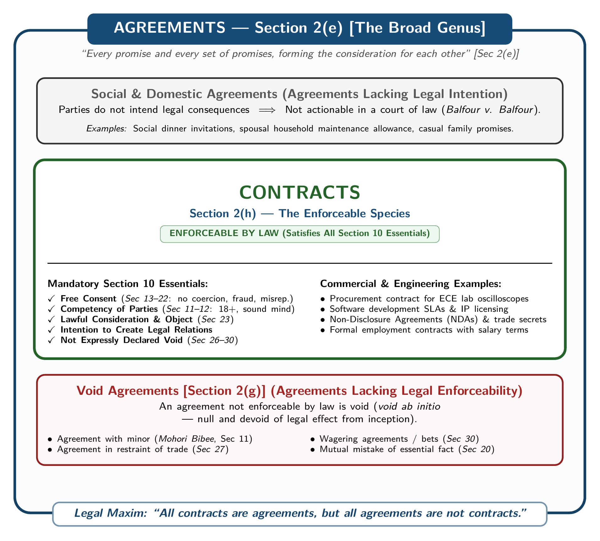

[← Previous: L01.3: Why ECE Students Must Learn Law](L01.3_Why_ECE_Students_Must_Learn_Law.md) | [🏠 Index](00_Index.md) | [Next: L02.2: Essential Elements of a Valid Contract →](L02.2_Essential_Elements_of_Valid_Contract.md)

---

# L02.1: Contract, Agreement, Void, and Voidable

> **Section:** Section A (CO1 · Legal Issues · Shoaib Islam Sir) | **Priority:** 🔴 Critical | **Exam Frequency:** 2024 Q.2(a) (02m), 2023 Q.3(a) (02m), High-Yield Ch. 2 Suggestion  
> **Subtopics Covered:** `L02.1` (Contract `Sec 2(h)`, Agreement `Sec 2(e)`, Maxim "All contracts are agreements, but all agreements are not contracts"), `L02.2` (Void Agreement `Sec 2(g)`, `Sec 26–30` vs. Voidable Contract `Sec 2(i)`)  
> **Sources:** SI Sir Notes (`Chapter-2.md`), SI Sir Slides (`Chapter-2slide.md`), Raidah Class Notes (SI Class 2 & Suggestions), `PreviousYearQuestions/2023.md`, `PreviousYearQuestions/2024.md`

## Why This Topic Matters

Shoaib Sir tests definitions and legal distinctions directly. This topic appeared in the 2024 Final as a 2-mark question. It also appeared in the 2023 Final as a 2-mark question.

Shoaib Sir grades legal scripts strictly. If you write the wrong section number, you lose marks at once. If you quote the exact section numbers and give clear examples, you can score full marks.

---

## 📝 Key Definitions

The **Contract Act, 1872** provides a clear ladder of definitions in Section 2. Learn these statutory definitions word for word:

> **Proposal / Offer [Section 2(a)]:** "When one person signifies to another his willingness to do or to abstain from doing anything, with a view to obtaining the assent of that other to such act or abstinence, he is said to make a proposal."

An offer is an expression of readiness to make a deal. It seeks the agreement of the other party.

> **Promise / Acceptance [Section 2(b)]:** "When the person to whom the proposal is made signifies his assent thereto, the proposal is said to be accepted. A proposal, when accepted, becomes a promise."

Acceptance occurs when the offeree agrees to the proposal. Once accepted, the proposal turns into a binding promise.

> **Promisor and Promisee [Section 2(c)]:** "The person making the proposal is called the 'promisor', and the person accepting the proposal is called the 'promisee'."

The promisor makes the proposal. The promisee accepts it.

> **Consideration [Section 2(d)]:** "When, at the desire of the promisor, the promisee or any other person has done or abstained from doing, or does or abstains from doing, or promises to do or to abstain from doing, something, such act or abstinence or promise is called a consideration for the promise."

Consideration is the price paid for a promise. Both parties must exchange something of value.

> **Agreement [Section 2(e)]:** "Every promise and every set of promises, forming the consideration for each other, is an agreement."

An agreement forms when parties exchange mutual promises backed by consideration.

> **Reciprocal Promises [Section 2(f)]:** "Promises which form the consideration or part of the consideration for each other are called reciprocal promises."

In reciprocal promises, each party promises to perform an act or provide consideration to the other.

> **Void Agreement [Section 2(g)]:** "An agreement not enforceable by law is said to be void."

A void agreement has no legal effect. It gives no rights and creates no duties.

> **Contract [Section 2(h)]:** "An agreement enforceable by law is a contract."

A contract requires two parts: an underlying agreement and legal enforceability by courts.

$$
\text{Contract} = \text{Agreement} + \text{Legal Enforceability}
$$

> **Voidable Contract [Section 2(i)]:** "An agreement which is enforceable by law at the option of one or more of the parties thereto, but not at the option of the other or others, is a voidable contract."

A voidable contract remains valid until the injured party chooses to cancel it.

---

## Jurist Definitions of Contract

Besides Section 2(h), two famous jurist definitions are often quoted in class and exam scripts:

1. **According to Salmond:**
   "A contract is an agreement creating and defining obligations between the parties."

2. **According to Sir William Anson:**
   "A contract is an agreement enforceable at law made between two or more persons, by which rights are acquired by one or more to acts or forbearances on the part of the other or others."

Both jurists highlight the same core idea. A contract creates legal obligations that the courts will enforce.

---

> [!tip] Memory Hook: The Section 2 Definition Ladder
> Remember the statutory chain in natural order:
>
> `Sec 2(a) Offer` → `2(b) Promise` → `2(c) Parties` → `2(d) Consideration` → `2(e) Agreement` → `2(f) Reciprocal Promises` → `2(g) Void` / `2(h) Contract` / `2(i) Voidable`
>
> **The 7-Step Story Flow:**
> 1. `2(a)` **Offer:** Party A proposes a deal to Party B.
> 2. `2(b)` **Promise:** Party B accepts the proposal.
> 3. `2(c)` **Parties:** Party A is the promisor; Party B is the promisee.
> 4. `2(d)` **Consideration:** Both sides exchange value (*quid pro quo*).
> 5. `2(e)` **Agreement:** The mutual promises create an agreement.
> 6. `2(f)` **Reciprocal Promises:** Both parties promise mutual performance.
> 7. **The Three Legal Endings:**
>    - `2(g)` **Void Agreement:** Law refuses to enforce it from day one.
>    - `2(h)` **Contract:** Law enforces it in court.
>    - `2(i)` **Voidable Contract:** Law allows the victim to cancel or uphold it.

---

## Core Legal Maxim: Contracts vs. Agreements

The foundational maxim of contract law states:

> **"All contracts are agreements, but all agreements are not contracts."**

This statement explains the legal relationship between agreements and contracts under the Contract Act, 1872. Agreement is the broad genus. Contract is the narrower species.

*Figure 1: Scope Relationship of Agreements and Contracts (Source: Contract Act 1872, Sec 2 & 10)*

### 1. All Contracts Are Agreements

Every contract begins as an agreement. Under Section 2(h), a contract is an agreement enforceable by law.

Before parties can have a contract, they must reach an agreement. One party must make an offer. The other party must accept it. They must exchange consideration.

Without an underlying agreement, no contract can exist. Therefore, every contract is an agreement.

### 2. All Agreements Are Not Contracts

An agreement becomes a contract only when it is enforceable by law. To be enforceable, it must satisfy all essential elements of Section 10.

Many agreements fail to meet these requirements. Such agreements never become contracts:

1. **Social and Domestic Agreements:**
   Parties in social or family settings rarely intend to create legal consequences.
   - *Example:* A invites B to dinner. B accepts the invitation. A fails to prepare dinner. B cannot sue A for damages. The parties never intended legal ties (*Balfour v. Balfour*).

2. **Agreements Lacking Free Consent:**
   Agreements caused by coercion, undue influence, fraud, or misrepresentation lack genuine consent. They do not form valid contracts.

3. **Agreements Lacking Competent Parties:**
   A minor cannot enter into a contract. Any agreement with a minor is void from the start (*Mohori Bibee v. Dharmodas Ghose*).

4. **Agreements Expressly Declared Void:**
   The Contract Act expressly bans certain agreements under Sections 26 to 30. An agreement to stop someone from trading or marrying is void. The court will not enforce it.

### 3. Concrete Examples

- **Agreement only (Not a contract):**
  Rahim invites Karim to watch a cricket match. Karim accepts. Rahim buys snacks, but Karim does not turn up. Rahim cannot sue Karim in court. This is a purely social agreement. It lacks legal intent.

- **Agreement and a valid contract:**
  Rahim agrees in writing to sell an oscilloscope to Karim for Tk 50,000. Karim accepts and pays the money. This agreement creates a legal obligation. If Rahim fails to deliver the oscilloscope, Karim can sue Rahim in court. This agreement is a contract.

---

## Comparison: Agreement vs. Contract

| Parameter | Agreement | Contract |
| :--- | :--- | :--- |
| **Statutory Section** | Defined under **Section 2(e)**. | Defined under **Section 2(h)**. |
| **Core Definition** | Every promise and set of promises forming consideration for each other. | An agreement enforceable by law. |
| **Scope** | Broader scope. Covers social, domestic, and legal promises. | Narrower scope. Limited only to legally binding agreements. |
| **Legal Enforceability** | May or may not be enforceable in court. | Always enforceable by law in court. |
| **Legal Obligation** | Does not always create a legal duty. | Always creates binding legal duties. |
| **Core Elements** | $\text{Offer} + \text{Acceptance}$. | $\text{Agreement} + \text{Legal Enforceability (Section 10)}$. |
| **Court Remedy** | Breach gives no legal remedy if social. | Breach entitles the injured party to sue for damages. |

---

## Void Agreement vs. Voidable Contract

An agreement that fails to satisfy the essential elements of a contract may become void or voidable.

### 1. Void Agreement [Section 2(g)]

Under Section 2(g), an agreement not enforceable by law is said to be void.

- **Void from the start (*void ab initio*):**
  A void agreement has no legal existence from the moment it is made. The law treats it as if it never existed.
- **No legal rights or duties:**
  Neither party acquires any legal rights. Neither party owes any legal duties.
- **No court remedy:**
  No court will enforce a void agreement. If broken, neither party can sue for breach.

#### Five Agreements Expressly Declared Void (Sections 26 to 30)

The Contract Act expressly declares five types of agreements void:

1. **Agreement in Restraint of Marriage [Section 26]:**
   Every agreement in restraint of the marriage of any person, other than a minor, is void. The law protects personal freedom of marriage.

2. **Agreement in Restraint of Trade [Section 27]:**
   Every agreement that restrains anyone from exercising a lawful profession, trade, or business is void. The law protects the right to earn a living.

3. **Agreement in Restraint of Legal Proceedings [Section 28]:**
   Agreements that bar a party from enforcing their rights in court, or that limit the time to sue, are void.

4. **Agreements Void for Uncertainty [Section 29]:**
   Agreements whose meaning is not certain, or cannot be made certain, are void.
   - *Example:* X agrees to sell "100 tons of oil" to Y. Nothing shows what kind of oil is meant. The agreement is void for uncertainty.

5. **Agreements by Way of Wager [Section 30]:**
   Agreements based on gambling, betting, or wagering are void. No suit can be brought to recover money won on a wager.

#### Other Void Agreements in the Act

- **Agreements by incompetent parties [Section 11]:**
  Agreements made by minors or persons of unsound mind are void *ab initio*.
- **Agreements without consideration [Section 25]:**
  Agreements made without consideration are void, subject to narrow statutory exceptions.
- **Agreements with unlawful object or consideration [Sections 23 and 24]:**
  Agreements for illegal, immoral, or fraudulent purposes are void.
- **Agreements to do an impossible act [Section 56(1)]:**
  An agreement to perform an impossible act is void from the start.

#### Agreements That Become Void [Section 56(2)]

An agreement may be valid when made. But it may become void later due to:
- Supervening impossibility (destruction of subject matter).
- Change of law.
- Outbreak of war.

When it becomes void, it ceases to have legal effect from that moment.

---

### 2. Voidable Contract [Section 2(i)]

Section 2(i) defines a voidable contract. One party can enforce or cancel it, while the other party cannot.

- **Valid until cancelled:**
  A voidable contract is not void from the start. It is a valid, binding contract when made. It stays valid until the injured party sets it aside.
- **Option of the aggrieved party:**
  Only the injured party has the legal right to cancel the contract. The guilty party cannot cancel it.
- **Right to affirm:**
  The injured party can also choose to affirm the contract and insist on performance.

#### Common Grounds for Voidable Contracts

A contract becomes voidable when free consent is missing:
1. **Coercion [Section 15]:** Threatening unlawful acts or property detention (makes contract voidable under Section 19).
2. **Undue Influence [Section 16]:** Dominating the will of a weaker party (makes contract voidable under Section 19A).
3. **Fraud [Section 17]:** Deceiving the other party intentionally (makes contract voidable under Section 19).
4. **Misrepresentation [Section 18]:** Making an innocent false statement (makes contract voidable under Section 19).

#### Practical Example of a Voidable Contract

Mr. X threatens to hurt Mr. Y unless Mr. Y sells his car to Mr. X for Tk 10,000. Mr. Y signs the sale agreement under threat.

This agreement is a voidable contract under Section 19:
- Mr. Y is the aggrieved party. He can go to court and have the contract cancelled.
- If Mr. Y prefers to keep the Tk 10,000, he can affirm the contract.
- Mr. X is the guilty party. Mr. X cannot cancel the contract or enforce it against Mr. Y's will.

---

> [!tip] Memory Hook: 5 Expressly Void Agreements (M-T-L-U-W)
> Remember the 5 expressly void agreements under Sections 26 to 30:
>
> *"**M**any **T**raders **L**ose **U**nder **W**agers."*
>
> 1. **M**arriage restraint (`Sec 26`)
> 2. **T**rade restraint (`Sec 27`)
> 3. **L**egal proceedings restraint (`Sec 28`)
> 4. **U**ncertainty (`Sec 29`)
> 5. **W**agering agreements (`Sec 30`)

---

> [!tip] Memory Hook: 4 Vices of Free Consent (C-U-F-M)
> Consent is not free when tainted by:
>
> 1. **C**oercion (`Sec 15`)
> 2. **U**ndue influence (`Sec 16`)
> 3. **F**raud (`Sec 17`)
> 4. **M**isrepresentation (`Sec 18`)
>
> All four vices make the contract **voidable** at the option of the victim (`Sec 19, 19A`).

---

## Comparison: Void Agreement vs. Voidable Contract

| Comparison Basis | Void Agreement [Section 2(g)] | Voidable Contract [Section 2(i)] |
| :--- | :--- | :--- |
| **Statutory Definition** | An agreement not enforceable by law. | An agreement enforceable at the option of one party only. |
| **Validity at Inception** | Null from the start (*void ab initio*). | Valid and binding when made. |
| **Enforceability** | Cannot be enforced by either party. | Enforceable by the aggrieved party only. |
| **Cause / Defect** | Lacks an essential element, such as capacity or legal object. | Free consent of one party is absent (coercion, fraud, etc.). |
| **Third-Party Rights** | A third party acquires no rights or title. | A bona fide buyer acquires good title before rescission. |
| **Effect of Lapse of Time** | Time never makes a void agreement valid. | If the victim does not cancel within reasonable time, it stays valid. |
| **Right to Damages** | Neither party can claim damages for breach. | Aggrieved party can rescind and claim compensation under Section 75. |

---

## Exam Variants

| Year / Source | Question / Scenario | Marks | Key Focus / Result |
| :--- | :--- | :---: | :--- |
| **2024 Final Q.2(a)** | Define contract and agreement | 02 | Quote `Sec 2(h)` and `Sec 2(e)` verbatim. |
| **2023 Final Q.3(a)** | Define void and voidable agreement | 02 | Quote `Sec 2(g)` and `Sec 2(i)`. Explain void *ab initio* vs. option of victim. |
| **Model Question 1** | Explain maxim: "All contracts are agreements, but all agreements are not contracts" | 04 | Two-part breakdown with Section 10 filter and dinner vs. sale example. |
| **Model Question 2** | Distinguish between an agreement and a contract | 04 | 5-point comparison table covering sections, scope, and enforceability. |
| **Model Question 3** | State five agreements expressly declared void under Contract Act | 04 | Sections 26 to 30 (`M-T-L-U-W` checklist with short examples). |

---

## 🏆 Golden Questions (Past Exam Archive & Model Answers)

### 🎯 GQ1 · 2024 Final Q.2(a) · Definitions of Contract and Agreement (02 Marks)

> **Appeared:** 2024 Final Exam · Question 2(a) (Section A · CO1) · (02 Marks)

**Question:**  
Define contract and agreement.

**Full Answer:**  
Under the **Contract Act, 1872**, these two terms are defined as follows:

1. **Agreement [Section 2(e)]:**  
   "Every promise and every set of promises, forming the consideration for each other, is an agreement."  
   An agreement forms when one party makes an offer and the other party accepts it, backed by reciprocal consideration.

2. **Contract [Section 2(h)]:**  
   "An agreement enforceable by law is a contract."  
   A contract requires two essential components: an underlying agreement and legal enforceability by courts.

$$
\text{Contract} = \text{Agreement} + \text{Legal Enforceability}
$$

---

### 🎯 GQ2 · 2023 Final Q.3(a) · Definitions of Void and Voidable Agreement (02 Marks)

> **Appeared:** 2023 Final Exam · Question 3(a) (Section A · CO1) · (02 Marks)

**Question:**  
Define void and voidable agreement.

**Full Answer:**  
Under the **Contract Act, 1872**, these two concepts are defined as follows:

1. **Void Agreement [Section 2(g)]:**  
   "An agreement not enforceable by law is said to be void."  
   A void agreement is void from the start (*void ab initio*). It creates no legal rights and imposes no obligations on either party. Examples include agreements with minors (**Section 11**) and agreements in restraint of trade (**Section 27**).

2. **Voidable Contract [Section 2(i)]:**  
   "An agreement which is enforceable by law at the option of one or more of the parties thereto, but not at the option of the other or others, is a voidable contract."  
   *(Note: The Act uses the term "voidable contract" rather than "voidable agreement").*  
   A voidable contract remains valid and binding until cancelled by the aggrieved party. It occurs when free consent is missing. This happens in cases of coercion, undue influence, fraud, or misrepresentation (Sections 15–18).

---

### 🎯 GQ3 · Model Exam Question · The Foundational Contract Maxim (04 Marks)

> **Appeared:** Prescribed High-Yield Exam Question (Chapter 2) · (04 Marks)

**Question:**  
"All contracts are agreements, but all agreements are not contracts." Explain this statement with examples and distinguish between an agreement and a contract.

**Full Answer:**  
The statement explains the legal relationship between agreements and contracts under the **Contract Act, 1872**. Agreement is the broad group. Contract is the narrower legal class.

1. **All contracts are agreements:**  
   Every contract begins as an agreement. Under **Section 2(h)**, a contract is an agreement enforceable by law. Parties must first exchange an offer and an acceptance under **Section 2(e)**. Without an underlying agreement, no contract can exist.

2. **All agreements are not contracts:**  
   An agreement becomes a contract only if it meets all conditions of **Section 10**. Agreements that lack legal enforceability never become contracts:
   - **Social or domestic agreements:** An invitation to dinner creates no legal ties. If broken, neither party can sue.
   - **Agreements lacking capacity:** Minors cannot contract. Any deal with a minor is void from the start (*void ab initio*).
   - **Agreements expressly declared void:** The law bars certain deals. Agreements in restraint of trade (**Section 27**) and wagers (**Section 30**) cannot be enforced in court.

3. **Illustrative Examples:**
   - *Agreement, not a contract:* Rahim invites Karim to dinner. Karim accepts. Rahim fails to serve dinner. Karim cannot sue Rahim. The parties never intended legal consequences.
   - *Agreement and a contract:* Rahim agrees in writing to sell an oscilloscope to Karim for Tk 50,000. Karim pays the price. A valid commercial obligation exists. A court will enforce it.

| Comparison Parameter | Agreement | Contract |
| :--- | :--- | :--- |
| **Statutory Definition** | Defined under **Section 2(e)**. | Defined under **Section 2(h)**. |
| **Scope** | Broader scope. Covers social, domestic, and commercial promises. | Narrower scope. Limited only to legally binding agreements. |
| **Legal Enforceability** | May or may not be enforceable in court. | Always enforceable by law. |
| **Legal Obligation** | Does not always create a legal duty. | Always creates binding legal duties. |
| **Constituents** | $\text{Offer} + \text{Acceptance}$. | $\text{Agreement} + \text{Legal Enforceability (Section 10)}$. |

---

### 🎯 GQ4 · Model Exam Question · Expressly Void Agreements (04 Marks)

> **Appeared:** Prescribed Model Question (Contract Act, 1872) · (04 Marks)

**Question:**  
Enumerate five classes of agreements that are expressly declared void under the Contract Act, 1872.

**Full Answer:**  
Under the **Contract Act, 1872**, Sections 26 to 30 specify five classes of agreements that are expressly declared void. Even if they meet other requirements, courts will not enforce them:

1. **Agreement in Restraint of Marriage [Section 26]:**  
   Every agreement in restraint of the marriage of any person, other than a minor, is void. The law guarantees individual freedom to marry.

2. **Agreement in Restraint of Trade [Section 27]:**  
   Agreements that stop anyone from exercising a lawful profession, trade, or business are void.

3. **Agreement in Restraint of Legal Proceedings [Section 28]:**  
   Agreements that prevent a party from enforcing their rights in court are void. Agreements that limit the statutory time to sue are also void.

4. **Agreements Void for Uncertainty [Section 29]:**  
   Agreements whose terms are not certain, or cannot be made certain, are void. A contract must be definite so that courts can enforce the true intent.

5. **Agreements by Way of Wager [Section 30]:**  
   Agreements by way of wager (betting on uncertain future events) are void. No court suit can be brought to claim any winnings.

---

## ⚡ Exam Tips & Common Mistakes

1. **Always cite section numbers:** Shoaib Sir looks for exact sections. Cite Section 2(e) for agreement, 2(h) for contract, 2(g) for void agreement, and 2(i) for voidable contract.
2. **Use the phrase "voidable contract":** The Contract Act uses the exact phrase "voidable contract" in Section 2(i), not "voidable agreement". Pointing this out shows deep knowledge.
3. **Do not confuse void and voidable:** A void agreement is dead from day one (*void ab initio*). A voidable contract is alive and valid until the injured party cancels it.
4. **Remember the formula:** Always write $\text{Contract} = \text{Agreement} + \text{Legal Enforceability}$ to secure easy visual marks.
5. **Use two contrasting examples for the maxim:** Give one social example (dinner invite). Give one commercial example (sale of goods).

---

## 🔗 Related Topics

- [L01.3: Why ECE Students Must Learn Law](L01.3_Why_ECE_Students_Must_Learn_Law.md)
- [L02.2: Essential Elements of a Valid Contract](L02.2_Essential_Elements_of_Valid_Contract.md)
- [L02.3: Offer and Acceptance Rules](L02.3_Offer_and_Acceptance_Rules.md)
- [L03.1: Consideration Definition, Types, and Rules](L03.1_Consideration_Definition_Types_and_Rules.md)

---

[← Previous: L01.3: Why ECE Students Must Learn Law](L01.3_Why_ECE_Students_Must_Learn_Law.md) | [🏠 Index](00_Index.md) | [Next: L02.2: Essential Elements of a Valid Contract →](L02.2_Essential_Elements_of_Valid_Contract.md)
