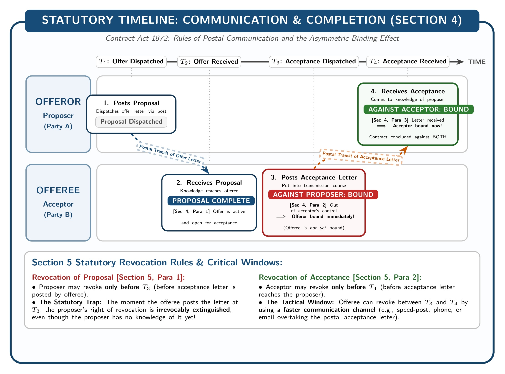

[← Previous: L02.2: Essential Elements of a Valid Contract](L02.2_Essential_Elements_of_Valid_Contract.md) | [🏠 Index](00_Index.md) | [Next: L02.4: Applied ECE Tenders and R&D Contract Risks →](L02.4_Applied_ECE_Tenders_and_RD_Contract_Risks.md)

---

# L02.3: Offer and Acceptance Rules

> **Section:** Section A (CO1 · Legal Issues · Shoaib Islam Sir) | **Priority:** 🔴 Critical | **Exam Frequency:** 2024 Q.6(a) (02m), 2025 Law-CT1 Q.2 (10m), Model Q (04m)  
> **Subtopics Covered:** `L02.4` (Proposal/Offer `Sec 2(a)`, Acceptance/Promise `Sec 2(b)`, Promisor/Promisee `Sec 2(c)`), `L02.5` (Rules & legal significance of valid Offer: express/implied `Sec 9`, specific vs general offer *Carlill*, offer vs invitation to offer, communication `Sec 4`, revocation `Sec 5–6`), `L02.6` (Rules regarding valid Acceptance: absolute & unqualified `Sec 7(1)`, usual & reasonable manner `Sec 7(2)`, acceptance by performing conditions `Sec 8`, silence is not acceptance)  
> **Sources:** SI Sir Notes (`Chapter-2.md`), SI Sir Slides (`Chapter-2slide.md`), Raidah Class Notes (SI Class 2 & Suggestions), `PreviousYearQuestions/CT_questions.md` (§3), `PreviousYearQuestions/2024.md`

## Why This Topic Matters

Every contract begins with a valid offer and acceptance. In the 2025 Class Test, Shoaib Sir set a 10-mark question on this exact topic. It also appeared in the 2024 Final as a 2-mark question.

Contract formation follows strict statutory rules. If an acceptance adds a new condition, it destroys the offer. If a letter is posted, the offeror is bound at once. Knowing these rules helps you score full marks.

---

## 📝 Key Definitions

Under the **Contract Act, 1872**, contract formation rests on three core statutory definitions:

> **Proposal / Offer [Section 2(a)]:** "When one person signifies to another his willingness to do or to abstain from doing anything, with a view to obtaining the assent of that other to such act or abstinence, he is said to make a proposal."

An offer shows a clear willingness to make a contract. The offeror wants to obtain the assent of the other party.

> **Acceptance / Promise [Section 2(b)]:** "When the person to whom the proposal is made signifies his assent thereto, the proposal is said to be accepted. A proposal, when accepted, becomes a promise."

When the offeree agrees to the proposal, acceptance takes place. An accepted proposal becomes a legally binding promise.

> **Promisor and Promisee [Section 2(c)]:** "The person making the proposal is called the 'promisor', and the person accepting the proposal is called the 'promisee'."

The party who makes the offer is the promisor or offeror. The party who accepts it is the promisee or acceptor.

---

## Legal Significance of Offer and Acceptance

Offer and acceptance bring the two parties into mutual agreement (*consensus ad idem*). They mark the exact second a binding contract comes to life.

English legal scholar Sir William Anson described this moment with a famous metaphor:

> "Acceptance is to an offer what a lighted match is to a train of gunpowder. It produces something which cannot be undone or recalled."

This classic statement highlights three key legal principles:

1. **Before Acceptance (The Powder Train):**
   An open offer is like a loose train of gunpowder. It has no explosive force on its own. The offeror can revoke it at any time before acceptance.
2. **The Act of Acceptance (The Lighted Match):**
   Acceptance is the match that ignites the powder. The instant the match touches the powder, an explosion takes place.
3. **After Acceptance (The Irrevocable Result):**
   Once acceptance is complete, the proposal becomes an irrevocable promise. Neither party can withdraw without facing legal breach and paying damages.

---

> [!tip] Memory Hook: Gunpowder and the Lighted Match
> - **Gunpowder Train:** An open offer (`Sec 2(a)`). It can be removed or blown away at any time.
> - **Lighted Match:** Unqualified acceptance (`Sec 2(b), 7(1)`).
> - **The Explosion:** A binding contract (`Sec 2(h)`). It cannot be recalled without legal liability.

---

## Rules Regarding a Valid Offer

The Contract Act lays down eight fundamental legal rules for a valid offer:

### 1. An Offer May Be Express or Implied [Section 9]
An offer may be made in two ways:
- **Express Offer:** Made by words, either spoken or written. For example, Rahim writes to Karim: "Will you buy my laptop for Tk 30,000?"
- **Implied Offer:** Made by conduct rather than words. For example, a public bus runs along a regular route. This acts as an implied offer to carry passengers at the standard fare. Getting onto the bus acts as acceptance.

Section 9 confirms:
> "In so far as the proposal or acceptance of any promise is made in words, the promise is said to be express. In so far as such proposal or acceptance is made otherwise than in words, the promise is said to be implied."

### 2. An Offer May Be Specific or General
An offer can be addressed to different targets:
- **Specific Offer:** Made to a definite person or a specific group. Only that person or group can accept it.
  - *Example:* A offers to sell his car to B for Tk 500,000. Only B can accept.
- **General Offer:** Made to the whole world or the public at large. Any person who learns of the offer and performs its conditions can accept it.
  - *Landmark Case:* In *Carlill v. Carbolic Smoke Ball Co. (1893)*, a company advertised a reward of £100 to anyone who contracted influenza after using their smoke ball as directed. Mrs. Carlill used the ball and still caught the flu. The court held that the advertisement was a general offer to the world. By using the product, Mrs. Carlill accepted the offer and was entitled to the £100 reward.

### 3. An Offer Must Intend to Create Legal Relations
The offer must contemplate legal consequences. An invitation to a dinner party or a social game creates no legal duties. If broken, the host cannot be sued.

### 4. Terms Must Be Certain, Definite, and Unambiguous [Section 29]
The terms of the offer cannot be vague. Under Section 29, uncertain agreements are void.
- *Example:* X tells Y: "I will pay you some cash if you marry Z." This offer is void because the amount is uncertain.

### 5. An Offer Differs from an Invitation to Offer (Invitation to Treat)
An offer must be distinguished from an invitation to receive offers.
- Price tags in a shop window, goods on display, sales catalogues, and newspaper advertisements are not offers. They are invitations to treat.
- In an auction sale, displaying goods invites bids. Each bid is an offer. The fall of the hammer signifies acceptance by the auctioneer.
- In engineering tenders, a tender advertisement or RFP invites bids. Submitting a bid is the legal offer.

### 6. An Offer Must Be Communicated to the Offeree [Section 4]
A person cannot accept an offer without knowing it exists.
- In *Lalman Shukla v. Gauri Datt (1913)*, a master sent his servant to find his missing nephew. Later, the master announced a cash reward for information. The servant found the boy without knowing about the reward. The court held that the servant could not claim the reward. He acted in ignorance of the offer, so no contract existed.

### 7. An Offer May Be Conditional
The offeror may attach conditions to the offer. But those conditions must be clearly communicated to the offeree. If the conditions are printed on the document in a standard way, the offeree is bound by them.

### 8. Protection in Printed Standard Form Contracts
Large organizations often use printed standard contracts with complex exemption clauses. Examples include railways, banks, and insurance companies. Courts protect consumers by requiring prominent notices of unreasonable exclusion clauses.

---

## Comparison: Offer vs. Invitation to Offer (Invitation to Treat)

| Comparison Basis | Offer (Proposal) [Section 2(a)] | Invitation to Offer (Invitation to Treat) |
| :--- | :--- | :--- |
| **Meaning** | Final expression of willingness to be bound on stated terms. | An invitation to the other party to come and make an offer. |
| **Intention** | Intends to obtain the immediate assent of the other party. | Intends to start negotiations or gather bids from customers. |
| **Legal Consequence** | Once accepted, it turns into a binding contract immediately. | Acceptance of an invitation creates only an offer, not a contract. |
| **Sequence** | The second stage in negotiations, made in response to an invitation. | The initial stage before an actual legal offer is made. |
| **Examples** | Submitting a priced tender bid; bidding at an auction; taking items to the cash counter. | Shop display of goods with price tags; company catalogues; tender notice / RFP. |

---

## Rules Regarding a Valid Acceptance

Under the Contract Act, 1872, acceptance turns an offer into a binding promise [Section 2(b)]. A valid acceptance must satisfy these legal rules:

### 1. Acceptance Must Be Absolute and Unqualified [Section 7(1)]
Acceptance must conform strictly to all terms of the offer without any change (the "mirror image" rule).
- If the offeree varies the terms, it is not an acceptance. It is a **counter-offer**.
- A counter-offer cancels and destroys the original offer.
- *Example:* X offers to sell his house to Y for Tk 1,200,000. Y replies: "I accept for Tk 1,000,000." Y's reply is a counter-offer. The original offer is dead. Y cannot accept the original price later unless X agrees.

### 2. Expressed in a Usual and Reasonable Manner [Section 7(2)]
Acceptance must be communicated in the usual way: by post, email, phone, or in person.
- If the offeror prescribes a specific mode (e.g. "reply by registered post"), the offeree must use that mode.
- If the offeree uses a different mode, the offeror can insist on the prescribed mode within a reasonable time.
- If the offeror fails to insist, he is deemed to have accepted the response (statutory waiver).

### 3. Acceptance by Performance of Conditions [Section 8]
Under Section 8, performing the conditions of a proposal counts as valid acceptance.
> "Performance of the conditions of a proposal, or the acceptance of any consideration for a reciprocal promise which may be offered with a proposal, is an acceptance of the proposal."

In general offers to the public, the offeree does not need to send advance notice. Performing the required act completes the contract (*Carlill v. Carbolic Smoke Ball Co.*).

### 4. Acceptance Must Be Communicated
Mental agreement alone does not create a contract. The offeree must actively communicate assent to the offeror.
- **Silence Is Not Acceptance:** Silence does not create a contract. An offeror cannot say: "If I hear nothing in seven days, the car is sold." Mental assent alone creates no contract (*Felthouse v. Bindley*).

### 5. By Whom Accepted
- A specific offer can be accepted only by the person to whom it was made.
  - In *Boulton v. Jones (1857)*, Jones sent an order to Brocklehurst. Boulton had taken over the business and fulfilled the order. Jones refused to pay. The court held that no contract existed because Jones never made an offer to Boulton.
- A general offer can be accepted by any member of the public who fulfills the terms.

### 6. Time of Acceptance
Acceptance must be given within the time set by the offeror. If no time is set, it must be given within a reasonable time. What is reasonable depends on the nature of the transaction. For perishable goods, a reasonable time is very short.

### 7. Acceptance Must Precede Revocation or Lapse
An acceptance must be made while the offer is still alive. Once an offer lapses or is revoked, it cannot be accepted.

---

## Communication and Revocation Rules (Sections 4, 5, and 6)

Section 4 and Section 5 govern when communication is complete and when an offer or acceptance can be revoked.

*Figure 1: Statutory Timeline of Communication and Completion (Source: Contract Act 1872, Sec 4)*

### 1. When Communication Is Complete [Section 4]
Section 4 creates an asymmetric rule for postal communication:

1. **Communication of Proposal:**
   Complete when it comes to the knowledge of the person to whom it is made.
   - *Example:* A sends an offer letter to B on 1st March. B receives it on 3rd March. The offer is complete on 3rd March.

2. **Communication of Acceptance against the Proposer:**
   Complete as soon as the acceptance is put in transmission out of the power of the acceptor [Section 4].
   - *Key Consequence:* The proposer is bound the moment the letter of acceptance is dropped into the letterbox!

3. **Communication of Acceptance against the Acceptor:**
   Complete only when the letter comes to the knowledge of the proposer [Section 4].
   - *Key Consequence:* The acceptor is bound only when the letter reaches the proposer.

### 2. Revocation of Offer and Acceptance [Section 5]
1. **Revocation of Proposal [Section 5]:**
   "A proposal may be revoked at any time before the communication of its acceptance is complete as against the proposer, but not afterwards."
   - The proposer can revoke until the offeree posts the acceptance letter. Once posted, the proposer is bound.

2. **Revocation of Acceptance [Section 5]:**
   "An acceptance may be revoked at any time before the communication of the acceptance is complete as against the acceptor, but not afterwards."
   - The acceptor can revoke until the letter reaches the proposer. A faster message must overtake the letter.

---

> [!tip] Memory Hook: Asymmetric Mailbox Rule (Section 4)
> - **Proposer is tied first:** Bound the instant the acceptance is **posted**.
> - **Acceptor is tied second:** Bound only when the acceptance is **delivered**.
> - **Window to revoke:** Proposer can revoke before dispatch; acceptor can revoke before arrival.

---

### 3. Four Modes of Offer Lapse [Section 6]

Under Section 6, an open offer lapses and comes to an end in four ways:

1. **By Notice of Revocation [Section 6(1)]:**
   The offeror gives notice of revocation to the offeree before acceptance is complete against him.
2. **By Lapse of Time [Section 6(2)]:**
   The offer lapses when the stated time expires. If no time is stated, it lapses after a reasonable time.
3. **By Failure to Fulfill a Condition Precedent [Section 6(3)]:**
   Some offers require an upfront step, such as paying a deposit. If the offeree fails to perform it, the offer lapses.
4. **By Death or Insanity of the Proposer [Section 6(4)]:**
   The offer lapses if the proposer dies or becomes insane. But the offeree must learn of the death before accepting.

---

> [!tip] Memory Hook: 4 Modes of Offer Lapse (N-T-C-D)
> Remember how an offer dies under Section 6:
>
> 1. **N**otice of revocation (`Sec 6(1)`)
> 2. **T**ime expiry (`Sec 6(2)`)
> 3. **C**ondition precedent unfulfilled (`Sec 6(3)`)
> 4. **D**eath or insanity of offeror (`Sec 6(4)`)

---

## Exam Variants

| Year / Source | Question / Scenario | Marks | Key Focus / Result |
| :--- | :--- | :---: | :--- |
| **2024 Final Q.6(a)** | Define offer and acceptance in a contract | 02 | Quote `Sec 2(a)` and `Sec 2(b)` verbatim with promisor/promisee (`Sec 2(c)`). |
| **2025 Law-CT1 Q.2** | Evaluate legal significance of offer and acceptance in contract formation | 10 | Sir William Anson's gunpowder quote, full offer rules, acceptance rules, and Section 4 postal rules. |
| **Model Question 1** | State statutory rules governing a valid acceptance | 04 | Six rules: mirror image, usual manner, performance under `Sec 8`, communication, time, and lapse. |
| **Model Question 2** | Distinguish between an Offer and an Invitation to Treat | 04 | 5-point comparison table with tender RFP and shop display examples. |
| **2024 Final Q.6(b)** | Apply offer and acceptance rules to an ECE firm bidding for a government project | 04 | Tender notice is an invitation to treat; submitted bid is the legal offer; award letter is acceptance. |

---

## 🏆 Golden Questions (Past Exam Archive & Model Answers)

### 🎯 GQ1 · 2024 Final Q.6(a) · Definitions of Offer and Acceptance (02 Marks)

> **Appeared:** 2024 Final Exam · Question 6(a) (Section B · CO1) · (02 Marks)

**Question:**  
Define the term offer and acceptance in a contract.

**Full Answer:**  
Under the **Contract Act, 1872**, offer and acceptance are defined as follows:

1. **Offer (Proposal) [Section 2(a)]:**  
   "When one person signifies to another his willingness to do or to abstain from doing anything, with a view to obtaining the assent of that other to such act or abstinence, he is said to make a proposal."  
   The person making the proposal is called the **promisor** or **offeror** [**Section 2(c)**].

2. **Acceptance [Section 2(b)]:**  
   "When the person to whom the proposal is made signifies his assent thereto, the proposal is said to be accepted. A proposal, when accepted, becomes a promise."  
   The person accepting the proposal is called the **promisee** or **acceptor** [**Section 2(c)**].

**ECE Example:** An engineer offers to design an embedded IoT telemetry board for Tk 40,000. When the client agrees to the price and scope without condition, the offer becomes a binding promise.

---

### 🎯 GQ2 · 2025 Law-CT1 Q.2 · Legal Significance of Offer and Acceptance (10 Marks)

> **Appeared:** 2025 1st Class Test (23 Series) · Question 2 (CO1 · Shoaib Islam Sir) · (10 Marks)

**Question:**  
Evaluate the legal significance of offer and acceptance in the formation of a valid contract under the Contract Act.

**Full Answer:**  
Offer and acceptance form the starting point of every valid contract under the **Contract Act, 1872**. They establish mutual agreement (*consensus ad idem*). As legal scholar Sir William Anson stated:

> "Acceptance is to an offer what a lighted match is to a train of gunpowder. It produces something which cannot be undone or recalled."

1. **Legal Nature and Significance of an Offer [Section 2(a)]:**  
   An offer shows willingness to contract on definite terms. It invites the assent of the other party.
   - **Legal Significance:** The offer fixes the exact legal boundaries of the transaction. Once accepted without change, the promisor cannot alter any terms.
   - **Offer vs. Invitation to Treat:** An offer differs from an invitation to receive offers. Shop displays, catalogues, and tender notices are invitations to treat. Submitting a bid makes the actual legal offer.
   - **Types of Offer:** Under **Section 9**, an offer may be express in words or implied by conduct. It can be specific to one party or general to the whole world (*Carlill v. Carbolic Smoke Ball Co.*).

2. **Legal Nature and Significance of Acceptance [Section 2(b)]:**  
   Acceptance occurs when the offeree signifies assent to the proposal.
   - **Legal Significance:** Acceptance converts a revocable proposal into an irrevocable legal promise. Before acceptance, neither party has legal obligations. After acceptance, both parties are bound. Any breach entitles the injured party to damages.

3. **Statutory Rules Governing Valid Acceptance:**
   - **Absolute and Unqualified [Section 7(1)]:** Acceptance must match the offer terms exactly. Any counter-offer destroys the original proposal.
   - **Usual and Reasonable Manner [Section 7(2)]:** Acceptance must follow the requested method or normal business practice.
   - **Acceptance by Conduct [Section 8]:** Performing the required conditions counts as valid acceptance. In general offers, prior notice is not required.
   - **Silence Is Not Acceptance:** Silence does not mean assent. The offeree must communicate acceptance.

4. **Rules on Communication and Completion [Section 4]:**  
   The timing of communication fixes when parties become legally bound:
   - **Communication of Proposal:** Complete when it comes to the knowledge of the offeree.
   - **Acceptance against Proposer:** Complete as soon as the letter is posted. The proposer is bound immediately.
   - **Acceptance against Acceptor:** Complete only when the letter reaches the proposer.

5. **Revocation of Offer and Acceptance [Sections 5 and 6]:**
   - **Revocation of Offer:** Allowed at any time before acceptance is posted against the proposer.
   - **Revocation of Acceptance:** Allowed at any time before the acceptance letter reaches the proposer.
   - **Lapse of Offer [Section 6]:** An offer ends by notice, time expiry, unmet conditions, or death of the proposer.

**Conclusion:**  
Offer and acceptance define the exact moment of contract formation. They fix legal jurisdiction, establish rights and duties, and convert voluntary negotiations into enforceable legal contracts.

---

### 🎯 GQ3 · Model Exam Question · Statutory Rules Governing Acceptance (04 Marks)

> **Appeared:** Prescribed High-Yield Model Question (Contract Act, 1872) · (04 Marks)

**Question:**  
State the statutory rules governing a valid acceptance under the Contract Act, 1872.

**Full Answer:**  
Under the **Contract Act, 1872**, acceptance turns an open proposal into a binding promise [**Section 2(b)**]. For an acceptance to be legally valid, it must satisfy the following statutory rules:

1. **Absolute and Unqualified [Section 7(1)]:**  
   Acceptance must match all terms of the offer without variation. A conditional reply acts as a counter-offer and destroys the original proposal.

2. **Usual and Reasonable Manner [Section 7(2)]:**  
   Acceptance must follow the prescribed method. If no method is prescribed, it must follow normal business practice. If a different method is used, the proposer must object promptly, or the acceptance stands.

3. **Performance of Conditions [Section 8]:**  
   Under Section 8, performing the required conditions or accepting the offered consideration amounts to acceptance (*Carlill v. Carbolic Smoke Ball Co.*).

4. **Must Be Communicated:**  
   Mental assent is not enough. The offeree must communicate acceptance to the offeror. Silence does not amount to acceptance.

5. **Rules on Completion [Section 4]:**  
   Acceptance binds the proposer the moment it is posted. But it binds the acceptor only when it reaches the proposer.

6. **Must Precede Revocation or Lapse [Sections 5 and 6]:**  
   Acceptance must be given while the offer is still open. A dead or revoked offer cannot be accepted.

---

### 🎯 GQ4 · Model Exam Question · Offer vs. Invitation to Offer (04 Marks)

> **Appeared:** Prescribed Model Question (Contract Basics) · (04 Marks)

**Question:**  
Distinguish between an Offer and an Invitation to Offer with suitable commercial examples.

**Full Answer:**  
Under the **Contract Act, 1872**, an offer must be distinguished from an invitation to offer (invitation to treat):

1. **Offer [Section 2(a)]:**  
   An offer is a final statement of willingness to contract on definite terms. It is made with the intention that it shall become binding the moment it is accepted by the other party.  
   - *Example:* A contractor submits a priced bid of Tk 2,000,000 to lay fiber optic cable for a telecommunications firm. This bid is a legal offer.

2. **Invitation to Offer:**  
   An invitation to offer is not a final proposal. It invites other parties to come and make offers. The person issuing the invitation does not intend to be bound until they review and accept the offers received.  
   - *Example:* A government agency publishes a Request for Proposals (RFP) in a national daily. The tender notice is an invitation to offer.

| Comparison Parameter | Offer [Section 2(a)] | Invitation to Offer |
| :--- | :--- | :--- |
| **Nature** | Definite proposal to enter into a contract. | Preliminary circulation of terms to invite proposals. |
| **Intention** | Intends to obtain the immediate assent of the offeree. | Intends to invite negotiations or gather offers. |
| **Legal Effect** | Acceptance forms a binding contract immediately. | Response forms an offer; no contract is formed yet. |
| **Sequence** | Precedes contract formation directly. | Precedes the making of the offer. |
| **Examples** | Bidding at an auction; bringing items to a cash desk. | Goods on display; catalogues; tender advertisements. |

---

## ⚡ Exam Tips & Common Mistakes

1. **Always cite Sir William Anson's quote in 10-mark questions:** The match and gunpowder train metaphor is expected by Shoaib Sir. It illustrates the irrevocable nature of acceptance.
2. **Remember the postal asymmetry under Section 4:** The proposer is bound on dispatch when the letter is posted. The acceptor is bound on receipt when the letter arrives.
3. **Counter-offer destroys the original offer:** Never say that a counter-offer modifies the contract. A counter-offer cancels the original proposal completely under Section 7(1).
4. **Silence is not acceptance:** Always cite the rule that an offeror cannot impose a condition that silence means acceptance.
5. **Differentiate tender notices from bids:** Remember that an advertisement for tenders is an invitation to treat. The bid submitted by the contractor is the actual legal offer.

---

## 🔗 Related Topics

- [L02.1: Contract, Agreement, Void, and Voidable](L02.1_Contract_Agreement_Void_and_Voidable.md)
- [L02.2: Essential Elements of a Valid Contract](L02.2_Essential_Elements_of_Valid_Contract.md)
- [L02.4: Applied ECE Tenders and R&D Contract Risks](L02.4_Applied_ECE_Tenders_and_RD_Contract_Risks.md)
- [L03.1: Consideration Definition, Types, and Rules](L03.1_Consideration_Definition_Types_and_Rules.md)

---

[← Previous: L02.2: Essential Elements of a Valid Contract](L02.2_Essential_Elements_of_Valid_Contract.md) | [🏠 Index](00_Index.md) | [Next: L02.4: Applied ECE Tenders and R&D Contract Risks →](L02.4_Applied_ECE_Tenders_and_RD_Contract_Risks.md)
