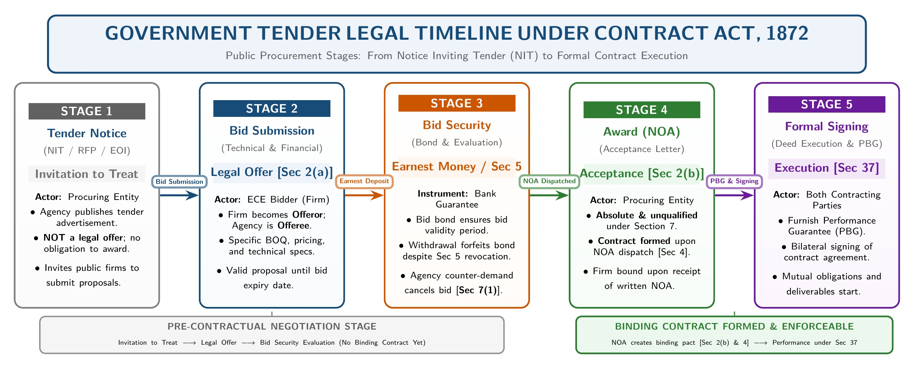
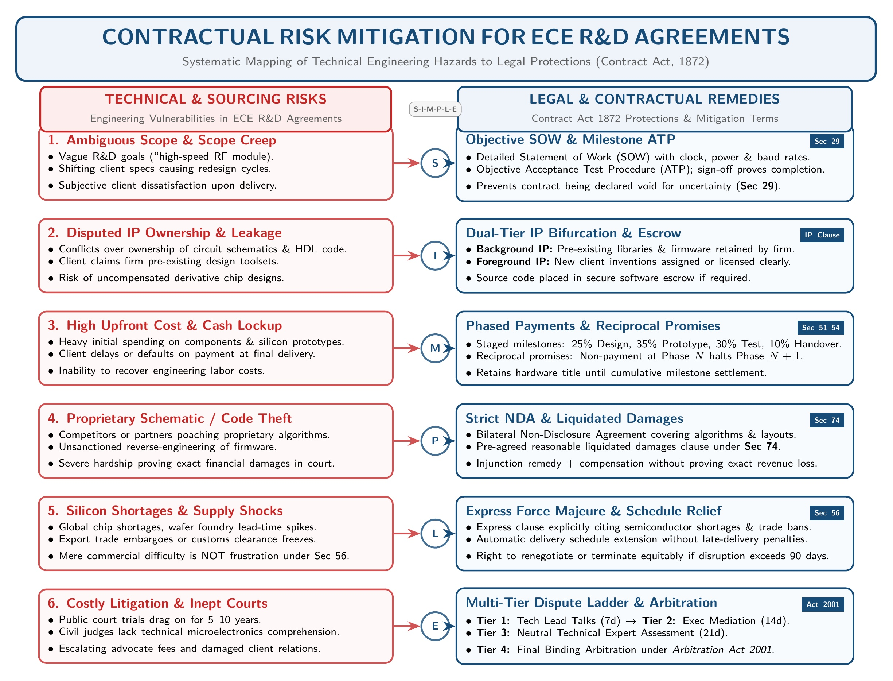
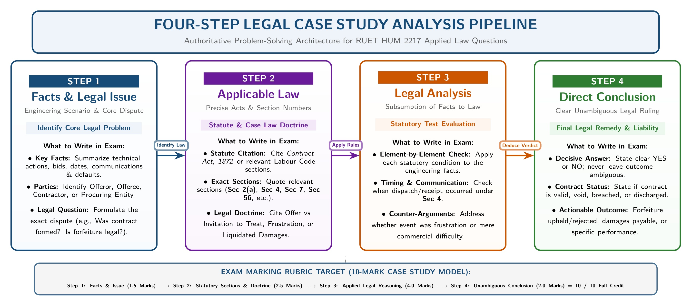

[← Previous: L02.3: Offer and Acceptance Rules](L02.3_Offer_and_Acceptance_Rules.md) | [🏠 Index](00_Index.md) | [Next: L03.1: Consideration Definition, Types, and Rules →](L03.1_Consideration_Definition_Types_and_Rules.md)

---

# L02.4: Applied ECE Tenders and R&D Contract Risks

> **Section:** Section A (CO1 · Legal Issues · Shoaib Islam Sir) | **Priority:** 🔴 Critical | **Exam Frequency:** High (2024 Q.6(b), 2023 Q.3(c))
> **Subtopics Covered:** `L02.7` (Applied: Offer and Acceptance in Government Tenders), `L02.8` (Applied: Contractual Risk Mitigation in ECE R&D)
> **Sources:** Contract Act 1872, SI Sir Notes (`Chapter-2.md`), SI Sir Slides (`Chapter-2slide.md`), PYQ 2024 & 2023

## Why This Topic Matters

Engineers often bid for state tenders and sign research contracts. In the exam, Shoaib Sir tests your ability to apply contract law to real engineering cases. 

You must identify who makes the offer and who accepts. You must also know how to protect an engineering firm from costly legal disputes. An accurate answer with exact section numbers scores full marks.

---

## 📝 Key Definitions

> **Proposal / Offer [Section 2(a)]:** "When one person signifies to another his willingness to do or to abstain from doing anything, to obtain the assent of that other to such act or abstinence, he is said to make a proposal." (Contract Act, 1872)

An offer is a formal proposal to do or avoid an act. The goal is to get the other party to agree.

> **Acceptance [Section 2(b)]:** "When the person to whom the proposal is made signifies his assent thereto, the proposal is said to be accepted. A proposal when accepted becomes a promise." (Contract Act, 1872)

Acceptance happens when the other party agrees to the exact offer. Once accepted, the offer turns into a binding promise.

> **Invitation to Offer (Invitation to Treat):** An act inviting other people to make an offer. It is not an offer itself. It creates no binding contract if someone agrees to it.

A tender notice, product catalog, or price quote is only an invitation to offer.

> **Certainty of Terms [Section 29]:** "Agreements, the meaning of which is not certain, or capable of being made certain, are void." (Contract Act, 1872)

If the technical goals or delivery terms are too vague, the law treats the agreement as void.

---

## How Government Tenders Work Under Contract Law

Many engineers think a government tender notice is an offer. Legally, that is incorrect. 

Under the Contract Act 1872, public procurement moves through five distinct legal stages.

*Figure 1: Government Tender Legal Stages under Contract Law (Invitation to Offer to Formal Execution) (Source: Contract Act 1872 & Class Lecture)*

### 1. Tender Notice is an Invitation to Offer

The government publishes an invitation for bids in newspapers or online portals. Examples include a railway signaling project or an optical fiber network. 

This advertisement is an **invitation to treat** (invitation to offer). The government does not promise to award the job to anyone yet. It merely invites engineering firms to calculate costs and submit proposals.

### 2. Bid Submission is the Legal Offer [Section 2(a)]

When an ECE firm prepares its technical and financial bids and submits them, it makes the **legal offer**. 

- The ECE firm is the **offeror** (proposer).
- The government agency is the **offeree**.
- The bid contains specific terms, unit prices, delivery dates, and technical details.

### 3. Bid Security and Revocation Rules [Section 5]

Under general contract law (`Section 5`), an offer can be revoked anytime before acceptance is complete against the offeror. 

However, public tenders require a **Bid Bond** or **Earnest Money Deposit**. 

- The bidder promises to keep the offer open for a fixed validity period (such as 90 or 120 days).
- If the firm withdraws its bid before the period ends, it violates tender rules.
- The government cannot force the firm to sign the contract, but it forfeits the security deposit.

### 4. Conditional Award vs Unconditional Acceptance [Section 7]

Under `Section 7(1)`, acceptance must be absolute and unqualified. 

- **Conditional Acceptance / Counter-Offer:** Suppose the agency asks for a 10% price cut. That reply is a counter-offer. Under law, a counter-offer cancels the original bid.
- **Unconditional Acceptance:** If the agency accepts the bid as submitted without adding new terms, a valid acceptance forms.

### 5. Notification of Award (NOA) is Legal Acceptance [Sections 2(b) & 4]

A binding contract is born when the government issues the official **Notification of Award (NOA)** or Letter of Acceptance.

- **Against the Government [Section 4]:** Acceptance is complete the moment the agency posts or emails the NOA. The government cannot back out after dispatch.
- **Against the ECE Firm [Section 4]:** Acceptance is complete when the NOA reaches the firm.
- Following the NOA, the parties sign a formal contract document and the firm provides a Performance Security.

> [!tip] Memory Hook: 5 Steps of a Tender Deal (T-B-S-C-A)
> Remember the acronym **"T-B-S-C-A"**:
> - **T**ender Notice: Invitation to offer (treat)
> - **B**id Submission: The true legal offer (`Sec 2(a)`)
> - **S**ecurity Deposit: Bid bond protecting the offer validity
> - **C**ounter-Offer: Conditional reply that cancels the original bid (`Sec 7(1)`)
> - **A**ward Notice (NOA): Absolute acceptance forming the contract (`Sec 2(b)`)

---

## Contractual Risk Mitigation in ECE R&D Agreements

ECE Research and Development (R&D) projects carry high uncertainty. Common examples include VLSI chip design, IoT firmware, 5G signal processing, and robotics. 

Engineers face hardware supply shortages, prototype bugs, and scope changes. Under the Contract Act 1872, an ECE firm can protect itself by using six contract strategies.

*Figure 2: Contractual Risk Mitigation Architecture for Engineering R&D Agreements (Source: Contract Act 1872 & ECE Engineering Practice)*

### Strategy 1: Define Objective Scope and Specifications [Section 29]

Under `Section 29`, agreements with uncertain meaning are void. R&D agreements often suffer from vague goals like "build a high-speed communication module."

- **Solution:** Write a detailed Statement of Work (SOW).
- Define clear clock speeds, power limits, error margins, and protocol standards.
- Include an objective Acceptance Test Procedure (ATP). If the prototype passes the ATP tests, the client must accept delivery.

### Strategy 2: Clarify Intellectual Property (IP) Rights

R&D creates new software code, circuit layouts, and trade secrets. Conflicts often arise over who owns the finished design.

- **Background IP:** Pre-existing patents, toolsets, and code libraries owned by the ECE firm before the contract. The firm keeps full ownership.
- **Foreground IP:** New inventions and circuit schematics created during the project. The contract must state whether the client buys total ownership or receives an exclusive license.

### Strategy 3: Phased Performance and Milestone Payments [Sections 51 to 54]

Under `Sections 51 to 54`, contracts often depend on reciprocal promises. A firm should never agree to deliver the entire project before getting paid.

- **Solution:** Break the project into stages:
  1. System design and simulation (25% payment).
  2. Prototype hardware fabrication (35% payment).
  3. Integration and field testing (30% payment).
  4. Final documentation and handover (10% payment).
- If the client does not pay for Phase 1, the firm pauses work. This avoids extra spending.

### Strategy 4: Strict Confidentiality (NDA) and Liquidated Damages [Section 74]

ECE projects handle sensitive algorithms and proprietary chip pinouts. If confidential schematics leak, the firm can suffer huge losses.

- **Solution:** Add a strict Non-Disclosure Agreement (NDA) clause.
- Include a reasonable pre-agreed compensation sum under `Section 74` (liquidated damages).
- This allows the injured party to claim damages without proving exact monetary loss in court.

### Strategy 5: Include Force Majeure and Relief Terms [Section 56]

Global supply chains face chip shortages, import bans, and factory fires. 

- Under `Section 56`, sudden impossibility discharges a contract. But courts apply strict tests. Mere difficulty or higher chip prices do not qualify as frustration.
- **Solution:** Draft an express **Force Majeure** clause.
- List specific events: trade embargoes, silicon supply breakdowns, and natural disasters.
- State that if such events occur, the delivery schedule extends automatically without financial penalties.

### Strategy 6: Adopt a Multi-Tier Dispute Resolution Ladder

Court trials take years and involve high legal fees. Civil court judges also lack specialized knowledge of microelectronics and software bugs.

- **Solution:** Write a step-by-step dispute ladder into the agreement:
  - **Tier 1 (Technical Review):** Project lead engineers meet within 7 days to resolve technical disputes.
  - **Tier 2 (Executive Talks):** CEOs or directors hold formal talks within 14 days.
  - **Tier 3 (Mediation):** An independent neutral technical expert mediates.
  - **Tier 4 (Binding Arbitration):** The dispute goes to arbitration under the Arbitration Act, 2001. The arbitrator's ruling is final and legally binding.

> [!tip] Memory Hook: 6 R&D Risk Protections (S-I-M-P-L-E)
> Remember the word **"S-I-M-P-L-E"**:
> - **S**cope & Specs: Clear ATP under `Sec 29`
> - **I**ntellectual Property: Divide background and foreground IP
> - **M**ilestones: Staged payments under `Sec 51-54`
> - **P**rotection of Secrets: NDA with damages under `Sec 74`
> - **L**ogistical Force Majeure: Relief terms under `Sec 56`
> - **E**xpert Arbitration: Fast dispute settlement

---

## Four-Step Legal Case Study Framework

When solving applied engineering law problems in the exam, always follow this four-step method:

*Figure 3: Four-Step Legal Case Study Analysis Pipeline for Exam Problem Solving (Source: Contract Act 1872 Problem-Solving Framework)*

---

## Exam Variants

| Year / Source | Question / Scenario | Marks | Key Focus / Takeaway |
| :--- | :--- | :---: | :--- |
| **2024 Q.6(b)** | Apply offer and acceptance to an ECE firm bidding for a government project | 04 | Tender notice = invitation to treat; firm's bid = offer; NOA = acceptance |
| **2023 Q.3(c)** | Propose strategies to mitigate contractual risks in ECE R&D agreements | 04 | 6 strategies: SOW (`Sec 29`), IP, milestones, NDA (`Sec 74`), force majeure (`Sec 56`), arbitration |
| **Model Scenario** | Firm revokes bid before tender award; can government seize earnest money? | 04 | Revocation valid under `Sec 5`, but tender bond is forfeited under tender conditions |

> [!note] Syllabus Cross-Reference: 2024 Exam Paper Numbering
> In 2024, Question 2(c) (5m) tested Herzberg's Motivation (CO2, in [M05.2](M05.2_Maslow_Hierarchy_and_Herzberg_Two_Factor_Theory.md)).
> The 2024 Contract Act applied question is Question 6(b) (04 Marks) below, paired with 2023 Question 3(c) (04 Marks). Both are answered in full below.

---

## 🏆 Golden Questions (Past Exam Archive & Model Answers)

### 🎯 GQ1 · 2024 Q.6(b) · Offer and Acceptance in Government Tenders (04 Marks)

> **Appeared:** 2024 Final Exam · Question 6(b) · Section B · (04 Marks)

**Question:**  
Apply the rules of offer and acceptance to a situation where a situation where an ECE firm is bidding for a government project.  
*(Note: "a situation where a situation where" is duplicated in original)*

**Full Answer:**

We evaluate this public procurement case under the **Contract Act, 1872** using the four-step legal framework:

**1. Facts and Issue:**  
A government agency invites bids for an ECE infrastructure project, such as an optical fiber link. An ECE engineering firm prepares and submits its bid. The legal issue has three parts. Which step forms the offer? Which step forms acceptance? When does a binding contract form?

**2. Applicable Law and Sections:**  
- **Contract Act, 1872:**
  - `Section 2(a)`: Definition of Proposal / Offer.
  - `Section 2(b)`: Definition of Acceptance / Promise.
  - `Section 4`: Communication of proposal and acceptance.
  - `Section 7`: Acceptance must be absolute and unqualified.
- **Legal Doctrine:** Distinction between an **Offer** and an **Invitation to Treat** (*Invitation to Offer*).

**3. Legal Analysis:**  
- **Tender Notice is an Invitation to Treat:**  
  The tender advertisement published by the government agency is not an offer. It is merely an invitation to treat. The agency invites qualified engineering firms to submit offers.
- **Bid Submission is the Legal Offer [Section 2(a)]:**  
  When the ECE firm submits its sealed technical and financial bid, that act forms the legal offer. The ECE firm becomes the offeror, and the government agency becomes the offeree.
- **Bid Evaluation and Counter-Offers [Section 7(1)]:**  
  If the agency asks the firm to reduce its bid price or alter specifications, that request is a counter-offer. Under `Section 7(1)`, a counter-offer cancels the original bid.
- **Notification of Award is Legal Acceptance [Sections 2(b) & 4]:**  
  Valid acceptance occurs when the agency issues the official Notification of Award (NOA) to the winning firm. Under `Section 4`, the acceptance binds the government the moment it sends the award letter.

**4. Direct Conclusion:**  
The government tender notice is only an invitation to offer. The ECE firm's submitted bid is the legal offer. A binding contract forms only when the government issues its formal Notification of Award without conditions.

---

### 🎯 GQ2 · 2023 Q.3(c) · Contract Risk Mitigation in ECE R&D (04 Marks)

> **Appeared:** 2023 Final Exam · Question 3(c) · Section A · (04 Marks)

**Question:**  
Propose strategies for mitigating contractual risks in research and development agreements within the field of ECE.

**Full Answer:**

ECE research and development projects carry high technical risks. Examples include chip design, embedded IoT firmware, and wireless hardware prototypes. To minimize contractual disputes under the **Contract Act, 1872**, ECE firms should adopt six risk mitigation strategies:

**1. Define Clear Technical Scope and Objective Acceptance Criteria [Section 29]:**  
Under `Section 29`, vague agreements are void. The contract should include a detailed Statement of Work (SOW). It must set clear targets like clock speed, power limits, and signal quality. It must define clear Acceptance Test Procedures (ATP). This ensures delivery acceptance does not depend on subjective client views.

**2. Establish Clear Allocation of Intellectual Property (IP) Rights:**  
The agreement must clearly separate pre-existing background IP from newly created foreground IP. The ECE firm should retain ownership of its proprietary base libraries. It should grant the client a defined commercial license.

**3. Adopt Milestone-Based Phased Performance [Sections 51 to 54]:**  
Under `Sections 51 to 54`, contracts can structure reciprocal promises. Divide the project into sequential milestones, like circuit design, PCB prototyping, and system integration. Link client payments directly to written milestone approvals. This limits financial exposure if the project stops early.

**4. Include Strict Confidentiality (NDA) and Liquidated Damages [Section 74]:**  
Protect hardware schematics, PCB Gerber files, and source code with non-disclosure obligations. Under `Section 74`, specify reasonable pre-agreed damages for unauthorized disclosure of trade secrets.

**5. Draft Comprehensive Force Majeure Clauses [Section 56]:**  
Global semiconductor shortages and import restrictions can halt hardware assembly. Under `Section 56`, contract frustration requires extreme legal tests. An express force majeure clause grants schedule extensions without penalties during component supply disruptions.

**6. Provide a Multi-Tier Dispute Resolution Ladder:**  
Use a four-step dispute ladder. First, technical talks between engineers. Second, executive meetings. Third, mediation. Fourth, binding arbitration under the Arbitration Act, 2001. This keeps technical disputes out of slow civil courts.

---

### 🎯 GQ3 · Model Applied Case · Withdrawal of Tender Bid Before Award (04 Marks)

> **Appeared:** High-Yield Model Exam Case Problem · (04 Marks)

**Question:**  
An ECE firm submits a bid for a smart grid telecommunications project with a bid validity period of 90 days. The firm submits a bid bond of Tk. 500,000. On day 30, component prices surge by 40%. The firm sends a letter revoking its bid before the tender committee announces any award.  
Analyze the legal rights of both parties under the Contract Act, 1872.

**Full Answer:**

We resolve this dispute using the four-step legal method:

**1. Facts and Issue:**  
The ECE firm submitted an offer with a 90-day validity guarantee and a Tk. 500,000 bid security. It revoked its offer on day 30 before any acceptance was issued. The issue is whether the firm can legally withdraw, and whether the government can seize the bid bond.

**2. Applicable Law and Sections:**  
- `Section 5` of the Contract Act, 1872: Revocation of proposals.
- Rules governing tender security and collateral contracts.

**3. Legal Analysis:**  
- **Right to Revoke under Section 5:** Under `Section 5`, a proposer may revoke an offer before acceptance is complete against him. Because the government had not sent an award letter, the revocation is valid. No procurement contract was formed.
- **Forfeiture of Bid Bond:** The firm agreed to keep its bid open for 90 days to enter the tender. It cannot be forced to build the project. But backing out breaks its tender pledge.
- Under tender rules, breaking that promise lets the government seize the Tk. 500,000 security deposit.

**4. Direct Conclusion:**  
The firm successfully revokes its bid and cannot be compelled to perform the project. However, the government agency has the full legal right to forfeit the Tk. 500,000 bid bond.

---

## ⚡ Exam Tips & Common Mistakes

1. **Do Not Call the Tender Notice an Offer:** A tender notice is an invitation to treat. The firm's bid is the true legal offer. Stating this backward is the most common student error.
2. **Cite Exact Section Numbers:** Quote `Section 2(a)` for the bid. Quote `Section 2(b)` and `Section 7` for the award. Quote `Section 4` for communication.
3. **Use the 4-Step Framework for Applied Questions:** For applied cases like `2024 Q.6(b)`, use four clear headers: *Facts and Issue*, *Applicable Law*, *Legal Analysis*, and *Direct Conclusion*. Shoaib Sir specifically looks for this structured approach.
4. **Connect R&D Strategies to Real ECE Examples:** When explaining R&D risks, mention real engineering items. Good examples include chip shortages, PCB layouts, firmware bugs, and VLSI testing. This shows practical engineering context.

---

## 🔗 Related Topics

- [L02.1 · Contract Basics and Formation](L02.1_Contract_Agreement_Void_and_Voidable.md)
- [L02.3 · Offer and Acceptance Rules](L02.3_Offer_and_Acceptance_Rules.md)
- [L03.1 · Consideration Definition, Types, and Rules](L03.1_Consideration_Definition_Types_and_Rules.md)
- [L04.2 · Doctrine of Frustration and Case Studies](L04.2_Doctrine_of_Frustration_and_Case_Studies.md)

---

[← Previous: L02.3: Offer and Acceptance Rules](L02.3_Offer_and_Acceptance_Rules.md) | [🏠 Index](00_Index.md) | [Next: L03.1: Consideration Definition, Types, and Rules →](L03.1_Consideration_Definition_Types_and_Rules.md)
