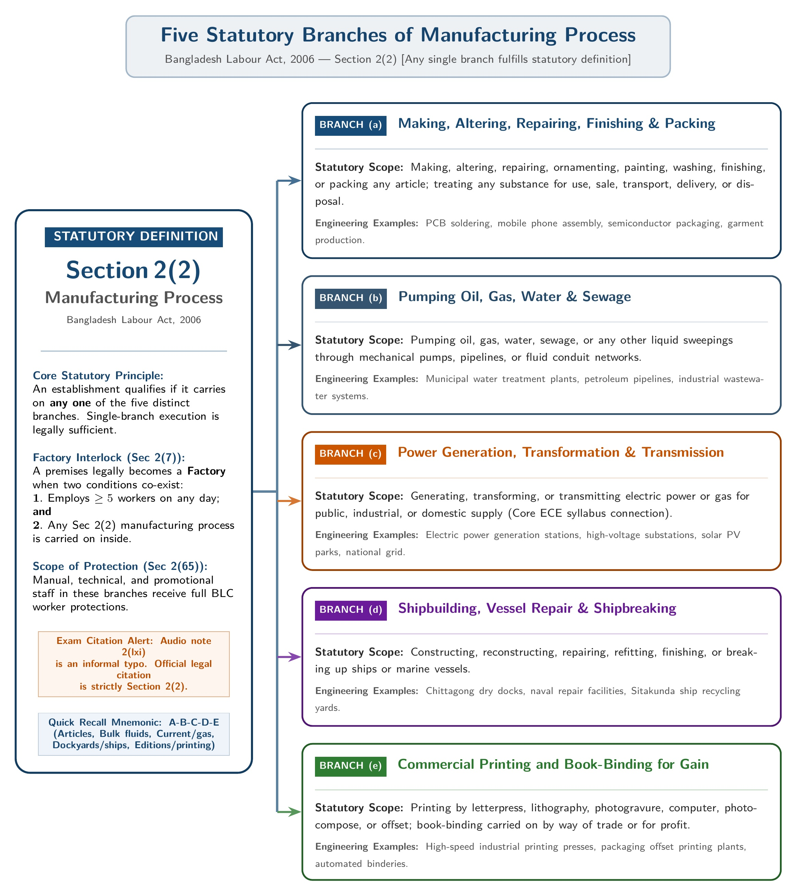

[← Previous: L04.2: Doctrine of Frustration and Case Studies](L04.2_Doctrine_of_Frustration_and_Case_Studies.md) | [🏠 Index](00_Index.md) | [Next: L05.2: Adolescent Working Hours (Section 41) →](L05.2_Adolescent_Working_Hours_Sec_41.md)

---

# L05.1: BLC Core Definitions and Age Classes

> **Section:** Section A (CO1 · Legal Issues · Shoaib Islam Sir) | **Priority:** 🔴 Essential | **Exam Frequency:** 2023 Final Q.1(a) (2m), Shoaib Sir Narrowed Chapter 3 Target
> **Subtopics Covered:** `L05.1` (Scope and objective of BLC 2006 · Act XLII of 2006), `L05.2` (Definitions of Factory `Sec 2(7)` and Worker `Sec 2(65)`), `L05.3` (Definition of Manufacturing Process `Sec 2(2)`), `L05.4` (Statutory Age Categories: Child $< 14$ `Sec 2(63)`, Adolescent $14\text{ to }<18$ `Sec 2(8)`, Adult $\ge 18$ `Sec 2(36)`, Minor $< 18$)
> **Sources:** SI Sir Notes (`Chapter-3.md`), BLC 2006 (`Chapter_01_Preliminary.md`), Topicwise Answer (`L05_BLC_Definitions_and_Adolescents.md`), Shoaib Sir Suggestions

---

## Why This Topic Matters

Shoaib Sir singled out Chapter 3 as a core scoring area. He gave a clear warning in his suggestions. The shorter the suggestion, the stricter the evaluation.

Any wrong section number loses marks immediately. Chapter 3 begins with legal definitions under Section 2. You must know who counts as a worker, what makes a factory, and what age laws apply. These definitions set the rules for working hours, safety, and welfare.

---

## 📝 Key Definitions

> **Factory [`Section 2(7)`]:** "Factory means any precincts or premises where five or more workers ordinarily work on any day of the year and in any part of which a manufacturing process is carried on, but does not include a mine." (The Bangladesh Labour Act, 2006)

In plain words, a factory needs at least 5 workers and a manufacturing process. It excludes mines.

> **Worker [`Section 2(65)`]:** "Worker means any person including an apprentice employed in any establishment or industry, either directly or through a contractor, by whatever name he is called, to do any skilled, unskilled, manual, technical, trade promotional or clerical work for hire or reward, whether the terms of employment are expressed or implied, but does not include a person employed mainly in a managerial, administrative or supervisory capacity." (The Bangladesh Labour Act, 2006)

In plain words, a worker does manual, technical, or clerical tasks for pay. Managers and supervisors are excluded.

> **Manufacturing Process [`Section 2(2)`]:** "Manufacturing process means any of the following processes, namely: making, altering, repairing, ornamenting, painting, washing, finishing, packing or treating any articles; pumping oil, gas, or water; generating or transmitting power; ship building or breaking; or printing." (The Bangladesh Labour Act, 2006)

In plain words, any process making, altering, pumping, powering, or printing goods is a manufacturing process.

> **Child [`Section 2(63)`]:** "Child means a person who has not completed 14th (fourteenth) years of age." (The Bangladesh Labour Act, 2006)

In plain words, anyone under 14 is a child. The law bans their employment in factories.

> **Adolescent [`Section 2(8)`]:** "Adolescent means a person who has completed fourteenth year but has not completed eighteenth year of age." (The Bangladesh Labour Act, 2006)

In plain words, an adolescent is a young person aged 14 to under 18 years.

> **Adult [`Section 2(36)`]:** "Adult means a person who has completed eighteenth year of age." (The Bangladesh Labour Act, 2006)

In plain words, an adult is anyone aged 18 or older.

> **Minor [General Law / Majority Act, 1875]:** "Minor means a person who has not completed eighteenth year of age."

In plain words, a minor is anyone under 18 years old. It covers both children and adolescents.

---

## 1. Scope and Objectives of the Bangladesh Labour Code, 2006

The Bangladesh Labour Act, 2006 is known as Act No. XLII of 2006. The parliament enacted it on 11 October 2006.

### Statutory Identity and Enactment

Before 2006, Bangladesh had 25 separate labour laws. Many dated back to the British colonial era. These old acts caused confusion and legal disputes. 

The 2006 Code repealed all 25 separate acts. It brought all labour rules together into one single unified code.

### Territorial and Sectoral Scope

Under Section 1(3), the Act extends to the whole of Bangladesh. 

It applies to:
- Industrial factories and workshops.
- Commercial firms and offices.
- Transport services (road, rail, water, and air).
- Plantations (tea, coffee, and rubber).
- Agricultural farms employing 5 or more workers.
- Docks, jetties, and construction sites.

### Establishments Excluded from the Act

Under Section 1(4), the Act does not apply to:
1. Government offices and civil servants.
2. Security printing presses.
3. Ordnance factories (military production).
4. Non-profit charity homes for the sick, aged, or orphans.
5. Non-profit schools, colleges, and training institutes.
6. Non-profit hostels and hospitals.
7. Agricultural farms with fewer than 5 workers.
8. Domestic household servants.
9. Family-run businesses where no paid worker is employed.

### Five Core Statutory Objectives

1. **Consolidation:** Combine scattered colonial laws into one modern code.
2. **Employment Terms:** Regulate appointment letters, probation, service records, and dismissal rules (Chapter II).
3. **Safety and Health:** Enforce clean working spaces, machine guards, and fire safety systems (Chapters V, VI, VII).
4. **Welfare and Rights:** Guarantee rest breaks, paid holidays, canteens, crèches, and maternity leave (Chapters IV, VIII, IX).
5. **Industrial Peace:** Provide legal rules for trade unions, collective bargaining agents, and Labour Courts (Chapters XIII, XIV).

---

## 2. Statutory Definition of Factory (Section 2(7))

Under Section 2(7), an establishment must meet four clear tests to qualify as a factory.

### Four Mandatory Elements of a Factory

1. **Premises or Precincts:** There must be a defined physical building, boundary, or compound.
2. **Worker Threshold:** Five or more workers must ordinarily work there on any day of the year.
3. **Active Manufacturing Process:** A manufacturing process must run in any part of the premises.
4. **Express Statutory Exclusion:** A mine is strictly excluded, even if it has machinery.

### The Factory Equation

You can write this definition as a simple mathematical equation:

$$
\text{Factory} = \text{Premises with } \ge 5\text{ workers} + \text{Manufacturing Process} - \text{Mines}
$$

> [!tip] Memory Hook: Factory Equation
> Remember the 3 pluses and 1 minus:
> - **+ Premises:** Defined boundary.
> - **+ 5 Workers:** 5 or more people working.
> - **+ Process:** Making, altering, or powering.
> - **- Mines:** Mines never count as factories.

### Practical Boundary Tests for Engineers

ECE engineers often manage technical labs, assembly plants, and network centers. Here is how the law applies:

- **Case A: 4 workers in a PCB assembly shop:** Not a statutory factory. It has fewer than 5 workers.
- **Case B: 6 workers soldering IoT devices in a garage:** Yes. It has 6 workers and an active manufacturing process.
- **Case C: 20 software coders in an office building:** Not a factory. Pure software writing has no physical manufacturing process under Section 2(2). It is a commercial establishment.
- **Case D: Coal mine with 100 workers:** Not a factory. Section 2(7) explicitly excludes mines.

---

## 3. Statutory Definition of Worker (Section 2(65))

Section 2(65) defines who gets the full legal protection of the Labour Code.

### Six Core Elements of the Worker Definition

1. **Includes Apprentices:** A trainee or apprentice is legally a worker.
2. **Workplace:** Must be employed in an establishment or industry.
3. **Hiring Method:** Can be hired directly or through an outside contractor.
4. **Work Types:** Covers skilled, unskilled, manual, technical, trade promotional, or clerical work.
5. **Reward:** Must work for hire or reward (wages).
6. **Contract Form:** The employment terms can be express (written) or implied (spoken or customary).

### The Managerial and Supervisory Exclusion

The definition ends with a strict exclusion clause. 

The law excludes anyone employed mainly in a:
- Managerial capacity.
- Administrative capacity.
- Supervisory capacity.

Managers and supervisors direct other people. They represent the employer. So the law does not give them the trade union or overtime protections meant for regular workers.

### Engineering Roles Classified Under the Act

| Role in Tech / Telecom Firm | Legal Classification | Section 2(65) Worker? | Legal Reason |
| :--- | :--- | :---: | :--- |
| **Junior Hardware Technician** | Operative Technical Staff | **Yes** | Performs manual and technical repairs. |
| **Apprentice Network Engineer** | Apprentice / Trainee | **Yes** | The section explicitly includes apprentices. |
| **Field Cabling Worker** | Manual / Contractor Staff | **Yes** | Covered whether direct or via contractor. |
| **Data Entry Clerk** | Clerical Staff | **Yes** | Clerical work is explicitly listed. |
| **Sales Promotion Officer** | Trade Promotional Staff | **Yes** | Trade promotional work is explicitly included. |
| **Plant General Manager** | Managerial Staff | **No** | Excluded by the managerial exclusion clause. |
| **HR Director** | Administrative Staff | **No** | Excluded by the administrative exclusion clause. |
| **Shift Floor Supervisor** | Supervisory Staff | **No** | Excluded by the supervisory exclusion clause. |

---

## 4. Definition of Manufacturing Process (Section 2(2))

Section 2(2) sets out five distinct categories of manufacturing. An establishment only needs to perform one of them.

### The Five Statutory Branches of Manufacturing

*Figure 5.1: Five Statutory Branches of Manufacturing Process under BLC 2006 (Source: Bangladesh Labour Act 2006, Section 2(2))*

1. **Making and Treating Articles [`Section 2(2)(a)`]:**
   - Making, altering, repairing, ornamenting, painting, washing, finishing, or packing any article.
   - Treating any substance for use, sale, transport, delivery, or disposal.
   - Examples: Assembling mobile phones, soldering circuit boards, sewing garments, or packaging chips.

2. **Pumping Operations [`Section 2(2)(b)`]:**
   - Pumping oil, gas, water, sewage, or any liquid sweepings.
   - Examples: Water treatment plants and oil pipeline pump stations.

3. **Power Generation and Transmission [`Section 2(2)(c)`]:**
   - Generating, transforming, or transmitting electric power or gas.
   - This covers power plants, electrical substations, and solar generation parks.
   - This is highly relevant to electrical and electronics engineers.

4. **Shipbuilding and Recycling [`Section 2(2)(d)`]:**
   - Constructing, reconstructing, repairing, finishing, or breaking up ships or marine vessels.
   - Examples: Shipyards in Chittagong and shipbreaking yards in Sitakunda.

5. **Commercial Printing [`Section 2(2)(e)`]:**
   - Printing by letterpress, lithography, photogravure, computer, photocompose, or offset.
   - Book-binding carried on for trade or business gain.

### Citation Alert: Section 2(2) vs Audio Note 2(lxi)

> [!warning] Exam Citation Alert
> In the class voice note, the audio transcription recorded this definition as "Section 2(lxi)". 
> That was an informal typo in old draft handouts. 
> The verified section in the official Bangladesh Labour Act is **Section 2(2)**. 
> Always write **Section 2(2)** on your exam script.

---

## 5. Statutory Age Categories of Workers

The Labour Act divides people into four distinct age categories. Each group has different legal rights and employment limits.

### Definitions of the Four Age Groups

1. **Child [`Section 2(63)`]:**
   - A person who has not completed 14 years of age ($< 14\text{ years}$).
   - General rule: Child labour is strictly prohibited under Section 34(1).
   - Light work exception: Children aged 12 to 14 may do light work. The work must not harm their school or health (Section 44).

2. **Adolescent [`Section 2(8)`]:**
   - A person who has completed 14 years but has not completed 18 years ($14 \le \text{age} < 18\text{ years}$).
   - Employment is permitted only with a medical fitness certificate (Section 34(2) and Section 37).
   - Working hours are strictly capped under Section 41 (max 5 hours daily in factories).

3. **Adult [`Section 2(36)`]:**
   - A person who has completed 18 years of age ($\ge 18\text{ years}$).
   - May work full standard hours under Chapter IX (8 hours daily, 48 hours weekly).

4. **Minor [General Law / Majority Act, 1875]:**
   - A person who has not completed 18 years of age ($< 18\text{ years}$).
   - Minor is the umbrella legal term for both children and adolescents together.

### Comprehensive Age Comparison Table

| Legal Category | Statutory Section | Exact Age Span | Legal Status for Factory Employment | Medical Certificate Needed? | Working Hours Rule |
| :--- | :--- | :---: | :--- | :---: | :--- |
| **Child** | `Sec 2(63)` | Under 14 ($< 14$) | **Banned** (`Sec 34(1)`). Light work allowed at 12–14 (`Sec 44`). | No (Cannot work) | Zero factory hours allowed. |
| **Adolescent** | `Sec 2(8)` | 14 to under 18 ($14 \le \text{age} < 18$) | **Permitted with limits** | **Yes** (`Sec 37`, valid 12m) | Max 5h/day, 30h/wk in factory (`Sec 41`). |
| **Adult** | `Sec 2(36)` | 18 and older ($\ge 18$) | **Fully Permitted** | No | 8h/day, 48h/wk (`Sec 100, 102`). |
| **Minor** | General Law | Under 18 ($< 18$) | Umbrella class | Follows specific child/adolescent rule | Capped or banned depending on age. |

> [!tip] Memory Hook: Age Ladder
> Think of the simple 14 and 18 cutoff points:
> - **Below 14:** Child. School only, no factory work.
> - **14 to 17:** Adolescent. Work allowed with doctor token and 5-hour limit.
> - **18 and Up:** Adult. Full working rights.

---

## Exam Variants

| Year / Source | Question Summary | Marks | Key Focus / Takeaway |
| :--- | :--- | :---: | :--- |
| **2023 Final Q.1(a)** | Define factory and worker according to BLC 2006. | 02 | 5+ workers, manufacturing process, no mines; worker exclusions. |
| **Model Exam Q.1** | What is BLC 2006? State its scope and main objectives. | 02 | Act XLII of 2006, 25 repealed laws, 5 core objectives. |
| **Model Exam Q.2** | Define "Manufacturing Process" under Section 2(2). | 02 | 5 branches: making, pumping, power, ships, printing. |
| **Model Exam Q.3** | Define statutory age categories under Section 2. | 02 | Child $< 14$, Adolescent $14$ to $< 18$, Adult $\ge 18$, Minor $< 18$. |

---

## 🏆 Golden Questions (Past Exam Archive & Model Answers)

### 🎯 GQ1 · 2023 Final Q.1(a) · Statutory Definitions of Factory and Worker (02 Marks)

> **Appeared:** 2023 Final Exam Q.1(a) · (02 Marks)

**Question:**  
Define factory and worker according to Bangladesh labor code 2006.

**Full Answer:**

The Bangladesh Labour Act, 2006 defines factory and worker under **Section 2**:

**1. Factory [`Section 2(7)`]:**
- Factory means any precincts or premises where **five or more workers** ordinarily work on any day of the year.
- A **manufacturing process** must be carried on in any part of the premises.
- The definition strictly **excludes a mine**.
- Statutory formula:
$$
\text{Factory} = \text{Premises with } \ge 5\text{ workers} + \text{Manufacturing Process} - \text{Mines}
$$

**2. Worker [`Section 2(65)`]:**
- Worker means any person, including an **apprentice**, employed in any establishment or industry.
- The person may be employed **directly** or through an **outside contractor**.
- It covers skilled, unskilled, manual, technical, trade promotional, or clerical work for hire or reward.
- Terms of employment may be express or implied.
- **Statutory Exclusion:** It strictly excludes any person employed mainly in a **managerial, administrative, or supervisory** capacity.

---

### 🎯 GQ2 · Model Exam Question · Scope and Objectives of BLC 2006 (02 Marks)

> **Appeared:** Prescribed Model Exam Question (Chapter 3 Blueprint) · (02 Marks)

**Question:**  
What is the Bangladesh Labour Code, 2006? State its scope and main objectives.

**Full Answer:**

- **Statutory Identity:**  
  The Bangladesh Labour Act, 2006 (**Act No. XLII of 2006**) was enacted on 11 October 2006. It consolidated and repealed 25 separate historical labour laws into a single modern code.

- **Scope:**  
  Under **Section 1(3)**, the Act extends to the entire territory of Bangladesh. It applies to all factories, commercial offices, transport firms, and agricultural farms employing 5 or more workers. Under **Section 1(4)**, it excludes government offices, defense installations, security printing presses, family-run firms, and non-profit charitable institutions.

- **Main Objectives:**
  1. Consolidate fragmented colonial laws into one unified legal framework.
  2. Regulate terms of employment, service books, and fair dismissal procedures (**Chapter II**).
  3. Enforce occupational safety, clean workspaces, and emergency fire precautions (**Chapters V, VI, VII**).
  4. Protect worker welfare, maternity benefits, and standard hours (**Chapters IV, VIII, IX**).
  5. Provide an orderly mechanism for industrial dispute settlement via trade unions and Labour Courts (**Chapters XIII, XIV**).

---

### 🎯 GQ3 · Model Exam Question · Definition of Manufacturing Process (02 Marks)

> **Appeared:** Prescribed Model Exam Question (Chapter 3 Blueprint) · (02 Marks)

**Question:**  
Define "Manufacturing Process" under Section 2(2) of the Bangladesh Labour Act, 2006.

**Full Answer:**

Under **Section 2(2)** of the Bangladesh Labour Act, 2006, "manufacturing process" means any of the following 5 distinct processes:

1. **Making and Treating Articles [`Section 2(2)(a)`]:** Making, altering, repairing, ornamenting, painting, washing, finishing, or packing any article. It also includes treating any substance for use, sale, transport, delivery, or disposal.
2. **Pumping Operations [`Section 2(2)(b)`]:** Pumping oil, gas, water, sewage, or any liquid sweepings.
3. **Power Generation and Transmission [`Section 2(2)(c)`]:** Generating, transforming, or transmitting power or gas. This covers electrical power stations and substations.
4. **Shipbuilding and Recycling [`Section 2(2)(d)`]:** Constructing, reconstructing, repairing, finishing, or breaking up ships or vessels.
5. **Commercial Printing [`Section 2(2)(e)`]:** Printing by letterpress, lithography, photogravure, computer, or offset. It also includes book-binding carried on for trade or business gain.

---

### 🎯 GQ4 · Model Exam Question · Statutory Age Categories of Workers (02 Marks)

> **Appeared:** Prescribed Model Exam Question (Chapter 3 Blueprint) · (02 Marks)

**Question:**  
Define "Child", "Adolescent", "Adult", and "Minor" according to the Bangladesh Labour Act, 2006.

**Full Answer:**

The Bangladesh Labour Act, 2006 establishes 4 legal age categories under **Section 2**:

1. **Child [`Section 2(63)`]:** A person who has not completed 14 years of age ($< 14\text{ years}$). Factory employment is prohibited under **Section 34(1)**. Light work is permitted from age 12 under **Section 44**.
2. **Adolescent [`Section 2(8)`]:** A person who has completed 14 years but has not completed 18 years ($14 \le \text{age} < 18\text{ years}$). Employment requires a medical fitness certificate (**Section 37**) and capped working hours (**Section 41**).
3. **Adult [`Section 2(36)`]:** A person who has completed 18 years of age ($\ge 18\text{ years}$). Standard employment rules apply (**Section 100**).
4. **Minor [General Law / Majority Act]:** A person who has not completed 18 years of age ($< 18\text{ years}$). This umbrella term covers all children and adolescents.

---

## ⚡ Exam Tips & Common Mistakes

1. **Write the worker threshold correctly:** A factory requires **5 or more workers**. Do not write 10 or 20 workers.
2. **Always state the mine exclusion:** In Section 2(7), forgetting "does not include a mine" costs half a mark.
3. **Always write the worker exclusion:** For Section 2(65), you must state that managerial, administrative, and supervisory persons are excluded.
4. **Use Section 2(2) for Manufacturing Process:** Do not write Section 2(lxi). The verified statutory clause is Section 2(2).
5. **Exact age limits matter:** For a child, write "has not completed 14 years" ($< 14$). For an adolescent, write "completed 14 years but not completed 18 years" ($14 \le \text{age} < 18$).

---

## 🔗 Related Topics

- [L04.2: Doctrine of Frustration and Case Studies](L04.2_Doctrine_of_Frustration_and_Case_Studies.md)
- [L05.2: Adolescent Working Hours (Section 41)](L05.2_Adolescent_Working_Hours_Sec_41.md)
- [L05.3: Applied Factory Compliance and Adult Hours](L05.3_Applied_Factory_Compliance_and_Adult_Hours.md)
- [L06.1: Maternity Benefits (Sections 45 to 50)](L06.1_Maternity_Benefits_Sec_45_to_50.md)

---

[← Previous: L04.2: Doctrine of Frustration and Case Studies](L04.2_Doctrine_of_Frustration_and_Case_Studies.md) | [🏠 Index](00_Index.md) | [Next: L05.2: Adolescent Working Hours (Section 41) →](L05.2_Adolescent_Working_Hours_Sec_41.md)
