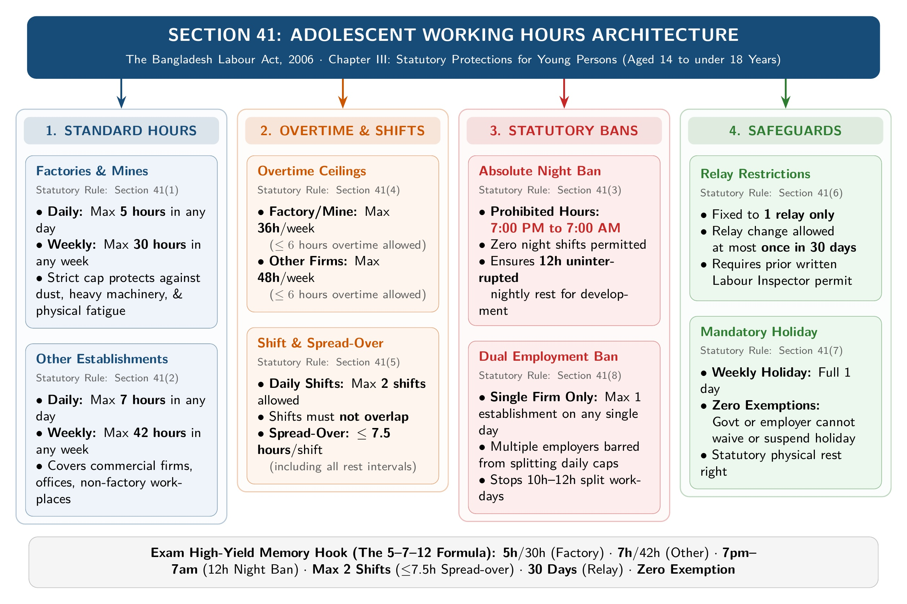
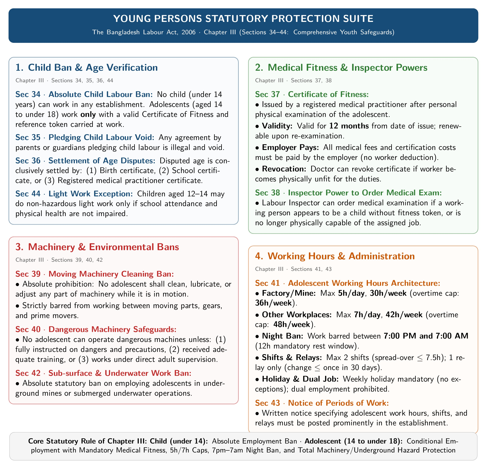

[← Previous: L05.1: BLC Core Definitions and Age Classes](L05.1_BLC_Core_Definitions_and_Age_Classes.md) | [🏠 Index](00_Index.md) | [Next: L05.3: Applied Factory Compliance and Adult Hours →](L05.3_Applied_Factory_Compliance_and_Adult_Hours.md)

---

# L05.2: Adolescent Working Hours and Statutory Rules (Section 41)

> **Section:** Section A (CO1 · Legal Issues · Shoaib Islam Sir) | **Priority:** 🔴 Essential | **Exam Frequency:** 2023 Final Q.1(b) (4m), Shoaib Sir Narrowed Chapter 3 Target
> **Subtopics Covered:** `L05.5` (Working hours for adolescents under `Sec 41`), `L05.6` (Other young-person rules under `Sec 34–40, 42–44`)
> **Sources:** SI Sir Notes (`Chapter-3.md`), BLC 2006 (`Chapter_03_Employment_of_Adolescent_Worker.md`), Raidah Class Notes (§15)

---

## Why This Topic Matters

Shoaib Sir singled out Section 41 in his final exam suggestion voice note. He warned that strict grading applies when the syllabus is narrowed. 

An adolescent is between 14 and 18 years old. The law protects their health and education through strict daily and weekly limits. You must quote the exact hours, shift caps, and section numbers to score full marks.

---

## 📝 Key Definitions

> **Adolescent [`Section 2(8)`]:** "Adolescent means a person who has completed fourteen years but has not completed eighteen years of age." (The Bangladesh Labour Act, 2006)

In plain words, an adolescent is a young person aged 14 to under 18 years.

> **Child [`Section 2(63)`]:** "Child means a person who has not completed fourteen years of age." (The Bangladesh Labour Act, 2006)

Children under 14 cannot work in any industrial setting. Only light work is permitted from age 12.

---

## Core Theory: Working Hours for Adolescents (Section 41)

Section 41 of the Bangladesh Labour Act, 2006 sets eight distinct statutory rules. These rules protect young workers from physical strain and exploitation.

*Figure 1: Comprehensive Section 41 Adolescent Working Hours and Restrictions Architecture (Source: Bangladesh Labour Act 2006, Section 41)*

### 1. Working Hours in Factories and Mines [`Section 41(1)`]

Adolescents face strict limits in factories and mines due to heavy machinery and dust.
- Daily limit: At most **5 hours in any day**.
- Weekly limit: At most **30 hours in any week**.
- The employer cannot force or allow hours beyond these caps during normal operations.

### 2. Working Hours in Other Establishments [`Section 41(2)`]

In non-factory places like commercial offices or shops:
- Daily limit: At most **7 hours in any day**.
- Weekly limit: At most **42 hours in any week**.

### 3. Absolute Ban on Night Work [`Section 41(3)`]

The law bans night employment for all adolescents without exception:
- No adolescent can work between **7:00 PM and 7:00 AM**.
- This creates a mandatory 12-hour rest window every night.
- The ban supports normal physical development and personal safety.

### 4. Overtime Ceilings [`Section 41(4)`]

If an adolescent works overtime, total weekly hours including overtime must stay within tight caps:
- **Factories and mines:** Total work must not exceed **36 hours in any week**. This permits at most 6 hours of overtime per week.
- **Other establishments:** Total work must not exceed **48 hours in any week**. This permits at most 6 hours of overtime per week.

### 5. Shift and Spread-Over Caps [`Section 41(5)`]

Work schedules cannot break an adolescent's day into irregular fragments:
- Daily work is limited to at most **2 shifts**.
- The two shifts must not overlap.
- The total spread-over of any single shift cannot exceed **7.5 hours**.
- Spread-over includes all rest intervals and meal breaks during that shift.

### 6. Relay Restrictions [`Section 41(6)`]

A relay is a group of workers doing the same job at different times:
- An adolescent must work in only **one relay**.
- The employer cannot switch the adolescent's relay frequently.
- A relay change can happen at most **once in 30 days**.
- Even then, the employer must get prior written permission from the Labour Inspector.

### 7. Mandatory Weekly Holiday [`Section 41(7)`]

Weekly holidays are non-negotiable for adolescents:
- The standard weekly holiday rules apply fully to adolescent workers.
- The government or employer cannot suspend or exempt this holiday for any adolescent.
- Every adolescent must receive their full weekly rest day.

### 8. Double Employment Prohibited [`Section 41(8)`]

Adolescents cannot work multiple jobs on the same day:
- No adolescent shall work in more than one establishment on any day.
- This rule stops two different employers from splitting the daily limits.
- It protects young workers from hidden 10-hour or 12-hour workdays.

---

## Comparison of Working Hour Standards

The table below contrasts adolescent limits with standard adult working hours:

| Provision | Adolescent: Factory / Mine (`Sec 41`) | Adolescent: Other Places (`Sec 41`) | Adult Worker Standard (`Sec 100–108`) |
| :--- | :--- | :--- | :--- |
| **Daily Hours** | Max 5 hours | Max 7 hours | Max 8 hours (10h with OT) |
| **Weekly Hours** | Max 30 hours | Max 42 hours | Max 48 hours |
| **Weekly Overtime Cap** | Max 36 hours total | Max 48 hours total | Max 60 hours total (56h avg/yr) |
| **Night Work** | Prohibited (7:00 PM to 7:00 AM) | Prohibited (7:00 PM to 7:00 AM) | Allowed (Women restricted 10 PM to 6 AM) |
| **Shifts Allowed** | Max 2 shifts | Max 2 shifts | Multiple shifts permitted |
| **Spread-Over** | Max 7.5 hours per shift | Max 7.5 hours per shift | Max 10 hours in a day |
| **Weekly Holiday** | Mandatory (Zero exemptions) | Mandatory (Zero exemptions) | 1 day (Factories) / 1.5 days (Shops) |
| **Double Employment** | Strictly prohibited | Strictly prohibited | Prohibited without Chief Inspector permit |

> [!tip] Memory Hook · The 5-7-12 Rule for Section 41
> Memorize these numbers to recall all eight subsections in the exam:
> - **5 / 30 / 36:** Factory limits (5h daily, 30h weekly, 36h with overtime).
> - **7 / 42 / 48:** Other establishments (7h daily, 42h weekly, 48h with overtime).
> - **7 to 7:** 12-hour night ban (No work between 7:00 PM and 7:00 AM).
> - **2 and 7.5:** At most 2 shifts; each shift spread-over $\le 7.5\text{ hours}$.
> - **30 Days:** Relay changes limited to once every 30 days with Inspector permit.
> - **Zero Exemptions:** Weekly holiday cannot be waived or suspended.
> - **Single Job:** Never work in two establishments on the same day.

---

## Other Statutory Rules for Young Persons (Sections 34 to 40, 42 to 44)

> [!note] Shoaib Sir's Final Exam Scope
> Shoaib Sir tested Sections 39 and 40 in the 2025 Class Test. But in his final exam suggestions, he excluded Sections 34 to 40 and 42 to 44 from standalone questions. He told students to focus strictly on **Section 41**. Here is a short summary for complete understanding.

*Figure 2: Statutory Protection Suite for Children and Adolescents under BLC Chapter III (Source: Bangladesh Labour Act 2006, Chapter III / Sections 34–44)*

### 1. Prohibition of Child Labour [`Section 34(1)`]

No child under 14 years old can work in any occupation or establishment. 

An adolescent (14 to under 18) may work only if two conditions are met:
1. The employer holds a valid **Certificate of Fitness** issued by a registered medical practitioner.
2. The adolescent carries a reference token while working that points to this certificate.

### 2. Agreements Pledging Child Labour Are Void [`Section 35`]

Parents or legal guardians cannot make agreements that pledge a child's labour. Any such contract is illegal and void.

### 3. Settlement of Age Disputes [`Section 36`]

If a worker's age is questioned, the dispute is resolved using three documents:
- A birth registration certificate.
- A school certificate.
- A certificate issued by a registered medical practitioner.

### 4. Certificate of Fitness [`Section 37`]

A registered doctor examines the adolescent before employment begins.
- The certificate stays valid for **12 months** from the date of issue.
- The employer must pay all medical examination fees.
- The employer cannot recover these costs from the adolescent or their parents.

### 5. Inspector's Power to Order Examination [`Section 38`]

A Labour Inspector can order a medical exam if:
- An adolescent is working without a fitness certificate.
- A working adolescent appears no longer fit for the job.
- The employer must stop the adolescent from working until the doctor clears them.

### 6. Hazardous Work and Moving Machinery [`Section 39`]

The government publishes a list of hazardous operations where adolescents cannot work.
- Under **Section 39(3)**, no adolescent can clean, lubricate, or adjust machinery while it is in motion.
- Adolescents cannot work between moving parts or between fixed and moving parts of running machines.

### 7. Dangerous Machines [`Section 40`]

An adolescent cannot work at any dangerous machine unless:
- They receive full instruction about machine hazards and safety precautions.
- They complete sufficient practical training, **OR** work under the direct supervision of an experienced person.

### 8. Underground and Underwater Work [`Section 42`]

Adolescents face an absolute ban on underground and underwater operations. They cannot work in mines, deep wells, tunnels, or diving operations.

### 9. Notice of Work Periods [`Section 43`]

The employer must post a clear notice showing work periods for adolescents. The hours shown must follow Section 41 limits.

### 10. Light Work Exception for Children [`Section 44`]

A child who has completed 12 years of age may do light work.
- The work must not harm their health or personal growth.
- The work must not interfere with their school attendance.
- All adolescent protections in Chapter III apply equally to these working children.

---

## Machine Safety: Adult Workers vs. Adolescent Workers

This comparison was tested in the 2025 Class Test:

| Point of Comparison | Machinery in Motion (`Sec 64`) | Dangerous Machines & Adolescents (`Sec 40` & `Sec 39(3)`) |
| :--- | :--- | :--- |
| **Worker Group** | **Adult male workers only** ($\ge 18\text{ years}$) | **Adolescent workers** (14 to under 18 years) |
| **Machine Status** | Machinery is **actively moving or running** | Machine is designated as **dangerous by Government** |
| **Eligibility Rule** | Specially trained adult male wearing tight clothes | Permitted only after safety instruction and training |
| **Supervision Role** | Supervision cannot replace the adult male rule | Work is allowed under direct expert supervision |
| **Cleaning Moving Parts** | Allowed only for the authorized adult male | **Strictly prohibited** under Section 39(3) |
| **Statutory Goal** | Prevents entanglement during live adjustments | Builds technical skills safely under adult control |

---

## Exam Variants

| Year / Exam | Question Type | Marks | Core Focus / Key Takeaway |
| :--- | :--- | :---: | :--- |
| **2023 Final Q.1(b)** | Descriptive Theory | 04 | Rules for child and adolescent employment under Chapter III. |
| **Model Exam Q.1** | Statutory Subsection Focus | 04 | Complete breakdown of eight Section 41 subsections. |
| **Model Exam Q.2** | Young Persons Safety | 03 | Summary of Sections 34, 37, 39, 40, and 44. |
| **2025 Law-CT2 Q.2** | Comparative Analysis | 10 | Comparison between Section 64 (adults) and Section 40/39(3) (adolescents). |

*(Exam Scope Note: In the 2024 exam, Q.1(c) covered managerial skills in Industrial Management. Child and adolescent employment appeared in 2023 Final Q.1(b) and remains Shoaib Sir's core Chapter 3 target).*

---

## 🏆 Golden Questions (Past Exam Archive & Model Answers)

### 🎯 GQ1 · 2023 Final Q.1(b) · Employment Rules for Children and Adolescents (04 Marks)

> **Appeared:** 2023 Final Exam Q.1(b) · (04 Marks)

**Question:**

Briefly discuss rules regarding the employment of children and adolescent according to Bangladesh Labor code 2006.

**Full Answer:**

The Bangladesh Labour Act, 2006 regulates child and adolescent employment through **Chapter III**:

#### 1. Absolute Prohibition on Child Labour [`Section 34(1)`]
- No child under 14 years of age shall work in any occupation or establishment.
- Under **Section 35**, parents or guardians cannot make agreements pledging child labour.
- *Exception under `Section 44`:* Children aged 12 to 14 may perform light work. The work must not harm their health or schooling.

#### 2. Employment Conditions for Adolescents [`Section 34(2)`, `Section 37`]
- An adolescent (aged 14 to under 18) may work only with a valid **Certificate of Fitness**.
- A registered medical practitioner issues the certificate after examination.
- The certificate remains valid for 12 months. The employer must pay all medical examination fees.
- The adolescent must carry a reference token pointing to this certificate while working.

#### 3. Working Hour Limits [`Section 41`]
- **Factories and Mines:** Maximum 5 hours per day and 30 hours per week. Overtime cannot push total hours beyond 36 hours in a week.
- **Other Establishments:** Maximum 7 hours per day and 42 hours per week. Total weekly hours with overtime cannot exceed 48 hours.
- **Night Work Ban:** No adolescent can work between 7:00 PM and 7:00 AM.
- **Shifts:** Limited to at most 2 shifts without overlap. Spread-over cannot exceed 7.5 hours per shift.
- **Holidays:** Weekly rest day is mandatory. The law allows zero exemptions for adolescents.

#### 4. Safety and Hazardous Work Bans [`Sections 39, 40, 42`]
- Adolescents cannot clean, lubricate, or adjust running machinery (**Section 39(3)**).
- They cannot operate dangerous machines without prior hazard instruction, training, or expert supervision (**Section 40**).
- Underground and underwater work is strictly banned (**Section 42**).

---

### 🎯 GQ2 · Model Exam Question · Detailed Working Hours Under Section 41 (04 Marks)

> **Target:** Shoaib Sir's Narrowed Chapter 3 Final Exam Target · (04 Marks)

**Question:**

State the statutory rules regarding working hours for adolescent workers under Section 41 of the Bangladesh Labour Act, 2006.

**Full Answer:**

Section 41 of the Bangladesh Labour Act, 2006 sets eight statutory rules for adolescent working hours:

1. **Daily and Weekly Limits in Factories and Mines [`Section 41(1)`]:**  
   No adolescent shall work in any factory or mine for more than **5 hours in any day**. Also, weekly work cannot exceed **30 hours in any week**.

2. **Daily and Weekly Limits in Other Establishments [`Section 41(2)`]:**  
   In other establishments, daily work cannot exceed **7 hours in any day**. Also, weekly work cannot exceed **42 hours in any week**.

3. **Night Work Prohibition [`Section 41(3)`]:**  
   No adolescent shall work in any establishment between **7:00 PM and 7:00 AM**.

4. **Overtime Ceilings [`Section 41(4)`]:**  
   Total working hours including overtime must not exceed:
   - **36 hours per week** in any factory or mine.
   - **48 hours per week** in any other establishment.

5. **Shift and Spread-Over Limits [`Section 41(5)`]:**  
   Work is limited to at most **2 shifts**. The shifts must not overlap. The spread-over of any shift cannot exceed **7.5 hours**.

6. **Relay Restrictions [`Section 41(6)`]:**  
   An adolescent must work in only one relay. The relay cannot change more often than **once in 30 days**, except with prior written permission from the Labour Inspector.

7. **Mandatory Weekly Holiday [`Section 41(7)`]:**  
   Weekly holiday provisions apply fully to adolescents. The Act prohibits any suspension or exemption of weekly holidays for adolescent workers.

8. **Prohibition of Double Employment [`Section 41(8)`]:**  
   No adolescent shall work or be allowed to work in more than one establishment on the same day.

---

### 🎯 GQ3 · Model Exam Question · Young Persons Statutory Provisions (03 Marks)

> **Target:** Chapter III Statutory Overview · (03 Marks)

**Question:**

Summarize the key statutory restrictions on child and adolescent employment under Sections 34, 37, 39, 40, and 44 of the Bangladesh Labour Act, 2006.

**Full Answer:**

1. **Prohibition of Child Labour [`Section 34(1)`]:**  
   No child under 14 years old can work in any occupation or establishment.

2. **Medical Fitness Certificate [`Section 34(2)`, `Section 37`]:**  
   Adolescents require a medical fitness certificate from a registered doctor before starting work. The certificate is valid for 12 months. The employer pays all examination fees and holds the certificate. The adolescent must carry a reference token.

3. **Moving Machinery Ban [`Section 39(3)`]:**  
   Adolescents cannot clean, lubricate, or adjust machinery while it is in motion. They cannot work between moving parts.

4. **Dangerous Machines [`Section 40`]:**  
   Adolescents cannot operate dangerous machines without full instruction on risks, adequate operational training, or constant supervision by an experienced person.

5. **Light Work for Children [`Section 44`]:**  
   Children aged 12 to 14 may perform light work. The work must not harm their health or schooling.

---

## ⚡ Exam Tips & Common Mistakes

1. **Write All 8 Subsections for Section 41:** If asked about Section 41, list all eight points. Do not stop after daily and weekly hours. Mention the night ban, shift limits, relay rules, weekly holiday, and single-job rule.
2. **Never Confuse Factory and Non-Factory Hours:** Factories are capped at 5h/day and 30h/week. Non-factories are capped at 7h/day and 42h/week. Mixing these numbers up causes an immediate loss of marks.
3. **Remember Overtime Ceilings:** Overtime is not unlimited. It is capped at 36 hours per week in factories and 48 hours per week elsewhere.
4. **Cite Exact Section Numbers:** Shoaib Sir values statutory accuracy. Always write "Section 41(1)", "Section 41(3)", or "Section 39(3)" instead of vague claims.

---

## 🔗 Related Topics

- [L05.1: BLC Core Definitions and Age Classes](L05.1_BLC_Core_Definitions_and_Age_Classes.md)
- [L05.3: Applied Factory Compliance and Adult Hours](L05.3_Applied_Factory_Compliance_and_Adult_Hours.md)
- [L06.1: Maternity Benefits (Sections 45 to 50)](L06.1_Maternity_Benefits_Sec_45_to_50.md)
- [L07.2: Machinery Safety and Workplace Duties](L07.2_Machinery_Safety_and_Workplace_Duties.md)

---

[← Previous: L05.1: BLC Core Definitions and Age Classes](L05.1_BLC_Core_Definitions_and_Age_Classes.md) | [🏠 Index](00_Index.md) | [Next: L05.3: Applied Factory Compliance and Adult Hours →](L05.3_Applied_Factory_Compliance_and_Adult_Hours.md)
