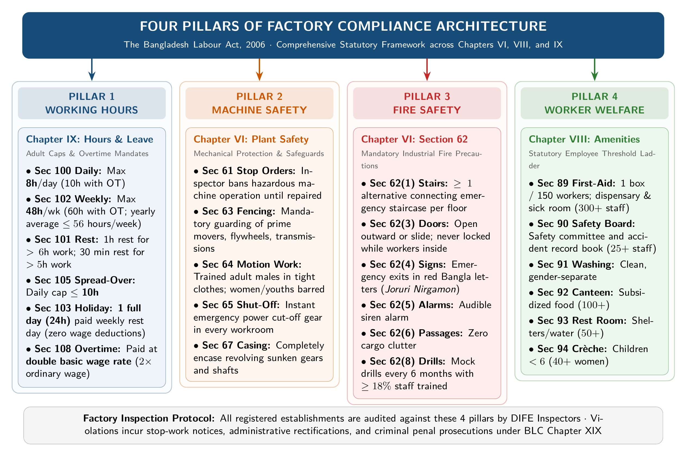
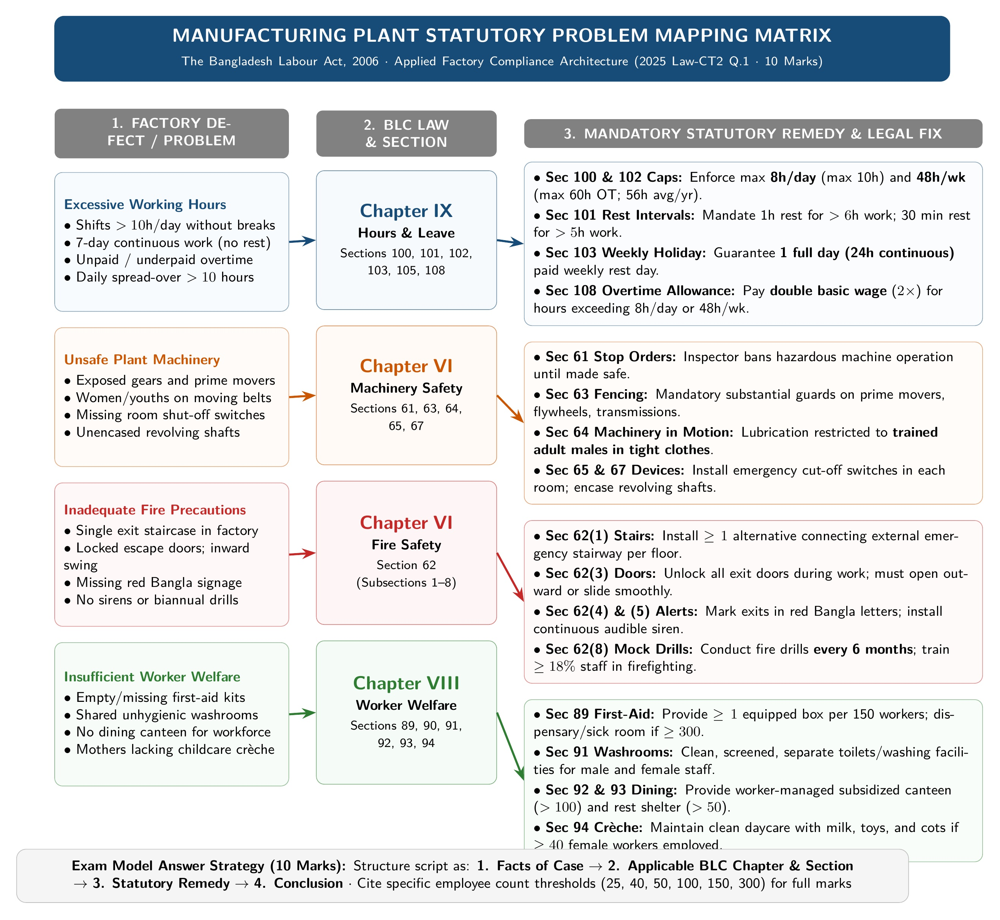

[← Previous: L05.2: Adolescent Working Hours (Section 41)](L05.2_Adolescent_Working_Hours_Sec_41.md) | [🏠 Index](00_Index.md) | [Next: L06.1: Maternity Benefits (Sections 45 to 50) →](L06.1_Maternity_Benefits_Sec_45_to_50.md)

---

# L05.3: Applied Factory Compliance and Adult Hours

> **Section:** Section A (CO1 · Legal Issues · Shoaib Islam Sir) | **Priority:** 🔴 Essential | **Exam Frequency:** 2023 Final Q.1(c) (4m), 2025 Law-CT2 Q.1 (10m)
> **Subtopics Covered:** `L05.7` (Applied: BLC effectiveness in safe/fair workplace & multi-issue factory compliance scenario), `L05.8` (Adult working hours, rest intervals, spread-over, weekly holidays, and overtime under `Sec 100–108`)
> **Sources:** SI Sir Notes (`Chapter-3.md`), BLC 2006 (`Chapter_06_Safety.md`, `Chapter_08_Welfare_Measures.md`, `Chapter_09_Working_Hour_and_Leave.md`), `PreviousYearQuestions/CT_questions.md` (§4), Topicwise Answer (`L05_BLC_Definitions_and_Adolescents.md`)

---

## Why This Topic Matters

Shoaib Sir loves testing practical, multi-issue problems. In 2025 Law-CT2 Q.1, he set a 10-mark question. It described a factory suffering from four simultaneous operational problems.

The factory had long working hours, unsafe machinery, poor fire precautions, and no welfare amenities. In 2023 Final Q.1(c), he asked for an assessment of law effectiveness (4 marks).

This note gives you a clean master compliance matrix. It connects Chapter VI (Safety), Chapter VIII (Welfare), and Chapter IX (Working Hours). You will know the exact sections, worker thresholds, and remedies to score full marks.

---

## 📝 Key Statutory Rules: Adult Working Hours (Sections 100 to 108)

Chapter IX of the Bangladesh Labour Act, 2006 sets standard hours and rest rules for adult workers.

### Summary Table of Adult Working Hours

| Statutory Provision | Section | Normal Limit | Overtime or Special Condition |
| :--- | :--- | :--- | :--- |
| **Daily Working Hours** | `Sec 100` | Max 8 hours in any day | May extend up to 10 hours daily with overtime pay (`Sec 108`). |
| **Interval for Rest or Meal** | `Sec 101` | 1 hour rest for $> 6$ hours work; 30 minutes rest for $> 5$ hours work | Continuous work without rest intervals is illegal. |
| **Weekly Working Hours** | `Sec 102` | Max 48 hours in any week | Overtime allows up to 60 hours/week. Annual weekly average $\le 56$ hours. |
| **Weekly Holiday** | `Sec 103` | 1 full day (24 consecutive hours) for factories; 1.5 days for shops | Fully paid. No wage deduction is allowed. |
| **Compensatory Holiday** | `Sec 104` | Equal number of compensatory days | Granted as soon as possible if exempted from weekly rest. |
| **Spread-over Limit** | `Sec 105` | Max 10 hours in any day | Work and rest periods together cannot exceed 10 hours daily. |
| **Night Shift Hours** | `Sec 106` | Shift extending past midnight | Holiday equals 24 hours from shift end. Post-midnight hours count to previous day. |
| **Overtime Wage Rate** | `Sec 108` | Double the ordinary basic wage rate | Formula: $2 \times (\text{Basic Wage} + \text{Dearness} + \text{Ad-hoc Pay})$. |
| **Women Night Work** | `Sec 109` | Ban between 10:00 PM and 6:00 AM | Work during this period requires explicit consent from the woman worker. |
| **Double Employment** | `Sec 110` | Banned on the same day | Worker cannot work in more than one establishment without Inspector permit. |

### Plain-English Breakdown of Sections 100 to 108

1. **Daily Work Cap [`Section 100`]:** An adult worker normally works 8 hours a day. With overtime, the maximum daily limit is 10 hours.
2. **Mandatory Rest Intervals [`Section 101`]:** No person can work all day without a meal break. If a worker works over 6 hours, they must get 1 hour of rest. If they work over 5 hours, they must get at least 30 minutes.
3. **Weekly Caps [`Section 102`]:** A standard work week is 48 hours. Overtime can take it up to 60 hours. But the average weekly hours over the whole year must not exceed 56 hours.
4. **Paid Weekly Holiday [`Section 103`]:** Every factory worker gets 24 consecutive hours of rest every week. The employer cannot deduct wages for this day.
5. **Spread-over Rule [`Section 105`]:** A shift cannot be dragged out over the entire day. Daily working hours and rest breaks together cannot spread over more than 10 hours.
6. **Double-Rate Overtime [`Section 108`]:** Extra work requires extra pay. Overtime is paid at twice the basic wage rate:

$$
\text{Overtime Wage Rate} = 2 \times \text{Ordinary Rate of Basic Wage}
$$

### Syllabus Scope Alert: Adult Hours vs Adolescent Focus

> [!note] Syllabus Scope Alert (Voice-Note Guidance)
> Shoaib Sir narrowed standalone final questions on working hours strictly to **Section 41 (Adolescents)**. 
> But adult hours under **Sections 100 to 108** are vital for applied questions. They appear in 2025 Law-CT2 Q.1 and 2023 Final Q.1(c). 
> Master both frameworks for complete exam security.

---

## Core Theory: Multi-Issue Factory Compliance Architecture

When an inspector visits a factory, they check four core operational areas. The Bangladesh Labour Act, 2006 addresses these across three major chapters.

*Figure 1: Four Pillars of Factory Hours and Statutory Compliance Architecture (Source: Bangladesh Labour Act 2006, Chapters VI, VIII, & IX)*

### The Four Pillars of Workplace Compliance

| Problem Area | Applicable Chapter | Governing Sections | Core Legal Solution |
| :--- | :--- | :--- | :--- |
| **1. Excessive Hours** | Chapter IX | `Sec 100, 101, 102, 103, 105, 108` | Cap daily hours at 8h (max 10h), weekly at 48h (max 60h), pay $2\times$ overtime rate. |
| **2. Unsafe Machinery** | Chapter VI | `Sec 61, 63, 64, 65, 67` | Fence prime movers, restrict moving parts to trained males in tight clothes, fit shut-off switches. |
| **3. Inadequate Fire Safety**| Chapter VI | `Sec 62` | Provide alternate stairs, unlocked outward doors, red Bangla signs, alarms, mock drills every 6 months. |
| **4. Insufficient Welfare** | Chapter VIII | `Sec 89, 90, 91, 92, 93, 94` | Provide first-aid box (1/150), clean washrooms, canteen (100+), rest room (50+), crèche (40+ women). |

---

### Pillar 1: Regulating Working Hours (Chapter IX)

Excessive hours cause worker fatigue and workplace accidents. The employer must enforce six statutory rules:

- **Section 100:** Limit normal daily shifts to 8 hours. Overtime cannot push daily work beyond 10 hours.
- **Section 101:** Give at least 1 hour of rest for work exceeding 6 hours.
- **Section 102:** Limit standard weekly work to 48 hours. Total weekly hours with overtime cannot exceed 60 hours. The yearly average must stay within 56 hours per week.
- **Section 103:** Grant one full day (24 consecutive hours) of paid weekly holiday.
- **Section 105:** Ensure total spread-over does not exceed 10 hours daily.
- **Section 108:** Pay double the ordinary basic wage rate for all overtime hours worked.

---

### Pillar 2: Guarding Dangerous Machinery (Chapter VI)

Mechanical hazards cause severe bodily injury. The factory must install safety guards and follow clear handling procedures:

1. **Urgent Orders for Dangerous Machinery [`Section 61`]:**  
   If any machine threatens human life, the Labour Inspector can ban its operation until repaired.
2. **Fencing of Machinery [`Section 63`]:**  
   Strong fences must guard moving parts of prime movers, flywheels, generators, and transmission gears.
3. **Work on Machinery in Motion [`Section 64`]:**  
   Only a trained adult male in tight clothes may examine or lubricate moving parts. His name must be in the factory register. Women and adolescents are strictly barred.
4. **Striking Gear and Power Shut-off Devices [`Section 65`]:**  
   Every workroom must have mechanical belt-shifters and emergency power cut-off switches. This allows instant machine stoppage during an accident.
5. **Casing of New Machinery [`Section 67`]:**  
   All revolving shafts, bolts, set-screws, and gears must be completely encased or sunk. This stops loose clothing from getting entangled.

> [!tip] Memory Hook: Machine Safety Rules (F-T-S-C)
> Remember **F-T-S-C**:
> - **F:** Fencing moving parts (`Sec 63`).
> - **T:** Trained adult male in Tight clothes (`Sec 64`).
> - **S:** Shut-off switches in every room (`Sec 65`).
> - **C:** Casing of bolts and gears (`Sec 67`).

---

### Pillar 3: Workplace Fire Safety Precautions (Chapter VI, Section 62)

Section 62 sets mandatory precautions against industrial fires. Every factory must implement seven specific safeguards:

1. **Alternative Emergency Staircases [`Section 62(1)`]:**  
   Every floor must have at least one alternative connecting emergency staircase. Adequate firefighting appliances must be kept ready.
2. **Door Construction and Openings [`Section 62(3)`]:**  
   Exit doors must never be locked or latched while people work inside. Doors must open outwards towards the escape path or slide smoothly.
3. **Red Bangla Exit Signs [`Section 62(4)`]:**  
   Every emergency exit route must be marked in prominent red Bangla letters (*জরুরী নির্গমন পথ*).
4. **Audible Fire Warning Alarms [`Section 62(5)`]:**  
   A loud siren or whistle must be installed. It must clearly alert every corner of the factory during an emergency.
5. **Unobstructed Passageways [`Section 62(6)`]:**  
   Corridors, gangways, and staircases must stay completely clear of raw materials, cartons, or trash.
6. **Emergency Escape Training [`Section 62(7)`]:**  
   If more than 10 workers work above the ground floor, all staff must receive regular evacuation training.
7. **Biannual Mock Fire Drills [`Section 62(8)`]:**  
   Factories employing 50 or more workers must conduct a mock fire drill at least once every 6 months. (The original 2006 Act stated once a year; the 2013 amendment made it every 6 months). At least 18% of workers must be trained in firefighting techniques.

---

### Pillar 4: Providing Mandatory Worker Welfare (Chapter VIII)

Welfare amenities protect health, hygiene, and human dignity. The law links specific facilities to employee counts:

1. **First-Aid Appliances [`Section 89`]:**  
   Provide at least one equipped first-aid box for every 150 workers. A trained attendant wearing a first-aid badge must maintain it. Factories with 300 or more workers must provide a dedicated sick room and dispensary.
2. **Safety Record Book & Safety Committee [`Section 90`, `Section 90A`]:**  
   Required in establishments with more than 25 workers.
3. **Washing Facilities [`Section 91`]:**  
   Provide adequate, clean, and screened washrooms separately for male and female workers.
4. **Canteens [`Section 92`]:**  
   Mandatory in establishments employing more than 100 workers. A joint committee with worker representatives manages food quality and non-profit prices.
5. **Rest Rooms and Lunch Rooms [`Section 93`]:**  
   Required in factories with more than 50 workers. Must have clean drinking water. If female workers exceed 25, a separate rest space is required.
6. **Crèches / Rooms for Children [`Section 94`]:**  
   Mandatory where 40 or more female workers are employed. It accommodates children under 6 years. It must have clean cots, toys, milk, and an open-air play area.

> [!tip] Memory Hook: Welfare Worker Threshold Ladder
> Remember the worker count ladder:
> - **25 Workers:** Safety Record Book & Committee (`Sec 90`).
> - **40 Female Workers:** Crèche for children under 6 (`Sec 94`).
> - **50 Workers:** Rest Room and Lunch Shelter (`Sec 93`).
> - **100 Workers:** Subsidized Canteen (`Sec 92`).
> - **150 Workers:** 1 First-Aid Box (`Sec 89(1)`).
> - **300 Workers:** Medical Sick Room and Dispensary (`Sec 89(5)`).

---

## Evaluating BLC Effectiveness in Practice (2023 Q.1(c))

In 2023 Final Q.1(c), students had to evaluate how industrial law creates a safe and fair workplace.

### Four Dimensions of Legal Protection

1. **Protecting Physical Life (Chapter VI):**  
   Section 62 fire exits and Section 63 machine guards prevent workplace deaths. These rules caused a major drop in factory fire casualties after 2013.
2. **Preventing Physical Exhaustion (Chapter IX):**  
   Section 100 caps daily shifts at 8 hours. Section 108 requires double pay for overtime. This stops forced labour and gives workers rest.
3. **Preserving Human Dignity (Chapters IV & VIII):**  
   Section 89 first-aid care, Section 94 crèches, and Sections 45 to 50 maternity benefits support female workers. They protect health and family income.
4. **Giving Workers a Voice (Chapters XIII & XIV):**  
   Section 176 allows trade unions. Section 202 establishes collective bargaining agents. Workers can negotiate for fair wages through legal channels.

### Critical Enforcement Challenges in Bangladesh

The statutory provisions are well designed on paper. But real-world implementation faces three major hurdles:

1. **Inspector Shortage:** The Department of Inspection for Factories and Establishments (DIFE) has limited inspectors for thousands of factories.
2. **Subcontracting Gaps:** Small informal subcontracting units often operate in cramped commercial spaces without fire exits or safety gear.
3. **Weak Penalties:** Fines under Chapter XIX are sometimes too low to stop willful violations by wealthy employers.

---

## Exam Variants

| Year / Source | Question Summary | Marks | Key Focus / Takeaway |
| :--- | :--- | :---: | :--- |
| **2025 Law-CT2 Q.1** | Manufacturing firm has excessive hours, unsafe machines, fire risk, and poor welfare. Analyze applicable BLC sections. | 10 | 4-pillar compliance matrix: Ch IX (hours), Ch VI (safety & fire), Ch VIII (welfare). |
| **2023 Final Q.1(c)** | Assess effectiveness of industrial law in promoting a safe and fair working environment. | 04 | 4 dimensions of protection plus realistic enforcement critique (DIFE inspection limits). |
| **Model Exam Q.1** | State statutory rules for adult hours, rest intervals, spread-over, and overtime under Chapter IX. | 04 | Sections 100, 101, 102, 103, 105, 108 summary and overtime formula. |

---

## 🏆 Golden Questions (Past Exam Archive & Model Answers)

### 🎯 GQ1 · 2025 Law-CT2 Q.1 · Multi-Issue Factory Compliance Analysis (10 Marks)

> **Appeared:** 2025 2nd Class Test (23 Series) Q.1 · (10 Marks)

**Question:**  
A manufacturing establishment has problems involving excessive working hours, unsafe machinery, inadequate fire protection, and insufficient welfare facilities. Analyze which provisions of the Bangladesh Labour Code apply to each problem.

**Full Answer:**

The **Bangladesh Labour Act, 2006 (BLC 2006)** establishes statutory standards across four separate chapters to resolve each problem:

*Figure 2: Manufacturing Plant Statutory Problem Mapping and Compliance Matrix (Source: Bangladesh Labour Act 2006, Chapters VI, VIII, IX)*

#### 1. Excessive Working Hours (Chapter IX: Working Hour and Leave)

To resolve excessive hours, the establishment must enforce statutory caps:

- **Daily Working Hours [`Section 100`]:** No adult worker shall ordinarily work for more than **8 hours in any day**. Work up to 10 hours daily is permitted only with overtime pay.
- **Interval for Rest or Meal [`Section 101`]:** Give 1 hour of rest for $> 6$ hours of work. Give 30 minutes of rest for $> 5$ hours of work.
- **Weekly Working Hours [`Section 102`]:** Standard weekly work is limited to **48 hours**. Overtime can extend weekly work up to **60 hours**. But the annual average must not exceed 56 hours per week.
- **Weekly Holiday [`Section 103`]:** Every worker gets **one full day (24 consecutive hours)** of paid rest weekly. Wages cannot be cut for this day.
- **Spread-over Limit [`Section 105`]:** Daily work and rest breaks together cannot spread over more than **10 hours**.
- **Overtime Allowance [`Section 108`]:** Work beyond standard hours requires **double the basic wage rate**:
$$
\text{Overtime Wage Rate} = 2 \times (\text{Basic Wage} + \text{Dearness Allowance} + \text{Ad-hoc Pay})
$$

#### 2. Unsafe Machinery (Chapter VI: Safety)

The factory must eliminate mechanical hazards by complying with safety rules:

- **Urgent Prohibition Orders [`Section 61`]:** If machines threaten life, the Labour Inspector can ban operation until repairs are certified.
- **Fencing of Machinery [`Section 63`]:** Prime movers, flywheels, gears, and motors must be securely fenced with strong physical guards.
- **Work on Machinery in Motion [`Section 64`]:** Only trained adult male workers wearing tight-fitting clothes may adjust moving parts. Their names must be recorded in the register. Women and adolescents are strictly barred.
- **Power Cut-off Devices [`Section 65`]:** Workrooms must have belt-shifting gear and instant emergency power shut-off switches.
- **Casing of New Machinery [`Section 67`]:** Revolving shafts, bolts, and gears must be encased or sunk to stop entanglement.

#### 3. Inadequate Fire Protection (Chapter VI: Safety, `Section 62`)

Under **Section 62** (*Precaution in case of fire*), the establishment must provide:

- **Alternative Emergency Exits [`Section 62(1)`]:** Every floor must have an alternative emergency staircase and ready firefighting equipment.
- **Door Construction [`Section 62(3)`]:** Exit doors must never be locked while workers are inside. Doors must open outwards or slide smoothly.
- **Visual Signage [`Section 62(4)`]:** All exit routes must be marked with prominent **red Bangla letters** (*জরুরী নির্গমন পথ*).
- **Audible Warning Alarms [`Section 62(5)`]:** Clear audible sirens or whistles must be installed to alert all workers instantly.
- **Clear Passageways [`Section 62(6)`]:** All corridors and staircases must stay free from stored goods or clutter.
- **Escape Training [`Section 62(7)`]:** If over 10 workers work upstairs, all staff must receive regular emergency evacuation training.
- **Mock Fire Drills [`Section 62(8)`]:** Plants with **50+ workers** must hold mock fire drills **every 6 months**. At least 18% of workers must receive firefighting training.

#### 4. Insufficient Welfare Facilities (Chapter VIII: Welfare Measures)

The establishment must furnish the mandatory welfare amenities:

- **First-Aid Appliances [`Section 89`]:** Provide at least 1 equipped first-aid box per 150 workers under a trained first aider. Provide a sick room and dispensary if workers reach 300 or more.
- **Safety Record Book & Committee [`Section 90`, `Section 90A`]:** Mandatory for establishments employing more than 25 workers.
- **Washing Facilities [`Section 91`]:** Adequate, clean, and screened washrooms provided separately for male and female workers.
- **Canteens [`Section 92`]:** Mandatory in establishments employing more than **100 workers**, managed by a joint committee with fair pricing.
- **Rest Rooms [`Section 93`]:** Mandatory where over **50 workers** are employed, with clean drinking water. A separate room is required if female workers exceed 25.
- **Crèches / Children Rooms [`Section 94`]:** Mandatory where **40 or more female workers** work. Rooms house kids under 6 with cots, toys, and milk.

---

### 🎯 GQ2 · 2023 Final Q.1(c) · Assessing Law Effectiveness for Safe and Fair Work (04 Marks)

> **Appeared:** 2023 Final Exam Q.1(c) · (04 Marks)

**Question:**  
Assess the effectiveness of a specific Industrial Law in Promoting a safe and fair working environment for workers.

**Full Answer:**

The **Bangladesh Labour Act, 2006 (BLC 2006)** sets binding legal standards to build a safe and fair workplace. Its practical impact shows across four core areas:

1. **Workplace Physical Safety (Chapter VI):**  
   - **Section 62** mandates alternative fire stairs, unlocked doors, red Bangla signs, alarms, and bi-annual mock drills.
   - **Section 63** requires strong fencing of moving machine parts.
   - *Impact:* These rules drastically lowered electrical and machinery deaths in export garment factories.

2. **Fair Working Hours and Rest (Chapter IX):**  
   - **Sections 100 and 102** cap standard shifts at 8 hours daily and 48 hours weekly.
   - **Section 108** requires double wages for overtime work ($2 \times \text{basic wage}$).
   - *Impact:* Prevents physical burnout, stops forced unpaid overtime, and guarantees one paid rest day per week (**Section 103**).

3. **Worker Dignity and Welfare (Chapters IV & VIII):**  
   - Mandates clean drinking water, first-aid boxes (**Section 89**), canteens (**Section 92**), and rest shelters (**Section 93**).
   - **Sections 45 to 50** guarantee 16 weeks of paid maternity leave. They protect female workers from unlawful dismissal.
   - *Impact:* Supports female employment and protects mothers in industrial careers.

4. **Worker Voice and Dispute Resolution (Chapters XIII & XIV):**  
   - Protects trade union rights (**Section 176**) and collective bargaining through a Collective Bargaining Agent (**Section 202**).
   - *Enforcement Reality:* The law is comprehensive on paper. But real effectiveness requires regular factory inspections by DIFE and strict penalty collection under **Chapter XIX**.

---

### 🎯 GQ3 · Model Exam Question · Adult Working Hours, Rest Intervals, and Overtime (04 Marks)

> **Appeared:** Prescribed Model Exam Question (Chapter IX Summary) · (04 Marks)

**Question:**  
State the statutory rules for adult working hours, rest intervals, weekly holidays, spread-over, and overtime under Chapter IX.

**Full Answer:**

Chapter IX of the Bangladesh Labour Act, 2006 sets six fundamental statutory rules for adult workers:

1. **Daily Working Hours [`Section 100`]:** Standard daily work is limited to **8 hours in any day**. With overtime, daily work may extend up to **10 hours**.
2. **Interval for Rest or Meal [`Section 101`]:** Provide at least **1 hour of rest** for work over 6 hours. Provide at least **30 minutes of rest** for work over 5 hours.
3. **Weekly Working Hours [`Section 102`]:** Standard weekly work is limited to **48 hours in any week**. Overtime can extend weekly work up to **60 hours**. The annual weekly average must not exceed **56 hours per week**.
4. **Weekly Holiday [`Section 103`]:** Factory workers get **1 full day (24 consecutive hours)** of paid weekly rest. Commercial staff get 1.5 days. Wages cannot be deducted.
5. **Spread-over Limit [`Section 105`]:** Daily work and rest breaks together cannot spread over more than **10 hours** in any day.
6. **Extra Allowance for Overtime [`Section 108`]:** Work beyond standard daily or weekly hours requires **double the basic wage rate**:
$$
\text{Overtime Allowance Rate} = 2 \times \text{Ordinary Rate of Basic Wage}
$$

---

## ⚡ Exam Tips & Common Mistakes

1. **Remember the 4-problem split:** For multi-issue factory problems, create 4 neat headings: Hours, Machine Safety, Fire Safety, and Welfare.
2. **Quote exact chapters:** Write Chapter VI for safety, Chapter VIII for welfare, and Chapter IX for working hours.
3. **Know the fire drill amendment:** Original 2006 text said once a year (`Sec 62(8)`). The 2013 amendment made it **once every 6 months** with 18% trained staff. Mention both to impress the examiner!
4. **Do not forget the overtime rate:** Write $2 \times \text{basic wage rate}$ (`Sec 108`). Do not just write "extra pay".
5. **Memorize the welfare thresholds:** 25 (Safety Book), 40 (Crèche), 50 (Rest Room), 100 (Canteen), 150 (First-Aid Box), 300 (Sick Room). Getting these numbers right guarantees full marks.

---

## 🔗 Related Topics

- [L05.1: BLC Core Definitions and Age Classes](L05.1_BLC_Core_Definitions_and_Age_Classes.md)
- [L05.2: Adolescent Working Hours (Section 41)](L05.2_Adolescent_Working_Hours_Sec_41.md)
- [L06.1: Maternity Benefits (Sections 45 to 50)](L06.1_Maternity_Benefits_Sec_45_to_50.md)
- [L07.1: Fire Safety Precautions (Section 62)](L07.1_Fire_Safety_Precautions_Sec_62.md)
- [L08.1: Welfare Measures (Sections 89 to 99)](L08.1_Welfare_Measures_Sec_89_to_99.md)

---

[← Previous: L05.2: Adolescent Working Hours (Section 41)](L05.2_Adolescent_Working_Hours_Sec_41.md) | [🏠 Index](00_Index.md) | [Next: L06.1: Maternity Benefits (Sections 45 to 50) →](L06.1_Maternity_Benefits_Sec_45_to_50.md)
